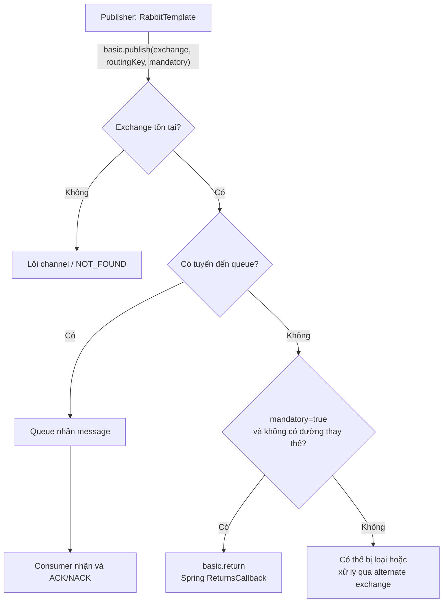
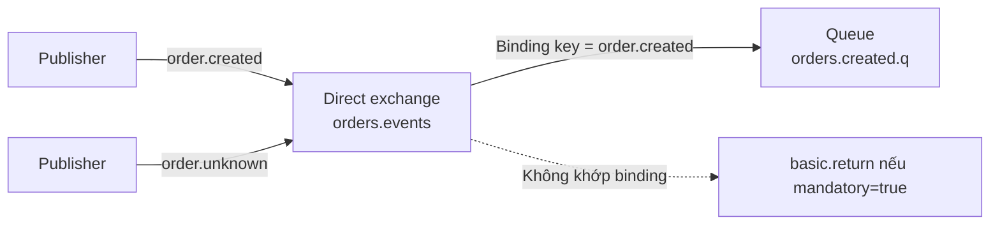
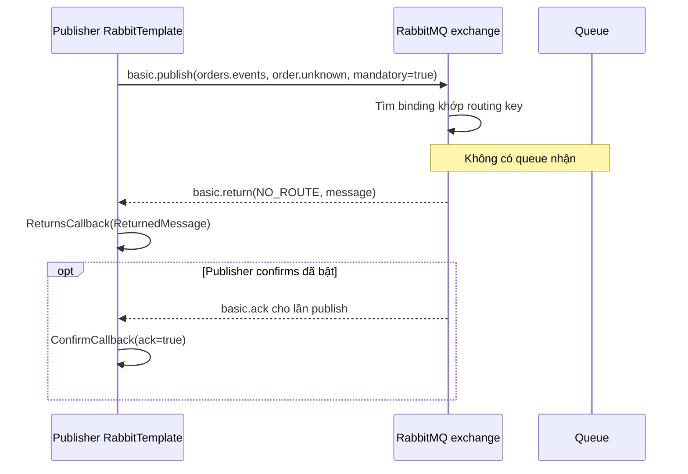
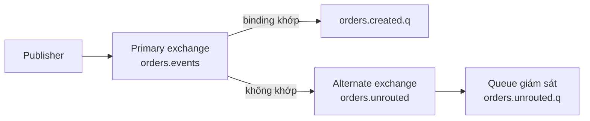
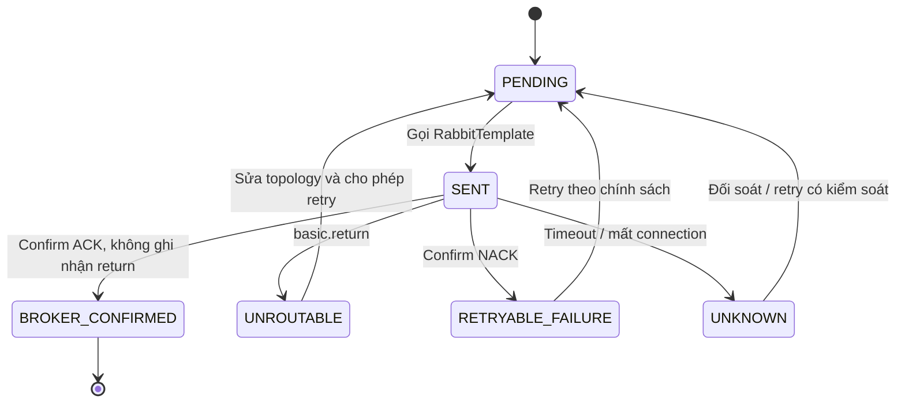

# Publisher returns, mandatory và ReturnsCallback

Khi ứng dụng gửi message bằng `RabbitTemplate`, việc gọi `convertAndSend(...)` không ném exception **không đủ để khẳng định message đã đến một queue**. Ví dụ, exchange `orders.events` vẫn tồn tại, publisher gửi routing key `order.unknown`, nhưng exchange chỉ có binding `order.created`. RabbitMQ có thể xử lý lần publish mà **không định tuyến message vào queue nào**. Nếu ứng dụng không theo dõi tình huống này, message có thể bị loại bỏ mà publisher không nhận được tín hiệu rõ ràng.

Để phát hiện **message không được định tuyến (unroutable)**, RabbitMQ hỗ trợ cờ `mandatory` ở lệnh `basic.publish` và phản hồi `basic.return`. Trong Spring AMQP, `RabbitTemplate.ReturnsCallback` giúp ứng dụng nhận thông tin message bị trả về: exchange, routing key, mã lỗi, lý do và nội dung message. Các cơ chế này có vai trò riêng so với **publisher confirm** hoặc **consumer acknowledgement**.

Bài thuộc chương **Confirm và return** của module **SPRING_AMQP**. Ta sẽ cấu hình `RabbitTemplate`, tạo exchange/queue/binding, thử publish đúng và sai routing key, xử lý `ReturnsCallback`, kết hợp publisher confirms, rồi thiết kế hướng khắc phục để các tác vụ bất đồng bộ có thể phát hiện và xử lý lỗi định tuyến đáng tin cậy.

## 1. Publisher return giải quyết vấn đề gì?

Trong AMQP 0-9-1, publisher **gửi đến exchange**; broker căn cứ loại exchange và các binding để chọn queue. Các tình huống có thể xảy ra:

| Tình huống | Kết quả định tuyến | Publisher return có xuất hiện? |
|---|---|---|
| Exchange tồn tại, routing key khớp ít nhất một binding đến queue | Message được định tuyến đến queue | **Không** vì message đã được định tuyến |
| Exchange tồn tại, không tìm được queue phù hợp, `mandatory=true` | Message không có queue nhận | **Có**, thông thường RabbitMQ gửi `basic.return` nếu không có đường xử lý thay thế |
| Exchange tồn tại, không tìm được queue phù hợp, `mandatory=false` | Message không có queue nhận | **Không**; message có thể bị broker loại bỏ |
| Queue tồn tại và binding khớp nhưng hiện không có consumer | Message vẫn có thể vào queue | **Không**; return không dùng để báo queue chưa có consumer |
| Exchange không tồn tại | Publish vi phạm topology; channel có thể bị đóng với lỗi `NOT_FOUND` | **Không** theo luồng return thông thường |
| Exchange có cấu hình alternate exchange | Message có thể được định tuyến qua alternate exchange | Phụ thuộc topology; không suy luận kết quả chỉ từ việc có hoặc không có return |

**Publisher return trả lời câu hỏi:** “Message có bị broker **trả lại vì không thể định tuyến đến queue** theo quy tắc của lần publish không?” Nó **không** trả lời “consumer đã xử lý thành công chưa?” và cũng không phải báo cáo cho mọi nguyên nhân thất bại của hệ thống.



Với `direct` exchange, routing key phải **khớp chính xác** binding key. Với `topic`, broker so routing key theo pattern `*` và `#`. Với `fanout`, routing key thường không ảnh hưởng định tuyến. Vì vậy, kết quả return chịu ảnh hưởng trực tiếp từ **exchange type và bindings**, không chỉ bởi một cờ trên publisher.

## 2. Cờ mandatory thuộc lần publish, không phải thuộc queue

Ở mức giao thức, lệnh `basic.publish` có tham số `mandatory`:

```text
basic.publish(
    exchange = "orders.events",
    routingKey = "order.unknown",
    mandatory = true,
    message = ...
)
```

Khi `mandatory=true`, publisher yêu cầu RabbitMQ **trả lại message không định tuyến được** thay vì im lặng loại bỏ nó trong tình huống bình thường. Broker gửi `basic.return` chứa thông tin lỗi và message gốc đến publisher channel; Spring chuyển phản hồi đó đến `ReturnsCallback`.

Khi `mandatory=false`, broker không cần gửi `basic.return` cho một message không định tuyến được. Một lời gọi `RabbitTemplate.convertAndSend(...)` có thể trả về bình thường và một publisher confirm ACK vẫn có thể đến, dù không queue nào nhận message.

Các giới hạn quan trọng:

- `mandatory` là lựa chọn của **publisher/lần publish**, không phải một thuộc tính của queue, exchange hoặc binding.
- Cờ này **không yêu cầu broker đợi consumer**. Nếu queue đã nhận message nhưng consumer tắt hoặc xử lý lỗi, publisher return không được kích hoạt vì lý do đó.
- Cờ này **không tự bật publisher confirms**, không chuyển message sang dead-letter queue và không tạo retry policy.
- Nếu ứng dụng sử dụng **alternate exchange** để xử lý message không khớp tuyến chính, RabbitMQ có thể chuyển message sang tuyến thay thế; `mandatory` không nên được coi là cơ chế duy nhất để phát hiện message đi sai queue mong muốn.
- Spring phải được cấu hình để **nhận publisher returns**. Chỉ đặt cờ mandatory mà thiếu cấu hình/callback phù hợp sẽ không tạo ra một quy trình xử lý lỗi có thể quan sát được trong ứng dụng.

### 2.1. Cấu hình cần có trong Spring Boot

Với Spring Boot và RabbitMQ AMQP 0-9-1, cấu hình thông dụng là:

```yaml
# application.yml
spring:
  rabbitmq:
    host: localhost
    port: 5672
    username: guest
    password: guest

    publisher-returns: true
    template:
      mandatory: true

    # Tùy chọn bổ sung khi muốn đồng thời theo dõi publisher confirms:
    publisher-confirm-type: correlated
```

Ý nghĩa từng giá trị:

| Thuộc tính | Tác dụng |
|---|---|
| `spring.rabbitmq.publisher-returns=true` | Cấu hình connection factory tương ứng để RabbitMQ publish returns có thể được chuyển đến Spring. |
| `spring.rabbitmq.template.mandatory=true` | Đặt cờ mandatory trên `RabbitTemplate` do Spring Boot cấu hình. |
| `spring.rabbitmq.publisher-confirm-type=correlated` | Cho phép publisher confirms có `CorrelationData` để đối chiếu từng lần publish. **Không phải điều kiện bắt buộc để nhận return**, nhưng rất hữu ích cho độ tin cậy. |

Đây là ví dụ cho RabbitMQ chạy cục bộ. Tài khoản `guest` thường bị giới hạn kết nối loopback trong cấu hình RabbitMQ mặc định. Ở môi trường thực, sử dụng tài khoản/quyền phù hợp, cấu hình TLS khi cần và đặt thông tin xác thực ngoài mã nguồn.

Nếu **tự khởi tạo `RabbitTemplate`** bằng `new RabbitTemplate(connectionFactory)`, cần gọi `setMandatory(true)` trên template đó hoặc áp dụng tùy chỉnh tương đương; đừng mặc định cho rằng `spring.rabbitmq.template.mandatory` sẽ tự được áp lên mọi bean template do ứng dụng tạo thủ công.

## 3. Khai báo một topology có thể thử được lỗi không định tuyến

Ta tạo direct exchange `orders.events`, queue `orders.created.q` và binding key `order.created`:

```java
package com.example.orders.messaging;

import org.springframework.amqp.core.Binding;
import org.springframework.amqp.core.BindingBuilder;
import org.springframework.amqp.core.DirectExchange;
import org.springframework.amqp.core.Queue;
import org.springframework.context.annotation.Bean;
import org.springframework.context.annotation.Configuration;

@Configuration(proxyBeanMethods = false)
public class ReturnsDemoTopology {
    public static final String EXCHANGE = "orders.events";
    public static final String QUEUE = "orders.created.q";
    public static final String ROUTING_KEY = "order.created";

    @Bean
    DirectExchange ordersExchange() {
        return new DirectExchange(EXCHANGE, true, false);
    }

    @Bean
    Queue ordersQueue() {
        return new Queue(QUEUE, true);
    }

    @Bean
    Binding ordersBinding(Queue ordersQueue, DirectExchange ordersExchange) {
        return BindingBuilder.bind(ordersQueue)
                .to(ordersExchange)
                .with(ROUTING_KEY);
    }
}
```

Khi `RabbitAdmin` được cấu hình và kết nối broker, Spring AMQP có thể khai báo các bean topology này. Exchange tồn tại trước khi test return là điều kiện quan trọng: **gửi sai routing key đến exchange có tồn tại** mới minh họa tình huống `NO_ROUTE`; gửi vào exchange không tồn tại là một lớp lỗi khác.



Lưu ý: nếu broker **đã có binding khác** hoặc alternate exchange cho `orders.events`, `order.unknown` vẫn có thể được định tuyến. Để thực hành, sử dụng vhost hoặc tên exchange riêng của môi trường test, xác minh thực tế các bindings trước khi kết luận.

## 4. Đăng ký RabbitTemplate.ReturnsCallback

`RabbitTemplate.ReturnsCallback` là callback ở phía publisher. Spring gọi nó khi một publish được broker trả về. Callback nhận một `ReturnedMessage`, có các thông tin:

| Phương thức của `ReturnedMessage` | Dữ liệu |
|---|---|
| `getMessage()` | `Message` gồm body và `MessageProperties`, có thể dùng để lấy business `eventId` đã gửi. |
| `getReplyCode()` | Mã phản hồi từ broker; lỗi thường gặp là `NO_ROUTE`. |
| `getReplyText()` | Mô tả lý do, thường là `NO_ROUTE` khi không định tuyến được. |
| `getExchange()` | Exchange của lần publish bị trả về. |
| `getRoutingKey()` | Routing key của lần publish bị trả về. |

Ở phiên bản Spring AMQP hiện đại, `ReturnsCallback` thay thế lối API cũ `ReturnCallback`. Ví dụ sau dùng callback hiện hành.

```java
package com.example.orders.messaging;

import org.slf4j.Logger;
import org.slf4j.LoggerFactory;
import org.springframework.amqp.rabbit.connection.ConnectionFactory;
import org.springframework.amqp.rabbit.core.RabbitTemplate;
import org.springframework.context.annotation.Bean;
import org.springframework.context.annotation.Configuration;

@Configuration(proxyBeanMethods = false)
public class PublisherCallbacksConfig {
    private static final Logger log =
            LoggerFactory.getLogger(PublisherCallbacksConfig.class);

    @Bean
    RabbitTemplate rabbitTemplate(ConnectionFactory connectionFactory) {
        RabbitTemplate template = new RabbitTemplate(connectionFactory);

        // Với custom RabbitTemplate, đặt rõ mandatory ở đây.
        template.setMandatory(true);

        // Broker trả message vì không có queue nhận.
        template.setReturnsCallback(returned -> {
            var props = returned.getMessage().getMessageProperties();
            String eventId = props.getMessageId();

            log.warn(
                "Unroutable eventId={}, exchange={}, routingKey={}, " +
                "replyCode={}, replyText={}",
                eventId,
                returned.getExchange(),
                returned.getRoutingKey(),
                returned.getReplyCode(),
                returned.getReplyText());

            // Hệ thống thật: ghi trạng thái/đẩy sự kiện lỗi vào luồng xử lý.
            // Tránh xử lý lâu hoặc gọi publish đệ quy vô hạn tại callback.
        });

        template.setConfirmCallback((correlation, ack, reason) -> {
            String eventId =
                    correlation == null ? "unknown" : correlation.getId();

            if (!ack) {
                log.error(
                    "Publish NACK, eventId={}, reason={}", eventId, reason);
            } else {
                log.info("Broker confirmed publish, eventId={}", eventId);
            }
        });

        return template;
    }
}
```

Mẫu này dùng **connection factory của Spring**, còn Spring Boot config `publisher-returns=true` và `publisher-confirm-type=correlated` từ phần 2 được áp dụng vào connection factory do Boot quản lý. Vì bean `RabbitTemplate` được tạo thủ công, ta cấu hình `mandatory` và callback trực tiếp. Nếu đã có template được tạo/cấu hình ở một nơi khác, hãy đăng ký callback trên **template đang được publisher thực sự sử dụng**.

**Không tạo nhiều bean `RabbitTemplate` cùng tên** khi ghép các ví dụ độc lập. Một template có một `ReturnsCallback`, nên nếu nhiều nhóm nghiệp vụ cần theo dõi return, cần tập trung callback và phân phối theo `eventId`/loại sự kiện thay vì các component liên tục thay thế callback của nhau.

### 4.1. Callback được gọi khi nào?

Một chuỗi ví dụ khi gửi với `mandatory=true`:



Trong mô hình giao thức, broker có thể gửi **return rồi confirm ACK cho cùng một lần publish**. `Return` cho biết message không được định tuyến; confirm ACK cho biết broker **đã xử lý lần publish**, chứ không phủ nhận return.

Khi nhiều message được publish đồng thời, các callback được xử lý bất đồng bộ. Không nên suy đoán “dòng log kế tiếp chắc chắn là phản hồi của lần gửi ngay trước đó” chỉ từ thứ tự các lần gọi `convertAndSend`. Hãy dùng ID tương quan để theo dõi trạng thái của từng sự kiện.

## 5. Gửi đúng và sai routing key để thấy return

Ví dụ publisher sau dùng **một event ID ổn định** cho mỗi sự kiện. Nó gắn ID vào `messageId` và custom header để `ReturnsCallback` tìm lại được thông tin nghiệp vụ; đồng thời tạo `CorrelationData` để đối chiếu publisher confirms.

```java
package com.example.orders.messaging;

import org.springframework.amqp.rabbit.connection.CorrelationData;
import org.springframework.amqp.rabbit.core.RabbitTemplate;
import org.springframework.stereotype.Service;

@Service
public class DemoOrderPublisher {
    private final RabbitTemplate template;

    public DemoOrderPublisher(RabbitTemplate template) {
        this.template = template;
    }

    public void publishRoutable(String eventId) {
        publish(eventId, ReturnsDemoTopology.ROUTING_KEY);
    }

    public void publishUnroutable(String eventId) {
        publish(eventId, "order.unknown");
    }

    private void publish(String eventId, String routingKey) {
        CorrelationData correlation = new CorrelationData(eventId);

        template.convertAndSend(
            ReturnsDemoTopology.EXCHANGE,
            routingKey,
            "order-created:" + eventId,
            message -> {
                message.getMessageProperties().setMessageId(eventId);
                message.getMessageProperties().setHeader("eventId", eventId);
                return message;
            },
            correlation);
    }
}
```

Chạy lần lượt:

```java
publisher.publishRoutable("evt-101");   // routing key order.created
publisher.publishUnroutable("evt-102"); // routing key order.unknown
```

Với topology **chỉ có binding `order.created`** và không có alternate exchange:

| Sự kiện | Điều broker làm | Điều publisher có thể quan sát |
|---|---|---|
| `evt-101` gửi với `order.created` | Định tuyến vào `orders.created.q` | Không có return; confirm ACK nếu broker xác nhận publish |
| `evt-102` gửi với `order.unknown` | Không có queue nhận theo binding | `ReturnsCallback` nhận `evt-102` với `NO_ROUTE`; confirm có thể vẫn ACK |

Thêm consumer để kiểm tra trường hợp thứ nhất:

```java
package com.example.orders.messaging;

import org.springframework.amqp.rabbit.annotation.RabbitListener;
import org.springframework.stereotype.Component;

@Component
public class DemoOrderConsumer {
    @RabbitListener(queues = ReturnsDemoTopology.QUEUE)
    public void consume(String payload) {
        System.out.println("Consumer received: " + payload);
    }
}
```

Nếu tắt consumer, `evt-101` vẫn có thể vào queue và chờ xử lý; **không có publisher return chỉ vì consumer offline**. Nếu mở lại consumer và message được giao, trạng thái consumer acknowledgement thuộc **một cơ chế độc lập** với return của publisher.

### 5.1. Phải xử lý kết quả bất đồng bộ

Lệnh:

```java
template.convertAndSend(exchange, routingKey, payload);
```

có thể trả về trước khi publisher nhận `basic.return` hoặc confirm. Vì vậy, API nghiệp vụ **không nên trả ngay trạng thái “đã được định tuyến chắc chắn”** chỉ vì hàm trên không ném exception. Nếu cần quyết định đồng bộ trong một tác vụ đơn lẻ, bạn có thể chờ `CorrelationData.getFuture()` có timeout và kiểm tra returned message đã được tương quan; còn trong luồng sản xuất tải lớn, nên cập nhật trạng thái gửi **bất đồng bộ**, có durable storage/đối soát và retry.

`ReturnsCallback` có thể chạy trên thread xử lý callback của RabbitMQ/Spring. Không thực hiện công việc blocking kéo dài, truy vấn cơ sở dữ liệu nặng hoặc publish lặp không giới hạn ngay trong callback; tốt hơn là chuyển một bản ghi trạng thái có ID sang thành phần xử lý lỗi thích hợp.

## 6. Phân biệt return, publisher confirm và consumer acknowledgement

Ba tín hiệu thường bị nhầm là ba mức “ACK” của cùng một message. Thực tế, chúng có **người gửi, người nhận và mục đích khác nhau**:

| Tín hiệu | Hướng phản hồi | Đối tượng được xác nhận/thông báo | Không bảo đảm điều gì? |
|---|---|---|---|
| `basic.return` / `ReturnsCallback` | Broker → **publisher** | Message bị broker **trả về** vì không định tuyến được trong điều kiện mandatory/return thích hợp | Không phản ánh consumer đã chạy hay chưa; không phải tín hiệu bắt buộc cho mọi lỗi publish |
| Publisher `basic.ack` / `ConfirmCallback(ack=true)` | Broker → **publisher** | Broker đã xử lý/xác nhận một lần publish | Không chứng minh đã có queue phù hợp, consumer nhận hoặc nghiệp vụ commit |
| Consumer `basic.ack` | **Consumer** → broker | Một delivery đã được consumer xác nhận trên channel nhận | Không chứng minh publisher đã nhận confirm; không tạo giao dịch end-to-end |

Một tình huống quan trọng:

```text
Publisher gửi order.unknown vào orders.events
  → Broker tìm binding, không có queue khớp
  → Broker trả basic.return(NO_ROUTE) do mandatory=true
  → Broker vẫn có thể phát publisher confirm ACK
  → Consumer không nhận delivery nào từ lần publish đó
```

Vì vậy, **confirm ACK + return không mâu thuẫn**. Đây là trường hợp broker đã xử lý lần gửi thành công theo giao thức nhưng **không thể định tuyến** message. Ứng dụng phải ghi nhận lỗi routing riêng.

Ngược lại, khi publisher không thấy return:

- Queue **có thể** đã nhận message và đang chờ consumer.
- Consumer **có thể** đã lấy message, đang xử lý hoặc đã ACK.
- Returns có thể chưa được bật đúng, mandatory đang false, hoặc broker có cấu hình alternate exchange.

Vì những khả năng trên, **không có return không đồng nghĩa xử lý nghiệp vụ thành công**. Nếu nghiệp vụ cần biết xử lý cuối cùng, consumer phải phát trạng thái nghiệp vụ, cập nhật một kho trạng thái chung hoặc dùng kiến trúc request–reply/outbox phù hợp.

### 6.1. CorrelationData giúp ghép return với confirm

Trong Spring AMQP có correlated publisher confirms, `CorrelationData` gắn một ID ứng dụng với lần publish. Với cơ chế trả về có tương quan của Spring, `CorrelationData.getReturned()` có thể cung cấp `ReturnedMessage` cho lần publish đó. Khi kết quả confirm được hoàn tất, Spring bảo đảm thông tin return tương ứng đã được đặt trước khi hoàn tất future (đối với cấu hình/version hỗ trợ correlated returns).

Ví dụ kiểm tra sau khi đã gửi với một `CorrelationData`:

```java
import java.util.concurrent.TimeUnit;
import org.springframework.amqp.rabbit.connection.CorrelationData;
import org.springframework.amqp.core.ReturnedMessage;

CorrelationData correlation = new CorrelationData("evt-103");

rabbitTemplate.convertAndSend(
        ReturnsDemoTopology.EXCHANGE,
        "order.unknown",
        "order-created:evt-103",
        correlation);

// Minh họa cho bài test/CLI; không chặn một HTTP request như thế này khi tải cao.
CorrelationData.Confirm confirm =
        correlation.getFuture().get(10, TimeUnit.SECONDS);
ReturnedMessage returned = correlation.getReturned();

if (!confirm.isAck()) {
    System.err.println("Broker NACK: " + confirm.getReason());
} else if (returned != null) {
    System.err.println("Broker ACK nhưng unroutable: "
            + returned.getReplyText());
} else {
    System.out.println("Broker ACK; không ghi nhận publisher return");
}
```

Đoạn code cần xử lý `TimeoutException`, `InterruptedException` và `ExecutionException` tại vị trí gọi thực tế (ví dụ khai báo `throws Exception` trong phương thức demo). **Hết thời gian chờ không chứng minh broker chưa nhận message**; nó cho biết publisher chưa có kết quả đáng tin trong giới hạn thời gian quan sát. Trong ứng dụng bất đồng bộ, xử lý future/callback phù hợp để không chặn thread.

**Đừng đồng nhất `CorrelationData.getId()` với `MessageProperties.getMessageId()`:** có thể chủ động dùng cùng `eventId` để đối soát, nhưng đó là quyết định của ứng dụng. `CorrelationData` theo dõi **lần publish** và không thay thế ID của consumer delivery.

### 6.2. ReturnsCallback có thể có nhưng không có publisher confirm

Publisher returns và publisher confirms là **hai tính năng riêng**. Để nhận return, trọng tâm là `publisher-returns=true`, `mandatory=true` và `ReturnsCallback`. `publisher-confirm-type=correlated` được bổ sung khi bạn còn muốn biết broker ACK/NACK publish và liên kết kết quả theo `CorrelationData`.

Không nên tắt returns chỉ vì đã bật confirm: confirm ACK vẫn có thể xuất hiện cùng một message bị trả về. Ngược lại, chỉ theo dõi returns mà bỏ confirms cũng không giúp phát hiện đầy đủ tình trạng broker NACK hoặc mất confirm do lỗi kết nối.

## 7. Các trường hợp biên quan trọng

### 7.1. Queue tồn tại nhưng chưa có consumer

Giả sử `orders.created.q` đã được binding đúng với `orders.events` nhưng toàn bộ listener `@RabbitListener` đang dừng. Một publish `order.created` vẫn có thể được broker **định tuyến vào queue**:

```text
exchange = orders.events
routingKey = order.created
queue = orders.created.q (có binding nhưng consumer_count = 0)
mandatory = true

Kết quả: message có thể vào queue; không có basic.return vì queue nhận được.
```

Publisher cần theo dõi queue depth/ready, số consumer và độ trễ xử lý để nhận biết tình trạng nghẽn. `ReturnsCallback` không phải phép kiểm tra health của consumer.

### 7.2. Default exchange với routing key là tên queue

RabbitMQ có default exchange tên `""`, với implicit binding đến mỗi queue bằng **tên queue**. Nếu muốn publish trực tiếp vào queue:

```java
rabbitTemplate.convertAndSend(
        "", "orders.created.q", "Message to existing queue");
```

Nếu publisher dùng tên queue **không tồn tại** trong đúng vhost, mandatory/returns có thể giúp phát hiện:

```java
rabbitTemplate.convertAndSend(
        "", "orders.not-found.q", "Message to missing queue");
```

Đừng nhầm tên queue với routing key của custom exchange. Với `orders.events` trong ví dụ, routing key là `order.created`, còn qua default exchange routing key là `orders.created.q`. Cả hai cách có thể đến cùng queue nhưng đi qua **hai tuyến khác nhau**.

### 7.3. Alternate exchange tác động thế nào?

RabbitMQ hỗ trợ **alternate exchange (AE)** để xử lý message không định tuyến được ở primary exchange. Khi primary exchange có AE và một message không khớp binding chính, broker có thể chuyển nó sang AE thay vì trả về publisher theo đường mandatory thông thường.

Ví dụ kiến trúc:



**Không dùng chỉ số publisher returns làm thước đo duy nhất cho message sai tuyến khi có AE.** Một message có thể được xử lý bởi tuyến thay thế và không tạo return mà ứng dụng mong đợi. Cần quan sát queue/metrics của AE và thiết lập quy trình kiểm tra, phân loại, khắc phục. Với broker có alternate exchange, hãy kiểm tra đầy đủ topology trước khi kết luận một sự kiện bị mất.

### 7.4. Return khác dead-letter

**Publisher return xảy ra ở pha publish/routing** khi message không được đưa vào queue theo điều kiện mandatory. **Dead-letter xảy ra ở pha xử lý queue**, chẳng hạn message đã nằm trong queue nhưng bị reject với `requeue=false`, hết TTL hoặc gặp điều kiện dead-letter do broker quản lý.

| Publisher return | Dead-letter |
|---|---|
| Broker trả message cho publisher qua `basic.return`. | Broker chuyển message từ queue sang dead-letter exchange, có thể đến DLQ. |
| Không đòi message đã được một queue giữ. | Bắt đầu từ message đã ở trong một queue và gặp điều kiện dead-letter. |
| Spring theo dõi qua `ReturnsCallback`. | Consumer/ops quan sát DLX, DLQ, headers như `x-death`, retry policy. |
| Lỗi thường do exchange/binding/routing key chưa phù hợp. | Lỗi thường do xử lý, TTL, giới hạn queue hoặc chính sách vận hành. |

Không kỳ vọng cấu hình `x-dead-letter-exchange` trên queue sẽ “bắt” message chưa từng được định tuyến vào queue đó. Để phát hiện lỗi routing trước queue, dùng mandatory/returns hoặc alternate exchange phù hợp.

## 8. Thiết kế luồng xử lý publish failure đáng tin cậy

`ReturnsCallback` cung cấp **tín hiệu về một thất bại định tuyến**, nhưng chỉ ghi log trong callback vẫn chưa bảo đảm hệ thống khắc phục được. Trong dịch vụ thực, hãy phân loại kết quả publish và gắn chúng với `eventId` ổn định:

| Kết quả quan sát | Diễn giải nên dùng | Hành động gợi ý |
|---|---|---|
| Confirm ACK, **có return** | Broker xử lý lần publish nhưng message không đến queue mong muốn theo tuyến thông thường. | Đánh dấu `UNROUTABLE`, lưu exchange/key/reply code, kiểm tra topology; không coi là publish thành công về mặt nghiệp vụ. |
| Confirm ACK, **không ghi nhận return** | Broker đã xác nhận publish; không có tín hiệu trả lại trong điều kiện cấu hình hiện tại. | Chuyển trạng thái `BROKER_CONFIRMED`; giám sát queue/consumer độc lập. |
| Confirm NACK | Broker không xác nhận lần publish. | Lưu lý do, quyết định retry theo loại lỗi và giữ ID sự kiện. |
| Hết hạn chờ confirm hoặc connection đứt | Trạng thái publish **chưa xác định**. | Đối soát hoặc retry có kiểm soát; consumer idempotent vì message có thể đã tới broker. |
| `NOT_FOUND` do exchange không tồn tại | Topology sai hoặc chưa được khai báo ở vhost. | Sửa cấu hình exchange/vhost, quyền hoặc thứ tự khởi tạo; không thử lại vô hạn mà không khắc phục. |
| Confirm ACK, queue có message nhưng không có consumer | Message đã được định tuyến; processing chưa xảy ra. | Theo dõi độ sâu queue, tuổi message, consumer health, retry/DLQ ở phía xử lý. |

**Không mặc định retry vô hạn ngay khi nhận return**. Nếu nguyên nhân là sai routing key hoặc thiếu binding, phát lại cùng exchange/key ngay lập tức thường chỉ tạo **hàng loạt return giống nhau**. Việc retry chỉ có ý nghĩa khi topology đã được sửa, trạng thái sự kiện được theo dõi và có giới hạn tốc độ/số lần thử.

### 8.1. Gợi ý state machine cho một outbox event



Đây là **mô hình trạng thái tham khảo cho phía publish**, không phải một giao dịch RabbitMQ tự cung cấp. Trạng thái `BROKER_CONFIRMED` chưa chứng minh consumer đã commit nghiệp vụ; nếu hệ thống cần biết xử lý đến đích, phải có thêm sự kiện/kho trạng thái của consumer.

Khi cập nhật DB và phát message cần nhất quán, **transactional outbox** là giải pháp thường dùng: lưu sự kiện outbox trong cùng transaction DB với thay đổi nghiệp vụ; một publisher worker phát các sự kiện, lưu kết quả confirm/return, retry hoặc đưa vào luồng điều tra. Consumer vẫn phải xử lý **idempotent** để chịu được phát lại sau lỗi trạng thái không chắc chắn.

### 8.2. Ghi nhận và quan sát đúng tín hiệu

Nên có các log/metrics sau, gắn nhãn exchange, routing key, service, môi trường và vhost khi phù hợp:

- Số lần publish và số publisher confirm ACK/NACK, timeout.
- Số message return theo `replyCode`/`replyText`; tỷ lệ return tăng sau deploy thường báo hiệu sai binding/topology.
- `eventId`, `messageId` hoặc correlation ID của message để ghép callback với nguồn phát.
- Số message đang `ready`/`unacked`, consumer count, redelivery và queue DLQ để quan sát **sau** bước định tuyến.
- Trạng thái kết nối, publisher blocked/unblocked và queue/exchange tồn tại đúng vhost.

Không ghi đầy đủ message body hoặc tất cả custom headers trong log production: returns có thể đưa **message gốc** trở lại publisher, bao gồm dữ liệu nhạy cảm. Đặc biệt, `replyText` có thể chứa thông tin broker, nên xử lý dữ liệu log theo chính sách bảo mật của hệ thống.

## 9. Troubleshooting: vì sao ReturnsCallback không chạy?

| Hiện tượng | Nguyên nhân có thể | Cách kiểm tra/khắc phục |
|---|---|---|
| Gửi sai key nhưng không có return | `mandatory=false` hoặc template đang sử dụng không bật mandatory. | Kiểm tra đúng bean `RabbitTemplate` và `setMandatory(true)`/`spring.rabbitmq.template.mandatory`. |
| `mandatory=true` nhưng callback không chạy | `publisher-returns` chưa bật ở connection factory, hoặc không đăng ký `ReturnsCallback` trên template gửi thực tế. | Kiểm tra cấu hình Spring Boot hoặc `CachingConnectionFactory.setPublisherReturns(true)` nếu cấu hình thủ công. |
| Callback không chạy vì queue đã nhận message | Có binding khớp; một consumer có thể chưa chạy. | Xem danh sách bindings và số message ready/unacked của queue trong đúng vhost. |
| Message đi đến queue khác nhưng không có return | Một binding khác, fanout hoặc alternate exchange đã định tuyến message. | Kiểm tra toàn bộ topology, exchange type và alternate-exchange arguments. |
| Publisher có exception `NOT_FOUND` | Exchange không tồn tại; đây là channel error, không phải `NO_ROUTE` thường gặp. | Khai báo đúng exchange, kiểm tra vhost/quyền và lỗi channel trong log. |
| Confirm ACK xuất hiện dù return xảy ra | Publisher confirm xác nhận broker xử lý lần publish. | Phân loại `ack=true + returned != null` là **unroutable**, không ghi nhận thành công end-to-end. |
| Return xảy ra nhưng `eventId` không có | Publisher không gắn `messageId`/business header hoặc converter không giữ property. | Gắn ID trước khi publish, thống nhất contract ID, kiểm tra message properties khi callback. |
| Có nhiều component đăng ký ReturnsCallback, chỉ một nơi thấy dữ liệu | Callback trên cùng template bị thay thế hoặc publisher dùng template khác. | Đăng ký callback tập trung và phân luồng theo event ID/loại message. |
| Gửi vào default exchange nhưng queue không nhận | Routing key không đúng **tên queue**, hoặc queue không tồn tại trong vhost đang kết nối. | Dùng `exchange=""` và routing key đúng tên queue, kiểm tra namespace/vhost. |
| Retry ngay tại ReturnsCallback gây return liên tục | Topology vẫn sai, không có backoff hay giới hạn. | Đưa lỗi vào quy trình retry/điều tra có trạng thái và giới hạn; khắc phục binding trước. |

### 9.1. Quy trình kiểm tra trong RabbitMQ Management UI

1. Chọn đúng **virtual host** mà ứng dụng đang kết nối (vhost khác nhau có namespace exchange/queue độc lập).
2. Kiểm tra exchange `orders.events` có thực sự tồn tại, thuộc loại `direct` và không có alternate exchange làm thay đổi tuyến thử nghiệm.
3. Kiểm tra binding từ `orders.events` đến `orders.created.q` mang key `order.created`.
4. Xác minh publisher dùng `exchange="orders.events"` và `routingKey="order.unknown"` khi muốn tạo lỗi `NO_ROUTE`, không nhầm sang overload `convertAndSend(routingKey, payload)`.
5. Xem log `ReturnsCallback`, nhận `replyCode/replyText` và xác nhận `eventId` của message vừa publish.
6. Gửi lại với routing key hợp lệ `order.created`, đối chiếu queue ready/deliver và xác minh return **không còn** cho message đó.

Nếu Management UI hiển thị `ready=0` sau khi gửi key đúng, đó **không nhất thiết là lỗi**: consumer có thể đã nhận và ACK rất nhanh. Kết hợp log listener và số delivery/ack để xác minh.

## 10. Bài thực hành

**Bài 1 — kiểm chứng mandatory.** Dùng topology `orders.events` với duy nhất binding `order.created`. Gửi `order.unknown` khi `mandatory=false` rồi khi `mandatory=true` và publisher returns được bật. So sánh: trường hợp thứ hai có thể nhận `ReturnsCallback`, trong khi confirm ACK vẫn có thể xuất hiện ở cả hai.

**Bài 2 — queue không có consumer.** Giữ binding đúng `order.created`, tắt listener rồi publish. Xác minh queue `orders.created.q` có thể tăng `ready` nhưng **không tạo publisher return**. Bật listener trở lại và quan sát consumer nhận message.

**Bài 3 — default exchange.** Gửi đến `exchange=""` với routing key là tên queue hợp lệ `orders.created.q` rồi gửi đến tên queue không tồn tại `orders.missing.q`. Quan sát khác biệt giữa publish được định tuyến và trường hợp return vì `NO_ROUTE` khi mandatory bật.

**Bài 4 — kết hợp return và confirm.** Bật `publisher-confirm-type=correlated`, đăng ký cả `ReturnsCallback` và `ConfirmCallback`. Gắn `CorrelationData("evt-301")` vào lần publish sai key, ghi nhận returned message và ACK/NACK. Giải thích vì sao ACK không phủ nhận return.

**Bài 5 — phân biệt exchange sai và routing key sai.** Publish sai key vào exchange tồn tại, rồi thử publish vào một exchange **không tồn tại** (chỉ trên broker test). Đối chiếu `NO_ROUTE`/return với channel error `NOT_FOUND`; không gom hai tình huống thành cùng một loại lỗi.

**Bài 6 — alternate exchange.** Tạo một primary exchange có alternate exchange dẫn đến queue giám sát. Gửi routing key không khớp binding chính, rồi kiểm tra message có vào queue giám sát không. Diễn giải vì sao chỉ theo dõi returns có thể không phát hiện việc message đi vào tuyến dự phòng.

**Bài 7 — xử lý lỗi có giới hạn.** Mô phỏng liên tiếp năm lần publish với key sai. Không gọi retry đệ quy tại callback; lưu `eventId` cùng lý do `UNROUTABLE`. Sau khi sửa binding, phát lại bằng **cùng event ID** theo chính sách có giới hạn, đồng thời xác minh consumer không áp dụng nghiệp vụ hai lần.

## 11. Câu hỏi tự đánh giá

1. **`mandatory=true` có bảo đảm consumer nhận/xử lý message không?** Không. Nó yêu cầu broker trả về message không định tuyến được trong những điều kiện phù hợp.
2. **`ReturnsCallback` được gọi khi queue có message nhưng không có consumer không?** Không chỉ vì thiếu consumer; đã có queue nhận message thì không phải lỗi unroutable.
3. **Publisher confirm ACK và return có thể xuất hiện cho cùng một lần publish không?** Có. Broker xử lý lần publish nhưng message không tìm được queue nhận theo tuyến đang dùng.
4. **Bật `publisher-confirm-type=correlated` đã đủ nhận returns chưa?** Chưa. Cần cấu hình publisher returns, mandatory và callback.
5. **Message gửi vào exchange không tồn tại có được báo qua `ReturnsCallback` như `NO_ROUTE` không?** Không phải luồng bình thường; broker có thể đóng channel với lỗi `NOT_FOUND`.
6. **`ReturnedMessage.getMessage()` có thể dùng để lấy gì?** Body và `MessageProperties`, ví dụ `messageId` hoặc header `eventId` do publisher đặt.
7. **Nếu primary exchange có alternate exchange, có thể dựa hoàn toàn vào `ReturnsCallback` để biết message sai tuyến không?** Không. Broker có thể đưa message vào alternate exchange, nên phải quan sát topology và queue đích thay thế.
8. **`basic.return` có phải dead-letter không?** Không. Return phản hồi cho publisher ở bước routing; dead-letter là luồng từ queue đến DLX khi thỏa điều kiện.
9. **Khi mất kết nối trước publisher confirm, có chắc message chưa được broker nhận không?** Không. Kết quả chưa xác định; retry có thể tạo trùng lặp.
10. **Nhận return do routing key sai, nên làm gì trước khi retry?** Ghi nhận event ID/trạng thái lỗi, kiểm tra và khắc phục exchange/binding/routing key, sau đó retry có kiểm soát.

**Ghi nhớ:** Để phát hiện message **không đến được queue**, bật `mandatory` trên `RabbitTemplate`, cho phép `publisher-returns` tại connection factory và đăng ký `ReturnsCallback` để nhận `ReturnedMessage`. Kết hợp **publisher confirms** để biết broker ACK/NACK lần publish, rồi theo dõi **consumer acknowledgement** và kết quả nghiệp vụ riêng. Đây là ba ranh giới trách nhiệm khác nhau trong một hệ thống Spring AMQP đáng tin cậy.

### Tài liệu tham khảo

- Spring AMQP — [Publisher Confirms and Returns trong RabbitTemplate](https://docs.spring.io/spring-amqp/reference/amqp/template.html#publisher-confirms-and-returns).
- Spring AMQP — [RabbitTemplate](https://docs.spring.io/spring-amqp/reference/amqp/template.html).
- RabbitMQ — [Publisher Confirms và mandatory flag](https://www.rabbitmq.com/docs/confirms).
- RabbitMQ — [Exchanges, Bindings và Alternate Exchanges](https://www.rabbitmq.com/docs/exchanges).
- RabbitMQ — [Dead Letter Exchanges](https://www.rabbitmq.com/docs/dlx).
