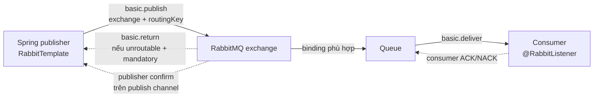
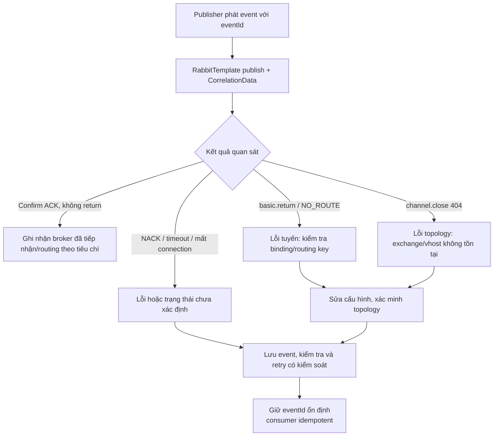

# Publish vào exchange không tồn tại và lỗi đóng channel trong Spring AMQP

Khi ứng dụng gửi sự kiện `order.created` bằng `RabbitTemplate`, người phát hành cần biết **broker đã tiếp nhận message chưa, exchange có tồn tại không và message có được định tuyến vào queue hay không**. Ba câu hỏi này thường bị gộp thành một khái niệm “publish thành công”, dẫn đến xử lý lỗi sai: ứng dụng retry mãi khi cấu hình exchange bị thiếu, hoặc ghi nhận thành công dù message chưa tới queue.

Trong RabbitMQ sử dụng **AMQP 0-9-1**, nếu client thực hiện `basic.publish` tới **một exchange không tồn tại trong virtual host hiện tại**, RabbitMQ coi đó là **lỗi giao thức trên channel**, thường trả về `channel.close` với mã **`404 NOT_FOUND`**. Đây **không phải** tình huống “exchange tồn tại nhưng routing key không khớp binding”, vốn có thể kích hoạt `basic.return` khi publisher bật `mandatory`.

Bài học thuộc chương **Confirm và return** của Spring AMQP, tập trung vào vòng đời channel sau lỗi `NOT_FOUND`, cách quan sát publisher confirms/returns, ví dụ `RabbitTemplate` và cách xây quy trình xử lý bất đồng bộ tin cậy mà không nhầm lỗi topology với lỗi routing.

Sau bài học, bạn có thể:

- Mô tả chính xác phản ứng của RabbitMQ khi publish vào exchange chưa tồn tại.
- Phân biệt **`channel.close`**, **publisher confirm ACK/NACK**, **publisher return** và **consumer acknowledgement**.
- Hiểu vì sao `mandatory=true` **không biến exchange thiếu thành một returned message**.
- Cấu hình Spring Boot/Spring AMQP để theo dõi confirm, return và lỗi channel.
- Chẩn đoán các nguyên nhân: sai tên exchange, sai vhost, thiếu khai báo, thứ tự triển khai, tài nguyên tự xóa và lỗi quyền.
- Thiết kế cách ứng phó: xác minh topology, không retry nóng, ghi nhận kết quả chưa xác định, dùng outbox/idempotency khi cần.

## 1. Đường đi của một lần publish



Thông thường publisher không gửi vào queue trực tiếp mà gửi vào **exchange**, kèm **routing key** và body. Exchange chọn queue dựa trên binding:

```java
rabbitTemplate.convertAndSend(
        "orders.events",     // exchange
        "order.created",     // routing key
        "ORD-1001");        // payload
```

Để thao tác này có ý nghĩa, trong **đúng virtual host** phải tồn tại exchange `orders.events` và, nếu mong message vào queue, phải có binding phù hợp tới queue đích.

Các trường hợp sau **khác nhau về mặt giao thức**:

| Tình huống | RabbitMQ làm gì? | Điều publisher cần theo dõi |
| --- | --- | --- |
| Exchange tồn tại, có binding tới queue | Định tuyến message đến queue phù hợp | Confirm kết quả publish; xử lý consumer riêng |
| Exchange tồn tại, **không có queue phù hợp** | Với `mandatory=true`, trả `basic.return`; nếu không có cơ chế xử lý khác, message có thể bị loại bỏ | Return **và** confirm |
| **Exchange không tồn tại** | Trả lỗi `404 NOT_FOUND` và đóng **channel phát hành** | Shutdown/channel exception, trạng thái confirm chưa giải quyết |
| Exchange tồn tại nhưng publisher thiếu quyền `write` | Broker có thể từ chối thao tác do permission, thường là lỗi channel | Kiểm tra quyền trên vhost/exchange |
| Tài nguyên cùng tên có thuộc tính khai báo sai | Khi declare, broker có thể trả `PRECONDITION_FAILED`, đóng channel khai báo | Chẩn đoán khai báo, không nhầm với lỗi routing |

**Điểm cần nhớ:** `mandatory`/`basic.return` xử lý trường hợp **một exchange hợp lệ không định tuyến được message**, không phải phương án bắt lỗi “không tìm thấy exchange”.

## 2. Điều gì xảy ra khi exchange không tồn tại?

Giả sử publisher gọi:

```java
rabbitTemplate.convertAndSend(
        "orders.events.missing",
        "order.created",
        "ORD-1001");
```

Broker không có exchange `orders.events.missing` trong virtual host mà connection hiện tại đã chọn.

```mermaid
sequenceDiagram
    participant APP as Spring application
    participant CH as AMQP publish channel
    participant MQ as RabbitMQ broker
    APP->>CH: basic.publish("orders.events.missing")
    CH->>MQ: Publish frames
    MQ-->>CH: channel.close(404 NOT_FOUND)
    CH-->>APP: Shutdown / channel exception
    APP->>APP: Xác định lỗi topology và kết quả publish
    Note over APP,MQ: Connection có thể vẫn mở; channel này đã bị đóng
```

Với RabbitMQ AMQP 0-9-1, phản hồi protocol thường có nội dung tương tự:

```text
NOT_FOUND - no exchange 'orders.events.missing' in vhost '/orders'
reply-code=404
class-id=60  (basic)
method-id=40 (publish)
```

Đây là **ví dụ thông báo**; tên exception, chuỗi log và cách exception lan tới ứng dụng tùy phiên bản RabbitMQ Java Client, Spring AMQP và thời điểm channel đóng.

### 2.1. Vì sao đóng channel thay vì trả một lỗi Java ngay lúc gửi?

`basic.publish` là thao tác publish **bất đồng bộ** ở cấp giao thức: client ghi frame vào channel, broker xử lý sau. Broker không trả một response RPC trực tiếp cho từng `basic.publish` theo cách giống HTTP request–response.

Do đó có thể xảy ra:

1. Lệnh `RabbitTemplate.convertAndSend(...)` ghi dữ liệu xong và **trả về bình thường**.
2. Broker nhận thấy exchange không tồn tại, gửi `channel.close(404)`.
3. Channel bị đóng **sau** thời điểm lời gọi publish trả về.
4. Spring/Java client ghi log về channel shutdown; publisher confirm đang chờ có thể bị ảnh hưởng.

Trong tình huống khác, khi channel đóng sớm hoặc client phát hiện channel hỏng lúc thao tác còn chạy, `RabbitTemplate` có thể ném exception đồng bộ. **Không được dựa hoàn toàn vào `try/catch` quanh `convertAndSend` để khẳng định mọi lỗi exchange thiếu đã được phát hiện.**

### 2.2. Channel đóng có làm connection cũng đóng không?

Không nhất thiết. AMQP phân biệt:

- **Connection:** kết nối vật lý/logic cấp cao với broker.
- **Channel:** luồng logic trên connection, nơi thực hiện publish/consume/declare.

Khi RabbitMQ đóng **một channel** vì `NOT_FOUND`, **connection thường vẫn tồn tại** và các channel khác có thể tiếp tục làm việc. Đối tượng channel vừa bị đóng **không thể dùng tiếp**. `CachingConnectionFactory` của Spring có thể cấp một channel mới cho thao tác tiếp theo, tùy cơ chế caching/recovery.

Tuy nhiên, việc lấy được channel mới **không sửa được exchange đang thiếu**. Nếu không khai báo đúng exchange hoặc sửa đích publish, lần gửi mới lại có thể gặp `404 NOT_FOUND`.

**Không nhầm với lỗi connection:** broker restart, mất mạng, heartbeat timeout hoặc connection-level protocol exception có phạm vi rộng hơn lỗi đóng một channel.

## 3. So sánh exchange thiếu với message không định tuyến được

Hai tình huống thường có cùng biểu hiện nghiệp vụ là “consumer không nhận”, nhưng cách xử lý hoàn toàn khác.

### 3.1. Exchange có tồn tại, routing key không khớp

Giả sử có exchange `orders.events` kiểu topic và queue `orders.created` chỉ được bind bằng key `order.created`. Publisher gửi key `order.cancelled`, trong khi không có binding nào khác khớp:

```java
rabbitTemplate.convertAndSend(
        "orders.events",
        "order.cancelled",
        "ORD-1002");
```

Nếu `mandatory=true` và cấu hình return đang hoạt động, broker gửi `basic.return` về publisher với thông tin tương tự:

```text
replyCode = 312
replyText = NO_ROUTE
exchange = orders.events
routingKey = order.cancelled
```

Channel vẫn có thể hoạt động bình thường. Khi dùng publisher confirms, broker vẫn có thể gửi **confirm ACK** cho lần publish đã được exchange xử lý, mặc dù message bị **return** do không có tuyến.

### 3.2. Exchange không tồn tại

Nếu thay exchange thành `orders.events.missing`, RabbitMQ **không có điểm nhận để thực hiện routing**. Do đó:

- Không thực hiện quy trình trả `basic.return` “NO_ROUTE” như trường hợp exchange tồn tại.
- Trả lỗi `NOT_FOUND` và đóng publish channel.
- Thao tác bất đồng bộ có thể làm caller nhận kết quả **không chắc chắn** cho tới khi cơ chế theo dõi confirm/shutdown được xử lý.

### 3.3. Bảng phân biệt bốn tín hiệu

| Tín hiệu | Ai phát ra? | Diễn giải đúng |
| --- | --- | --- |
| **`basic.return`** | Broker → publisher | Với message `mandatory`, exchange tồn tại nhưng không có tuyến tới queue (theo điều kiện tương ứng) |
| **Publisher confirm ACK** | Broker → publisher, khi bật confirm | Broker xác nhận xử lý lần publish theo ngữ nghĩa queue/broker; **không nói consumer đã chạy xong** |
| **Publisher confirm NACK** | Broker → publisher | Broker không thể đảm nhận/xử lý một publish theo ngữ nghĩa confirm; không tự đồng nghĩa với `404 NOT_FOUND` |
| **`channel.close(404)`** | Broker → client | Thao tác dùng exchange không tồn tại trong vhost; **channel bị đóng** |
| **Consumer ACK/NACK** | Consumer → broker | Xác nhận/từ chối một delivery ở queue, không phải phản hồi cho publisher trực tiếp |

Khi exchange thiếu, publisher confirm có thể không tới theo chu trình bình thường do **channel bị đóng**; Spring Rabbit có thể hoàn tất những confirm còn treo bằng trạng thái thất bại hoặc đưa lỗi lên các callback/future theo phiên bản và tình huống. **Không giả định luôn có một NACK confirm hoặc luôn có `basic.return`**. Cần xử lý cả shutdown/exception và trường hợp quá thời hạn chờ confirm.

## 4. Cấu hình Spring Boot để quan sát confirm và return

Với Spring Rabbit/AMQP 0-9-1, một cấu hình minh họa:

```yaml
# application.yml
spring:
  rabbitmq:
    host: ${RABBITMQ_HOST:localhost}
    port: ${RABBITMQ_PORT:5672}
    username: ${RABBITMQ_USERNAME}
    password: ${RABBITMQ_PASSWORD}
    virtual-host: ${RABBITMQ_VHOST:/orders}
    publisher-confirm-type: correlated
    publisher-returns: true
    template:
      mandatory: true
```

Ý nghĩa:

1. `publisher-confirm-type: correlated` cho Spring theo dõi publisher confirm với đối tượng `CorrelationData`.
2. `publisher-returns: true` bật khả năng nhận message không định tuyến được.
3. `template.mandatory: true` yêu cầu trả message khi exchange tồn tại nhưng không route tới queue.
4. Vhost `/orders` phải tồn tại; exchange/binding được tạo trong **vhost này**.

**Bật properties là bước chuẩn bị, không đồng nghĩa ứng dụng đã xử lý lỗi.** Cần kiểm tra callback, future, log và cách ứng dụng phản ứng khi trạng thái publish thất bại hoặc chưa xác định.

Tên starter hoặc property có thể thay đổi theo thế hệ Spring Boot; trước khi sao chép cấu hình production, xác nhận bạn đang dùng **Spring Rabbit cho giao thức AMQP 0-9-1** với phiên bản Boot thực tế.

### 4.1. Theo dõi returned messages

Nếu ứng dụng cần ghi nhận thông tin message không có route, có thể đăng ký `ReturnsCallback` trên `RabbitTemplate`:

```java
import org.springframework.amqp.rabbit.core.RabbitTemplate;
import org.springframework.boot.ApplicationRunner;
import org.springframework.context.annotation.Bean;
import org.springframework.context.annotation.Configuration;

@Configuration
public class PublisherReturnLogging {

    @Bean
    public ApplicationRunner observeReturns(RabbitTemplate rabbitTemplate) {
        return args -> rabbitTemplate.setReturnsCallback(returned -> {
            System.err.printf(
                    "RETURN code=%s text=%s exchange=%s key=%s%n",
                    returned.getReplyCode(),
                    returned.getReplyText(),
                    returned.getExchange(),
                    returned.getRoutingKey());
        });
    }
}
```

Mẫu trên **chỉ nhằm minh họa callback return**. Trong hệ thống thật, cần log có cấu trúc, correlation ID, metrics và quyết định retry/cách ly theo yêu cầu nghiệp vụ. Không log toàn bộ body nếu có dữ liệu cá nhân hoặc thông tin nhạy cảm.

Một `RabbitTemplate` thường chỉ giữ **một callback return**; nếu framework hoặc application đã đăng ký callback, không ghi đè tùy tiện mà phải tích hợp vào cơ chế chung.

**Lưu ý:** Callback này **không phải nơi duy nhất bắt lỗi exchange thiếu**, vì broker đóng channel thay vì trả message theo `basic.return` trong trường hợp đó.

## 5. Ví dụ publisher theo dõi kết quả bằng CorrelationData

`CorrelationData` liên kết một publish với thông tin xác nhận mà Spring Rabbit nhận được. Khi dùng correlated confirms, có thể theo dõi kết quả một cách tường minh qua future. Đây là ví dụ **đồng bộ có timeout** để dễ quan sát; với luồng gửi nhiều message, cách bất đồng bộ/callback thường phù hợp hơn.

```java
import java.util.concurrent.ExecutionException;
import java.util.concurrent.TimeUnit;
import java.util.concurrent.TimeoutException;

import org.springframework.amqp.rabbit.connection.CorrelationData;
import org.springframework.amqp.rabbit.core.RabbitTemplate;
import org.springframework.stereotype.Service;

@Service
public class ConfirmedOrderPublisher {

    private final RabbitTemplate rabbitTemplate;

    public ConfirmedOrderPublisher(RabbitTemplate rabbitTemplate) {
        this.rabbitTemplate = rabbitTemplate;
    }

    public void publish(String eventId, String exchangeName, String orderId) {
        CorrelationData correlation = new CorrelationData(eventId);

        // Có thể ném AmqpException ngay nếu channel/connection lỗi đồng bộ.
        rabbitTemplate.convertAndSend(
                exchangeName,
                "order.created",
                orderId,
                correlation);

        try {
            CorrelationData.Confirm confirm =
                    correlation.getFuture().get(5, TimeUnit.SECONDS);

            if (!confirm.isAck()) {
                throw new IllegalStateException(
                        "Broker did not confirm event " + eventId
                                + ": " + confirm.getReason());
            }

            // Với correlated confirms, returned message có thể được
            // gắn vào CorrelationData khi mandatory return xảy ra.
            if (correlation.getReturned() != null) {
                throw new IllegalStateException(
                        "Unroutable event " + eventId
                                + ": "
                                + correlation.getReturned().getReplyText());
            }

            // Chỉ lúc này mới có cơ sở ghi nhận publish/route đạt
            // tiêu chí trên; consumer chưa chắc đã xử lý nghiệp vụ.
            System.out.println("Confirmed " + eventId);

        } catch (InterruptedException ex) {
            Thread.currentThread().interrupt();
            throw new IllegalStateException(
                    "Interrupted while awaiting confirm for " + eventId, ex);

        } catch (ExecutionException | TimeoutException ex) {
            throw new IllegalStateException(
                    "Publish result unknown for " + eventId, ex);
        }
    }
}
```

Cách đọc ví dụ:

- `convertAndSend(...)` có thể ném exception đồng bộ. Nếu exception phát sinh, đây là tín hiệu thất bại hoặc trạng thái cần điều tra, **không tự động chứng minh broker chưa nhận bất cứ byte nào**.
- `confirm.isAck()==false`: broker/client báo rằng lần publish không được xác nhận thành công theo ngữ nghĩa confirm; cần xử lý thất bại.
- `correlation.getReturned()!=null`: có một **returned message** được liên kết với lần publish. Một confirm ACK có thể đi kèm returned message khi không có route.
- `TimeoutException`: kết quả chưa xác định trong thời gian chờ; **không đồng nghĩa chắc chắn message thất bại**. Ứng dụng cần lưu trạng thái, truy vết và quyết định retry có bảo vệ chống trùng.
- Lời gọi `get(...)` đang **chặn thread**. Không đặt bừa trong vòng lặp gửi hàng nghìn message nếu chưa tính timeout và throughput.

Khi publish tới exchange không tồn tại, tương tác giữa channel shutdown và future xác nhận tùy phiên bản/thời điểm. Vì vậy đoạn mã trên là **một lớp theo dõi confirm**, không phải vật thay thế cho quan sát `channel.close(404)` từ Java client/Spring và broker logs.

### 5.1. Vì sao không retry ngay mọi exception?

Giả sử application gửi message, broker tiếp nhận, nhưng connection bị ngắt trước khi kết quả confirm về client. Publisher có thể coi kết quả là **không rõ** và gửi lại. Nếu consumer không idempotent, message có thể tạo tác dụng nghiệp vụ hai lần.

Với riêng lỗi `404 NOT_FOUND`, retry lại **cùng exchange sai tên** cũng không giải quyết được nguyên nhân. Cần sửa topology trước, sau đó mới đánh giá cách phát lại những sự kiện chưa xác nhận.

Dùng **event ID ổn định** qua các lần thử, **transactional outbox** khi cần liên kết DB với publish, và **consumer idempotency** để kiểm soát tác động khi gửi lại hoặc redelivery.

## 6. Khai báo topology đúng trước khi publish

Một cách giảm lỗi exchange thiếu là **quản lý exchange, queue và binding một cách tường minh**, thay vì dựa vào việc bên kia “chắc đã tạo rồi”.

Ví dụ cấu hình Spring AMQP:

```java
import org.springframework.amqp.core.Binding;
import org.springframework.amqp.core.BindingBuilder;
import org.springframework.amqp.core.ExchangeBuilder;
import org.springframework.amqp.core.Queue;
import org.springframework.amqp.core.QueueBuilder;
import org.springframework.amqp.core.TopicExchange;
import org.springframework.context.annotation.Bean;
import org.springframework.context.annotation.Configuration;

@Configuration
public class OrderTopology {

    public static final String EXCHANGE = "orders.events";
    public static final String QUEUE = "orders.created";
    public static final String ROUTING_KEY = "order.created";

    @Bean
    public TopicExchange ordersExchange() {
        return ExchangeBuilder.topicExchange(EXCHANGE)
                .durable(true)
                .build();
    }

    @Bean
    public Queue ordersCreatedQueue() {
        return QueueBuilder.durable(QUEUE).build();
    }

    @Bean
    public Binding ordersCreatedBinding(
            Queue ordersCreatedQueue,
            TopicExchange ordersExchange) {
        return BindingBuilder.bind(ordersCreatedQueue)
                .to(ordersExchange)
                .with(ROUTING_KEY);
    }
}
```

`ExchangeBuilder`, `QueueBuilder` và `BindingBuilder` tạo ra các **đối tượng Java mô tả topology**. Để chúng thực sự tồn tại tại RabbitMQ, một thành phần như `RabbitAdmin` phải gửi các lệnh khai báo vào **đúng virtual host**, hoặc hệ thống triển khai hạ tầng phải khai báo trước.

`RabbitTemplate.convertAndSend(...)` **không mặc nhiên tạo exchange bị thiếu**. Đừng xây “giải pháp” dựa trên giả định cứ gửi message thì RabbitMQ sẽ tự tạo exchange.

### 6.1. Những trường hợp topology vẫn có thể thiếu

Ngay cả khi source code có bean `TopicExchange`, exchange thực tế vẫn có thể không tồn tại vì:

- Spring `RabbitAdmin` chưa chạy/chưa kích hoạt khai báo hoặc chạy sai connection factory.
- Ứng dụng kết nối vhost `/orders` nhưng exchange được tạo trong `/`.
- Publisher khởi động và gửi trước khi quy trình provisioning hoàn thành.
- Exchange không durable bị mất sau restart, hoặc exchange auto-delete đã bị xóa theo vòng đời binding.
- Exchange được tạo bởi môi trường khác nhưng chưa triển khai ở môi trường hiện tại.
- User RabbitMQ thiếu quyền `configure` để khai báo, hoặc quyền `write` để publish.
- Tên exchange trong code khác chính tả, chữ hoa/chữ thường, prefix môi trường hoặc biến cấu hình.

**Nên quản lý topology như một hợp đồng triển khai**: dùng Spring RabbitAdmin được cấu hình đúng hoặc IaC/automation khai báo trước, cộng kiểm tra readiness/health thích hợp. Cơ chế kiểm tra không được phụ thuộc vào việc “gửi thử message vào exchange lạ” trên production vì hành động đó sẽ đóng channel nếu exchange thực sự không tồn tại.

### 6.2. Default exchange không giống một exchange do ứng dụng tự tạo

RabbitMQ có **default exchange** với tên rỗng `""`. Queue được tự bind vào default exchange theo tên queue. Vì vậy:

```java
// Dùng default exchange: routingKey là tên queue
rabbitTemplate.convertAndSend("", "orders.created", "ORD-1001");
```

Đây là một đường publish **khác** với `orders.events` và binding `order.created`. Không nên chuyển mọi publish sang default exchange chỉ để né lỗi `404`; cách đó có thể làm mất hợp đồng event routing hoặc bỏ qua các subscriber khác.

## 7. Quy trình tái hiện và phân biệt lỗi trong môi trường thử nghiệm

Thử nghiệm nên thực hiện trong **vhost riêng**, không gửi vào một exchange cố ý sai trong production. Ta dùng hai case:

- **Case A:** exchange tồn tại nhưng routing key không khớp binding.
- **Case B:** exchange không tồn tại, broker đóng publish channel.

### 7.1. Chuẩn bị

1. Tạo vhost thử nghiệm, ví dụ `/orders`, và user có quyền phù hợp.
2. Khai báo exchange `orders.events` kiểu topic, queue `orders.created` và binding key `order.created` như phần 6.
3. Bật `publisher-confirm-type: correlated`, `publisher-returns: true`, `template.mandatory: true`.
4. Gắn return callback hoặc theo dõi `CorrelationData`, bật log channel shutdown/metrics ở mức vừa đủ.
5. Kiểm tra exchange và binding thực tế trước khi chạy.

Với RabbitMQ CLI trên máy có quyền quản trị:

```bash
rabbitmqctl list_exchanges -p /orders name type durable
rabbitmqctl list_queues -p /orders name messages_ready messages_unacknowledged consumers
rabbitmqctl list_bindings -p /orders source_name destination_name routing_key
```

Khi chạy `list_exchanges`, phải thấy `orders.events` trong **`/orders`**; exchange cùng tên trong một vhost khác không thỏa điều kiện.

### 7.2. Case A: exchange tồn tại nhưng message không route được

```java
confirmedOrderPublisher.publish(
        "evt-unroutable-1",
        "orders.events",   // tồn tại
        "ORD-1002");
```

Lời gọi `publish` ở phần 5 sử dụng key `order.created`, vốn **có binding** theo topology hiện tại, nên để mô phỏng `NO_ROUTE` cần tạm đổi key publish trong bài thử thành `order.unknown` hoặc loại bỏ binding trong vhost thử nghiệm.

Khi exchange tồn tại, không có binding nào khớp và `mandatory=true`:

- Spring có thể nhận `ReturnedMessage` với `312 NO_ROUTE`.
- Publisher confirm vẫn có thể ACK, vì broker đã xử lý publish.
- Channel **không bị đóng chỉ vì message unroutable**.
- Ứng dụng cần ghi nhận lỗi routing riêng, không coi ACK confirm là message chắc chắn đã ở queue.

### 7.3. Case B: publish vào exchange không tồn tại

Dùng một tên cố ý không được khai báo:

```java
confirmedOrderPublisher.publish(
        "evt-missing-exchange-1",
        "orders.events.missing",
        "ORD-1003");
```

Kỳ vọng quan sát:

- Broker trả `channel.close` với `404 NOT_FOUND`.
- Java client/Spring có thể ghi nhận channel shutdown/exception.
- Không có `basic.return` `NO_ROUTE` chỉ vì exchange thiếu.
- Confirm future có thể thất bại, bị hoàn tất với trạng thái lỗi hoặc không có kết quả trong thời gian chờ, tùy phiên bản/thời điểm.
- Connection có thể vẫn còn hoạt động; request sau có thể mượn channel mới. Nếu exchange vẫn thiếu, thử lại tiếp tục lỗi.

**Không nên viết unit/integration test khẳng định bắt buộc có đúng một subtype Java exception duy nhất** cho lỗi bất đồng bộ này. Hãy kiểm chứng **sự kiện broker trả `404`, publish không đạt tiêu chí chấp nhận và hệ thống ghi nhận xử lý phù hợp**.

### 7.4. Bảng so sánh kỳ vọng

| Điều kiện | Case A: unroutable | Case B: exchange thiếu |
| --- | --- | --- |
| Exchange thực sự tồn tại | Có | Không |
| Có binding phù hợp | Không | Không áp dụng |
| `mandatory=true` | Có ích để nhận return | Không sửa lỗi exchange thiếu |
| `basic.return` / `NO_ROUTE` | Có thể nhận | **Không phải cơ chế phản hồi** |
| `channel.close(404)` | Không do riêng lỗi routing | **Có** |
| Publisher confirm ACK | Có thể có, dù bị return | Không được mặc định thành công |
| Cách sửa gốc | Bổ sung/sửa binding hoặc key | Tạo đúng exchange / sửa exchange name hoặc vhost |

## 8. Xử lý lỗi trong một quy trình gửi đáng tin cậy

Ứng dụng sản xuất cần phân loại lỗi trước khi retry. Không phải lỗi nào cũng cần “thử gửi lại càng nhanh càng tốt”.



### 8.1. Phân loại lỗi và hành động

| Nhóm | Ví dụ | Hành động nên làm |
| --- | --- | --- |
| **Topology/configuration** | `404 NOT_FOUND` khi publish tới exchange thiếu | Cảnh báo, xác minh vhost/exchange, dừng retry nóng; chỉ replay sau khi sửa |
| **Không có tuyến** | `basic.return` với `312 NO_ROUTE` | Kiểm tra binding, routing key và phạm vi subscribers; sửa topology rồi phát lại khi phù hợp |
| **Quyền** | `403 ACCESS_REFUSED` khi publish/declare | Điều chỉnh permission có nguyên tắc, không thử vô hạn |
| **Tạm thời/hạ tầng** | Mất mạng, broker unavailable, resource alarm | Retry có backoff, giới hạn số lần, cảnh báo vận hành |
| **Không rõ kết quả publish** | Mất connection khi chờ confirm | Theo dõi event ID/outbox, chấp nhận khả năng gửi lại gây trùng |
| **Consumer lỗi** | Listener đã nhận nhưng xử lý thất bại | Xử lý ACK/NACK, retry/DLX theo queue; không nhầm với publisher confirm |

### 8.2. Transactional outbox giúp giải quyết khoảng trống DB → RabbitMQ

Giả sử service tạo đơn hàng:

1. Transaction DB lưu đơn hàng thành công.
2. Service định publish `order.created` nhưng exchange thiếu.
3. Publish bị lỗi `404`; nếu không có bản ghi event cần phát lại, người dùng có đơn hàng nhưng Notification không bao giờ nhận sự kiện.

**Transactional outbox** giúp lưu bản ghi sự kiện cùng transaction DB. Một worker phát hành từ outbox:

- gửi message với **event ID ổn định**;
- theo dõi confirm và return;
- nếu gặp `404`, đánh dấu lỗi cấu hình và đợi khắc phục, **không xóa outbox record**;
- chỉ đánh dấu publish thành công theo tiêu chí đã xác định;
- có thể retry sau khi exchange/binding được sửa, còn consumer cần **idempotency** để chịu được gửi trùng.

Outbox không tự làm RabbitMQ và database thành một transaction phân tán. Nó cung cấp dữ liệu bền để khôi phục publish, kết hợp xác nhận và xử lý trùng.

### 8.3. Một exception chưa đủ để kết luận message chưa đến broker

Khi phát hiện lỗi channel hoặc timeout, phải xét vị trí trong pipeline:

- **Lỗi `404` cụ thể cho exchange thiếu:** publish đó không thể được định tuyến qua exchange không tồn tại.
- **Timeout confirm hoặc mất kết nối:** có thể chưa publish, broker đã nhận, hoặc kết quả confirm bị mất. Không kết luận chắc chắn thất bại.
- **Confirm ACK nhưng message được return:** broker xử lý publish, nhưng ứng dụng không có tuyến đến queue.
- **Consumer xử lý thành công nhưng ACK bị mất:** broker có thể redeliver; cần idempotency ở consumer.

Lựa chọn xử lý đúng dựa trên **loại lỗi**, không chỉ dựa trên việc `convertAndSend(...)` có ném exception hay không.

## 9. Quan sát và điều tra trong RabbitMQ/Spring

Để phân tích sự cố `NOT_FOUND`, nên ghi nhận các trường nhỏ, có ý nghĩa:

| Thông tin | Vì sao cần |
| --- | --- |
| Exchange, routing key, vhost | Phân biệt sai địa chỉ với binding không khớp |
| Event ID / `CorrelationData` ID | Ghép publish, confirm, return, retries và outbox |
| Mã lỗi protocol (`404`, `403`, `406`...) | Phân loại topology, quyền, khai báo bất tương thích |
| Channel ID, connection ID | Xác định phạm vi shutdown, không suy diễn cả broker chết |
| Confirm ACK/NACK/timeout | Biết mức độ broker tiếp nhận publish |
| Return reply code/text | Biết message có route hay không khi mandatory |
| Số publisher retry, queue depth, DLQ count | Phát hiện vòng lặp lỗi và hệ quả ở phía nhận |

Những công cụ hữu ích:

- **Spring application logs:** exception, confirm, return, correlation ID và tên exchange/vhost.
- **RabbitMQ Management UI:** exchange/binding/queue trong đúng vhost, connection/channel, user permissions, publish/return rates.
- **RabbitMQ CLI:** `list_exchanges`, `list_bindings`, `list_permissions` và `list_connections` theo đúng môi trường có quyền.
- **Metrics/alert:** số lỗi `NOT_FOUND`, tỷ lệ confirm NACK, returned messages, số event outbox tồn, backlog và publish latency.

Không tăng log mức debug của toàn bộ payload trong production chỉ để xem lỗi `404`; có thể làm lộ dữ liệu và tăng tải hệ thống.

### 9.1. Những lỗi thường gặp

| Triệu chứng | Khả năng nguyên nhân | Cách kiểm tra |
| --- | --- | --- |
| `NOT_FOUND - no exchange` | Tên exchange sai hoặc chưa khai báo trong vhost | Kiểm tra `rabbitmqctl list_exchanges -p ...` và code config |
| Exchange có trong UI nhưng publisher vẫn gặp `404` | UI đang chọn vhost khác hoặc ứng dụng dùng connection khác | So sánh vhost của publisher với vhost trong UI |
| Khởi động lại thì chạy được, lần đầu bị `404` | Race giữa khai báo topology và publisher | Thiết lập trình tự startup/readiness, tránh publish trước provisioning |
| Thi thoảng bị `404` | Exchange tạm/auto-delete hoặc thay đổi topology trong deployment | Kiểm tra durability/auto-delete và lịch sử thay đổi |
| Không thấy `ReturnsCallback` hoạt động | Lỗi là exchange thiếu hoặc chưa bật mandatory/returns | Phân biệt `404` với `NO_ROUTE`, xem config publisher |
| Confirm có ACK mà consumer không nhận | Publish bị return, hoặc queue có consumer/backlog khác | Kiểm tra returns, binding, queue metrics, consumer ACK |
| Channel đóng nhưng connection còn | Broker đóng channel do lỗi protocol | Kiểm tra shutdown reason; đừng gọi lỗi này là mất connection |
| Code cứ retry rồi bị đóng channel liên tục | Exchange vẫn thiếu, publisher không xử lý lỗi cấu hình | Dừng retry nóng, sửa topology và replay từ outbox |
| `PRECONDITION_FAILED` khi tạo exchange | Khai báo cùng tên với type/durability khác | Lập kế hoạch migration; không xóa tài nguyên có dữ liệu tùy tiện |
| `ACCESS_REFUSED` | User thiếu quyền configure/write/read phù hợp | Kiểm tra quyền theo tên và vhost, tránh cấp rộng không cần thiết |

## 10. Checklist trước khi triển khai

- [ ] Xác nhận exchange mà publisher dùng **tồn tại trong đúng vhost**, tên và loại chính xác.
- [ ] Kiểm tra queue/binding/routing key cho mọi luồng sự kiện quan trọng.
- [ ] Xác định ai sở hữu khai báo topology: Spring `RabbitAdmin` hay quy trình hạ tầng.
- [ ] Tránh startup race: publisher chỉ nhận traffic khi exchange/binding đã sẵn sàng.
- [ ] Bật và **xử lý** correlated publisher confirms, publisher returns, mandatory nếu nghiệp vụ cần.
- [ ] Phân biệt `basic.return` (unroutable) với `channel.close(404)` (exchange không tồn tại).
- [ ] Không giả định `convertAndSend` trả về bình thường tức broker đã nhận/consumer đã xử lý.
- [ ] Theo dõi channel shutdown, reply code/text, event ID và trạng thái confirm đang chờ.
- [ ] Với `404`, ưu tiên **sửa topology** thay vì retry vô hạn trên exchange sai.
- [ ] Với timeout/mất kết nối, đánh dấu kết quả **không chắc chắn** và retry có backoff, idempotency.
- [ ] Nếu event phải được phát sau transaction DB, cân nhắc transactional outbox.
- [ ] Kiểm tra publisher confirm/return tách biệt với consumer ACK, retry và DLX.
- [ ] Diễn tập Case A (unroutable) và Case B (missing exchange) trong vhost thử nghiệm trước khi triển khai.

**Ghi nhớ:** Khi publisher gửi message tới một exchange **không tồn tại**, RabbitMQ trả **`404 NOT_FOUND` và đóng channel**, không xử lý như trường hợp routing key không khớp binding. `mandatory` và publisher returns chủ yếu giúp nhìn thấy message **unroutable ở một exchange hợp lệ**; publisher confirms cho biết broker đã xử lý lần publish theo ngữ nghĩa confirm, không phải consumer hoàn tất. Xây luồng Spring AMQP tin cậy bằng cách **khai báo topology đúng, kiểm tra channel shutdown, xử lý confirm và return, giữ event ID ổn định và có chiến lược retry/outbox/idempotency phù hợp**.

### Tài liệu tham khảo

- [RabbitMQ — Publisher Confirms](https://www.rabbitmq.com/docs/confirms)
- [RabbitMQ — AMQP 0-9-1 Model Explained](https://www.rabbitmq.com/tutorials/amqp-concepts)
- [RabbitMQ — Exchanges](https://www.rabbitmq.com/docs/exchanges)
- [RabbitMQ — Channels](https://www.rabbitmq.com/docs/channels)
- [RabbitMQ — Unroutable Message Handling](https://www.rabbitmq.com/docs/publishers)
- [Spring AMQP — Correlated Publisher Confirms and Returns](https://docs.spring.io/spring-amqp/reference/amqp/template.html#publisher-confirms-returns)
- [Spring AMQP — RabbitTemplate](https://docs.spring.io/spring-amqp/reference/amqp/template.html)
- [Spring AMQP — RabbitAdmin and Broker Configuration](https://docs.spring.io/spring-amqp/reference/amqp/broker-configuration.html)

