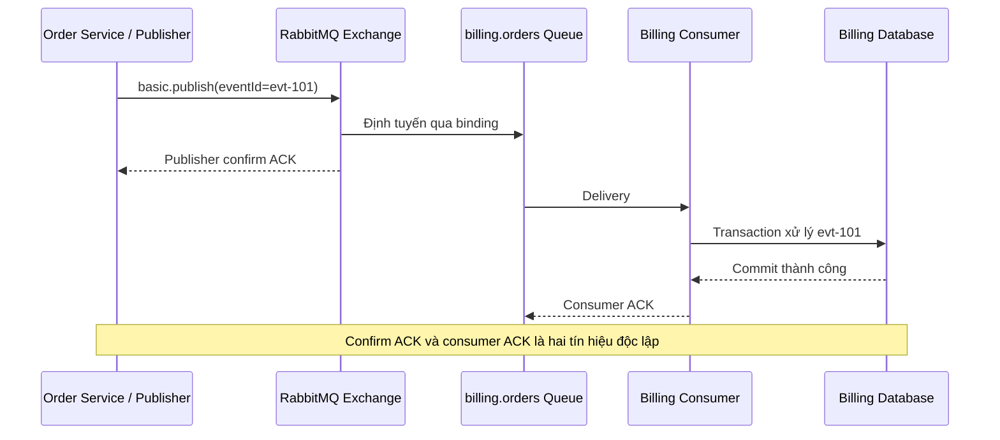
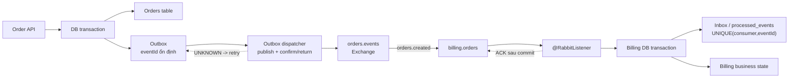
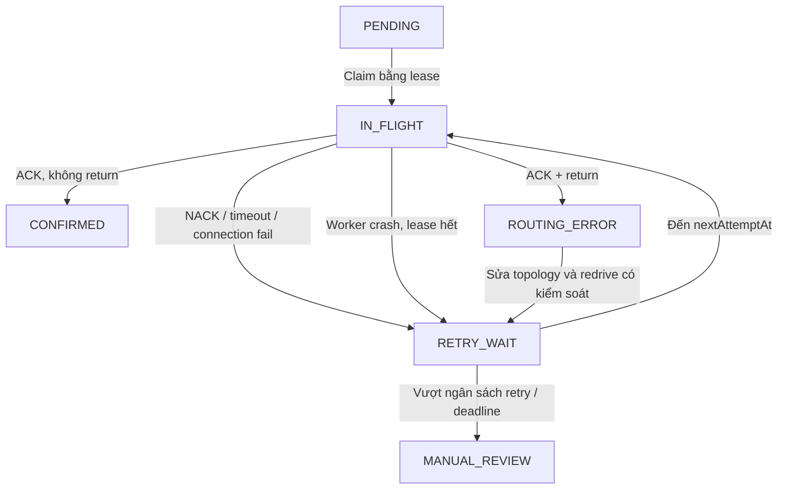
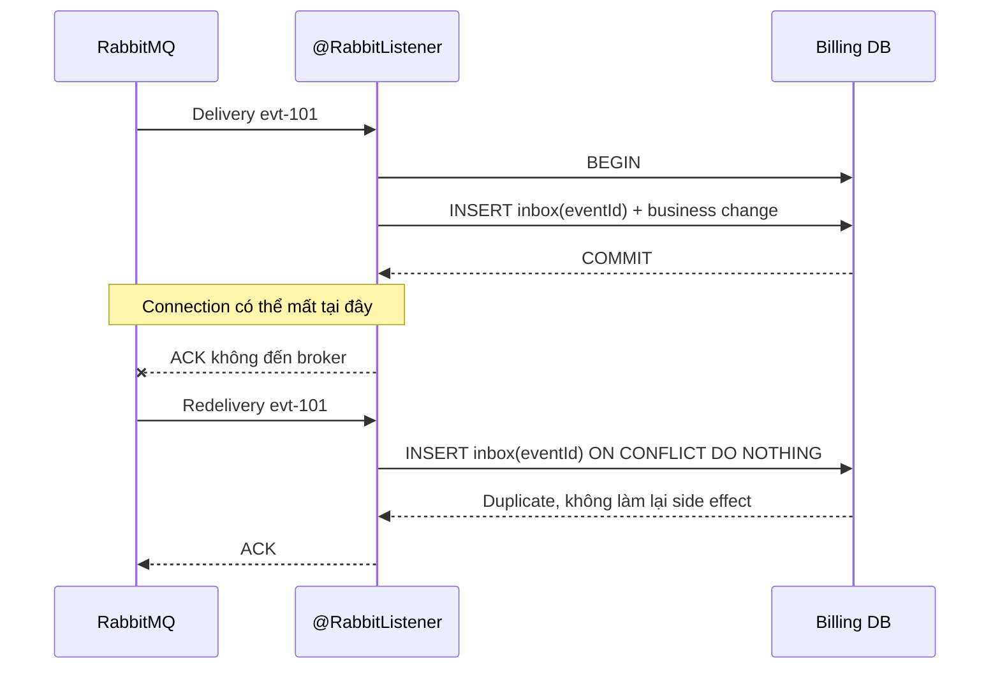

# Thiết kế gửi lại khi kết quả không rõ và chống xử lý trùng

## 1. Bài toán: gửi thành công nhưng producer không biết

Trong **Spring AMQP**, ứng dụng thường dùng `RabbitTemplate` gửi sự kiện đến RabbitMQ, rồi dùng `@RabbitListener` xử lý ở dịch vụ phía sau. Exchange, queue và binding giúp **định tuyến**; publisher confirms và returns giúp **quan sát kết quả publish**; ACK/NACK và retry/dead-letter giúp quản lý **delivery phía consumer**. Tuy vậy, một hệ thống bất đồng bộ đáng tin cậy vẫn có thể gặp tình huống rất khó: **message có thể đã đến broker, nhưng producer không nhận được câu trả lời**.

Ví dụ `Order Service` phát sự kiện `orders.created` để `Billing Service` tạo yêu cầu thanh toán:

1. Order Service đã commit đơn hàng vào database.
2. Nó publish event có `messageId=evt-101` tới exchange `orders.events`.
3. RabbitMQ nhận message và định tuyến vào queue `billing.orders`.
4. Broker gửi publisher confirm ACK.
5. Mạng đứt trước khi ACK đến ứng dụng.
6. Producer chỉ thấy timeout và **không biết event có được nhận hay không**.

Nếu **không gửi lại**, một message chưa đến broker thật sự có thể bị mất. Nếu **gửi lại**, message đã đến broker có thể được publish lần nữa và consumer có thể thực hiện tác dụng phụ hai lần. Đây chính là mâu thuẫn giữa **at-least-once delivery** và **duplicate processing**.

Bài thuộc chương **Confirm và return** của module **SPRING_AMQP**, tập trung vào cách thiết kế hai phía:

- **Publisher:** dùng confirm/return đúng ngữ nghĩa, lưu sự kiện bền vững vào transactional outbox, gửi lại có giới hạn khi kết quả không rõ và **giữ nguyên event ID**.
- **Consumer:** dùng inbox/idempotency key, giao dịch database và xử lý lỗi để message trùng không tạo tác dụng phụ trùng.
- **Vận hành:** phân biệt timeout, NACK, returned message, poison message và message bị dead-letter; theo dõi event qua các lần publish, retry và redelivery.

Sau bài, bạn có thể tự thiết kế một luồng gửi sự kiện mà lỗi mạng **không làm mất hẳn ý định gửi**, đồng thời không biến mỗi lần retry thành một lần tạo giao dịch nghiệp vụ mới.

## 2. Phân biệt các loại xác nhận trong AMQP 0-9-1

Một ứng dụng cần đặt các tín hiệu vào **đúng phạm vi**:

| Cơ chế | Nơi phát sinh | Điều nói lên | Điều **không** đảm bảo |
| --- | --- | --- | --- |
| **Publisher confirm ACK** | RabbitMQ → publisher, theo channel publish | Broker đã xử lý publish theo semantics của publisher confirms | Consumer đã xử lý xong, DB của consumer đã commit, message đã vào **queue nghiệp vụ mong muốn** |
| **Publisher confirm NACK** | RabbitMQ → publisher | Broker không xác nhận thành công publish; cần xử lý thất bại/kết quả không chắc chắn | Mọi queue đích chắc chắn đều chưa nhận message |
| **Publisher return** | RabbitMQ → publisher khi `mandatory` áp dụng và message không route được | Message bị trả về vì không đến queue phù hợp theo routing tại broker | Broker có lỗi lưu trữ, message đã timeout, hoặc consumer xử lý thất bại |
| **Consumer ACK** | Consumer → RabbitMQ trên channel nhận | Consumer xác nhận đã xử lý/nhận trách nhiệm với delivery | Producer tự được thông báo rằng nghiệp vụ downstream thành công |
| **Consumer NACK/reject** | Consumer → RabbitMQ | Yêu cầu xử lý delivery lỗi theo `requeue` và cấu hình queue | Tự đồng nghĩa publisher publish thất bại |
| **Business result** | Database/API nghiệp vụ | Tác vụ mong muốn đã commit hoặc có trạng thái xác định | Có thể suy chỉ từ publisher confirm hay delivery ACK |



Với exchange đúng tên nhưng routing key không khớp binding, broker **vẫn có thể publisher-confirm ACK** cho một publish không route được. Để quan sát trường hợp đó, bật `mandatory` và publisher returns, hoặc cấu hình alternate exchange có queue dự phòng và giám sát queue dự phòng.

### 2.1. Return và confirm ACK có thể cùng tồn tại

Một message không route được khi `mandatory=true` có thể được **return trước**, sau đó publisher vẫn nhận **confirm ACK**. Hai tín hiệu không mâu thuẫn:

- **Return:** không tìm được queue đích theo routing.
- **Confirm ACK:** broker đã xử lý publish theo cơ chế confirm, dù message có thể không nằm ở queue đích.

Ngược lại, nếu alternate exchange đã route message tới một fallback queue, message không nhất thiết được return; publisher confirm ACK cũng không cho biết message nằm ở **queue bình thường** hay **queue fallback**. Vì vậy, đối với hợp đồng định tuyến nghiệp vụ, phải kiểm tra topology và metric của queue.

### 2.2. Không có confirm không đồng nghĩa gửi thất bại

Khi `RabbitTemplate` bị timeout chờ confirm, có ít nhất các khả năng sau:

1. Broker **chưa nhận** message.
2. Broker **đã nhận** nhưng chưa xử lý xong hoặc chưa gửi confirm.
3. Broker **đã gửi** confirm nhưng mạng làm mất đường truyền.
4. Confirm đã tới client nhưng ứng dụng crash trước khi ghi nhận trạng thái thành công vào database.

Trong bốn trường hợp, log phía producer có thể đều kết thúc bằng “không chắc chắn”. **Không thể suy ra trạng thái thực của message chỉ từ một timeout.** Một thiết kế tốt ghi nhận trạng thái `UNKNOWN` và dựa vào **retry at-least-once + idempotent consumer**, thay vì tự đoán rằng chưa gửi.

## 3. Ma trận quyết định sau một lần publish

Giả sử producer dùng Spring AMQP với `publisher-confirm-type: correlated`, `publisher-returns: true`, `template.mandatory: true` và có queue đích theo topology đã kiểm chứng:

| Kết quả nhận được | Phân loại thực dụng | Quyết định cho outbox | Vì sao |
| --- | --- | --- | --- |
| Confirm **ACK**, không có return | `CONFIRMED` | Có thể đánh dấu đã publish theo hợp đồng định tuyến | Broker xác nhận publish; không phải xác nhận business consumer |
| Confirm **ACK**, **có return** | `UNROUTABLE` | Giữ event và chuyển sang sửa routing/quarantine; không retry nóng vô hạn | Broker xử lý publish nhưng không có queue đích |
| Confirm **NACK** | `UNKNOWN_OR_FAILED` | Giữ record, điều tra hoặc lên lịch retry | Không mặc định tất cả queue đích chưa nhận |
| Chờ confirm **timeout** | `UNKNOWN` | Giữ record, retry sau backoff | Broker có thể đã nhận |
| Connection/channel đóng khi publish | `UNKNOWN` trừ khi chứng minh chắc chắn chưa gửi | Không xóa outbox, cần retry có kiểm soát | Ranh giới network khiến kết quả không chắc chắn |
| Lỗi converter/schema trước khi gửi | `LOCAL_VALIDATION_ERROR` | Sửa payload hoặc quarantine, **không** retry mù quáng | Lỗi cố định thường không hết sau khi chờ |
| Queue route được nhưng **consumer offline** | Publish có thể ACK | Giám sát backlog, không tự phân loại return | Queue vẫn nhận message dù consumer chưa chạy |

**Quy tắc quan trọng:** trạng thái `CONFIRMED` chỉ chứng minh một chặng của hệ thống. Muốn biết Billing đã tạo yêu cầu thanh toán, phải có trạng thái business riêng hoặc event phản hồi độc lập.

Ở những ứng dụng dùng nhiều queue cùng bind một routing key, một publish có thể được chấp nhận ở queue này nhưng bị từ chối ở queue khác (ví dụ chính sách overflow). Khi retry toàn bộ publish, queue đã nhận trước đó có thể nhận **bản trùng**. Đây là một lý do nữa khiến consumer idempotency bắt buộc.

## 4. Giữ nguyên danh tính của event khi retry

### 4.1. Message ID, correlation ID và delivery tag không giống nhau

| Giá trị | Phạm vi | Quy tắc trong bài toán retry |
| --- | --- | --- |
| `eventId` / `messageId` | Một **sự kiện logic** | Tạo một lần, **giữ nguyên** qua các lần publish lại cùng sự kiện |
| `orderId` | Một đối tượng nghiệp vụ | Có thể xuất hiện trong nhiều event khác nhau của cùng order |
| `correlationId` | Một workflow/request | Có thể dùng chung qua nhiều event cùng nghiệp vụ |
| `CorrelationData.id` | Theo dõi một lần publish/confirm ở Spring AMQP | Có thể là `eventId` hoặc `eventId + attempt` để dễ đối chiếu; không thay thế `messageId` |
| Delivery tag | Một channel consumer cụ thể | Broker cấp lại cho từng delivery; **không** dùng làm khóa dedup |
| Trace/span ID | Ngữ cảnh tracing phân tán | Dùng để liên kết log và span, không coi là business event ID |

Một order có thể có các sự kiện `orders.created`, `orders.confirmed` và `orders.cancelled`. Nếu chỉ dùng `orderId` làm dedup key, Billing có thể vô tình bỏ qua sự kiện hợp lệ xảy ra sau đó. Khóa dedup nên nhận diện đúng đơn vị tác dụng phụ nghiệp vụ; thường là **`(consumerName, eventId)`**.

### 4.2. Tạo ID khi tạo sự kiện, không tạo khi gửi lại

**Sai**:

```java
for (int attempt = 0; attempt < 3; attempt++) {
    // Sai: mỗi lần retry trở thành một eventId mới.
    String eventId = UUID.randomUUID().toString();
    rabbitTemplate.convertAndSend(
            "orders.events", "orders.created", payload,
            m -> {
                m.getMessageProperties().setMessageId(eventId);
                return m;
            });
}
```

**Đúng về nguyên tắc**:

```java
// Event được tạo và lưu trước khi publish.
String eventId = eventFromOutbox.eventId();

for (int attempt = 0; attempt < maxAttempts; attempt++) {
    // Mọi lần retry của CÙNG event dùng cùng eventId.
    publishAttempt(eventId, eventFromOutbox.payload());
}
```

Đoạn lặp trên chỉ minh họa danh tính; trong production **không retry ngay trong một vòng lặp nóng**. Cần outbox bền vững, backoff, timeout, giới hạn retry và cơ chế điều phối sau crash.

Một message có thể được broker **redeliver** dù publisher không retry, ví dụ consumer commit DB xong nhưng mất connection trước khi ACK. Cả publish retry và consumer redelivery đều yêu cầu cùng một nguyên tắc: **idempotent side effect**.

## 5. Kiến trúc tham chiếu: transactional outbox + idempotent inbox

Để không mất ý định publish khi Order Service crash, lưu event vào **outbox cùng giao dịch ghi đơn hàng**. Để không nhân đôi tác dụng phụ khi message lặp, Billing ghi nhận event đã xử lý vào **inbox/processed-events trong cùng giao dịch thay đổi dữ liệu nghiệp vụ**.



Hai điểm bảo đảm cần tách rõ:

- **Outbox:** giảm rủi ro đã commit đơn hàng nhưng không còn record để publish event. Nếu publish thành công mà chưa cập nhật trạng thái outbox, dispatcher có thể gửi lại; đó là hành vi **at-least-once**.
- **Inbox + transaction:** cùng `eventId` được giao lại thì consumer nhận diện bản trùng, bỏ qua side effect đã commit và vẫn hoàn tất ACK theo chính sách.

Đây là mẫu **at-least-once delivery + idempotent processing**, **không phải** distributed transaction nguyên tử giữa RabbitMQ và cả hai database.

## 6. Transactional outbox phía publisher

### 6.1. Ghi thay đổi nghiệp vụ và outbox trong một database transaction

Ví dụ thiết kế schema dạng SQL (cú pháp có thể cần điều chỉnh theo hệ quản trị DB):

```sql
CREATE TABLE orders (
    order_id VARCHAR(100) PRIMARY KEY,
    status VARCHAR(40) NOT NULL
);

CREATE TABLE outbox_events (
    event_id VARCHAR(100) PRIMARY KEY,
    aggregate_id VARCHAR(100) NOT NULL,
    event_type VARCHAR(100) NOT NULL,
    exchange_name VARCHAR(200) NOT NULL,
    routing_key VARCHAR(200) NOT NULL,
    payload TEXT NOT NULL,
    status VARCHAR(40) NOT NULL,
    attempt_count INT NOT NULL DEFAULT 0,
    next_attempt_at TIMESTAMP WITH TIME ZONE NOT NULL,
    lease_until TIMESTAMP WITH TIME ZONE,
    last_error TEXT,
    created_at TIMESTAMP WITH TIME ZONE NOT NULL DEFAULT CURRENT_TIMESTAMP,
    confirmed_at TIMESTAMP WITH TIME ZONE
);
```

Ghi trong cùng transaction:

```sql
BEGIN;

INSERT INTO orders(order_id, status)
VALUES ('order-123', 'CREATED');

INSERT INTO outbox_events(
    event_id, aggregate_id, event_type,
    exchange_name, routing_key, payload, status, next_attempt_at
) VALUES (
    'evt-101', 'order-123', 'orders.created',
    'orders.events', 'orders.created',
    'order-123',
    'PENDING', CURRENT_TIMESTAMP
);

COMMIT;
```

Ở ví dụ xuyên suốt này, payload được giữ đơn giản là chuỗi `order-123`; `eventId` nằm trong outbox record và được đặt vào AMQP `messageId` khi publish. Nếu ứng dụng chọn JSON, producer và consumer phải dùng cùng JSON contract/converter thay vì đọc nguyên body JSON như một order ID.

Nếu transaction rollback, cả order và outbox event đều không được tạo. Nếu commit thành công rồi service chết, record `PENDING` vẫn tồn tại để dispatcher tiếp tục gửi.

**Không giữ DB transaction ghi đơn hàng mở trong suốt thời gian chờ publisher confirm.** Một network timeout kéo dài có thể giữ lock và connection DB vô ích. Outbox worker lấy record và xử lý publish **sau** khi giao dịch tạo order đã commit.

### 6.2. Trạng thái outbox và thời điểm chuyển đổi

Một state machine đơn giản:



Nguyên tắc:

1. `CONFIRMED` chỉ đánh dấu **chặng publish**, không nói Billing xử lý thành công.
2. `RETRY_WAIT` giữ lại **eventId và payload gốc**, chỉ cập nhật attempt count, lỗi gần nhất và lịch gửi tiếp.
3. `ROUTING_ERROR` thường cần sửa exchange/binding/routing key; gửi lại y nguyên liên tục chỉ tạo thêm return.
4. Worker crash ở trạng thái `IN_FLIGHT` phải được khôi phục bằng **lease timeout** hoặc một cơ chế tương đương. Khi lease hết, record có thể được xử lý lại.
5. `MANUAL_REVIEW` là một trạng thái vận hành, không phải tự động xóa event; yêu cầu nghiệp vụ quyết định có tiếp tục redrive hay bù trừ.

### 6.3. Nhiều worker: claim bằng lease hoặc khóa thích hợp

Nếu chạy nhiều instance outbox dispatcher, chúng không nên cùng tự do lấy một record `PENDING` và publish đồng thời. Có thể dùng các chiến lược:

- `SELECT ... FOR UPDATE SKIP LOCKED` rồi đánh dấu `IN_FLIGHT` cùng lease trong **một transaction ngắn**, sau đó commit và mới publish.
- Cập nhật có điều kiện dựa trên status/lease/version rồi kiểm tra số dòng được cập nhật.
- Phân vùng outbox theo tenant/aggregate, hoặc chọn một leader phù hợp.

**Dù claim tránh xử lý đồng thời, nó không thể bảo đảm exactly once publish.** Worker có thể đã publish thành công nhưng crash trước khi cập nhật outbox; lease hết và worker khác sẽ gửi lại. Cơ chế dedup ở consumer vẫn cần thiết.

Nếu ứng dụng cần thứ tự event theo từng order, bổ sung sequence/aggregate version, chọn chiến lược claim và retry không để event mới vượt event cũ mà gây sai nghiệp vụ. ID ổn định không tự bảo đảm thứ tự.

## 7. Cấu hình Spring Boot publisher confirms và returns

### 7.1. Dependency và cấu hình

Spring Boot thường dùng:

```xml
<dependency>
    <groupId>org.springframework.boot</groupId>
    <artifactId>spring-boot-starter-amqp</artifactId>
</dependency>
```

```yaml
spring:
  rabbitmq:
    host: ${RABBITMQ_HOST:localhost}
    port: ${RABBITMQ_PORT:5672}
    username: ${RABBITMQ_USERNAME:guest}
    password: ${RABBITMQ_PASSWORD:guest}
    virtual-host: ${RABBITMQ_VHOST:/}
    publisher-confirm-type: correlated
    publisher-returns: true
    template:
      mandatory: true
    connection-timeout: 5s
    requested-heartbeat: 30s
    listener:
      simple:
        acknowledge-mode: auto
        default-requeue-rejected: false
        prefetch: 20
```

Ý nghĩa:

- `publisher-confirm-type: correlated` bật correlated publisher confirms qua `CorrelationData`, callback/future phù hợp.
- `publisher-returns: true` cùng `template.mandatory: true` cho phép quan sát message không định tuyến đến queue được.
- `default-requeue-rejected: false` trong ví dụ hướng các exception cuối cùng theo hướng reject không requeue; nếu queue có DLX phù hợp, broker có thể dead-letter. Cần kết hợp **bounded retry policy** cho lỗi tạm thời thay vì để mọi lỗi đi DLQ ngay.
- `acknowledge-mode: auto` nghĩa là **Spring listener container ACK sau khi method xử lý thành công**; không phải RabbitMQ Java client `autoAck=true`.

Cấu hình này không thay thế bảo đảm về business outcome. Chúng cũng phải khớp Spring Boot/Spring AMQP version trong dự án. Account `guest` thường chỉ được kết nối từ localhost theo mặc định của RabbitMQ; production phải dùng tài khoản/vhost và quyền phù hợp.

### 7.2. Khai báo topology cho ví dụ

```java
package example.messaging;

import org.springframework.amqp.core.Binding;
import org.springframework.amqp.core.BindingBuilder;
import org.springframework.amqp.core.Declarables;
import org.springframework.amqp.core.DirectExchange;
import org.springframework.amqp.core.Queue;
import org.springframework.amqp.core.QueueBuilder;
import org.springframework.context.annotation.Bean;
import org.springframework.context.annotation.Configuration;

@Configuration
public class OrdersTopology {
    public static final String EXCHANGE = "orders.events";
    public static final String KEY = "orders.created";
    public static final String QUEUE = "billing.orders";
    public static final String DLX = "orders.dead";
    public static final String DLQ = "billing.orders.dlq";
    public static final String DEAD_KEY = "orders.failed";

    @Bean
    Declarables orderResources() {
        DirectExchange exchange = new DirectExchange(EXCHANGE, true, false);
        DirectExchange dlx = new DirectExchange(DLX, true, false);

        Queue work = QueueBuilder.durable(QUEUE)
                .deadLetterExchange(DLX)
                .deadLetterRoutingKey(DEAD_KEY)
                .build();
        Queue dead = QueueBuilder.durable(DLQ).build();

        Binding route = BindingBuilder.bind(work).to(exchange).with(KEY);
        Binding deadRoute = BindingBuilder.bind(dead).to(dlx).with(DEAD_KEY);

        return new Declarables(exchange, dlx, work, dead, route, deadRoute);
    }
}
```

`RabbitAdmin` có thể khai báo các bean tài nguyên khi auto-declare được bật, connection và quyền hợp lệ. Không mặc định exchange/queue đã tồn tại chỉ vì có bean. Nếu đã có queue cùng tên nhưng arguments khác, broker có thể từ chối declare `PRECONDITION_FAILED`; không xóa queue production để sửa nóng.

Trong luồng này, DLQ dành cho **consumer không xử lý được delivery sau chính sách lỗi**, **không phải** nơi mặc định lưu một publisher timeout hay event chưa publish.

## 8. Ví dụ publisher: CorrelationData + future để phân loại kết quả

### 8.1. Một lần thử gửi, không tự suy đoán retry

Đoạn code sau là **một lần thử gửi** một outbox record, cố ý không tự đánh dấu DB thành công. Bộ điều phối outbox quyết định cập nhật trạng thái và lịch retry trong transaction riêng.

```java
package example.messaging;

import java.util.concurrent.ExecutionException;
import java.util.concurrent.TimeUnit;
import java.util.concurrent.TimeoutException;

import org.springframework.amqp.AmqpException;
import org.springframework.amqp.core.MessageDeliveryMode;
import org.springframework.amqp.rabbit.connection.CorrelationData;
import org.springframework.amqp.rabbit.core.RabbitTemplate;
import org.springframework.stereotype.Service;

@Service
public class ConfirmingOrderPublisher {

    private final RabbitTemplate rabbitTemplate;

    public ConfirmingOrderPublisher(RabbitTemplate rabbitTemplate) {
        this.rabbitTemplate = rabbitTemplate;
    }

    public enum Outcome {
        CONFIRMED,       // ACK và không có return
        UNROUTABLE,      // Có returned message
        UNKNOWN          // NACK, timeout hoặc mất kết nối...
    }

    public record OutboxEvent(
            String eventId,
            String payload) {}

    public Outcome sendOnce(OutboxEvent event) {
        // ID này dùng để đối chiếu publisher confirm.
        CorrelationData correlation = new CorrelationData(event.eventId());

        try {
            rabbitTemplate.convertAndSend(
                    OrdersTopology.EXCHANGE,
                    OrdersTopology.KEY,
                    event.payload(),
                    message -> {
                        message.getMessageProperties()
                                .setMessageId(event.eventId());
                        message.getMessageProperties()
                                .setType("orders.created");
                        message.getMessageProperties()
                                .setHeader("eventType", "orders.created");
                        message.getMessageProperties()
                                .setHeader("schemaVersion", 1);
                        message.getMessageProperties()
                                .setDeliveryMode(MessageDeliveryMode.PERSISTENT);
                        return message;
                    },
                    correlation);

            // Đợi confirm của đúng publish/correlation data này.
            CorrelationData.Confirm confirm =
                    correlation.getFuture().get(5, TimeUnit.SECONDS);

            // Khi có returns và mandatory, Spring đặt returned message
            // vào CorrelationData trước khi future hoàn tất.
            if (!confirm.isAck()) {
                return Outcome.UNKNOWN;
            }
            if (correlation.getReturned() != null) {
                return Outcome.UNROUTABLE;
            }
            return Outcome.CONFIRMED;

        } catch (InterruptedException ex) {
            Thread.currentThread().interrupt();
            return Outcome.UNKNOWN;
        } catch (ExecutionException | TimeoutException | AmqpException ex) {
            // Không kết luận broker chắc chắn chưa nhận message.
            return Outcome.UNKNOWN;
        }
    }
}
```

**Điều kiện để ví dụ có ý nghĩa:** đã bật `publisher-confirm-type: correlated`, `publisher-returns: true`, `template.mandatory: true` và topology phù hợp. Trong các phiên bản Spring AMQP hỗ trợ correlated future cùng returned message, trường returned được đặt trước khi future hoàn tất; kiểm tra API/release của stack đang dùng.

Với code trên, `UNROUTABLE` được ưu tiên khi có returned message; trong ứng dụng thực tế vẫn cần log cả `confirm.isAck()`/reason và các trường `replyCode`, `replyText`, exchange/routing key của return để phân tích chính xác. Đừng xóa record `UNROUTABLE` khỏi outbox nếu chưa có quyết định nghiệp vụ; cần sửa routing rồi redrive có kiểm soát.

Nếu producer tự ném exception vì dữ liệu không hợp lệ **trước khi gửi**, nên phân loại thành `INVALID_PAYLOAD`/quarantine thay vì để lẫn trong `UNKNOWN`; ví dụ tối giản trên chỉ tập trung vào uncertainty phía network/confirm. Converter và schema validation cần được thực hiện trước khi claim outbox record.

### 8.2. Vì sao dùng CorrelationData thay vì chỉ nghe log ACK?

Khi có nhiều publish đồng thời, confirm đến không nhất thiết đồng bộ với HTTP request hoặc vòng lặp nghiệp vụ. `CorrelationData` giúp liên kết một publish với kết quả của nó. Trong thiết kế nâng cao có thể dùng:

- `CorrelationData.id = eventId + ":" + attemptNo` để phân biệt các **attempt**, trong khi AMQP `messageId = eventId` giữ nguyên.
- `CorrelationData.getFuture()` để chờ bất đồng bộ hoặc nhận kết quả khi future hoàn tất.
- Một worker/dispatcher ghi trạng thái outbox khi đã xác nhận kết quả và đảm bảo **chỉ attempt hợp lệ** cập nhật record.

Bí quyết là **tách định danh event logic và định danh lần gửi**. Không tăng `messageId` mỗi khi tăng `attemptNo`.

### 8.3. Chờ future không phải transaction

`getFuture().get(5, TimeUnit.SECONDS)` minh họa kiểu chờ đồng bộ, dễ học nhưng không tối ưu throughput nếu mỗi record giữ một thread trong nhiều giây. Với tải cao, dùng luồng xử lý confirm bất đồng bộ và một cơ chế cập nhật outbox an toàn với concurrency, giới hạn số message đang chờ confirm.

Ngoài ra, việc future trả ACK **không atomically commit outbox status**. Nếu ACK nhận thành công nhưng DB update thất bại, record vẫn `PENDING/IN_FLIGHT` và có thể được gửi lại. Consumer idempotency là lớp bảo vệ bắt buộc.

## 9. Bộ điều phối retry: có giới hạn, có lịch và có trạng thái

### 9.1. Pseudocode của outbox dispatcher

```text
mỗi chu kỳ:
  claim một nhóm outbox event đủ điều kiện bằng lease
  với từng event:
    nếu hết business deadline -> đánh dấu EXPIRED/REVIEW theo nghiệp vụ
    nếu payload/schema không hợp lệ -> QUARANTINE, không retry nóng
    outcome = sendOnce(event)
    nếu CONFIRMED:
       cố gắng đánh dấu outbox CONFIRMED trong transaction riêng
    nếu UNROUTABLE:
       lưu thông tin return; ROUTING_ERROR; cảnh báo routing contract
    nếu UNKNOWN:
       tăng attempt; tính nextAttemptAt bằng backoff + jitter
       nếu vượt retry budget -> MANUAL_REVIEW
       ngược lại -> RETRY_WAIT
  worker crash -> khi lease hết, record đủ điều kiện được claim lại
```

Đặt timeout của một lần publish và thời hạn lease nhất quán. Lease quá ngắn có thể khiến worker thứ hai claim lại khi worker đầu đang chờ confirm; lease quá dài khiến khôi phục sau crash bị chậm. Cần heartbeat/renew lease nếu có tác vụ lâu, hoặc giới hạn thời gian một attempt.

### 9.2. Exponential backoff với jitter

Một lịch thử lại tham khảo:

| Attempt thất bại | Backoff cơ bản | Khoảng jitter minh họa |
| --- | --- | --- |
| 1 | 1 giây | 0,5–1,5 giây |
| 2 | 2 giây | 1–3 giây |
| 3 | 4 giây | 2–6 giây |
| 4 | 8 giây | 4–12 giây |
| 5 | 16 giây | 8–24 giây |
| 6 trở lên | Giới hạn trần, ví dụ 30 giây | Có biến động có kiểm soát |

Đây chỉ là ví dụ. Phải tính tải, deadline, timeout, mức cho phép trễ và khả năng mở rộng. Đừng cho hàng nghìn dispatcher retry đồng thời đúng một giây sau outage: **jitter** giúp giảm retry storm.

Một hàm tính delay đơn giản (mang tính minh họa, Java 17+):

```java
import java.time.Duration;
import java.util.concurrent.ThreadLocalRandom;

public final class Backoff {
    private Backoff() {}

    public static Duration nextDelay(int failedAttempt) {
        int exponent = Math.max(0, Math.min(failedAttempt - 1, 10));
        long baseMs = Math.min(30_000L, 1_000L << exponent);
        long jitterMs = ThreadLocalRandom.current()
                .nextLong(baseMs / 2, baseMs + baseMs / 2 + 1);
        return Duration.ofMillis(jitterMs);
    }
}
```

Trong production, ghi `nextAttemptAt` **vào outbox DB**; không chỉ `Thread.sleep()` trong bộ nhớ. Nếu process restart, lịch retry vẫn tồn tại.

### 9.3. Những lỗi không nên retry y nguyên

- `UNROUTABLE` do thiếu binding/queue, sai exchange hoặc routing key: cần sửa topology/contract; retry nóng có thể chỉ tạo thêm returns.
- Payload sai schema, không thể serialize, thiếu field bắt buộc: phải sửa dữ liệu hoặc chuyển xử lý thủ công.
- Authorization/vhost sai: cần sửa cấu hình và quyền.
- Event quá business deadline và không còn hợp lệ: cần quy tắc hết hạn/bù trừ, không phát lại như event đang hiệu lực.
- Poison message lặp ở consumer: cần retry có giới hạn, DLQ/quarantine và khả năng redrive sau sửa lỗi.

**Không thay đổi event ID để “qua” dedup sau lỗi.** Khi thật sự có một sự kiện nghiệp vụ mới, hãy tạo event mới với ID mới và liên kết event cũ bằng metadata rõ ràng.

## 10. Consumer inbox: xử lý trùng an toàn trong cùng DB transaction

### 10.1. Vì sao kiểm tra "đã xử lý" rồi mới update là chưa đủ?

Mẫu sai:

```text
if (!exists(eventId)) {
    createBillingCharge(orderId);
    saveProcessed(eventId);
}
```

Hai listener chạy đồng thời có thể **đều thấy `exists=false`** rồi cùng tạo thanh toán. Hoặc app crash sau `createBillingCharge` nhưng trước `saveProcessed`, redelivery lại tạo side effect. Cần một cơ chế **atomic** ở database và khóa duy nhất do database cưỡng chế.

### 10.2. Schema inbox cho từng consumer

Ví dụ PostgreSQL:

```sql
CREATE TABLE processed_events (
    consumer_name VARCHAR(100) NOT NULL,
    event_id VARCHAR(100) NOT NULL,
    processed_at TIMESTAMP WITH TIME ZONE NOT NULL
        DEFAULT CURRENT_TIMESTAMP,
    PRIMARY KEY (consumer_name, event_id)
);

CREATE TABLE billing_requests (
    event_id VARCHAR(100) PRIMARY KEY,
    order_id VARCHAR(100) NOT NULL,
    state VARCHAR(40) NOT NULL
);
```

`consumer_name` là định danh xử lý logic, ví dụ `billing-orders-created`. Hai chức năng khác nhau được phép xử lý cùng một `eventId`, nên khóa `(consumer_name, event_id)` tránh chặn nhầm lẫn giữa các consumer nghiệp vụ.

### 10.3. Service xử lý trong một giao dịch database

Ví dụ dùng `JdbcTemplate` và PostgreSQL `ON CONFLICT DO NOTHING`. Phần này yêu cầu dependency JDBC, driver và schema DB tương ứng; nó minh họa cơ chế dedup, **không tự tạo bảng**:

```java
package example.billing;

import org.springframework.jdbc.core.JdbcTemplate;
import org.springframework.stereotype.Service;
import org.springframework.transaction.annotation.Transactional;

@Service
public class BillingProcessor {
    private final JdbcTemplate jdbc;

    public BillingProcessor(JdbcTemplate jdbc) {
        this.jdbc = jdbc;
    }

    @Transactional
    public void processOnce(String eventId, String orderId) {
        int inserted = jdbc.update(
                "INSERT INTO processed_events(consumer_name, event_id) "
                + "VALUES (?, ?) ON CONFLICT DO NOTHING",
                "billing-orders-created", eventId);

        if (inserted == 0) {
            // Event này đã được transaction khác xử lý và commit.
            return;
        }

        // Side effect nghiệp vụ nằm trong CÙNG database transaction.
        jdbc.update(
                "INSERT INTO billing_requests(event_id, order_id, state) "
                + "VALUES (?, ?, ?)",
                eventId, orderId, "PENDING");
    }
}
```

Các thuộc tính đáng chú ý:

- Hai thao tác `INSERT` tham gia **cùng Spring DB transaction**. Nếu insert billing thất bại, insert inbox cũng rollback; redelivery có thể xử lý lại.
- Ràng buộc `PRIMARY KEY` giải quyết race giữa nhiều consumer cùng nhận event ID. `SELECT EXISTS` trước rồi insert riêng không đủ.
- Với duplicate đã commit, `inserted==0` làm handler trở về thành công; listener có thể ACK bản trùng và không tạo billing mới.
- Nếu DB của nghiệp vụ khác DB lưu inbox, hoặc side effect là HTTP/gửi email, cần cơ chế phối hợp khác. Một DB transaction không tự bao trùm API bên ngoài.

**Đặc biệt với thanh toán:** không gọi API charge bên thứ ba trực tiếp sau bước claim inbox rồi tin rằng DB rollback sẽ đảo ngược charge. Dùng idempotency key của payment provider (thường gắn với event/business operation ID), trạng thái xử lý bền vững hoặc outbox cho tác vụ bên ngoài.

### 10.4. Listener nhận message và giao cho service giao dịch

Ví dụ bài học dùng body là order ID dạng UTF-8 và `messageId` là event ID:

```java
package example.billing;

import java.nio.charset.StandardCharsets;

import org.springframework.amqp.AmqpRejectAndDontRequeueException;
import org.springframework.amqp.core.Message;
import org.springframework.amqp.rabbit.annotation.RabbitListener;
import org.springframework.stereotype.Component;

@Component
public class BillingListener {
    private final BillingProcessor processor;

    public BillingListener(BillingProcessor processor) {
        this.processor = processor;
    }

    @RabbitListener(queues = "billing.orders")
    public void onMessage(Message message) {
        String eventId = message.getMessageProperties().getMessageId();

        if (eventId == null || eventId.isBlank()) {
            // Trường hợp này cần quarantine hoặc DLQ, không retry vô hạn.
            throw new AmqpRejectAndDontRequeueException(
                    "Missing messageId");
        }

        String orderId = new String(
                message.getBody(), StandardCharsets.UTF_8);

        processor.processOnce(eventId, orderId);
        // Chỉ return sau khi transaction service đã commit thành công.
        // Với Spring listener AUTO ack, container ACK sau đó.
    }
}
```

Ở ví dụ trên, `BillingProcessor` là bean Spring **riêng** được inject, giúp lời gọi `@Transactional` đi qua proxy/interceptor thích hợp. Nếu logic xử lý ném exception, transaction rollback; listener/container áp dụng error handling và reject/requeue theo cấu hình. Với `default-requeue-rejected: false` và DLX đã cấu hình, message lỗi có thể đi vào DLQ; để xử lý transient DB outage, thêm **bounded retry/backoff** trước khi dead-letter.

Một delivery có thể được giao lại sau khi DB commit nhưng trước khi consumer ACK tới broker. Khi đó, service thấy event ID đã commit trong inbox và bỏ qua side effect. Đây là tình huống kiểm chứng quan trọng nhất của thiết kế.

### 10.5. Nếu consumer cần thực hiện tác dụng bên ngoài database

Giả sử nhiệm vụ là gọi payment gateway:

1. Ghi một yêu cầu xử lý/idempotency record bền vững cùng giao dịch nhận event.
2. Một worker riêng gọi payment provider với **idempotency key ổn định**, gắn với business operation phù hợp.
3. Lưu kết quả provider và phân biệt timeout với charge đã thành công.
4. Nếu không có API idempotency, thiết kế trạng thái `UNKNOWN` và quy trình đối soát; không gọi lại mù quáng tạo lần charge thứ hai.

**Exactly once của tác dụng phụ ngoài DB không thể chỉ đạt được bằng RabbitMQ message ID hoặc database inbox.** Nó yêu cầu giao thức/khóa nghiệp vụ của hệ thống nhận tác dụng phụ.

## 11. Vì sao ACK và transaction phía consumer cần được đặt đúng thứ tự?

Một kịch bản điển hình:



Không nên ACK **trước khi** dữ liệu nghiệp vụ bền vững được commit; nếu ACK đã tới broker nhưng DB rollback, event có thể biến mất khỏi queue mà tác vụ chưa xảy ra. Trong ví dụ `@RabbitListener` với chế độ `AUTO` và service `@Transactional` đồng bộ, DB transaction hoàn tất khi `processOnce` trả về trước lúc listener method kết thúc; sau đó listener container mới thực hiện ACK theo cơ chế của nó.

Tuy nhiên, không được tuyên bố có giao dịch phân tán nguyên tử giữa broker và database. Các khoảng hở crash vẫn tồn tại; inbox đảm bảo **định nghĩa idempotency tại ứng dụng**, không phải thay thế cơ chế ACK.

Nếu listener chạy async, chuyển xử lý sang thread pool hoặc hoàn tất transaction sau khi method return, cần xem lại ack mode và cách quản lý completion; **không** tự tin rằng code async nhận được bảo đảm như ví dụ đồng bộ.

## 12. Phối hợp retry, dead-letter và message TTL

### 12.1. Hai loại retry khác nhau

| Loại retry | Điều kích hoạt | Vị trí xử lý | Rủi ro chính |
| --- | --- | --- | --- |
| **Publisher retry** | Confirm NACK/timeout, network fail, kết quả không rõ | Outbox dispatcher | Publish trùng cùng event |
| **Consumer retry/redelivery** | Handler lỗi, channel/connection mất trước ACK, NACK requeue | Listener container / RabbitMQ / retry topology | Side effect trùng khi đã commit nhưng chưa ACK |

Cùng một message có thể bị gửi trùng **và** từng bản trùng lại bị giao lại. Vì vậy, idempotency key nên theo **sự kiện logic**, không theo delivery tag hay số lần retry.

### 12.2. Dead-letter không phải nơi lưu publisher outcome UNKNOWN

DLX xử lý những message **đã đến một queue** và sau đó bị dead-letter do reject/nack không requeue, TTL, giới hạn queue hoặc các điều kiện khác của broker. Một publisher timeout trước khi biết broker có nhận message không **không tự tạo DLQ record**.

Outbox là nơi lưu **ý định publish** chưa xác nhận. DLQ là nơi lưu các **delivery từ queue** đã bị chuyển theo chính sách broker. Cả hai cần quy trình xử lý rõ ràng, nhưng không nên trộn semantics.

### 12.3. TTL và deadline

Một outbox record có thể lưu `businessExpiresAt`:

- Trước mỗi retry, kiểm tra deadline. Nếu event là lệnh chỉ còn hợp lệ trong một cửa sổ thời gian, không tiếp tục publish sau hạn mà không có quyết định nghiệp vụ.
- Nếu đặt per-message `expiration`, tính TTL còn lại theo deadline cố định; **không đặt lại thời gian sống trọn vẹn ở mỗi retry** nếu điều đó kéo dài trái phép hạn nghiệp vụ.
- Một message đã đến consumer trước TTL hết có thể tiếp tục được xử lý sau hạn; consumer cần kiểm tra deadline khi nghiệp vụ yêu cầu.
- Một event “đã xảy ra” dùng cho audit/đồng bộ trạng thái có thể **không nên expire** chỉ vì bị retry chậm; hãy phân biệt event lịch sử với command có thời hạn.

## 13. Các tình huống lỗi quan trọng cần phân tích

### Tình huống A — Broker đã nhận, producer mất confirm

1. Publisher gửi `evt-101`; broker route tới Billing.
2. Confirm ACK bị mất trên đường truyền.
3. Dispatcher đánh dấu `UNKNOWN`, retry sau 2 giây với **cùng event ID**.
4. Billing nhận hai bản cùng `evt-101`.
5. Record inbox đã commit khiến chỉ một lần tạo yêu cầu thanh toán.

**Kết quả mong muốn:** không mất event, không tạo billing request trùng, và vẫn có log/metric cho retry.

### Tình huống B — Broker confirm ACK, DB update outbox thất bại

1. RabbitMQ ACK publish.
2. Worker crash trước khi cập nhật outbox `CONFIRMED`.
3. Lease hết, worker khác claim lại và publish lần nữa.
4. Billing bỏ qua duplicate dựa trên `(consumer,eventId)`.

**Bài học:** không có cách đơn giản dùng confirm để tạo atomic commit giữa broker và outbox DB; at-least-once và idempotency giải quyết tình huống này.

### Tình huống C — Return vì thiếu binding

1. Publisher gửi `orders.created` vào exchange tồn tại nhưng không queue nào match.
2. Vì `mandatory=true`, broker return message.
3. Broker vẫn có thể confirm ACK.
4. Dispatcher **không** đánh dấu publish đã đi vào queue nghiệp vụ chỉ vì ACK.
5. Record chuyển `ROUTING_ERROR`, team kiểm tra exchange/queue/binding/vhost.

**Bài học:** ACK của publisher và thành công định tuyến là hai tín hiệu khác nhau.

### Tình huống D — Consumer commit DB rồi mất ACK

1. Billing ghi inbox và business state, commit.
2. Kết nối mất khi container gửi consumer ACK.
3. Broker redeliver event.
4. Inbox chặn side effect trùng và handler return thành công để ACK lại.

**Bài học:** chống trùng cần ở consumer ngay cả khi publisher chỉ gửi một lần.

### Tình huống E — Một event route đến hai queue

1. `orders.created` được route đến Billing và Analytics.
2. Billing queue từ chối publish do giới hạn overflow nhưng Analytics đã nhận.
3. Publisher có thể nhận NACK ở phạm vi publish.
4. Publisher retry toàn event.
5. Analytics có thể nhận bản trùng dù Billing cần retry.

**Bài học:** không thể diễn giải NACK là “không queue nào nhận”; mỗi consumer cần idempotency độc lập.

### Tình huống F — Consumer gọi API thanh toán rồi timeout

1. Billing gọi provider với operation ID.
2. Provider có thể đã thực hiện charge nhưng response bị mất.
3. RabbitMQ delivery bị retry, inbox DB chưa ghi hoàn tất.
4. Nếu gọi lại bằng operation ID mới, có nguy cơ charge hai lần.

**Bài học:** muốn xử lý side effect ngoài DB cần **idempotency key/đối soát của hệ thống đích**, không chỉ inbox SQL.

## 14. Quan sát hệ thống: đo cả điểm gửi và điểm nhận

### 14.1. Publisher / outbox metrics

| Chỉ số | Ý nghĩa |
| --- | --- |
| `outbox_pending_count` | Số event chưa gửi đủ điều kiện |
| `outbox_retry_wait_count` | Số event đang đợi retry |
| `outbox_oldest_age_seconds` | Độ trễ record cũ nhất chưa confirmed |
| `publish_confirm_ack_total` | Publish được broker ACK |
| `publish_confirm_nack_total` | Publish bị NACK |
| `publish_confirm_timeout_total` | Không nhận confirm trong thời gian cho phép |
| `publish_return_total` | Message bị return vì không route được |
| `publish_attempts_per_event` | Số lần gửi của cùng event logic |
| `publish_confirm_latency` | Độ trễ từ gửi tới confirm |
| `outbox_routing_error_count` | Số event cần xử lý hợp đồng routing |

Đối với từng attempt, nên log `eventId`, `attemptId`, exchange, routing key, elapsed time, confirm outcome, return reply code/text và `nextAttemptAt`. Không log payload nhạy cảm hoặc credentials.

### 14.2. Consumer / inbox metrics

| Chỉ số | Ý nghĩa |
| --- | --- |
| `message_redelivered_total` | Delivery có dấu hiệu redelivery từ broker |
| `inbox_duplicate_total` | Event ID đã xử lý, side effect được bỏ qua |
| `consumer_processed_total` | Event mới xử lý thành công |
| `consumer_processing_error_total` | Lỗi xử lý business/DB |
| `consumer_processing_latency` | Thời gian xử lý event |
| `queue_messages_ready` | Backlog chờ consumer |
| `queue_messages_unacknowledged` | Delivery đang in-flight |
| `dlq_message_count` | Message lỗi cần phân tích/redrive |

Dấu `redelivered` của RabbitMQ không phải khóa idempotency và không phải cách đếm chính xác mọi trùng lặp: có thể có **hai publish riêng** cùng event ID, mỗi bản đều có `redelivered=false` lần đầu giao. Inbox event ID mới là nguồn kiểm tra trùng theo nghiệp vụ.

### 14.3. Khi nhìn thấy một lỗi, tìm theo thứ tự nào?

Nếu Order Service báo timeout nhưng Billing đã xử lý:

1. Truy vấn outbox theo `eventId` và trạng thái/attempt gần nhất.
2. Kiểm tra confirm/return logs của producer, connection/channel errors.
3. Kiểm tra exchange/binding và message rates của queue đích.
4. Kiểm tra inbox theo `(consumerName,eventId)` và business state đã commit.
5. Phân biệt do **publish retry** hay **consumer redelivery** nếu thấy hai delivery.
6. Chỉ redrive thủ công sau khi xác định contract và idempotency đã bảo vệ đường xử lý.

## 15. Bài thực hành kiểm thử failure windows

Chạy trên RabbitMQ local/test, không chủ động ngắt broker hoặc thay binding của môi trường production.

### Lab 1 — Happy path với confirms

1. Khởi động RabbitMQ và tạo exchange `orders.events`, queue `billing.orders`, binding `orders.created`.
2. Bật correlated publisher confirms và mandatory returns.
3. Tạo một outbox event `evt-test-001`, body là `order-001`.
4. Gửi event, quan sát confirm ACK không có return.
5. Xác minh outbox chuyển `CONFIRMED`, listener nhận message và inbox có đúng một record.

### Lab 2 — Mất confirm sau khi broker có thể đã nhận

1. Gửi `evt-test-002` với timeout hữu hạn.
2. Ngắt kết nối có kiểm soát trong lab khi đang gửi/chờ confirm; thời điểm cố tình không bảo đảm.
3. Outbox phải giữ trạng thái có thể retry, không bị xóa vì exception.
4. Khôi phục broker, cho dispatcher retry cùng `eventId`.
5. Đối chiếu số lần nhận tại listener với số lần tạo business record: **business record phải không tăng trùng**.

Nếu fault injection không tái tạo được chính xác khoảng hở, mô phỏng bằng test double cho trạng thái timeout **sau** khi một message được enqueue thành công ở broker; kiểm thử hành vi duplicate vẫn có giá trị.

### Lab 3 — DB update outbox thất bại sau ACK

1. Cho broker xác nhận publish.
2. Giả lập lỗi cập nhật outbox status hoặc crash của dispatcher ngay sau ACK.
3. Sau khi lease hết, record được claim lại và publish lần nữa.
4. Billing phải nhận diện duplicate theo inbox primary key.

### Lab 4 — Return và ACK đồng thời

1. Tạo một routing key chưa có binding đến queue nào.
2. Bật mandatory/returns và publish event test.
3. Ghi nhận returned message; quan sát publisher confirm có thể vẫn ACK.
4. Outbox chuyển `ROUTING_ERROR`, không chuyển `CONFIRMED` theo hợp đồng cần route đến queue.
5. Khôi phục binding rồi redrive bằng cùng event ID, tránh thử đi thử lại vô hạn khi topology còn sai.

### Lab 5 — Commit DB xong nhưng consumer ACK bị mất

1. Consumer xử lý một event và commit inbox/business data.
2. Mô phỏng mất connection ở giai đoạn chuẩn bị gửi ACK; nếu không tái tạo ổn định, redeliver một bản có cùng `eventId` để kiểm thử.
3. Dữ liệu nghiệp vụ phải chỉ có một record/side effect.
4. Lần xử lý duplicate phải return thành công để container có thể ACK nó.

### Lab 6 — Multi-queue và retry

1. Bind thêm queue `analytics.orders` vào exchange theo key `orders.created`.
2. Thiết lập môi trường thử nghiệm để một queue không nhận thêm publish nhưng queue kia vẫn nhận.
3. Cho publisher nhận trạng thái lỗi/không chắc chắn rồi retry.
4. Xác minh cả Billing và Analytics đều có khóa dedup **riêng theo consumer**.
5. Kiểm tra broker version, queue type và chính sách overflow cụ thể khi mô phỏng tình huống.

### Bảng kết quả cần điền

| Kịch bản | Producer outcome | Event ID sau retry | Inbox duplicate? | Business side effect |
| --- | --- | --- | --- | --- |
| Happy path | ACK, không return | Không đổi | Không | Một lần |
| Mất confirm | UNKNOWN | Giữ nguyên | Có thể có | Một lần |
| ACK rồi crash trước DB update | UNKNOWN do outbox chưa confirmed | Giữ nguyên | Có thể có | Một lần |
| Routing sai | RETURN + có thể ACK | Giữ nguyên khi redrive | Tùy trước đó đã route chưa | Không nhân đôi |
| Consumer mất ACK | Publisher có thể đã ACK | Không phụ thuộc publisher retry | Có | Một lần |
| Multi-queue partial outcome | NACK/UNKNOWN | Giữ nguyên | Có thể ở queue đã nhận | Mỗi consumer một lần |

## 16. Checklist thiết kế trước khi đưa vào production

- [ ] Mỗi sự kiện nghiệp vụ có `eventId` ổn định, không tạo lại trong mỗi publish attempt.
- [ ] Outbox được ghi **cùng transaction** với thay đổi nghiệp vụ producer.
- [ ] Dispatcher có cơ chế claim/lease, timeout, backoff + jitter và retry budget.
- [ ] Chỉ đánh dấu publish confirmed theo **cả confirm và routing contract**; không suy từ ACK rằng consumer hoàn thành.
- [ ] Publisher return có đường xử lý riêng, không retry nóng vô hạn khi thiếu binding.
- [ ] `UNKNOWN` được giữ bền vững, có thể retry sau crash và không bị xem là “chưa gửi chắc chắn”.
- [ ] Consumer dùng unique key phù hợp, thường `(consumerName,eventId)`.
- [ ] Inbox claim và business DB state được commit trong **cùng transaction** khi có thể.
- [ ] Consumer không ACK trước khi durable business state được commit.
- [ ] API bên ngoài được gọi với idempotency key hoặc cơ chế đối soát phù hợp.
- [ ] Consumer retry/dead-letter phân biệt lỗi tạm thời với poison message và có đường redrive an toàn.
- [ ] Có metric outbox age, confirms, returns, retry, inbox duplicate, queue ready/unacked và DLQ.
- [ ] Đã kiểm thử mất confirm, ACK rồi crash, consumer commit rồi mất ACK và nhiều queue cùng nhận.
- [ ] Các tên exchange, routing key, queue và loại message có contract/version rõ ràng; không đặt dữ liệu nhạy cảm vào log/headers không cần thiết.

## 17. Câu hỏi tự đánh giá

1. Vì sao publisher timeout không chứng minh message chưa đến broker? Hãy nêu ba trạng thái thực có thể xảy ra.
2. Confirm ACK và publisher return có thể cùng xảy ra không? Điều đó có nghĩa gì?
3. Vì sao giữ `messageId/eventId` ổn định qua lần gửi lại quan trọng hơn việc tạo UUID mới mỗi attempt?
4. Tại sao outbox vẫn có thể publish hai lần dù publisher confirms đã bật?
5. Vì sao `(consumerName,eventId)` là khóa inbox hợp lý hơn chỉ dùng `eventId` trong hệ thống nhiều consumer nghiệp vụ?
6. Hãy mô tả race condition của mẫu `if (!exists(eventId)) { process(); saveProcessed(eventId); }`.
7. Vì sao inbox insert và cập nhật business data nên nằm trong cùng transaction?
8. Khi consumer đã commit DB nhưng ACK bị mất, thiết kế nào ngăn side effect trùng?
9. Nếu Billing phải gọi payment provider, vì sao transaction database và RabbitMQ ACK vẫn chưa đủ để ngăn charge hai lần?
10. `UNROUTABLE` và `UNKNOWN` nên có chính sách retry khác nhau như thế nào?
11. Khi một publish route đến hai queue và chỉ một queue từ chối vì đầy, vì sao retry có thể khiến queue kia nhận duplicate?
12. Bạn sẽ đo metric nào để phát hiện dispatcher bị mắc kẹt trong chu trình retry nhiều giờ mà không mất record outbox?

**Ghi nhớ:** **Mất confirm không có nghĩa là broker chưa nhận message.** Thiết kế đúng là **giữ event trong outbox đến khi xác nhận theo đúng hợp đồng, retry có giới hạn với cùng event ID và bảo vệ side effect bằng inbox/idempotency tại consumer**. Publisher confirm, return, consumer ACK và business commit nằm ở các chặng khác nhau; không tín hiệu đơn lẻ nào tạo ra exactly-once end-to-end. Khi kết hợp định tuyến đúng, retry/backoff, dead-letter, giao dịch database phù hợp và quan sát đầy đủ, Spring AMQP có thể vận hành ổn định ngay cả khi message bị gửi hoặc giao nhiều lần.
