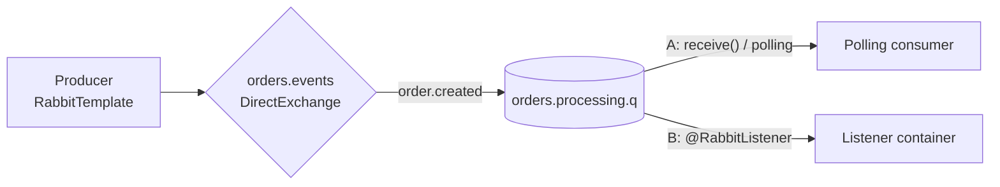
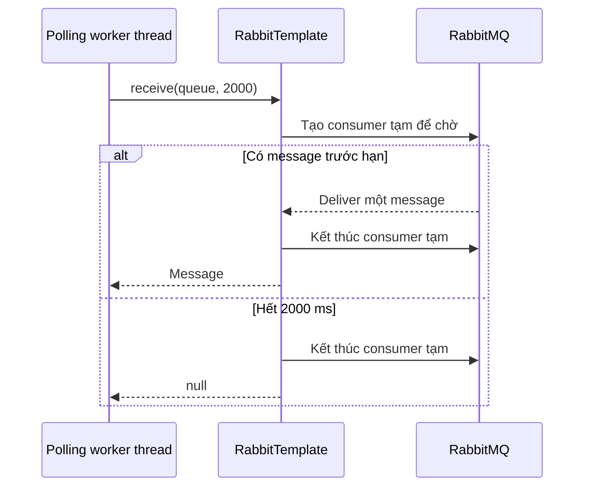
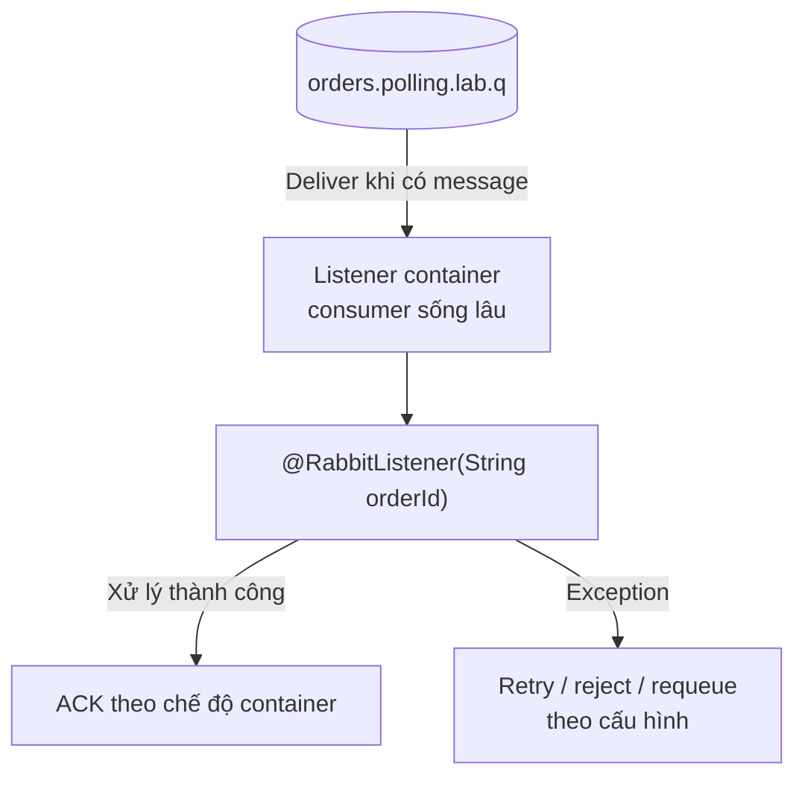
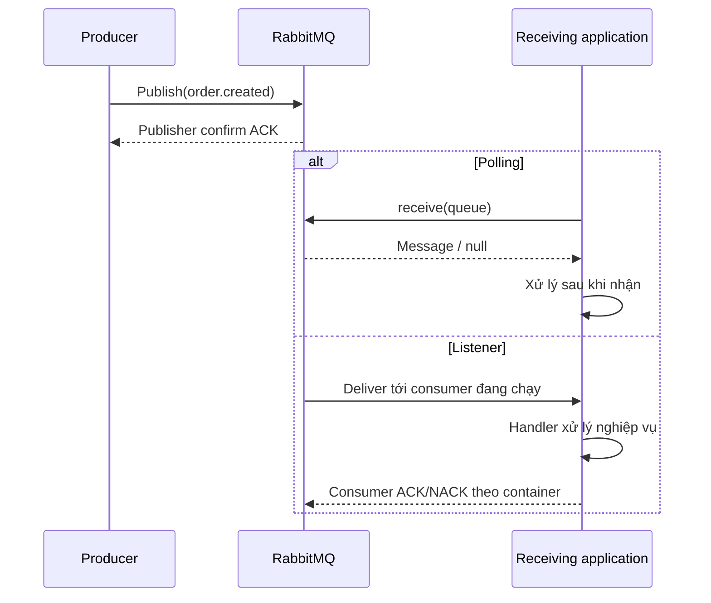

# Nhận ngay, chờ có thời hạn và chi phí polling

Trong Spring AMQP, producer có thể gửi message bằng `RabbitTemplate.convertAndSend(...)` và consumer có thể nhận thông điệp theo **hai mô hình khác nhau**:

- **Polling (chủ động hỏi):** ứng dụng gọi `RabbitTemplate.receive(...)` để lấy **một message** từ queue. Lời gọi có thể trả về ngay hoặc chờ trong một khoảng thời gian.
- **Listener bất đồng bộ:** ứng dụng khai báo `@RabbitListener`; listener container giữ consumer hoạt động và nhận delivery khi broker có message.

Bài thuộc chương **Nhận thông điệp** của module **SPRING_AMQP**. Chủ đề trọng tâm là **nhận ngay, chờ có thời hạn và chi phí polling**: vì sao `null` là kết quả bình thường, các mức timeout khác nhau hoạt động ra sao, khi nào polling hữu ích, khi nào nó gây tải không cần thiết, và vì sao hệ thống xử lý sự kiện liên tục thường ưu tiên listener container.

Những điểm cần đạt:

1. Phân biệt `receive(queue)`, `receive(queue, 0)`, `receive(queue, timeoutMillis)`, `receiveAndConvert(...)` và `@RabbitListener`.
2. Giải thích ý nghĩa của timeout bằng **0**, **số dương** và **số âm**.
3. Nhận biết chi phí yêu cầu broker liên tục, thread bị giữ khi chờ và consumer tạm trong timed receive.
4. Viết ví dụ Spring Boot với `DirectExchange`, queue, binding, `RabbitTemplate` và hai cách nhận message có thể thử độc lập.
5. Đưa ra chiến lược scheduling, backoff, concurrency và quan sát để tránh busy polling.
6. Hiểu giới hạn của polling đối với acknowledgement, retry, dead-letter, giao dịch và xử lý trùng.

## 1. Vì sao consumer cần hai kiểu nhận?

Giả sử `Order Service` phát sự kiện `order.created`. Hệ thống thông báo thường cần nhận sự kiện liên tục; ngược lại, một lệnh quản trị thỉnh thoảng chỉ muốn lấy một message trong queue để kiểm tra.

Hai nhu cầu này khác nhau:

| Nhu cầu | Cách tiếp cận thường phù hợp | Vì sao |
|---|---|---|
| Xử lý hàng nghìn đơn mỗi phút | `@RabbitListener` | Consumer tồn tại lâu dài, nhận message theo delivery của broker |
| Công cụ quản trị lấy thử một message | `RabbitTemplate.receive(queue)` | Chủ động lấy một message tại đúng thời điểm yêu cầu |
| Một tác vụ chỉ muốn chờ tối đa 2 giây | `receive(queue, 2000)` | Đặt giới hạn rõ ràng cho một lời gọi |
| Job định kỳ xử lý tối đa N message mỗi lượt | Poll có giới hạn số lượng, lịch chạy và giám sát | Dễ kiểm soát cửa sổ xử lý theo yêu cầu |
| Tác vụ nghiệp vụ cần xử lý liên tục, retry/ACK có kiểm soát | Listener container | Tách vòng đời consumer khỏi thread gọi và hỗ trợ quản lý delivery |
| API HTTP cần biết một message sẽ đến hay không | Xem xét thiết kế API; không tự động dùng polling vô hạn | Chờ message chiếm tài nguyên request và khó đặt SLA |

Đây không phải hai loại queue: **cùng một RabbitMQ queue** có thể được đọc bằng các cơ chế khác nhau. Tuy nhiên, nếu một poller và một listener cùng tiêu thụ một queue, chúng **cạnh tranh nhận delivery**, không tự động nhân bản thông điệp cho nhau.



Trong sơ đồ, A và B là **hai lựa chọn hoặc hai consumer cạnh tranh**. Một message ở queue thường được giao cho **một** consumer tại một thời điểm; nếu A đã lấy message, B không tự nhận thêm một bản sao.

## 2. API nhận một message của RabbitTemplate

`RabbitTemplate` triển khai giao diện `AmqpTemplate` và có các phương thức nhận message:

```java
Message receive();
Message receive(String queueName);

Message receive(long timeoutMillis);
Message receive(String queueName, long timeoutMillis);
```

Có hai nhóm:

- Không truyền `queueName`: template phải có **default receive queue** được cấu hình phù hợp.
- Truyền `queueName`: lấy message từ queue được nêu rõ trong lời gọi. Đây là cách dễ hiểu cho ví dụ và tránh phụ thuộc vào queue mặc định.

Một lời gọi nhận **tối đa một message**. Nếu không có message phù hợp trong khoảng chờ, kết quả là `null`; đó không phải ngoại lệ và không chứng tỏ broker bị lỗi.

### 2.1. Nhận ngay: receive(queue)

Ví dụ:

```java
import org.springframework.amqp.core.Message;
import org.springframework.amqp.rabbit.core.RabbitTemplate;

Message message = rabbitTemplate.receive("orders.processing.q");

if (message == null) {
    System.out.println("Không có message sẵn sàng tại thời điểm poll");
} else {
    System.out.println("Đã nhận body bytes: "
            + message.getBody().length);
}
```

Nếu queue có message đang **ready**, template có thể nhận một message và trả về; nếu không có, lời gọi trả về `null` ngay, không chờ một message tương lai xuất hiện.

Ở mức mô hình AMQP, trường hợp nhận không chờ dùng cơ chế lấy message theo yêu cầu (`basic.get`). Mỗi lần gọi cần trao đổi với broker để kiểm tra. Khi queue trống, việc gọi liên tục vẫn tạo lưu lượng yêu cầu và tiêu thụ tài nguyên.

Một ví dụ tương đương về thời gian chờ:

```java
Message message = rabbitTemplate.receive("orders.processing.q", 0);
```

`timeoutMillis = 0` nghĩa là **không chờ** nếu chưa có message. Trong cấu hình mặc định của template, lời gọi `receive(queue)` cũng có hành vi nhận ngay vì `receiveTimeout` mặc định bằng 0.

### 2.2. Chờ có thời hạn: receive(queue, timeoutMillis)

Ví dụ chờ tối đa hai giây:

```java
Message message = rabbitTemplate.receive(
        "orders.processing.q",
        2_000L
);

if (message == null) {
    System.out.println("Hết thời gian chờ mà không nhận được message");
} else {
    System.out.println("Có message, xử lý tiếp...");
}
```

Có ba kịch bản:

1. **Message đã sẵn sàng:** lời gọi có thể trả về nhanh, không cần dùng hết hai giây.
2. **Queue ban đầu trống, message xuất hiện sau 300 ms:** lời gọi có thể nhận message và kết thúc sớm.
3. **Không có message trong khoảng chờ:** lời gọi trả `null` sau khi đã chờ đến gần thời hạn, không coi là lỗi.

`timeoutMillis` biểu diễn thời gian **chờ nhận message**, tính bằng mili giây. Nó không phải thời gian tối đa để *xử lý nghiệp vụ* sau khi message đã được nhận và cũng không phải publisher `replyTimeout` cho RPC/request-reply.

### 2.3. Timeout âm: chờ vô hạn theo hợp đồng API

```java
Message message = rabbitTemplate.receive(
        "orders.processing.q",
        -1L
);
```

Giá trị nhỏ hơn 0 yêu cầu chờ vô hạn theo API, ít nhất đến khi có message hoặc một sự cố như mất kết nối xảy ra. Với ứng dụng web hay worker cần giới hạn tài nguyên, **tránh dùng timeout âm**:

- Thread gọi có thể bị giữ quá lâu.
- Request HTTP có thể hết hạn ở load balancer/client trước khi broker trả message.
- Việc dừng ứng dụng, hủy tác vụ và giám sát trở nên phức tạp.
- Khi có nhiều lời gọi đồng thời, số thread/channel/consumer đang chờ tăng.

Chờ vô hạn chỉ nên dùng khi thật sự có chiến lược lifecycle, cancellation và recovery phù hợp; trong đa số ứng dụng, listener container là lựa chọn tự nhiên hơn.

### 2.4. Bảng ba chế độ

| Lời gọi | Khi queue chưa có message | Kết quả khi không nhận được |
|---|---|---|
| `receive(queue)` với mặc định | Trả về ngay | `null` |
| `receive(queue, 0)` | Trả về ngay | `null` |
| `receive(queue, 500)` | Chờ tối đa khoảng 500 ms | `null` sau thời hạn |
| `receive(queue, 3000)` | Chờ tối đa khoảng 3 s | `null` sau thời hạn |
| `receive(queue, -1)` | Chờ không giới hạn thông thường | Có thể chờ mãi; lỗi kết nối là trường hợp riêng |

**Chú ý:** số mili giây là **ngưỡng logic**, không phải cam kết rằng tổng thời gian thực tế của lời gọi luôn chính xác đến từng mili giây. Kết nối, lập lịch thread, tải hệ thống và lỗi mạng có thể ảnh hưởng độ trễ đo được.

## 3. receiveTimeout toàn cục và timeout trên từng lời gọi

`RabbitTemplate` có thuộc tính `receiveTimeout` dùng làm thời gian chờ mặc định khi gọi những overload không truyền timeout.

Ví dụ với cấu hình Java do ứng dụng tự điều chỉnh:

```java
rabbitTemplate.setReceiveTimeout(1_000L);

Message message =
        rabbitTemplate.receive("orders.processing.q");
```

Khi đó lời gọi `receive(queue)` có thể chờ tối đa một giây, khác hành vi mặc định là nhận ngay.

Tuy nhiên, `RabbitTemplate` thường là **singleton** được nhiều component sử dụng. Không nên thay đổi `setReceiveTimeout(...)` ở mỗi request HTTP chỉ để chọn thời gian chờ cho request đó; việc thay đổi thuộc tính dùng chung có thể ảnh hưởng lời gọi đồng thời.

**Ưu tiên overload theo từng lần nhận**:

```java
Message immediate =
        rabbitTemplate.receive("orders.processing.q", 0L);

Message waited =
        rabbitTemplate.receive("orders.processing.q", 2_000L);
```

Khi chọn API cần phân biệt ba cấu hình dễ nhầm:

| Tên | Phạm vi |
|---|---|
| `RabbitTemplate.receiveTimeout` | Thời gian chờ **poll/receive** không truyền timeout |
| `RabbitTemplate.replyTimeout` | Thời gian chờ **reply của request/reply** qua `sendAndReceive`/`convertSendAndReceive` |
| `listener.simple.receiveTimeout` của container | Một lựa chọn nội bộ của **listener container**, không đồng nghĩa timeout của `RabbitTemplate.receive(...)` |

Không copy cấu hình timeout của RPC sang polling nếu chưa hiểu tác động.

## 4. Nhận object bằng receiveAndConvert

Nếu cần lấy dữ liệu đã chuyển đổi thay vì raw AMQP message, có thể dùng:

```java
Object value = rabbitTemplate.receiveAndConvert(
        "orders.processing.q",
        1_000L
);
```

Các overload thông dụng:

```java
Object receiveAndConvert();
Object receiveAndConvert(String queueName);
Object receiveAndConvert(long timeoutMillis);
Object receiveAndConvert(String queueName, long timeoutMillis);
```

`receiveAndConvert(...)` nhận một message rồi sử dụng **AMQP MessageConverter** của template để biến body/properties thành Java object. Với message chuỗi phù hợp converter mặc định, kết quả thường là `String`. Với JSON/POJO, phải thống nhất converter, schema và type metadata; không nên ép kiểu mù quáng.

Ví dụ an toàn cho demo chuỗi:

```java
Object payload =
        rabbitTemplate.receiveAndConvert("orders.processing.q", 500);

if (payload == null) {
    System.out.println("Không có message trong khoảng chờ");
} else if (payload instanceof String text) {
    System.out.println("Received: " + text);
} else {
    System.out.println("Unexpected payload type: "
            + payload.getClass().getName());
}
```

**Một message có thể đã được lấy khỏi queue trước khi lỗi chuyển đổi xảy ra.** Việc `receiveAndConvert(...)` ném exception khác với việc `receive(...)` trả `null` vì queue rỗng. Với dữ liệu nghiệp vụ quan trọng, hãy cân nhắc listener container với error handler, retry và DLQ rõ ràng thay vì tự xây vòng poll rồi kỳ vọng framework tự xử lý lỗi sau khi nhận.

## 5. Vì sao polling có chi phí?

Polling không “miễn phí” ngay cả khi queue rỗng. Ứng dụng phải thực hiện một thao tác nhận rồi diễn giải kết quả.

### 5.1. Nhận ngay: chi phí của việc hỏi liên tục

Trong `receive(queue, 0)`, mỗi lần gọi tạo yêu cầu tương ứng để kiểm tra queue. Khi có rất nhiều lần gọi rỗng:

- Broker phải xử lý nhiều yêu cầu không mang giá trị nghiệp vụ.
- Mạng, channel và CPU ứng dụng vẫn phải tham gia.
- Nhiều poller có thể tạo tải đáng kể chỉ để nhận `null`.
- Log quá chi tiết cho mỗi lần poll rỗng làm tốn chi phí lưu trữ và che khuất lỗi thật.

Phản ví dụ cần tránh:

```java
// KHÔNG LÀM: busy polling không nghỉ khi queue trống.
while (running) {
    Message message = rabbitTemplate.receive("orders.processing.q");
    if (message != null) {
        process(message);
    }
}
```

Khi queue rỗng, vòng lặp có thể lặp nhanh theo tốc độ round trip tới broker. Việc tăng số thread hoặc replica ứng dụng sẽ nhân thêm số yêu cầu rỗng.

### 5.2. Chờ có thời hạn: giảm vòng hỏi nhưng tốn consumer tạm

Theo tài liệu chính thức của Spring AMQP, với timeout **khác 0**, việc chờ message dùng cơ chế consumer cho lời gọi nhận và cần tạo một **consumer tạm** cho mỗi lần nhận. Consumer được đăng ký rồi hủy khi có kết quả hoặc hết hạn.



Với một công cụ thỉnh thoảng cần chờ message, chi phí này có thể chấp nhận. Với hệ thống tải cao, **tạo/hủy consumer cho từng message** gây thêm thao tác phía client và broker so với listener container duy trì consumer lâu dài. Đây là lý do Spring AMQP khuyến nghị listener bất đồng bộ, hoặc `receiveTimeout=0` khi muốn polling nhưng cần tránh chi phí consumer tạm.

Không diễn giải timed receive thành “long polling tự động tối ưu như listener”: lời gọi vẫn giữ thread chờ và vẫn tạo consumer tạm theo thiết kế.

### 5.3. Chờ chặn thread gọi

Nếu 200 request HTTP cùng gọi `receive(queue, 5_000)` lúc queue trống, hệ thống có thể giữ gần 200 thread xử lý request trong tối đa khoảng năm giây, cùng với các tài nguyên liên quan đến việc nhận.

Các chi phí có thể thấy:

| Loại chi phí | Poll nhận ngay | Poll chờ có thời hạn |
|---|---|---|
| Yêu cầu tới broker khi queue rỗng | Nhiều nếu lặp dày | Ít vòng lặp hơn khi có thời gian chờ |
| Thời gian giữ thread gọi | Thường ngắn | Có thể bằng thời gian chờ |
| Consumer tạm per receive | Không cần theo cách nhận ngay | Có, theo cơ chế timed receive |
| Độ trễ khi message đến | Phụ thuộc thời điểm poll | Có thể nhận ngay trong thời gian chờ |
| Kiểm soát backpressure | Cần tự thiết kế | Cần tự thiết kế |
| Phù hợp tải cao, liên tục | Thường kém listener | Thường kém listener |

### 5.4. Ước tính số lượt poll rỗng

Nếu mỗi instance gọi một poll không chờ mỗi `T` giây, có `N` instance, và bỏ qua thời gian thao tác, số lượt poll gần đúng mỗi giây là:

```text
polls_per_second ≈ N / T

Ví dụ: 20 instance, cứ 0,1 giây poll một lần:
20 / 0,1 = 200 poll/giây

Nếu trong một phút queue luôn rỗng:
200 * 60 = 12.000 yêu cầu poll rỗng/phút
```

Đây là phép **ước tính tải**, không phải benchmark. Round trip, tốc độ handler, scheduler, thread pool và retry làm số thực tế thay đổi.

Nếu tăng interval từ 100 ms lên 1 giây, số yêu cầu rỗng lý tưởng giảm khoảng mười lần, nhưng độ trễ phát hiện message khi không có poll đang chờ cũng tăng.

### 5.5. Đánh đổi độ trễ và chi phí

| Chiến lược | Khi message xuất hiện | Khi queue rỗng |
|---|---|---|
| Poll mỗi 50 ms | Thường phát hiện sớm | Rất nhiều lần hỏi rỗng |
| Poll mỗi 2 s | Có thể chờ gần 2 s tới lượt poll tiếp | Ít yêu cầu hơn |
| Timed receive 2 s | Nếu message đến trong cửa sổ, có thể nhận sớm | Thread chờ, consumer tạm |
| `@RabbitListener` | Broker phân phối tới consumer đang chạy | Consumer duy trì chờ sự kiện, không tạo lại theo từng lần nhận |

Khi cần xử lý liên tục với độ trễ thấp, listener container thường phù hợp hơn cố tối ưu tần suất polling.

## 6. Thực hành Spring Boot: nhận ngay và chờ tối đa

Bài lab dùng một queue `orders.polling.lab.q`. Producer publish string qua direct exchange; một endpoint nhận ngay, endpoint khác chờ giới hạn. **Trong pha thử polling, không chạy `@RabbitListener` trên cùng queue**, để kết quả có thể quan sát rõ.

### 6.1. Chuẩn bị broker

Có thể chạy RabbitMQ cục bộ với Docker:

```bash
docker run -d --rm --name rabbitmq-polling-lab -p 5672:5672 -p 15672:15672 -e RABBITMQ_DEFAULT_USER=demo -e RABBITMQ_DEFAULT_PASS=demo-local-only rabbitmq:4-management
```

- AMQP: `localhost:5672`.
- Management UI: `http://localhost:15672`.
- Tài khoản lab: `demo` / `demo-local-only`.

Không dùng username/password demo này trên production. Nếu broker/container khác đã dùng các cổng, hãy điều chỉnh môi trường thực hành.

### 6.2. Dependencies và cấu hình kết nối

Với Spring Boot **4.2.x** và RabbitMQ AMQP 0-9-1:

```groovy
dependencies {
    implementation 'org.springframework.boot:spring-boot-starter-rabbitmq'
    implementation 'org.springframework.boot:spring-boot-starter-web'
}
```

Với Spring Boot **3.x hoặc 4.0–4.1**, RabbitMQ AMQP 0-9-1 dùng `spring-boot-starter-amqp` thay cho starter RabbitMQ ở trên. Chọn **một** trong hai theo phiên bản Boot; các ví dụ dưới đây dùng API Spring AMQP `RabbitTemplate` thống nhất.

Cấu hình `application.yml`:

```yaml
spring:
  rabbitmq:
    host: localhost
    port: 5672
    username: demo
    password: demo-local-only
    publisher-confirm-type: correlated
    publisher-returns: true
    template:
      mandatory: true
```

Những thuộc tính confirm/return cho phép mở rộng chẩn đoán đường gửi; chỉ khai báo chúng không có nghĩa ứng dụng đã theo dõi callback xác nhận. Tài khoản lab và topology dùng để học, không phải mẫu cấu hình bảo mật production.

### 6.3. Khai báo exchange, queue, binding

Tạo `PollingTopology.java` trong package được Spring Boot quét:

```java
import org.springframework.amqp.core.Binding;
import org.springframework.amqp.core.BindingBuilder;
import org.springframework.amqp.core.DirectExchange;
import org.springframework.amqp.core.Queue;
import org.springframework.amqp.core.QueueBuilder;
import org.springframework.context.annotation.Bean;
import org.springframework.context.annotation.Configuration;

@Configuration
public class PollingTopology {
    public static final String EXCHANGE = "orders.polling.direct";
    public static final String QUEUE = "orders.polling.lab.q";
    public static final String ROUTING_KEY = "order.created";

    @Bean
    DirectExchange pollingExchange() {
        return new DirectExchange(EXCHANGE, true, false);
    }

    @Bean
    Queue pollingQueue() {
        return QueueBuilder.durable(QUEUE).build();
    }

    @Bean
    Binding pollingBinding(Queue pollingQueue,
                           DirectExchange pollingExchange) {
        return BindingBuilder.bind(pollingQueue)
                .to(pollingExchange)
                .with(ROUTING_KEY);
    }
}
```

Spring Boot cùng `RabbitAdmin` mặc định có thể khai báo các bean topology trên broker khi đủ điều kiện. Exchange quyết định queue đích theo binding; `receive(...)` **lấy trực tiếp từ tên queue**, không đọc từ exchange.

### 6.4. Publisher gửi message dạng chuỗi

Tạo `LabPublisher.java`:

```java
import org.springframework.amqp.rabbit.core.RabbitTemplate;
import org.springframework.stereotype.Service;

@Service
public class LabPublisher {
    private final RabbitTemplate rabbitTemplate;

    public LabPublisher(RabbitTemplate rabbitTemplate) {
        this.rabbitTemplate = rabbitTemplate;
    }

    public void send(String orderId) {
        rabbitTemplate.convertAndSend(
                PollingTopology.EXCHANGE,
                PollingTopology.ROUTING_KEY,
                orderId
        );
    }
}
```

Đặt `String` trong payload giúp ví dụ không bị phân tán sang JSON converter/schema. Với DTO và `receiveAndConvert`, bạn cần bảo đảm converter hai phía tương thích.

### 6.5. Polling service đo thời gian chờ

Tạo record `PollResult.java`:

```java
public record PollResult(
        boolean found,
        String body,
        long elapsedMillis
) {}
```

Tạo service `LabPollingReceiver.java`:

```java
import java.nio.charset.StandardCharsets;
import java.util.concurrent.TimeUnit;
import org.springframework.amqp.core.Message;
import org.springframework.amqp.rabbit.core.RabbitTemplate;
import org.springframework.stereotype.Service;

@Service
public class LabPollingReceiver {
    private final RabbitTemplate rabbitTemplate;

    public LabPollingReceiver(RabbitTemplate rabbitTemplate) {
        this.rabbitTemplate = rabbitTemplate;
    }

    public PollResult pollNow() {
        return poll(0);
    }

    public PollResult poll(long timeoutMillis) {
        long started = System.nanoTime();

        Message message = rabbitTemplate.receive(
                PollingTopology.QUEUE,
                timeoutMillis
        );

        long elapsed = TimeUnit.NANOSECONDS.toMillis(
                System.nanoTime() - started
        );

        if (message == null) {
            return new PollResult(false, null, elapsed);
        }

        String body = new String(
                message.getBody(),
                StandardCharsets.UTF_8
        );
        return new PollResult(true, body, elapsed);
    }

    public Object pollAndConvert(long timeoutMillis) {
        return rabbitTemplate.receiveAndConvert(
                PollingTopology.QUEUE,
                timeoutMillis
        );
    }
}
```

Bốn điều cần chú ý:

1. `pollNow()` truyền `0` nên trả về ngay khi không có message.
2. `poll(timeoutMillis)` có thể chờ tối đa thời hạn để nhận **một message**.
3. Khi trả `found=false`, đó là **không nhận được trong lần thử**, không phải bằng chứng message sẽ không đến sau đó.
4. `elapsedMillis` đo toàn bộ thời gian lời gọi trên máy; nó có thể lớn hơn hoặc nhỏ hơn timeout tùy tình huống cụ thể.

Trong ví dụ, `String` được đọc từ `byte[]` theo UTF-8. Với payload dạng khác, hãy dùng converter/schema phù hợp và kiểm tra `contentType`, không giả định mọi message là văn bản.

### 6.6. HTTP endpoint có giới hạn thời gian

Tạo `LabPollingController.java`:

```java
import org.springframework.http.ResponseEntity;
import org.springframework.web.bind.annotation.PathVariable;
import org.springframework.web.bind.annotation.PostMapping;
import org.springframework.web.bind.annotation.RequestParam;
import org.springframework.web.bind.annotation.RestController;

@RestController
public class LabPollingController {
    private final LabPublisher publisher;
    private final LabPollingReceiver receiver;

    public LabPollingController(
            LabPublisher publisher,
            LabPollingReceiver receiver) {
        this.publisher = publisher;
        this.receiver = receiver;
    }

    @PostMapping("/lab/publish/{orderId}")
    public ResponseEntity<Void> publish(@PathVariable String orderId) {
        publisher.send(orderId);
        return ResponseEntity.accepted().build();
    }

    @PostMapping("/lab/poll/now")
    public PollResult pollNow() {
        return receiver.pollNow();
    }

    @PostMapping("/lab/poll/wait")
    public PollResult pollWait(
            @RequestParam(defaultValue = "2000") long timeoutMillis) {
        if (timeoutMillis < 0 || timeoutMillis > 5000) {
            throw new IllegalArgumentException(
                    "timeoutMillis must be between 0 and 5000");
        }
        return receiver.poll(timeoutMillis);
    }
}
```

**Vì sao dùng POST cho poll?** Việc nhận message có tác dụng tiêu thụ/xóa một delivery khỏi queue theo cơ chế API. Không nên để một request `GET` có vẻ chỉ đọc lại ngầm làm thay đổi trạng thái queue và vô tình bị proxy/cache/prefetch gọi.

**Vì sao chặn timeout âm và giới hạn 5.000 ms?** Người gọi HTTP không nên tự ép server giữ thread vô thời hạn. Trong ứng dụng thật, cần xử lý validation thành lỗi HTTP 400 thích hợp; đoạn trên tập trung vào API polling.

### 6.7. Chạy và kiểm thử

Đặt các lớp trong package được `@SpringBootApplication` quét rồi chạy ứng dụng. Khi chưa publish:

```bash
curl -X POST http://localhost:8080/lab/poll/now
```

Kết quả tương tự:

```json
{"found":false,"body":null,"elapsedMillis":12}
```

Thời gian trên **chỉ là số ví dụ**, không phải cam kết 12 ms.

Thử chờ hai giây khi không có message:

```bash
curl -X POST 'http://localhost:8080/lab/poll/wait?timeoutMillis=2000'
```

Nếu không có message nào xuất hiện, kết quả có thể giống:

```json
{"found":false,"body":null,"elapsedMillis":2007}
```

Trong khi một terminal đang gọi endpoint chờ, mở terminal khác và publish message:

```bash
curl -X POST http://localhost:8080/lab/publish/order-42
```

Nếu message xuất hiện trước timeout và poller giành được delivery, endpoint chờ có thể trả:

```json
{"found":true,"body":"order-42","elapsedMillis":430}
```

Để thử `pollNow()` khi có sẵn message, publish trước rồi gọi endpoint ngay. Có thể kết hợp nhiều lần publish để quan sát mỗi poll chỉ lấy một message:

```bash
curl -X POST http://localhost:8080/lab/publish/order-43
curl -X POST http://localhost:8080/lab/publish/order-44
curl -X POST http://localhost:8080/lab/poll/now
curl -X POST http://localhost:8080/lab/poll/now
```

Kết quả thực tế phụ thuộc số message đang ready và các consumer khác. HTTP `202` của endpoint publish **không đồng nghĩa** consumer đã lấy message và cũng chưa bảo đảm publisher confirm được ứng dụng ghi nhận.

### 6.8. Quan sát trong RabbitMQ Management UI

Truy cập `http://localhost:15672`, chọn queue `orders.polling.lab.q` và quan sát:

- **Ready:** message chưa được giao cho consumer.
- **Unacknowledged:** delivery đã giao nhưng chưa được ACK theo cơ chế liên quan.
- **Consumer count:** timed receive có thể tạo consumer ngắn hạn trong lúc chờ, còn listener container duy trì consumer lâu dài.
- **Get / deliver / ack rate:** giúp phân biệt poll nhận ngay và message đến qua consumer.
- **Connections / Channels:** dùng để đánh giá tải khi nhiều poll đồng thời.

Không nên kết luận queue hỏng chỉ vì số consumer bằng 0 khi không có poll chờ: nhận ngay không cần giữ consumer lâu dài.

## 7. Thử cùng queue với @RabbitListener

Trong hệ thống cần nhận message liên tục, thay vì vòng polling, thường dùng:

```java
import org.springframework.amqp.rabbit.annotation.RabbitListener;
import org.springframework.context.annotation.Profile;
import org.springframework.stereotype.Component;

@Profile("listener-mode")
@Component
public class OrdersContinuousListener {
    @RabbitListener(queues = PollingTopology.QUEUE)
    public void onOrderCreated(String orderId) {
        System.out.println("Listener processed: " + orderId);
    }
}
```

Lớp này chỉ được tạo khi profile `listener-mode` được bật. Vì vậy trong pha thử polling mặc định, không có listener cạnh tranh nhận từ queue. Khi muốn chuyển sang chế độ listener, bật profile phù hợp cho một lần chạy riêng:

```bash
java -jar app.jar --spring.profiles.active=listener-mode
```

Tên `app.jar` là minh họa cho artifact JAR do dự án tạo; dùng đường dẫn JAR thực tế của bạn. Khi profile này bật, hãy **tránh thử polling cùng queue đồng thời** nếu muốn đối chiếu thời gian/khả năng nhận một cách công bằng.

### 7.1. Vì sao listener container phù hợp xử lý liên tục?

`@RabbitListener` được chạy bởi một **listener container** quản lý vòng đời consumer, connection/channel, prefetch, concurrency và acknowledgement. Broker có thể phân phối message tới consumer đang đăng ký, không yêu cầu ứng dụng tự lặp `receive()`.



Không có nghĩa listener luôn tốt hơn trong **mọi** bài toán. Với lệnh quản trị lấy đúng một message theo yêu cầu, `receive(queue, 0)` có thể đơn giản và trực tiếp hơn. Nhưng nếu yêu cầu là “chạy 24/7 và xử lý mọi event đến”, tạo một listener container thường dễ vận hành hơn custom polling loop.

### 7.2. So sánh chi tiết

| Tiêu chí | Poll nhận ngay | Timed receive | `@RabbitListener` |
|---|---|---|---|
| Cơ chế | Client chủ động hỏi | Client đăng ký chờ trong thời hạn | Broker giao qua consumer sống lâu |
| Khi queue rỗng | Trả `null` ngay | Giữ thread chờ | Container duy trì trạng thái consumer |
| Consumer được tạo | Không cần consumer tạm | Tạo theo lần nhận | Tạo khi container khởi động, tái sử dụng |
| Độ trễ nhận | Phụ thuộc lịch polling | Nhận khi message xuất hiện trong cửa sổ chờ | Thường thấp khi consumer sẵn sàng |
| Tải khi nhàn rỗi | Cao nếu lặp quá dày | Có chi phí thread/consumer đang chờ | Không cần tái tạo consumer cho từng message |
| Giới hạn concurrency | Tự tổ chức loop/scheduler | Tự giới hạn các lời gọi chờ | Factory/container hỗ trợ trực tiếp |
| ACK/retry/DLQ | Cần hiểu semantics template và tự thiết kế logic nghiệp vụ | Tương tự, không tự có lifecycle handler như listener | Có cơ chế container, error handler và cấu hình retry |
| Phù hợp | Công cụ, job ít chạy, kiểm tra thủ công | Chờ một message trong cửa sổ ngắn | Worker nghiệp vụ chạy thường xuyên |

## 8. Polling có lịch: tránh busy loop

Khi mục tiêu là job theo lịch, hãy đặt **khoảng nghỉ có kiểm soát** giữa các lần nhận thay vì `while(true)` không nghỉ. Một lựa chọn là Spring scheduling.

Ví dụ thành phần chỉ kích hoạt trong profile `scheduled-polling`:

```java
import org.springframework.amqp.core.Message;
import org.springframework.amqp.rabbit.core.RabbitTemplate;
import org.springframework.context.annotation.Profile;
import org.springframework.scheduling.annotation.Scheduled;
import org.springframework.stereotype.Component;

@Profile("scheduled-polling")
@Component
public class ScheduledOrderPoller {
    private final RabbitTemplate rabbitTemplate;

    public ScheduledOrderPoller(RabbitTemplate rabbitTemplate) {
        this.rabbitTemplate = rabbitTemplate;
    }

    @Scheduled(fixedDelayString = "${lab.poll.delay-ms:1000}")
    public void pollOnce() {
        Message message =
                rabbitTemplate.receive(PollingTopology.QUEUE, 0);

        if (message == null) {
            return; // Không log WARN cho mỗi lần queue rỗng.
        }

        System.out.println("Scheduled poll received body bytes="
                + message.getBody().length);
    }
}
```

Để bật `@Scheduled`, thêm `@EnableScheduling` vào một bean/configuration phù hợp, rồi chạy ứng dụng với profile `scheduled-polling`. Code trên minh họa **nhận tối đa một message mỗi chu kỳ** và cố ý không triển khai nghiệp vụ sau khi nhận.

**Lưu ý cú pháp:** biểu thức property placeholder trong `fixedDelayString` dùng `${lab.poll.delay-ms:1000}`, giá trị mặc định là 1.000 ms. Đặt cấu hình này cho việc thử job; không đồng thời bật `listener-mode` nếu muốn tránh competing consumers.

### 8.1. Đặt giới hạn số message mỗi lượt

Nếu queue có backlog lớn, một message mỗi giây có thể không đủ. Thay vì giảm interval xuống vài mili giây, có thể thiết kế mỗi đợt xử lý tối đa `N` message với timeout 0:

```java
public int drainUpTo(int maxMessages) {
    int processed = 0;

    for (int i = 0; i < maxMessages; i++) {
        Message message = rabbitTemplate.receive(
                PollingTopology.QUEUE, 0
        );
        if (message == null) {
            break;
        }

        processMessage(message);
        processed++;
    }

    return processed;
}
```

Đoạn code là **phương thức minh họa** nằm trong service có `rabbitTemplate` và hàm `processMessage(...)` được định nghĩa; không phải file Java hoàn chỉnh độc lập. Cần giới hạn `maxMessages`, độ dài một chu kỳ, xử lý exception và cách đảm bảo message không mất khi nghiệp vụ lỗi.

Tăng batch size không tự làm polling có semantics giống listener. Đặc biệt, khi message đã được lấy khỏi queue, exception ở `processMessage(...)` có thể **không được broker tự retry như listener ném exception trước ACK**. Với tác vụ quan trọng, sử dụng listener hoặc xây quy trình chuyển trạng thái nghiệp vụ riêng phù hợp.

### 8.2. Backoff khi queue liên tục rỗng

Nếu workload đến theo từng đợt thưa thớt, có thể chọn adaptive polling:

```text
Có message:
    giảm delay về mức thấp nhất để xử lý backlog

Không có message:
    tăng delay theo cấp số nhân tới ngưỡng tối đa
    thêm jitter nhỏ giữa các instance

Ví dụ:
    100 ms → 200 ms → 400 ms → 800 ms → tối đa 2 s
```

Backoff giảm lượt hỏi rỗng nhưng có thể làm tăng latency khi event mới đến. Jitter giúp tránh tất cả poller cùng thức dậy đúng một thời điểm gây burst tải lên broker.

Nếu yêu cầu độ trễ thấp ngay cả khi traffic rất thưa, một listener container chờ delivery thường tốt hơn thuật toán polling phức tạp.

## 9. Acknowledgement: điều gì xảy ra sau khi poll lấy message?

Đây là ranh giới quan trọng cho độ tin cậy.

**Nhận message** và **xử lý nghiệp vụ thành công** không phải một sự kiện. Khi `RabbitTemplate.receive(...)` trả về một message, thao tác nhận/ack thuộc scope do template quản lý; template **không tự biết rằng mã ứng dụng sẽ ghi database, gửi email hay gọi API thành công sau đó**.

Ví dụ:

```java
Message message =
        rabbitTemplate.receive("orders.processing.q", 0);

if (message != null) {
    // Thao tác này có thể lỗi SAU KHI template đã nhận message.
    saveOrderToDatabase(message);
}
```

Nếu `saveOrderToDatabase(...)` ném exception, không nên mặc định RabbitMQ tự giao lại message như trong listener container với error handler thích hợp. Trong chế độ template nhận thông thường, việc broker đã chấp nhận xử lý delivery/ACK có thể tách khỏi bước nghiệp vụ xảy ra **sau** `receive(...)`.

Do đó:

- Polling đơn giản phù hợp với thao tác nhẹ, công cụ hỗ trợ hoặc khi tác vụ có cơ chế bù/phát lại độc lập.
- Với sự kiện quan trọng cần ACK **sau** khi nghiệp vụ hoàn tất, hãy ưu tiên `@RabbitListener` có acknowledge mode và error handling phù hợp.
- Nếu phải tự kiểm soát ACK bằng API thấp, cần quản lý channel, delivery tag, giao dịch và lifecycle một cách cẩn trọng; không mặc định `RabbitTemplate.receive(...)` cung cấp cùng cơ chế `basicAck(...)` tùy ý như listener có tham số `Channel`.

### 9.1. Consumer ACK không giống publisher confirms



Publisher confirm kiểm tra chặng **producer → broker**; consumer acknowledgement kiểm tra chặng **broker → consumer**. Một phương thức `receive(...)` trả về có payload không đồng nghĩa nghiệp vụ downstream đã commit thành công.

### 9.2. Retry và dead-letter

Nếu consumer gặp lỗi tạm thời, hệ thống cần retry có giới hạn, backoff và cách đưa message lỗi không thể phục hồi vào DLQ. Với listener container, bạn có thể cấu hình retry interceptor/error handler và chọn reject/requeue để tương tác với DLX/DLQ.

Với một poller đơn giản, khi mã đã lấy message rồi thất bại, đừng tin rằng DLQ sẽ tự nhận message chỉ vì queue có `x-dead-letter-exchange`. DLX được kích hoạt bởi những điều kiện broker cụ thể như hết TTL hoặc reject/nack với chính sách phù hợp, **không phải bất kỳ exception Java nào sau `receive(...)`**.

Nếu polling là yêu cầu bắt buộc, cân nhắc quy trình bù: ghi nhận job bền vững, chuyển dữ liệu sang vùng xử lý có kiểm soát, hoặc sử dụng queue/workflow riêng và chính sách tái phát phù hợp. Đừng tự triển khai publisher lại payload trong catch mà không có event ID, retry limit và khả năng chống trùng.

## 10. Timeout không phải transaction hay giới hạn nghiệp vụ

Một số nhầm lẫn cần tách riêng:

| Khái niệm | Mục đích |
|---|---|
| `receive(queue, 1000)` | Chờ tối đa khoảng một giây để **có một message** |
| `RabbitTemplate.setReceiveTimeout(...)` | Cấu hình timeout mặc định cho **polling receive** |
| `RabbitTemplate.setReplyTimeout(...)` | Chờ câu trả lời trong mô hình **request/reply** |
| HTTP request timeout | Giới hạn việc client/gateway chờ phản hồi HTTP |
| Transaction timeout | Giới hạn thời gian cho transaction theo cơ chế tương ứng |
| Business processing deadline | SLA xử lý đơn, thanh toán, gửi email... |
| Queue TTL/message TTL | Thời hạn của queue/message do RabbitMQ áp dụng |

Bạn có thể chờ nhận 2 giây, sau đó xử lý database trong 30 giây. Tăng `receiveTimeout` không giới hạn nghiệp vụ 30 giây đó. Nếu cần deadline end-to-end, phải thiết kế timeout và cancellation ở các chặng khác nhau.

Quorum queue, durable queue, publisher confirms và transactional outbox giúp bảo vệ các chặng dữ liệu riêng, không biến polling thành một transaction phân tán nguyên tử với database.

## 11. Nhiều poller và tính cạnh tranh trên queue

Giả sử có ba instance chạy `receive(queue, 0)` mỗi 500 ms:

- Mỗi instance có thể nhận message khác nhau.
- Cùng một message không được broker cố ý gửi cho tất cả poller như broadcast.
- Thứ tự xử lý có thể khác thứ tự publish vì timing, concurrency, redelivery, processing time.
- Thời điểm poller hỏi không bảo đảm queue luôn có message ready, nhất là khi consumer khác đã prefetch.
- Nếu nhiều poller nhận `null`, đó là kết quả của **những thời điểm quan sát**, không chứng tỏ producer ngừng phát.

### 11.1. Null có nghĩa gì và không có nghĩa gì?

`receive(queue, timeout) == null` có thể có nghĩa **không có message mà lời gọi đó nhận được trong thời gian quan sát**.

Nó **không chứng minh**:

- Queue chưa từng có message.
- Sẽ không có message sau đó.
- Producer đã ngừng gửi.
- Không có message đang unacknowledged ở consumer khác.
- Broker không có message ở queue khác do routing key/binding khác.
- Ứng dụng có thể coi một job nghiệp vụ đã hoàn tất.

Đặc biệt, nếu RabbitMQ Management hiển thị `messages_unacknowledged > 0`, queue vẫn có delivery đang được giữ bởi consumer khác, nhưng poller mới có thể không nhận được ngay.

### 11.2. “Chỉ một message mỗi lần” ảnh hưởng throughput

Một lời gọi `receive(...)` trả về tối đa một message. Nếu mỗi vòng gồm 1 network round trip + xử lý + khoảng nghỉ, throughput của một poller bị giới hạn bởi tổng thời gian đó.

Ví dụ lý tưởng:

```text
Thời gian mỗi vòng:
  nhận message: 10 ms
  xử lý nghiệp vụ: 40 ms
  delay trước lần kế: 200 ms

Tổng: khoảng 250 ms/vòng
Throughput lý tưởng: 1 / 0,25 = 4 message/s/poller

Đây chỉ là mô hình đơn giản, không phải số đo thực tế.
```

Tăng số poller có thể nâng throughput nhưng cũng tăng concurrency, số yêu cầu rỗng và áp lực lên database. Với công việc liên tục, điều chỉnh concurrency/prefetch trên listener container thường rõ ràng và dễ vận hành hơn.

## 12. Quan sát chi phí polling và cách chẩn đoán

Để quyết định giữ hay bỏ polling, hãy đo thay vì phỏng đoán.

| Chỉ số | Câu hỏi cần trả lời |
|---|---|
| Poll attempts/s | Mỗi instance gọi `receive(...)` bao nhiêu lần? |
| Empty poll ratio | Bao nhiêu phần trăm lượt trả `null`? |
| Poll duration p50/p95/p99 | Chi phí network/broker/chờ timeout thực tế? |
| Messages received/s | Poll có xử lý được workload hiện tại không? |
| Processing duration | Phần thời gian nào nằm ở nghiệp vụ, không phải thời gian chờ? |
| Queue ready/unacknowledged | Message đang chờ hay bị giữ bởi consumer khác? |
| Consumer count và churn | Timed receive tạo/hủy bao nhiêu consumer tạm? |
| Connections/channels | Có quá nhiều channel hoặc lỗi checkout timeout không? |
| Retry/redelivery/DLQ depth | Có lỗi nghiệp vụ hoặc khả năng mất message ở tầng consumer không? |
| Publisher confirm/returns | Producer có gửi đúng exchange/routing key không? |
| Thread pool utilization | Có quá nhiều thread bị giữ chờ polling? |

### 12.1. Kỳ vọng đo đạc

Ví dụ một hệ thống có `emptyPollRatio=99%`, 100 instance, mỗi instance poll 10 lần mỗi giây: đó là tín hiệu để xem lại cơ chế tiêu thụ hoặc điều chỉnh nhịp poll. Nếu hàng đợi thường xuyên có backlog và thời gian xử lý tăng, cần xem cả số worker, lỗi handler và downstream bottleneck.

Không nên chỉ quan sát CPU ứng dụng. Broker có thể xử lý nhiều lượt hỏi rỗng trong khi CPU ứng dụng vẫn thấp, đặc biệt khi phần lớn thời gian chờ I/O.

### 12.2. Chẩn đoán null và timeout

| Hiện tượng | Cần kiểm tra |
|---|---|
| Luôn trả `null` dù producer nói đã gửi | Đúng queue, vhost, binding, routing key? Producer có bị return `NO_ROUTE` không? |
| Chờ 2 giây nhưng thường kết thúc sau vài ms | Có message sẵn trong queue hoặc consumer khác? |
| Chờ 2 giây rồi trả null | Không có message được nhận trong cửa sổ; không mặc định kết luận broker lỗi |
| Timed receive chậm dưới tải cao | Số lời gọi đồng thời, consumer churn, network, channel cache |
| Queue ready tăng khi job poll chậm | Khoảng nghỉ quá dài hoặc throughput mỗi poll quá thấp |
| Queue unacknowledged cao nhưng poll null | Các consumer khác đang giữ delivery/prefetch |
| Message được poll rồi nghiệp vụ thất bại | Kiểm tra semantics ACK và quy trình bù/retry; không mặc định DLQ tự nhận |
| Có listener nhưng poll không thấy message | Competing consumers: listener có thể đã lấy message |
| HTTP request treo lâu | Timeout âm hoặc positive timeout quá dài, thread pool bị giữ |
| Polling rất nhiều nhưng không có kết quả | Busy loop, sai queue, không có event, broker/routing misconfiguration |

## 13. Khi nào nên dùng polling và khi nào cần chuyển sang listener?

**Polling hợp lý** khi:

- Một công cụ chẩn đoán hoặc job ít chạy chỉ cần thử lấy một message.
- Một workflow có cửa sổ xử lý theo lịch rõ ràng và dữ liệu không quan trọng đến mức phải tự thiết kế ACK sau xử lý.
- Cần kiểm tra một queue trong lab, test hoặc thao tác vận hành có kiểm soát.
- Yêu cầu nghiệp vụ cố ý chủ động lấy một lượng nhỏ message tại những thời điểm xác định.

**Nên dùng listener** khi:

- Consumer cần hoạt động 24/7, đón message liên tục với độ trễ thấp.
- Tải nhận lớn hoặc nhiều instance, polling tạo nhiều lượt hỏi rỗng.
- Cần concurrency, prefetch, ACK/NACK, retry, DLQ và lỗi consumer được framework quản lý.
- Muốn giám sát backlog và autoscaling theo queue depth/processing rate mà không tự vận hành polling loop.
- Xử lý nghiệp vụ quan trọng cần kết hợp consumer idempotency với transaction database.

Việc đổi từ polling sang listener không cần đổi exchange/queue/binding nếu wire contract vẫn giữ nguyên. Nhưng cần xem lại **acknowledgement mode, retry policy, lỗi conversion, concurrency và idempotency** trước khi triển khai, vì semantics khi lỗi có thể khác.

## 14. Bài tập thực hành

### Bài 1 — Dự đoán kết quả

Queue hiện đang trống. Hãy giải thích kỳ vọng của năm lời gọi:

```java
receive("orders.polling.lab.q");
receive("orders.polling.lab.q", 0);
receive("orders.polling.lab.q", 500);
receive("orders.polling.lab.q", 5_000);
receive("orders.polling.lab.q", -1);
```

Đâu là lời gọi trả ngay, đâu là lời gọi có thời hạn, đâu là chờ không giới hạn? Vì sao `null` không phải exception?

### Bài 2 — So sánh nhận ngay và chờ

Chạy ví dụ ở mục 6. Gọi `/lab/poll/now` khi queue trống, sau đó gọi `/lab/poll/wait?timeoutMillis=3000` và publish message từ terminal khác sau khoảng 500 ms. Đo `elapsedMillis` và giải thích vì sao lời gọi chờ không nhất thiết dùng hết ba giây.

### Bài 3 — Chi phí poll rỗng

Có 40 instance, mỗi instance gọi `receive(queue, 0)` một lần mỗi 200 ms. Nếu queue trống suốt một phút, ước tính số lần poll rỗng trong một phút (bỏ qua thời gian round trip). Nếu tăng khoảng nghỉ lên 2 giây thì con số giảm bao nhiêu lần?

### Bài 4 — Phân biệt template timeout

Một developer cấu hình `RabbitTemplate.replyTimeout=5000` rồi ngạc nhiên vì `receive(queue)` vẫn trả `null` ngay. Hãy phân tích nguyên nhân và nêu hai cách đặt đúng receive timeout.

### Bài 5 — Timed receive dưới tải

Một API tạo 300 request đồng thời, mỗi request gọi `receive(queue, 10_000)`. Đề xuất các chỉ số cần đo, điểm nghẽn dự kiến và cách giới hạn timeout/thread pool. Trong tình huống nào nên thay API đó bằng job bất đồng bộ hoặc listener?

### Bài 6 — Competing consumers

Chạy đồng thời profile `listener-mode` và endpoint polling trên cùng queue, publish 10 message. Poller có nhất thiết nhận đúng năm message không? Vì sao không? Thiết kế lại topology thế nào nếu muốn hai hệ thống **đều** nhận mỗi event?

### Bài 7 — Xử lý lỗi sau receive

Poller nhận message, sau đó ghi database thất bại. Có thể mặc định RabbitMQ tự NACK và đưa message vào DLQ không? Hãy đề xuất cách chuyển sang listener có ACK sau nghiệp vụ, và cách bảo vệ idempotency bằng `eventId`.

### Bài 8 — Thiết kế scheduler

Hãy thiết kế một job polling chạy sau mỗi một giây, lấy tối đa 20 message, có giới hạn thời gian chạy, retry/backoff khi broker lỗi và metric `empty_poll_ratio`. Giải thích khi nào scheduler này vẫn không tối ưu bằng listener container.

### Bài 9 — Transactional outbox

Order Service commit database rồi gọi `convertAndSend(...)`, nhưng kết nối mất trước khi nhận publisher confirm. Poller lấy message và xử lý, nhưng kết quả xử lý sau nhận bị lỗi. Hãy chỉ ra **hai điểm rủi ro độc lập** và đề xuất outbox + consumer idempotency/DLQ để bảo vệ luồng.

## 15. Tài liệu tham khảo

- [Spring AMQP — Polling Consumer](https://docs.spring.io/spring-amqp/reference/amqp/receiving-messages/polling-consumer.html): các overload `receive`, `receiveAndConvert`, timeout và chi phí consumer tạm.
- [Spring AMQP — Asynchronous Consumer](https://docs.spring.io/spring-amqp/reference/amqp/receiving-messages/async-consumer.html): listener container và cơ chế nhận message bất đồng bộ.
- [Spring AMQP — Receiving Messages](https://docs.spring.io/spring-amqp/reference/amqp/receiving-messages.html): hai mô hình polling và listener trong Spring AMQP.
- [Spring AMQP — Listener Container Configuration](https://docs.spring.io/spring-amqp/reference/amqp/containerAttributes.html): acknowledge mode, prefetch, concurrency và receive timeout riêng của container.
- [Spring AMQP — AmqpTemplate](https://docs.spring.io/spring-amqp/reference/amqp/template.html): gửi message, publisher confirms/returns và API template.
- [Spring Boot — AMQP](https://docs.spring.io/spring-boot/reference/messaging/amqp.html): cấu hình RabbitMQ và starter phù hợp với phiên bản Boot.

## 16. Ghi nhớ cốt lõi

- **`RabbitTemplate.receive(queue)` mặc định là nhận ngay:** nếu không có message sẵn sàng, trả `null`; `receive(queue, 0)` có ý nghĩa tương đương.
- **Timeout dương là chờ có thời hạn** và trả về sớm nếu message xuất hiện. **Timeout âm** có thể chờ vô hạn cho đến khi có message hoặc gặp sự cố, nên rất dễ giữ thread quá lâu.
- **`receiveAndConvert(...)`** dùng cùng mô hình nhận nhưng còn chuyển message body/properties thành Java object.
- **Nhận ngay lặp dày tạo nhiều yêu cầu rỗng**; **timed receive tạo consumer tạm cho từng lần nhận và giữ thread đang chờ**. Hai lựa chọn đều có chi phí.
- **`@RabbitListener` thường tốt hơn cho xử lý liên tục và tải cao**, vì listener container giữ consumer hoạt động, hỗ trợ concurrency, prefetch và lifecycle của ACK/retry.
- **Một queue có nhiều consumer là cạnh tranh**, không phải phát bản sao cho mỗi bên. Dùng queue riêng và binding phù hợp nếu cần fan-out tới nhiều hệ thống.
- **Poll trả message không đồng nghĩa nghiệp vụ đã commit**. Khi việc xử lý sau nhận thất bại, không mặc định có ACK/NACK, retry hoặc DLQ giống listener.
- **Độ tin cậy cần nhiều tầng:** publisher confirms/returns, consumer ACK, retry có giới hạn, DLQ, idempotency, outbox và giám sát queue/thread/channel.

Hiểu rõ sự khác nhau giữa **hỏi ngay**, **chờ trong một khoảng** và **để broker giao message cho listener** giúp bạn chọn mô hình tiêu thụ phù hợp với độ trễ, throughput và mức an toàn dữ liệu mà ứng dụng Spring AMQP thực sự cần.
