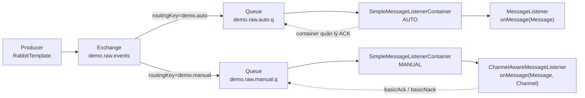
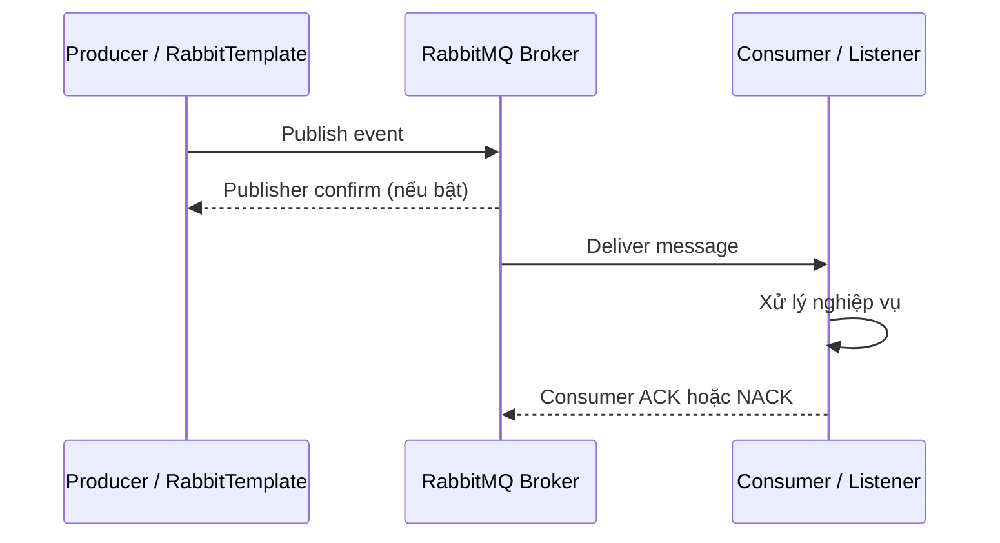

# MessageListener và ChannelAwareMessageListener

## 1. Bài toán: ai nhận message và ai xác nhận xử lý?

Trong module **SPRING_AMQP**, một producer thường dùng `RabbitTemplate` để gửi công việc tới RabbitMQ. Broker định tuyến message qua **exchange → binding → queue**; phía nhận dùng consumer để thực hiện nghiệp vụ và xác nhận delivery. Với Spring, cách quen thuộc nhất là `@RabbitListener`, nhưng Spring AMQP còn có các API listener trực tiếp ở tầng thấp hơn:

- **`MessageListener`:** nhận một AMQP `Message`, thích hợp khi muốn tự viết logic xử lý raw body/properties nhưng để listener container quản lý acknowledgement.
- **`ChannelAwareMessageListener`:** nhận `Message` **và** RabbitMQ Java client `Channel` tương ứng với delivery, thích hợp khi cần tương tác trực tiếp với channel, nhất là `basicAck`, `basicNack` hoặc `basicReject`.

Hai listener này thường được đăng ký với **listener container**, ví dụ `SimpleMessageListenerContainer`. Chúng không tự mở kết nối hoặc tự đăng ký consumer nếu không được container quản lý.

Bài học thuộc chương **Nhận thông điệp** và tập trung vào sự khác nhau giữa hai callback, cách chọn acknowledgement mode, ranh giới trách nhiệm framework/ứng dụng và cách xử lý lỗi một cách đáng tin cậy.

### Mục tiêu

Sau bài này, bạn có thể:

1. Phân biệt `MessageListener` và `ChannelAwareMessageListener` theo method, dữ liệu đầu vào và quyền kiểm soát channel.
2. Biết listener container quản lý connection, consumer, conversion, prefetch, concurrency và lifecycle như thế nào.
3. Giải thích `AUTO`, `MANUAL` và `NONE` mà không nhầm với `autoAck` của RabbitMQ.
4. Tạo hai container nhận từ **hai queue riêng** để so sánh xử lý tự động và ACK thủ công.
5. Gửi message thử bằng `RabbitTemplate`, quan sát Ready/Unacked, lỗi và DLQ.
6. Tránh ACK nhầm delivery tag, ACK quá sớm, requeue vô hạn hoặc nuốt lỗi nghiệp vụ.
7. Quyết định khi nào nên ưu tiên `@RabbitListener` thay vì callback cấp thấp.

## 2. Đặt hai interface cạnh nhau

### 2.1. MessageListener

`MessageListener` ở package:

```java
import org.springframework.amqp.core.MessageListener;
```

Hình thức callback điển hình:

```java
void onMessage(org.springframework.amqp.core.Message message);
```

Ví dụ:

```java
MessageListener listener = message -> {
    String body = new String(
            message.getBody(),
            java.nio.charset.StandardCharsets.UTF_8
    );
    System.out.println("MessageListener nhận: " + body);
};
```

Callback có quyền đọc **body bytes** và **MessageProperties**. Nó không nhận đối số `Channel` để thực hiện `basicAck`/`basicNack` trực tiếp.

Nếu container đặt `AcknowledgeMode.AUTO`, framework ACK khi callback hoàn thành bình thường và xử lý lỗi khi callback ném exception theo cấu hình.

### 2.2. ChannelAwareMessageListener

`ChannelAwareMessageListener` nằm trong package:

```java
import org.springframework.amqp.rabbit.listener.api.ChannelAwareMessageListener;
```

Hình thức callback:

```java
void onMessage(
    org.springframework.amqp.core.Message message,
    com.rabbitmq.client.Channel channel
) throws Exception;
```

Ví dụ:

```java
ChannelAwareMessageListener listener = (message, channel) -> {
    long tag = message.getMessageProperties().getDeliveryTag();

    String body = new String(
            message.getBody(),
            java.nio.charset.StandardCharsets.UTF_8
    );

    process(body);
    channel.basicAck(tag, false);
};
```

Đây là **đoạn minh họa**: `process(...)` cần được định nghĩa, container phải dùng `AcknowledgeMode.MANUAL` và phải xử lý exception để không bỏ quên delivery chưa được ACK.

Đối số `channel` là **RabbitMQ Java client channel gắn với delivery**. Có thể thao tác ACK/NACK trên đó, nhưng không nên tự đóng channel, lưu giữ nó để dùng tùy tiện sau này hoặc chia sẻ giữa các thread.

### 2.3. Bảng phân biệt

| Tiêu chí | `MessageListener` | `ChannelAwareMessageListener` |
| --- | --- | --- |
| Vai trò | Callback nhận AMQP message | Callback nhận message và channel |
| Import thường dùng | `org.springframework.amqp.core.MessageListener` | `org.springframework.amqp.rabbit.listener.api.ChannelAwareMessageListener` |
| Method | `onMessage(Message)` | `onMessage(Message, Channel)` |
| Có `byte[] body` và properties | Có | Có |
| Nhận trực tiếp `Channel` | Không | **Có** |
| Phù hợp ACK mode | **AUTO** khi muốn container ACK | **MANUAL** khi tự điều khiển ACK/NACK |
| Tự khai báo queue, binding? | Không | Không |
| Tự tạo consumer AMQP? | Không; container quản lý | Không; container quản lý |
| Độ gần RabbitMQ Java client | Thấp hơn | Cao hơn |
| Nguy cơ sử dụng sai | Nuốt exception dẫn đến ACK sai | Quên ACK, ACK hai lần, sai delivery tag, requeue lặp |
| Lựa chọn mặc định cho nghiệp vụ đơn giản | Có thể dùng; `@RabbitListener` thường tiện hơn | Chỉ dùng nếu thật sự cần channel |

**Không phải cứ có `Channel` là xử lý đáng tin hơn.** Quyền kiểm soát nhiều hơn đi kèm trách nhiệm quản lý delivery thủ công nhiều hơn.

## 3. Listener container nằm ở đâu?

Hai interface chỉ mô tả **phương thức được gọi** khi có message. Để nhận thật từ broker, Spring AMQP dùng một listener container như `SimpleMessageListenerContainer` hoặc `DirectMessageListenerContainer`.



Container chịu trách nhiệm thông thường gồm:

1. Tạo và quản lý consumer qua `ConnectionFactory`.
2. Đăng ký queue cần consume với broker.
3. Điều phối thread và số consumer.
4. Áp dụng prefetch, acknowledge mode và error handler.
5. Nhận delivery rồi gọi listener callback.
6. Quản lý ACK/NACK khi dùng chế độ tự động hoặc để code xử lý khi MANUAL.
7. Khôi phục consumer/kết nối khi gặp lỗi theo khả năng framework và cấu hình.

Bạn **không** cần tự viết vòng lặp `basicConsume` khi dùng container. Nếu tự tạo `Channel` và consumer ngoài Spring, bạn sẽ tự chịu trách nhiệm những phần mà container đã quản lý.

**Tên queue cần đúng:** cả hai listener đều subscribe vào **queue**, không subscribe trực tiếp vào exchange. Producer thường publish đến **exchange + routing key**; binding quyết định queue đích.

## 4. Raw Message chứa những gì?

Cả hai interface ở đây đều làm việc trực tiếp với:

```java
org.springframework.amqp.core.Message
```

Đối tượng này bao gồm:

- `getBody()`: `byte[]` chứa payload thực đã nhận.
- `getMessageProperties()`: metadata như content type, headers, message ID, routing/consumer queue, delivery tag và thông tin redelivery theo dữ liệu broker cung cấp.

Ví dụ:

```java
MessageProperties properties = message.getMessageProperties();

byte[] body = message.getBody();
long deliveryTag = properties.getDeliveryTag();
String messageId = properties.getMessageId();
String contentType = properties.getContentType();
String consumerQueue = properties.getConsumerQueue();
```

### Message ID và delivery tag khác nhau

| Trường | Ý nghĩa | Phạm vi sử dụng |
| --- | --- | --- |
| `messageId` | Metadata message có thể do publisher đặt | Theo dõi và idempotency nghiệp vụ; có thể vắng mặt |
| `correlationId` | Liên hệ message với request/transaction/event khác | Logging, tracing, request/reply |
| `deliveryTag` | Số định danh delivery trên **channel** của RabbitMQ | ACK/NACK **chính delivery trên cùng channel** |
| `consumerQueue` | Queue mà consumer đang nhận | Chẩn đoán topology và metric |
| `redelivered` | Cờ đánh dấu delivery được broker coi là giao lại | Hỗ trợ debug, không phải ID chống trùng |
| `contentType` | Gợi ý định dạng body | Chọn converter và giải mã an toàn |

**Delivery tag không phải một ID toàn cục của message.** Nó chỉ có ý nghĩa trong channel chứa delivery đó. Không lưu tag vào DB để làm khóa idempotency, không dùng tag của channel này để ACK trên channel khác, và không giả định tag giữ nguyên khi message được giao lại sau khi connection mất.

### Raw listener và chuyển đổi JSON

Ở `MessageListener`/`ChannelAwareMessageListener`, body thường được đọc trực tiếp bằng `message.getBody()`. Với JSON, bạn cần giải mã phù hợp:

```java
String json = new String(
    message.getBody(),
    java.nio.charset.StandardCharsets.UTF_8
);
// Sau đó có thể dùng ObjectMapper để parse JSON thành DTO.
```

Không mặc định bytes luôn là UTF-8 string: nếu publisher dùng Protobuf, Avro, ảnh hoặc định dạng binary khác, phải dùng codec tương ứng và kiểm tra `contentType`/hợp đồng message.

Ngược lại, `@RabbitListener` có thể nhận trực tiếp DTO nhờ hệ thống `MessageConverter` và cơ chế ánh xạ tham số:

```java
@RabbitListener(queues = "orders.work.q")
public void handle(OrderCreatedEvent event) {
    // Spring chuyển đổi payload trước khi gọi method.
}
```

Với ví dụ trên, cần DTO và JSON converter phù hợp. Chuyển đổi payload **không tự tạo ACK trước khi xử lý xong**; ACK do container và acknowledge mode quyết định.

## 5. Ba acknowledge mode cần phân biệt

Spring AMQP listener container hỗ trợ các chế độ acknowledgement quan trọng:

| Mode | Ai gửi ACK? | Tình huống phù hợp | Rủi ro |
| --- | --- | --- | --- |
| `AcknowledgeMode.AUTO` | **Listener container** gửi ACK sau callback thành công; xử lý lỗi bằng reject/nack tùy cấu hình | Listener xử lý đồng bộ bình thường | Nuốt exception khiến container tưởng đã thành công |
| `AcknowledgeMode.MANUAL` | **Code consumer** gửi ACK/NACK/reject qua channel | Cần kiểm soát chính xác xác nhận delivery | Quên ACK, ACK trùng, ACK quá sớm |
| `AcknowledgeMode.NONE` | Dùng chế độ không yêu cầu consumer ACK (`autoAck` của broker) | Chỉ khi chấp nhận mất delivery nếu consumer lỗi | Message có thể được coi đã giao trước khi xử lý nghiệp vụ |

Cực kỳ quan trọng:

> **`AUTO` của Spring AMQP không đồng nghĩa `autoAck=true` của RabbitMQ Java client.**

Trong Spring `AUTO`, container đợi callback hoàn thành để xác nhận. Trong Spring `NONE`, broker không đợi ACK thủ công để coi delivery đã được giao.

### Khi AUTO gặp exception

Giả sử `MessageListener`:

```java
MessageListener listener = message -> {
    String body = new String(
        message.getBody(),
        StandardCharsets.UTF_8
    );

    orderService.process(body); // Có thể ném RuntimeException.
};
```

Khi `process(...)` trả về thành công, container ACK delivery. Khi ném exception, container áp dụng chính sách error handling, `defaultRequeueRejected`, retry advice và DLX nếu được cấu hình.

Nếu code viết:

```java
try {
    orderService.process(body);
} catch (Exception ex) {
    log.error("Xử lý lỗi", ex);
    // Không throw lại và không có cơ chế báo thất bại.
}
```

thì method vẫn trả về bình thường và container có thể **ACK message chưa xử lý thành công**. Đây là một nguồn mất dữ liệu nghiệp vụ thường gặp.

### Khi MANUAL quên ACK

Với manual acknowledgement, nếu callback kết thúc mà không `basicAck`, `basicNack` hay `basicReject`, delivery có thể tiếp tục ở trạng thái **Unacked** trên channel đang mở. Khi connection/channel đóng, broker thường đưa delivery chưa xác nhận vào khả năng giao lại.

Unacked backlog lớn có thể chiếm prefetch và ngăn consumer nhận thêm message. Bởi vậy, code MANUAL cần bảo đảm **mỗi delivery đều được quyết định đúng một lần** theo đường xử lý mong muốn.

## 6. Những API Channel cần biết

Khi dùng `ChannelAwareMessageListener` với mode MANUAL, các thao tác cơ bản là:

```java
long tag = message.getMessageProperties().getDeliveryTag();

// Xác nhận chính delivery này.
channel.basicAck(tag, false);

// Từ chối delivery và yêu cầu broker đưa vào lại queue.
channel.basicNack(tag, false, true);

// Từ chối delivery, không đưa lại vào queue.
channel.basicNack(tag, false, false);

// Hoặc từ chối một delivery, không đưa lại vào queue.
channel.basicReject(tag, false);
```

**Đây là các lựa chọn thay thế nhau**, không phải bốn lệnh chạy liên tiếp trên cùng delivery.

Hai boolean thường thấy trong `basicNack(deliveryTag, multiple, requeue)`:

- `multiple=false`: chỉ áp dụng cho **delivery tag này**.
- `multiple=true`: ACK/NACK hàng loạt các delivery chưa xác nhận **đến tag đó trên cùng channel**. Chỉ dùng khi nắm chắc tính tuần tự và trách nhiệm của các delivery liên quan.
- `requeue=true`: broker có thể giao lại message; nếu lỗi không tự phục hồi, dễ tạo vòng lặp nóng.
- `requeue=false`: broker không đưa lại vào queue cũ; message có thể được **dead-letter** nếu đã có DLX phù hợp, nếu không có thể bị loại.

`basicReject(tag, requeue)` không có tham số `multiple`, nên chỉ áp dụng cho một delivery.

**Sai lầm nghiêm trọng:** ACK cùng delivery tag hai lần hoặc ACK một tag không hợp lệ có thể khiến broker đóng channel với lỗi `PRECONDITION_FAILED - unknown delivery tag`.

### Channel do container quản lý

Đối số `Channel` đến từ consumer đang nhận delivery. Không:

- Gọi `channel.close()` tùy tiện từ listener.
- Chia sẻ channel cho nhiều thread tự phát.
- Lưu channel vào biến static để ACK các delivery khác.
- Giữ delivery tag để ACK sau khi channel đã bị phục hồi hoặc connection thay đổi.
- ACK trước side effect quan trọng rồi giả định broker sẽ tự khôi phục khi DB thất bại.

Nếu cần xử lý bất đồng bộ lâu dài, phải thiết kế tích hợp async listener/container được Spring AMQP hỗ trợ hoặc một workflow riêng, thay vì tự chuyền channel qua thread không kiểm soát.

## 7. Demo Spring Boot: so sánh hai listener trên hai queue

Ta tạo một project Spring Boot với:

- **Một direct exchange:** `demo.raw.events`.
- **Hai queue làm việc:** `demo.raw.auto.q` và `demo.raw.manual.q`.
- **Hai routing key khác nhau:** `demo.auto` và `demo.manual`.
- **Một dead-letter exchange và DLQ:** `demo.raw.dlx` → `demo.raw.dead.q`.
- **Hai listener container:** một `AUTO` dùng `MessageListener`, một `MANUAL` dùng `ChannelAwareMessageListener`.

Chọn **hai queue riêng** để kiểm nghiệm độc lập; nếu hai consumer đọc **cùng một queue**, RabbitMQ sẽ phân phối competing consumers, nên không bảo đảm cả hai đều nhìn thấy cùng một message.

### 7.1. Chuẩn bị

Yêu cầu:

- JDK 17+.
- Spring Boot và Spring AMQP starter tương thích.
- Docker/RabbitMQ local hoặc broker tương đương.
- Maven hoặc Maven Wrapper.

Có thể chạy RabbitMQ local:

```bash
docker run -d --name rabbitmq-raw-listener-demo \
  -p 5672:5672 -p 15672:15672 rabbitmq:4-management
```

Nếu RabbitMQ đã chiếm `5672` và `15672`, không mở container thứ hai. RabbitMQ Management UI ở `http://localhost:15672`; `guest/guest` chỉ dùng cho broker local mặc định.

Thêm dependency Maven:

```xml
<dependency>
    <groupId>org.springframework.boot</groupId>
    <artifactId>spring-boot-starter-amqp</artifactId>
</dependency>
```

Với Gradle:

```groovy
implementation 'org.springframework.boot:spring-boot-starter-amqp'
```

Cấu hình `src/main/resources/application.yml`:

```yaml
spring:
  application:
    name: raw-listeners-demo
  rabbitmq:
    host: localhost
    port: 5672
    username: guest
    password: guest
```

Giả định ứng dụng chạy **trực tiếp trên máy host** còn RabbitMQ trong Docker được expose qua localhost. Trong Docker Compose, ứng dụng cần kết nối bằng **service name** của RabbitMQ thay vì `localhost` trong container.

### 7.2. Cấu trúc code

```text
src/main/java/com/example/rawlisteners/
├── RawListenerDemoApplication.java
├── RabbitTopology.java
├── RawListenersConfig.java
└── DemoPublisher.java
```

Các lớp cùng package `com.example.rawlisteners`.

### 7.3. Khai báo exchange, queue, binding và DLQ

Tạo `RabbitTopology.java`:

```java
package com.example.rawlisteners;

import org.springframework.amqp.core.Binding;
import org.springframework.amqp.core.BindingBuilder;
import org.springframework.amqp.core.DirectExchange;
import org.springframework.amqp.core.Queue;
import org.springframework.amqp.core.QueueBuilder;
import org.springframework.beans.factory.annotation.Qualifier;
import org.springframework.context.annotation.Bean;
import org.springframework.context.annotation.Configuration;

@Configuration
public class RabbitTopology {

    public static final String EXCHANGE = "demo.raw.events";
    public static final String AUTO_QUEUE = "demo.raw.auto.q";
    public static final String MANUAL_QUEUE = "demo.raw.manual.q";
    public static final String AUTO_KEY = "demo.auto";
    public static final String MANUAL_KEY = "demo.manual";

    public static final String DLX = "demo.raw.dlx";
    public static final String DLQ = "demo.raw.dead.q";
    public static final String DEAD_KEY = "demo.failed";

    @Bean
    DirectExchange demoExchange() {
        return new DirectExchange(EXCHANGE);
    }

    @Bean
    DirectExchange deadExchange() {
        return new DirectExchange(DLX);
    }

    @Bean
    Queue autoQueue() {
        return QueueBuilder.durable(AUTO_QUEUE)
                .deadLetterExchange(DLX)
                .deadLetterRoutingKey(DEAD_KEY)
                .build();
    }

    @Bean
    Queue manualQueue() {
        return QueueBuilder.durable(MANUAL_QUEUE)
                .deadLetterExchange(DLX)
                .deadLetterRoutingKey(DEAD_KEY)
                .build();
    }

    @Bean
    Queue deadQueue() {
        return QueueBuilder.durable(DLQ).build();
    }

    @Bean
    Binding autoBinding(
            @Qualifier("autoQueue") Queue queue,
            @Qualifier("demoExchange") DirectExchange exchange) {
        return BindingBuilder.bind(queue).to(exchange).with(AUTO_KEY);
    }

    @Bean
    Binding manualBinding(
            @Qualifier("manualQueue") Queue queue,
            @Qualifier("demoExchange") DirectExchange exchange) {
        return BindingBuilder.bind(queue).to(exchange).with(MANUAL_KEY);
    }

    @Bean
    Binding deadBinding(
            @Qualifier("deadQueue") Queue queue,
            @Qualifier("deadExchange") DirectExchange exchange) {
        return BindingBuilder.bind(queue).to(exchange).with(DEAD_KEY);
    }
}
```

Ba queue đều durable để demo có thể quan sát backlog sau khi khởi động lại. Đây **không phải cam kết message luôn được giữ an toàn trong mọi sự cố**; còn cần delivery mode, publisher confirms, queue type và hạ tầng.

DLX/DLQ giúp xem message không thể xử lý trong bài lab. Trong production, RabbitMQ **policy** thường thuận tiện hơn hardcode `x-dead-letter-exchange` để thay đổi cấu hình mà không phải redeclare queue. Nếu đã có queue cùng tên với arguments khác, RabbitMQ có thể báo `PRECONDITION_FAILED`; nên dùng tên mới cho lab hoặc dọn topology thử nghiệm có chủ đích.

### 7.4. MessageListener với container AUTO

Tạo `RawListenersConfig.java`, trước hết triển khai container thứ nhất:

```java
package com.example.rawlisteners;

import java.nio.charset.StandardCharsets;

import org.springframework.amqp.core.AcknowledgeMode;
import org.springframework.amqp.core.MessageListener;
import org.springframework.amqp.rabbit.connection.ConnectionFactory;
import org.springframework.amqp.rabbit.listener.SimpleMessageListenerContainer;
import org.springframework.amqp.rabbit.listener.api.ChannelAwareMessageListener;
import org.springframework.context.annotation.Bean;
import org.springframework.context.annotation.Configuration;

@Configuration
public class RawListenersConfig {

    @Bean
    SimpleMessageListenerContainer autoContainer(
            ConnectionFactory connectionFactory) {

        SimpleMessageListenerContainer container =
                new SimpleMessageListenerContainer(connectionFactory);

        container.setQueueNames(RabbitTopology.AUTO_QUEUE);
        container.setAcknowledgeMode(AcknowledgeMode.AUTO);
        container.setConcurrentConsumers(1);
        container.setPrefetchCount(10);

        // Với exception: không requeue vô hạn; dùng DLX của queue.
        container.setDefaultRequeueRejected(false);

        MessageListener listener = message -> {
            String payload = new String(
                    message.getBody(),
                    StandardCharsets.UTF_8
            );

            System.out.println("[AUTO] received: " + payload);

            if (payload.startsWith("bad:")) {
                throw new IllegalArgumentException(
                        "Payload không hợp lệ: " + payload
                );
            }

            // Thay bằng nghiệp vụ đồng bộ thực tế.
            System.out.println("[AUTO] completed: " + payload);
        };

        container.setMessageListener(listener);
        return container;
    }

    // Thêm manualContainer(...) ở phần tiếp theo.
}
```

**Đây là phần đầu của cùng một lớp `RawListenersConfig`**, không phải tạo hai class có tên giống nhau. Khi ghép project, thêm method ở phần sau vào bên trong lớp này và bỏ dòng comment placeholder.

Điều xảy ra với một message:

1. Container nhận AMQP delivery từ `demo.raw.auto.q`.
2. Callback `onMessage(Message)` chuyển body bytes thành String.
3. Với payload hợp lệ, callback hoàn thành; container **ACK**.
4. Với payload bắt đầu `bad:`, callback ném exception.
5. Vì `defaultRequeueRejected=false` và queue có DLX, message lỗi thuộc diện **reject không requeue** và có thể đến `demo.raw.dead.q`.

Tùy phiên bản và cấu hình error handler, callback lỗi được ghi log; ví dụ lab này không áp retry advice. Với ứng dụng thật, cần phân loại lỗi tạm thời và lỗi dữ liệu sai, tránh chuyển ngay mọi lỗi tạm thời vào DLQ nếu còn cơ hội retry hợp lý.

### 7.5. ChannelAwareMessageListener với container MANUAL

Thêm method sau **bên trong cùng `RawListenersConfig`**:

```java
@Bean
SimpleMessageListenerContainer manualContainer(
        ConnectionFactory connectionFactory) {

    SimpleMessageListenerContainer container =
            new SimpleMessageListenerContainer(connectionFactory);

    container.setQueueNames(RabbitTopology.MANUAL_QUEUE);
    container.setAcknowledgeMode(AcknowledgeMode.MANUAL);
    container.setConcurrentConsumers(1);
    container.setPrefetchCount(10);

    ChannelAwareMessageListener listener = (message, channel) -> {
        long tag = message.getMessageProperties().getDeliveryTag();

        String payload = new String(
                message.getBody(),
                StandardCharsets.UTF_8
        );

        System.out.println(
                "[MANUAL] received tag=" + tag + " payload=" + payload
        );

        if (payload.startsWith("bad:")) {
            System.err.println("[MANUAL] reject: " + payload);
            channel.basicReject(tag, false);
            return;
        }

        try {
            // Thay bằng nghiệp vụ đồng bộ thực tế.
            System.out.println("[MANUAL] completed: " + payload);

            // Đánh dấu thành công sau khi nghiệp vụ hoàn tất.
            channel.basicAck(tag, false);
        } catch (RuntimeException processingError) {
            System.err.println(
                "[MANUAL] processing failed: "
                    + processingError.getMessage()
            );
            channel.basicNack(tag, false, false);
        }
    };

    container.setMessageListener(listener);
    return container;
}
```

Lý do code được viết như vậy:

- `AcknowledgeMode.MANUAL` bắt buộc để code chịu trách nhiệm ACK/NACK.
- `getDeliveryTag()` lấy tag đúng của delivery hiện tại.
- `basicReject(tag, false)` dùng cho payload không hợp lệ và không requeue.
- `basicAck(tag, false)` chỉ chạy **sau bước nghiệp vụ thành công**.
- `basicNack(tag, false, false)` ở nhánh lỗi RuntimeException báo không requeue; queue có DLX để thu thập message lỗi.

**Cần phân biệt ngoại lệ khi ACK:** Các lệnh `channel.basicAck` và `basicNack` có thể ném `IOException`. Đoạn minh họa không cố ACK hoặc NACK thêm lần nữa sau khi channel lỗi; để exception thoát cho framework phục hồi kết nối/channel. Khi không chắc broker đã nhận ACK chưa, delivery có thể được giao lại; ứng dụng vẫn cần idempotency.

**Không catch rồi ACK thành công với mọi exception.** Như thế sẽ làm broker loại công việc chưa xử lý. Đồng thời không nên cứ gặp lỗi là `basicNack(..., true)` vô hạn, vì poison message có thể lặp lại ngay lập tức.

### 7.6. Publisher dùng RabbitTemplate gửi message thử

Tạo `DemoPublisher.java`:

```java
package com.example.rawlisteners;

import org.springframework.amqp.rabbit.core.RabbitTemplate;
import org.springframework.stereotype.Service;

@Service
public class DemoPublisher {

    private final RabbitTemplate rabbitTemplate;

    public DemoPublisher(RabbitTemplate rabbitTemplate) {
        this.rabbitTemplate = rabbitTemplate;
    }

    public void publishSamples() {
        send(RabbitTopology.AUTO_KEY, "auto:job-101");
        send(RabbitTopology.AUTO_KEY, "bad:auto-job-102");

        send(RabbitTopology.MANUAL_KEY, "manual:job-201");
        send(RabbitTopology.MANUAL_KEY, "bad:manual-job-202");
    }

    private void send(String routingKey, String payload) {
        rabbitTemplate.convertAndSend(
                RabbitTopology.EXCHANGE,
                routingKey,
                payload
        );

        System.out.println(
                "[PUBLISH] key=" + routingKey + " payload=" + payload
        );
    }
}
```

Đây là ví dụ **payload String**, phù hợp converter mặc định của Spring Boot. Producer không cần biết consumer là `MessageListener` hay `ChannelAwareMessageListener`; producer chỉ gửi message đến exchange và routing key.

Lệnh publish trả về không đồng nghĩa consumer đã xử lý, và cũng không tự chứng minh broker xác nhận ghi message. Trong các bài liên quan độ tin cậy cần bật publisher confirms và kiểm tra publisher returns cho unroutable message.

### 7.7. Khởi động và gửi mẫu

Tạo `RawListenerDemoApplication.java`:

```java
package com.example.rawlisteners;

import org.springframework.boot.ApplicationRunner;
import org.springframework.boot.SpringApplication;
import org.springframework.boot.autoconfigure.SpringBootApplication;
import org.springframework.context.annotation.Bean;

@SpringBootApplication
public class RawListenerDemoApplication {

    public static void main(String[] args) {
        SpringApplication.run(RawListenerDemoApplication.class, args);
    }

    @Bean
    ApplicationRunner runDemo(DemoPublisher publisher) {
        return args -> publisher.publishSamples();
    }
}
```

Spring Boot phát hiện `@Configuration` và `@Bean` trong package, tạo các container, register queue, rồi `ApplicationRunner` gửi bốn message khi ứng dụng sẵn sàng.

Chạy:

```bash
./mvnw spring-boot:run
```

Trên Windows PowerShell:

```powershell
.\mvnw.cmd spring-boot:run
```

Ví dụ log **về ý nghĩa**, không cam kết thứ tự tuyệt đối giữa các thread:

```text
[PUBLISH] key=demo.auto payload=auto:job-101
[PUBLISH] key=demo.auto payload=bad:auto-job-102
[PUBLISH] key=demo.manual payload=manual:job-201
[PUBLISH] key=demo.manual payload=bad:manual-job-202

[AUTO] received: auto:job-101
[AUTO] completed: auto:job-101
[AUTO] received: bad:auto-job-102
... IllegalArgumentException từ AUTO listener ...

[MANUAL] received tag=... payload=manual:job-201
[MANUAL] completed: manual:job-201
[MANUAL] received tag=... payload=bad:manual-job-202
[MANUAL] reject: bad:manual-job-202
```

Kết quả dự kiến sau khi các delivery được xử lý và dead-letter thành công:

| Queue | Message hợp lệ | Message `bad:...` | Trạng thái mong đợi |
| --- | --- | --- | --- |
| `demo.raw.auto.q` | Được container ACK | Exception → reject không requeue | Không còn message ready/unacked sau xử lý |
| `demo.raw.manual.q` | Được code `basicAck` | Code `basicReject(..., false)` | Không còn message ready/unacked sau xử lý |
| `demo.raw.dead.q` | Không nhận message hợp lệ | Nhận hai message lỗi nếu DLX/binding hoạt động | **2 message ready** khi chưa có DLQ consumer |

Mỗi lần khởi động app, `ApplicationRunner` lại gửi thêm **bốn message mới**. Vì thế nếu chạy lặp nhiều lần, DLQ có thể chứa nhiều message `bad:...`. Trước khi so số đếm, cần dùng broker sạch hoặc nhận diện từng đợt.

Trong Management UI `http://localhost:15672`, kiểm tra `Queues and Streams`, Ready, Unacked, Consumers và DLQ. Nếu message được xử lý quá nhanh, số Ready của hai work queue thường bằng 0; điều này không phải bằng chứng publisher không gửi.

## 8. @RabbitListener khác gì hai interface trên?

`@RabbitListener` thường là lựa chọn **cao cấp và ngắn gọn** hơn cho xử lý nghiệp vụ:

```java
@Component
public class OrderConsumer {

    @RabbitListener(queues = "orders.work.q")
    public void onOrder(String orderId) {
        orderService.process(orderId);
    }
}
```

Spring tạo listener adapter/container, chuyển payload thành tham số method và xử lý lifecycle theo listener factory. Bạn không cần tự tạo `SimpleMessageListenerContainer` trong mỗi service.

### So sánh ba cách nhận

| Tiêu chí | `@RabbitListener` | `MessageListener` | `ChannelAwareMessageListener` |
| --- | --- | --- | --- |
| Mức trừu tượng | Cao: method nghiệp vụ | Thấp: raw AMQP Message | Thấp: raw Message + Channel |
| Khai báo | Annotation trên method/bean | Đăng ký callback với container | Đăng ký callback với container |
| Tự ánh xạ DTO/headers vào tham số | Thường có, theo converter | Tự thao tác raw body/properties | Tự thao tác raw body/properties |
| Điều khiển ACK | Container AUTO, hoặc MANUAL nếu cấu hình | Thường container AUTO | Có Channel, thường MANUAL |
| Cần container Spring | Có, Spring tạo/quản lý | Có | Có |
| Phù hợp | Phần lớn nghiệp vụ thông thường | Adapter, middleware, xử lý raw payload | Manual ACK/NACK, tích hợp RabbitMQ low-level |

### @RabbitListener có thể nhận Channel không?

Có. Khi cần MANUAL, một method annotation-driven cũng có thể nhận `Channel`:

```java
@RabbitListener(queues = "orders.manual.q", ackMode = "MANUAL")
public void onOrder(
        org.springframework.amqp.core.Message message,
        com.rabbitmq.client.Channel channel) throws java.io.IOException {

    long tag = message.getMessageProperties().getDeliveryTag();

    // Xử lý body và bảo đảm side effect thành công.
    channel.basicAck(tag, false);
}
```

Đây là snippet tối giản; cần thêm logic lỗi/reject trong ứng dụng thật. **Không chạy snippet này cùng một raw consumer trên chính queue `orders.manual.q`** nếu mục tiêu là so sánh cả hai cách cùng nhận một message: chúng sẽ thành competing consumers.

Vì thế, **không nhất thiết phải chuyển sang `ChannelAwareMessageListener` chỉ để dùng manual ACK**; `@RabbitListener` vẫn là lựa chọn hợp lý nếu method annotation-driven đáp ứng yêu cầu.

### Khi nào thực sự dùng raw listener?

Cân nhắc `MessageListener` hoặc `ChannelAwareMessageListener` nếu:

- Viết thư viện hoặc adapter consumer dùng chung thay vì một method nghiệp vụ cụ thể.
- Cần xử lý raw `MessageProperties`/body trước khi chuyển đổi.
- Muốn cấu hình một container bằng code, đăng ký callback được tạo động.
- Cần tương tác trực tiếp với `Channel` cho các thao tác ACK/NACK theo logic đặc thù.

Nếu chỉ cần xử lý `OrderCreatedEvent`, validate, ghi DB, ACK khi thành công, `@RabbitListener` với cấu hình phù hợp thường dễ đọc, dễ test và ít boilerplate hơn.

## 9. Thứ tự xử lý, prefetch và concurrency

Một listener container thường có nhiều tùy chọn vận hành, ví dụ:

```java
container.setConcurrentConsumers(2);
container.setMaxConcurrentConsumers(4);
container.setPrefetchCount(20);
```

Ý nghĩa:

- **Concurrent consumers:** số consumer chạy song song để tăng khả năng xử lý.
- **Prefetch:** số delivery broker có thể đưa tới một consumer/channel trước khi được ACK theo cơ chế QoS.
- **Concurrency và prefetch cao:** cải thiện throughput trong một số workload nhưng làm nhiều message ở trạng thái **Unacked** hơn.

Ví dụ có 2 consumer, prefetch 20: có thể tồn tại nhiều delivery chưa ACK phân bố giữa các consumer. Đừng lấy số Ready thấp để kết luận không có backlog, vì message có thể đang nằm trong **Unacked**.

### Có giữ được thứ tự không?

Queue lưu và giao message theo quy tắc của broker, nhưng **thứ tự hoàn thành xử lý** có thể thay đổi do:

- Có nhiều competing consumers.
- Thời gian xử lý từng message khác nhau.
- NACK/requeue/redelivery.
- Prefetch nhiều message cùng lúc.

Nếu nghiệp vụ yêu cầu một thứ tự xử lý nghiêm ngặt theo đơn hàng/customer, cần thiết kế khóa phân vùng, single active consumer hoặc chiến lược tuần tự hóa phù hợp với queue type và SLA. Không coi manual ACK là công cụ tự động đảm bảo thứ tự toàn cục.

### Khi tăng concurrency

Cần theo dõi:

- Queue Ready/Unacked.
- Tốc độ delivery/ACK và độ trễ xử lý.
- Số lần redelivery/retry.
- CPU, thread, pool kết nối DB, API downstream.
- Chỉ số DLQ và thời gian tồn đọng message.

Tăng số consumer không tự giải quyết vấn đề nếu database hoặc một API ngoài là nút thắt.

## 10. Xử lý lỗi đúng tầng: reject, retry và DLQ

### 10.1. Lỗi dữ liệu không thể xử lý

Ví dụ message body thiếu trường bắt buộc hoặc sai schema: retry y nguyên hàng trăm lần thường không hữu ích.

Với `MessageListener`/AUTO:

1. Callback ném exception.
2. Container/error handler áp chính sách reject/requeue.
3. Nếu reject không requeue và queue có DLX, message có thể đi DLQ.

Với `ChannelAwareMessageListener`/MANUAL:

1. Callback xác định lỗi không thể khôi phục.
2. Gọi `basicReject(tag, false)` hoặc `basicNack(tag, false, false)`.
3. RabbitMQ dead-letter nếu queue có DLX phù hợp.

**DLQ không được tạo tự động chỉ nhờ một lệnh NACK.** Cần DLX, binding và queue đích; nếu không có, message không requeue có thể bị loại khỏi hệ thống.

### 10.2. Lỗi tạm thời

Ví dụ DB trả lỗi kết nối tạm thời, payment gateway 503, rate limiting:

- Retry có giới hạn và backoff thường hợp lý hơn reject vĩnh viễn ngay.
- Tránh `basicNack(tag, false, true)` lặp tức thì mãi, gây hot requeue loop.
- Có thể dùng retry advice, delayed retry, TTL/dead-letter retry topology hoặc một scheduler phù hợp.
- Sau khi vượt số lần thử, đưa message vào DLQ/quarantine và cảnh báo.

Với quorum queue, cần hiểu thêm delivery limit và poison-message handling theo broker version. Không dựa hoàn toàn vào một flag `redelivered` làm bộ đếm retry chính xác.

### 10.3. Lỗi conversion có thể xảy ra trước listener

Với `@RabbitListener` nhận DTO, converter có thể lỗi **trước khi method nghiệp vụ được gọi**. Với raw listener, bạn thường tự deserialize trong callback, nên lỗi parse phát sinh ngay tại phần code đó.

Phải có error handling ở **container** và chiến lược DLQ cho cả lỗi chuyển đổi lẫn lỗi nghiệp vụ. Chỉ viết `try/catch` bên trong một method `@RabbitListener` không bao phủ mọi lỗi trước khi method được gọi.

## 11. Hai ranh giới xác nhận: publisher confirm và consumer ACK

Một lỗi phổ biến là nghĩ rằng broker xác nhận publish nghĩa là listener đã xử lý xong.



**Publisher confirm** trả lời broker đã xử lý lần publish theo điều kiện confirm hay chưa. **Consumer ACK** trả lời broker đã nhận xác nhận delivery từ consumer hay chưa. Nếu ACK xảy ra sau bước ghi DB thành công, đó là lựa chọn của code ứng dụng, không phải một bảo đảm tự nhiên của RabbitMQ.

Bảng tình huống:

| Tình huống | Phía publisher | Phía consumer |
| --- | --- | --- |
| Broker nhận publish, consumer tắt | Có thể nhận confirm ACK | Chưa delivery/ACK; message ở queue |
| Consumer xử lý tốt | Confirm có thể đã xảy ra trước đó | Container AUTO hoặc code MANUAL ACK |
| Consumer ném exception | Không tự làm confirm trước đó trở thành NACK | Có thể retry/requeue/DLQ theo policy |
| Consumer ghi DB rồi crash trước ACK | Publisher có thể đã được confirm | Message có thể được giao lại |
| Producer mất connection trước confirm | Kết quả publish có thể chưa rõ | Consumer vẫn có thể đã/đang xử lý |

Vì vậy, nếu hệ thống cần đảm bảo “xử lý một lệnh thanh toán đúng một lần về mặt nghiệp vụ”, phải dùng **idempotency key/transaction DB**; không chỉ chọn ACK mode.

### Ranh giới giao dịch

Ví dụ listener làm:

```text
1. Nhận PaymentRequested(paymentId)
2. Ghi transaction DB
3. Gửi ACK tới RabbitMQ
```

Nếu DB commit thành công nhưng connection bị đứt **trước bước 3**, message có thể redeliver và chạy lại. Code consumer phải kiểm tra `paymentId` đã hoàn tất chưa bằng transaction/ràng buộc duy nhất trước khi tạo side effect mới.

Tương tự, việc producer dùng `@Transactional` để vừa lưu DB vừa publish `RabbitTemplate` không làm DB và RabbitMQ tự có một distributed atomic transaction. Với nhu cầu nhất quán giữa DB và broker, cân nhắc **transactional outbox** và consumer idempotent.

## 12. Kiểm thử thực tế: thay đổi ACK mode có tác động gì?

### Thí nghiệm A — AUTO xử lý thành công

1. Chạy app demo.
2. Gửi `auto:job-101`.
3. Quan sát log `[AUTO] completed`.
4. Kiểm tra số Ready/Unacked và delivery/ACK rate của `demo.raw.auto.q`.

**Kết luận:** container AUTO xác nhận sau khi callback hoàn tất bình thường. Không có `basicAck` trong mã `MessageListener`.

### Thí nghiệm B — AUTO lỗi và DLQ

1. Gửi `bad:auto-job-102`.
2. Callback `MessageListener` ném `IllegalArgumentException`.
3. Với `defaultRequeueRejected=false` và DLX đang hoạt động, message được reject không requeue và có thể đến `demo.raw.dead.q`.
4. Kiểm tra x-death/reason và routing ở DLQ khi cần.

**Kết luận:** error handler và cấu hình container quyết định phản ứng đối với exception; không cần code gọi NACK trong callback AUTO.

### Thí nghiệm C — MANUAL thành công

1. Gửi `manual:job-201`.
2. Callback nhận `Channel` và delivery tag.
3. Sau khi xử lý, code gọi `basicAck(tag, false)`.
4. Ready/Unacked giảm khi broker nhận ACK.

**Kết luận:** ứng dụng trực tiếp chịu trách nhiệm xác nhận.

### Thí nghiệm D — MANUAL reject

1. Gửi `bad:manual-job-202`.
2. Listener xác định payload sai.
3. Code gọi `basicReject(tag, false)`.
4. Nếu DLX/binding đúng, DLQ nhận message.

**Kết luận:** manual NACK/reject không có phép màu: không requeue mà thiếu DLX có thể dẫn đến mất message.

### Thí nghiệm E — Quên ACK

Trên một queue **thử nghiệm riêng**, tạm bỏ lệnh `basicAck` ở nhánh thành công nhưng vẫn để mode MANUAL:

1. Publish một số job.
2. Quan sát `messages_unacknowledged` tăng.
3. Khi đạt prefetch, consumer có thể không nhận thêm.
4. Dừng consumer/channel và xem hành vi redelivery sau khi khởi động lại.

**Kết luận:** manual ACK tạo trách nhiệm xử lý mọi nhánh code; quên ACK không giống gửi thất bại.

### Thí nghiệm F — ACK quá sớm

Trong lab, thử ACK **trước** một thao tác nghiệp vụ có thể ném exception. Nếu thao tác sau ACK thất bại, RabbitMQ đã coi delivery hoàn tất và không tự giao lại vì ngoại lệ sau đó.

**Kết luận:** thứ tự *side effect thành công → ACK* là yêu cầu thiết kế quan trọng, kết hợp idempotency để xử lý duplicate khi ACK bị mất.

## 13. Troubleshooting

| Triệu chứng | Nguyên nhân thường gặp | Cách xử lý |
| --- | --- | --- |
| Không có callback nào được gọi | Container chưa start, queue sai, broker chưa kết nối, thiếu topology | Kiểm tra bean container, RabbitAdmin, queue/consumer count và log kết nối |
| Cùng một message không xuất hiện ở cả hai listener | Hai listener cùng consume một queue nên cạnh tranh | Dùng hai queue riêng nếu muốn cả hai nhận bản sao |
| `MessageListener` không có `Channel` để ACK thủ công | Callback chỉ nhận `Message` | Dùng `ChannelAwareMessageListener` hoặc `@RabbitListener` với `Channel` và MANUAL |
| AUTO listener xử lý lỗi nhưng message biến mất | Exception bị nuốt nên callback trả về bình thường, hoặc cấu hình reject không requeue | Không nuốt lỗi; cấu hình retry/DLX và kiểm thử |
| MANUAL listener không nhận thêm message | Delivery chưa được ACK và bị giữ ở Unacked/prefetch | Đảm bảo mọi nhánh kết thúc bằng quyết định ACK/NACK thích hợp |
| `PRECONDITION_FAILED - unknown delivery tag` | ACK trùng, tag sai, ACK trên channel khác | Chỉ ACK một lần, đúng channel, `multiple=false` khi không cần batch |
| Message bị redeliver sau khi DB đã ghi | Crash/mất kết nối trước ACK | Idempotency dựa trên ID nghiệp vụ và transaction |
| Message lỗi quay lại liên tục | `requeue=true` không giới hạn | Retry có giới hạn và backoff, DLQ/quarantine |
| Reject không requeue nhưng DLQ trống | DLX/binding/queue đích sai hoặc không được khai báo | Kiểm tra topology, x-death, permission và broker log |
| Message chuyển thành ký tự lỗi | Đọc bytes bằng sai encoding hoặc thực tế payload là binary | Kiểm tra content type, charset và converter |
| Tăng concurrency nhưng throughput không cải thiện | DB/API downstream hoặc network là nút thắt | Đo latency, pool, Ready/Unacked và contention |
| Log hoàn thành nhưng broker còn Unacked | Chưa ACK, ACK lỗi, channel mất kết nối hoặc code async | Quan sát channel, ACK mode và thời điểm side effect |

## 14. Checklist chọn listener cho dự án

Trước khi quyết định `MessageListener`, `ChannelAwareMessageListener` hay `@RabbitListener`, hãy trả lời:

1. **Có thực sự cần raw `Message` không?** Nếu chỉ cần DTO nghiệp vụ, `@RabbitListener` thường gọn hơn.
2. **Có thực sự cần `Channel` không?** Nếu cần ACK/NACK thủ công, chọn ChannelAware hoặc annotation-driven MANUAL.
3. **ACK sau bước nào?** Sau DB commit, sau API thành công hay sau khi chỉ nhận request?
4. **Nếu connection mất trước ACK thì sao?** Consumer có idempotency key và cách khử trùng không?
5. **Có poison message không?** Lỗi parse/schema sẽ retry có giới hạn và đến DLQ hay bị lặp vô hạn?
6. **DLQ có thực sự hoạt động?** Exchange, binding, queue đích, retention và cảnh báo đã kiểm thử chưa?
7. **Queue có competing consumers?** Nếu cần fan-out cho hai dịch vụ, mỗi dịch vụ đã có queue riêng chưa?
8. **Prefetch/concurrency đã đo chưa?** Có quá nhiều Unacked, xử lý mất thứ tự hoặc downstream overload không?
9. **Có log/metrics đủ không?** Ghi message ID, queue, routing key, delivery tag, redelivery, ACK/NACK, lỗi và thời gian xử lý.
10. **Đã phân biệt confirm và ACK chưa?** Publisher confirm không chứng minh consumer hoàn tất.

## 15. Tổng kết

`MessageListener` và `ChannelAwareMessageListener` đều là **callback nhận AMQP message** do listener container quản lý, nhưng khác nhau về mức kiểm soát RabbitMQ channel:

```text
MessageListener:
    onMessage(Message)
    → xử lý body/properties
    → container AUTO xác nhận khi thành công

ChannelAwareMessageListener:
    onMessage(Message, Channel)
    → xử lý body/properties
    → code MANUAL basicAck/basicNack/basicReject

@RabbitListener:
    → lựa chọn annotation-driven cấp cao
    → hỗ trợ chuyển đổi tham số, AUTO và MANUAL khi cấu hình
```

**Quy tắc chọn:** ưu tiên `@RabbitListener` cho xử lý nghiệp vụ thông thường; dùng `MessageListener` khi cần callback raw nhưng muốn container quản lý ACK; dùng `ChannelAwareMessageListener` khi cần **Channel** và chủ động chịu trách nhiệm ACK/NACK.

Để xây xử lý bất đồng bộ **đáng tin cậy** với Spring AMQP và RabbitMQ, hãy kết hợp mô hình listener với exchange/queue/binding đúng, publisher confirms/returns, acknowledgement, retry có giới hạn, dead-letter, transaction/outbox, idempotency và observability. **ACK đúng thời điểm và khả năng xử lý redelivery quan trọng hơn việc chọn listener có API “thấp” hay “cao”.**

### Tài liệu tham khảo chính thức

- [Spring AMQP Reference](https://docs.spring.io/spring-amqp/reference/)
- [Spring AMQP — Message Listener Container Configuration](https://docs.spring.io/spring-amqp/reference/amqp/containerAttributes.html)
- [Spring AMQP — Asynchronous Consumer](https://docs.spring.io/spring-amqp/reference/amqp/receiving-messages/async-consumer.html)
- [Spring AMQP — Annotation-driven Listener Endpoints](https://docs.spring.io/spring-amqp/reference/amqp/receiving-messages/async-annotation-driven.html)
- [Spring AMQP — Exception Handling](https://docs.spring.io/spring-amqp/reference/amqp/exception-handling.html)
- [RabbitMQ — Consumer Acknowledgements and Publisher Confirms](https://www.rabbitmq.com/docs/confirms)
- [RabbitMQ — Negative Acknowledgements](https://www.rabbitmq.com/docs/nack)
- [RabbitMQ — Dead Letter Exchanges](https://www.rabbitmq.com/docs/dlx)
