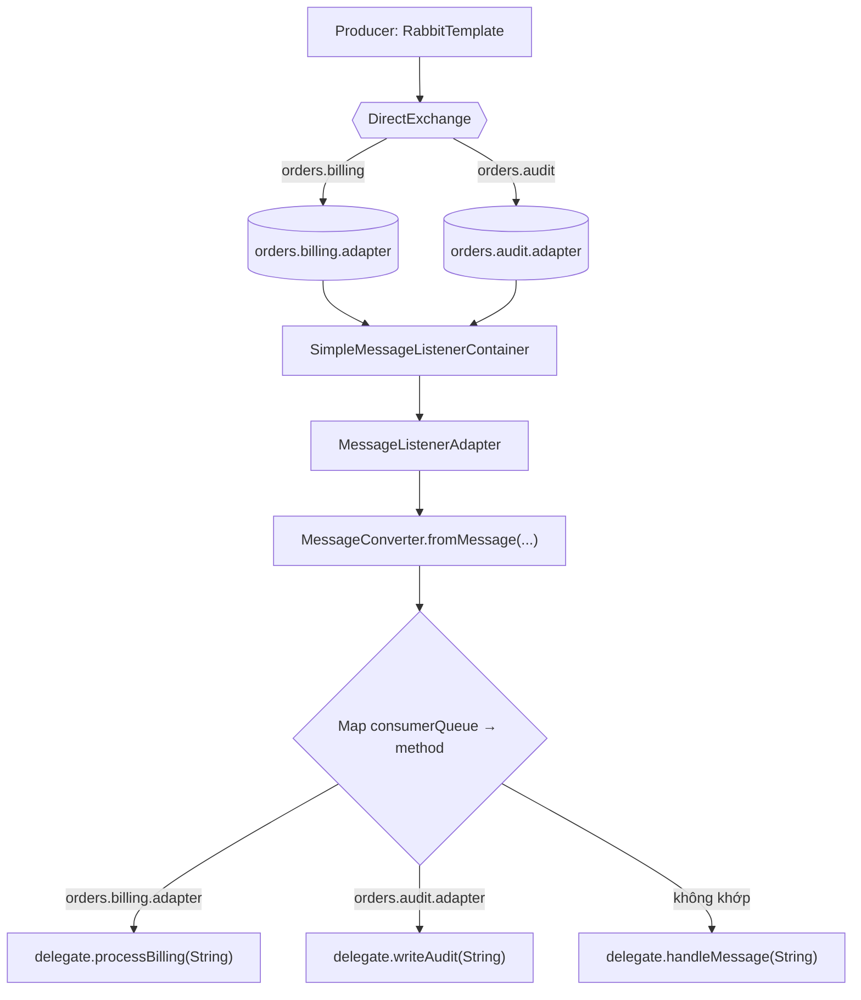
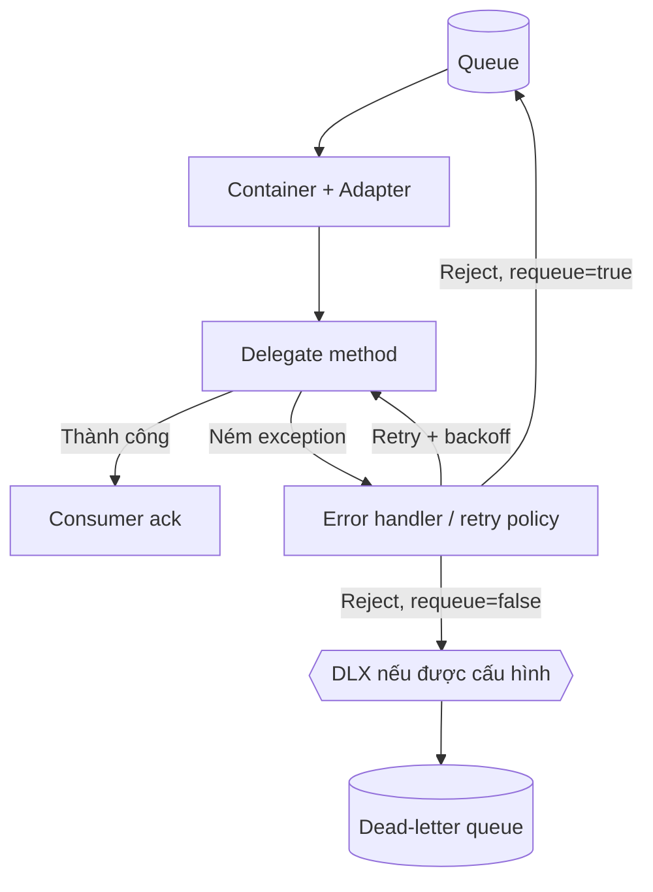

# MessageListenerAdapter và ánh xạ thông điệp vào phương thức

Khi RabbitMQ chuyển một message đến consumer, ứng dụng không nhất thiết phải viết một lớp `MessageListener` phụ thuộc trực tiếp vào `org.springframework.amqp.core.Message`. Trong **Spring AMQP**, `MessageListenerAdapter` là lớp trung gian giúp một **POJO (Plain Old Java Object)** nhận nội dung message qua phương thức Java thông thường. Adapter thực hiện bước chuyển đổi dữ liệu và tìm phương thức cần gọi; **listener container** mới là thành phần kết nối tới queue, lấy delivery và điều phối acknowledgement.

Ví dụ, một ứng dụng quản lý đơn hàng có hai queue `orders.billing.adapter` và `orders.audit.adapter`. Cùng một delegate POJO có thể định nghĩa `processBilling(String)` và `writeAudit(String)`. Ta ánh xạ **tên queue → tên phương thức** trong `MessageListenerAdapter` mà không phải thêm điều kiện `if/else` trong từng phương thức xử lý.

Bài học thuộc chương **Nhận thông điệp** của module **SPRING_AMQP**. Ta sẽ thiết lập exchange, queue, binding, publish bằng `RabbitTemplate`, tiêu thụ qua `MessageListenerAdapter`, tìm hiểu `MessageConverter`, phương thức mặc định, ánh xạ queue/consumer tag, phản hồi RPC, cùng những lưu ý về ack, retry, dead-letter, transaction và quan sát hệ thống bất đồng bộ đáng tin cậy.

## 1. Adapter đứng ở đâu trong luồng tiêu thụ?

Luồng dữ liệu từ producer đến phương thức xử lý:



Có ba vai trò tách biệt:

| Thành phần | Trách nhiệm | Không chịu trách nhiệm |
| --- | --- | --- |
| **RabbitMQ broker** | Định tuyến message đến queue theo exchange và binding; phân phối delivery | Không chọn phương thức Java của POJO |
| **Listener container** (`SimpleMessageListenerContainer`, `DirectMessageListenerContainer`) | Mở connection/channel, đăng ký consumer, chuyển delivery đến listener, điều phối ack, concurrency và recovery | Không tự biết phương thức nghiệp vụ nào phù hợp |
| **`MessageListenerAdapter`** | Nhận delivery từ container, chuyển đổi payload và gọi method trên delegate theo tên hoặc mapping | Không tạo queue, không cấu hình exchange, không tự duy trì kết nối |
| **Delegate POJO** | Validate payload, thực hiện nghiệp vụ, ném exception nếu thất bại | Không cần gọi API RabbitMQ nếu chỉ dùng AUTO acknowledgement |

**Phân biệt hai “listener”:** `MessageListenerAdapter` triển khai listener interface để container có thể gọi; **delegate** lại là đối tượng nghiệp vụ mà adapter gọi thông qua reflection. Đừng đặt annotation `@RabbitListener` lên delegate của ví dụ này rồi cũng đăng ký adapter vào container cho **cùng queue**, vì khi đó có thể tạo **hai consumer cạnh tranh**.

## 2. Khác gì với MessageListener và @RabbitListener?

Spring AMQP cung cấp nhiều cách tiêu thụ, không phải chỉ một:

| Cách | Ví dụ | Ưu điểm | Khi dùng |
| --- | --- | --- | --- |
| `MessageListener` | `void onMessage(Message message)` | Kiểm soát raw message/headers rõ | Consumer mức thấp, công cụ chẩn đoán |
| `ChannelAwareMessageListener` | `onMessage(Message, Channel)` | Có channel để tự ack/reject khi cần | Tích hợp đặc biệt, MANUAL ack |
| **`MessageListenerAdapter`** | Delegate `processBilling(String)`, ánh xạ bằng code cấu hình | Giữ POJO độc lập với Rabbit API, chọn method theo queue | Hệ thống hiện có, đăng ký động hoặc muốn điều phối method thủ công |
| **`@RabbitListener`** | `@RabbitListener(queues="...")` | Khai báo gọn, tích hợp type conversion, argument resolution và error handler | **Ưu tiên** cho phần lớn ứng dụng Spring Boot mới |

`MessageListenerAdapter` không “mới hơn” hoặc “tốt hơn” `@RabbitListener`; nó là **một lựa chọn cấu hình khác**. Với nhiều phương thức nhận DTO có annotation, `@RabbitListener` thường dễ đọc và dễ bảo trì. Với delegate POJO không muốn thêm annotation hoặc một container tiêu thụ nhiều queue và điều phối thủ công, adapter có ích. Tham khảo [Spring AMQP – Asynchronous Consumer](https://docs.spring.io/spring-amqp/reference/amqp/receiving-messages/async-consumer.html).

## 3. Mặc định handleMessage và phương thức tùy chỉnh

Theo API Spring AMQP, khi xây:

```java
MessageListenerAdapter adapter = new MessageListenerAdapter(delegate);
```

adapter mặc định tìm phương thức **`handleMessage`** trên `delegate`. Có thể đổi bằng:

```java
adapter.setDefaultListenerMethod("processBilling");
```

Hoặc truyền ngay khi tạo:

```java
MessageListenerAdapter adapter =
        new MessageListenerAdapter(delegate, "processBilling");
```

Ví dụ POJO đơn giản:

```java
import org.slf4j.Logger;
import org.slf4j.LoggerFactory;
import org.springframework.stereotype.Component;

@Component
public class BillingHandler {
    private static final Logger log =
            LoggerFactory.getLogger(BillingHandler.class);

    public void handleMessage(String payload) {
        log.info("Billing nhận: {}", payload);
        // Xử lý nghiệp vụ và lưu idempotency trong DB khi triển khai thật.
    }
}
```

Với `SimpleMessageConverter` mặc định, một message có body dạng text và `contentType` phù hợp thường được chuyển thành **`String`** trước khi truyền vào delegate. Nếu content type/payload không tương thích, adapter có thể nhận `byte[]` hoặc kiểu khác và không tìm được phương thức tương ứng. Vì vậy, **tên method đúng nhưng parameter type không khớp vẫn có thể gây lỗi**.

### Tên method được chọn như thế nào?

Khi có mapping riêng, quy tắc tra cứu mặc định của `MessageListenerAdapter` là:

1. Lấy **consumer queue name** từ `MessageProperties.consumerQueue`, tìm entry trong map.
2. Nếu không có, thử **consumer tag** từ `MessageProperties.consumerTag`.
3. Nếu vẫn không có, dùng **default listener method**, mặc định là `handleMessage`.

Đây là mapping ở **phía consumer**: queue được xác định sau khi broker định tuyến, không phải giá trị `routingKey` mà producer gửi. Không coi `eventType` header hay `type` property là tiêu chí mapping mặc định của adapter.

## 4. Chuẩn bị project Spring Boot và RabbitMQ

Dependency Maven trong dự án Spring Boot dùng parent/BOM tương thích:

```xml
<dependency>
    <groupId>org.springframework.boot</groupId>
    <artifactId>spring-boot-starter-amqp</artifactId>
</dependency>
```

Với Gradle:

```groovy
implementation 'org.springframework.boot:spring-boot-starter-amqp'
```

Ví dụ `application-local.yml` trên một RabbitMQ test được chuẩn bị sẵn:

```yaml
spring:
  rabbitmq:
    host: localhost
    port: 5672
    username: app_local
    password: local-demo-only
    virtual-host: orders_local
```

Đây là thông tin **minh họa local**, không phải tài khoản production. Broker phải có user/vhost đúng quyền; khi ứng dụng chạy trong container khác, `localhost` có thể trỏ vào container ứng dụng thay vì broker. Khi triển khai thật, cấp secrets bằng biến môi trường/secret manager và sử dụng TLS theo yêu cầu.

### 4.1. Khai báo exchange, hai queue và bindings

```java
import org.springframework.amqp.core.Binding;
import org.springframework.amqp.core.BindingBuilder;
import org.springframework.amqp.core.DirectExchange;
import org.springframework.amqp.core.Queue;
import org.springframework.amqp.core.QueueBuilder;
import org.springframework.beans.factory.annotation.Qualifier;
import org.springframework.context.annotation.Bean;
import org.springframework.context.annotation.Configuration;

@Configuration
public class AdapterDemoTopology {
    public static final String EXCHANGE = "orders.adapter.events";
    public static final String BILLING_QUEUE = "orders.billing.adapter";
    public static final String AUDIT_QUEUE = "orders.audit.adapter";
    public static final String BILLING_KEY = "orders.billing";
    public static final String AUDIT_KEY = "orders.audit";

    @Bean
    public DirectExchange adapterExchange() {
        return new DirectExchange(EXCHANGE, true, false);
    }

    @Bean
    public Queue adapterBillingQueue() {
        return QueueBuilder.durable(BILLING_QUEUE).build();
    }

    @Bean
    public Queue adapterAuditQueue() {
        return QueueBuilder.durable(AUDIT_QUEUE).build();
    }

    @Bean
    public Binding adapterBillingBinding(
            @Qualifier("adapterBillingQueue") Queue queue,
            @Qualifier("adapterExchange") DirectExchange exchange) {
        return BindingBuilder.bind(queue).to(exchange).with(BILLING_KEY);
    }

    @Bean
    public Binding adapterAuditBinding(
            @Qualifier("adapterAuditQueue") Queue queue,
            @Qualifier("adapterExchange") DirectExchange exchange) {
        return BindingBuilder.bind(queue).to(exchange).with(AUDIT_KEY);
    }
}
```

Khai báo trên có **hai queue riêng** để thử hai method. Spring Boot thường auto-configure `RabbitAdmin` khi starter và điều kiện phù hợp; phải xác minh exchange, queue và binding được tạo **thực sự trên RabbitMQ** trước khi thử, không coi việc Spring khởi tạo bean là bằng chứng broker đã có topology.

## 5. Ví dụ đầy đủ: một POJO, hai phương thức

### 5.1. Delegate không phụ thuộc Spring AMQP API

Một POJO nhận `String` thuần, có thể dùng lại trong unit test độc lập:

```java
import org.slf4j.Logger;
import org.slf4j.LoggerFactory;
import org.springframework.stereotype.Component;

@Component
public class OrderOperations {
    private static final Logger log =
            LoggerFactory.getLogger(OrderOperations.class);

    public void processBilling(String payload) {
        log.info("[billing] received={}", payload);
        // Thực tế: validate, ghi dữ liệu hóa đơn, bảo vệ duplicate bằng eventId.
    }

    public void writeAudit(String payload) {
        log.info("[audit] received={}", payload);
        // Thực tế: lưu audit record, có quy tắc retention và bảo mật.
    }

    public void handleMessage(String payload) {
        log.warn("[fallback] message={}", payload);
        // Chỉ là fallback demo. Production nên quyết định rõ cách xử lý
        // queue mới/chưa mapping thay vì âm thầm bỏ qua nghiệp vụ.
    }
}
```

Trong demo này, việc ghi `payload` vào log chỉ phù hợp với text không nhạy cảm ở **local/test**. Trong production, chỉ log `eventId`, loại message, queue và trạng thái; tránh để dữ liệu khách hàng hoặc token lọt vào log.

### 5.2. Khai báo MessageListenerAdapter và container

```java
import java.util.Map;

import org.springframework.amqp.core.AcknowledgeMode;
import org.springframework.amqp.rabbit.connection.ConnectionFactory;
import org.springframework.amqp.rabbit.listener.SimpleMessageListenerContainer;
import org.springframework.amqp.rabbit.listener.adapter.MessageListenerAdapter;
import org.springframework.amqp.support.converter.SimpleMessageConverter;
import org.springframework.context.annotation.Bean;
import org.springframework.context.annotation.Configuration;

@Configuration
public class AdapterConsumerConfiguration {

    @Bean
    public MessageListenerAdapter orderListenerAdapter(OrderOperations handler) {
        MessageListenerAdapter adapter =
                new MessageListenerAdapter(handler, "handleMessage");

        adapter.setQueueOrTagToMethodName(Map.of(
                AdapterDemoTopology.BILLING_QUEUE, "processBilling",
                AdapterDemoTopology.AUDIT_QUEUE, "writeAudit"
        ));

        // Tường minh với demo text; bản thân adapter cũng mặc định
        // dùng SimpleMessageConverter khi chưa cấu hình converter khác.
        adapter.setMessageConverter(new SimpleMessageConverter());
        return adapter;
    }

    @Bean
    public SimpleMessageListenerContainer orderAdapterContainer(
            ConnectionFactory connectionFactory,
            MessageListenerAdapter orderListenerAdapter) {
        SimpleMessageListenerContainer container =
                new SimpleMessageListenerContainer(connectionFactory);
        container.setQueueNames(
                AdapterDemoTopology.BILLING_QUEUE,
                AdapterDemoTopology.AUDIT_QUEUE);
        container.setMessageListener(orderListenerAdapter);
        container.setAcknowledgeMode(AcknowledgeMode.AUTO);
        container.setConcurrentConsumers(1);
        container.setPrefetchCount(10);
        return container;
    }
}
```

**Đây là cấu hình tiêu thụ thực sự**, không chỉ tạo adapter rồi để đó:

1. Spring Boot cấp `ConnectionFactory` với host, vhost, credentials và TLS đã cấu hình.
2. `SimpleMessageListenerContainer` đăng ký consumer trên **hai queue**.
3. Adapter biết delegate `OrderOperations`, phương thức mặc định `handleMessage` và map queue → method.
4. Khi queue `orders.billing.adapter` nhận delivery, adapter gọi `processBilling(String)`.
5. Khi queue `orders.audit.adapter` nhận delivery, adapter gọi `writeAudit(String)`.

Không cần `@EnableRabbit` để **container được khai báo bằng Java bean thủ công** như ví dụ này: `@EnableRabbit` chủ yếu kích hoạt hạ tầng xử lý annotation `@RabbitListener`. Nếu ứng dụng đã dùng `@RabbitListener` ở nơi khác, vẫn có thể sử dụng cơ chế annotation và container thủ công song song, nhưng cần tránh chúng cùng consume một queue không chủ ý.

### 5.3. Producer gửi text bằng RabbitTemplate

```java
import org.springframework.amqp.rabbit.core.RabbitTemplate;
import org.springframework.stereotype.Service;

@Service
public class AdapterDemoPublisher {
    private final RabbitTemplate template;

    public AdapterDemoPublisher(RabbitTemplate template) {
        this.template = template;
    }

    public void sendBilling(String text) {
        template.convertAndSend(
                AdapterDemoTopology.EXCHANGE,
                AdapterDemoTopology.BILLING_KEY,
                text);
    }

    public void sendAudit(String text) {
        template.convertAndSend(
                AdapterDemoTopology.EXCHANGE,
                AdapterDemoTopology.AUDIT_KEY,
                text);
    }
}
```

Với `SimpleMessageConverter`, `String` thường được chuyển thành message dạng text với metadata `contentType` thích hợp. Đừng gửi trực tiếp một record/DTO Java qua `convertAndSend` mà kỳ vọng converter mặc định tự tạo JSON: cần cấu hình JSON converter hoặc serialize trước theo hợp đồng đã thống nhất.

### 5.4. Gửi thử khi profile local hoạt động

```java
import org.springframework.boot.ApplicationArguments;
import org.springframework.boot.ApplicationRunner;
import org.springframework.context.annotation.Bean;
import org.springframework.context.annotation.Configuration;
import org.springframework.context.annotation.Profile;

@Configuration
public class AdapterDemoRunner {
    @Bean
    @Profile("local")
    ApplicationRunner sendSamples(AdapterDemoPublisher publisher) {
        return args -> {
            publisher.sendBilling("bill:ORD-1001");
            publisher.sendAudit("audit:ORD-1001");
        };
    }
}
```

Khởi chạy ứng dụng với profile `local` khi RabbitMQ sẵn sàng, sau đó quan sát:

```text
[billing] received=bill:ORD-1001
[audit] received=audit:ORD-1001
```

Thứ tự hai log **không được bảo đảm** vì các consumer hoạt động bất đồng bộ. Runner minh họa publish mỗi lần ứng dụng local khởi động: production không nên tự gửi event nghiệp vụ mỗi khi process restart.

## 6. Ánh xạ queue/consumer tag và fallback

Phương thức `setQueueOrTagToMethodName(Map<String,String>)` là cách mapping của `MessageListenerAdapter`. Mapping không dựa trên class name, không dựa vào header `eventType` và không thay đổi routing của exchange.

```java
adapter.setQueueOrTagToMethodName(Map.of(
        "orders.billing.adapter", "processBilling",
        "orders.audit.adapter", "writeAudit"
));
adapter.setDefaultListenerMethod("handleMessage");
```

Khi nhiều queue được gắn vào cùng container, tên queue thường **ổn định hơn consumer tag** để mapping. Consumer tag có thể được broker/client gán lại khi container tái kết nối hoặc scale consumer, nên không dùng tag tự sinh làm định danh nghiệp vụ. Nếu dự án có tag tường minh và muốn mapping theo tag, phải kiểm soát tính duy nhất và vòng đời của tag.

### Fallback có thể trở thành lỗi thiết kế

Nếu queue `orders.refund.adapter` được thêm vào `container.setQueueNames(...)` nhưng bạn quên thêm mapping, adapter có thể gọi `handleMessage` mặc định. Nếu method đó chỉ log rồi trả về, listener container ở chế độ AUTO có thể **ack message**, khiến tác vụ refund **không bao giờ được xử lý đúng**.

Trong hệ thống thật, nên:

- Ghi nhận danh sách queue được đăng ký và danh sách method mapping như một cấu hình được kiểm thử.
- Không dùng fallback kiểu “log và bỏ qua” cho nghiệp vụ quan trọng; có thể **ném exception** để đưa sang cơ chế lỗi rõ ràng, kết hợp retry/DLQ an toàn.
- Trước khi thêm queue mới, bổ sung method và integration test cho mapping tương ứng.
- Xem mức quyền của queue/vhost và các policy trước khi triển khai, vì sai queue có thể khiến adapter gọi method đúng cho **ngữ cảnh dữ liệu sai**.

### Định tuyến dựa trên header thay vì tên queue?

Nếu nhiều loại event đi vào **cùng một queue** và bạn muốn chọn method theo `eventType` hoặc header riêng, `setQueueOrTagToMethodName` **không giải quyết** việc đó. Có thể:

1. Dùng `@RabbitListener` với nhiều `@RabbitHandler` và quy tắc chuyển đổi/type dispatch phù hợp.
2. Đặt một method `handleMessage` rồi phân loại event trong service theo schema/type được kiểm chứng.
3. Kế thừa `MessageListenerAdapter` và override **`getListenerMethodName(Message originalMessage, Object extractedMessage)`**, sau đó kiểm thử ràng buộc phương thức và dữ liệu. Đây là cơ chế tùy biến nâng cao; không nên làm nếu chỉ cần mapping theo queue.

Ví dụ chỉ minh họa cách xác định method (không phải class hoàn chỉnh):

```java
@Override
protected String getListenerMethodName(
        org.springframework.amqp.core.Message originalMessage,
        Object extractedMessage) {
    Object type = originalMessage.getMessageProperties()
            .getHeaders().get("eventType");
    if ("orders.cancelled".equals(type)) {
        return "handleCancellation";
    }
    return super.getListenerMethodName(originalMessage, extractedMessage);
}
```

Nếu override như trên, delegate phải có `handleCancellation` với kiểu tham số phù hợp; không tin tưởng header bất kỳ để gọi tên method bằng reflection một cách không kiểm soát.

## 7. MessageConverter và việc chọn chữ ký phương thức

**Adapter mặc định dùng `SimpleMessageConverter`**, không phải JSON converter cho mọi DTO. Với incoming message, converter đọc body và properties rồi đưa một đối tượng Java vào method delegate.

| Message vào queue | Conversion phổ biến | Delegate phù hợp | Lưu ý |
| --- | --- | --- | --- |
| Text `text/plain` | `String` | `processBilling(String)` | Charset cần thống nhất giữa producer và consumer |
| Binary `application/octet-stream` | `byte[]` | `processBytes(byte[])` | POJO phải biết định dạng byte |
| Java-serialized object | Deserialization theo cơ chế converter (nếu được phép) | Method nhận kiểu tương ứng | **Không khuyến nghị** với nguồn không tin cậy |
| JSON `application/json` | Tùy converter đã cấu hình; Simple không tự tạo DTO tùy ý | `processBilling(OrderEvent)` **chỉ khi converter cho ra đúng kiểu** | Cần JSON converter, schema và type mapping phù hợp |

### 7.1. Gửi DTO JSON vào adapter

Ví dụ nghiệp vụ có record:

```java
public record OrderEvent(String eventId, String orderId, String type) {}
```

Nếu muốn delegate `processBilling(OrderEvent event)`, producer và adapter phải **cùng thống nhất serializer/converter**. Trong Spring AMQP 3.x có thể dùng `Jackson2JsonMessageConverter`; các dòng Spring AMQP mới hơn có thể có converter tương ứng với Jackson 3. Với adapter POJO thuần, cần đảm bảo **type mapping/header hoặc class mapper** đủ để deserialize về `OrderEvent`.

Ví dụ cấu hình adapter khi dự án đã có converter JSON thích hợp:

```java
// Thay SimpleMessageConverter của adapter khi sử dụng JSON:
adapter.setMessageConverter(jsonMessageConverter);
```

**Điểm dễ nhầm:** Bean `MessageConverter` được Spring Boot áp dụng cho `RabbitTemplate` hoặc `@RabbitListener` **không nhất thiết tự áp dụng** cho một `MessageListenerAdapter` mà bạn tự khởi tạo bằng `new`. Phải inject converter tương ứng vào adapter theo đúng cấu hình bạn đang dùng. Khác với method `@RabbitListener` có cơ chế suy luận kiểu tham số, adapter không nên được mặc định coi là suy ra DTO từ method signature trong mọi trường hợp.

Khi có nhiều microservice, **không phụ thuộc tuyệt đối vào tên class Java của producer** trong header JSON để phân loại dữ liệu. Nên dùng type ID/schema version ổn định, giới hạn class được phép deserialize và validate dữ liệu ở consumer. Với message không tin cậy, tránh native Java deserialization.

### 7.2. Nhận raw Message khi cần kiểm tra properties

Nếu muốn xử lý `org.springframework.amqp.core.Message` thô thay vì payload đã convert, `MessageListenerAdapter` cho phép **tắt converter**:

```java
MessageListenerAdapter adapter = new MessageListenerAdapter(rawHandler);
adapter.setMessageConverter(null);
```

Delegate:

```java
public void handleMessage(org.springframework.amqp.core.Message message) {
    String id = message.getMessageProperties().getMessageId();
    // Kiểm tra contentType, headers, bytes và schema có kiểm soát.
}
```

Đừng dùng method nhận `String` nếu bạn đã tắt converter và adapter được cấu hình để truyền raw `Message`. Với các logic cần truy cập `Channel` để ack thủ công, dùng `ChannelAwareMessageListener` hoặc một adapter mở rộng `buildListenerArguments(...)` sau khi nắm rõ contract; không giả định POJO bình thường tự được inject `Channel`.

## 8. Phương thức trả về dữ liệu và phản hồi RPC

Nếu delegate trả `void`, adapter hoàn tất xử lý delivery mà không cần gửi phản hồi application-level. Nếu delegate trả **một giá trị khác null**, adapter có thể chuyển kết quả thành một message phản hồi, thường dùng khi request có **`replyTo`** hoặc adapter được cấu hình response destination.

```java
public String handleMessage(String request) {
    return "ACK:" + request;
}
```

**Đây không phải consumer acknowledgement.** Chuỗi `"ACK:..."` là **payload của một reply message mới**. Consumer ACK/NACK là frame AMQP khác và được listener container xử lý theo chế độ acknowledgement.

Những điều kiện cần ghi nhớ:

- Đường tự động gửi reply yêu cầu adapter được gọi qua **`ChannelAwareMessageListener` entry point** (thường do Spring message listener container cung cấp).
- Phải có địa chỉ phản hồi từ `replyTo` của request hoặc cấu hình response exchange/routing phù hợp; nếu không, không nên trông đợi hệ thống biết gửi trả về đâu.
- `MessageConverter` được dùng cho việc chuyển kết quả sang message; content type và kiểu reply phải tương thích với caller.
- RPC qua broker **không đồng nghĩa transaction xuyên producer–consumer**; caller cần timeout, correlation ID và xử lý reply đến muộn hoặc trùng.

Đối với event/command **không cần reply**, ưu tiên method trả `void` để tránh phát sinh response ngoài ý muốn. Nếu nghiệp vụ cần giao thức request/reply, đánh giá `RabbitTemplate.convertSendAndReceive(...)` cùng thiết kế timeout/response rõ ràng, thay vì chỉ đổi delegate từ `void` sang `String`.

## 9. Ack, retry và dead-letter khi method thất bại

Trong ví dụ mục 5, container được cấu hình:

```java
container.setAcknowledgeMode(AcknowledgeMode.AUTO);
```

**AUTO acknowledgement** của Spring AMQP không có nghĩa RabbitMQ auto-ack ngay khi giao message. Nó có nghĩa **container quyết định ack/reject** theo kết quả xử lý listener. Với method chạy thành công, container thường ack; khi method ném exception, container/error handler có thể reject, requeue hoặc đưa vào DLX tùy cấu hình.



### Ví dụ phân loại lỗi vĩnh viễn

Nếu dữ liệu sai định dạng mà retry không thể sửa được, code delegate có thể ném exception theo quy ước của Spring AMQP:

```java
import org.springframework.amqp.AmqpRejectAndDontRequeueException;

public void processBilling(String payload) {
    if (payload == null || !payload.startsWith("bill:")) {
        throw new AmqpRejectAndDontRequeueException(
                "Unsupported billing payload");
    }
    // Xử lý nghiệp vụ thật.
}
```

`AmqpRejectAndDontRequeueException` yêu cầu không trả message về queue khi exception được xử lý theo cơ chế thích hợp. Message chỉ vào DLQ khi **queue đã cấu hình DLX và có binding đích hợp lệ**; nếu không có, message có thể bị loại bỏ. Trường hợp callback thất bại do reflection/conversion có thể xảy ra **trước khi delegate chạy**, nên `try/catch` trong POJO không bao quát tất cả lỗi.

### Chọn retry theo phân loại

| Lỗi | Cách xử lý nên cân nhắc | Cần kiểm chứng |
| --- | --- | --- |
| Schema không hợp lệ | Reject không requeue; DLQ để điều tra | Converter/error handler thực sự reject |
| HTTP timeout tạm thời | Retry có giới hạn, backoff, sau đó DLQ | Không requeue tức thời vô hạn |
| Database unavailable | Điều chỉnh tải, retry có kiểm soát | Mức tải, transaction và thời gian phục hồi |
| Method không tồn tại hoặc tham số không khớp | Sửa mapping/MessageConverter | Không biến lỗi cấu hình thành vòng lặp retry |
| Consumer crash trước ack | Broker có thể redeliver | Handler idempotent theo `eventId` |

Các tham số `prefetch` và concurrency thuộc **listener container**, không thuộc `MessageListenerAdapter`. Với nhiều consumer trên **cùng queue**, một delivery được phân phối đến một consumer tại một thời điểm; đây là chia tải, không phải broadcast. Nếu nhiều nhóm xử lý đều cần nhận một sự kiện, hãy binding **nhiều queue khác nhau** vào exchange phù hợp.

### Transaction boundary

Nếu method ghi DB xong nhưng process chết trước ack, message có thể được giao lại. **Không có bảo đảm exactly-once** chỉ nhờ adapter, AUTO ack hay quorum queue. Nên dùng `eventId`/business key và database uniqueness hoặc transaction phù hợp để thực hiện idempotency. Nếu delegate vừa ghi DB vừa phát một event RabbitMQ khác, đánh giá **transactional outbox** khi cần nhất quán; RabbitMQ transaction không tự gộp với DB transaction thành giao dịch phân tán.

## 10. Thực hành kiểm chứng phương thức được gọi

### 10.1. Kiểm tra đúng mapping

Trên môi trường local/test:

1. Khởi chạy RabbitMQ, kiểm tra đúng user/vhost và các queue `orders.billing.adapter`, `orders.audit.adapter`.
2. Xác nhận exchange `orders.adapter.events` có bindings với keys `orders.billing` và `orders.audit`.
3. Chạy ứng dụng với profile `local` để `AdapterDemoRunner` gửi hai message.
4. Theo dõi log của `OrderOperations`: message billing phải đi vào `processBilling`, message audit phải đi vào `writeAudit`.
5. Đổi tạm mapping billing sang `writeAudit`, gửi lại trên test và quan sát **cùng queue nhưng method được gọi khác**. Khôi phục cấu hình đúng sau thử nghiệm.
6. Thử sai tên method, ví dụ `doesNotExist`, và quan sát error handler/reflection error. Không dùng queue production để thử.

**Lưu ý:** số message `Ready` có thể về 0 rất nhanh vì consumer đã nhận; chỉ nhìn queue trống không đủ kết luận message không được gửi. Đọc log, `Unacked`, deliver rate và kết quả xử lý nghiệp vụ.

### 10.2. Kiểm chứng fallback

Trong môi trường thử nghiệm, thêm queue mới có binding vào exchange nhưng **chưa thêm mapping**; cho container tiêu thụ queue này và gửi một message. Quan sát `handleMessage` mặc định được gọi. Sau đó đổi fallback thành hành vi **ném lỗi có kiểm soát** để thấy vì sao bỏ qua message im lặng là nguy hiểm.

Việc tạo thêm queue thay đổi topology và cần quyền trên broker; xóa queue thử nghiệm sau khi đã xác nhận không còn dữ liệu cần giữ.

### 10.3. Kiểm chứng lỗi payload

Gửi payload không khớp `bill:` vào `orders.billing.adapter` nếu bạn đã bật validation ở mục 9:

```java
publisher.sendBilling("INVALID_PAYLOAD");
```

Xác nhận method ném exception và container xử lý theo chính sách hiện hành. Nếu cần quan sát DLQ, hãy cấu hình DLX + binding cho queue trước khi thử, bảo đảm retry không tạo vòng lặp redelivery không giới hạn.

### 10.4. Unit test delegate và integration test adapter

Tách hai lớp kiểm thử:

- **Unit test POJO:** gọi trực tiếp `processBilling("bill:ORD-1001")` và `writeAudit("audit:ORD-1001")`, kiểm tra validation, database service mocked và xử lý idempotency. Không cần broker.
- **Integration test:** dùng RabbitMQ test (hoặc Testcontainers với endpoint cấp động), tạo topology, publish message, đợi tín hiệu xử lý và xác minh method được gọi. **Không dùng `Thread.sleep` cố định làm bằng chứng**; dùng `CountDownLatch`/Awaitility với timeout và assertion rõ.
- **Negative test:** sai mapping, sai content type, thiếu queue, delegate throw exception; kiểm tra log, ack/reject, retry/DLQ và cách application xử lý lỗi.

Với test chạy nhiều lần, tạo queue riêng cho suite hoặc reset dữ liệu hợp lý để kết quả không bị ảnh hưởng bởi message từ lần trước.

## 11. Lỗi hay gặp và cách khoanh vùng

| Hiện tượng | Nguyên nhân thường gặp | Cách xác minh |
| --- | --- | --- |
| Adapter được tạo nhưng không nhận message | Chưa gắn vào listener container hoặc container chưa start | `container.setMessageListener(adapter)`, active consumers trên RabbitMQ UI |
| `NoSuchMethodException` hoặc lỗi invoke | Mapping sai tên method hoặc parameter type không khớp payload đã convert | Kiểm tra delegate, chữ ký public, converter, content type |
| Message vào queue sai phương thức | Map queue→method sai; nhiều queue cùng container nhưng cấu hình thiếu | Đọc consumerQueue, mapping và tên queue trên UI |
| Method mặc định nhận message ngoài dự kiến | Queue mới chưa có entry trong map | Bổ sung mapping và test fail-fast |
| Nhận `byte[]` thay vì `String` | Content type/encoding không tương thích với `SimpleMessageConverter` | Kiểm tra raw message và AMQP properties |
| JSON không thành DTO | Adapter chưa cấu hình JSON converter hoặc type mapping | Inject converter/class mapper phù hợp, test producer-consumer |
| Method trả chuỗi nhưng không thấy reply | Chưa cấu hình `replyTo`/response destination hoặc reply converter | Kiểm tra request properties và container entry point |
| Message lỗi bị giao lại mãi | Error handler requeue, không có retry limit/backoff | Phân loại lỗi, cấu hình retry/reject/DLX |
| Hai handler cùng đọc một queue nhưng chỉ một handler nhận mỗi message | Competing consumers, không phải fanout | Tách queue theo nhóm nếu muốn cùng nhận sự kiện |
| Message được xử lý hai lần | Consumer restart/crash trước ack, redelivery hoặc producer retry | Dùng eventId và idempotency ở database |
| Consumer hoạt động nhưng broker blocked hoặc backlog tăng | Thiếu tài nguyên, concurrency/prefetch quá lớn hoặc method chậm | Quan sát `Ready`, `Unacked`, broker disk/RAM, container logs |

### Quan sát production

Các metric/log nên theo dõi: consumer count, queue `Ready`/`Unacked`, tốc độ delivery và ack/reject, lỗi converter/reflection, retry, redelivery và DLQ. Ghi log **queueName, handlerName, eventId, correlationId, duration, outcome**, tránh ghi payload chứa thông tin nhạy cảm. Không dùng consumerTag tự sinh làm metric label có cardinality cao.

Nếu `@RabbitListener` hoặc adapter liên tục không kết nối được, kiểm tra cả RabbitMQ user/vhost/permissions, network/TLS và quá trình khai báo queue. Sai topology có thể biểu hiện như lỗi consumer chứ không phải lỗi logic chọn method.

## 12. Checklist và câu hỏi tự kiểm tra

Trước khi coi cơ chế adapter hoạt động đáng tin cậy:

- [ ] Phân biệt được listener container, adapter và delegate POJO; biết ai quản lý connection và acknowledgement.
- [ ] Biết `handleMessage` là phương thức mặc định và cách thay bằng `setDefaultListenerMethod(...)`.
- [ ] Có thể mapping **queue name hoặc consumer tag → method name** và hiểu thứ tự fallback.
- [ ] Đã khai báo exchange, queue và binding đúng vhost; kiểm tra topology thật trước khi publish.
- [ ] Delegate có các phương thức public với kiểu tham số phù hợp `MessageConverter` của adapter.
- [ ] Hiểu khi nào cần raw `Message`, `String`, `byte[]` hoặc DTO JSON; không dùng native Java deserialization thiếu kiểm soát.
- [ ] Không dùng return value của delegate như một consumer ack; cấu hình reply-to khi thật sự cần request/reply.
- [ ] Có retry giới hạn, backoff, DLQ và idempotency cho message thất bại/giao lại.
- [ ] Đã kiểm thử mapping, fallback và các ca lỗi trên broker local/test.
- [ ] Có metrics/logging theo queue, handler và kết quả nghiệp vụ; không rò rỉ payload nhạy cảm.

Tự kiểm tra:

1. Vì sao một delegate POJO không cần import `RabbitTemplate` hoặc `Channel` vẫn có thể nhận message?
2. Nếu container consume cả `orders.billing.adapter` và `orders.audit.adapter`, adapter sẽ chọn method dựa trên routing key hay consumerQueue?
3. Khi map không có queue hiện tại nhưng có consumerTag, adapter làm gì? Khi cả hai đều không có thì sao?
4. Vì sao có bean `MessageListenerAdapter` nhưng không gắn `setMessageListener(...)` chưa đủ để nhận message?
5. Khi producer gửi JSON và delegate muốn `OrderEvent`, vì sao cần kiểm tra converter/type mapping?
6. Phương thức trả `String` ở adapter khác consumer ACK như thế nào?
7. Nếu fallback chỉ log rồi trả về ở chế độ AUTO ack, rủi ro gì khi thêm queue mà quên mapping?
8. Vì sao message có thể được giao lại sau khi DB đã xử lý xong? Adapter có bảo đảm exactly-once không?

## 13. Tài liệu chính thức

- [Spring AMQP – Asynchronous Consumer / MessageListenerAdapter](https://docs.spring.io/spring-amqp/reference/amqp/receiving-messages/async-consumer.html): delegate POJO, phương thức mặc định, queue/tag mapping, container và custom method resolution.
- [Spring AMQP API – MessageListenerAdapter 3.2.x](https://docs.spring.io/spring-amqp/docs/3.2.x/api/org/springframework/amqp/rabbit/listener/adapter/MessageListenerAdapter.html): constructors, `setDefaultListenerMethod`, `setQueueOrTagToMethodName`, `getListenerMethodName`.
- [Spring AMQP – Message Conversion](https://docs.spring.io/spring-amqp/reference/amqp/message-converters.html): `SimpleMessageConverter` và JSON converter, type headers.
- [Spring AMQP – Listener Container](https://docs.spring.io/spring-amqp/reference/amqp/receiving-messages/containerAttributes.html): ack, requeue, prefetch, concurrency và retry/error handling.
- [RabbitMQ – Consumer Acknowledgements and Publisher Confirms](https://www.rabbitmq.com/docs/confirms): ý nghĩa của ack/nack và khác biệt publisher/consumer.

**Ghi nhớ:** `MessageListenerAdapter` là cầu nối giữa delivery RabbitMQ và **phương thức POJO**. Tên phương thức được xác định theo **consumer queue → consumer tag → default `handleMessage`**, còn payload được chuyển đổi qua `MessageConverter`. Hãy gắn adapter vào **listener container**, kiểm tra đúng exchange/queue/binding và chữ ký method; đừng nhầm mapping với routing ở broker hoặc return value với consumer acknowledgement. Một consumer Spring AMQP tin cậy còn cần xử lý lỗi conversion, ack/retry/DLQ, idempotency và quan sát đầy đủ.
