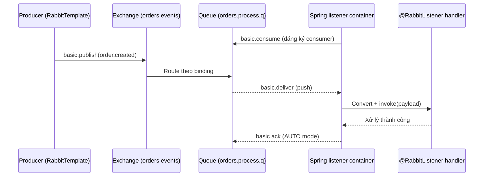
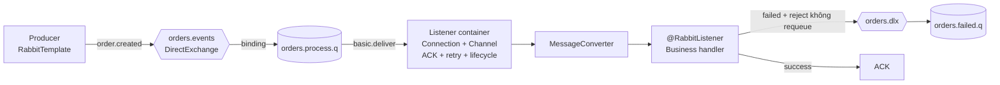
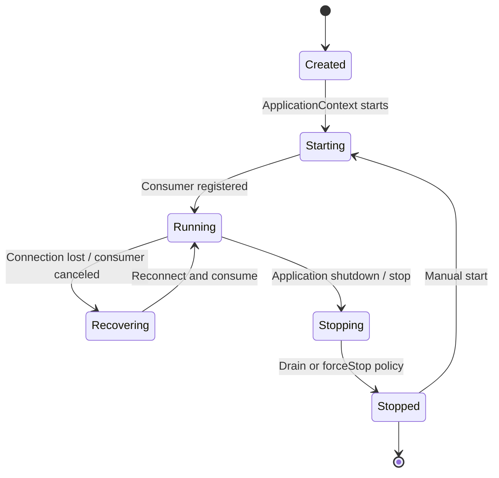
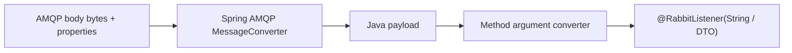

# Nhận theo sự kiện bằng listener container

**Chương:** Nhận thông điệp

Trong ứng dụng Spring AMQP, producer thường gửi message qua `RabbitTemplate` tới RabbitMQ exchange, sau đó broker định tuyến vào queue. Phía nhận có hai cách tiếp cận: ứng dụng chủ động hỏi queue có message hay chưa, hoặc **đăng ký consumer và để broker đẩy message đến khi có dữ liệu**. Cách thứ hai gọi là **nhận theo sự kiện bằng message listener container**.

Listener container là bộ phận hạ tầng chạy nền, giữ kết nối/consumer, gọi code nghiệp vụ khi có delivery, điều phối ACK/NACK, xử lý lỗi, khởi động lại consumer sau mất kết nối và quản lý concurrency. Với Spring AMQP, cách khai báo quen thuộc nhất là `@RabbitListener`; phía sau annotation vẫn là một **listener container** thực sự.

Bài học thuộc mô-đun **SPRING_AMQP**, nơi chúng ta tích hợp RabbitMQ bằng `RabbitTemplate`, `@RabbitListener`, exchange, queue và binding, đồng thời xây hệ thống bất đồng bộ đáng tin cậy với publisher confirms, consumer ACK, retry, dead-letter, giao dịch và observability.

**Mục tiêu sau bài học:**

1. Phân biệt **polling consumer** với **event-driven consumer**, hiểu sự khác nhau giữa RabbitMQ `basic.get` và `basic.consume`.
2. Hiểu vai trò của `SimpleMessageListenerContainer` (SMLC), `DirectMessageListenerContainer` (DMLC), `RabbitListenerContainerFactory` và `RabbitListenerEndpointRegistry`.
3. Viết producer và listener hoàn chỉnh, kết nối bằng queue/exchange/binding và kiểm tra trạng thái consumer trên RabbitMQ.
4. Cấu hình concurrency, prefetch, acknowledgement, retry, DLQ và vòng đời container.
5. Chẩn đoán backlog, redelivery, lỗi định dạng, queue không tồn tại và sự cố connection mà không nhầm publisher confirm với consumer ACK.

> Ví dụ sử dụng **Spring AMQP RabbitMQ AMQP 0.9.1** (`spring-rabbit`). Generic AMQP 1.0 dùng API listener/client khác; không sao chép nguyên cấu hình `@RabbitListener` sang `@AmqpListener`.

## 1. Vì sao gọi là “nhận theo sự kiện”?

### 1.1. Polling: ứng dụng tự hỏi broker

Với `RabbitTemplate.receive(...)`, ứng dụng gọi API để lấy message:

```java
Message message = rabbitTemplate.receive("orders.process.q");
if (message != null) {
    // Tự xử lý message và điều phối lần lấy tiếp theo.
}
```

Ở mức giao thức RabbitMQ, đây là luồng **`basic.get`**. Ứng dụng tự quyết định lúc nào gọi lấy tiếp, xử lý timeout, lịch chạy, số worker và phần lớn công việc điều phối.

Polling có ích khi:

- Chạy một tác vụ quản trị lấy một số message có kiểm soát.
- Dịch vụ chỉ thực hiện xử lý theo lịch cụ thể.
- Viết thử nghiệm, kiểm tra một queue hoặc xây một công cụ nhỏ.

Nhưng nếu chạy liên tục, vòng `while` + `receive()` thường gây nhiều request khi queue rỗng và dễ bị viết thiếu retry, backpressure hoặc shutdown đúng cách.

### 1.2. Event-driven: đăng ký consumer dài hạn

Với `@RabbitListener` hoặc một `MessageListenerContainer`, Spring AMQP đăng ký **consumer bằng `basic.consume`**. RabbitMQ chủ động giao delivery khi queue có message và consumer có credit/prefetch thích hợp.



**Hàm listener không tự “chạy vòng lặp hỏi queue”**. Container nhận delivery, quản lý thread/channel, rồi gọi phương thức ứng dụng.

### 1.3. So sánh nhanh

| Tiêu chí | `RabbitTemplate.receive()` | `@RabbitListener` / listener container |
| --- | --- | --- |
| Cơ chế AMQP điển hình | `basic.get` (pull) | `basic.consume` (push) |
| Ai chủ động lấy delivery? | Ứng dụng gọi API | Broker đẩy tới consumer đã đăng ký |
| Vòng đời nhận | Theo từng lệnh gọi | Consumer tồn tại trong thời gian container chạy |
| Quản lý concurrency | Ứng dụng tự triển khai | Container cung cấp cấu hình consumer/thread |
| Prefetch / backpressure | Không có cùng mô hình đẩy delivery dài hạn | Có giới hạn unacked qua prefetch |
| ACK/reject | Tùy API và cách dùng, cần quản lý đúng | `AUTO`, `MANUAL`, `NONE` và error handling |
| Recovery khi mất kết nối | Người gọi xử lý retry/catch | Container có cơ chế khởi động lại consumer |
| Trường hợp sử dụng | Script, polling có chủ ý | Microservice xử lý message liên tục |

**Lưu ý tên gọi:** SMLC có một **hàng đợi nội bộ trong JVM** giữa thread của RabbitMQ client và thread gọi listener. Đây không phải RabbitMQ `basic.get` polling. Về phía broker, SMLC vẫn là một **push consumer**.

## 2. Listener container đứng ở đâu trong kiến trúc Spring AMQP?



Những thành phần chính:

| Thành phần | Trách nhiệm |
| --- | --- |
| **`ConnectionFactory`** | Cấp connection/channel tới RabbitMQ; thường là `CachingConnectionFactory` |
| **`RabbitListenerContainerFactory`** | **Tạo và cấu hình** container cho từng endpoint `@RabbitListener` |
| **`MessageListenerContainer`** | **Chạy consumer**; vòng đời, recovery, ACK, concurrency, prefetch |
| **`MessageListener` / `ChannelAwareMessageListener`** | Callback cấp thấp nhận raw AMQP `Message`, tùy loại có cả `Channel` |
| **`@RabbitListener`** | Cho phép viết handler dưới dạng một phương thức của Spring bean |
| **`RabbitListenerEndpointRegistry`** | Lưu và quản lý các container được tạo cho annotated endpoints |
| **`RabbitAdmin` / IaC** | Khai báo exchange/queue/binding; **không phải** thành phần gọi listener |
| **`RabbitTemplate`** | Producer publish; cũng có API polling, nhưng không thay listener container |

### 2.1. Hành trình một delivery

Một message `order.created` thường đi qua các bước:

1. Producer dùng `RabbitTemplate` publish vào exchange `orders.events`.
2. RabbitMQ áp dụng binding/routing key để đưa bản message vào `orders.process.q`.
3. Container đã đăng ký consumer với queue, sử dụng connection/channel từ factory.
4. Broker giao message trong giới hạn `prefetch`, delivery có `deliveryTag`, `redelivered` và metadata.
5. Container có thể chuyển đổi body, rồi gọi phương thức `@RabbitListener`.
6. Business handler xử lý và có thể commit DB hoặc gọi downstream.
7. Container ACK/NACK/reject theo `acknowledgeMode` và kết quả.
8. Message rời queue khi được ACK; nếu bị reject không requeue và có DLX hợp lệ, broker chuyển nó theo dead-letter routing.

Nếu container chưa chạy hoặc broker không có consumer, **message có thể nằm chờ trong queue** tùy cấu hình durability/TTL/limits. Sự kiện đến khi không có listener không có nghĩa ứng dụng bị gọi hàm bất kỳ.

### 2.2. Container quản lý hạ tầng, ứng dụng quản lý nghiệp vụ

Container biết làm những việc như:

- Khởi tạo/cancel RabbitMQ consumer.
- Giữ và phục hồi connection/channel.
- Điều chỉnh số consumer và prefetch.
- Gọi handler, kiểm soát ACK/NACK/requeue.
- Kích hoạt retry advice/error handler và phát lifecycle events.
- Thực hiện shutdown theo cấu hình.

Container **không tự biết** một email đã gửi thành công, một chuyển khoản đã hạch toán, hoặc việc ghi DB có ý nghĩa nghiệp vụ gì. Ứng dụng phải bảo đảm xử lý idempotent, phân loại lỗi và lưu kết quả đáng tin cậy.

## 3. Ví dụ hoàn chỉnh: nhận sự kiện tạo đơn hàng

### 3.1. Khai báo topology ở local/test

Ta dùng:

- Exchange: `orders.events` loại `direct`.
- Routing key: `order.created`.
- Queue xử lý: `orders.process.q`.
- Dead-letter exchange: `orders.dlx`.
- Dead-letter queue: `orders.failed.q`.
- Binding DLQ: `orders.failed`.

```java
import org.springframework.amqp.core.*;
import org.springframework.context.annotation.Bean;
import org.springframework.context.annotation.Configuration;
import org.springframework.context.annotation.Profile;

@Configuration(proxyBeanMethods = false)
@Profile("local")
class LocalOrderTopology {

    @Bean
    Declarables orderResources() {
        DirectExchange events =
                new DirectExchange("orders.events", true, false);
        DirectExchange deadLetterExchange =
                new DirectExchange("orders.dlx", true, false);

        Queue work = QueueBuilder.durable("orders.process.q")
                .deadLetterExchange("orders.dlx")
                .deadLetterRoutingKey("orders.failed")
                .build();
        Queue dead = QueueBuilder.durable("orders.failed.q").build();

        Binding workBinding = BindingBuilder.bind(work)
                .to(events).with("order.created");
        Binding deadBinding = BindingBuilder.bind(dead)
                .to(deadLetterExchange).with("orders.failed");

        return new Declarables(
                events, deadLetterExchange,
                work, dead,
                workBinding, deadBinding);
    }
}
```

Đây là **cấu hình thí nghiệm**. `Declarables` chỉ mô tả các tài nguyên; để khai báo thực sự trên broker cần `RabbitAdmin` thích hợp, kết nối và quyền `configure`. Trong production, đội vận hành thường tạo exchange, queue, binding và DLX/DLQ qua IaC/policy trước khi deploy. Không xóa hoặc redeclare queue có backlog chỉ để sửa thông số.

### 3.2. Producer gửi message

Để không bị nhiễu bởi JSON converter trong bài học về listener, ta gửi payload `String` trước:

```java
import org.springframework.amqp.rabbit.core.RabbitTemplate;
import org.springframework.stereotype.Service;

@Service
class OrderCreatedPublisher {

    private final RabbitTemplate template;

    OrderCreatedPublisher(RabbitTemplate template) {
        this.template = template;
    }

    void publish(String orderId) {
        template.convertAndSend(
                "orders.events",
                "order.created",
                orderId);
    }
}
```

`RabbitTemplate.convertAndSend` áp dụng converter đã được cấu hình (mặc định hỗ trợ String), sau đó publish qua exchange/routing key. Nó **không gọi trực tiếp handler**; RabbitMQ sẽ định tuyến, lưu và đẩy delivery khi consumer active.

### 3.3. Một listener với `AUTO` acknowledgement

```java
import org.springframework.amqp.rabbit.annotation.RabbitListener;
import org.springframework.context.annotation.Profile;
import org.springframework.stereotype.Component;

@Component
@Profile("auto-demo")
class OrderProjectionListener {

    private final OrderProjectionService projection;

    OrderProjectionListener(OrderProjectionService projection) {
        this.projection = projection;
    }

    @RabbitListener(
            id = "orders-projector",
            queues = "orders.process.q",
            concurrency = "2-6")
    public void onOrderCreated(String orderId) {
        projection.applyOnce(orderId);
        // Phương thức thành công -> container xử lý ACK ở AUTO mode.
    }
}
```

`OrderProjectionService` là **dịch vụ nghiệp vụ do bạn triển khai**, không phải lớp của Spring AMQP:

```java
public interface OrderProjectionService {

    // Bảo đảm apply idempotent theo orderId/eventId với DB constraint.
    void applyOnce(String orderId);
}
```

**Trong bản demo** `onOrderCreated(String)` nhận đúng payload String do producer gửi. Với JSON DTO, phải đăng ký `MessageConverter` phù hợp ở producer và listener; không chỉ đổi tham số `String` thành một `record` rồi mặc định converter sẽ tự hiểu định dạng.

Với `concurrency = "2-6"` trên **SimpleMessageListenerContainer**, số consumer tối thiểu là 2, tối đa 6 theo tải. Nếu dùng **DirectMessageListenerContainer**, chuỗi `"2-6"` không phù hợp; DMLC dùng một số nguyên `consumersPerQueue`.

### 3.4. Bật infrastructure của `@RabbitListener`

Trong Spring Framework/Spring AMQP không dùng Spring Boot, hãy bật annotation processing:

```java
import org.springframework.amqp.rabbit.annotation.EnableRabbit;
import org.springframework.context.annotation.Configuration;

@Configuration
@EnableRabbit
class RabbitListenerEnabled {
}
```

Trong Spring Boot với RabbitMQ infrastructure/auto-configuration phù hợp, `@RabbitListener` thường đã được hỗ trợ khi starter có mặt. Không cần tạo container bean cho từng phương thức bằng tay.

**Cần kiểm tra starter của phiên bản Boot**: các phiên bản hiện đại có thể phân biệt starter RabbitMQ AMQP 0.9.1 với generic AMQP 1.0. Bài này giả định `RabbitTemplate`/`@RabbitListener` trong `spring-rabbit`.

## 4. `@RabbitListener` hoạt động nhờ container factory

Khi Spring quét thấy:

```java
@RabbitListener(queues = "orders.process.q")
public void handle(String data) {
    // ...
}
```

Framework tạo một endpoint cho phương thức và dùng bean `RabbitListenerContainerFactory` để **tạo container** thực thi endpoint đó. Mặc định, nếu không chỉ định factory, Spring tìm bean tên **`rabbitListenerContainerFactory`**.

### 4.1. Cấu hình SMLC bằng Java

```java
import org.springframework.amqp.core.AcknowledgeMode;
import org.springframework.amqp.rabbit.config.SimpleRabbitListenerContainerFactory;
import org.springframework.amqp.rabbit.connection.ConnectionFactory;
import org.springframework.context.annotation.Bean;
import org.springframework.context.annotation.Configuration;

@Configuration(proxyBeanMethods = false)
class ListenerFactoryConfig {

    @Bean("rabbitListenerContainerFactory")
    SimpleRabbitListenerContainerFactory rabbitListenerContainerFactory(
            ConnectionFactory connectionFactory) {

        SimpleRabbitListenerContainerFactory factory =
                new SimpleRabbitListenerContainerFactory();

        factory.setConnectionFactory(connectionFactory);
        factory.setConcurrentConsumers(2);
        factory.setMaxConcurrentConsumers(6);
        factory.setPrefetchCount(10);
        factory.setAcknowledgeMode(AcknowledgeMode.AUTO);

        return factory;
    }
}
```

Thiết lập này được áp dụng mặc định cho các `@RabbitListener` dùng factory đó. Nếu endpoint chỉ rõ `concurrency`, thuộc tính endpoint có thể ghi đè concurrency tương ứng của factory.

Nếu Spring Boot đã tự tạo factory mặc định, khi khai báo bean riêng như trên, bạn **thay cấu hình mặc định bằng cấu hình tự viết**. Phải kiểm tra có cần giữ những customizer, message converter, observation hoặc retry settings mà Boot trước đó cấu hình hay không. Không vừa đặt YAML vừa viết Java cấu hình trái ngược mà không kiểm tra thứ tự áp dụng.

### 4.2. Cấu hình bằng `application.yml` trong Spring Boot

Ví dụ dành cho đường cấu hình RabbitMQ AMQP 0.9.1:

```yaml
spring:
  rabbitmq:
    host: localhost
    port: 5672
    listener:
      type: simple
      simple:
        concurrency: 2
        max-concurrency: 6
        prefetch: 10
        acknowledge-mode: auto
        auto-startup: true
```

Trong ví dụ `@RabbitListener(concurrency="2-6")`, giới hạn concurrency của endpoint là 2–6 như YAML. Để dễ hiểu khi chạy lab, **chọn một nguồn cấu hình chính**: hoặc cấu hình factory/YAML, hoặc ghi đè có chủ đích tại annotation.

### 4.3. Cấu hình DMLC khi cần

```java
import org.springframework.amqp.rabbit.config.DirectRabbitListenerContainerFactory;
import org.springframework.amqp.rabbit.connection.ConnectionFactory;
import org.springframework.context.annotation.Bean;
import org.springframework.context.annotation.Configuration;

@Configuration(proxyBeanMethods = false)
class DirectListenerFactoryConfig {

    @Bean("directOrderFactory")
    DirectRabbitListenerContainerFactory directOrderFactory(
            ConnectionFactory connectionFactory) {

        DirectRabbitListenerContainerFactory factory =
                new DirectRabbitListenerContainerFactory();

        factory.setConnectionFactory(connectionFactory);
        factory.setConsumersPerQueue(3);
        factory.setPrefetchCount(10);
        return factory;
    }
}
```

Một endpoint có thể dùng factory riêng:

```java
@RabbitListener(
        id = "orders-direct",
        queues = "orders.process.q",
        containerFactory = "directOrderFactory",
        concurrency = "3")
public void handleDirect(String orderId) {
    // Xử lý sự kiện.
}
```

**Đây là một phương án thay thế**, không phải listener thứ hai cần bật đồng thời với `orders-projector` trong ví dụ. Nếu cả hai cùng nghe `orders.process.q`, RabbitMQ coi chúng là **competing consumers**; mỗi delivery đi tới một consumer, không tự sao chép cho mỗi phương thức.

## 5. So sánh hai loại container: SMLC và DMLC

Spring AMQP cung cấp hai container chính cho `spring-rabbit`:

- **`SimpleMessageListenerContainer` (SMLC)**: mô hình truyền thống có queue đệm nội bộ và các consumer thread do container quản lý.
- **`DirectMessageListenerContainer` (DMLC)**: RabbitMQ Java client thread gọi listener trực tiếp hơn, giảm bước handoff.

| Tiêu chí | SMLC | DMLC |
| --- | --- | --- |
| Luồng giao nhận | RabbitMQ client thread → internal queue → consumer thread → handler | RabbitMQ client dispatch thread → handler |
| Cấu hình số consumer | `concurrentConsumers`, `maxConcurrentConsumers`, `concurrency="m-n"` | `consumersPerQueue`, `concurrency="n"` |
| Tự điều chỉnh số consumer theo tải | Có cơ chế scale trong khoảng min/max | Không có cùng cơ chế auto-scale; có thể điều chỉnh số consumer/queue bằng chương trình |
| Nhiều queue trong một container | Mỗi consumer có thể nhận từ các queue đã cấu hình trên cùng channel | Mỗi consumer gắn với một queue; số consumer nhân theo số queue |
| Batch do consumer gom | Hỗ trợ `consumerBatchEnabled` / `batchSize` theo chức năng | Không hỗ trợ cùng chức năng consumer-side batch như SMLC |
| Giảm số ACK | `batchSize` có thể điều phối ACK/transaction | `messagesPerAck` với giới hạn khác |
| Thêm/bỏ queue động | Có thể restart/cancel các consumer của container | Chỉ cần tác động consumer thuộc queue được đổi |
| Thread sizing | Cần `TaskExecutor` phù hợp số consumer | Cần RabbitMQ client executor đủ thread cho các listener |
| Điểm mạnh | Linh hoạt về concurrency, batch, mô hình worker riêng | Ít bước chuyển thread, dễ thay queue động |
| Phù hợp làm mặc định? | Thường là lựa chọn dễ bắt đầu | Chọn khi cần các đặc điểm riêng và đã đo hiệu năng |

### 5.1. SMLC không có nghĩa là xử lý tuần tự

Nếu `concurrentConsumers = 3`, container mở ba consumer. Chúng có thể nhận và xử lý **song song** từ cùng queue. Khi các consumer nhanh/chậm khác nhau, thứ tự **hoàn thành** không nhất thiết trùng thứ tự broker giao message.

Nếu cần xử lý theo thứ tự nghiêm ngặt cho một dòng sự kiện, phải đánh giá:

- Chỉ một consumer active hoặc điều phối theo khóa nghiệp vụ.
- `prefetch=1` khi cần giảm delivery đang chờ trong client.
- Không có nhiều instance service cùng consume queue mà không quản lý thứ tự.
- Không có retry/requeue khiến event cũ quay lại sau event mới.

### 5.2. DMLC không “luôn nhanh hơn”

DMLC tránh một bước context switch, nhưng listener chạy trên các thread do RabbitMQ client executor sử dụng. Nếu business handler gọi API/DB chậm hoặc block quá lâu, bạn phải tính toán thread pool của connection factory cho **tất cả các DMLC dùng chung factory**, không chỉ một container.

SMLC dùng các consumer thread riêng từ `TaskExecutor`; có thể thuận tiện cho công việc blocking. Cả hai cần benchmark theo throughput, latency, concurrency và lượng message đang unacked.

### 5.3. Ví dụ nhiều queue làm concurrency khác nhau

Giả sử một container nghe ba queue `q1`, `q2`, `q3`:

- **SMLC `concurrentConsumers=2`**: có **hai consumer**, mỗi consumer sử dụng một channel để tiêu thụ các queue của container.
- **DMLC `consumersPerQueue=2`**: thường có **hai consumer cho mỗi queue**, tổng cộng **sáu consumer/channel** cho ba queue.

Nếu sao chép con số 2 giữa hai mode mà không xét số queue, số consumer và channel thực tế có thể khác rất lớn.

## 6. Prefetch, concurrency và backpressure

### 6.1. Prefetch giới hạn số message đang chờ ACK

`prefetchCount` điều khiển số delivery **chưa ACK** broker cho phép giao tới mỗi consumer theo QoS của RabbitMQ.

Giả sử:

```text
Queue: orders.process.q
Container: SMLC
Concurrent consumers: 4
Prefetch: 10
Acknowledge mode: AUTO
```

Trong cách tính gần đúng, broker có thể có tối đa **4 × 10 = 40 deliveries đang outstanding** cho nhóm consumer này (giả định không có cấu hình QoS/phạm vi khác). Đây là các message có thể **đã rời trạng thái ready** nhưng đang chờ xử lý/ACK, không phải 40 message đã hoàn tất.

**Mặc định prefetch của listener container Spring AMQP từ phiên bản 2.0 là 250**, nhằm giữ consumer bận và tăng throughput. Đây **không phải** lựa chọn tốt cho mọi workload:

- Message lớn/consumer chậm: 250 outstanding mỗi consumer có thể làm tăng RAM và độ trễ.
- Cần thứ tự chặt: bắt đầu thử `prefetch=1` cùng chiến lược concurrency phù hợp.
- Nhiều consumer nhưng tải ít: prefetch thấp hơn có thể giúp phân phối công việc đều.
- Xử lý nhẹ, tải cao: tăng prefetch có thể cải thiện throughput nếu downstream theo kịp.

### 6.2. Bài toán nhân tài nguyên

Nếu một service có 5 instance, mỗi instance chạy 6 consumer, prefetch 100:

```text
instances  = 5
consumers/instance = 6
prefetch/consumer  = 100

Cận trên giản lược của unacked deliveries:
5 × 6 × 100 = 3000
```

Nếu mỗi payload khoảng 1 MiB, chỉ tính phần body của deliveries outstanding đã là mức tối đa lý thuyết gần **3 GiB**, chưa kể object overhead, buffers và các bản copy. **Ví dụ chỉ để minh họa rủi ro**, không phải phép đo bộ nhớ thực tế; client/broker có nhiều cơ chế buffer và trạng thái khác.

Vì vậy concurrency và prefetch phải được sizing cùng:

- Thời gian xử lý trung bình/p95/p99.
- Khả năng của DB, HTTP downstream và thread pool.
- Dung lượng message, queue type và broker memory.
- Số instance/replica của service.
- Mức độ chấp nhận redelivery, mất thứ tự và SLA.

### 6.3. Công thức kiểm tra sơ bộ throughput

Nếu một handler mất trung bình 200 ms để hoàn tất một message, một consumer xử lý tuần tự có năng lực khoảng:

```text
1 / 0.2 s ≈ 5 messages/s
4 consumer ≈ 20 messages/s (ước tính lý tưởng)
```

Con số thực tế bị giới hạn bởi contention, broker, prefetch, network, DB transaction, lock và số luồng. Đừng tăng số consumer lên 100 khi database chỉ chịu được 30 request/s.

### 6.4. Một queue có hai nhóm worker

Nếu hai ứng dụng cùng `@RabbitListener(queues = "orders.process.q")`, broker phân phối delivery như **competing consumers**. Đây là cách scale **một công việc**, không phải publish một event cho cả hai ứng dụng.

Nếu email-service và audit-service **cùng cần mỗi event**, hãy dùng **hai queue độc lập** cùng bind từ exchange, ví dụ `orders.email.q` và `orders.audit.q`. Không giải quyết fan-out bằng cách tạo hai listener trên cùng queue.

## 7. Chế độ ACK: `AUTO`, `MANUAL` và `NONE`

Trong Spring AMQP, `AcknowledgeMode` có ba giá trị:

| Mode | Ai ACK? | Khi nào dùng? | Rủi ro |
| --- | --- | --- | --- |
| **`AUTO`** (mặc định của container) | Container ACK khi listener hoàn thành thành công, xử lý reject/nack khi lỗi | Phần lớn business handlers đồng bộ | Cần hiểu retry/requeue/error handler |
| **`MANUAL`** | Ứng dụng tự gọi `Channel.basicAck/basicNack/basicReject` | Cần điều phối thủ công hoặc async workflow đặc biệt | Quên ACK làm unacked backlog; double ACK đóng channel |
| **`NONE`** | Broker **auto-ack** ngay khi delivery, không chờ consumer ACK | Chỉ khi mất message chấp nhận được | Nếu handler crash, broker không redeliver vì đã coi message acknowledged |

Tên `AUTO` của Spring **không đồng nghĩa** với RabbitMQ `autoAck=true`. Trên wire:

- Spring `AUTO`: ứng dụng **có ACK** do container gửi thay handler.
- Spring `NONE`: RabbitMQ **autoAck/noAck**; broker coi delivery thành công ngay khi giao.

### 7.1. `AUTO`: đơn giản nhưng phải biết xử lý exception

```java
@RabbitListener(queues = "orders.process.q")
public void handle(String orderId) {
    projection.applyOnce(orderId);
    // Trở về thành công: container ACK.
    // Ném exception: container xử lý lỗi theo cấu hình.
}
```

Nếu `applyOnce` ném exception, Spring xử lý thông qua listener container và error handler. Mặc định một số lỗi nghiệp vụ có thể khiến message **bị requeue và giao lại**, tạo vòng lặp nếu nguyên nhân không thể phục hồi. Không nên đặt `try/catch` nuốt mọi exception rồi trả về bình thường, vì khi đó container có thể **ACK một message chưa được xử lý thành công**.

### 7.2. `MANUAL`: minh họa ACK/NACK rõ ràng

Đây là **phương án thay thế** cho listener `auto-demo`, không được bật hai listener cùng queue trong bài lab nếu muốn so sánh một cách rõ ràng.

```java
import com.rabbitmq.client.Channel;
import java.io.IOException;
import org.springframework.amqp.rabbit.annotation.RabbitListener;
import org.springframework.amqp.support.AmqpHeaders;
import org.springframework.context.annotation.Profile;
import org.springframework.messaging.handler.annotation.Header;
import org.springframework.stereotype.Component;

@Component
@Profile("manual-demo")
class ManualOrderListener {

    private final OrderProjectionService projection;

    ManualOrderListener(OrderProjectionService projection) {
        this.projection = projection;
    }

    @RabbitListener(
            id = "orders-manual",
            queues = "orders.process.q",
            ackMode = "MANUAL")
    public void onOrder(
            String orderId,
            Channel channel,
            @Header(AmqpHeaders.DELIVERY_TAG) long tag) throws IOException {

        try {
            projection.applyOnce(orderId);
            channel.basicAck(tag, false);
        } catch (IllegalArgumentException permanentError) {
            // Sai dữ liệu: không requeue; broker dùng DLX nếu có.
            channel.basicReject(tag, false);
        } catch (RuntimeException transientError) {
            // Minh họa lỗi tạm thời; tránh requeue mãi vô hạn.
            channel.basicNack(tag, false, true);
        }
    }
}
```

Ý nghĩa các tham số:

- `basicAck(tag, false)`: ACK **một** delivery tag.
- `basicReject(tag, false)`: reject một delivery, **không requeue**.
- `basicNack(tag, false, true)`: negative ACK một delivery, **cho phép requeue**.
- `false` ở đối số thứ hai của `basicAck/basicNack` là `multiple=false`, tránh vô tình xác nhận nhiều message outstanding trên channel.

**Cảnh báo sản xuất:** `basicNack(..., requeue=true)` có thể làm cùng message quay lại **ngay lập tức**, tạo hot loop nếu phụ thuộc bên ngoài vẫn lỗi. Phải thiết kế retry delay, attempt limit, DLQ hoặc broker delivery limit theo queue type. Nếu việc gửi ACK thất bại do channel đóng sau khi DB đã commit, broker có thể redeliver; business handler vẫn cần idempotency.

### 7.3. Trường hợp bất đồng bộ thực sự

`@RabbitListener` có thể trả về `CompletableFuture<?>` hoặc `Mono<?>` khi xử lý/phản hồi bất đồng bộ. Khi đó ACK phải gắn với **kết quả hoàn thành tương lai**, không thể ACK ngay khi phương thức vừa trả object future.

Spring AMQP hiện đại có hỗ trợ điều chỉnh ACK mode khi phát hiện async return type, nhưng **cần kiểm tra cấu hình listener và cách hoàn tất future đúng phiên bản**. Đừng tự tạo `new Thread(...).start()` rồi trả `void`: với `AUTO`, container có thể ACK trước khi công việc nền kết thúc.

### 7.4. ACK không đồng nghĩa đã lưu kết quả nghiệp vụ

Một handler có thể gọi hệ thống ngoài, nhận HTTP 200 rồi ACK, nhưng API downstream xử lý bất đồng bộ và cuối cùng thất bại. Khi đó RabbitMQ chỉ biết consumer đã xác nhận delivery, không biết nghiệp vụ end-to-end đã thành công.

Muốn bảo đảm tác dụng phụ:

- Commit transaction ở nơi lưu trạng thái nghiệp vụ trước khi ACK.
- Lưu `eventId` cùng unique constraint/idempotency record.
- Thiết kế outbox cho các event tiếp theo nếu cần publish sau DB commit.
- Quan sát riêng **publisher confirm**, **consumer ACK** và **business completion**.

## 8. Xử lý lỗi, retry và DLQ trong listener container

### 8.1. Ba nhóm lỗi khác nhau

| Nhóm lỗi | Ví dụ | Cách phản ứng |
| --- | --- | --- |
| **Dữ liệu không hợp lệ** | JSON sai cú pháp, schema thiếu trường, event version không hỗ trợ | Không retry mù; quarantine/DLQ, tìm nguyên nhân producer |
| **Phụ thuộc tạm thời lỗi** | DB timeout, HTTP 503, rate limit | Retry giới hạn, backoff, cuối cùng DLQ |
| **Lỗi hạ tầng/connection** | Broker restart, socket disconnect | Container recovery, theo dõi trạng thái consumer và retry connect |

Một lỗi parse có thể xảy ra **trước khi phương thức `@RabbitListener` được gọi**. `try/catch` bên trong handler không bắt hết loại này. Spring AMQP có `ConditionalRejectingErrorHandler` mặc định phân loại một số lỗi fatal, nhưng bạn phải kiểm tra cấu hình thực tế để biết message bị discard, requeue hay dead-letter.

### 8.2. Vì sao `defaultRequeueRejected=false` cần DLX?

Nếu listener ném exception và cấu hình reject không requeue:

```yaml
spring:
  rabbitmq:
    listener:
      simple:
        default-requeue-rejected: false
```

Broker có thể dead-letter message theo `x-dead-letter-exchange` hoặc policy tương ứng của queue. Nếu **không có DLX/binding đích**, message có thể bị loại bỏ. Vì vậy cần provision topology DLQ **trước** khi thay đổi chế độ reject, và kiểm thử được message thực sự đến `orders.failed.q`.

Hàm `@RabbitListener` cũng có thể chủ động ném `AmqpRejectAndDontRequeueException` để yêu cầu reject không requeue trong một trường hợp cụ thể, không phụ thuộc vào default behavior của listener container.

### 8.3. Retry là giới hạn lần thử, không phải vòng requeue vô hạn

Ở Spring Boot với RabbitMQ listener kiểu `simple`, có thể cấu hình retry advice theo property được hỗ trợ bởi phiên bản:

```yaml
spring:
  rabbitmq:
    listener:
      type: simple
      simple:
        concurrency: 2
        prefetch: 10
        acknowledge-mode: auto
        default-requeue-rejected: false
        retry:
          enabled: true
          max-retries: 2
          initial-interval: 1s
          multiplier: 2.0
          max-interval: 10s
```

Ví dụ minh họa **retry trong listener pipeline**: với Spring Boot 4.1, `max-retries: 2` là tối đa hai lần thử lại sau lần chạy ban đầu (tổng tối đa ba attempts). Khi tất cả attempt thất bại, cơ chế recoverer/reject quyết định ACK, requeue, DLQ hay chuyển sang xử lý khác. Cần kiểm tra tên property và ngữ nghĩa của **phiên bản Boot** đang dùng trước khi đưa vào production.

**Quan trọng:** không đồng nghĩa có delay broker-side khi Spring listener đang retry. In-memory retry/backoff giữ tài nguyên consumer trong thời gian chờ. Với delay dài hoặc tải lớn, cân nhắc retry queues với TTL/DLX hay cơ chế delayed message phù hợp; phân biệt với basicNack `requeue=true` thường giao lại nhanh.

### 8.4. Ví dụ advice chain cho retry có giới hạn

Khi cần cấu hình rõ recovery, Spring AMQP có `RetryInterceptorBuilder`:

```java
import org.springframework.amqp.rabbit.config.RetryInterceptorBuilder;
import org.springframework.amqp.rabbit.retry.RejectAndDontRequeueRecoverer;
import org.springframework.retry.interceptor.RetryOperationsInterceptor;

@Bean
RetryOperationsInterceptor orderListenerRetry() {
    return RetryInterceptorBuilder.stateless()
            .maxAttempts(3)
            .backOffOptions(1000, 2.0, 10000)
            .recoverer(new RejectAndDontRequeueRecoverer())
            .build();
}
```

Sau đó gắn interceptor vào **factory của listener đang dùng**, ví dụ:

```java
factory.setAdviceChain(orderListenerRetry);
```

Đây là phương án **thay thế** cho retry auto-configuration bằng YAML, không bật cả hai mà không hiểu chuỗi advice cuối cùng. `RejectAndDontRequeueRecoverer` ném tín hiệu reject không requeue sau khi retry hết, giúp broker dead-letter nếu queue có DLX. Trái lại, một số recoverer mặc định hoặc recoverer tùy biến có thể **tiêu thụ/ACK message lỗi**, lúc đó broker không tự dead-letter.

### 8.5. Idempotency và transaction

Giả sử handler đã commit DB, sau đó JVM chết trước ACK. Khi connection mất, broker có thể giao lại message cho consumer khác. Nếu handler cập nhật số dư lần nữa mà không có `eventId`/idempotency, nghiệp vụ sai dù container hoạt động đúng.

Cần:

1. Producer tạo `eventId` ổn định, không thay qua retry/replay.
2. Consumer ghi một idempotency record có unique constraint **cùng transaction với thay đổi nghiệp vụ** khi có thể.
3. Chỉ ACK khi transaction bền vững đã thành công.
4. Khi external side effect không nằm trong DB transaction, dùng idempotency key ở hệ thống ngoài hoặc workflow điều phối thích hợp.
5. Nếu cần publish event tiếp theo sau DB commit, cân nhắc transactional outbox.

Spring `@Transactional` trên handler không tự tạo **một giao dịch phân tán nguyên tử** giữa DB và RabbitMQ. Giao dịch AMQP riêng (`channelTransacted`) cũng không thay thế outbox cho DB+broker atomicity.

## 9. Vòng đời của listener container

Một listener container thường thực thi `SmartLifecycle` của Spring:



Trong hệ thống production, thường muốn container **khởi động tự động**; nhưng đôi khi cần chờ database migration, token/secret, cấu hình broker hoặc một phụ thuộc nghiệp vụ sẵn sàng trước khi consume.

### 9.1. Điều khiển qua `RabbitListenerEndpointRegistry`

Những container được tạo cho `@RabbitListener` được quản lý trong `RabbitListenerEndpointRegistry`, **không nhất thiết là bean riêng** có thể autowire bằng tên.

```java
import org.springframework.amqp.core.MessageListenerContainer;
import org.springframework.amqp.rabbit.listener.RabbitListenerEndpointRegistry;
import org.springframework.stereotype.Component;

@Component
class ListenerLifecycleControl {

    private final RabbitListenerEndpointRegistry registry;

    ListenerLifecycleControl(RabbitListenerEndpointRegistry registry) {
        this.registry = registry;
    }

    void pauseOrders() {
        MessageListenerContainer container =
                registry.getListenerContainer("orders-projector");
        if (container != null) {
            container.stop();
        }
    }

    void resumeOrders() {
        MessageListenerContainer container =
                registry.getListenerContainer("orders-projector");
        if (container != null) {
            container.start();
        }
    }
}
```

Các hàm trên **chỉ minh họa API**. Không nên đưa `pauseOrders/resumeOrders` thành endpoint HTTP công khai không xác thực. Production cần phân quyền, audit, quyết định khi nào được dừng tiêu thụ và cách phục hồi backlog.

Nếu cấu hình `autoStartup=false`, container có thể được start sau khi dependency đã sẵn sàng. Nếu có nhiều listener, dùng `getListenerContainerIds()`/`getListenerContainers()` để kiểm tra những endpoint đang chạy.

### 9.2. Shutdown bình thường và `forceStop`

Khi dừng container, mặc định framework thường cố xử lý các message **đã prefetch** trước khi ngừng, tùy timeout/shutdown settings. Khi đặt `forceStop=true` ở phiên bản hỗ trợ, container có thể dừng sau message hiện tại và để những delivery đã prefetch còn lại được **requeue**, giúp chuyển quyền xử lý nhanh hơn nhưng tăng nguy cơ redelivery.

Cần phối hợp:

- Graceful shutdown timeout của container.
- Thời gian xử lý p99 của handler.
- Deadline đóng pod/container ở nền tảng triển khai.
- Idempotency khi consumer bị dừng lúc đã commit nhưng chưa ACK.
- Lượng unacked khi prefetch lớn.

### 9.3. Queue bị xóa, chưa tồn tại hoặc consumer bị broker cancel

Container có thể kiểm tra queue bằng **passive declaration**, thử đăng ký consumer và retry khi connection hoặc queue tạm không có. Nhưng hành vi **fatal hay chờ phục hồi** phụ thuộc `missingQueuesFatal`, container type và phiên bản.

Nếu một queue bị broker xóa lúc ứng dụng đang chạy:

- Listener có thể nhận consumer cancel.
- Container cố khôi phục theo cấu hình.
- Nếu đã cố ý xóa queue vĩnh viễn, phải cập nhật danh sách queue mà container đang lắng nghe; nếu không, nó có thể tiếp tục cố subscribe.
- Không giải quyết `PRECONDITION_FAILED` do queue arguments khác nhau bằng cách bật retry vô hạn.

**Auto-recovery không phải auto-provisioning:** để khai báo queue/exchange/binding vẫn cần `RabbitAdmin` được phép hoặc pipeline hạ tầng thích hợp. Production có IaC không nên dựa vào việc mọi listener tự tạo lại topology.

## 10. Cách tạo container trực tiếp không dùng `@RabbitListener`

Annotation phù hợp phần lớn ứng dụng, nhưng bạn có thể tạo container bean cho một callback `MessageListener` hoặc `ChannelAwareMessageListener`.

Ví dụ listener nhận **raw bytes**:

```java
import java.nio.charset.StandardCharsets;
import org.springframework.amqp.core.AcknowledgeMode;
import org.springframework.amqp.core.MessageListener;
import org.springframework.amqp.rabbit.connection.ConnectionFactory;
import org.springframework.amqp.rabbit.listener.SimpleMessageListenerContainer;
import org.springframework.context.annotation.Bean;
import org.springframework.context.annotation.Configuration;
import org.springframework.context.annotation.Profile;

@Configuration(proxyBeanMethods = false)
@Profile("raw-demo")
class RawListenerConfig {

    @Bean
    SimpleMessageListenerContainer rawContainer(
            ConnectionFactory connectionFactory) {

        SimpleMessageListenerContainer container =
                new SimpleMessageListenerContainer(connectionFactory);

        container.setQueueNames("orders.raw.q");
        container.setAcknowledgeMode(AcknowledgeMode.AUTO);
        container.setConcurrentConsumers(1);
        container.setPrefetchCount(5);

        container.setMessageListener((MessageListener) message -> {
            String payload = new String(
                    message.getBody(), StandardCharsets.UTF_8);
            System.out.println("RAW received: " + payload);
        });

        return container;
    }
}
```

**Phải provision `orders.raw.q` trước khi bật profile**. Container bean này có lifecycle riêng trong ApplicationContext, khác với annotated endpoint nằm trong `RabbitListenerEndpointRegistry`.

Khi dùng raw `MessageListener`:

- Bạn tự quyết định cách deserialize, kiểm tra metadata và validation.
- Nếu throw exception, container vẫn xử lý ACK/requeue theo `AcknowledgeMode` và error settings.
- Với `ChannelAwareMessageListener`, callback nhận thêm `Channel` để ACK/NACK thủ công khi cần.
- Không nên trộn raw listener và annotated listener trên cùng queue trong lab rồi ngạc nhiên vì message được chia sang hai handler.

## 11. Message conversion và event contract

Khi dùng `@RabbitListener`, framework phải biến `byte[]` từ RabbitMQ thành tham số Java.



Ví dụ nhận DTO JSON:

```java
public record OrderCreatedEvent(
        String eventId,
        String orderId) {
}

@Component
class JsonOrderListener {

    @RabbitListener(
            queues = "orders.json.q",
            messageConverter = "jsonConverter")
    void handle(OrderCreatedEvent event) {
        // Kiểm tra schema, eventId và idempotency.
    }
}
```

Ví dụ giả định `jsonConverter` là bean message converter phù hợp với phiên bản Spring AMQP/Jackson (Spring AMQP 4.x dùng họ `JacksonJsonMessageConverter`). Queue `orders.json.q` cũng cần được tạo và bind đúng. Đặt `contentType=application/json` ở producer không tự bảo đảm schema hợp lệ; cần kiểm tra JSON, type mapping và event version.

**Lỗi chuyển đổi có thể xảy ra trước khi handler chạy**. Cần kiểm tra error handler, reject policy và DLQ thay vì đặt toàn bộ logic xử lý lỗi trong phương thức annotated listener.

### 11.1. Một class có nhiều kiểu event

Spring AMQP hỗ trợ `@RabbitListener` ở class-level kết hợp `@RabbitHandler` trên nhiều phương thức, chọn handler theo kiểu payload sau chuyển đổi. Điều này có ích cho một queue chứa nhiều loại message có hợp đồng chung.

Nhưng nhiều event khác nhau có SLA, retry/DLQ và mức ưu tiên riêng thường nên tách queue, vì:

- Một poison event có thể làm chậm cả queue.
- Nhiều handler ở class-level dùng chung container và concurrency.
- Thao tác thêm/bỏ một event type có thể ảnh hưởng consumers khác.
- Việc chọn handler dựa trên converted payload, cần type headers/schema đáng tin cậy.

Không xem nhiều phương thức `@RabbitHandler` là nhiều RabbitMQ consumer: một class-level listener endpoint được container quản lý như một subscription.

## 12. Bảo đảm xử lý đáng tin cậy: ba tầng xác nhận

Người mới học thường nghĩ `@RabbitListener` trả về bình thường có nghĩa message đã “an toàn tuyệt đối”. Hãy phân biệt ba loại mốc:

| Tầng | Thành phần xác nhận | Ý nghĩa | Không bảo đảm |
| --- | --- | --- | --- |
| **Publisher confirm** | RabbitMQ → `RabbitTemplate` | Broker đã xử lý publish theo điều kiện confirms | Không xác nhận consumer đã chạy |
| **Consumer ACK** | Listener/container → RabbitMQ | Consumer chấp nhận delivery | Không xác nhận hệ thống downstream cuối cùng đã hoàn tất |
| **Business completion** | DB/workflow/domain service | Tác dụng phụ nghiệp vụ đã đạt trạng thái mong muốn | Không nhất thiết có quan hệ 1:1 với delivery nếu có retry |

Luồng điển hình:

```text
1. Producer commit đơn hàng.
2. Producer publish event.
3. RabbitMQ publisher-confirm ACK.
4. Queue lưu message.
5. Listener container nhận delivery.
6. Handler commit projection DB.
7. Listener container basic.ack.
```

Các khoảng giữa những bước này đều có rủi ro crash:

- **Giữa bước 1 và 2:** dùng transactional outbox để tránh mất event.
- **Giữa bước 2 và 3:** producer có thể không biết broker đã nhận; retry có thể tạo duplicate.
- **Giữa bước 6 và 7:** broker có thể redeliver event đã xử lý; cần idempotency.
- **Sau khi reject:** có thể cần DLX/DLQ để không mất dấu lỗi.

Sự kiện `order.created` xử lý theo chiến lược **at-least-once** thường cần idempotency, không tuyên bố “exactly once” chỉ nhờ listener container.

## 13. Quan sát listener container trong production

Để biết consumer có làm việc đúng không, không chỉ đếm message được publish. Một hệ thống tối thiểu nên quan sát:

| Tín hiệu | Nguồn điển hình | Câu hỏi được trả lời |
| --- | --- | --- |
| Consumer count theo queue | RabbitMQ Management UI / metrics | Listener đã thực sự đăng ký chưa? |
| Queue ready | Broker | Có backlog chưa được giao không? |
| Queue unacked | Broker | Message đã giao nhưng chưa ACK có tăng không? |
| Publish rate / deliver rate / ACK rate | Broker | Producer gửi nhanh hơn tốc độ hoàn tất không? |
| p95/p99 handler latency | Micrometer/Observation hoặc app metrics | Handler nào chậm? |
| Retry/redelivery/DLQ count | Broker + app logs | Poison message hay downstream gặp lỗi? |
| Consumer startup/recovery events | Spring events/logs | Có mất connection, queue missing, consumer cancel không? |
| Active consumers/concurrency | Container state + broker | Hệ thống đã scale đến mức nào? |
| Connection/channel count, resource alarms | Broker | Có thiếu channel, RAM, file descriptor hoặc disk không? |
| Processing success by eventType | App domain metrics | Công việc nghiệp vụ có thật sự hoàn tất? |

### 13.1. Phân tích backlog bằng Little's Law, không chỉ tăng consumer

Nếu broker nhận 100 message/s, nhưng consumer hoàn tất 70 message/s, backlog tăng khoảng **30 message/s** trong thời gian đó. Trong 10 phút, tăng gần 18.000 message nếu tải không đổi và không có TTL/giới hạn khác.

Tăng `concurrency` có thể giúp nếu bottleneck nằm ở CPU/thread; nhưng nếu giới hạn là database hoặc API rate limit, tăng consumer có thể làm nhiều request thất bại hơn, khiến retry/DLQ tăng.

Quan sát đồng thời:

- `ready` tăng nhưng `unacked` thấp: consumer không nhận đủ, thiếu consumer hoặc không connect.
- `unacked` cao, ACK rate thấp: handler chậm, prefetch cao hoặc đang bị phụ thuộc chặn.
- Consumer count = 0: không có consumer đăng ký, có thể listener chưa startup hoặc queue/broker lỗi.
- Nhiều redelivery cùng một eventId: cần xem retry policy, lỗi dữ liệu và idempotency.
- DLQ tăng sau rollout: có thể schema/converter hoặc cấu hình route mới sai.

### 13.2. Structured logging hữu ích

Ví dụ:

```text
service=order-projection
listenerId=orders-projector
queue=orders.process.q
eventId=evt-1005
orderId=ORD-1024
redelivered=true
processingMs=83
outcome=ALREADY_APPLIED
```

Không log toàn bộ payload nhạy cảm. Đừng dùng `eventId` làm nhãn metric với cardinality lớn. Nên dùng eventId/traceId trong structured log và tracing để tra từng giao dịch, còn metrics dùng nhãn hữu hạn như listenerId, queue, eventType và outcome.

## 14. Các lỗi cấu hình thường gặp

| Triệu chứng | Nguyên nhân khả dĩ | Cách kiểm tra và khắc phục |
| --- | --- | --- |
| `@RabbitListener` không được gọi | Chưa bật annotation infrastructure, class không phải Spring bean, sai queue hoặc container chưa chạy | Kiểm tra `@Component`, starter/`@EnableRabbit`, registry và consumer count |
| Queue có message nhưng consumer count = 0 | Container không kết nối hoặc không khởi động được | Kiểm tra broker/vhost, credentials, queue tồn tại và logs |
| Message đi tới listener “khác” | Hai listener trên cùng queue là competing consumers | Tách queue qua exchange/binding nếu cả hai đều cần một bản |
| Không nhận message dù publisher ACK | Exchange không có binding phù hợp | Kiểm tra routing key/binding và bật publisher returns/mandatory |
| Message bị xử lý lặp liên tục | Handler ném lỗi, mặc định requeue, retry vô hạn | Xác định lỗi vĩnh viễn/tạm thời, giới hạn retry và DLQ |
| Message “biến mất” khi listener ném exception | `NONE` auto-ack hoặc reject không requeue không có DLX | Kiểm tra ACK mode, DLX/binding và broker logs |
| Queue unacked tăng nhưng không ACK | Handler block, manual ACK bị quên hoặc prefetch quá cao | Thread dumps, xử lý chậm, ACK path, prefetch |
| Message xử lý trùng sau restart | Xử lý đã commit nhưng ACK chưa đến broker | Idempotency key, unique constraint và transaction |
| Không scale dù tải tăng | DMLC dùng `consumersPerQueue`, không có SMLC max concurrent auto-scale | Kiểm tra loại container và `concurrency` |
| Tăng `concurrency` làm DB quá tải | Consumer nhiều hơn năng lực downstream | Đo throughput/latency/connection pool và giảm concurrency |
| `PRECONDITION_FAILED` khi startup | Queue đã tồn tại nhưng arguments/type khác khai báo | So sánh topology với broker; migration thay vì sửa bean/xóa queue |
| DMLC bị block hàng loạt | RabbitMQ client thread pool thiếu hoặc handler block | Sizing executor phù hợp, cân nhắc SMLC |
| SMLC bắt đầu listener chậm | TaskExecutor thiếu threads hoặc startup chờ queue/broker | Kiểm tra executor, startup recovery và queue availability |
| Container dừng nhưng message được giao lại | Shutdown `forceStop` hoặc connection đóng khi còn unacked | Thiết kế idempotency và graceful shutdown |
| Message JSON đến handler sai kiểu | Thiếu converter/type mapper, contentType/schema sai | Cấu hình converter và validation, xử lý lỗi trước handler |

## 15. Bài thực hành có mục tiêu và tiêu chí

**Chuẩn bị:** RabbitMQ ở local/test, ứng dụng Spring Boot sử dụng `spring-rabbit`, một vhost thử nghiệm và quyền khai báo topology phù hợp. Nếu dùng production-like environment với IaC, provision exchange/queue/binding/DLX trước, không bật auto-declare tùy tiện. Với các ví dụ bên trên, chạy profile `local,auto-demo` cho AUTO; chuyển sang `local,manual-demo` khi thử MANUAL.

### Bài A — So sánh polling và event-driven

1. Tạo queue `orders.process.q` bằng topology lab.
2. Gửi 10 message qua `RabbitTemplate`.
3. Tạm **không bật listener** và dùng `RabbitTemplate.receive(...)` lấy từng message trong test.
4. Ghi lại số lần gọi receive khi queue rỗng và những gì ứng dụng phải tự điều phối.
5. Bật `@RabbitListener`, publish thêm 10 message.
6. Quan sát RabbitMQ **consumer count** và log khi handler được gọi mà không cần ứng dụng chủ động polling.

**Tiêu chí:** giải thích `basic.get` khác `basic.consume`; SMLC có internal queue nhưng vẫn dùng push từ broker.

### Bài B — Concurrency và prefetch

1. Đặt SMLC `concurrency=1`, `prefetch=1` và handler giả lập xử lý 200 ms.
2. Publish 100 message; ghi thời gian hoàn tất, queue ready và unacked.
3. Tăng `concurrency=4`, giữ prefetch 1, lặp lại.
4. Tăng prefetch lên 20; quan sát unacked và phân phối message.
5. Thử SMLC `concurrency="2-6"` với tải đủ lớn; theo dõi số consumer biến đổi.
6. Thử DMLC `consumersPerQueue=3` trên queue tương đương, không bật cả hai endpoint cùng queue trong lần đo.

**Tiêu chí:** biết vì sao tăng prefetch không đồng nghĩa tăng throughput khi DB là bottleneck; phân biệt số consumer của SMLC và DMLC.

### Bài C — AUTO, MANUAL và NONE

1. Chạy listener `AUTO`; xử lý thành công rồi quan sát ACK rate.
2. Cho handler ném lỗi và xem hành vi requeue/retry theo cấu hình.
3. Chuyển sang profile `manual-demo`; gọi `basicAck(tag,false)` đúng một lần khi thành công.
4. Cố ý bỏ ACK trong **môi trường thử nghiệm**, xem `unacked` tích lũy và message được giao lại khi consumer/channel đóng.
5. Thử `basicReject(tag,false)` để quan sát routing đến `orders.failed.q`.
6. Thử `NONE` trên queue thí nghiệm riêng; dừng handler giữa chừng để hiểu vì sao không có redelivery đáng tin cậy.

**Tiêu chí:** hiểu Spring AUTO khác RabbitMQ autoAck và nhận diện rủi ro quên ACK/double ACK.

### Bài D — Retry và DLQ

1. Giữ topology DLX/DLQ ở mục 3.
2. Cấu hình retry giới hạn và một handler cố tình fail với eventId xác định.
3. Quan sát số lần thử theo policy, sau đó reject không requeue.
4. Kiểm tra message vào DLQ với metadata và body phù hợp.
5. Sửa lỗi nghiệp vụ, replay từ DLQ một cách có giới hạn.
6. Thử lỗi parse/conversion để biết tại sao handler có thể chưa được gọi.
7. Đảm bảo không bật `basicNack(requeue=true)` vô hạn cho lỗi vĩnh viễn.

**Tiêu chí:** không nhầm in-memory retry, broker requeue và dead-letter; có quy trình xử lý poison message.

### Bài E — Recovery và graceful shutdown

1. Chạy consumer ổn định, gửi backlog có eventId.
2. Tắt RabbitMQ tạm thời trong test, quan sát container recovery logs và consumer count.
3. Bật lại broker, kiểm tra container subscribe lại và backlog được drain.
4. Dùng `RabbitListenerEndpointRegistry` stop/start listener bằng id.
5. Thử shutdown khi đang có message unacked và prefetch; đánh giá hành vi `forceStop` theo phiên bản.
6. Kiểm tra không thực hiện trùng tác dụng phụ sau restart nhờ idempotency record.

**Tiêu chí:** nhận biết rõ container lifecycle, recovery và giới hạn của việc “reconnect tự động”.

### Bài F — Quan sát tình huống production giả lập

1. Tăng producer lên 100 message/s, trong khi consumer xử lý ~70 message/s.
2. Vẽ queue ready/unacked/ACK rate theo thời gian.
3. Quan sát p95 handler latency và các lỗi downstream.
4. Thử tăng concurrency; giải thích khi nào giúp và khi nào chỉ làm DB quá tải.
5. Tách một event type nặng sang queue khác qua binding để cách ly SLA.
6. Viết runbook có các bước xác minh routing, kết nối, ACK, retry/DLQ, consumer restart và tình trạng DB.

**Tiêu chí:** có thể phân tích nguyên nhân backlog từ **dữ liệu đo**, không đơn thuần tăng thread.

## 16. Checklist trước khi deploy

- **Topology:** Exchange, queue, binding và DLX/DLQ đã được tạo và kiểm tra đúng vhost/type/permission chưa?
- **Container:** Dùng SMLC hay DMLC? Concurrency và thread pool có phù hợp số queue, số instance và workload không?
- **Prefetch:** Giá trị hiện tại có phù hợp kích thước message, thời gian xử lý, memory và yêu cầu thứ tự không?
- **ACK:** Dùng AUTO, MANUAL hay NONE? Có nhánh xử lý exception dẫn tới ACK sai/quên ACK không?
- **Retry:** Phân loại lỗi tạm thời/vĩnh viễn, attempt limit, backoff, DLQ và replay đã được thử chưa?
- **Idempotency:** eventId có unique constraint/atomic guard trong transaction và external idempotency key khi cần không?
- **Shutdown:** Có graceful drain, timeout hợp lý, kiểm thử stop/start và recovery khi broker restart không?
- **Schema:** Content type, converter, version và validation có tương thích với producer không?
- **Observability:** Consumer count, queue ready/unacked, redelivery, DLQ, processing latency và business completion có được theo dõi không?
- **Release:** Có thể rollback consumer hoặc thay đổi topology mà không đánh mất message đang chờ không?

## 17. Câu hỏi tự kiểm tra

1. Vì sao `@RabbitListener` là cơ chế push dù `SimpleMessageListenerContainer` có hàng đợi nội bộ?
2. Hãy mô tả đường đi của một message từ `RabbitTemplate` qua exchange/binding/queue tới handler và consumer ACK.
3. `RabbitListenerContainerFactory` khác `MessageListenerContainer` và `RabbitListenerEndpointRegistry` ở điểm nào?
4. Khi chọn SMLC thay vì DMLC, bạn được gì từ `concurrentConsumers` và `maxConcurrentConsumers`?
5. Nếu DMLC nghe 4 queue với `consumersPerQueue=3`, tổng consumer mong đợi là bao nhiêu?
6. Vì sao `prefetch=250` có thể không phù hợp với message lớn hoặc consumer rất chậm?
7. Spring `AcknowledgeMode.AUTO` khác `AcknowledgeMode.NONE` như thế nào?
8. Trong MANUAL mode, vì sao `basicAck(tag,true)` có thể nguy hiểm nếu nhiều delivery đang outstanding?
9. Vì sao DB đã commit rồi process crash trước consumer ACK vẫn có thể tạo xử lý trùng?
10. Vì sao một message conversion exception có thể xảy ra trước phương thức `@RabbitListener`?
11. Khi retry hết số lần mà không có DLX, cấu hình `defaultRequeueRejected=false` có thể gây điều gì?
12. Dừng container với `forceStop=true` có thể ảnh hưởng prefetch và redelivery thế nào?
13. Publisher confirm ACK có chứng minh handler đã xử lý thành công chưa? Cần quan sát những gì để xác nhận business completion?
14. Nếu queue backlog tăng nhanh nhưng consumer unacked thấp, bạn sẽ kiểm tra gì trước?
15. Vì sao hai service cùng cần một event nên có hai queue, không phải hai listener cạnh tranh trên cùng queue?

## 18. Ghi nhớ

**Listener container là thành phần chạy consumer theo sự kiện trong Spring AMQP.** Nó đăng ký `basic.consume`, nhận delivery do RabbitMQ đẩy tới, chuyển đổi payload, gọi `@RabbitListener` hoặc callback `MessageListener`, điều phối ACK/NACK, concurrency, recovery và shutdown. `@RabbitListener` là cách khai báo gọn; **container thực sự đứng phía sau và chịu trách nhiệm hạ tầng**.

- **SMLC:** thuận tiện cho phần lớn ứng dụng, hỗ trợ điều chỉnh concurrency min/max và một số tính năng batching.
- **DMLC:** listener chạy trực tiếp hơn trên RabbitMQ client threads, `consumersPerQueue` là tham số concurrency chính, phù hợp khi hiểu rõ threading và nhu cầu thêm/bỏ queue động.
- **Prefetch:** giới hạn delivery chưa ACK; cần đo cùng kích thước message, số consumer và downstream.
- **AUTO/MANUAL/NONE:** quyết định cách ACK, không phải ba mức đảm bảo exactly-once.
- **Retry/DLQ/idempotency:** xử lý lỗi và redelivery đúng nghiệp vụ; publisher confirms và consumer ACK độc lập nhau.

Một dịch vụ bất đồng bộ đáng tin cậy không chỉ có phương thức `@RabbitListener` được gọi. Nó cần **topology đúng, container được cấu hình phù hợp, ACK đúng thời điểm, khả năng khôi phục, retry có giới hạn và observability end-to-end**.

### Tài liệu tham khảo chính thức

- [Spring AMQP — Receiving Messages](https://docs.spring.io/spring-amqp/reference/amqp/receiving-messages.html): polling consumer và asynchronous consumer.
- [Spring AMQP — Asynchronous Consumer](https://docs.spring.io/spring-amqp/reference/amqp/receiving-messages/async-consumer.html): `MessageListener`, `MessageListenerAdapter`, container lifecycle và prefetch.
- [Spring AMQP — Annotation-driven Listener Endpoints](https://docs.spring.io/spring-amqp/reference/amqp/receiving-messages/async-annotation-driven.html): `@RabbitListener`, khai báo queue/binding và endpoint.
- [Spring AMQP — Enable Listener Endpoint Annotations](https://docs.spring.io/spring-amqp/reference/amqp/receiving-messages/async-annotation-driven/enable.html): `@EnableRabbit`, factories, concurrency và ACK mode.
- [Spring AMQP — Choosing a Container](https://docs.spring.io/spring-amqp/reference/amqp/receiving-messages/choose-container.html): SMLC/DMLC, threading, batching và trade-offs.
- [Spring AMQP — Listener Concurrency](https://docs.spring.io/spring-amqp/reference/amqp/listener-concurrency.html): scaling của SMLC và consumersPerQueue của DMLC.
- [Spring AMQP — Message Listener Container Configuration](https://docs.spring.io/spring-amqp/reference/amqp/containerAttributes.html): `prefetchCount`, `acknowledgeMode`, `defaultRequeueRejected` và lifecycle.
- [Spring AMQP — Container Management](https://docs.spring.io/spring-amqp/reference/amqp/receiving-messages/async-annotation-driven/container-management.html): `RabbitListenerEndpointRegistry` và `forceStop`.
- [Spring AMQP — Threading and Asynchronous Consumers](https://docs.spring.io/spring-amqp/reference/amqp/receiving-messages/threading.html): worker threads, RabbitMQ client executor và pool sizing.
- [Spring AMQP — Resilience and Error Recovery](https://docs.spring.io/spring-amqp/reference/amqp/resilience-recovering-from-errors-and-broker-failures.html): retry interceptors, recoverers và dead-letter.
- [Spring Boot — AMQP Messaging](https://docs.spring.io/spring-boot/reference/messaging/amqp.html): Boot auto-configure `@RabbitListener` và container factories.
- [RabbitMQ — Consumer Acknowledgements and Publisher Confirms](https://www.rabbitmq.com/docs/confirms): ACK semantics, prefetch và các tầng xác nhận.
