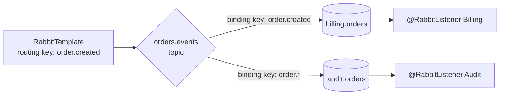
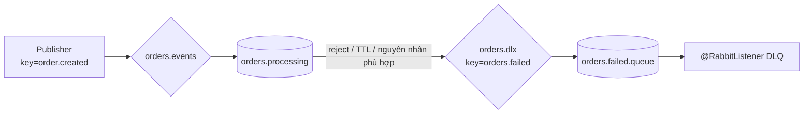

# Header nhận, routing key gốc và thông tin queue

## Mục tiêu bài học

Trong **SPRING_AMQP**, một publisher dùng `RabbitTemplate` phát message đến exchange RabbitMQ. Exchange áp dụng routing key và các binding để đưa message vào queue; `@RabbitListener` trên consumer nhận và xử lý message. Ngoài payload, consumer thường cần biết **message đến từ đâu**, **được gửi bằng routing key nào**, **được nhận qua queue nào** và **đây có phải lần giao lại hay không**.

Bài thuộc chương **Nhận thông điệp**, tập trung vào những metadata của **message đã được nhận**. Sau khi học, bạn có thể:

1. Phân biệt **AMQP properties/application headers** với **delivery metadata** do broker/container bổ sung ở phía nhận.
2. Sử dụng `MessageProperties.getReceivedRoutingKey()`, `getReceivedExchange()`, `getConsumerQueue()`, `getConsumerTag()`, `getDeliveryTag()` và `getRedelivered()` đúng ngữ cảnh.
3. Đọc các giá trị tương ứng bằng `@Header(AmqpHeaders.*)` hoặc `org.springframework.messaging.Message<T>` trong `@RabbitListener`.
4. Giải thích **routing key của message khác binding key** và thường **khác tên queue**; biết các ngoại lệ quan trọng khi message đi qua dead-letter exchange.
5. Phân tích nhiều queue, nhiều consumer, listener container và vấn đề giữ metadata phục vụ trace, retry, dead-letter, manual acknowledgement.
6. Viết và chạy ví dụ Spring Boot để quan sát trực tiếp headers và thông tin queue trong consumer.

> **Phạm vi:** Các ví dụ sử dụng Spring AMQP với RabbitMQ qua AMQP 0-9-1. Tên trường và việc header được ánh xạ vào `Spring Messaging` phụ thuộc phần nào vào phiên bản/framework adapter. Không coi mọi metadata trong một delivery là do publisher tự tạo.

## 1. Payload và metadata là hai phần khác nhau

Giả sử Order Service phát sự kiện:

```json
{"orderId":"ORD-42","status":"CREATED"}
```

Nếu chỉ nhìn payload, Billing Service biết mã đơn nhưng có thể chưa biết message:

- Được publish với routing key `order.created` hay `order.updated`?
- Đi vào queue `billing.orders` hay `audit.orders`?
- Được giao lần đầu hay đã bị broker giao lại?
- Có `correlationId` nào để ghép với request hoặc trace nghiệp vụ?

Một message ở consumer thường được nhìn theo hai nhóm:

```text
AMQP Message đã nhận
├── Body (byte[])
│     └── {"orderId":"ORD-42","status":"CREATED"}
└── MessageProperties
      ├── Các basic properties / application headers
      │     ├── messageId, correlationId, contentType, timestamp ...
      │     └── headers["tenantId"], headers["eventVersion"] ...
      └── Thông tin phía nhận
            ├── receivedExchange
            ├── receivedRoutingKey
            ├── consumerQueue
            ├── consumerTag
            ├── deliveryTag
            └── redelivered
```

**Không phải mọi trường được liệt kê đều nằm trong map `MessageProperties.getHeaders()`.** Ví dụ, `receivedRoutingKey` và `consumerQueue` có getter riêng. Chúng là metadata mà Spring AMQP tổng hợp cho delivery, không phải application header do publisher gửi qua `setHeader(...)`.

### Bảng tra nhanh

| Thuộc tính | Nguồn chính | Ý nghĩa khi consumer nhận |
|---|---|---|
| `getBody()` | Publisher/converter | Nội dung bytes của message |
| `getMessageId()` | Publisher có thể đặt | ID của message do ứng dụng quy ước; không tự bảo đảm duy nhất |
| `getCorrelationId()` | Publisher có thể đặt | Liên hệ request, trace hay quy trình nghiệp vụ |
| `getHeaders()` | Application headers và một số broker metadata tùy hoàn cảnh | Map các header do producer hoặc broker gắn, ví dụ `tenantId`, có thể có `x-death` |
| `getReceivedExchange()` | Delivery metadata từ broker | Exchange được báo trên lần giao hiện tại |
| `getReceivedRoutingKey()` | Delivery metadata từ broker | Routing key được báo cho lần giao hiện tại |
| `getConsumerQueue()` | Listener container / Spring AMQP | **Tên queue thực sự được container đọc** |
| `getConsumerTag()` | Broker cấp lúc consumer đăng ký, container nhận biết | Định danh consumer subscription trên channel |
| `getDeliveryTag()` | Broker cấp cho từng delivery | Tag dùng khi ack/nack trên **đúng channel consumer** |
| `getRedelivered()` | Cờ broker đặt trên delivery | Cho biết message được đánh dấu là đã giao trước đó |

Tên queue, consumer tag và delivery tag là thông tin **về lượt nhận**, không phải đặc tính bất biến của một message ở mọi lần giao.

## 2. Routing key gốc, binding key và tên queue: ba khái niệm riêng

### 2.1. Ví dụ topic exchange

Giả sử một ứng dụng publish bằng:

```java
rabbitTemplate.convertAndSend(
        "orders.events",    // exchange
        "order.created",    // routing key
        "orderId=ORD-42"    // payload
);
```

Broker có các binding:



Hai consumer có thể cùng quan sát:

```text
receivedExchange   = orders.events
receivedRoutingKey = order.created
```

Nhưng chúng có **`consumerQueue` khác nhau**:

```text
Billing consumer: consumerQueue = billing.orders
Audit consumer:   consumerQueue = audit.orders
```

**Kết luận:** Binding key `order.*` của audit là **mẫu để chọn đường đi**, không phải routing key mà publisher đã gửi. Và routing key `order.created` không phải tên queue `audit.orders` hoặc `billing.orders`.

### 2.2. Routing key gốc ở phạm vi nào?

Đối với một lần publish thông thường vào direct/topic/fanout exchange, `receivedRoutingKey` là key mà broker báo trong AMQP **delivery envelope**. Nó thường chính là routing key dùng khi publisher gọi `RabbitTemplate.convertAndSend(...)`.

Tuy nhiên, khi message đã trải qua **dead-lettering**, broker thực hiện một lần định tuyến lại. Nếu cấu hình `x-dead-letter-routing-key`, routing key của lần gửi qua DLX có thể **khác** routing key ở lần publish ban đầu. Khi consumer đọc từ DLQ, `receivedRoutingKey` mô tả **lần delivery hiện tại**, không nhất thiết là “routing key ban đầu của cả hành trình”.

Nếu quy trình cần giữ tuyệt đối routing key ban đầu, hãy ghi một **application header có tên rõ ràng**, ví dụ `originalRoutingKey`, ngay tại publisher hoặc tại tầng biên đáng tin cậy:

```java
rabbitTemplate.convertAndSend(
        "orders.events",
        "order.created",
        "orderId=ORD-42",
        amqpMessage -> {
            amqpMessage.getMessageProperties().setHeader(
                    "originalRoutingKey", "order.created");
            return amqpMessage;
        });
```

Header `originalRoutingKey` trong ví dụ này là **quy ước của ứng dụng**, không phải field tiêu chuẩn bắt buộc mà RabbitMQ tự tạo. Header do producer gửi cũng có thể không đáng tin nếu producer nằm ngoài phạm vi kiểm soát; khi cần dùng trong quyết định bảo mật, hãy xác thực nguồn gửi.

### 2.3. Vì sao fanout vẫn có receivedRoutingKey?

`FanoutExchange` **bỏ qua routing key khi chọn binding**, nhưng publisher vẫn có thể publish một routing key. Metadata phía nhận có thể chứa key đó, dù nó **không quyết định queue nào được chọn** trong tầng fanout.

Vì vậy, có routing key trong message **không chứng minh** exchange đã định tuyến bằng key. Cần biết **loại exchange**, binding và topology thực tế.

### 2.4. Trường hợp đặc biệt: default exchange

RabbitMQ có default exchange tên **chuỗi rỗng `""`**. Một queue được khai báo thường tự có binding với key bằng **tên queue** trên default exchange.

```java
rabbitTemplate.convertAndSend(
        "",
        "billing.orders",
        "orderId=ORD-42"
);
```

Khi nhận, consumer có thể thấy:

```text
receivedExchange   = ""
receivedRoutingKey = "billing.orders"
consumerQueue      = "billing.orders"
```

Ở đây routing key và tên queue **tình cờ trùng nhau do quy tắc của default exchange**, không phải một định luật cho mọi exchange. Đừng tổng quát hóa kết quả của ví dụ default exchange sang direct/topic/fanout.

## 3. Các trường received trong `MessageProperties`

Một listener có thể nhận trực tiếp `org.springframework.amqp.core.Message` để xem body và mọi AMQP properties:

```java
import java.nio.charset.StandardCharsets;
import org.springframework.amqp.core.Message;
import org.springframework.amqp.core.MessageProperties;
import org.springframework.amqp.rabbit.annotation.RabbitListener;
import org.springframework.stereotype.Component;

@Component
public class RawDeliveryInspector {

    @RabbitListener(queues = "billing.orders")
    public void inspect(Message message) {
        MessageProperties props = message.getMessageProperties();

        String body = new String(
                message.getBody(), StandardCharsets.UTF_8);

        System.out.printf(
                "body=%s exchange=%s key=%s queue=%s%n",
                body,
                props.getReceivedExchange(),
                props.getReceivedRoutingKey(),
                props.getConsumerQueue());

        System.out.printf(
                "consumerTag=%s deliveryTag=%d redelivered=%s%n",
                props.getConsumerTag(),
                props.getDeliveryTag(),
                props.getRedelivered());
    }
}
```

**Phân biệt hai lớp trùng tên:** `org.springframework.amqp.core.Message` có `getBody()` và `getMessageProperties()`. `org.springframework.messaging.Message<T>` có `getPayload()` và `getHeaders()`. Nếu dùng cả hai trong một file Java, viết tên đầy đủ cho ít nhất một lớp.

### 3.1. `receivedExchange`

`MessageProperties.getReceivedExchange()` trả tên exchange ghi trong thông tin delivery phía RabbitMQ. Với một lần publish trực tiếp thông thường, nó là exchange publisher đã dùng. Với default exchange, giá trị có thể là chuỗi rỗng.

**Không nên** coi trường này như lịch sử mọi exchange message đã đi qua trong topology phức tạp. Với exchange-to-exchange bindings, alternate exchange hoặc dead-lettering, message có thể trải qua nhiều quyết định định tuyến. Delivery metadata **không chứa sơ đồ các chặng đi**. Nếu cần trace, gắn event ID, correlation ID và ghi log theo ranh giới dịch vụ.

### 3.2. `receivedRoutingKey`

`MessageProperties.getReceivedRoutingKey()` cho biết routing key gắn với **delivery hiện tại**. Trong đường publish thông thường, nó giữ key publisher đã cung cấp:

```text
Publisher routing key = order.created
Topic binding key     = order.*
Received routing key  = order.created
```

Không dùng `getReceivedRoutingKey()` để xác định binding **nào** đã khớp, vì một message có thể khớp nhiều binding và được định tuyến tới cùng queue qua nhiều đường. Broker không gửi toàn bộ tập binding đã khớp như một field tiêu chuẩn của delivery.

### 3.3. `consumerQueue`

`MessageProperties.getConsumerQueue()` cho biết **tên queue mà listener container đang tiêu thụ**. Đây là thông tin ứng dụng/adapter xác định khi nhận delivery; protocol `basic.deliver` không có một field “consumerQueue” độc lập giống tên exchange và routing key.

Giá trị này đặc biệt hữu ích khi:

- Một listener container tiêu thụ **nhiều queue**.
- Cùng một handler xử lý message từ nhiều luồng và cần chọn logging/metrics theo queue.
- Có queue chính, queue retry và DLQ, cần biết code đang chạy ở consumer nào.

Đừng dùng tên queue để suy ra **producer** hay **exchange đầu tiên**. Một queue có thể được bind với nhiều exchange hoặc nhận message từ nhiều nguồn.

### 3.4. `consumerTag`

`getConsumerTag()` là tag đại diện cho một consumer registration, được RabbitMQ cấp hoặc xác nhận khi client subscribe. Một queue có thể có **nhiều consumer tag** nếu nhiều consumer cùng đọc.

Consumer tag giúp phân biệt kết nối/consumer trong logs hoặc quan sát vận hành, nhưng nó **có thể thay đổi khi container khởi động lại hoặc consumer được tạo lại**. Không sử dụng tag làm business event ID, idempotency key hoặc khóa phân vùng đơn hàng.

### 3.5. `deliveryTag`

`getDeliveryTag()` là số thứ tự delivery trong phạm vi **channel consumer**. Khi bật manual acknowledgement, bạn truyền tag này cho `channel.basicAck(...)`, `basicNack(...)` hoặc `basicReject(...)` trên **đúng channel đã nhận delivery**.

```text
Channel A: deliveryTag=1, 2, 3, ...
Channel B: deliveryTag=1, 2, 3, ...
```

Hai channel có thể đồng thời có delivery tag `1`. Vì vậy, **delivery tag không duy nhất toàn broker**, không phải message ID và không thích hợp để lưu làm khóa nhận diện message trong cơ sở dữ liệu.

### 3.6. `redelivered`

`getRedelivered()` phản ánh cờ `redelivered` trên delivery do broker gửi. Khi `true`, message được đánh dấu đã từng được giao trước đó và có thể đang được giao lại sau requeue, consumer/channel failure hoặc một hoàn cảnh redelivery phù hợp.

Khi `false`, bạn cũng **không thể kết luận tuyệt đối** message là sự kiện nghiệp vụ mới chưa từng xuất hiện. Publisher có thể gửi cùng event nhiều lần; đó là **các publish riêng**. Cờ redelivered cũng không phải bộ đếm số lần retry.

## 4. Application headers và received metadata khác nhau thế nào?

Khi publish, ứng dụng có thể gắn headers:

```java
rabbitTemplate.convertAndSend(
        "orders.events",
        "order.created",
        "orderId=ORD-42",
        amqpMessage -> {
            var props = amqpMessage.getMessageProperties();
            props.setMessageId("event-42");
            props.setCorrelationId("trace-abc");
            props.setHeader("tenantId", "tenant-7");
            props.setHeader("eventVersion", 1);
            return amqpMessage;
        });
```

Khi consumer nhận `org.springframework.amqp.core.Message`:

```java
MessageProperties props = message.getMessageProperties();

String messageId = props.getMessageId();
String correlationId = props.getCorrelationId();
Object tenant = props.getHeaders().get("tenantId");

String receivedKey = props.getReceivedRoutingKey();
String actualQueue = props.getConsumerQueue();
```

Các trường thuộc **những tầng khác nhau**:

| Dữ liệu | Nơi lấy ở AMQP Message | Ai thiết lập thông thường? |
|---|---|---|
| `messageId` | `getMessageId()` | Publisher hoặc message converter/application |
| `correlationId` | `getCorrelationId()` | Publisher/application |
| `tenantId` | `getHeaders().get("tenantId")` | Application header từ publisher |
| `receivedRoutingKey` | `getReceivedRoutingKey()` | Broker đưa trong delivery metadata, Spring AMQP ánh xạ |
| `receivedExchange` | `getReceivedExchange()` | Broker đưa trong delivery metadata |
| `consumerQueue` | `getConsumerQueue()` | Listener container biết queue đã subscribe |
| `deliveryTag` | `getDeliveryTag()` | Broker cấp theo channel của delivery |

Ví dụ `tenantId` là dữ liệu ứng dụng tùy biến và nên kiểm tra tính hợp lệ. `deliveryTag` có thể thay đổi khi message được giao lại. `messageId` có thể giữ nguyên qua nhiều lần giao lại nhưng cũng có thể bị publisher bỏ trống hoặc trùng; nếu cần idempotency nên thiết kế **business event ID** đủ tin cậy.

## 5. Đọc header bằng `@Header(AmqpHeaders.*)`

Khi không muốn nhận raw `Message`, annotated listener có thể khai báo các tham số header trực tiếp. Spring AMQP cung cấp các hằng trong `org.springframework.amqp.support.AmqpHeaders` để tránh hard-code tên header.

```java
import org.springframework.amqp.rabbit.annotation.RabbitListener;
import org.springframework.amqp.support.AmqpHeaders;
import org.springframework.messaging.handler.annotation.Header;
import org.springframework.messaging.handler.annotation.Payload;
import org.springframework.stereotype.Component;

@Component
public class HeaderBasedConsumer {

    @RabbitListener(queues = "billing.orders")
    public void handle(
            @Payload String payload,
            @Header(AmqpHeaders.RECEIVED_EXCHANGE) String exchange,
            @Header(AmqpHeaders.RECEIVED_ROUTING_KEY) String routingKey,
            @Header(AmqpHeaders.CONSUMER_QUEUE) String consumerQueue,
            @Header(AmqpHeaders.CONSUMER_TAG) String consumerTag,
            @Header(AmqpHeaders.DELIVERY_TAG) long deliveryTag,
            @Header(value = "tenantId", required = false) String tenantId) {

        System.out.printf(
                "payload=%s exchange=%s key=%s queue=%s%n",
                payload, exchange, routingKey, consumerQueue);

        System.out.printf(
                "consumer=%s tag=%d tenant=%s%n",
                consumerTag, deliveryTag, tenantId);
    }
}
```

Ý nghĩa:

- `@Payload String` là payload đã được chuyển đổi theo converter của listener container.
- `@Header(AmqpHeaders.RECEIVED_ROUTING_KEY)` đọc header Spring Messaging đã được adapter ánh xạ từ AMQP delivery metadata.
- `@Header(AmqpHeaders.CONSUMER_QUEUE)` là tên queue **đang được listener đọc**, không phải một header user tự đặt.
- `tenantId` là application header tùy chọn; nếu producer không gửi, biến có thể là `null` do `required=false`.

Nếu một header không tồn tại hoặc không chuyển đổi được về kiểu Java đã khai báo, method invocation có thể thất bại. Với handler dùng nhiều loại consumer/container, kiểm tra header mapping của adapter và chọn kiểu nullable/cách kiểm tra phù hợp.

### Tên hằng được ưu tiên hơn chuỗi tự gõ

| Hằng `AmqpHeaders` | Dữ liệu mong muốn |
|---|---|
| `RECEIVED_EXCHANGE` | Exchange nhận được từ broker |
| `RECEIVED_ROUTING_KEY` | Routing key trong delivery |
| `CONSUMER_QUEUE` | Queue mà listener container đang dùng |
| `CONSUMER_TAG` | Consumer subscription tag |
| `DELIVERY_TAG` | Tag của delivery trên consumer channel |
| `REDELIVERED` | Cờ message được giao lại |

Các hằng này giúp code tự mô tả và tránh nhầm `routingKey` trong header ứng dụng với **received routing key** của broker. Tùy phiên bản Spring AMQP, những header khác như `RECEIVED_USER_ID`, `RECEIVED_DELAY` hoặc metadata giao thức cũng có thể được ánh xạ khi phù hợp.

## 6. Dùng `org.springframework.messaging.Message<T>` để lấy headers

Một `@RabbitListener` cũng có thể nhận `org.springframework.messaging.Message<T>`:

```java
import org.springframework.amqp.rabbit.annotation.RabbitListener;
import org.springframework.amqp.support.AmqpHeaders;
import org.springframework.messaging.Message;
import org.springframework.stereotype.Component;

@Component
public class SpringMessagingConsumer {

    @RabbitListener(queues = "audit.orders")
    public void onMessage(Message<String> message) {
        String payload = message.getPayload();

        Object exchange =
                message.getHeaders().get(AmqpHeaders.RECEIVED_EXCHANGE);
        Object routingKey =
                message.getHeaders().get(AmqpHeaders.RECEIVED_ROUTING_KEY);
        Object queue =
                message.getHeaders().get(AmqpHeaders.CONSUMER_QUEUE);

        System.out.printf(
                "payload=%s exchange=%s key=%s queue=%s%n",
                payload, exchange, routingKey, queue);
    }
}
```

Đây là **Spring Messaging Message**: payload có kiểu `String`, còn `getHeaders()` là `MessageHeaders`. Nó khác kiểu **Spring AMQP Message** vốn có `getBody()` và `getMessageProperties()`.

Với đoạn code typed listener, hãy bảo đảm converter của container chuyển body thành `String`. Nếu publisher gửi JSON để tạo DTO mà ứng dụng chưa cấu hình converter phù hợp, việc chỉ khai báo `Message<OrderEvent>` **không tự tạo ra deserialization**.

**Quy tắc chọn kiểu nhận:**

- Chọn `org.springframework.amqp.core.Message` khi cần **raw bytes** và mọi metadata AMQP ở đúng property.
- Chọn `org.springframework.messaging.Message<T>` hoặc `@Payload + @Header` khi handler ưu tiên **payload đã chuyển đổi** và metadata được adapter cung cấp qua Spring Messaging headers.
- Nếu cần manual acknowledgement, bạn có thể nhận thêm RabbitMQ Java Client `Channel` và đọc `deliveryTag` từ raw message hoặc header phù hợp; điều kiện là listener container sử dụng **MANUAL ack mode**.

## 7. Ví dụ Spring Boot: một sự kiện, hai queue, hai cách đọc metadata

### 7.1. Chuẩn bị dependency và broker

Dự án Spring Boot cần `spring-boot-starter-amqp`. Với Gradle Groovy DSL:

```groovy
dependencies {
    implementation 'org.springframework.boot:spring-boot-starter-amqp'
}
```

Với Maven:

```xml
<dependency>
    <groupId>org.springframework.boot</groupId>
    <artifactId>spring-boot-starter-amqp</artifactId>
</dependency>
```

Spring Boot parent/BOM hoặc cơ chế dependency management sẽ quản lý version tương thích. Nếu chưa có broker RabbitMQ local và đã cài Docker, có thể dùng:

```bash
docker run -d --name rabbitmq-received-metadata-lab \
  -p 5672:5672 -p 15672:15672 \
  rabbitmq:4-management
```

Ví dụ `src/main/resources/application.yml`:

```yaml
spring:
  rabbitmq:
    host: localhost
    port: 5672
    username: guest
    password: guest
    virtual-host: /
```

Tài khoản `guest/guest` chỉ nên dùng cho phát triển local; trong production dùng thông tin xác thực và bảo vệ transport phù hợp.

### 7.2. Khai báo topic exchange, hai queue và binding

Ví dụ file `ReceivedMetadataTopology.java`, trong package `com.example.received`:

```java
package com.example.received;

import org.springframework.amqp.core.Binding;
import org.springframework.amqp.core.BindingBuilder;
import org.springframework.amqp.core.Queue;
import org.springframework.amqp.core.QueueBuilder;
import org.springframework.amqp.core.TopicExchange;
import org.springframework.beans.factory.annotation.Qualifier;
import org.springframework.context.annotation.Bean;
import org.springframework.context.annotation.Configuration;

@Configuration
public class ReceivedMetadataTopology {

    public static final String EXCHANGE = "demo.order.events";
    public static final String BILLING_QUEUE = "demo.billing.orders";
    public static final String AUDIT_QUEUE = "demo.audit.orders";

    @Bean
    TopicExchange orderEventsExchange() {
        return new TopicExchange(EXCHANGE, true, false);
    }

    @Bean
    Queue billingQueue() {
        return QueueBuilder.durable(BILLING_QUEUE).build();
    }

    @Bean
    Queue auditQueue() {
        return QueueBuilder.durable(AUDIT_QUEUE).build();
    }

    @Bean
    Binding billingBinding(
            @Qualifier("billingQueue") Queue queue,
            @Qualifier("orderEventsExchange") TopicExchange exchange) {
        return BindingBuilder.bind(queue)
                .to(exchange)
                .with("order.created");
    }

    @Bean
    Binding auditBinding(
            @Qualifier("auditQueue") Queue queue,
            @Qualifier("orderEventsExchange") TopicExchange exchange) {
        return BindingBuilder.bind(queue)
                .to(exchange)
                .with("order.*");
    }
}
```

Khi Spring Boot tự cấu hình `RabbitAdmin` và có kết nối, các bean exchange, queue và binding đủ điều kiện sẽ được khai báo trên broker. Nếu bạn đã tắt auto-declaration hoặc cấu hình admin riêng, cần bảo đảm topology thực sự có trên RabbitMQ.

### 7.3. Publisher có application headers

File `OrderPublisher.java`:

```java
package com.example.received;

import java.util.UUID;
import org.springframework.amqp.rabbit.core.RabbitTemplate;
import org.springframework.stereotype.Service;

@Service
public class OrderPublisher {

    private final RabbitTemplate rabbitTemplate;

    public OrderPublisher(RabbitTemplate rabbitTemplate) {
        this.rabbitTemplate = rabbitTemplate;
    }

    public void publishCreated(String orderId) {
        String eventId = UUID.randomUUID().toString();
        String routingKey = "order.created";

        rabbitTemplate.convertAndSend(
                ReceivedMetadataTopology.EXCHANGE,
                routingKey,
                "orderId=" + orderId,
                message -> {
                    var props = message.getMessageProperties();
                    props.setMessageId(eventId);
                    props.setCorrelationId("trace-" + orderId);
                    props.setHeader("tenantId", "tenant-demo");
                    props.setHeader("originalRoutingKey", routingKey);
                    return message;
                });
    }
}
```

Ở đây `tenantId` và `originalRoutingKey` là **application headers**, còn `receivedRoutingKey` sẽ được điền từ phía broker/adapter khi message được giao cho consumer.

### 7.4. Consumer Billing đọc raw `Message`

File `BillingListener.java`:

```java
package com.example.received;

import java.nio.charset.StandardCharsets;
import org.springframework.amqp.core.Message;
import org.springframework.amqp.core.MessageProperties;
import org.springframework.amqp.rabbit.annotation.RabbitListener;
import org.springframework.stereotype.Component;

@Component
public class BillingListener {

    @RabbitListener(queues = ReceivedMetadataTopology.BILLING_QUEUE)
    public void onBilling(Message message) {
        MessageProperties props = message.getMessageProperties();

        String body = new String(
                message.getBody(), StandardCharsets.UTF_8);

        System.out.printf(
                "[BILLING] body=%s exchange=%s key=%s queue=%s%n",
                body,
                props.getReceivedExchange(),
                props.getReceivedRoutingKey(),
                props.getConsumerQueue());

        System.out.printf(
                "[BILLING] msgId=%s correlation=%s tenant=%s redelivered=%s%n",
                props.getMessageId(),
                props.getCorrelationId(),
                props.getHeaders().get("tenantId"),
                props.getRedelivered());
    }
}
```

### 7.5. Consumer Audit dùng `@Header(AmqpHeaders.*)`

File `AuditListener.java`:

```java
package com.example.received;

import org.springframework.amqp.rabbit.annotation.RabbitListener;
import org.springframework.amqp.support.AmqpHeaders;
import org.springframework.messaging.handler.annotation.Header;
import org.springframework.messaging.handler.annotation.Payload;
import org.springframework.stereotype.Component;

@Component
public class AuditListener {

    @RabbitListener(queues = ReceivedMetadataTopology.AUDIT_QUEUE)
    public void onAudit(
            @Payload String payload,
            @Header(AmqpHeaders.RECEIVED_EXCHANGE) String exchange,
            @Header(AmqpHeaders.RECEIVED_ROUTING_KEY) String routingKey,
            @Header(AmqpHeaders.CONSUMER_QUEUE) String queue,
            @Header(value = "tenantId", required = false) String tenantId) {

        System.out.printf(
                "[AUDIT] payload=%s exchange=%s key=%s queue=%s tenant=%s%n",
                payload, exchange, routingKey, queue, tenantId);
    }
}
```

Hai listener không cạnh tranh đọc cùng một queue: chúng đọc **hai queue khác nhau** và cả hai queue có binding khớp routing key `order.created`. Vì vậy, mỗi queue có thể nhận một bản sao của sự kiện.

### 7.6. Chạy và đối chiếu output

File `ReceivedMetadataApplication.java`:

```java
package com.example.received;

import org.springframework.amqp.rabbit.annotation.EnableRabbit;
import org.springframework.boot.ApplicationRunner;
import org.springframework.boot.SpringApplication;
import org.springframework.boot.autoconfigure.SpringBootApplication;
import org.springframework.context.annotation.Bean;

@SpringBootApplication
@EnableRabbit
public class ReceivedMetadataApplication {

    public static void main(String[] args) {
        SpringApplication.run(ReceivedMetadataApplication.class, args);
    }

    @Bean
    ApplicationRunner publishOnce(OrderPublisher publisher) {
        return args -> publisher.publishCreated("ORD-42");
    }
}
```

Chạy ứng dụng bằng công cụ build dự án đã có:

```bash
./mvnw spring-boot:run
# Hoặc:
./gradlew bootRun
```

Output dự kiến (thứ tự log **không được bảo đảm**):

```text
[BILLING] body=orderId=ORD-42 exchange=demo.order.events key=order.created queue=demo.billing.orders
[BILLING] msgId=... correlation=trace-ORD-42 tenant=tenant-demo redelivered=false
[AUDIT] payload=orderId=ORD-42 exchange=demo.order.events key=order.created queue=demo.audit.orders tenant=tenant-demo
```

Quan sát quan trọng:

| Giá trị | Billing | Audit |
|---|---|---|
| `receivedExchange` | `demo.order.events` | `demo.order.events` |
| `receivedRoutingKey` | `order.created` | `order.created` |
| `consumerQueue` | `demo.billing.orders` | `demo.audit.orders` |
| Binding key | `order.created` | `order.*` |
| Application header `tenantId` | `tenant-demo` | `tenant-demo` |

**Đúng cùng routing key nhưng khác consumerQueue** là đặc trưng cần nhận diện trong hệ thống publish-subscribe dựa trên nhiều queue. Ngoài ra, một queue có thể có nhiều consumer; khi đó `consumerTag` giúp phân biệt consumer cụ thể xử lý delivery.

## 8. Đọc metadata khi một listener nhận từ nhiều queue

Trong thực tế, một method có thể được đăng ký tiêu thụ nhiều queue:

```java
import org.springframework.amqp.rabbit.annotation.RabbitListener;
import org.springframework.amqp.support.AmqpHeaders;
import org.springframework.messaging.handler.annotation.Header;
import org.springframework.messaging.handler.annotation.Payload;
import org.springframework.stereotype.Component;

@Component
public class MultiQueueListener {

    @RabbitListener(queues = {
            "demo.operations.high",
            "demo.operations.normal"
    })
    public void onMessage(
            @Payload String payload,
            @Header(AmqpHeaders.CONSUMER_QUEUE) String queue,
            @Header(AmqpHeaders.RECEIVED_ROUTING_KEY) String routingKey) {

        System.out.printf(
                "queue=%s routingKey=%s payload=%s%n",
                queue, routingKey, payload);
    }
}
```

Đây là ví dụ **độc lập**; hai queue `demo.operations.high` và `demo.operations.normal` phải được tạo/bind riêng trước khi dùng. `consumerQueue` cung cấp vị trí nhận thực tế, giúp log/metrics hoặc logic kiểm soát queue.

Không nên để business logic **hoàn toàn phụ thuộc tên queue** nếu topology có thể thay đổi theo môi trường. Với nghiệp vụ bền vững, event type/schema version và các application headers đáng tin cậy thường là thông tin phù hợp hơn. Tên queue rất có giá trị cho **tracing và vận hành**, nhưng cũng là chi tiết triển khai.

### Nhiều consumer trên cùng queue

Giả sử có hai instance `BillingListener` cùng đọc queue `demo.billing.orders`:

```text
                       +--> Consumer instance 1 (tag A)
demo.billing.orders ---|
                       +--> Consumer instance 2 (tag B)
```

Với mô hình competing consumers, mỗi delivery thường được giao cho **một consumer** ở một thời điểm, không tự nhân bản cho cả hai instance. `consumerQueue` sẽ giống nhau, nhưng `consumerTag` và `deliveryTag` theo channel/consumer có thể khác nhau.

Nếu cần **hai dịch vụ đều nhận một bản sao**, tạo **hai queue** và binding cả hai queue vào exchange phù hợp, thay vì gắn hai listener vào một queue rồi mong cả hai đều nhận toàn bộ sự kiện.

## 9. Delivery tag, redelivery và manual acknowledgement

Metadata phía nhận không chỉ dùng để log. Khi ứng dụng chọn **manual acknowledgement**, `deliveryTag` đóng vai trò trực tiếp trong việc báo broker biết một delivery đã được xử lý.

### 9.1. Ví dụ manual ack

Ví dụ **riêng** trên queue `demo.orders.manual`, với listener container được cấu hình manual ack:

```java
import java.io.IOException;
import com.rabbitmq.client.Channel;
import org.springframework.amqp.core.Message;
import org.springframework.amqp.rabbit.annotation.RabbitListener;
import org.springframework.stereotype.Component;

@Component
public class ManualAckListener {

    @RabbitListener(
            queues = "demo.orders.manual",
            ackMode = "MANUAL")
    public void handle(Message message, Channel channel)
            throws IOException {

        long tag = message.getMessageProperties().getDeliveryTag();

        // Trước khi ack: xử lý nghiệp vụ một cách idempotent.
        process(message.getBody());

        // Tag chỉ có hiệu lực trên channel đã giao delivery này.
        channel.basicAck(tag, false);
    }

    private void process(byte[] body) {
        // Ví dụ minh họa: validate, cập nhật nghiệp vụ ...
    }
}
```

Queue `demo.orders.manual` phải tồn tại trước khi listener đăng ký. Ví dụ này dùng annotation `ackMode = "MANUAL"` của Spring AMQP; hãy kiểm tra phiên bản đang sử dụng nếu hệ thống có thiết lập annotation/container factory khác.

**Phải có error handling phù hợp ở production:** Nếu `process(...)` ném exception trước `basicAck`, ứng dụng cần quyết định requeue/reject/nack dựa trên loại lỗi và chính sách retry. Không bao giờ tùy tiện ack một message chưa được xử lý thành công chỉ để làm giảm backlog.

### 9.2. DeliveryTag không phải messageId

| Đặc điểm | `deliveryTag` | `messageId` |
|---|---|---|
| Do ai cấp? | Broker theo delivery trên channel | Thường do publisher/app đặt |
| Phạm vi duy nhất | Trong **channel** cụ thể | Tùy ứng dụng quy ước |
| Thay đổi khi redelivery trên channel khác? | Có thể thay đổi | Có thể vẫn giữ nguyên |
| Dùng cho manual ack? | **Có** | Không |
| Dùng làm business idempotency key? | **Không** | Có thể, nếu được thiết kế đảm bảo duy nhất và đáng tin cậy |

Để xử lý idempotent, nên có **event ID hoặc business key ổn định** và một cơ chế lưu vết xử lý. Không dùng `deliveryTag` hay `consumerTag` vì các giá trị này là chi tiết của lần giao nhận.

### 9.3. `redelivered` không phải số lần retry

`getRedelivered()` báo cờ do broker đánh dấu. Nó **không lưu số lần listener đã xử lý thất bại**; cũng không phân biệt retry nội bộ trước khi message bị trả về broker. Khi cần giới hạn số lần retry, dùng cơ chế retry policy, thông tin dead-letter, application attempts hoặc các metadata phù hợp.

Ví dụ:

```text
redelivered=false:
  Có thể là delivery đầu tiên của một publish,
  nhưng không phủ nhận publisher đã gửi trùng cùng eventId.

redelivered=true:
  Broker đánh dấu message đã được giao trước đó;
  không cho biết xử lý trước đó thất bại bao nhiêu lần.
```

## 10. Khi message đi qua Dead-Letter Exchange

Trong luồng xử lý có retry và dead-letter, câu hỏi **“routing key gốc là gì?”** đòi hỏi xác định bạn đang nói đến **lần publish nào**.

Giả sử:

1. Order Service publish `order.created` vào exchange `orders.events`.
2. Queue `orders.processing` có dead-letter exchange `orders.dlx`.
3. Queue cũng đặt `x-dead-letter-routing-key=orders.failed`.
4. Khi message bị dead-letter, RabbitMQ định tuyến lại qua `orders.dlx` bằng key `orders.failed`.
5. Consumer DLQ nhận message.



Khi consumer chính nhận lần đầu, `receivedRoutingKey` thường là `order.created`. Khi **DLQ consumer** nhận thông qua dead-letter republish với routing key được cấu hình lại, `receivedRoutingKey` có thể là `orders.failed`.

Tùy phiên bản RabbitMQ và tình huống, message được dead-letter có thể chứa metadata như `x-death`, `x-first-death-*` hoặc `x-last-death-*` để mô tả các lần dead-letter. Chúng **không thay thế** một ứng dụng tự quản lý event ID và routing key nguồn nếu cần trace xuyên suốt nhiều vòng retry.

### Vì sao không dùng `x-death` để đoán toàn bộ lịch sử?

- Broker có thể gộp thông tin dead-letter theo queue/reason thay vì lưu một record cho từng lần.
- Một message có thể chuyển qua nhiều queue/DLX.
- Các header dead-letter là metadata của broker, không phải schema nghiệp vụ được mọi hệ thống truyền message cam kết giữ nguyên.
- Khi ứng dụng tự republish message mới, nó có thể làm thay đổi hoặc làm mất metadata trước đó.

Thực hành tốt là **tách hai lớp thông tin**:

| Nhóm | Ví dụ | Vai trò |
|---|---|---|
| Metadata theo delivery | `receivedExchange`, `receivedRoutingKey`, `consumerQueue`, `deliveryTag` | Trả lời “message này đang được nhận ở đâu, như thế nào?” |
| Metadata nghiệp vụ xuyên vòng đời | `eventId`, `originalRoutingKey`, `correlationId`, `eventVersion` | Trả lời “đây là sự kiện nào, bắt đầu từ đâu, thuộc quy trình nào?” |

Nếu producer không đáng tin cậy, hãy validate metadata nghiệp vụ và tránh dùng nguyên header tự khai báo cho quyết định phân quyền.

## 11. Quan sát trong RabbitMQ Management và log ứng dụng

Bạn có thể mở RabbitMQ Management ở `http://localhost:15672` khi chạy image có Management và map cổng như ví dụ.

1. Vào **Exchanges**, tìm `demo.order.events` và kiểm tra các binding từ exchange đến hai queue. Tại đây bạn sẽ thấy `order.created` và `order.*` là **binding keys**.
2. Vào **Queues and Streams**, xác nhận `demo.billing.orders` và `demo.audit.orders` đã tồn tại, có consumer và các message được nhận.
3. Xem consumer count, message `Ready` và `Unacked`. Nếu listener xử lý nhanh, `Ready` có thể bằng 0 dù message đã publish đúng.
4. So sánh với application log có `receivedRoutingKey`, `consumerQueue` và `messageId`.
5. Nếu test redelivery, dùng một queue test riêng với acknowledgement mode/chính sách requeue được kiểm soát. Không cố ý tạo vòng requeue vô hạn trên production.

### Nên log những trường nào?

Ví dụ một log có cấu trúc:

```text
eventId=event-42
correlationId=trace-ORD-42
receivedExchange=demo.order.events
receivedRoutingKey=order.created
consumerQueue=demo.billing.orders
consumerTag=...
redelivered=false
processingStatus=SUCCESS
```

Nếu dùng `deliveryTag` trong log để điều tra manual ack, hãy đi kèm nhận diện channel/consumer thích hợp; tag **không duy nhất toàn hệ thống**. Không dùng routing key hoặc tên queue làm nhãn metric cardinality vô hạn nếu chúng chứa ID động như mã người dùng, mã đơn hàng.

**Đừng log nguyên payload hoặc toàn bộ headers** khi chúng có dữ liệu cá nhân, token hoặc thông tin nội bộ nhạy cảm. Các application headers là nguồn dữ liệu đầu vào, không mặc nhiên an toàn để ghi log.

## 12. Các lỗi thường gặp khi đọc thông tin phía nhận

| Triệu chứng/hiểu lầm | Nguyên nhân | Hướng xử lý |
|---|---|---|
| Log `receivedRoutingKey=order.created` dù audit binding là `order.*` | Received key là key của message, không phải binding pattern | Đọc topology trên broker để biết binding key |
| Tưởng `receivedRoutingKey` luôn bằng tên queue | Chỉ tình cờ đúng trong một số trường hợp, đặc biệt default exchange | Đọc `consumerQueue` để lấy queue thực tế |
| `receivedExchange=""` | Publisher gửi qua default exchange | Chuỗi rỗng là tên exchange hợp lệ, không nhất thiết là dữ liệu thiếu |
| Không thấy `consumerQueue` trong `MessageProperties.getHeaders()` | Nó là received/container metadata có getter riêng | Dùng `getConsumerQueue()` hoặc `AmqpHeaders.CONSUMER_QUEUE` |
| Đọc `@Header("routingKey")` nhưng giá trị thiếu | Tự gõ sai tên header hoặc nhầm application header | Dùng `AmqpHeaders.RECEIVED_ROUTING_KEY` |
| Sau DLQ, received routing key khác routing key ban đầu | DLX có thể thay đổi routing key | Gắn `originalRoutingKey`/event ID riêng nếu cần trace |
| Dùng `deliveryTag` làm ID vĩnh viễn trong database | Tag chỉ có phạm vi channel consumer | Dùng business event ID/idempotency key |
| Hai consumer cùng queue không đều nhận mọi message | Competing consumer phân chia deliveries | Muốn mỗi dịch vụ nhận bản sao, tạo queue riêng |
| `redelivered=false` nhưng nghiệp vụ xử lý trùng | Publisher gửi cùng sự kiện nhiều lần hoặc app tự republish | Idempotency dựa trên event ID, không chỉ redelivery flag |
| Chuyển `Message<String>` thành `Message<OrderDto>` mà lỗi | Chưa cấu hình JSON converter/type mapping | Kiểm tra converter và schema payload |
| `@Header` yêu cầu bắt buộc nhưng header không tồn tại | Producer không gắn header hoặc adapter không ánh xạ | Dùng `required=false` nếu hợp lý, hoặc bổ sung cấu hình/contract |
| `basicAck` báo unknown delivery tag | Ack sai channel, ack hai lần hoặc tag không hợp lệ | Ack đúng tag trên channel nhận, thiết kế rõ ack ownership |
| Chỉ nhìn tên queue đoán producer ban đầu | Queue có thể nhận từ nhiều exchange/publisher | Sử dụng event ID, correlation và application metadata được kiểm chứng |

## 13. Bài tập suy luận và tự kiểm tra

### Bài 1. Một routing key, hai binding

Publisher:

```java
rabbitTemplate.convertAndSend(
        "shop.events", "order.created", "orderId=99");
```

Bindings:

```text
shop.events (topic)
  ├── key order.created --> billing.orders
  └── key order.*       --> audit.orders
```

**Câu hỏi:** Consumer Audit sẽ nhận giá trị gì cho `receivedRoutingKey` và `consumerQueue`?

**Đáp án:** `receivedRoutingKey = "order.created"`; `consumerQueue = "audit.orders"`. `order.*` là binding pattern, không phải key gốc.

### Bài 2. Default exchange

Publisher gửi `convertAndSend("", "reports.ready", payload)`; listener đọc queue `reports.ready`. Hỏi tại sao routing key và tên queue trùng nhau?

**Đáp án:** Default exchange dùng binding ngầm theo **tên queue**. Đây là đặc điểm của default exchange, không phải vì `getConsumerQueue()` luôn bằng `getReceivedRoutingKey()`.

### Bài 3. Tag và idempotency

Một message có `messageId="event-123"` được giao lần đầu với `deliveryTag=7`. Sau sự cố, message được giao lại trên channel khác với `deliveryTag=2`. Hỏi nên dùng khóa nào để phát hiện trùng sự kiện?

**Đáp án:** Dùng **business event ID ổn định**, ví dụ `event-123` nếu hệ thống có quy tắc tạo/kiểm chứng ID tin cậy. `deliveryTag` không giữ nguyên qua các channel và không phù hợp làm idempotency key.

### Bài 4. Routing key trong DLQ

Message ban đầu có routing key `payment.failed`, nhưng queue chính có `x-dead-letter-routing-key="payments.retry"`. DLQ consumer có thể thấy `receivedRoutingKey` nào?

**Đáp án:** Có thể là `payments.retry` theo cấu hình định tuyến lại qua DLX. Nếu cần key ban đầu `payment.failed`, phải quản lý thông tin này qua một hợp đồng metadata/trace phù hợp, không mặc định `receivedRoutingKey` luôn giữ giá trị của lần publish đầu tiên.

### Bài 5. Hai listener trên cùng queue

Hai instance cùng dùng `@RabbitListener(queues = "billing.orders")`. Có phải mỗi message được gửi tới cả hai instance?

**Đáp án:** Không. Các consumer trên cùng một queue thường **cạnh tranh nhận**; broker giao mỗi delivery cho một consumer ở một thời điểm. Muốn mỗi nhánh nhận một bản sao, cần queue riêng và binding thích hợp.

### Bài 6. Phân biệt hai header

Producer tự đặt:

```java
message.getMessageProperties().setHeader(
        "originalRoutingKey", "order.created");
```

Khi nhận, listener đọc `AmqpHeaders.RECEIVED_ROUTING_KEY` và application header `originalRoutingKey`. Hai giá trị có bắt buộc luôn bằng nhau?

**Đáp án:** Không. Trong đường publish thông thường chúng có thể bằng nhau. Sau dead-lettering hoặc republish với key mới, received routing key có thể thay đổi trong khi application header được giữ nguyên theo chính sách ứng dụng/broker. Header ứng dụng cũng phải được xem là dữ liệu đầu vào cần kiểm tra.

### Bài 7. Manual ack

Listener có `deliveryTag=5` ở channel A, nhưng code gọi `basicAck(5, false)` trên channel B. Điều gì sai?

**Đáp án:** Delivery tag có phạm vi **channel**, nên ack trên channel khác là sai. Broker có thể đóng channel với lỗi protocol như unknown delivery tag, tùy trạng thái tag trên channel B. Phải ack trên chính channel đã nhận delivery.

## 14. Ghi nhớ

- **`receivedRoutingKey` là routing key được báo cho lần delivery hiện tại**; trong publish thông thường nó là routing key publisher đã gửi, **không phải binding key** và không mặc định là tên queue.
- **`consumerQueue` là queue thực sự được listener container đọc**. Nó rất hữu ích khi một consumer xử lý nhiều queue, khi cần logging/metrics, hoặc khi phân biệt queue chính với retry/DLQ.
- `receivedExchange`, `consumerTag`, `deliveryTag` và `redelivered` mô tả **thông tin nhận/giao**; đừng dùng chúng thay business event ID hoặc idempotency key.
- Dùng **`MessageProperties` trên Spring AMQP `Message`** hoặc **`@Header(AmqpHeaders.*)` / Spring Messaging `Message<T>`** để truy cập metadata đúng tầng.
- **Dead-lettering có thể thay đổi routing key của lần delivery sau**. Khi cần trace hành trình sự kiện xuyên các exchange/queue, thiết kế metadata `eventId`, `originalRoutingKey`, `correlationId` rõ ràng và kiểm chứng được.
- Những metadata này hỗ trợ chẩn đoán định tuyến, consumer acknowledgement, retry, dead-letter và quan sát hệ thống; bản thân chúng **không bảo đảm exactly-once**, giao dịch hay độ bền message.
