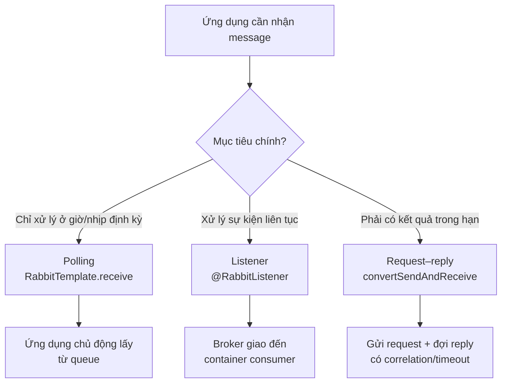
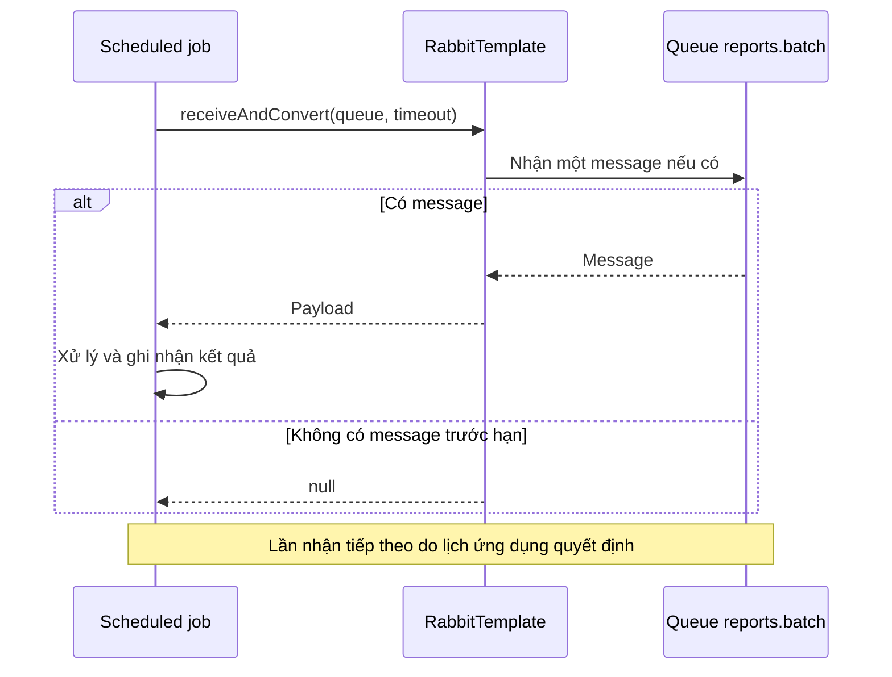
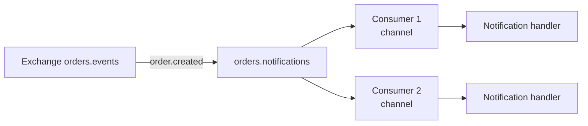
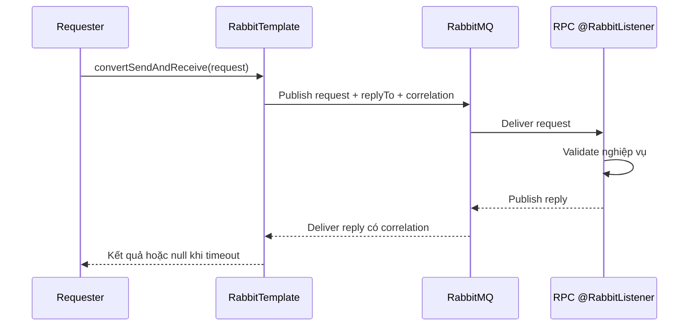

# Lựa chọn polling, listener hoặc request–reply theo bài toán trong Spring AMQP

Trong hệ thống bất đồng bộ xây bằng **RabbitMQ và Spring AMQP**, nhận message không chỉ là gọi một API. Bạn cần quyết định **ai chủ động lấy dữ liệu**, **có cần trả kết quả ngay hay không**, **tải xử lý biến động ra sao** và **lỗi được xác nhận, thử lại hoặc chuyển dead-letter như thế nào**.

Giả sử hệ thống đặt hàng có ba nhu cầu:

1. Một tác vụ đối soát báo cáo muốn lấy một số message vào thời điểm định kỳ, không cần consumer thường trực.
2. Dịch vụ gửi thông báo cần xử lý sự kiện `order.created` liên tục, không chờ kết quả ở phía publisher.
3. Dịch vụ thanh toán cần kiểm tra nhanh tính hợp lệ của mã đơn hàng và **nhận một kết quả trước khi tiếp tục**.

Spring AMQP hỗ trợ ba mô hình tương ứng: **polling** bằng `RabbitTemplate.receive(...)` / `receiveAndConvert(...)`, **listener bất đồng bộ** bằng `@RabbitListener` và **request–reply** bằng `RabbitTemplate.sendAndReceive(...)` / `convertSendAndReceive(...)`.

Bài học thuộc chương **Nhận thông điệp**. Bạn sẽ chọn mô hình theo ngữ nghĩa nghiệp vụ, áp dụng chúng cùng exchange–queue–binding, và hiểu giới hạn của publisher confirms, consumer acknowledgements, retry, dead-letter, giao dịch và quan sát.

## 1. Ba mô hình khác nhau ở điểm nào?



| Tiêu chí | Polling | Listener bất đồng bộ | Request–reply |
| --- | --- | --- | --- |
| Bên khởi xướng việc nhận | Ứng dụng gọi `receive` | Listener container duy trì consumer | Client gửi request và chờ reply |
| Kết quả tại thời điểm gọi | Message hoặc `null` | Xử lý qua callback/method khi có message | Reply hoặc hết thời gian chờ |
| Độ trễ thường mong muốn | Chấp nhận khoảng trễ đến lần poll | Thấp, xử lý ngay khi được giao theo tải | Bị ràng buộc bởi SLA request |
| Tải cao/liên tục | Thường không tối ưu, đặc biệt polling có timeout dương | Phù hợp hơn; điều chỉnh concurrency/prefetch | Có thể bị giới hạn bởi số request đồng thời và thời gian chờ |
| Điều khiển nhịp xử lý | Rõ ràng theo lịch và số lần gọi | Theo broker, prefetch, consumer và container | Theo tốc độ gọi của client và tốc độ responder |
| Mô hình phản hồi | Không mặc định có reply | Không mặc định có reply | Reply gắn với request |
| Xử lý lỗi | Phải chủ động thiết kế cho từng lần nhận và xử lý | Container hỗ trợ ACK/NACK, retry và error handler | Có cả lỗi request, responder, reply, timeout |
| Tình huống chính | Batch/kiểm tra định kỳ, lưu lượng thấp | Event-driven processing, work queue | RPC ngắn, kết quả cần ngay |

**Mỗi cách vẫn sử dụng RabbitMQ làm trung gian**. Khác biệt nằm ở cách application tương tác với queue và cách hợp đồng nghiệp vụ xác định “hoàn thành”.

### 1.1. Phân biệt ba câu hỏi

- **Message đã được publish?** `RabbitTemplate` gửi tới exchange, broker có thể trả **publisher confirm**.
- **Message đã tới queue?** Exchange định tuyến dựa trên binding; với `mandatory`, message không có route có thể được **publisher return**.
- **Message đã được xử lý?** Phụ thuộc consumer, **ACK/NACK**, logic nghiệp vụ và cơ chế reply nếu có.

Không nên dùng một tín hiệu để suy luận thay cho cả ba. Ví dụ, confirm ACK **không chứng minh** consumer đã hoàn tất; reply timeout **không chứng minh** responder chưa xử lý request.

## 2. Polling: ứng dụng chủ động lấy message từ queue

Polling phù hợp khi công việc diễn ra theo lịch, không yêu cầu consumer thường trực hoặc cần kiểm soát thời điểm lấy dữ liệu. Spring AMQP cung cấp:

```java
Message message = rabbitTemplate.receive("reports.batch");
Object payload = rabbitTemplate.receiveAndConvert("reports.batch");
```

Nếu queue không có message, các lời gọi mặc định **trả `null` ngay**. Spring cũng cho phép đặt timeout chờ:

```java
Message message = rabbitTemplate.receive("reports.batch", 250L);
Object payload = rabbitTemplate.receiveAndConvert("reports.batch", 250L);
```

Trong ví dụ, `250L` là **250 mili giây**. Lời gọi có thể đợi tối đa khoảng này để nhận message; không có message thì trả `null`. Giá trị 0 nghĩa là kiểm tra ngay, còn giá trị âm có thể chờ không giới hạn theo ngữ nghĩa API; **tránh chờ vô hạn trong thread có SLA hoặc nhiệm vụ theo lịch**.

### 2.1. Polling không có nghĩa broker chủ động đẩy vào listener



**Không có message** không đồng nghĩa broker không hoạt động; đôi khi queue rỗng là trạng thái hoàn toàn bình thường. Ngoài ra, `receiveAndConvert` còn có thể báo lỗi chuyển đổi/AMQP; không nên nuốt mọi exception rồi giả vờ queue đang rỗng.

### 2.2. Ví dụ polling theo lịch bằng Spring

Đoạn sau là một **phương án consumer độc lập**, dùng queue `reports.batch` và `@Scheduled`. Nếu project đang dùng Spring Boot, nhớ bật scheduling ở một lớp cấu hình:

```java
import org.springframework.context.annotation.Configuration;
import org.springframework.scheduling.annotation.EnableScheduling;

@Configuration
@EnableScheduling
public class SchedulingConfig {
}
```

Consumer kiểm tra queue mỗi giây; lần gọi có thể chờ tối đa 200 ms để có message:

```java
import org.springframework.amqp.rabbit.core.RabbitTemplate;
import org.springframework.scheduling.annotation.Scheduled;
import org.springframework.stereotype.Component;

@Component
public class ReportPollingWorker {

    private final RabbitTemplate rabbitTemplate;

    public ReportPollingWorker(RabbitTemplate rabbitTemplate) {
        this.rabbitTemplate = rabbitTemplate;
    }

    @Scheduled(fixedDelay = 1000L)
    public void pollOneReport() {
        Object value = rabbitTemplate.receiveAndConvert(
                "reports.batch", 200L);

        if (value == null) {
            // Không có message trong khoảng chờ; lần sau thử tiếp.
            return;
        }

        if (!(value instanceof String reportId)) {
            throw new IllegalArgumentException(
                    "Unexpected report payload: " + value.getClass());
        }

        // Demo: thay bằng xử lý có tính idempotent và cơ chế
        // lưu kết quả/khôi phục khi lỗi.
        System.out.println("Generate report: " + reportId);
    }
}
```

Với converter mặc định và message text `String`, ví dụ này giúp thấy rõ cách polling hoạt động. Nếu payload là JSON, phải cấu hình `MessageConverter` phù hợp hoặc lấy `Message` để tự parse và validate.

**Giới hạn lớn của ví dụ:** Khi nhận message bằng API template rồi **mới xử lý nghiệp vụ ở code phía sau**, không nên mặc định rằng exception từ `generateReport(...)` sẽ được listener container tự động NACK, requeue hay chuyển DLX. Polling có vòng đời nhận/xác nhận khác với `@RabbitListener`. Với công việc quan trọng, phải thiết kế cơ chế nhận/ACK/transaction thích hợp, ghi nhận trạng thái công việc hoặc chọn listener.

### 2.3. Khi polling hợp lý và khi không

Polling hợp lý khi:

- Batch chạy vào giờ được kiểm soát, ví dụ đọc yêu cầu tổng hợp báo cáo mỗi vài phút.
- Tích hợp hệ thống cũ chỉ có chu kỳ chạy ngắn, không duy trì process consumer liên tục.
- Queue có lượng message nhỏ và độ trễ chấp nhận được.
- Một công cụ vận hành cần lấy thử **một** message trong môi trường thử nghiệm.

Polling không phù hợp nếu bạn cần xử lý liên tục hàng nghìn message mỗi giây, muốn broker giao message nhanh nhất hoặc cần các chính sách ACK/retry/phục hồi có sẵn của listener container. Một cách polling có timeout khác 0 có thêm chi phí thiết lập consumer cho lần nhận và thường **không phải lựa chọn tối ưu cho tải cao**.

**Đừng tự triển khai vòng lặp vô hạn** `while(true)` gọi `receive` liên tục mà không có giới hạn nhịp, thời gian chờ hoặc dừng an toàn. Nó có thể gây tải rỗng lớn và khó điều khiển khi ứng dụng shutdown.

## 3. Listener: lựa chọn mặc định cho xử lý sự kiện liên tục

`@RabbitListener` là API quen thuộc nhất khi muốn phản ứng với sự kiện. Spring tạo **listener container** duy trì consumer trên queue và chuyển delivery tới method xử lý. Mô hình này giảm nhu cầu viết vòng lặp polling thủ công.

```java
import org.springframework.amqp.rabbit.annotation.RabbitListener;
import org.springframework.stereotype.Component;

@Component
public class OrderNotificationListener {

    @RabbitListener(queues = "orders.notifications")
    public void onCreated(String orderId) {
        System.out.println("Notify order created: " + orderId);
        // Thực tế: kiểm tra event ID và gửi thông báo idempotent.
    }
}
```

Ví dụ trên yêu cầu queue `orders.notifications` tồn tại và được bind vào exchange nhận `order.created`. Listener **không trực tiếp subscribe vào một exchange**; nó consume từ queue.

### 3.1. Vai trò của container, prefetch và concurrency



Hai consumer cùng lấy từ **một queue** là **competing consumers**: một lần giao message thường được xử lý bởi một consumer, không phải phát một bản đến mỗi consumer. Nếu Billing và Notification đều phải nhận một sự kiện, chúng cần **hai queue riêng**, mỗi queue có binding phù hợp.

Trong Spring Boot với `SimpleRabbitListenerContainerFactory`, cấu hình ví dụ:

```yaml
spring:
  rabbitmq:
    listener:
      simple:
        concurrency: 2
        max-concurrency: 6
        prefetch: 20
        acknowledge-mode: auto
```

- `concurrency`: số consumer khởi đầu, `max-concurrency`: trần mở rộng động theo chính sách của container.
- `prefetch`: số delivery chưa ACK broker có thể cấp trước theo cơ chế prefetch; **không phải số thread**.
- `acknowledge-mode: auto`: **Spring container** ACK sau xử lý thành công, tùy hành vi listener/error handler. Nó khác với `autoAck=true` của AMQP, nơi broker không đợi consumer ACK.

Các tham số này phải được đo dưới tải thực, cùng thời gian xử lý message, channel cache và tài nguyên broker. Tăng concurrency không tự tạo thông lượng tuyến tính khi database hoặc bên gửi email mới là nút thắt.

### 3.2. Khi listener gặp lỗi

Một listener có thể:

1. **Xử lý thành công:** container phát ACK theo cấu hình.
2. **Gặp lỗi tạm thời:** retry có giới hạn và backoff, sau đó ACK/NACK/requeue theo chính sách.
3. **Gặp lỗi không thể xử lý:** reject/NACK không requeue và chuyển message tới DLX nếu queue có chính sách dead-letter phù hợp.
4. **Mất kết nối trước ACK:** broker có thể giao lại delivery cho consumer khác khi điều kiện cho phép.

**Không nên chỉ `throw RuntimeException` rồi mặc định message sẽ xuất hiện ở DLQ.** Cách xử lý thực tế phụ thuộc container retry interceptor, `defaultRequeueRejected`, kiểu exception, queue DLX và số lần redelivery.

Với các consumer có tác dụng nghiệp vụ (gửi email, chuyển tiền, ghi nhận hóa đơn), cần event ID ổn định và cơ chế **idempotency**. Message có thể được xử lý lại khi publisher gửi trùng hoặc delivery bị redeliver.

### 3.3. Khi nào chọn listener?

Chọn listener khi dịch vụ cần phản ứng với message **ngay khi broker giao**, traffic liên tục, có khả năng mở rộng consumer và muốn quản lý ACK/retry/DLX thông qua container. Đây thường là lựa chọn tốt cho xử lý sự kiện nghiệp vụ, công việc nền và tích hợp bất đồng bộ.

Nếu endpoint phải trả kết quả cho caller theo một thời hạn rất ngắn, listener một chiều **chưa tự giải quyết** yêu cầu đó. Có thể bổ sung protocol request–reply, hoặc thiết kế API nhận request rồi trả `202 Accepted` cùng một job ID để client kiểm tra sau.

## 4. Request–reply: khi caller cần một kết quả trong thời hạn

Trong request–reply, ứng dụng gọi **gửi request** vào exchange và **đợi một message phản hồi** được gắn với request đó. Spring AMQP cung cấp các phương thức:

```java
Message reply = rabbitTemplate.sendAndReceive(
        "orders.commands", "order.validate", requestMessage);

Object response = rabbitTemplate.convertSendAndReceive(
        "orders.commands", "order.validate", "ORD-1001");
```

`sendAndReceive` gửi/nhận đối tượng `Message`, còn `convertSendAndReceive` sử dụng `MessageConverter` cho cả request và reply. Spring RabbitTemplate quản lý `reply-to` và **correlation** của lời gọi phù hợp với cấu hình.



**Request–reply là một cách làm RPC qua messaging**, không biến RabbitMQ thành HTTP và cũng không tự tạo transaction phân tán. Client chờ reply sẽ phụ thuộc vào cả thời gian broker định tuyến, thời gian responder xử lý và khả năng gửi reply trở lại.

### 4.1. Reply timeout và kết quả chưa chắc chắn

Với `RabbitTemplate`, các phương thức request–reply thường **mặc định chờ khoảng 5 giây**; có thể thay đổi bằng `setReplyTimeout(...)` (đơn vị mili giây).

Nếu hết thời gian mà không có reply, lời gọi thường **trả `null`**. `null` có thể nghĩa là:

- Request chưa đến queue do lỗi định tuyến/đường truyền.
- Responder chưa kịp xử lý hoặc đang quá tải.
- Responder xử lý xong nhưng reply chưa đến, đến muộn hoặc bị mất.
- Message lỗi và bị retry/DLQ.
- Reply được gửi nhầm địa chỉ hoặc correlation không khớp.

Vì vậy **timeout không bằng “nghiệp vụ chưa được thực hiện”**. Nếu caller retry một request có side effect, server cần nhận ra trùng bằng **request ID/idempotency key**.

### 4.2. Direct reply-to và reply queue

Khi RabbitMQ hỗ trợ **Direct Reply-To** và template sử dụng cấu hình mặc định phù hợp, Spring AMQP thường dùng cơ chế này cho reply thay vì tạo một queue riêng cho mỗi request. Nó giúp giảm overhead khai báo reply queue.

Tuy nhiên, Direct Reply-To có giới hạn quan trọng:

- Reply **không được lưu bền** trong một queue thông thường.
- Cơ chế này có tính chất **at-most-once** đối với reply; khi requester mất kết nối, reply có thể bị mất.
- Tên `amq.rabbitmq.reply-to` là cơ chế pseudo-queue; không nên trông đợi nó hiện như queue thông thường trong `rabbitmqctl list_queues`.
- Không nên dùng Direct Reply-To nếu nghiệp vụ yêu cầu reply phải lưu bền và có thể nhận lại sau khi caller ngắt kết nối.

Nếu cần reply queue cố định, phải thiết kế **listener cho reply**, correlation, tên reply queue theo requester và lifecycle, tránh nhiều requester cạnh tranh đọc nhầm reply trên một queue chung. Việc cấu hình cố định phức tạp hơn nên chỉ chọn khi có yêu cầu rõ ràng.

### 4.3. Khi nào request–reply hợp lý?

Phù hợp khi cần tra cứu/kiểm tra **ngắn, bounded**, ví dụ kiểm tra nhanh mã đơn trước khi xác nhận thao tác. Nó ít phù hợp cho quy trình dài như tạo báo cáo 20 phút, đợi nhà cung cấp bên ngoài hoặc xử lý có side effect khó đảo ngược.

Đối với thao tác lâu, nên **nhận lệnh bất đồng bộ**, lưu job ID và báo trạng thái qua event/DB/API. Tránh biến một pipeline event-driven thành chuỗi RPC lồng nhau, vì mỗi bước đợi có thể làm tăng latency, timeout dây chuyền và tiêu hao connection/channel.

## 5. Ví dụ dùng cả ba mô hình trong một hệ thống Spring AMQP

Để minh họa ranh giới, ta dùng **ba queue riêng**, không cố lấy cùng một queue theo ba cách đồng thời:

| Mô hình | Exchange | Queue | Routing key | Vai trò |
| --- | --- | --- | --- | --- |
| Polling | `jobs.events` | `reports.batch` | `report.requested` | Lấy report job theo nhịp |
| Listener | `orders.events` | `orders.notifications` | `order.created` | Gửi thông báo bất đồng bộ |
| Request–reply | `orders.commands` | `orders.validation.rpc` | `order.validate` | Trả kết quả kiểm tra nhanh |

**Không chạy polling và listener trên cùng queue trong ví dụ này**. Nếu chúng cùng consume một queue, chúng trở thành những consumer cạnh tranh, có thể làm message “biến mất khỏi” consumer bạn dự kiến.

### 5.1. Khai báo exchange, queue và binding

```java
import org.springframework.amqp.core.Binding;
import org.springframework.amqp.core.BindingBuilder;
import org.springframework.amqp.core.Declarables;
import org.springframework.amqp.core.DirectExchange;
import org.springframework.amqp.core.ExchangeBuilder;
import org.springframework.amqp.core.Queue;
import org.springframework.amqp.core.QueueBuilder;
import org.springframework.amqp.core.TopicExchange;
import org.springframework.context.annotation.Bean;
import org.springframework.context.annotation.Configuration;

@Configuration
public class MessagingTopology {

    public static final String JOBS_EXCHANGE = "jobs.events";
    public static final String REPORT_QUEUE = "reports.batch";

    public static final String EVENTS_EXCHANGE = "orders.events";
    public static final String NOTIFICATION_QUEUE = "orders.notifications";

    public static final String COMMANDS_EXCHANGE = "orders.commands";
    public static final String RPC_QUEUE = "orders.validation.rpc";

    @Bean
    public Declarables messagingResources() {
        TopicExchange jobs = ExchangeBuilder
                .topicExchange(JOBS_EXCHANGE).durable(true).build();
        Queue reports = QueueBuilder.durable(REPORT_QUEUE).build();
        Binding reportBinding = BindingBuilder.bind(reports)
                .to(jobs).with("report.requested");

        TopicExchange events = ExchangeBuilder
                .topicExchange(EVENTS_EXCHANGE).durable(true).build();
        Queue notifications = QueueBuilder
                .durable(NOTIFICATION_QUEUE).build();
        Binding notificationBinding = BindingBuilder.bind(notifications)
                .to(events).with("order.created");

        DirectExchange commands = ExchangeBuilder
                .directExchange(COMMANDS_EXCHANGE).durable(true).build();
        Queue validation = QueueBuilder.durable(RPC_QUEUE).build();
        Binding validationBinding = BindingBuilder.bind(validation)
                .to(commands).with("order.validate");

        return new Declarables(
                jobs, reports, reportBinding,
                events, notifications, notificationBinding,
                commands, validation, validationBinding);
    }
}
```

`Declarables` gom các đối tượng topology để `RabbitAdmin` có thể khai báo chúng. Việc tạo `@Bean` **không tự đồng nghĩa** broker đã có exchange/queue/binding; cần `RabbitAdmin` hoặc cơ chế provisioning phù hợp, kết nối đến **đúng virtual host** và user có quyền khai báo.

### 5.2. Kết nối RabbitMQ

```yaml
# application.yml
spring:
  rabbitmq:
    host: ${RABBITMQ_HOST:localhost}
    port: ${RABBITMQ_PORT:5672}
    virtual-host: ${RABBITMQ_VHOST:/orders}
    username: ${RABBITMQ_USERNAME}
    password: ${RABBITMQ_PASSWORD}
    listener:
      simple:
        acknowledge-mode: auto
        concurrency: 2
        max-concurrency: 6
        prefetch: 20
```

Vhost `/orders` phải tồn tại. Trong môi trường thật, cung cấp mật khẩu qua secret/biến môi trường. Những giá trị concurrency/prefetch chỉ là ví dụ; cần điều chỉnh dựa trên tải và tính chất xử lý.

### 5.3. Publish message để kiểm thử polling và listener

```java
import org.springframework.amqp.rabbit.core.RabbitTemplate;
import org.springframework.stereotype.Service;

@Service
public class DemoEventPublisher {

    private final RabbitTemplate rabbitTemplate;

    public DemoEventPublisher(RabbitTemplate rabbitTemplate) {
        this.rabbitTemplate = rabbitTemplate;
    }

    public void requestReport(String reportId) {
        rabbitTemplate.convertAndSend(
                MessagingTopology.JOBS_EXCHANGE,
                "report.requested",
                reportId);
    }

    public void orderCreated(String orderId) {
        rabbitTemplate.convertAndSend(
                MessagingTopology.EVENTS_EXCHANGE,
                "order.created",
                orderId);
    }
}
```

Khi gọi `requestReport("RPT-001")`, message được định tuyến tới `reports.batch` và chỉ được đọc khi polling worker gọi `receiveAndConvert`. Khi gọi `orderCreated("ORD-1001")`, listener của `orders.notifications` có thể nhận ngay khi nó đang hoạt động.

### 5.4. Responder RPC trả kết quả bằng @RabbitListener

```java
import org.springframework.amqp.rabbit.annotation.RabbitListener;
import org.springframework.stereotype.Component;

@Component
public class OrderValidationResponder {

    @RabbitListener(queues = MessagingTopology.RPC_QUEUE)
    public String validateOrder(String orderId) {
        // Ví dụ đơn giản, không thay cho validation nghiệp vụ thật.
        return orderId != null && orderId.startsWith("ORD-")
                ? "VALID"
                : "REJECTED";
    }
}
```

Method trả về một `String`. Khi request có `replyTo` do `RabbitTemplate.convertSendAndReceive` đặt, listener adapter của Spring có thể **tạo reply đến địa chỉ đó**. Với luồng này **không cần `@SendTo`**, vì reply address đã nằm trong request. `@SendTo` thường dùng làm địa chỉ mặc định khi inbound message không cung cấp `replyTo`.

### 5.5. Requester dùng RabbitTemplate với timeout tường minh

Để không thay đổi `replyTimeout` của các luồng publish/polling, ta tạo **hai template có mục đích riêng**. Bean `oneWayRabbitTemplate` được đánh dấu `@Primary` để các ví dụ tiêm `RabbitTemplate` theo kiểu nhận được template thông thường; client RPC chọn chính xác bean còn lại bằng `@Qualifier`. Định nghĩa cả hai tường minh cũng tránh phụ thuộc vào việc Spring Boot có tự tạo default `RabbitTemplate` khi đã thấy bean ứng dụng hay không.

```java
import org.springframework.amqp.rabbit.connection.ConnectionFactory;
import org.springframework.amqp.rabbit.core.RabbitTemplate;
import org.springframework.context.annotation.Bean;
import org.springframework.context.annotation.Configuration;
import org.springframework.context.annotation.Primary;

@Configuration
public class RpcTemplateConfiguration {

    @Bean("oneWayRabbitTemplate")
    @Primary
    public RabbitTemplate oneWayRabbitTemplate(
            ConnectionFactory connectionFactory) {
        return new RabbitTemplate(connectionFactory);
    }

    @Bean("validationRpcTemplate")
    public RabbitTemplate validationRpcTemplate(
            ConnectionFactory connectionFactory) {
        RabbitTemplate template = new RabbitTemplate(connectionFactory);
        template.setReplyTimeout(2500L); // 2,5 giây
        return template;
    }
}
```

Caller:

```java
import org.springframework.amqp.rabbit.core.RabbitTemplate;
import org.springframework.beans.factory.annotation.Qualifier;
import org.springframework.stereotype.Service;

@Service
public class OrderValidationClient {

    private final RabbitTemplate rpcTemplate;

    public OrderValidationClient(
            @Qualifier("validationRpcTemplate") RabbitTemplate rpcTemplate) {
        this.rpcTemplate = rpcTemplate;
    }

    public boolean validate(String orderId) {
        Object reply = rpcTemplate.convertSendAndReceive(
                MessagingTopology.COMMANDS_EXCHANGE,
                "order.validate",
                orderId);

        if (reply == null) {
            throw new IllegalStateException(
                    "RPC reply timeout: orderId=" + orderId);
        }

        if (!(reply instanceof String status)) {
            throw new IllegalStateException(
                    "Unexpected RPC reply type");
        }

        return "VALID".equals(status);
    }
}
```

Đây là ví dụ RPC **chỉ đọc/kiểm tra**, không tạo side effect. Nó dùng converter mặc định với payload `String`. Với JSON/DTO, phải cấu hình converter và ánh xạ type rõ ràng cho cả request lẫn reply.

**Đừng diễn giải `reply == null` là “validation đã từ chối”.** Đó là **không có reply trước hạn**; caller phải quyết định báo lỗi, thử lại với cùng request ID hoặc chuyển sang workflow khác. Trong API thực, nên phân biệt ba trạng thái: **VALID**, **REJECTED** và **UNKNOWN/TIMEOUT** thay vì trả Boolean cho mọi tình huống.

## 6. Chọn mô hình theo yêu cầu thực tế

### 6.1. Ba bài toán minh họa

**Bài toán A – Đối soát cuối ngày.** Một job chạy lúc 23:00, đọc tối đa một số yêu cầu tổng hợp báo cáo đã xếp hàng, rồi kết thúc. Polling có thể phù hợp nếu lượng message nhỏ, chấp nhận chờ đến giờ chạy. Nếu công việc kéo dài, có nhiều worker và cần xử lý lỗi/requeue nghiêm ngặt, listener được giới hạn concurrency hoặc một hệ thống batch có quản lý trạng thái có thể an toàn hơn.

**Bài toán B – Gửi email sau khi tạo đơn.** Dịch vụ đặt hàng không nên chờ phản hồi email. Nó publish `order.created` và kết thúc sau khi đã xử lý bảo đảm publish theo tiêu chí hệ thống; Notification dùng `@RabbitListener` để tiêu thụ và retry độc lập. Đây là mẫu event-driven phù hợp.

**Bài toán C – Kiểm tra mã voucher trước khi chốt đơn.** Caller cần kết quả nhanh trước khi tiếp tục. Request–reply qua RabbitMQ có thể đáp ứng nếu responder đủ nhanh, giới hạn timeout rõ ràng và không có side effect không idempotent. Nếu yêu cầu RPC thuần đồng bộ và cả hai service đã có HTTP/gRPC, cũng nên so sánh giải pháp đó thay vì chọn AMQP RPC theo thói quen.

### 6.2. Bảng quyết định

| Yêu cầu nổi bật | Polling | Listener | Request–reply |
| --- | :---: | :---: | :---: |
| Chạy đúng các khung giờ do ứng dụng kiểm soát | **Tốt** | Có thể, nhưng phải điều khiển consumer | Không nhằm mục tiêu này |
| Xử lý liên tục với độ trễ thấp | Không ưu tiên | **Tốt** | Chỉ khi cần reply |
| Nhiều worker chia tải một queue | Có thể nhưng phải tự tổ chức | **Tốt** | Responder thường là listener |
| Caller không cần chờ kết quả nghiệp vụ | Có thể | **Tốt** | Dư thừa |
| Caller bắt buộc nhận kết quả trong vài giây | Không tiện | Cần tự bổ sung reply/status | **Tốt** nếu workload bounded |
| Tác vụ kéo dài vài phút hoặc giờ | Có thể cho job kiểm soát thủ công | **Tốt** cùng quản lý trạng thái | Không ưu tiên |
| Muốn cơ chế ACK/retry từ listener container | Không trực tiếp có cùng semantics | **Tốt** | Responder được hưởng listener, requester còn timeout/reply |
| Cần lưu bền kết quả sau khi requester offline | Cần lưu state riêng | Event + DB/status service | Direct Reply-To **không phù hợp** |

### 6.3. Những kết hợp thường hiệu quả hơn “chọn đúng một”

Một kiến trúc có thể dùng nhiều mô hình ở những ranh giới khác nhau: API dùng request–reply cho kiểm tra ngắn; sau khi chốt đơn, publisher phát sự kiện để listener xử lý email; một công việc báo cáo có thể chạy polling theo giờ. Không có yêu cầu phải dùng cùng một chiến lược nhận message cho mọi queue.

Quan trọng là **không vô tình cho hai mô hình cạnh tranh trên cùng queue** khi nghiệp vụ kỳ vọng mỗi nhóm đều được nhận mọi sự kiện. Muốn nhân bản một sự kiện cho hai nhóm độc lập, cần **hai queue với binding riêng**.

## 7. ACK, timeout, retry và dead-letter theo từng mô hình

| Chủ đề | Polling | Listener | Request–reply |
| --- | --- | --- | --- |
| **Nhận message** | `receive`/`receiveAndConvert` theo lời gọi | Container `basic.consume` liên tục | Responder nhận request, requester nhận reply |
| **ACK** | Phải hiểu cơ chế nhận/ack theo template và transaction; không có tự động NACK từ method business ngoài template | Theo `acknowledge-mode` và error handler | ACK request phụ thuộc responder container; reply có vòng đời riêng |
| **Retry** | Ứng dụng hoặc workflow phải thiết kế | Retry interceptor, broker redelivery/DLX và policy | Cả retry xử lý request và retry khi reply timeout |
| **Timeout** | `receiveTimeout`/tham số timeout | Không có thời gian chờ từng message ở caller | `replyTimeout` và SLA toàn bộ RPC |
| **Dead-letter** | Khi broker/consumer reject hoặc message hết hạn theo cấu hình; không tự bật chỉ vì poll lỗi | Khi reject/NACK không requeue hoặc điều kiện DLX khác | Áp dụng cho request queue/responder; Direct Reply-To không phải reply queue bền vững |
| **Dữ liệu trùng** | Có thể do logic gửi lại hoặc phục hồi | Có thể do redelivery/retry/publish trùng | Retry vì timeout có thể tạo request trùng trong khi responder đã xử lý |

### 7.1. Một lỗi quan trọng với polling

Nếu code làm:

```java
String reportId = (String) rabbitTemplate.receiveAndConvert(
        "reports.batch");

if (reportId != null) {
    processExpensiveReport(reportId); // Có thể ném lỗi sau khi nhận
}
```

thì **đừng tự suy luận** rằng lỗi ở `processExpensiveReport` sẽ khiến RabbitMQ đưa message đó vào queue để đọc lại. Kiểm tra chính xác semantics của `receive`/ack/transaction và quyết định chiến lược khôi phục; với task quan trọng, thường hợp lý hơn dùng listener với ACK sau xử lý và retry/DLQ hoặc lưu trạng thái job trong DB.

### 7.2. Timeout RPC có thể tạo side effect trùng

Giả sử RPC thực hiện **trừ điểm thưởng**:

1. Client gửi request với `requestId=cmd-123`.
2. Responder trừ điểm và commit DB.
3. Reply đến muộn hoặc bị mất; client timeout.
4. Client gửi lại request theo cùng nghiệp vụ.
5. Nếu responder không kiểm tra `requestId`, điểm có thể bị trừ hai lần.

Vì vậy request–reply không tự tạo exactly-once. Cách giải quyết là **idempotency ở responder** (kiểm tra command ID trong cùng transaction DB phù hợp), hoặc tránh RPC có side effect và chuyển sang workflow bất đồng bộ có trạng thái.

### 7.3. Publisher confirm khác reply

Publisher confirm cho biết broker đã xử lý lần publish ở mức AMQP; **reply** là một **message mới** mang kết quả do responder tạo. Bạn có thể nhận publisher confirm ACK nhưng không có reply, hoặc nhận reply mà vẫn cần xử lý logic nghiệp vụ của kết quả.

Consumer ACK xác nhận delivery request, không thay thế việc gửi reply. Với direct reply-to, reply có thể mất nếu requester offline; đây là lý do không dùng reply timeout làm bằng chứng chắc chắn về kết quả của side effect.

### 7.4. Kết hợp DLX và outbox ở đúng nơi

Đối với listener xử lý sự kiện, lỗi vĩnh viễn có thể chuyển qua DLX/DLQ khi queue và container được cấu hình phù hợp; lỗi tạm thời có thể retry có backoff và giới hạn. Đối với publisher cần bảo đảm phát sự kiện sau DB commit, có thể dùng **transactional outbox**, publisher confirms và consumer idempotency.

Một lỗi conversion xảy ra trước khi `@RabbitListener` method được gọi vẫn cần error handler của container; chỉ viết `try/catch` trong method listener là chưa bao phủ được tất cả failure.

## 8. Thực hành kiểm chứng trên RabbitMQ

### 8.1. Kiểm tra topology

Sau khi ứng dụng thiết lập connection và `RabbitAdmin` khai báo tài nguyên, kiểm tra đúng vhost `/orders`:

```bash
rabbitmqctl list_exchanges -p /orders name type durable

rabbitmqctl list_queues -p /orders \
    name messages_ready messages_unacknowledged consumers

rabbitmqctl list_bindings -p /orders \
    source_name destination_name routing_key
```

Cần thấy ba queue, ba binding và các exchange theo `MessagingTopology`. Các consumer chạy liên tục có thể khiến `messages_ready=0` ngay sau publish; hãy phân biệt queue rỗng vì đã nhận/ACK với queue không có route.

### 8.2. Bộ tình huống thử nghiệm

| Thử nghiệm | Cách làm | Kết quả kỳ vọng |
| --- | --- | --- |
| **Polling khi queue rỗng** | Gọi `receiveAndConvert("reports.batch", 200L)` | Trả `null` sau khi hết hạn nếu không có message; không ném “queue empty” |
| **Polling khi có dữ liệu** | Gửi `report.requested` vào `jobs.events`, đợi scheduled job | Job nhận `reportId` tại lần poll phù hợp |
| **Listener hoạt động** | Gửi `order.created` vào `orders.events` | `OrderNotificationListener` được gọi |
| **Hai consumer cùng queue** | Tăng concurrency của listener | Một delivery được giao cho một consumer; không nhân bản cho mỗi consumer |
| **RPC thành công** | Gọi `validate("ORD-1001")` | Nhận `VALID` và trả `true` trong hạn |
| **RPC từ chối nghiệp vụ** | Gọi `validate("BAD")` | Nhận `REJECTED` và trả `false` |
| **RPC timeout** | Dừng responder hoặc làm phản hồi chậm quá 2,5 giây | `convertSendAndReceive` trả `null`, caller báo trạng thái chưa xác định |
| **RPC late reply** | Responder hoàn thành sau khi caller timeout | Không giả định reply được lưu để caller lấy lại; quan sát late reply và xử lý retry |
| **Listener thất bại** | Thử exception ở handler với policy retry/DLX rõ ràng | Theo dõi ACK/requeue/DLQ; không kết luận từ exception đơn lẻ |
| **Unroutable request** | Publish vào exchange hợp lệ với key không có binding | Kiểm tra return/mandatory; không chờ reply vô hạn |

Thử trên **vhost thử nghiệm**, đặc biệt khi tạm dừng consumer hoặc thay đổi binding. Không dùng queue có dữ liệu nghiệp vụ thật để kiểm tra bằng cách lấy message ra và xử lý tùy ý.

### 8.3. Chỉ số nên quan sát

- **Queue:** `messages_ready`, `messages_unacknowledged`, consumer count, publish/deliver/ack rates và DLQ depth.
- **Polling:** tần suất poll, tỷ lệ poll không có message, độ trễ mỗi lần nhận và lỗi xử lý sau receive.
- **Listener:** latency xử lý, số consumer, prefetch/concurrency, redelivery, retry count và DLX.
- **Request–reply:** số request đang chờ, reply latency, tỷ lệ timeout, late reply, lỗi correlation và tỷ lệ responder quá tải.
- **Publisher:** confirm ACK/NACK, returns, channel/connection failures và event ID để truy vết end-to-end.

**Correlation ID, message ID, routing key và vhost** giúp ghép các sự kiện, nhưng phải thiết kế theo hợp đồng thống nhất để tracing không phụ thuộc vào thứ tự log đến.

## 9. Những lỗi thiết kế phổ biến

| Lỗi | Vì sao gây vấn đề | Cách sửa |
| --- | --- | --- |
| Dùng polling liên tục với vòng `while(true)` không chờ | Gây tải polling vô ích và tiêu tốn tài nguyên | Dùng lịch/tần suất rõ; với tải cao dùng listener |
| Dùng polling cho công việc cần ACK sau DB commit nhưng không kiểm tra semantics | Có thể không phục hồi đúng khi xử lý sau receive thất bại | Dùng listener, transaction/idempotency hoặc cơ chế job state rõ ràng |
| Cho polling và listener đọc chung queue mà kỳ vọng cả hai đều thấy message | Chúng cạnh tranh lấy các delivery | Dùng queue riêng nếu cần hai nhóm nhận |
| Đặt prefetch/concurrency quá cao | Tăng unacked và áp lực RAM/DB | Điều chỉnh theo thời gian xử lý và năng lực downstream |
| Coi listener return value như HTTP response cho publisher một chiều | One-way publish không tự có reply-to/correlation | Dùng request–reply hoặc event kết quả riêng |
| Dùng request–reply cho task mất vài phút | Giữ caller chờ, tăng timeout và tài nguyên | Trả job ID/202, xử lý async và có trạng thái |
| Coi RPC timeout là “request không chạy” | Responder có thể đã commit nhưng reply mất | Dùng idempotency key, trạng thái UNKNOWN và đối soát |
| Coi publisher confirm ACK là responder hoàn tất | Confirm là tín hiệu phía broker, không phải reply nghiệp vụ | Tách publish state khỏi business state |
| Không có DLX/retry policy khi listener lỗi | Có nguy cơ requeue vô hạn hoặc drop | Cấu hình phân loại lỗi, retry/backoff/DLX |
| Cấu hình reply queue cố định cho nhiều requester không có correlation/consumer riêng | Reply có thể bị một requester khác nhận | Dùng direct reply-to hoặc fixed reply queue theo requester với mapping rõ |
| Không ghi metrics riêng cho ba mô hình | Khó biết nghẽn ở publisher, broker, consumer hay reply | Giám sát theo luồng và từng queue |

## 10. Checklist lựa chọn

- [ ] Caller có **phải nhận kết quả** trước khi tiếp tục không? Nếu có, xác định rõ thời gian chờ và kết quả UNKNOWN.
- [ ] Công việc có thể chạy theo lịch và lưu lượng nhỏ? Cân nhắc polling nếu semantics nhận/ACK đáp ứng.
- [ ] Công việc cần xử lý sự kiện liên tục? Ưu tiên `@RabbitListener` với container được quản lý.
- [ ] Nếu dùng RPC, kết quả có thực sự **nhanh và bounded** không? Direct Reply-To có chấp nhận mất reply khi requester offline không?
- [ ] Xác định queue/exchange/binding cho từng nhóm, tránh cho nhiều subscriber dùng chung queue khi cần bản riêng.
- [ ] Tính độ trễ, thông lượng, prefetch, concurrency, connection/channel và tài nguyên downstream.
- [ ] Phân biệt `receiveTimeout` với `replyTimeout` và timeout của publisher confirm hoặc network.
- [ ] Có chính sách ACK/NACK, retry có giới hạn và DLX/DLQ rõ ràng cho listener và responder.
- [ ] Với polling, kiểm tra chuyện message được xác nhận khi nào trước khi đặt side effect sau receive.
- [ ] Dùng event ID/request ID và idempotency khi publish/retry/redelivery có thể gây xử lý trùng.
- [ ] Có metrics/log/tracing cho publish, queue, handler, timeout và reply; đối soát kết quả nghiệp vụ khi cần.
- [ ] Kiểm thử queue rỗng, lỗi parse, consumer crash, reply mất/chậm và broker reconnect trước production.

**Ghi nhớ:** **Polling** là lựa chọn chủ động, có nhịp, hợp với tác vụ ít dữ liệu hoặc chạy theo lịch; **listener** là lựa chọn tự nhiên cho xử lý sự kiện liên tục, có container quản lý ACK/retry và concurrency; **request–reply** dành cho bài toán bắt buộc có một kết quả trong thời hạn hữu hạn, nhưng phải chấp nhận reply timeout và khả năng kết quả không xác định. Dù chọn mô hình nào, Spring AMQP vẫn cần topology RabbitMQ chính xác, publisher confirms/returns, consumer ACK, retry/DLX, idempotency và quan sát hệ thống phù hợp để xử lý bất đồng bộ đáng tin cậy.

### Tài liệu tham khảo chính thức

- [Spring AMQP — Polling Consumer](https://docs.spring.io/spring-amqp/reference/amqp/receiving-messages/polling-consumer.html)
- [Spring AMQP — Asynchronous Consumer](https://docs.spring.io/spring-amqp/reference/amqp/receiving-messages/async-consumer.html)
- [Spring AMQP — Annotation-driven Listener Endpoints](https://docs.spring.io/spring-amqp/reference/amqp/receiving-messages/async-annotation-driven.html)
- [Spring AMQP — Request/Reply Messaging](https://docs.spring.io/spring-amqp/reference/amqp/request-reply.html)
- [Spring AMQP — Reply Management](https://docs.spring.io/spring-amqp/reference/amqp/receiving-messages/async-annotation-driven/reply.html)
- [Spring AMQP — Listener Error Handling](https://docs.spring.io/spring-amqp/reference/amqp/exception-handling.html)
- [RabbitMQ — Direct Reply-To](https://www.rabbitmq.com/docs/direct-reply-to)
- [RabbitMQ — Consumer Acknowledgements and Publisher Confirms](https://www.rabbitmq.com/docs/confirms)
- [RabbitMQ — Dead Letter Exchanges](https://www.rabbitmq.com/docs/dlx)

