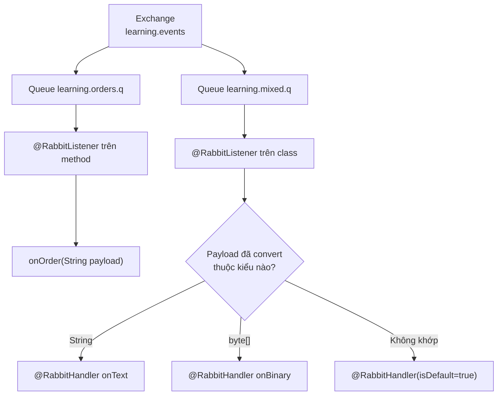
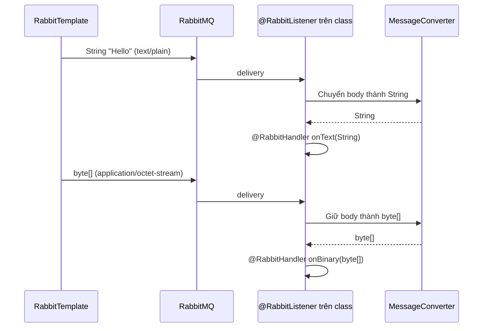

# @RabbitListener tại phương thức và lớp

Trong Spring AMQP, `@RabbitListener` giúp ứng dụng đăng ký consumer để nhận message bất đồng bộ từ RabbitMQ mà không phải tự viết vòng lặp `basic.consume`. Annotation này có thể đặt **trên một phương thức** hoặc **trên một lớp**; tuy cùng tên, cách Spring chọn hàm xử lý khác nhau đáng kể. Khi đặt trên phương thức, chính phương thức đó là điểm nhận message. Khi đặt trên lớp, ta thường kết hợp `@RabbitHandler` trên các phương thức để Spring lựa chọn handler dựa vào **kiểu payload sau khi chuyển đổi**.

Bài học thuộc chương **Listener khai báo** trong module **SPRING_AMQP**. Dựa trên mô hình exchange, queue, binding và `RabbitTemplate`, ta sẽ cấu hình listener cho sự kiện đơn hàng, thử nhận nhiều kiểu dữ liệu, xem cách giải mã payload, kiểm soát acknowledgement, concurrency, retry/dead-letter và quan sát hệ thống. Mục tiêu là hiểu rõ khi nào dùng method-level hoặc class-level listener, tránh đăng ký nhiều consumer ngoài ý muốn và xử lý message đáng tin cậy.

## 1. Hai kiểu đặt annotation tạo ra hai mô hình xử lý

| Tiêu chí | `@RabbitListener` trên **phương thức** | `@RabbitListener` trên **lớp** |
|---|---|---|
| Vị trí | Ngay trên phương thức cần nhận message | Trên class được Spring quản lý |
| Handler được gọi | Chính phương thức có annotation | Một trong các phương thức có `@RabbitHandler` |
| Chọn handler | Endpoint đã xác định phương thức từ đầu | Chọn handler theo **kiểu payload đã convert** |
| Kiểu payload | Thường có thể suy luận kiểu đích từ tham số của phương thức, với converter phù hợp | Converter phải tạo ra kiểu payload đủ cụ thể **trước khi** Spring chọn `@RabbitHandler` |
| Số consumer/container | Mỗi annotation listener tạo một endpoint/container riêng | Một endpoint từ annotation ở lớp, có thể dispatch qua nhiều handler |
| Thích hợp | Một loại payload hoặc một hợp đồng xử lý rõ ràng trên queue | Một queue chứa nhiều loại payload mà converter phân biệt được |
| Khả năng nhận `org.springframework.amqp.core.Message` chưa chuyển đổi | Hỗ trợ trong chữ ký phương thức | `@RabbitHandler` dành cho payload đã chuyển đổi; cần raw `Message` thì nên đặt `@RabbitListener` trên phương thức |



**Chốt phân biệt:** nhiều `@RabbitListener` trên những phương thức cùng đọc **một queue** sẽ trở thành các **competing consumers**, không phải cơ chế dispatch theo payload. Nếu muốn Spring chuyển một message trong **một endpoint** đến nhiều phương thức theo kiểu nội dung, hãy dùng `@RabbitListener` ở **lớp** kết hợp `@RabbitHandler`.

## 2. Chuẩn bị Spring Boot và topology ví dụ

Ứng dụng cần RabbitMQ đang chạy, kết nối thành công và dependency Spring RabbitMQ AMQP 0-9-1. Với **Spring Boot 3.x**, dependency thường dùng là:

```xml
<dependency>
    <groupId>org.springframework.boot</groupId>
    <artifactId>spring-boot-starter-amqp</artifactId>
</dependency>
```

Với **Spring Boot 4.x**, dùng starter RabbitMQ AMQP 0-9-1 tương ứng (`spring-boot-starter-rabbitmq`). Không dùng nhầm starter AMQP 1.0 với bài thực hành `RabbitTemplate`/`@RabbitListener` này.

```yaml
# application.yml — minh họa môi trường phát triển cục bộ
spring:
  rabbitmq:
    host: localhost
    port: 5672
    username: guest
    password: guest
    virtual-host: /
```

Tài khoản `guest` mặc định thường chỉ được RabbitMQ cho kết nối qua loopback. Môi trường sản xuất nên dùng tài khoản phù hợp, secrets, quyền truy cập riêng và TLS khi cần.

Ta khai báo **một direct exchange và hai queue riêng** để có thể chạy ví dụ method-level và class-level cùng lúc mà không tranh nhau delivery:

```java
package com.example.listeners;

import org.springframework.amqp.core.Binding;
import org.springframework.amqp.core.BindingBuilder;
import org.springframework.amqp.core.DirectExchange;
import org.springframework.amqp.core.Queue;
import org.springframework.context.annotation.Bean;
import org.springframework.context.annotation.Configuration;

@Configuration(proxyBeanMethods = false)
public class ListenerTopology {
    public static final String EXCHANGE = "learning.events";
    public static final String ORDER_QUEUE = "learning.orders.q";
    public static final String MIXED_QUEUE = "learning.mixed.q";
    public static final String ORDER_KEY = "order.created";
    public static final String MIXED_KEY = "demo.mixed";

    @Bean
    DirectExchange learningExchange() {
        return new DirectExchange(EXCHANGE, true, false);
    }

    @Bean
    Queue orderQueue() {
        return new Queue(ORDER_QUEUE, true);
    }

    @Bean
    Queue mixedQueue() {
        return new Queue(MIXED_QUEUE, true);
    }

    @Bean
    Binding orderBinding(Queue orderQueue,
                         DirectExchange learningExchange) {
        return BindingBuilder.bind(orderQueue)
                .to(learningExchange).with(ORDER_KEY);
    }

    @Bean
    Binding mixedBinding(Queue mixedQueue,
                         DirectExchange learningExchange) {
        return BindingBuilder.bind(mixedQueue)
                .to(learningExchange).with(MIXED_KEY);
    }
}
```

Trong ứng dụng Spring Boot có auto-configuration Spring AMQP và `RabbitAdmin` thích hợp, các bean `Exchange`, `Queue`, `Binding` có thể được khai báo lên broker khi kết nối được thiết lập. Tạo bean Java **không tự bảo đảm** topology đã có trên RabbitMQ. Nếu tài nguyên cùng tên đã tồn tại nhưng khác thuộc tính, broker có thể từ chối bằng `PRECONDITION_FAILED`.

## 3. Đặt @RabbitListener trên phương thức

Đây là cách phổ biến nhất: định nghĩa một bean Spring và một phương thức nhận payload của queue cụ thể.

```java
package com.example.listeners;

import org.springframework.amqp.rabbit.annotation.RabbitListener;
import org.springframework.amqp.support.AmqpHeaders;
import org.springframework.messaging.handler.annotation.Header;
import org.springframework.stereotype.Component;

@Component
public class OrderCreatedConsumer {

    @RabbitListener(
            id = "orderCreatedListener",
            queues = ListenerTopology.ORDER_QUEUE,
            concurrency = "1")
    public void onOrderCreated(
            String payload,
            @Header(AmqpHeaders.RECEIVED_ROUTING_KEY) String routingKey) {
        System.out.println("Received key=" + routingKey
                + ", payload=" + payload);
        // Ứng dụng thật: xác thực, xử lý idempotent và commit nghiệp vụ.
    }
}
```

**Ý nghĩa:**

1. `@Component` khiến class được Spring đăng ký thành bean; annotation listener chỉ hoạt động khi infrastructure xử lý `@RabbitListener` được bật.
2. `queues` là **tên queue** để consumer đăng ký, không phải exchange. Message chỉ đến queue nếu broker có topology/binding phù hợp.
3. `id` định danh listener endpoint để quản lý và quan sát trong `RabbitListenerEndpointRegistry`.
4. `concurrency="1"` quy định một consumer trong container endpoint này, không khóa queue trên toàn broker. Một process khác vẫn có thể đăng ký consumer cùng queue.
5. Tham số `String payload` nhận body sau bước chuyển đổi thông điệp. `@Header(AmqpHeaders.RECEIVED_ROUTING_KEY)` lấy routing key của delivery từ metadata Spring.

Để kiểm tra, publisher gửi:

```java
package com.example.listeners;

import org.springframework.amqp.rabbit.core.RabbitTemplate;
import org.springframework.stereotype.Component;

@Component
public class DemoPublisher {
    private final RabbitTemplate rabbitTemplate;

    public DemoPublisher(RabbitTemplate rabbitTemplate) {
        this.rabbitTemplate = rabbitTemplate;
    }

    public void sendTextOrder() {
        rabbitTemplate.convertAndSend(
                ListenerTopology.EXCHANGE,
                ListenerTopology.ORDER_KEY,
                "orderId=1001;status=CREATED");
    }
}
```

Khi exchange và binding đã tồn tại, queue `learning.orders.q` nhận message, và method `onOrderCreated` được gọi. Nếu consumer đang tắt, message có thể ở trạng thái `ready` trong queue để được xử lý sau. Khi listener hoàn thành thành công, listener container xử lý ACK theo cấu hình, thường là `AcknowledgeMode.AUTO`.

### 3.1. Phương thức listener nhận được những tham số nào?

Không chỉ `String`. Spring AMQP hỗ trợ một số kiểu tham số đặc biệt:

| Tham số | Dùng khi |
|---|---|
| `@Payload OrderEvent event` | Nhận DTO sau conversion, validate schema hoặc dùng `@Valid` nếu có validator phù hợp. |
| `@Header("eventId") String eventId` | Đọc một custom header; có thể chọn `required=false` nếu header tùy chọn. |
| `@Headers Map<String,Object> headers` | Đọc nhiều header, rồi xác thực kiểu/giá trị cần thiết. |
| `org.springframework.amqp.core.Message raw` | Cần body byte gốc và toàn bộ `MessageProperties`. |
| `org.springframework.amqp.core.MessageProperties properties` | Cần metadata đã nhận như `receivedRoutingKey`, `deliveryTag`, `redelivered`. |
| `com.rabbitmq.client.Channel channel` | Cần ACK/NACK thủ công đúng channel hoặc thực hiện tác vụ cấp channel. |
| `org.springframework.messaging.Message<?> converted` | Cần message đã qua tầng chuyển đổi Spring Messaging. |

Ví dụ đọc payload và header tùy chọn:

```java
@RabbitListener(queues = "learning.orders.q")
public void inspect(
        String payload,
        @Header(name = "eventId", required = false) String eventId) {
    System.out.println("eventId=" + eventId + ", body=" + payload);
}
```

**Đoạn `inspect` là lựa chọn thay thế**, không được đăng ký đồng thời với `OrderCreatedConsumer` nếu mục tiêu là để **cả hai cùng nhận mỗi message**. Khi cả hai đọc một queue, RabbitMQ phân phối delivery giữa chúng, không phát một bản sao cho từng phương thức.

### 3.2. Bật annotation-driven listeners

Trong Spring Boot đã có starter Spring AMQP, cơ chế listener được auto-configure khi các điều kiện phù hợp. Nếu cấu hình Spring Framework/AMQP thủ công, có thể bật bằng:

```java
import org.springframework.amqp.rabbit.annotation.EnableRabbit;
import org.springframework.context.annotation.Configuration;

@Configuration
@EnableRabbit
public class RabbitListenerConfig {
}
```

Infrastructure dùng một `RabbitListenerContainerFactory` để tạo listener container cho từng endpoint. Theo quy ước, factory mặc định thường mang tên `rabbitListenerContainerFactory`; có thể chỉ định bean khác qua thuộc tính `containerFactory` của `@RabbitListener`.

## 4. Đặt @RabbitListener trên lớp với nhiều @RabbitHandler

Khi một queue chứa message có **nhiều kiểu payload** và Spring có thể chuyển chúng thành các kiểu Java khác nhau, có thể đặt `@RabbitListener` **một lần trên class** rồi đặt `@RabbitHandler` lên các phương thức nhận. Spring tạo **một endpoint/listener container** cho class và chọn handler sau khi converter đã chuyển message thành payload.

Trong ví dụ trước, queue `learning.mixed.q` chỉ dành cho class-level listener. Ta dùng hai kiểu dữ liệu mà `SimpleMessageConverter` thường phân biệt được: **text/plain → `String`** và **binary/octet-stream → `byte[]`**.

```java
package com.example.listeners;

import org.springframework.amqp.rabbit.annotation.RabbitHandler;
import org.springframework.amqp.rabbit.annotation.RabbitListener;
import org.springframework.amqp.support.AmqpHeaders;
import org.springframework.messaging.handler.annotation.Header;
import org.springframework.stereotype.Component;

@Component
@RabbitListener(
        id = "mixedPayloadListener",
        queues = ListenerTopology.MIXED_QUEUE)
public class MixedPayloadConsumer {

    @RabbitHandler
    public void onText(
            String payload,
            @Header(AmqpHeaders.RECEIVED_ROUTING_KEY) String routingKey) {
        System.out.println("TEXT key=" + routingKey + ": " + payload);
    }

    @RabbitHandler
    public void onBinary(byte[] payload) {
        System.out.println("BINARY length=" + payload.length);
    }

    @RabbitHandler(isDefault = true)
    public void onOther(Object payload) {
        // Chỉ minh họa nhánh fallback. Hệ thống thật phải có
        // cơ chế xử lý không hợp lệ: log có kiểm soát, DLQ, alert...
        System.err.println("Unsupported payload type: "
                + payload.getClass().getName());
    }
}
```

**Cơ chế chọn handler:**

1. Container của `@RabbitListener` trên class nhận message từ `learning.mixed.q`.
2. `MessageConverter` xử lý body + content type/type headers để tạo **một payload Java**.
3. Spring tìm một `@RabbitHandler` có tham số payload khớp **kiểu thực tế đã chuyển đổi**.
4. Nếu không có handler khớp và có `@RabbitHandler(isDefault = true)`, handler mặc định được gọi.
5. Nếu có nhiều handler cùng phù hợp nhưng không chọn được **một handler duy nhất**, hoặc không có handler phù hợp và cũng không có fallback, việc dispatch có thể thất bại và đi vào quy trình lỗi của listener container.

Mỗi handler phải có **một tham số payload có thể xác định**, tức tham số không annotation hoặc có `@Payload`. Những tham số khác như `@Header` không phải tiêu chí chọn handler chính. Chỉ nên có **tối đa một handler mặc định**.

### 4.1. Publish hai kiểu payload tới cùng queue

Thêm hai phương thức vào `DemoPublisher` hoặc dùng trực tiếp `RabbitTemplate`:

```java
// Một String thường được SimpleMessageConverter chuyển thành text/plain.
rabbitTemplate.convertAndSend(
        ListenerTopology.EXCHANGE,
        ListenerTopology.MIXED_KEY,
        "Hello from String");

// byte[] thường được giữ ở dạng bytes và content type dạng binary.
rabbitTemplate.convertAndSend(
        ListenerTopology.EXCHANGE,
        ListenerTopology.MIXED_KEY,
        new byte[] { 1, 2, 3, 4 });
```

Cả hai publish đều dùng **exchange/routing key giống nhau**, nên đi vào **cùng queue**. Tuy nhiên, sau chuyển đổi, payload đầu tiên là `String` và payload thứ hai là `byte[]`; Spring có thể gọi `onText` hoặc `onBinary` tương ứng. **Không có việc broker gọi một method cụ thể**: RabbitMQ chỉ định tuyến đến queue, còn Spring dispatch dựa vào kiểu payload.



Trong ví dụ này, `onOther(Object)` chỉ log để dễ quan sát. Ở production, **không nên âm thầm ACK và bỏ qua message lạ** như vậy: phải xác định chính sách fallback (báo lỗi, gửi DLQ, lưu mẫu kiểm tra hoặc từ chối không requeue) để không mất dữ liệu nghiệp vụ.

### 4.2. Không phải cứ nhiều @RabbitHandler là định tuyến theo sự kiện

Giả sử bạn viết:

```java
@RabbitListener(queues = "learning.mixed.q")
public class IncorrectMultiHandler {
    @RabbitHandler
    public void created(String payload) { /* ... */ }

    @RabbitHandler
    public void cancelled(String payload) { /* ... */ }
}
```

**Đây là cách khai báo không hợp lệ về logic dispatch**: cả hai handler đều nhận `String` nên Spring không thể quyết định theo routing key `order.created` hay `order.cancelled`. Nó **không tự dùng tên method**, tên event trong JSON hoặc giá trị routing key để phân biệt hai `@RabbitHandler` cùng kiểu.

Để sửa, chọn một trong hai phương án:

- **Phương án A — một handler String:** một `@RabbitHandler` nhận payload, sau đó ứng dụng tự đọc `eventType`/routing key và chuyển tiếp cho service nghiệp vụ tương ứng.
- **Phương án B — các DTO khác nhau:** converter tạo chính xác `OrderCreatedEvent` hoặc `OrderCancelledEvent`, rồi hai `@RabbitHandler` nhận hai lớp đó. Đây là định tuyến **theo kiểu Java**, không phải theo key.

Khi codebase có nhiều loại event hơn và logic dispatch chủ yếu dựa vào routing key, **nhiều queue với binding rõ ràng** hoặc **một listener đơn nhất đọc event envelope** thường đơn giản hơn so với cố ép class-level handler suy luận từ string payload.

## 5. Class-level listener và JSON DTO: vấn đề quan trọng của converter

Với JSON, cần đặc biệt cẩn thận. Một byte[] JSON như `{"orderId":1001}` không tự biến thành `OrderCreatedEvent` chỉ vì class có method `@RabbitHandler void created(OrderCreatedEvent event)`. Spring cần một `MessageConverter` có thể xác định kiểu Java **trước khi chọn handler**.

Ở method-level listener, trong nhiều trường hợp converter JSON có thể **suy luận kiểu đích từ tham số phương thức**. Ở class-level multi-method listener, điều đó không thể làm theo cùng cách vì **phương thức chưa được chọn** tại thời điểm conversion. Converter cần cách khác để nhận diện kiểu, ví dụ type metadata đáng tin, cấu hình class mapping, hoặc envelope/schema discriminator cùng converter tùy biến.

Ví dụ cấu trúc class-level chỉ dùng **sau khi đã cấu hình converter phù hợp**:

```java
@Component
@RabbitListener(queues = "learning.orders.json.q")
public class TypedOrderEventsConsumer {

    @RabbitHandler
    public void created(OrderCreatedEvent event) {
        // Xử lý sự kiện tạo đơn hàng.
    }

    @RabbitHandler
    public void cancelled(OrderCancelledEvent event) {
        // Xử lý sự kiện hủy đơn hàng.
    }
}
```

`OrderCreatedEvent`, `OrderCancelledEvent` và queue `learning.orders.json.q` ở đây là **các kiểu/tài nguyên minh họa**: cần định nghĩa DTO, tạo queue/binding và cấu hình converter trước khi có thể chạy. Đoạn code **không tự đủ điều kiện** để nhận hai loại JSON chỉ nhờ annotation.

Tùy phiên bản Spring AMQP, JSON converter sử dụng Jackson được đặt tên khác nhau (ví dụ `Jackson2JsonMessageConverter` ở nhiều dự án Spring AMQP 3.x; `JacksonJsonMessageConverter` ở dòng mới hơn). Không nên mặc định copier code converter giữa các major version mà không đối chiếu API của phiên bản đang dùng.

**Bảo mật:** nếu converter dựa vào header kiểu dữ liệu do publisher cung cấp (ví dụ type-id), giới hạn các package/lớp được phép deserialize, không tin type header từ nguồn không đáng tin. Payload JSON cũng cần được validate schema và nội dung sau khi chuyển đổi. Một payload không rõ type, JSON sai định dạng hoặc type header sai có thể bị loại tại bước conversion **trước khi** handler của bạn được gọi.

### 5.1. @RabbitHandler(isDefault = true) không cứu mọi lỗi conversion

Fallback chỉ xử lý trường hợp **đã có payload Java sau conversion** nhưng không khớp các handler chính. Nếu converter ném exception ngay khi đọc bytes (JSON hỏng, sai type header, deserialize thất bại), Spring có thể xử lý lỗi ở listener container/error handler và **không đi vào fallback**. Do đó, phải quan sát conversion failures riêng và cấu hình cơ chế reject/DLQ phù hợp.

Đây là khác biệt căn bản so với một method-level listener nhận raw `org.springframework.amqp.core.Message`: khi nhận raw message, ứng dụng có thể chủ động kiểm tra bytes/content type trước khi thực hiện bất kỳ deserialization nào.

## 6. @RabbitListener trên nhiều phương thức của cùng một lớp

Spring cũng cho phép một class có **nhiều phương thức, mỗi phương thức gắn một `@RabbitListener` riêng**, ví dụ:

```java
@Component
public class TwoIndependentListeners {

    @RabbitListener(
            id = "ordersQueueEndpoint",
            queues = "learning.orders.q")
    public void onOrder(String payload) { /* ... */ }

    @RabbitListener(
            id = "auditQueueEndpoint",
            queues = "learning.audit.q")
    public void onAudit(String payload) { /* ... */ }
}
```

Ở đây có **hai endpoints/listener containers độc lập**, không phải một class-level multi-method dispatcher. Queue `learning.audit.q` phải được tạo và binding thích hợp (ví dụ này chỉ minh họa cú pháp).

Nếu hai phương thức đều đặt `queues="learning.orders.q"`, chúng có thể **cạnh tranh** lấy message từ cùng queue. Đừng dùng mô hình này khi yêu cầu “một message được cả hai phương thức xử lý”; RabbitMQ chỉ giao một delivery cho một consumer tại một thời điểm trên cùng queue. Muốn hai nhóm xử lý cùng nhận sự kiện, tạo **hai queue** với binding đến cùng exchange hoặc thiết kế fanout/topic theo yêu cầu.

| Cách khai báo | Số endpoint điển hình | Cách chọn logic xử lý |
|---|---|---|
| Hai phương thức đều có `@RabbitListener` | Hai endpoint độc lập | Broker chọn delivery đến consumer, method tương ứng endpoint đó chạy |
| Một `@RabbitListener` trên class + hai `@RabbitHandler` | Một endpoint chung | Spring chọn handler theo kiểu payload sau conversion |
| Một `@RabbitListener` method có `switch(eventType)` | Một endpoint | Ứng dụng chủ động dispatch theo event type/routing key |

Nếu muốn handler chạy khác nhau **theo routing key** mà vẫn giữ một listener container, tự đọc `AmqpHeaders.RECEIVED_ROUTING_KEY` trong một method-level listener có thể minh bạch hơn so với tạo nhiều handler nhận cùng `String`.

## 7. Chọn queue và khai báo topology ngay trên annotation

Thuộc tính `queues` của `@RabbitListener` chỉ ra tên queue **đã có hoặc sẽ được một cơ chế khác khai báo**. Khi muốn mô tả một queue ngay cạnh listener, Spring AMQP còn hỗ trợ `queuesToDeclare` và `bindings`.

| Thuộc tính | Chức năng | Khi nên dùng |
|---|---|---|
| `queues = "learning.orders.q"` | Đăng ký nhận từ queue có tên cụ thể. | Topology quản lý bằng Spring bean hoặc provisioning riêng. |
| `queues = {"q1", "q2"}` | Một endpoint đăng ký nhận từ nhiều queue. | Một phương thức xử lý chung cùng schema, không cần dispatch theo queue trong broker. |
| `queuesToDeclare = @Queue(...)` | Khai báo queue được mô tả trực tiếp trên annotation. | Bài demo hoặc topology đơn giản; phải xác định queue dùng default exchange/binding thế nào. |
| `bindings = @QueueBinding(...)` | Khai báo queue, exchange và binding đi cùng listener. | Khi muốn định nghĩa đầy đủ một tuyến ngay tại điểm tiêu thụ. |
| `containerFactory` | Chọn listener container factory có cấu hình mong muốn. | Khi cần chọn connection factory, conversion, retry hoặc prefetch riêng. |

Ví dụ **một endpoint với topology đặt ngay trên phương thức**:

```java
package com.example.listeners;

import org.springframework.amqp.rabbit.annotation.RabbitListener;
import org.springframework.amqp.rabbit.annotation.QueueBinding;
import org.springframework.amqp.rabbit.annotation.Queue;
import org.springframework.amqp.rabbit.annotation.Exchange;
import org.springframework.stereotype.Component;

@Component
public class DeclaredOrderConsumer {

    @RabbitListener(
            bindings = @QueueBinding(
                    value = @Queue(value = "learning.declared.orders.q",
                                   durable = "true"),
                    exchange = @Exchange(value = "learning.declared.events",
                                         type = "direct",
                                         durable = "true"),
                    key = "order.created"))
    public void receive(String payload) {
        System.out.println("Inline declaration received: " + payload);
    }
}
```

**Lưu ý import:** `org.springframework.amqp.rabbit.annotation.Queue` là annotation mô tả queue, **khác** với `org.springframework.amqp.core.Queue` là Spring bean. Tương tự, `@Exchange` và `@QueueBinding` ở đây là **annotation**. Đoạn trên là một ví dụ độc lập, **không phải** lời yêu cầu thêm cùng tên queue vào topology của phần 2.

Nếu chỉ cần queue và định tuyến bằng **default exchange** của RabbitMQ:

```java
@RabbitListener(
        queuesToDeclare = @Queue(
                value = "learning.default.exchange.q",
                durable = "true"))
public void consume(String payload) {
    System.out.println(payload);
}
```

Khi publish bằng default exchange tên rỗng `""`, routing key là **tên queue** `learning.default.exchange.q`. Cấu hình `queuesToDeclare` không tự tạo binding với một custom exchange `learning.events`; muốn tuyến đó hãy thêm `@QueueBinding` hoặc bean binding phù hợp.

**Không nên trộn ngẫu nhiên nhiều nguồn khai báo cùng một tài nguyên:** Spring bean, listener annotation và cấu hình hạ tầng đều có thể gửi lệnh declare. RabbitMQ yêu cầu queue/exchange cùng tên phải có thuộc tính tương đương; khác `durable`, queue type hoặc arguments có thể gây `PRECONDITION_FAILED`. Với production, nên có cách quản trị topology thống nhất và rõ quyền truy cập.

## 8. Cấu hình listener container: concurrency, startup, ACK và factory

Annotation chỉ mô tả endpoint; listener container thực tế được tạo bởi một `RabbitListenerContainerFactory`. Trong Spring AMQP, hai kiểu container phổ biến là:

- `SimpleRabbitListenerContainerFactory` → tạo `SimpleMessageListenerContainer`.
- `DirectRabbitListenerContainerFactory` → tạo `DirectMessageListenerContainer`.

Hai loại có mô hình thread và cách diễn giải concurrency khác nhau. Nếu chỉ muốn bắt đầu với một listener, cấu hình mặc định của Spring Boot thường đủ. Khi cần prefetch, ACK mode hoặc tách các nhóm queue, hãy tạo factory chuyên dụng.

```java
package com.example.listeners;

import org.springframework.amqp.core.AcknowledgeMode;
import org.springframework.amqp.rabbit.config.SimpleRabbitListenerContainerFactory;
import org.springframework.amqp.rabbit.connection.ConnectionFactory;
import org.springframework.context.annotation.Bean;
import org.springframework.context.annotation.Configuration;

@Configuration(proxyBeanMethods = false)
public class ListenerContainerConfig {

    @Bean("ordersListenerFactory")
    SimpleRabbitListenerContainerFactory ordersListenerFactory(
            ConnectionFactory connectionFactory) {
        SimpleRabbitListenerContainerFactory factory =
                new SimpleRabbitListenerContainerFactory();
        factory.setConnectionFactory(connectionFactory);
        factory.setConcurrentConsumers(2);
        factory.setMaxConcurrentConsumers(4);
        factory.setPrefetchCount(10);
        factory.setAcknowledgeMode(AcknowledgeMode.AUTO);
        factory.setDefaultRequeueRejected(false);
        return factory;
    }
}
```

Để dùng factory này ở **một endpoint**:

```java
@RabbitListener(
        id = "orderProcessingEndpoint",
        queues = "learning.orders.q",
        containerFactory = "ordersListenerFactory",
        concurrency = "2-4")
public void process(String payload) {
    // Xử lý và commit nghiệp vụ trước khi method hoàn tất.
}
```

`concurrency="2-4"` áp dụng với **simple container**: từ 2 đến 4 consumer theo khả năng điều chỉnh; nó **ghi đè** thiết lập concurrency tương ứng của factory cho endpoint. Với **direct container**, giá trị concurrency mang ý nghĩa số consumer **trên mỗi queue** và chỉ dùng một số nguyên, không dùng chuỗi khoảng `"2-4"`. Do đó hãy chọn giá trị theo **đúng loại container**, không sao chép máy móc. Đoạn method ở trên cũng là lựa chọn thay thế cho endpoint cùng queue, không đăng ký kèm với các ví dụ cũ nếu bạn đang kiểm thử từng handler.

### 8.1. AUTO, MANUAL và NONE khác nhau thế nào?

| Ack mode | Nguyên tắc | Điều cần nhớ |
|---|---|---|
| `AUTO` | Container thường ACK khi listener xử lý thành công; khi lỗi, container áp dụng chính sách reject/requeue tương ứng. | **Không phải** RabbitMQ `autoAck=true`; broker vẫn có acknowledgement thực sự. |
| `MANUAL` | Code handler chủ động gọi `basicAck` hoặc `basicNack`/`basicReject` trên đúng channel. | Phải xử lý mọi đường thành công/thất bại, tránh giữ message unacked vô hạn. |
| `NONE` | Dùng no-ack/auto-ack ở cấp broker: delivery được coi như đã được xác nhận ngay khi giao. | Có nguy cơ mất message nếu consumer chết trước khi xử lý xong. |

Ví dụ **method-level manual acknowledgement**:

```java
package com.example.listeners;

import com.rabbitmq.client.Channel;
import java.io.IOException;
import org.springframework.amqp.rabbit.annotation.RabbitListener;
import org.springframework.amqp.support.AmqpHeaders;
import org.springframework.messaging.handler.annotation.Header;
import org.springframework.stereotype.Component;

@Component
public class ManualAckConsumer {

    @RabbitListener(
            queues = "learning.manual.ack.q",
            ackMode = "MANUAL")
    public void receive(
            String payload,
            Channel channel,
            @Header(AmqpHeaders.DELIVERY_TAG) long tag) throws IOException {
        try {
            processBusiness(payload);
        } catch (IllegalArgumentException invalidMessage) {
            // Ví dụ lỗi không thể retry: yêu cầu broker không requeue.
            channel.basicReject(tag, false);
            return;
        } catch (Exception transientFailure) {
            // Cần giới hạn retry và có DLQ để tránh vòng lặp vô hạn.
            channel.basicNack(tag, false, true);
            return;
        }
        // Chỉ ACK sau khi xử lý và commit dữ liệu nghiệp vụ thành công.
        // Đặt riêng ngoài try/catch nghiệp vụ để không NACK khi ACK lỗi I/O.
        channel.basicAck(tag, false);
    }

    private void processBusiness(String payload) {
        // Thay bằng service nghiệp vụ; minh họa không tác động DB thật.
        if (payload.isBlank()) {
            throw new IllegalArgumentException("Empty payload");
        }
    }
}
```

Queue `learning.manual.ack.q` trong ví dụ phải được khai báo trước khi chạy. `basicAck(tag, false)` xác nhận một delivery; `basicNack(tag, false, true)` yêu cầu requeue; `basicReject(tag, false)` từ chối không requeue (message có thể đi DLX nếu được cấu hình). `deliveryTag` có hiệu lực **trên channel nhận**, không phải ID toàn cục hoặc ID của sự kiện.

Đây là ví dụ mô tả ý tưởng. Trong sản phẩm thực, cần tránh bắt exception quá rộng làm mất nguyên nhân, xử lý lỗi khi chính lệnh ACK/NACK thất bại, giới hạn số lần retry, tách lỗi vĩnh viễn khỏi lỗi tạm thời và dùng idempotency. Nếu nghiệp vụ đã commit DB nhưng connection đứt trước ACK, RabbitMQ có thể giao lại message; ACK không bảo đảm exactly-once.

### 8.2. Cấu hình retry và dead-letter không tự phát sinh từ annotation

Khi listener ném exception, với `AUTO` container sẽ áp dụng error handler, requeue và retry theo cấu hình. Nếu `defaultRequeueRejected=true` (thường là mặc định) và lỗi không được xử lý, message có thể được requeue nhiều lần, tạo vòng lặp nóng. Để xây luồng đáng tin cậy cần:

1. Phân loại lỗi có thể thử lại và lỗi dữ liệu không thể xử lý.
2. Giới hạn số lần retry, có backoff hợp lý.
3. Thiết lập DLX/DLQ hoặc tuyến xử lý thất bại khi không thể phục hồi.
4. Ghi log/metrics theo `eventId`, queue, consumer và số lần xử lý.
5. Dùng idempotency khi xử lý có tác động DB hoặc API bên ngoài.

Class-level hay method-level `@RabbitListener` **không tự bật** các chính sách retry/DLQ đó. Các chính sách thuộc container factory, error handler và topology RabbitMQ.

## 9. Quản lý listener endpoint và quan sát khi ứng dụng chạy

Thông qua `id` của `@RabbitListener`, có thể tìm container tương ứng trong `RabbitListenerEndpointRegistry`. Điều này hữu ích khi cần tạm dừng một listener để bảo trì, kiểm soát khởi động theo thứ tự hoặc quan sát trạng thái container.

```java
package com.example.listeners;

import org.springframework.amqp.rabbit.listener.RabbitListenerEndpointRegistry;
import org.springframework.stereotype.Component;

@Component
public class ListenerOperations {
    private final RabbitListenerEndpointRegistry registry;

    public ListenerOperations(RabbitListenerEndpointRegistry registry) {
        this.registry = registry;
    }

    public void stopOrderListener() {
        var container = registry.getListenerContainer("orderCreatedListener");
        if (container != null) {
            container.stop();
        }
    }

    public void startOrderListener() {
        var container = registry.getListenerContainer("orderCreatedListener");
        if (container != null) {
            container.start();
        }
    }
}
```

**Lưu ý:** dừng listener chỉ **ngừng nhận delivery mới từ queue** (và cần thời gian hoàn tất/hủy các delivery đang xử lý theo cấu hình container), không xóa queue và không tự xóa những message đang chờ broker. Đây là thao tác vận hành có tác động thực tế; ứng dụng production cần phân quyền và điều phối khi pause/resume.

Nếu chưa muốn endpoint chạy ngay lúc khởi động ứng dụng, có thể đặt:

```java
@RabbitListener(
        id = "controlledOrderListener",
        queues = "learning.orders.q",
        autoStartup = "false")
public void handle(String payload) {
    // Chỉ chạy sau khi container tương ứng được start.
}
```

Đây là **endpoint thay thế** cho các ví dụ đã đăng ký cùng queue. Khi gọi `registry.getListenerContainer("controlledOrderListener").start()`, container bắt đầu đăng ký consumer. Đặt `autoStartup=false` không bảo đảm **không có consumer khác** trên queue nếu ứng dụng/replica vẫn có endpoint khác hoạt động.

### 9.1. Những thứ nên quan sát

| Nhóm thông tin | Tác dụng |
|---|---|
| Listener ID, tên queue, consumer tag, container state | Xác định endpoint nào đang hoạt động và đang đọc queue nào. |
| `messages_ready`, `messages_unacknowledged`, consumer count | Phân biệt backlog, message đã giao nhưng chưa ACK và số consumer có mặt. |
| Tốc độ deliver/ack/nack/redelivery | Phát hiện xử lý chậm, retry lặp và mất kết nối. |
| Exceptions khi convert/dispatch | Phân biệt payload sai schema, handler không khớp hoặc lỗi nghiệp vụ. |
| DLQ depth và số message dead-letter | Biết những message không thể xử lý đã chuyển sang tuyến thất bại hay chưa. |
| Tracing/correlation ID hoặc `eventId` | Ghép log publisher/consumer, hỗ trợ điều tra khi message bị xử lý lại. |

Đừng log toàn bộ body, thông tin cá nhân và tất cả headers trong production. Nên log cho phép theo danh sách các trường được duyệt, che dữ liệu nhạy cảm và giữ `eventId`/queue/routing key làm thông tin đối soát.

## 10. Những lỗi thường gặp với @RabbitListener tại phương thức và lớp

| Hiện tượng | Nguyên nhân khả dĩ | Cách xử lý |
|---|---|---|
| Không method nào được gọi | Class không phải Spring bean, annotation infrastructure chưa bật hoặc container chưa start. | Kiểm tra `@Component`, component scan, `@EnableRabbit`/Boot auto-configuration, `autoStartup` và listener ID. |
| Listener báo queue không tồn tại | `queues` sai tên, queue chưa được provision hoặc sai virtual host. | Kiểm tra `RabbitAdmin`, broker/vhost, tên queue và quyền tài khoản. |
| Một message chỉ chạy một trong hai method-level listener | Hai endpoint cùng tiêu thụ một queue và trở thành **competing consumers**. | Dùng hai queue nếu cả hai nhóm cần bản sao, hoặc một method xử lý/dispatch duy nhất. |
| Đặt `@RabbitListener` ở class nhưng `@RabbitHandler` không chạy | Converter tạo payload khác kiểu handler, class không có handler khớp, hoặc conversion đã lỗi. | Kiểm tra content type/type mapping, converter và lựa chọn `@RabbitHandler(isDefault=true)` nếu cần. |
| Hai `@RabbitHandler` cùng nhận `String` gây lỗi dispatch | Spring không chọn theo routing key/tên method, nên nhiều handler đều khớp kiểu. | Chỉ để một handler String, hoặc chuyển thành các DTO khác kiểu và cấu hình converter đúng. |
| JSON thành `byte[]`, không được xử lý bởi handler DTO | Chưa dùng JSON converter, hoặc class-level không có type metadata đủ để chọn DTO. | Cấu hình converter/schema mapping; không kỳ vọng Spring tự suy đoán nhiều DTO theo method. |
| Class-level handler fallback không nhận JSON lỗi | Converter thất bại **trước khi** có payload Java. | Quan sát conversion error và cấu hình error handler/DLQ; fallback không thay thế error policy. |
| `@RabbitListener(concurrency="2-4")` lỗi hoặc không như kỳ vọng | Đang dùng direct container, không diễn giải cú pháp khoảng như simple container. | Kiểm tra container type; với direct container dùng số nguyên theo consumer-per-queue. |
| Message lặp vô hạn trong queue | Listener ném exception và container requeue lại mãi; chưa có giới hạn retry. | Phân loại lỗi, giới hạn retry, `defaultRequeueRejected` và DLQ phù hợp. |
| `messages_unacknowledged` tăng liên tục | Manual ACK thiếu một đường xử lý, hoặc consumer bị chặn. | Kiểm tra ACK/NACK trên đúng channel, thời gian xử lý và connection health. |
| Xử lý DB hai lần dù đã ACK ở lần trước | DB đã commit nhưng ACK mất khi connection lỗi; broker giao lại. | Dùng ID nghiệp vụ và idempotency transaction, không coi ACK là exactly-once. |
| Phát message đúng exchange nhưng listener không nhận | Binding/routing key sai, message vào queue khác, hoặc consumer chưa active. | Xem bindings, queue ready/unacked, consumer count và publisher returns. |

Một quy tắc chẩn đoán hữu ích: trước tiên xác định **message đã vào queue chưa**, sau đó mới kiểm tra **listener container có consumer không**, cuối cùng xem **conversion/dispatch/ACK**. Nếu publisher gửi vào exchange không có binding, thay đổi `@RabbitHandler` sẽ không sửa được đường định tuyến ở broker.

## 11. Bài thực hành

**Bài 1 — một method-level endpoint.** Dùng `ListenerTopology` và `OrderCreatedConsumer` ở phần 2–3. Publish ba chuỗi `orderId=1001`, `orderId=1002` và `orderId=1003` với routing key `order.created`. Xác minh `onOrderCreated` nhận đủ các message, đồng thời xem `AmqpHeaders.RECEIVED_ROUTING_KEY` trong log.

**Bài 2 — một class-level endpoint với hai loại payload.** Dùng `MixedPayloadConsumer`, publish một `String` và một `byte[]` với cùng routing key `demo.mixed`. Dự đoán handler nào chạy. Thay content type hoặc converter ở môi trường test để quan sát ảnh hưởng đến **kiểu payload sau conversion**.

**Bài 3 — mô phỏng handler không rõ ràng.** Định nghĩa hai `@RabbitHandler` cùng nhận `String` trong một class-level listener **chỉ trên môi trường thử nghiệm**. Quan sát lỗi dispatch/khởi tạo tùy cơ chế chọn handler. Sửa bằng một handler String hoặc hai kiểu DTO khác nhau; giải thích vì sao routing key không tự quyết định handler.

**Bài 4 — multi-method với JSON.** Định nghĩa hai DTO `OrderCreatedEvent` và `OrderCancelledEvent`. Cấu hình converter JSON hỗ trợ type mapping đáng tin, gửi hai loại event với thông tin type đầy đủ; xác minh class-level `@RabbitHandler` gọi đúng method. Gửi một payload sai schema và so sánh lỗi **conversion** với lỗi **không có handler khớp**.

**Bài 5 — hai method-level listener cùng queue.** Đăng ký hai method riêng lắng nghe `learning.orders.q`, mỗi method ghi tên endpoint. Publish nhiều message, quan sát việc phân chia delivery. Sau đó đổi thành hai queue cùng binding để cả hai nhóm nhận sự kiện riêng. Không suy luận từ vài message đầu rằng RabbitMQ có lịch round-robin cố định trong mọi điều kiện.

**Bài 6 — inline binding.** Dùng `@QueueBinding` để khai báo queue mới `learning.declared.orders.q`, exchange `learning.declared.events` và key `order.created`. Publish một message đúng key rồi một message sai key; xác minh queue nhận theo binding, không phải do annotation đặt trên method.

**Bài 7 — ACK, redelivery và idempotency.** Với listener manual ACK ở phần 8, xử lý một event có `eventId` ổn định, mô phỏng consumer mất kết nối trước `basicAck`. Quan sát broker có thể giao lại delivery, rồi dùng bảng idempotency hoặc unique key trong DB test để không áp dụng nghiệp vụ hai lần.

**Bài 8 — lifecycle và metrics.** Đặt `autoStartup=false` cho một endpoint riêng, kiểm tra trạng thái trong `RabbitListenerEndpointRegistry`, sau đó `start()` và `stop()`. Quan sát consumer count, `messages_ready` và `messages_unacknowledged` trong RabbitMQ Management UI.

## 12. Tự đánh giá

1. **`@RabbitListener` trên method nghĩa là gì?** Spring tạo endpoint cho phương thức đó và gọi nó khi nhận message từ queue đã cấu hình.
2. **`@RabbitListener` trên class có tự gọi mọi method không?** Không. Thường cần `@RabbitHandler` để dispatch theo kiểu payload sau conversion.
3. **Hai `@RabbitHandler` nhận `String` có được Spring chọn dựa vào routing key không?** Không. Phải có một handler duy nhất cho kiểu đó hoặc tự dispatch theo event/routing key.
4. **Ở class-level, JSON converter có thể suy luận kiểu DTO từ từng handler như method-level không?** Không theo cùng cách, vì phải convert payload trước khi chọn handler.
5. **Fallback `@RabbitHandler(isDefault=true)` có luôn nhận được JSON lỗi không?** Không. Nếu converter lỗi trước khi tạo payload, fallback không chạy.
6. **Hai `@RabbitListener` method cùng queue có làm cả hai nhận một bản sao message không?** Không. Chúng cạnh tranh delivery trên cùng queue.
7. **`@RabbitListener(queues=...)` có tự tạo exchange và binding không?** Không. Muốn khai báo cùng listener có thể dùng `bindings=@QueueBinding(...)` hoặc bean topology.
8. **`concurrency="2-4"` có cùng ý nghĩa trên simple và direct container không?** Không. Direct container dùng số nguyên consumer-per-queue.
9. **`AcknowledgeMode.AUTO` có phải no-ack của broker không?** Không. Container thường ACK sau khi listener xử lý thành công; `NONE` mới là chế độ không yêu cầu consumer ACK.
10. **Manual `deliveryTag` có thể ACK trên channel khác không?** Không. Delivery tag thuộc channel nhận, phải ACK/NACK trên đúng channel.
11. **Dừng container có xóa queue không?** Không chỉ vì dừng container; queue có vòng đời theo thuộc tính broker riêng.
12. **Listener xử lý xong có bảo đảm nghiệp vụ exactly-once không?** Không. Khi mất kết nối quanh lúc ACK vẫn có thể redelivery; cần idempotency.

**Ghi nhớ:** `@RabbitListener` **trên phương thức** phù hợp cho một luồng xử lý xác định, có thể nhận raw message hoặc payload đã chuyển đổi. `@RabbitListener` **trên lớp** kết hợp `@RabbitHandler` để chọn handler theo **kiểu payload sau chuyển đổi**, không theo routing key. Với cả hai, RabbitMQ vẫn định tuyến bằng **exchange → binding → queue**, còn Spring quản lý **listener container, chuyển đổi, dispatch, ACK và vòng đời consumer**. Phân biệt đúng các tầng này là tiền đề để xây retry, DLQ và xử lý message bất đồng bộ đáng tin cậy.

### Tài liệu tham khảo

- Spring AMQP — [Annotation-driven Listener Endpoints](https://docs.spring.io/spring-amqp/reference/amqp/receiving-messages/async-annotation-driven.html).
- Spring AMQP — [Multi-method Listeners](https://docs.spring.io/spring-amqp/reference/amqp/receiving-messages/async-annotation-driven/method-selection.html).
- Spring AMQP — [Message Conversion for Annotated Methods](https://docs.spring.io/spring-amqp/reference/amqp/receiving-messages/async-annotation-driven/conversion.html).
- Spring AMQP — [Enable Listener Endpoint Annotations](https://docs.spring.io/spring-amqp/reference/amqp/receiving-messages/async-annotation-driven/enable.html).
- Spring AMQP — [Annotated Endpoint Method Signature](https://docs.spring.io/spring-amqp/reference/amqp/receiving-messages/async-annotation-driven/enable-signature.html).
- RabbitMQ — [Consumer Acknowledgements and Publisher Confirms](https://www.rabbitmq.com/docs/confirms).
