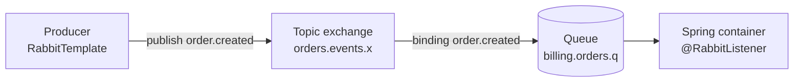
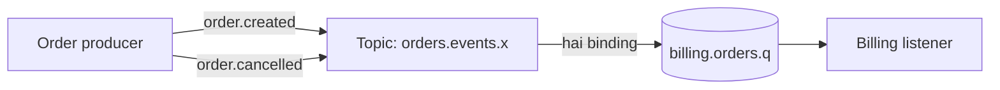
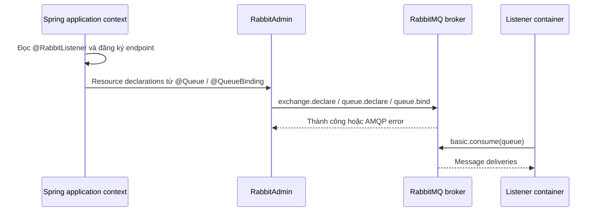

# Khai báo queues, queuesToDeclare và bindings

Khi viết một consumer Spring AMQP, lập trình viên thường bắt đầu bằng `@RabbitListener(queues = "orders.q")`. Tuy nhiên, annotation này **không mặc nhiên tạo queue trên RabbitMQ**. Spring AMQP còn cung cấp `queuesToDeclare` để mô tả queue cần khai báo và `bindings` để mô tả trọn bộ queue–exchange–binding ngay tại listener. Ba lựa chọn có mục đích, quyền sở hữu tài nguyên và tác động triển khai rất khác nhau.

Bài học thuộc chương **Listener khai báo** của module **SPRING_AMQP**. Trong lộ trình tích hợp RabbitMQ với `RabbitTemplate`, `@RabbitListener`, exchange, queue và binding, việc chọn đúng cách khai báo giúp consumer khởi động ổn định, nhận đúng message, tránh tạo tài nguyên sai và đặt nền tảng cho ACK, retry, dead-letter, giao dịch và quan sát hệ thống bất đồng bộ đáng tin cậy.

Sau bài học, bạn có thể:

- Phân biệt chính xác ba thuộc tính `queues`, `queuesToDeclare` và `bindings` của `@RabbitListener`.
- Chọn cách phù hợp khi queue được tạo bởi đội vận hành, khi listener sở hữu queue, hoặc khi cần routing qua exchange riêng.
- Khai báo `@Queue`, `@Exchange`, `@QueueBinding`, `@Argument` và cấu hình bằng properties.
- Giải thích vai trò của `RabbitAdmin` và lý do listener vẫn có thể báo thiếu queue hoặc sai thuộc tính.
- Thiết kế nhiều listener/queue mà không nhầm work queue với publish–subscribe.
- Kiểm tra topology thực tế, xử lý lỗi declaration và xây dựng bài test routing.

> **Giả định:** Ví dụ dùng Java 17+, Spring Boot 3.x với dependency `spring-boot-starter-amqp` và RabbitMQ dùng AMQP 0-9-1. Các annotation nằm trong `org.springframework.amqp.rabbit.annotation`, còn các kiểu `Queue`, `Exchange`, `Binding` dạng đối tượng Java nằm trong `org.springframework.amqp.core`. Đối chiếu API theo bản Spring AMQP thực tế trước khi dùng với dòng phiên bản khác.

## 1. Một listener cần hai thứ: nguồn message và topology phù hợp

Khi producer gọi:

```java
rabbitTemplate.convertAndSend(
        "orders.events.x", "order.created", "O-204");
```

RabbitMQ sẽ nhận message tại exchange `orders.events.x`, kiểm tra binding phù hợp với routing key `order.created`, chuyển message vào queue, rồi giao message từ queue đó cho listener.



Để listener nhận được event, cần phân biệt:

1. **Consumer registration:** Spring tạo listener endpoint/container và đăng ký consumer đọc queue.
2. **Resource declaration:** Queue, exchange và binding tồn tại trên broker với tên và thuộc tính tương thích.

`@RabbitListener` là điểm bắt đầu của consumer, nhưng một số thuộc tính của nó cũng có thể **yêu cầu khai báo tài nguyên**. Việc broker có thực sự tạo tài nguyên hay không phụ thuộc `RabbitAdmin`, kết nối, quyền truy cập, tính tương đương của declaration và cấu hình container.

### 1.1. Bảng quyết định nhanh

| Thuộc tính `@RabbitListener` | Nói với Spring điều gì? | Có yêu cầu khai báo tài nguyên? | Khi nào dùng? |
| --- | --- | --- | --- |
| `queues` | Tiêu thụ **queue có tên đã biết**. | **Không tự tạo queue** chỉ vì nêu tên trong `queues`. | Queue được provisioning trước, hoặc được khai báo ở `@Bean`/nơi khác. |
| `queuesToDeclare` | Tiêu thụ và mô tả **queue cần declare** bằng `@Queue`. | **Có**: queue declaration. | Listener sở hữu queue, publish trực tiếp qua default exchange hoặc binding được thiết lập riêng. |
| `bindings` | Tiêu thụ và khai báo **queue + exchange + binding** bằng `@QueueBinding`. | **Có**: topology tương ứng. | Listener cần nhận message qua custom exchange với routing key/pattern. |

**Ba lựa chọn này là các cách chỉ định queue mang tính loại trừ cho một listener.** Không đặt đồng thời `queues`, `queuesToDeclare` và `bindings` trong **cùng một `@RabbitListener`**. Muốn kết hợp nhiều đối tượng khai báo, hãy chọn một hình thức phù hợp hoặc tách phần topology ra các bean cấu hình.

## 2. `queues`: chỉ định tên queue để tiêu thụ

Ví dụ đơn giản nhất:

```java
import org.springframework.amqp.rabbit.annotation.RabbitListener;
import org.springframework.stereotype.Component;

@Component
public class PreProvisionedOrderListener {

    @RabbitListener(queues = "ops.orders.q")
    public void receive(String orderId) {
        System.out.println("Đã nhận đơn " + orderId);
    }
}
```

Ở đây Spring sẽ tạo listener container để nhận từ `ops.orders.q`. Nhưng bản thân thuộc tính `queues` **chỉ là tên queue**, không nói broker phải tạo queue với `durable=true`, `exclusive=false` hay có binding nào.

Nếu queue chưa tồn tại:

- Container có thể phát sinh lỗi khi kiểm tra/khởi chạy consumer và có cơ chế thử lại hoặc dừng, tùy `missingQueuesFatal`, recovery settings và phiên bản.
- Nếu `RabbitAdmin` chưa có bean tài nguyên tương ứng để declare, chờ/retry không tự biến chuỗi tên queue thành một queue hợp lệ.
- Việc queue xuất hiện sau đó do provisioning bên ngoài có thể cho phép container phục hồi, nhưng phải xác minh chính sách retry/auto recovery thực tế.

### 2.1. Ai tạo queue cho `queues`?

Ba tình huống thông dụng:

1. **Platform/operations provisioning:** queue/exchange/binding được tạo bằng RabbitMQ Management UI, `rabbitmqadmin`, Terraform hoặc hệ thống quản trị khác.
2. **Ứng dụng khai báo bằng `@Bean`:** Spring context có bean `org.springframework.amqp.core.Queue` và `RabbitAdmin` thực thi declare.
3. **Ứng dụng khác khai báo cùng topology:** có thể hoạt động, nhưng cần hợp đồng đồng nhất và người sở hữu thay đổi rõ ràng.

Ví dụ một queue được khai báo bằng bean, rồi listener tham chiếu đến tên queue đó:

```java
import org.springframework.amqp.core.Queue;
import org.springframework.amqp.core.QueueBuilder;
import org.springframework.context.annotation.Bean;
import org.springframework.context.annotation.Configuration;

@Configuration
class ExistingQueueConfig {
    @Bean
    Queue opsOrdersQueue() {
        return QueueBuilder.durable("ops.orders.q").build();
    }
}
```

`@Bean Queue` và `@RabbitListener(queues = "ops.orders.q")` là **hai trách nhiệm khác nhau**. Bean mô tả tài nguyên cần declare; annotation listener chỉ định nguồn tiêu thụ. Nếu auto-declaration bị tắt hoặc admin thiếu quyền, có bean cũng chưa bảo đảm queue đã được tạo trên broker.

### 2.2. Một listener có thể đọc nhiều queue

```java
@RabbitListener(queues = {"ops.orders.created.q", "ops.orders.cancelled.q"})
public void handleOrderMessage(String payload) {
    System.out.println(payload);
}
```

Spring tạo container tiêu thụ từ **cả hai queue**; điều này không tự tạo queue hay binding. Vì một method xử lý cả hai, hai queue nên có payload contract tương thích hoặc method phải nhận thêm header/metadata để phân biệt.

Nếu muốn mỗi queue dùng error handling, concurrency hoặc message converter khác nhau, tạo listener/factory riêng thường rõ ràng hơn.

### 2.3. Tên queue có thể lấy từ cấu hình

```yaml
app:
  rabbit:
    ops-queue: ops.orders.q
```

```java
@RabbitListener(queues = "${app.rabbit.ops-queue}")
public void handleConfiguredQueue(String payload) {
    System.out.println(payload);
}
```

Đây là property placeholder được Spring resolve khi tạo endpoint. Thay đổi property làm listener đọc **tên queue khác**; không tự đảm bảo queue mới tồn tại hoặc có binding hợp lệ.

Khi queue đã là bean Spring:

```java
@RabbitListener(queues = "#{@opsOrdersQueue.name}")
public void handleBeanQueue(String payload) {
    System.out.println(payload);
}
```

Đoạn ví dụ này minh họa cách resolve tên queue qua Spring Expression Language (SpEL) và bean `opsOrdersQueue`. **Không đăng ký đồng thời cả ba listener minh họa vào cùng một queue trong lab** nếu mục tiêu là mỗi listener đều nhận cùng message: các consumer cùng một queue sẽ cạnh tranh delivery.

## 3. `queuesToDeclare`: listener yêu cầu khai báo queue

Khi một listener sở hữu hàng đợi riêng của mình, có thể mô tả nó ngay tại annotation bằng `@Queue`:

```java
import org.springframework.amqp.rabbit.annotation.Queue;
import org.springframework.amqp.rabbit.annotation.RabbitListener;
import org.springframework.stereotype.Component;

@Component
public class EmailCommandListener {
    @RabbitListener(
            queuesToDeclare = @Queue(
                    value = "emails.commands.q",
                    durable = "true"))
    public void sendEmail(String emailJobId) {
        System.out.println("Gửi email cho job " + emailJobId);
    }
}
```

Đoạn annotation trên có hai tác dụng:

- Yêu cầu khai báo queue tên `emails.commands.q` với thuộc tính đã mô tả.
- Tạo consumer đọc từ `emails.commands.q` sau khi hạ tầng cần thiết sẵn sàng.

**Quan trọng:** `queuesToDeclare` không tạo một custom exchange + binding cho queue đó. RabbitMQ có **default exchange** tên `""` và binding ngầm từ default exchange đến mỗi queue theo routing key là tên queue. Vì vậy producer có thể gửi:

```java
rabbitTemplate.convertAndSend(
        "", "emails.commands.q", "EMAIL-001");
```

RabbitMQ định tuyến vào `emails.commands.q` nhờ default exchange. Nếu producer gửi tới `emails.commands.x` thay vì `""`, **chỉ `queuesToDeclare` sẽ không tạo binding cho custom exchange đó**. Bạn phải khai báo binding riêng hoặc dùng `bindings`.

### 3.1. Khai báo nhiều queue bằng `queuesToDeclare`

```java
@RabbitListener(queuesToDeclare = {
        @Queue(value = "emails.high.q", durable = "true"),
        @Queue(value = "emails.normal.q", durable = "true")
})
public void handleEmail(String jobId) {
    System.out.println("Nhận email job " + jobId);
}
```

Listener tiêu thụ cả hai queue. Nếu có nhiều worker cùng đọc `emails.high.q`, chúng chia nhau xử lý những message trong queue đó; không phải mỗi worker đều được gửi bản sao.

### 3.2. `@Queue` có tên và queue tạm không tên

Đối với queue có tên ổn định, hãy ghi rõ vòng đời:

```java
@RabbitListener(queuesToDeclare = @Queue(
        value = "notifications.work.q",
        durable = "true",
        exclusive = "false",
        autoDelete = "false"))
public void processNotification(String payload) {
    // Công việc cần giữ queue qua thời gian.
}
```

Với queue tạm thời, annotation `@Queue` **không đặt tên** có thể dẫn đến tạo queue tên sinh tự động, thường non-durable, exclusive và auto-delete:

```java
@RabbitListener(queuesToDeclare = @Queue)
public void consumeTemporarySubscription(String event) {
    System.out.println(event);
}
```

Queue sinh tên tự động phù hợp subscription tạm, không phù hợp backlog cần phục hồi theo tên cố định. **Đừng giả định một queue tạm sẽ nhận được sự kiện từ một custom exchange** khi chưa khai báo binding. Với pub–sub, thường dùng `bindings` và một `@Queue` vô danh cùng fanout exchange.

### 3.3. Queue arguments ngay trong annotation

`@Queue` hỗ trợ `arguments`, chẳng hạn khi cần khai báo queue type:

```java
import org.springframework.amqp.rabbit.annotation.Argument;
import org.springframework.amqp.rabbit.annotation.Queue;
import org.springframework.amqp.rabbit.annotation.RabbitListener;

@RabbitListener(queuesToDeclare = @Queue(
        value = "payments.commands.q",
        durable = "true",
        arguments = @Argument(
                name = "x-queue-type",
                value = "quorum")))
public void handlePayment(String paymentId) {
    // Xử lý idempotent theo paymentId.
}
```

`x-queue-type=quorum` là thuộc tính cấu trúc của queue, **không thể đổi loại một queue cùng tên đã tồn tại** bằng cách sửa annotation rồi restart. Queue type, durability và các argument được broker so sánh khi declare; khác biệt có thể dẫn đến `PRECONDITION_FAILED`.

TTL hoặc DLX có thể khai báo bằng `@Argument`, ví dụ:

```java
@Argument(
        name = "x-message-ttl",
        value = "60000",
        type = "java.lang.Integer")
```

Đây chỉ là **một phần tử `@Argument`**, chưa phải một annotation listener hoàn chỉnh. Với những tùy chọn như TTL, giới hạn backlog hoặc DLX cần đổi ở runtime, cân nhắc **RabbitMQ policies** thay vì hard-code `x-*` trong nhiều consumer: client-provided arguments có thể chi phối policy và gây khó khi sửa queue đang tồn tại.

## 4. `bindings`: khai báo queue, exchange và đường định tuyến

Nếu producer gửi vào **exchange có tên riêng**, một queue chưa đủ: broker phải có binding từ exchange tới queue. `@RabbitListener(bindings = ...)` cho phép mô tả toàn bộ quan hệ này.

### 4.1. Ví dụ topic exchange nhận hai routing key

```java
import org.springframework.amqp.core.ExchangeTypes;
import org.springframework.amqp.rabbit.annotation.Exchange;
import org.springframework.amqp.rabbit.annotation.Queue;
import org.springframework.amqp.rabbit.annotation.QueueBinding;
import org.springframework.amqp.rabbit.annotation.RabbitListener;
import org.springframework.stereotype.Component;

@Component
public class BillingOrderEventListener {
    @RabbitListener(bindings = @QueueBinding(
            value = @Queue(
                    value = "billing.orders.q",
                    durable = "true"),
            exchange = @Exchange(
                    value = "orders.events.x",
                    type = ExchangeTypes.TOPIC,
                    durable = "true"),
            key = {"order.created", "order.cancelled"}))
    public void handle(String eventPayload) {
        System.out.println("Billing nhận event " + eventPayload);
    }
}
```

Annotation yêu cầu khai báo:

1. Queue `billing.orders.q` là durable.
2. Topic exchange `orders.events.x` là durable.
3. Hai binding từ exchange đến queue, với key `order.created` và `order.cancelled`.
4. Listener tiêu thụ **queue `billing.orders.q`**, không “nghe trực tiếp” exchange.



Producer:

```java
import org.springframework.amqp.rabbit.core.RabbitTemplate;
import org.springframework.stereotype.Service;

@Service
public class OrderPublisher {
    private final RabbitTemplate rabbitTemplate;

    public OrderPublisher(RabbitTemplate rabbitTemplate) {
        this.rabbitTemplate = rabbitTemplate;
    }

    public void publishCreated(String orderId) {
        rabbitTemplate.convertAndSend(
                "orders.events.x", "order.created", orderId);
    }

    public void publishCancelled(String orderId) {
        rabbitTemplate.convertAndSend(
                "orders.events.x", "order.cancelled", orderId);
    }
}
```

Vì ví dụ gửi `String` nên không cần ép người học thêm JSON converter. Khi gửi một object JSON, producer/consumer phải thống nhất schema, content type và converter; lỗi chuyển đổi có thể xảy ra trước khi thân method listener chạy.

### 4.2. Direct, topic và fanout khác nhau trong `@Exchange`

| Loại exchange | Ví dụ khai báo | Quy tắc routing | Cần `key` trong `@QueueBinding`? |
| --- | --- | --- | --- |
| Direct | `type = ExchangeTypes.DIRECT` | Binding key khớp chính xác routing key. | Có nếu dùng key cụ thể. |
| Topic | `type = ExchangeTypes.TOPIC` | `*` khớp một từ; `#` khớp không hoặc nhiều từ, phân cách bởi `.`. | Có, thường là routing key/pattern. |
| Fanout | `type = ExchangeTypes.FANOUT` | Gửi tới tất cả queue được bind, bỏ qua routing key. | Không cần. |
| Headers | `type = ExchangeTypes.HEADERS` | Dựa trên binding headers/arguments. | Thường dùng binding arguments thay vì routing key. |

Ví dụ topic pattern cho một subscriber quan tâm mọi event đơn hàng:

```java
@RabbitListener(bindings = @QueueBinding(
        value = @Queue(
                value = "analytics.orders.q",
                durable = "true"),
        exchange = @Exchange(
                value = "orders.events.x",
                type = ExchangeTypes.TOPIC,
                durable = "true"),
        key = "order.#"))
public void collectOrderEvent(String payload) {
    System.out.println("Analytics: " + payload);
}
```

Trong một hệ thống nhiều service, Billing và Analytics có thể khai báo hai queue khác nhau cùng bind tới `orders.events.x`; **mỗi queue** có backlog độc lập. Nếu hai service dùng chung `billing.orders.q`, chúng trở thành hai consumer cạnh tranh và **không** cùng nhận mọi event.

### 4.3. Fanout exchange với queue subscription tạm

Một subscriber tạm thời có thể tạo một queue vô danh được bind đến fanout exchange:

```java
@RabbitListener(bindings = @QueueBinding(
        value = @Queue,
        exchange = @Exchange(
                value = "system.broadcast.x",
                type = ExchangeTypes.FANOUT,
                durable = "true")))
public void onBroadcast(String message) {
    System.out.println("Nhận broadcast: " + message);
}
```

Queue vô danh thường là non-durable, exclusive và auto-delete, thích hợp subscription theo vòng đời ứng dụng. Nó **không** giữ lịch sử các event đã phát trước khi binding được tạo và không phù hợp khi cần khôi phục backlog sau khi subscriber offline.

Nếu nhiều instance đều cần nhận broadcast độc lập, mỗi instance có thể sở hữu queue tạm riêng. Nếu cần nhóm instance **cùng chia tải công việc** và giữ backlog qua restart, hãy dùng **một queue durable đặt tên cố định** cho nhóm consumer đó.

### 4.4. Nhiều `@QueueBinding` trên cùng listener

Một listener có thể đăng ký nhiều khai báo binding:

```java
@RabbitListener(bindings = {
        @QueueBinding(
                value = @Queue(
                        value = "auditing.events.q",
                        durable = "true"),
                exchange = @Exchange(
                        value = "orders.events.x",
                        type = ExchangeTypes.TOPIC,
                        durable = "true"),
                key = "order.#"),
        @QueueBinding(
                value = @Queue(
                        value = "auditing.events.q",
                        durable = "true"),
                exchange = @Exchange(
                        value = "payments.events.x",
                        type = ExchangeTypes.TOPIC,
                        durable = "true"),
                key = "payment.#")
})
public void audit(String payload) {
    System.out.println(payload);
}
```

Hai `@QueueBinding` cùng tham chiếu một queue tên `auditing.events.q` với thuộc tính **tương đương**, cho phép queue này nhận message từ hai exchange. Người học cần thống nhất payload schema: một method `audit(String)` nhận cả sự kiện đơn hàng và thanh toán sẽ phải phân biệt message type/routing key hoặc dùng envelope chung khi xử lý nghiệp vụ.

Không sao chép mẫu này thành nhiều khai báo **cùng tên queue nhưng khác durable, exclusive, auto-delete hoặc arguments**; broker có thể từ chối vì không tương đương.

### 4.5. Queue arguments và binding arguments

`@QueueBinding` chứa ba nhóm metadata:

- `value = @Queue(...)`: thuộc tính của queue đích và queue arguments.
- `exchange = @Exchange(...)`: tên/loại/durability của exchange.
- `key` và `arguments` (nếu loại binding cần): điều kiện nối exchange với queue.

Ví dụ khai báo queue nhận dead-letter:

```java
@RabbitListener(bindings = @QueueBinding(
        value = @Queue(
                value = "invoices.commands.q",
                durable = "true",
                arguments = {
                        @Argument(
                                name = "x-dead-letter-exchange",
                                value = "invoices.dlx"),
                        @Argument(
                                name = "x-dead-letter-routing-key",
                                value = "invoice.failed")
                }),
        exchange = @Exchange(
                value = "invoices.commands.x",
                type = ExchangeTypes.DIRECT,
                durable = "true"),
        key = "invoice.generate"))
public void generateInvoice(String invoiceId) {
    // Ví dụ tập trung vào declaration, không trình bày retry chi tiết.
}
```

Khai báo `x-dead-letter-exchange` **chưa** tạo exchange `invoices.dlx`, DLQ hoặc binding dead-letter đích. Phải provision những tài nguyên ấy riêng. Ngoài ra, listener exception không mặc nhiên vào DLQ: việc dead-letter phụ thuộc chính sách reject/requeue/retry của container và broker.

**Lựa chọn production:** Nếu đội vận hành cần thay DLX/TTL thường xuyên, hãy ưu tiên RabbitMQ policy khi queue type hỗ trợ. Một argument `x-*` viết cứng trong listener có thể làm việc redeclare và thay policy phức tạp hơn.

## 5. `RabbitAdmin` làm gì với các khai báo trong annotation?

Các khai báo `queuesToDeclare` và `bindings` tạo **yêu cầu khai báo tài nguyên** từ cấu hình listener. Để chúng tồn tại trên RabbitMQ, Spring AMQP cần infrastructure như `RabbitAdmin` và một kết nối có quyền thích hợp.



Đây là sơ đồ logic, không phải cam kết thứ tự từng callback nội bộ của mọi bản Spring. Một bean `@RabbitListener` được Spring scan thành công **không chứng minh** broker đã có đủ exchange, queue và binding.

### 5.1. Các điều kiện để khai báo thành công

1. Ứng dụng có kết nối tới **đúng RabbitMQ virtual host**.
2. `RabbitAdmin` hoặc cơ chế auto-declaration tương ứng đang được bật và dùng đúng connection factory.
3. Tài khoản có quyền **configure** cho tài nguyên cần declare, cùng quyền read/write phù hợp với consume/publish và binding.
4. Nếu tài nguyên đã tồn tại, loại/thuộc tính/arguments không xung đột.
5. Việc khai báo exchange, queue và binding đích thực sự thành công; không có lỗi channel `PRECONDITION_FAILED` hoặc `ACCESS_REFUSED`.

Spring Boot với starter AMQP thường tự cấu hình `RabbitAdmin` khi điều kiện auto-configuration được đáp ứng. Trong ứng dụng có nhiều connection factory, nhiều admin hoặc cấu hình tắt auto-declaration, cần chỉ rõ infrastructure chịu trách nhiệm; đừng giả định rằng annotation sẽ tạo tài nguyên trên **mọi broker**.

### 5.2. Tính lặp lại và xung đột declaration

RabbitMQ cho phép declare lại queue/exchange đã tồn tại khi thuộc tính **tương đương**. Đó là lý do việc khởi động lại ứng dụng với cùng cấu hình thường an toàn.

Nếu `billing.orders.q` ban đầu là durable classic queue nhưng code mới khai báo cùng tên là quorum queue, RabbitMQ có thể trả lỗi:

```text
PRECONDITION_FAILED - inequivalent arg 'x-queue-type'
```

Đây **không** phải yêu cầu broker tự nâng cấp queue. Không xóa queue production chỉ để vượt lỗi: có thể mất backlog và gián đoạn consumer. Hãy lập kế hoạch tạo queue mới, chuyển routing, xử lý dữ liệu cũ và chỉ gỡ tài nguyên cũ sau khi đã xác minh.

### 5.3. Ai sở hữu topology?

| Mô hình | Cách thường nên chọn | Lý do |
| --- | --- | --- |
| Queue/exchange do platform provisioning | `queues` | Listener không cố thay thuộc tính tài nguyên do bên khác sở hữu. |
| Queue công việc nội bộ của một service | `queuesToDeclare` hoặc `@Bean Queue` | Service quản lý tên và lifecycle queue. |
| Consumer sở hữu queue và binding tới domain event exchange | `bindings` | Toàn bộ routing cho subscriber được mô tả gần listener. |
| Topology chia sẻ bởi nhiều listener/service | Bean `Queue`/`Exchange`/`Binding` hoặc provisioning tập trung | Giảm trùng lặp, dễ review migration và kiểm soát quyền. |
| Subscription tạm cho fanout broadcast | `bindings` với queue vô danh | Mỗi instance có queue riêng, nhận các broadcast trong vòng đời kết nối. |

Đừng để producer và nhiều consumer độc lập khai báo cùng một exchange với các `type` khác nhau (direct/topic/fanout) hoặc khác durability. Nếu tất cả khai báo tương đương thì có thể chạy, nhưng việc **ai phê duyệt thay đổi topology** vẫn phải rõ ràng.

## 6. Property placeholders, SpEL và cấu hình theo môi trường

Nhúng thẳng `dev.orders.q` hoặc `prod.orders.q` vào code dễ gây nhầm môi trường. Có thể đưa tên tài nguyên và routing key vào Spring configuration:

```yaml
app:
  rabbit:
    billing-queue: billing.orders.q
    order-exchange: orders.events.x
    created-key: order.created

spring:
  rabbitmq:
    host: localhost
    port: 5672
    virtual-host: /
```

Trong annotation, các chuỗi metadata có thể tham chiếu Spring property placeholder:

```java
@RabbitListener(
        id = "billingOrdersListener",
        bindings = @QueueBinding(
                value = @Queue(
                        value = "${app.rabbit.billing-queue}",
                        durable = "true"),
                exchange = @Exchange(
                        value = "${app.rabbit.order-exchange}",
                        type = ExchangeTypes.TOPIC,
                        durable = "true"),
                key = "${app.rabbit.created-key}"))
public void consumeConfiguredEvent(String orderId) {
    System.out.println("Đơn hàng: " + orderId);
}
```

Đây là **một phương án thay thế** cho listener Billing ở mục 4.1: nếu đăng ký cả hai vào cùng một queue, chúng trở thành hai consumer cạnh tranh. Trong thực tế, tên exchange, queue và routing key phải được thống nhất giữa producer và consumer, không chỉ là giá trị property cục bộ.

Đối với `queues` hoặc `queuesToDeclare` cũng có thể dùng placeholder:

```java
@RabbitListener(queues = "${app.rabbit.billing-queue}")
public void consumeExisting(String orderId) {
    // Queue phải được tạo ở nơi khác.
}

@RabbitListener(queuesToDeclare = @Queue(
        value = "${app.rabbit.billing-queue}",
        durable = "true"))
public void consumeDeclaringQueue(String orderId) {
    // Chỉ declare queue, không tự tạo binding cho orders.events.x.
}
```

**Các snippet trên là các phương án độc lập**, không phải cấu hình khuyến nghị dùng cùng lúc. Property placeholders và SpEL được resolve khi Spring đăng ký endpoint/declaration; sửa cấu hình bên ngoài không có nghĩa listener đang chạy tự đổi queue lập tức. Nếu đổi tên queue, hãy kiểm tra lại lifecycle, binding, backlog và khởi động lại/điều chỉnh endpoint theo quy trình.

### 6.1. Khi dùng SpEL để tham chiếu bean

Với `queues`, có thể lấy tên từ một bean `Queue` do application context quản lý:

```java
@RabbitListener(queues = "#{@opsOrdersQueue.name}")
public void consumeQueueBean(String payload) {
    System.out.println(payload);
}
```

`@opsOrdersQueue` trong SpEL chỉ **bean Spring** tên `opsOrdersQueue`, không trực tiếp là queue trên broker. Spring resolve bean để lấy tên; `RabbitAdmin` vẫn cần declare nếu queue chưa tồn tại và ứng dụng sở hữu topology.

### 6.2. Không dùng annotation để tạo queue theo từng message

`@RabbitListener` được Spring xử lý khi đăng ký container, không phải mỗi lần event đến. Việc gọi API gửi message **không chạy lại** `@QueueBinding` để tạo queue mới. Nếu bài toán cần queue động theo khách hàng hoặc request, đó là bài toán provisioning/lifecycle riêng, cần quota, quyền, TTL, số lượng queue và cơ chế dọn dẹp tài nguyên.

## 7. `@RabbitListener` và cấu hình listener container

Ba thuộc tính đang học quyết định **queue nào được nghe và cần declare gì**; chúng không thay thế các tùy chọn vận hành listener container.

```java
@RabbitListener(
        id = "emailJobsConsumer",
        queues = "emails.commands.q",
        concurrency = "2-4",
        autoStartup = "true")
public void consumeEmailJob(String jobId) {
    // Xử lý job, đảm bảo idempotency khi delivery bị lặp.
}
```

`concurrency = "2-4"` minh họa min–max consumer cho **SimpleRabbitListenerContainerFactory**; cấu hình direct listener container có thể khác. Có thể chỉ định `containerFactory` để chọn factory riêng có retry, converter, ACK, concurrency hoặc các đặc tính khác.

| Nhóm cấu hình | Ví dụ | Tác động |
| --- | --- | --- |
| Nguồn tiêu thụ | `queues`, `queuesToDeclare`, `bindings` | Queue và topology. |
| Vòng đời listener | `id`, `autoStartup` | Định danh và thời điểm start/stop consumer container. |
| Năng lực xử lý | `concurrency`, prefetch qua factory/Boot properties | Số consumer và số message chưa ACK. |
| Chuyển đổi dữ liệu | `MessageConverter` của factory | Body AMQP thành DTO Java; có thể lỗi trước handler. |
| Xác nhận giao nhận | `AcknowledgeMode.AUTO/MANUAL/NONE` | Khi nào broker nhận ACK/NACK; khác queue declaration. |
| Lỗi, retry, DLQ | Error handler, retry advice, reject/requeue, DLX | Hành vi khi conversion hoặc business processing thất bại. |
| Giao dịch | Transaction config phù hợp | Ảnh hưởng thời điểm commit/ACK; không tạo transaction phân tán DB–broker. |

Ví dụ cấu hình Spring Boot cho simple listener container:

```yaml
spring:
  rabbitmq:
    listener:
      simple:
        acknowledge-mode: auto
        concurrency: 2
        max-concurrency: 4
        prefetch: 10
```

`AcknowledgeMode.AUTO` nghĩa là **Spring container chủ động ACK khi listener xử lý thành công theo chính sách**, không phải AMQP broker auto-ack. Nếu listener ném exception, container có thể reject/requeue/retry tùy cấu hình; **khai báo queue có DLX không bảo đảm mọi exception tự vào DLQ**.

### 7.1. Quản lý container bằng listener ID

Có thể dùng `RabbitListenerEndpointRegistry` để tra cứu/start/stop container:

```java
import org.springframework.amqp.rabbit.listener.RabbitListenerEndpointRegistry;
import org.springframework.stereotype.Component;

@Component
class ListenerOperations {
    private final RabbitListenerEndpointRegistry registry;

    ListenerOperations(RabbitListenerEndpointRegistry registry) {
        this.registry = registry;
    }

    public void pauseEmailConsumer() {
        var container = registry.getListenerContainer("emailJobsConsumer");
        if (container != null) {
            container.stop();
        }
    }

    public void resumeEmailConsumer() {
        var container = registry.getListenerContainer("emailJobsConsumer");
        if (container != null) {
            container.start();
        }
    }
}
```

Dừng listener **không xóa durable queue trên broker**. Message có thể tiếp tục tích lũy nếu producer vẫn publish và queue/binding còn hoạt động. Stop/start consumer cũng không tương đương với việc đổi `queues` sang một queue mới.

### 7.2. Queue tồn tại không đồng nghĩa listener đang khỏe

Cần phân biệt ba trạng thái: **queue tồn tại**, **consumer đã đăng ký**, và **nghiệp vụ xử lý thành công**. Management UI có thể cho thấy queue còn nhưng `consumer count = 0` khi app lỗi hoặc container chưa start. Ngược lại, consumer có thể đang chạy nhưng requeue liên tục message sai schema. Theo dõi cả topology, container và business outcome.

## 8. Vòng đời khai báo: startup, restart và deploy nhiều instance

Một diễn tiến điển hình:

1. Spring khởi tạo context, scan `@RabbitListener`, resolve placeholders/SpEL và tạo endpoint definitions.
2. Infrastructure chuẩn bị listener container và `RabbitAdmin` theo cấu hình.
3. Khi kết nối được dùng, các đối tượng cần declare được gửi đến broker.
4. Listener container bắt đầu tiêu thụ queue; broker giao message và listener xử lý.
5. Sau restart hoặc phục hồi kết nối, framework có thể thực hiện lại declaration/consumer registration theo cơ chế của nó.

Nếu broker đang offline, việc scan annotation thành công không bảo đảm declare và consume thành công tại thời điểm khởi động. Một số listener container có cơ chế retry/recovery, với hành vi tùy Spring AMQP/Boot version.

### 8.1. Nhiều instance cùng khai báo có an toàn không?

**Có thể**, nếu các instance khai báo **tương đương** và đều được phép sử dụng queue. Ví dụ bốn instance của Billing có cùng `@RabbitListener(bindings=...)` với tên queue durable `billing.orders.q`. Broker duy trì một queue, còn nhiều consumer chia nhau xử lý message.

**Không an toàn** nếu:

- Instance mới khai báo queue là quorum trong khi instance cũ còn khai báo classic cùng tên.
- Một instance dùng `durable=true`, instance khác dùng `durable=false`.
- Các instance khai báo exchange khác loại hoặc queue arguments không tương đương.
- Một phiên bản thay routing key/TTL nhưng chưa đồng bộ producer hoặc các nhóm consumer khác.

Với rolling deployment, ưu tiên hợp đồng topology tương thích. Nếu thay một thuộc tính bất biến, tạo queue/exchange mới và xây kế hoạch migration; không ép broker tự biến đổi queue hiện hữu.

### 8.2. Work queue hay publish–subscribe?

| Nhu cầu | Thiết kế phù hợp |
| --- | --- |
| Nhiều worker cùng chức năng chia việc | Nhiều consumer cùng đọc **một queue durable**. |
| Billing và Analytics mỗi bên nhận mọi event | **Mỗi service một queue**; cùng binding tới event exchange. |
| Mỗi instance nhận broadcast trong lúc đang online | Mỗi instance có queue tạm/anonymous bind fanout. |
| Subscriber offline vẫn cần backlog khi quay lại | Queue durable tên cố định, không dựa vào queue tạm auto-delete. |

`@RabbitListener(queues = {"a.q", "b.q"})` không tự sao chép message từ `a.q` sang `b.q`. Tương tự, đăng ký hai listener cùng `queues = "a.q"` không tạo pub–sub: hai listener cạnh tranh nhận message từ một queue.

## 9. Lỗi cấu hình thường gặp

| Triệu chứng | Nguyên nhân thường gặp | Cách kiểm tra/khắc phục |
| --- | --- | --- |
| Listener `queues="x.q"` nhưng broker không có queue | `queues` không tự declare. | Provision queue hoặc dùng `queuesToDeclare`/`@Bean Queue`; xem log admin. |
| Publish vào exchange nhưng `queuesToDeclare` không nhận | Chỉ tạo queue, thiếu binding tới custom exchange. | Chuyển sang `bindings` hoặc khai báo bean `Binding`. |
| `PRECONDITION_FAILED - inequivalent arg` | Queue/exchange đã có với thuộc tính khác. | Đối chiếu queue type, durability, arguments; migration thay vì xóa production queue. |
| `NOT_FOUND - no queue` khi start container | Sai tên, vhost hoặc declaration thất bại. | Xem `RabbitAdmin`, quyền, vhost và missing-queue retry policy. |
| `ACCESS_REFUSED` khi declare/bind | User thiếu configure/read/write permissions. | Kiểm tra quyền trên vhost và owner tài nguyên. |
| Consumer count = 0 dù queue tồn tại | Container chưa start, bị dừng hoặc mất kết nối. | Xem registry ID, log startup, kết nối và health. |
| Confirm ACK nhưng queue không thấy message | Routing khác dự kiến hoặc message đã được tiêu thụ. | Kiểm tra bindings, publisher returns, ready/unacked, consumer logs. |
| Một service không nhận đủ event | Hai service cùng đọc một queue. | Tạo queue riêng cho mỗi nhóm subscriber và bind cùng exchange. |
| Message lỗi không vào DLQ | Listener requeue, DLX đích/binding sai hoặc chưa được provision. | Xem error handler, ACK/NACK, policy và dead-letter routing. |
| Anonymous queue biến mất | Vòng đời exclusive/auto-delete, connection đóng. | Dùng queue durable tên cố định nếu cần backlog. |
| Đổi property queue name nhưng listener vẫn đọc tên cũ | Annotation đã resolve lúc đăng ký endpoint. | Restart/reconfigure endpoint có kiểm soát và chuyển routing. |
| Payload ở hai queue có schema khác nhau | Một method lắng nghe cả hai với converter không tương thích. | Tách listener hoặc dùng envelope/message type rõ ràng. |

### 9.1. Quyền broker tối thiểu

Trên RabbitMQ, user thường cần **configure** trên resource muốn declare, **read** để consume queue và **write** để publish/bind theo quy tắc permissions của broker. Với binding, còn có kiểm tra quyền trên source/destination thích hợp.

Nếu platform provisioning trước:

- Consumer có thể chỉ được cấp quyền đủ để **read** từ queue của mình.
- Chuyển từ `queues` sang `queuesToDeclare` hoặc `bindings` có thể cần quyền **configure/write** bổ sung.
- Đừng cấp tài khoản quyền quản trị rộng chỉ để né lỗi declaration. Hãy chọn đúng chủ sở hữu topology hoặc nhờ platform provision tài nguyên.

## 10. Bài thực hành với RabbitMQ và Spring Boot

Chạy các ví dụ trên RabbitMQ thử nghiệm/vhost riêng; không dùng queue chứa backlog nghiệp vụ. Bài lab này gồm ba tình huống độc lập để thấy sự khác nhau giữa từng thuộc tính.

### 10.1. Bài 1 — `queues` và queue chưa được provision

1. Tạo `@RabbitListener(queues = "lab.existing.q")` với method nhận `String`.
2. **Chưa tạo** `lab.existing.q` trên RabbitMQ. Chạy ứng dụng và quan sát log: listener không thể tiêu thụ thành công một queue chưa có.
3. Provision queue bằng RabbitMQ Management UI hoặc `@Bean Queue` cùng tên và auto-declaration hoạt động.
4. Publish qua default exchange: `convertAndSend("", "lab.existing.q", "hello")`.
5. Quan sát listener nhận message. Giải thích vì sao `queues` không phải queue declaration.

**Điểm cần thu thập:** log container/admin lúc thiếu queue, tên vhost, queue properties, consumer count và số message ready/unacked.

### 10.2. Bài 2 — `queuesToDeclare` tự khai báo queue

Trong một app hoặc cấu hình lab riêng:

```java
@RabbitListener(queuesToDeclare = @Queue(
        value = "lab.email.q",
        durable = "true"))
public void receiveLabEmail(String payload) {
    System.out.println("Email job: " + payload);
}
```

Khởi động ứng dụng, kiểm tra queue `lab.email.q` xuất hiện ở broker. Gửi:

```java
rabbitTemplate.convertAndSend("", "lab.email.q", "EMAIL-42");
```

Xác minh consumer nhận message; sau đó thử publish vào `lab.email.x` (exchange **chưa tạo**) và ghi nhận lỗi tương ứng. Đây là cách chứng minh `queuesToDeclare` không ngầm tạo custom exchange/binding.

### 10.3. Bài 3 — `bindings` tự tạo topology

Sử dụng listener sau trong một lab độc lập:

```java
@RabbitListener(bindings = @QueueBinding(
        value = @Queue(
                value = "lab.billing.q",
                durable = "true"),
        exchange = @Exchange(
                value = "lab.orders.events.x",
                type = ExchangeTypes.TOPIC,
                durable = "true"),
        key = "order.*"))
public void receiveLabOrder(String payload) {
    System.out.println("Billing nhận " + payload);
}
```

Publish từng routing key:

| Routing key | Kỳ vọng có route vào `lab.billing.q`? | Lý do |
| --- | --- | --- |
| `order.created` | Có | `*` khớp một từ. |
| `order.cancelled` | Có | `*` khớp một từ. |
| `order.created.eu` | Không | Pattern chỉ cho phép một từ sau `order.`. |
| `payment.failed` | Không | Prefix không khớp. |

Dùng Management UI để xác minh exchange type là **topic**, queue **durable**, và binding key `order.*`. Nếu listener đang chạy và xử lý ngay, số message ready có thể về 0; hãy xem log listener và delivery metrics thay vì chỉ nhìn queue depth.

### 10.4. Bài 4 — Publish–subscribe với queue riêng

Tạo hai subscriber:

- `lab.billing.q` bind `order.created`.
- `lab.analytics.q` bind `order.#`.

Publish một event `order.created`. Hai queue nhận các bản riêng của event; mỗi bên ACK độc lập. Sau đó tạo **hai instance Billing cùng đọc `lab.billing.q`**: kiểm tra mỗi message của Billing thường chỉ được giao cho một instance, thay vì mọi instance đều nhận bản sao.

### 10.5. Bài 5 — Lỗi khai báo không tương đương

Trong vhost test:

1. Declare `lab.migration.q` là durable classic queue.
2. Đổi declaration **cùng tên** thành quorum queue.
3. Quan sát lỗi `PRECONDITION_FAILED` và mô tả vì sao đây không phải phép nâng queue type.
4. Lập kế hoạch tạo `lab.migration.v2.q`, cập nhật bindings và consumer, xử lý backlog cũ trước khi bỏ queue ban đầu.

Không xóa queue thật để làm biến mất lỗi startup; thao tác xóa có thể làm mất message chưa xử lý.

### 10.6. Bài 6 — Failure trước và sau listener method

Khai báo `bindings` hợp lệ nhưng cho listener nhận DTO không tương thích với JSON được publish. Quan sát lỗi converter có thể xuất hiện **trước khi method được gọi**. Sau đó sửa DTO/converter, xử lý bình thường và kiểm tra ACK.

Tiếp theo, chủ động ném exception từ method listener để kiểm tra retry, requeue và DLX (nếu cấu hình). Ghi rõ sự khác nhau giữa:

- **Listener configuration**: queue/exchange/binding nào được declare và consume?
- **Message conversion**: body/headers có chuyển thành tham số Java được không?
- **Processing reliability**: khi xử lý lỗi, container ACK/NACK/requeue theo chính sách nào?

Đây là ba lớp cần kiểm thử riêng, không nên nhầm một declaration thành công với consumer xử lý đáng tin cậy.

## 11. Kiểm thử topology: cần kiểm chứng gì?

Một unit test gọi trực tiếp method Java **không xác nhận** RabbitMQ đã có queue, exchange và binding. Nên có integration test với broker thật hoặc môi trường RabbitMQ tương đương.

| Tình huống | Bằng chứng cần kiểm tra |
| --- | --- |
| `queues` trỏ queue đã có | Queue tồn tại và listener consumer đăng ký. |
| `queues` trỏ queue không tồn tại | Log container/behavior recovery đúng cấu hình, không âm thầm coi là sẵn sàng. |
| `queuesToDeclare` | Queue được declare đúng tên, durability/arguments. |
| `bindings` | Exchange đúng type/durability, queue tồn tại, binding đúng key. |
| Topic key khớp/không khớp | Message chỉ đến queue dự kiến trong các tình huống test. |
| Hai subscriber độc lập | Mỗi service có queue riêng và nhận bản event phù hợp. |
| Hai consumer cùng queue | Message được chia tải, không sao chép tới mọi instance. |
| Broker restart | Declaration và registration/recovery theo thiết kế. |
| Tên queue từ placeholder | Đúng môi trường/vhost, không trỏ nhầm production. |
| Inequivalent declaration | Test thất bại rõ ràng và không phá hủy queue có dữ liệu. |
| Consumer lỗi | ACK/requeue/retry/DLQ theo config, tách biệt với declaration. |

Ví dụ test kiểm tra queue tồn tại bằng `AmqpAdmin` (giả định test có broker và Spring context):

```java
import static org.junit.jupiter.api.Assertions.assertNotNull;
import org.junit.jupiter.api.Test;
import org.springframework.amqp.core.AmqpAdmin;
import org.springframework.beans.factory.annotation.Autowired;
import org.springframework.boot.test.context.SpringBootTest;

@SpringBootTest
class RabbitTopologyTest {
    @Autowired
    AmqpAdmin admin;

    @Test
    void listenerQueueWasDeclared() {
        assertNotNull(admin.getQueueProperties("lab.billing.q"));
    }
}
```

Test này mới kiểm tra **queue tồn tại**, chưa kiểm chứng exchange type hoặc binding. Cần Management API, một công cụ kiểm tra topology hoặc test publish và nhận trên một queue test **không có listener cạnh tranh** để xác minh routing. Nếu dùng cùng queue với listener đang chạy, message có thể bị consumer lấy ngay trước khi test chủ động `receive`.

## 12. Câu hỏi ôn tập

1. `@RabbitListener(queues = "orders.q")` có tự tạo queue `orders.q` không? Vì sao?
2. Khác biệt thực tế giữa `queuesToDeclare` và `bindings` là gì?
3. Với `queuesToDeclare = @Queue(value = "emails.q", durable = "true")`, producer gửi qua exchange nào mà không cần khai báo binding riêng?
4. Producer gửi vào `orders.events.x` nhưng listener chỉ dùng `queuesToDeclare`: còn thiếu thành phần gì?
5. `@QueueBinding` mô tả những thành phần của RabbitMQ topology?
6. Một fanout exchange có cần binding routing key không? Queue vô danh có phù hợp khi subscriber offline lâu ngày không?
7. Nhiều instance cùng declare một durable queue tên giống nhau có luôn là lỗi không?
8. Nếu hai service cùng cần mọi sự kiện `order.created`, vì sao nên có hai queue?
9. Nếu queue đang là classic, đổi `x-queue-type=quorum` trong annotation có tự chuyển dữ liệu không?
10. `RabbitAdmin` có vai trò gì và vì sao scanner `@RabbitListener` thành công chưa đủ?
11. Spring `AcknowledgeMode.AUTO` có đồng nghĩa RabbitMQ broker auto-ack không?
12. Đặt queue name từ property placeholder có tự động cập nhật listener đang chạy khi sửa property ngoài ứng dụng không?
13. Vì sao tạo test listener trực tiếp gọi method Java không đủ kiểm tra binding?
14. Nếu method listener không bao giờ chạy, làm sao phân biệt queue chưa được declare, lỗi converter và consumer chưa start?

## 13. Tài liệu tham khảo

- [Spring AMQP — Annotation-driven Listener Endpoints](https://docs.spring.io/spring-amqp/reference/amqp/receiving-messages/async-annotation-driven.html): `@RabbitListener`, `queues`, `queuesToDeclare`, `bindings` và `@QueueBinding`.
- [Spring AMQP — Configuring the Broker](https://docs.spring.io/spring-amqp/reference/amqp/broker-configuration.html): `Queue`, `Exchange`, `Binding`, `Declarables` và `RabbitAdmin`.
- [Spring AMQP — Listener Container](https://docs.spring.io/spring-amqp/reference/amqp/receiving-messages/async-consumer.html): vòng đời container, concurrency, prefetch và recovery.
- [Spring AMQP — Listener Endpoint Registry](https://docs.spring.io/spring-amqp/reference/amqp/receiving-messages/async-annotation-driven.html): quản lý listener container bằng ID.
- [Spring Boot — AMQP](https://docs.spring.io/spring-boot/reference/messaging/amqp.html): tự cấu hình template, container, connection factory và application properties.
- [RabbitMQ — Queues](https://www.rabbitmq.com/docs/queues): queue properties, lifecycle và các lỗi khai báo không tương đương.
- [RabbitMQ — Exchanges](https://www.rabbitmq.com/docs/exchanges): direct, topic, fanout, default exchange và binding.
- [RabbitMQ — Consumer Acknowledgements and Publisher Confirms](https://www.rabbitmq.com/docs/confirms): phân biệt nhận message/ACK với xác nhận publish.
- [RabbitMQ — Dead Letter Exchanges](https://www.rabbitmq.com/docs/dlx): dead-letter topology và điều kiện định tuyến message lỗi.

**Ghi nhớ:** `queues` chỉ cho listener biết **đọc queue nào**; `queuesToDeclare` bổ sung **queue declaration**; còn `bindings` mô tả **queue + exchange + binding** để consumer nhận message qua routing. Chọn đúng một cách cho mỗi `@RabbitListener`, quản lý tài nguyên bằng `RabbitAdmin` hoặc provisioning phù hợp, và luôn kiểm tra topology thực trên broker. Khai báo thành công mới là điều kiện đầu tiên; message conversion, ACK/NACK, retry, dead-letter, giao dịch và observability vẫn cần được thiết kế và kiểm thử riêng.
