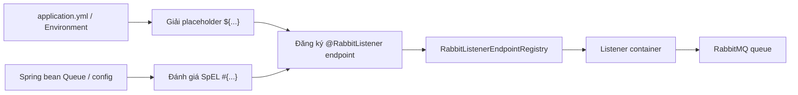
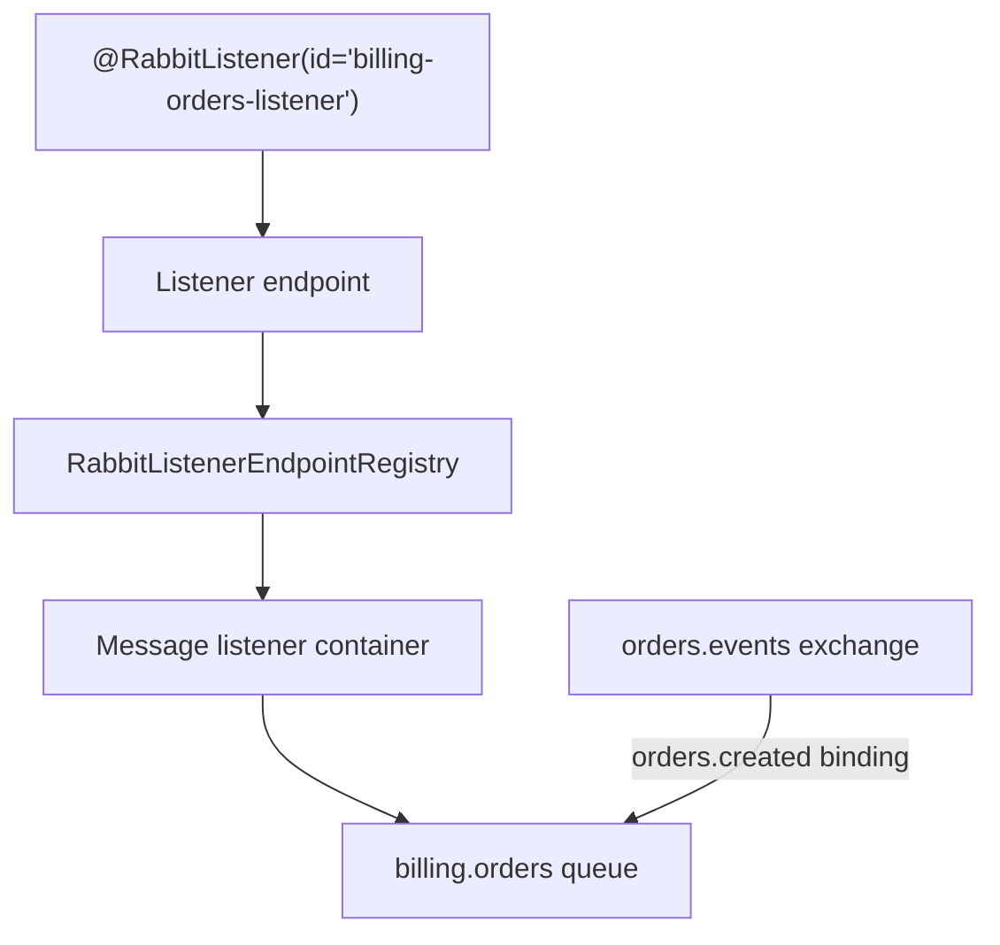
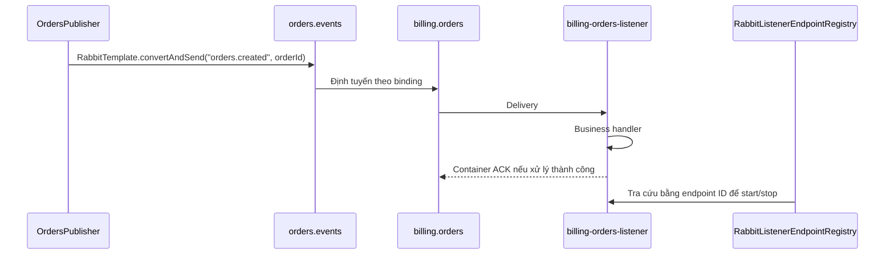

# SpEL, property placeholder và định danh endpoint

## 1. Bối cảnh: một listener cần biết đọc queue nào và được quản lý ra sao

Trong **SPRING_AMQP**, `@RabbitListener` giúp biến một phương thức Java thành nơi nhận message từ RabbitMQ. Ứng dụng có thể dùng `RabbitTemplate` để publish sự kiện qua exchange, queue và binding; phía nhận cấu hình một listener container để đọc queue, chuyển đổi body, gọi handler, xử lý ACK/NACK, retry hoặc dead-letter.

Vấn đề xuất hiện khi cùng một ứng dụng chạy ở nhiều môi trường:

- Local dùng queue `billing.orders.local`, còn production dùng `billing.orders`.
- Một queue được khai báo bằng Spring bean; tên queue được đặt trong configuration thay vì chuỗi cứng.
- Người vận hành cần **dừng hoặc khởi động lại một listener cụ thể** mà không tác động các listener khác.
- Log, metrics và các thao tác qua `RabbitListenerEndpointRegistry` cần **định danh endpoint ổn định**.
- Một số thuộc tính listener như tên queue, concurrency, auto-startup cần lấy từ cấu hình.

Spring hỗ trợ ba công cụ bổ sung cho nhau:

1. **Property placeholder** — cú pháp `${...}`: lấy giá trị từ Spring `Environment` như `application.yml`, environment variables hoặc hệ thống cấu hình đã tích hợp.
2. **SpEL (Spring Expression Language)** — cú pháp `#{...}`: đánh giá biểu thức để truy cập Spring bean, property hoặc tính toán một giá trị phù hợp.
3. **Endpoint ID (`@RabbitListener.id`)**: định danh một listener endpoint được tạo từ annotation để registry quản lý container tương ứng.

Bài này thuộc chương **Listener khai báo**. Sau bài, bạn có thể:

- Phân biệt chính xác `${...}` với `#{...}` và khi nào nên dùng từng cách.
- Cấu hình `@RabbitListener(queues = ...)` bằng external properties hoặc SpEL tham chiếu bean `Queue`.
- Đặt `id` rõ ràng, ổn định và duy nhất cho listener endpoint.
- Sử dụng `RabbitListenerEndpointRegistry` để tìm, dừng và khởi động listener theo ID.
- Phân biệt `queues`, `queuesToDeclare` và `bindings` cùng vai trò của `RabbitAdmin`.
- Tránh hiểu nhầm biểu thức annotation là cơ chế định tuyến động **cho từng message**.
- Chẩn đoán startup failure, sai queue/vhost, trùng endpoint ID, lỗi binding và lỗi consumer.

## 2. Phân biệt property placeholder và SpEL

### 2.1. Bảng so sánh nhanh

| Tiêu chí | Property placeholder `${...}` | SpEL `#{...}` |
| --- | --- | --- |
| Nguồn dữ liệu phổ biến | Spring `Environment` / configuration property | Spring BeanFactory, bean và biểu thức |
| Mục đích | Đưa giá trị cấu hình vào annotation | Truy xuất thuộc tính bean hoặc tính giá trị |
| Ví dụ | `${app.messaging.billing.queue}` | `#{@billingQueue.name}` |
| Có thể có default? | Có: `${app.messaging.billing.queue:billing.orders}` | Có biểu thức điều kiện/tính toán theo SpEL |
| Kết quả dùng làm tên queue | Giá trị chuỗi cấu hình | Giá trị biểu thức trả về được Spring chuyển thành tên queue |
| Thời điểm với `@RabbitListener` | Khi Spring xử lý/đăng ký annotation | Khi Spring xử lý/đăng ký annotation |
| Tự thay đổi sau khi app đã chạy? | Không mặc định | Không mặc định |
| Rủi ro điển hình | Thiếu key, gõ nhầm property, trỏ queue sai | Thiếu bean, expression sai, nhầm kiểu trả về, phụ thuộc ngầm |

Hai cú pháp này không tương đương. `${...}` không phải Java string interpolation trong annotation: Spring phải phân giải nó khi tạo bean và đăng ký listener. `#{...}` không phải một chuỗi ngẫu nhiên gửi cho RabbitMQ; Spring đánh giá biểu thức trước khi listener container sử dụng giá trị.

### 2.2. Luồng phân giải khi ứng dụng khởi động



Đây là sơ đồ khái niệm: thời điểm resolution và các bước nội bộ phụ thuộc phiên bản Spring AMQP, nhưng điều quan trọng là **giá trị được giải quyết khi cấu hình endpoint được xử lý**, không phải mỗi khi RabbitMQ giao một delivery.

Nếu sửa file `application.yml` hoặc biến môi trường sau khi container đã khởi tạo, bạn **không thể mặc định** listener sẽ bỏ queue cũ để tự chuyển sang queue mới. Việc thay đổi runtime cần cơ chế quản lý container, cập nhật queue/subscription hoặc tái khởi tạo cấu hình có chủ đích.

## 3. Property placeholder trong @RabbitListener

### 3.1. Ví dụ dùng tên queue từ application.yml

```yaml
app:
  messaging:
    billing:
      queue: billing.orders
      listener-id: billing-orders-listener
      concurrency: 2
      auto-startup: true

spring:
  rabbitmq:
    host: ${RABBITMQ_HOST:localhost}
    port: ${RABBITMQ_PORT:5672}
    username: ${RABBITMQ_USERNAME:guest}
    password: ${RABBITMQ_PASSWORD:guest}
    virtual-host: ${RABBITMQ_VHOST:/}
```

`${RABBITMQ_HOST:localhost}` trong YAML là placeholder Spring cho biến môi trường với default `localhost`. Các key `app.messaging.*` là ví dụ thuộc **cấu hình do ứng dụng tự định nghĩa**, còn `spring.rabbitmq.*` là namespace của Spring Boot.

Một listener:

```java
package example.messaging;

import org.springframework.amqp.rabbit.annotation.RabbitListener;
import org.springframework.stereotype.Component;

@Component
public class BillingOrderListener {

    @RabbitListener(
            id = "${app.messaging.billing.listener-id}",
            queues = "${app.messaging.billing.queue}",
            concurrency = "${app.messaging.billing.concurrency:2}",
            autoStartup = "${app.messaging.billing.auto-startup:true}")
    public void handleCreated(String orderId) {
        // Ví dụ đơn giản; xử lý nghiệp vụ thật cần idempotency.
        System.out.println("Process order " + orderId);
    }
}
```

Sau khi giải cấu hình như trên:

- Endpoint ID được đăng ký là `billing-orders-listener`.
- Listener subscribe queue `billing.orders`.
- Thuộc tính concurrency yêu cầu số consumer tương ứng theo container factory đang dùng.
- `autoStartup=true` cho phép container khởi động tự động theo lifecycle.

**Lưu ý:** `concurrency` có ý nghĩa tùy loại listener container. Với `SimpleRabbitListenerContainerFactory`, chuỗi dạng `"2-4"` có thể biểu diễn khoảng concurrent consumers; `DirectRabbitListenerContainerFactory` có cách tổ chức consumer khác. Một ví dụ dùng `"2"` dễ hiểu hơn khi chưa chọn loại factory và phiên bản cụ thể.

### 3.2. Khi nào dùng giá trị mặc định?

Cú pháp:

```java
@RabbitListener(
        queues = "${app.messaging.billing.queue:billing.orders}",
        id = "${app.messaging.billing.listener-id:billing-orders-listener}")
```

Kết quả vẫn phụ thuộc cấu hình môi trường. Default giúp chạy thử nhanh, nhưng **default tên queue production** có thể nguy hiểm: nếu sai property key ở staging, app có thể âm thầm kết nối đến một queue không mong muốn. Với queue nghiệp vụ quan trọng, nên cân nhắc **bắt buộc có cấu hình**, kiểm tra vhost và đích kết nối trước khi nhận message.

Ví dụ:

```java
@RabbitListener(
        id = "${app.messaging.billing.listener-id}",
        queues = "${app.messaging.billing.queue}")
```

Nếu thiếu property cần thiết, ứng dụng thường lỗi trong giai đoạn tạo context/đăng ký listener, giúp phát hiện cấu hình sai sớm. Tên lỗi và thời điểm chính xác phụ thuộc cấu hình xử lý placeholder của Spring.

### 3.3. Các nguồn của cùng một property

`app.messaging.billing.queue` có thể đến từ:

- `application.yml` hay một profile như `application-prod.yml`.
- Environment variable, thường theo quy tắc tên tương ứng của Spring Boot cho configuration properties.
- Hệ thống quản lý cấu hình hoặc secrets được Spring tích hợp.
- Test properties do test framework cung cấp.

**Precedence** khi nhiều nguồn cùng đặt một key phụ thuộc thứ tự `PropertySource` của Spring Boot/configuration. Không giả định file trong repository luôn có ưu tiên cao nhất khi container production còn nhận environment overrides.

## 4. SpEL tham chiếu bean Queue

### 4.1. Vì sao cần SpEL khi đã có placeholder?

Nếu bạn khai báo một queue bằng bean Spring, tên thật có thể được cấu hình tập trung trong bean đó. Thay vì ghi lại tên queue trong listener, có thể tham chiếu bean:

```java
package example.messaging;

import org.springframework.amqp.core.Queue;
import org.springframework.amqp.core.QueueBuilder;
import org.springframework.beans.factory.annotation.Value;
import org.springframework.context.annotation.Bean;
import org.springframework.context.annotation.Configuration;

@Configuration
public class BillingQueueConfig {
    @Bean
    Queue billingQueue(
            @Value("${app.messaging.billing.queue}") String queueName) {
        return QueueBuilder.durable(queueName).build();
    }
}
```

Sau đó, listener:

```java
package example.messaging;

import org.springframework.amqp.rabbit.annotation.RabbitListener;
import org.springframework.stereotype.Component;

@Component
public class BillingQueueBeanListener {

    @RabbitListener(
            id = "billing-orders-listener",
            queues = "#{@billingQueue.name}")
    public void handle(String orderId) {
        System.out.println("Billing received: " + orderId);
    }
}
```

`#{@billingQueue.name}` nghĩa là:

1. `@billingQueue`: lấy Spring bean tên `billingQueue`.
2. `.name`: đọc property `name`, tương ứng với tên queue.
3. Đưa giá trị thu được vào cấu hình `queues` của listener.

Nếu queue bean được tạo với tên `billing.orders`, listener trỏ đúng queue này.

**Chỉ dùng một trong hai listener ví dụ ở mục 3 và mục 4 trong cùng ứng dụng demo**, vì cả hai đặt endpoint ID giống nhau. Hai phương án minh họa cách cấu hình, không phải hai consumer cần chạy đồng thời trên cùng queue.

### 4.2. Khi nào biểu thức SpEL có ích?

- Một bean `Queue` được định nghĩa và tái sử dụng cho topology.
- Một bean cấu hình chứa tên của nhiều queue, đã kiểm tra hợp lệ.
- Tên queue có được từ logic khởi tạo phù hợp, ví dụ dựa trên môi trường hoặc tenant được xác định lúc startup.
- Bạn cần tránh lặp lại chuỗi tên tài nguyên giữa `@Bean Queue` và `@RabbitListener`.

Ví dụ với bean tra cứu:

```java
package example.messaging;

import org.springframework.beans.factory.annotation.Value;
import org.springframework.stereotype.Component;

@Component("queueCatalog")
public class QueueCatalog {
    private final String billingName;

    public QueueCatalog(
            @Value("${app.messaging.billing.queue}") String billingName) {
        this.billingName = billingName;
    }

    public String getBillingName() {
        return billingName;
    }
}
```

```java
@RabbitListener(
        id = "billing-orders-listener",
        queues = "#{@queueCatalog.billingName}")
public void handle(String orderId) {
    // Đọc từ queue đã được cấu hình trong bean.
}
```

Bean ở đây chỉ trả về **tên queue**, không tạo queue trên broker. Nếu cần topology thật, vẫn phải khai báo queue/exchange/binding bằng `RabbitAdmin`, IaC hoặc công cụ quản trị phù hợp.

### 4.3. Tránh lạm dụng biểu thức quá phức tạp

SpEL hỗ trợ cú pháp biểu thức, truy cập property và gọi method, nhưng trong annotation listener nên ưu tiên một giá trị dễ đọc. Tránh:

- Logic nhiều nhánh quyết định queue theo trạng thái runtime thay đổi liên tục.
- Gọi API mạng hoặc database từ bean method được SpEL sử dụng trong lúc startup.
- Biểu thức tạo tên queue không có convention, khó tái hiện ở môi trường khác.
- Giả định expression sẽ được đánh giá lại khi có **mỗi message**.
- Biểu thức dùng cấu hình đầu vào không tin cậy để điều khiển topology của broker.

Nếu cần lắng nghe hàng trăm queue có lifecycle động, hãy cân nhắc quản lý containers/endpoint registration bằng API Spring phù hợp thay vì nhồi mọi trường hợp vào một chuỗi SpEL duy nhất.

## 5. Property placeholder kết hợp SpEL

Hai cơ chế có thể xuất hiện trong cùng một annotation, nhưng cần hiểu **nguồn giá trị** và **thời điểm phân giải**.

Ví dụ độc lập:

```java
@RabbitListener(
        id = "${app.messaging.billing.listener-id}",
        queues = "#{@billingQueue.name}")
public void handle(String orderId) {
    // ID lấy từ Environment; queue lấy từ Spring bean.
}
```

Cách này thường rõ ràng: endpoint ID thuộc cấu hình vận hành, còn tên queue lấy từ bean khai báo topology.

Một biểu thức trộn cú pháp như:

```java
@RabbitListener(
        queues = "#{'${app.messaging.queue-prefix}' + '.orders'}",
        id = "${app.messaging.billing.listener-id}")
```

có thể được Spring phân giải khi cấu hình được xử lý, nhưng nó khó đọc và dễ lỗi dấu ngoặc/quotes hơn. Hãy ưu tiên **cấu hình tên hoàn chỉnh** `app.messaging.billing.queue` hoặc **bean chuyên trách tính tên**. Cú pháp trộn chỉ nên dùng khi có lý do thực tế và có integration test theo version Spring đang dùng.

### 5.1. Phân biệt chuỗi cấu hình với giá trị Java

Những ví dụ sau khác nhau:

| Annotation | Ý nghĩa |
| --- | --- |
| `queues = "billing.orders"` | Chuỗi literal, không cần resolution |
| `queues = "${app.messaging.billing.queue}"` | Tên queue từ property |
| `queues = "#{@billingQueue.name}"` | Tên queue từ Spring bean |
| `id = "billing-orders-listener"` | Endpoint ID literal |
| `id = "${app.messaging.billing.listener-id}"` | Endpoint ID từ property |
| `queues = "#{T(java.lang.Math).random()}"` | Biểu thức cho giá trị ngẫu nhiên; **không phù hợp** để đặt queue name ổn định |

Có thể có tính năng SpEL cho nhiều thuộc tính khác của listener, nhưng kiểu dữ liệu và khả năng được hỗ trợ phụ thuộc annotation attribute/API. Hãy ưu tiên các cách đặt `queues`/`id` thông dụng và xem lại phiên bản khi dùng biểu thức phức tạp.

## 6. Định danh endpoint: @RabbitListener.id là gì?

Khi Spring xử lý `@RabbitListener`, nó tạo endpoint và listener container tương ứng. **`id` là định danh của endpoint**, giúp registry tìm container và thao tác lifecycle. Nó **không phải**:

- Tên queue trên RabbitMQ.
- Exchange hoặc routing key.
- Message ID của event.
- Consumer delivery tag.
- Correlation ID cho publisher confirms.
- Một bảo đảm về số consumer hoặc thứ tự message.



### 6.1. Lựa chọn endpoint ID

Endpoint ID tốt nên:

1. **Duy nhất** trong phạm vi registry/application context đang đăng ký listener.
2. **Ổn định** qua mỗi lần restart và rollout của cùng vai trò.
3. **Có ý nghĩa nghiệp vụ**, ví dụ `billing-orders-created` thay vì `listener1`.
4. **Không chứa bí mật hoặc thông tin cá nhân**.
5. **Dễ tìm trong logs, metrics và runbook**.
6. **Không phụ thuộc vào số instance** nếu chỉ cần quản lý container **trong từng instance**.

Ví dụ: ba pod Billing Service đều có endpoint ID `billing-orders-created`. Điều này có thể hợp lệ vì chúng ở **ba application context khác nhau**. Mỗi pod có registry riêng; gọi stop qua registry của pod A **không tự dừng** listener trên pod B hay C.

### 6.2. Không đặt trùng ID giữa hai listener trong cùng ứng dụng

Phản ví dụ:

```java
@Component
public class DuplicateIds {

    @RabbitListener(id = "billing-handler", queues = "billing.orders")
    public void first(String payload) {}

    @RabbitListener(id = "billing-handler", queues = "billing.refunds")
    public void second(String payload) {}
}
```

Hai endpoint cùng `id` có nguy cơ đăng ký xung đột; tùy Spring AMQP version, application context có thể fail khi khởi tạo. **Không dùng chung ID để biểu thị rằng hai consumer cùng một nhóm**. Nếu thực sự có hai endpoint khác chức năng, hãy dùng hai ID riêng; muốn quản lý một nhóm có chủ đích, xem tính năng group hoặc xây registry-control service.

### 6.3. Không nhầm ID với group

Một số cấu hình `@RabbitListener` hỗ trợ thuộc tính `group` để nhóm các listener containers. Tuy vậy, `id` vẫn là định danh **một endpoint**; group không biến tất cả listener thành một endpoint và không thay thế việc đặt ID riêng. Cơ chế đăng ký bean/collection cho group thay đổi theo phiên bản API, nên cần kiểm tra trong version dự án nếu muốn điều khiển cả nhóm.

## 7. RabbitListenerEndpointRegistry: tìm và điều khiển container theo ID

Spring AMQP cung cấp `RabbitListenerEndpointRegistry` để truy cập các containers được tạo từ listener endpoints khai báo bằng annotation. Chúng thường **không được đăng ký như Spring bean độc lập** theo cách ứng dụng tự tạo một `SimpleMessageListenerContainer`, vì thế việc tra cứu qua registry là cách phù hợp.

### 7.1. Ví dụ dừng/khởi động một listener

```java
package example.messaging;

import org.springframework.amqp.rabbit.listener.RabbitListenerEndpointRegistry;
import org.springframework.stereotype.Service;

@Service
public class ListenerControlService {

    private final RabbitListenerEndpointRegistry registry;

    public ListenerControlService(RabbitListenerEndpointRegistry registry) {
        this.registry = registry;
    }

    public boolean stopBilling() {
        var container = registry.getListenerContainer("billing-orders-listener");
        if (container == null) {
            return false; // Sai ID hoặc endpoint chưa được đăng ký.
        }
        container.stop();
        return true;
    }

    public boolean startBilling() {
        var container = registry.getListenerContainer("billing-orders-listener");
        if (container == null) {
            return false;
        }
        container.start();
        return true;
    }

    public boolean isRunning() {
        var container = registry.getListenerContainer("billing-orders-listener");
        return container != null && container.isRunning();
    }
}
```

Code chỉ là service nội bộ minh họa **API quản lý lifecycle**. Trong production, không expose `startBilling()/stopBilling()` qua endpoint HTTP công khai nếu không có xác thực, phân quyền và audit. Dừng container có thể không lập tức làm mọi delivery đang xử lý biến mất; cần xem semantics stop/shutdown, acknowledgement và retry đang dùng.

**Ý nghĩa của `start()/stop()`:** điều khiển listener container tương ứng trong **application process hiện tại**. Nó không tạm dừng queue broker, không thay đổi binding và không ngừng các consumer của service instance khác.

### 7.2. ID lấy từ property khi quản lý registry

Nếu annotation lấy ID từ `${app.messaging.billing.listener-id}`, phần điều khiển cũng nên lấy **cùng nguồn cấu hình** thay vì viết lại chuỗi:

```java
package example.messaging;

import org.springframework.amqp.rabbit.listener.RabbitListenerEndpointRegistry;
import org.springframework.beans.factory.annotation.Value;
import org.springframework.stereotype.Service;

@Service
public class ConfiguredListenerControl {
    private final RabbitListenerEndpointRegistry registry;
    private final String listenerId;

    public ConfiguredListenerControl(
            RabbitListenerEndpointRegistry registry,
            @Value("${app.messaging.billing.listener-id}") String listenerId) {
        this.registry = registry;
        this.listenerId = listenerId;
    }

    public boolean isRunning() {
        var container = registry.getListenerContainer(listenerId);
        return container != null && container.isRunning();
    }
}
```

Không nên đổi giá trị ID bất chợt giữa listener declaration và service điều khiển. Nếu chúng tham chiếu hai property khác nhau hoặc một bên có default khác, registry lookup có thể trả `null` dù container vẫn đang chạy.

### 7.3. ID ổn định giúp gì cho vận hành?

- Runbook có thể nói rõ “kiểm tra listener `billing-orders-listener` tại pod X”.
- Có thể gắn tên endpoint vào log hoặc hệ thống quan sát **do ứng dụng chủ động cấu hình**.
- Có thể điều khiển `autoStartup=false` rồi start sau khi dependency sẵn sàng.
- Có thể viết health/readiness check theo ID, nhưng cần xem **container running** và broker connectivity/consumer state; một boolean không thay thế kiểm tra end-to-end.

**Không giả định** chỉ cần đặt `id` thì Spring tự tạo một metric/trace đầy đủ hoặc đăng ký RabbitMQ consumer tag bằng đúng ID. Cách đặt tag và meter phụ thuộc container factory, Observation/Micrometer và cấu hình/version.

## 8. Phân biệt queues, queuesToDeclare và bindings

Một lỗi phổ biến là đặt `queues = "billing.orders"` rồi mặc định rằng Spring sẽ tạo đầy đủ queue, exchange và binding. Ba thuộc tính có ý nghĩa khác nhau.

| Thuộc tính @RabbitListener | Mục đích | Trách nhiệm khai báo |
| --- | --- | --- |
| `queues` | Chỉ định **tên queue để lắng nghe** | Bản thân một chuỗi queue name không mô tả exchange/binding. Tài nguyên cần tồn tại hoặc được quản lý ngoài annotation |
| `queuesToDeclare` | Chỉ định queue cần được khai báo bằng annotation `@Queue` | Cho phép framework/admin khai báo queue; không tự biểu diễn binding tới custom exchange |
| `bindings` | Mô tả `@QueueBinding` kết hợp queue, exchange, binding key | Framework/admin có thể khai báo topology tương ứng nếu cấu hình và quyền cho phép |

### 8.1. Cách A: topology bằng @Bean, listener chỉ tham chiếu queue

```java
package example.messaging;

import org.springframework.amqp.core.Binding;
import org.springframework.amqp.core.BindingBuilder;
import org.springframework.amqp.core.Queue;
import org.springframework.amqp.core.QueueBuilder;
import org.springframework.amqp.core.TopicExchange;
import org.springframework.beans.factory.annotation.Value;
import org.springframework.beans.factory.annotation.Qualifier;
import org.springframework.context.annotation.Bean;
import org.springframework.context.annotation.Configuration;

@Configuration
public class OrderTopology {

    @Bean
    TopicExchange orderEvents(
            @Value("${app.messaging.orders.exchange}") String exchangeName) {
        return new TopicExchange(exchangeName, true, false);
    }

    @Bean
    Queue billingOrdersQueue(
            @Value("${app.messaging.billing.queue}") String queueName) {
        return QueueBuilder.durable(queueName).build();
    }

    @Bean
    Binding billingOrdersBinding(
            @Qualifier("billingOrdersQueue") Queue queue,
            @Qualifier("orderEvents") TopicExchange exchange,
            @Value("${app.messaging.orders.routing-key}") String routingKey) {
        return BindingBuilder.bind(queue).to(exchange).with(routingKey);
    }
}
```

```yaml
app:
  messaging:
    orders:
      exchange: orders.events
      routing-key: orders.created
    billing:
      queue: billing.orders
      listener-id: billing-orders-listener
```

Và listener:

```java
@RabbitListener(
        id = "${app.messaging.billing.listener-id}",
        queues = "#{@billingOrdersQueue.name}")
public void handle(String orderId) {
    // Nhận các event đã định tuyến đến bean Queue tương ứng.
}
```

**Đây là một ví dụ độc lập** thay thế những lớp cấu hình/listener trước, không nên copy tất cả cùng lúc gây trùng ID hoặc khai báo queue trùng kiểu. `RabbitAdmin` tự khai báo (khi được cấu hình phù hợp) có thể dùng các bean `Queue`, `Exchange`, `Binding` để tạo topology. Việc bean tồn tại không bảo đảm broker đã chấp nhận khai báo: credentials, vhost, quyền configure và compatibility của resource vẫn cần kiểm tra.

### 8.2. Cách B: khai báo binding ngay trong @RabbitListener

Khi muốn giữ topology gần listener:

```java
package example.messaging;

import org.springframework.amqp.core.ExchangeTypes;
import org.springframework.amqp.rabbit.annotation.Exchange;
import org.springframework.amqp.rabbit.annotation.Queue;
import org.springframework.amqp.rabbit.annotation.QueueBinding;
import org.springframework.amqp.rabbit.annotation.RabbitListener;
import org.springframework.stereotype.Component;

@Component
public class AnnotationDefinedBillingListener {

    @RabbitListener(
            id = "${app.messaging.billing.listener-id}",
            bindings = @QueueBinding(
                    value = @Queue(
                            value = "${app.messaging.billing.queue}",
                            durable = "true"),
                    exchange = @Exchange(
                            value = "${app.messaging.orders.exchange}",
                            type = ExchangeTypes.TOPIC,
                            durable = "true"),
                    key = "${app.messaging.orders.routing-key}"))
    public void handle(String orderId) {
        System.out.println("Received order: " + orderId);
    }
}
```

Ở đây `org.springframework.amqp.rabbit.annotation.Queue` là **annotation** khai báo, khác với lớp `org.springframework.amqp.core.Queue` dùng trong `@Bean`. `@QueueBinding` mô tả queue, exchange và routing key.

Khi copy ví dụ, phải chọn **cách A hoặc B** làm nguồn quản lý topology để tránh các định nghĩa cùng tên nhưng khác durability, arguments hoặc exchange type. Với production, có thể dùng IaC/policy làm nguồn khai báo thay vì tự tạo topology từ consumer.

### 8.3. Cách C: queuesToDeclare chỉ để tạo queue

```java
@RabbitListener(
        id = "${app.messaging.billing.listener-id}",
        queuesToDeclare = @Queue(
                value = "${app.messaging.billing.queue}",
                durable = "true"))
public void handle(String body) {
    // Queue được mô tả; vẫn cần route/binding phù hợp nếu publish qua custom exchange.
}
```

Đoạn này **không tự bind** queue vào `orders.events` bằng key `orders.created`. Nếu producer dùng `RabbitTemplate.convertAndSend("orders.events", "orders.created", ...)`, bạn phải tạo exchange/binding riêng. Không được xem “listener đã start” là bằng chứng event sẽ tới.

## 9. Ví dụ kết hợp hoàn chỉnh với publisher và listener

Chọn **cách A** ở mục 8 cho topology và một listener nhận String. Một publisher:

```java
package example.messaging;

import org.springframework.amqp.rabbit.core.RabbitTemplate;
import org.springframework.beans.factory.annotation.Value;
import org.springframework.stereotype.Service;

@Service
public class OrdersPublisher {
    private final RabbitTemplate template;
    private final String exchangeName;
    private final String routingKey;

    public OrdersPublisher(
            RabbitTemplate template,
            @Value("${app.messaging.orders.exchange}") String exchangeName,
            @Value("${app.messaging.orders.routing-key}") String routingKey) {
        this.template = template;
        this.exchangeName = exchangeName;
        this.routingKey = routingKey;
    }

    public void publish(String orderId) {
        template.convertAndSend(exchangeName, routingKey, orderId);
    }
}
```

Một listener với ID và queue name đã cấu hình:

```java
package example.messaging;

import org.springframework.amqp.rabbit.annotation.RabbitListener;
import org.springframework.stereotype.Component;

@Component
public class OrdersBillingConsumer {

    @RabbitListener(
            id = "${app.messaging.billing.listener-id}",
            queues = "#{@billingOrdersQueue.name}")
    public void receive(String orderId) {
        // Consumer thật phải kiểm tra event ID và xử lý idempotent.
        System.out.println("Billing received: " + orderId);
    }
}
```



Các vấn đề liên quan:

- **Định tuyến:** property routing key của publisher phải khớp binding; listener ID không tham gia exchange routing.
- **Chuyển đổi dữ liệu:** payload ở đây là `String`, converter mặc định thường là `SimpleMessageConverter`. Nếu dùng JSON DTO, phải thống nhất converter/contract.
- **Publisher confirms/returns:** cần cấu hình riêng nếu muốn biết broker ACK/NACK hoặc message không route được; việc listener được đăng ký không tự bật những cơ chế đó.
- **Consumer ACK/NACK:** listener container quyết định dựa trên ack mode. `AUTO` của Spring ack sau handler hoàn thành không có lỗi; exception có thể dẫn đến requeue/reject theo chính sách.
- **Retry/DLX:** cần khai báo dead-letter exchange, queue và cơ chế error handling nếu muốn đưa message lỗi sang DLQ; SpEL hoặc ID không tự làm việc này.
- **Transaction:** cùng một listener có thể gọi service `@Transactional`, nhưng ID không tạo distributed ACID giữa RabbitMQ và DB.

## 10. Trạng thái lifecycle: autoStartup, start, stop và chạy nhiều instance

### 10.1. autoStartup không phải thuộc tính của queue

Có thể cấu hình:

```yaml
app:
  messaging:
    billing:
      auto-startup: false
      listener-id: billing-orders-listener
      queue: billing.orders
```

```java
@RabbitListener(
        id = "${app.messaging.billing.listener-id}",
        queues = "${app.messaging.billing.queue}",
        autoStartup = "${app.messaging.billing.auto-startup:false}")
public void handle(String orderId) {
    // Chưa consume tự động nếu autoStartup=false.
}
```

Khi container không tự start, **queue vẫn tồn tại** nếu đã được khai báo ở broker; producer vẫn có thể gửi message đến queue đó và backlog sẽ tăng. Sau khi dependency sẵn sàng, quản trị viên hoặc app có thể gọi `RabbitListenerEndpointRegistry.getListenerContainer(id).start()` trong điều kiện phù hợp.

Đây là việc điều khiển **consumer container**, không phải bật/tắt exchange hay policy của RabbitMQ.

### 10.2. Concurrency và tính cạnh tranh trên queue

Nếu có nhiều consumer cùng đọc **một queue**, RabbitMQ thường phân phối các delivery giữa chúng theo cơ chế competing consumers. Tăng concurrency có thể cải thiện throughput khi handler đủ độc lập, nhưng không tạo mỗi consumer một bản message riêng.

- **Một queue, nhiều consumer:** các consumer chia nhau message.
- **Nhiều queue bind cùng exchange/routing key:** mỗi queue có thể nhận một bản được định tuyến; thích hợp cho các chức năng Billing và Inventory độc lập.
- **Một endpoint ID trên ba pod:** mỗi pod có container riêng; chúng vẫn cùng cạnh tranh đọc queue nếu trỏ cùng queue.

Nếu nghiệp vụ yêu cầu thứ tự nghiêm ngặt, cần xem publisher ordering, number of consumers, prefetch, redelivery và cách xử lý transaction. Đặt `id` duy nhất không bảo đảm thứ tự xử lý.

### 10.3. Thay tên queue khi đang vận hành

Giả sử đổi cấu hình từ `billing.orders` thành `billing.orders.v2`. Khi restart với cấu hình mới:

1. Bean/annotation listener có thể trỏ queue mới.
2. Queue/binding mới phải tồn tại và đúng arguments.
3. Message còn trong queue cũ **không tự chuyển sang queue mới**.
4. Những instance chạy phiên bản cũ có thể vẫn consume queue cũ.
5. Phải có kế hoạch migration: tạo queue/binding mới, rollout publisher/consumer, xử lý backlog, chuyển metric/alert, rồi dọn resource cũ an toàn.

Không giả định refresh một property sẽ tự cập nhật listener/container đã chạy mà không có lifecycle operation rõ ràng.

## 11. Lỗi điển hình và cách chẩn đoán

| Triệu chứng | Nguyên nhân có thể | Cách kiểm tra / sửa |
| --- | --- | --- |
| App fail khi xử lý `${app.messaging.billing.queue}` | Thiếu property hoặc sai tên key | Kiểm tra profile, Environment và config; cân nhắc validate key bắt buộc |
| SpEL lỗi `@billingOrdersQueue` không tồn tại | Bean chưa được scan/import hoặc tên bean khác | Kiểm tra `@Configuration`/`@Bean`, tên bean và expression |
| SpEL trả về tên sai | Bean cấu hình trả nhầm queue/vhost hoặc method trả giá trị không hợp lệ | Log tên đã resolve lúc startup; unit test queue bean và annotation |
| Registry trả `null` | Sai endpoint ID, annotation chưa đăng ký, khác application context | Kiểm tra `@RabbitListener.id` thực tế, startup logs, registry và profile |
| Duplicate listener endpoint ID | Hai annotation dùng cùng ID trong một context | Đặt ID riêng cho từng endpoint hoặc khai báo group rõ |
| Listener start nhưng không nhận message | Publisher route sai exchange/key, queue/binding không tồn tại hoặc đang xem nhầm vhost | Xem RabbitMQ bindings, publisher returns, queue metrics và consumer count |
| Queue missing khi listener khởi động | `queues` chỉ tham chiếu tên; tài nguyên không được khai báo hoặc admin thiếu quyền | Tạo queue/topology đúng, kiểm tra RabbitAdmin/vhost/credentials |
| `PRECONDITION_FAILED` khi tạo queue | Queue đã tồn tại với durable/arguments khác | Lập kế hoạch migration; không xóa queue production để sửa nhanh |
| Listener có ID nhưng consumer count bằng 0 | Container chưa start, connection lỗi, quyền read thiếu hoặc init chưa xong | Kiểm tra registry.isRunning, broker logs, connections/channels và listener logs |
| Đổi property nhưng listener vẫn nghe queue cũ | Expression đã resolve khi endpoint khởi tạo | Tái cấu hình/restart có kiểm soát; không kỳ vọng runtime hot-switch |
| Dừng listener trên một pod nhưng queue vẫn được tiêu thụ | Instance khác có consumer riêng | Kiểm tra toàn bộ service instances và RabbitMQ consumer count |
| Conversion exception trước handler | Body/contentType không khớp method argument | Kiểm tra MessageConverter, headers, error handler, retry và DLQ |
| Listener lặp vô hạn với message lỗi | Requeue/retry không có giới hạn | Thiết kế bounded retry, nack/reject và DLX/DLQ |

**Hai chẩn đoán cần tách riêng:** (1) endpoint có đăng ký và container đang chạy không? (2) message có thực sự được publisher định tuyến đến queue và được xử lý không? `RabbitListenerEndpointRegistry` chủ yếu giúp câu (1); RabbitMQ Management metrics và publisher/consumer telemetry giúp câu (2).

## 12. Kiểm thử cấu hình endpoint

### 12.1. Test registry để xác minh ID đã đăng ký

Trong integration test có Spring Boot context và cấu hình RabbitMQ phù hợp:

```java
package example.messaging;

import static org.junit.jupiter.api.Assertions.assertNotNull;

import org.junit.jupiter.api.Test;
import org.springframework.amqp.rabbit.listener.RabbitListenerEndpointRegistry;
import org.springframework.beans.factory.annotation.Autowired;
import org.springframework.beans.factory.annotation.Value;
import org.springframework.boot.test.context.SpringBootTest;

@SpringBootTest
class ListenerRegistrationTest {
    @Autowired
    RabbitListenerEndpointRegistry registry;

    @Value("${app.messaging.billing.listener-id}")
    String listenerId;

    @Test
    void endpointRegisteredByConfiguredId() {
        assertNotNull(registry.getListenerContainer(listenerId));
    }
}
```

Test này chứng minh **container được đăng ký với ID**; nó không tự chứng minh queue đang tồn tại, exchange binding đúng hoặc publisher/consumer end-to-end hoạt động. Spring Boot context có thể cần RabbitMQ local/test tương ứng nếu container auto-start khi test khởi động.

### 12.2. Test bằng RabbitMQ thật

Một integration test end-to-end nên:

1. Khởi động broker local/test (ví dụ RabbitMQ chạy trong môi trường kiểm thử của dự án).
2. Dùng `application-test.yml` để đặt queue/exchange/routing key và listener ID riêng cho test.
3. Khởi động context, kiểm tra `registry.getListenerContainer(testListenerId) != null`.
4. Kiểm tra topology có queue và binding chính xác trên broker.
5. Gọi `RabbitTemplate.convertAndSend` với routing key đã cấu hình.
6. Chờ listener nhận và ghi dấu event (latch/repository test) thay vì chỉ đọc số message tức thời.
7. Dừng container qua registry, publish thêm event rồi quan sát backlog khi không có consumer khác; start lại và xác minh tiếp tục xử lý.
8. Tạo cấu hình sai queue hoặc thiếu binding **chỉ trong lab**, kiểm tra log/returns và cơ chế error handling.

### 12.3. Kiểm tra fail-fast ở môi trường sai cấu hình

Các case nên thử:

| Case | Điều kiện | Kết quả mong muốn |
| --- | --- | --- |
| Thiếu `app.messaging.billing.queue` | Không có default | Startup báo thiếu config/không thể đăng ký listener |
| Sai tên bean trong SpEL | `#{@unknownQueue.name}` | Startup không thể resolve expression |
| Hai listener dùng cùng ID | Trùng `id` trong một context | Phát hiện xung đột, không silently quản lý nhầm |
| Queue tồn tại nhưng chưa bind vào exchange | Listener vẫn có thể subscribe queue | Publisher event không đến queue nếu route không có binding |
| `autoStartup=false` | Endpoint được đăng ký | Registry có container nhưng ban đầu chưa running |
| Đổi config queue sau khi app đã chạy | Không recreate container | Listener không được kỳ vọng tự chuyển queue |
| Dừng một trong hai pod | Một pod stop container | Pod còn lại vẫn có thể consume cùng queue |

## 13. Checklist thiết kế listener có thể vận hành

- [ ] Tên queue/exchange/routing key có một nguồn cấu hình rõ ràng cho từng môi trường.
- [ ] `${...}` dùng cho external properties, `#{...}` dùng khi thật sự cần lấy giá trị từ bean/biểu thức.
- [ ] Không viết SpEL phức tạp chỉ để nối vài chuỗi tên queue; ưu tiên bean/config dễ đọc.
- [ ] Mỗi `@RabbitListener` có `id` duy nhất, ổn định và giàu ý nghĩa.
- [ ] Mọi code tra cứu `RabbitListenerEndpointRegistry` dùng chính ID sau resolution.
- [ ] Phân biệt `queues` với `queuesToDeclare` và `bindings`; không cho rằng tên queue tự tạo toàn topology.
- [ ] Có kế hoạch quản lý RabbitAdmin, quyền configure/read, vhost và resource migration.
- [ ] `autoStartup`, concurrency, prefetch và ack mode phù hợp công suất consumer.
- [ ] Đã xác định khi nào được phép start/stop listener và cách bảo vệ API điều khiển.
- [ ] Không hiểu container running đồng nghĩa message được route hoặc xử lý thành công.
- [ ] Có publisher confirms/returns, consumer error handling, retry và DLQ theo yêu cầu nghiệp vụ.
- [ ] Handler cần idempotency vì message có thể được redeliver khi mất connection hoặc ACK.
- [ ] Có log/metrics theo listener ID, queue, pod/instance và trạng thái broker.
- [ ] Đã test cấu hình theo profile, endpoint registration và giao nhận message với RabbitMQ thật.

## 14. Câu hỏi tự đánh giá

1. `queues = "${app.messaging.billing.queue}"` và `queues = "#{@billingQueue.name}"` khác nhau ở nguồn giá trị và cách phân giải thế nào?
2. Nếu sửa `application.yml` mà không restart/tái cấu hình listener, listener có tự chuyển sang queue khác không?
3. Vì sao một endpoint ID ổn định hữu ích cho `RabbitListenerEndpointRegistry`, runbook và observability?
4. Một ứng dụng có hai method `@RabbitListener(id = "billing-worker")`. Rủi ro là gì và cách sửa?
5. Khi nào nên dùng `queuesToDeclare`, khi nào nên dùng `bindings = @QueueBinding(...)`?
6. Vì sao `queues = "billing.orders"` không đảm bảo exchange `orders.events` có binding `orders.created` đến queue đó?
7. Registry trả `null` cho một ID: bạn sẽ phân biệt sai property, thiếu bean/annotation và sai context thế nào?
8. `autoStartup=false` có xóa queue hoặc ngăn publisher gửi message vào queue không?
9. Cùng một endpoint ID xuất hiện trên ba pod có nhất thiết là xung đột không? Vì sao `stop()` trên một pod không dừng hai pod còn lại?
10. Nếu tăng concurrency lên 4, mỗi consumer có nhận bản sao của mọi message trong cùng queue không?
11. Một consumer đang chạy bình thường nhưng chưa nhận event. Bạn sẽ kiểm tra endpoint registry hay exchange/binding trước, và vì sao?
12. Khi đổi tên queue sang `billing.orders.v2`, làm thế nào để không làm mất backlog còn ở queue cũ?

**Ghi nhớ:** Trong `@RabbitListener`, **`${...}` lấy cấu hình**, **`#{...}` đánh giá SpEL** và **`id` định danh endpoint để quản lý container qua `RabbitListenerEndpointRegistry`**. Chúng giúp khai báo listener linh hoạt, nhất quán và dễ vận hành, nhưng không thay thế topology exchange/queue/binding, publisher confirms/returns, consumer ACK/NACK, retry, dead-letter hoặc xử lý idempotent. Hãy kiểm chứng cả đăng ký endpoint lẫn đường đi message thực tế trước khi đưa ứng dụng Spring AMQP vào production.
