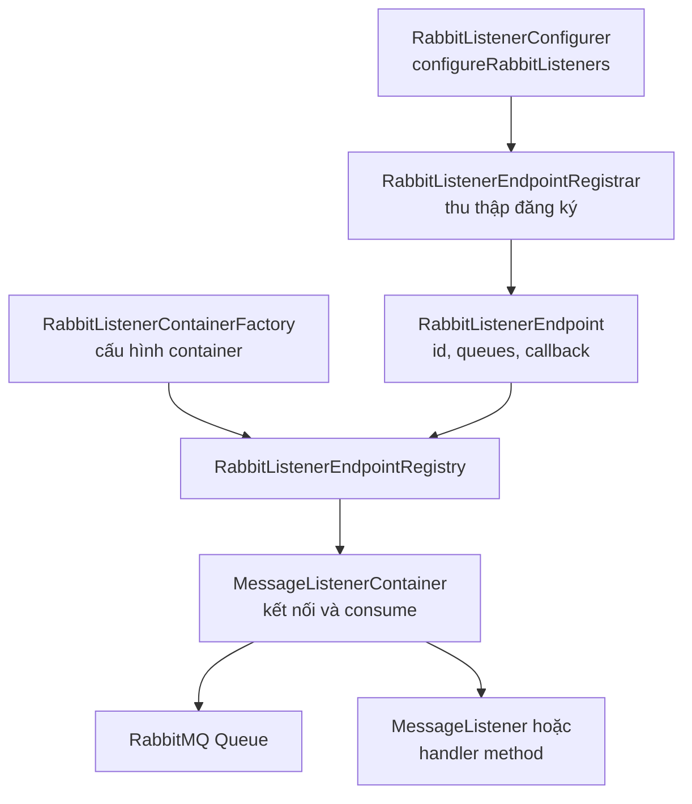
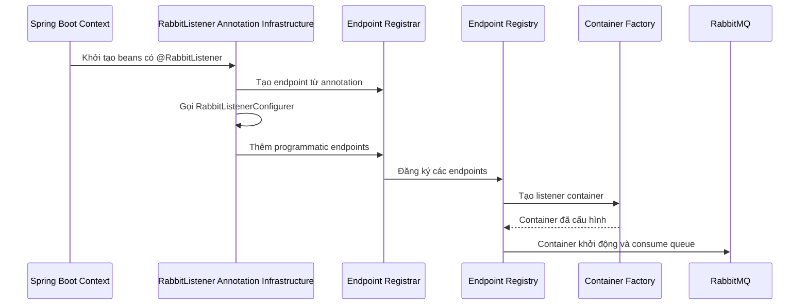
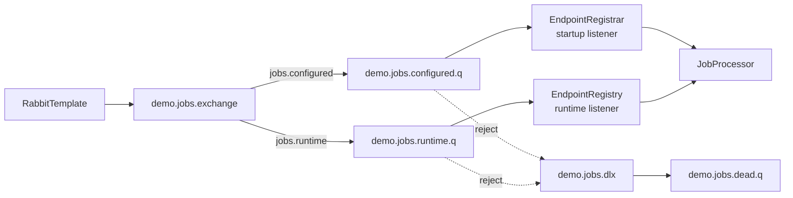
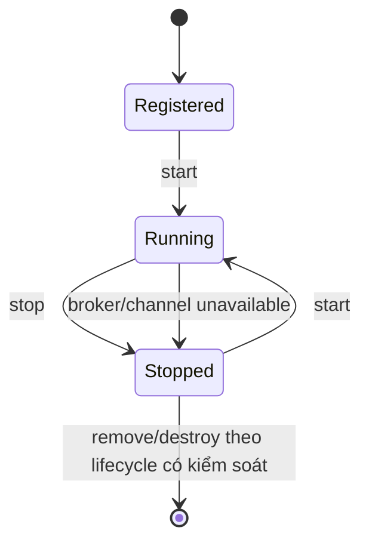
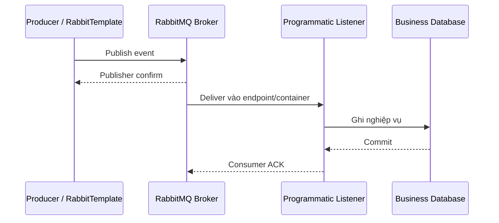

# RabbitListenerConfigurer và đăng ký endpoint bằng mã

## 1. Vì sao cần đăng ký listener bằng mã?

Trong phần lớn dự án **SPRING_AMQP**, bạn chỉ cần khai báo một phương thức nhận message:

```java
@RabbitListener(queues = "orders.created.q")
public void onOrderCreated(String orderId) {
    orderService.process(orderId);
}
```

Spring AMQP quét annotation, tạo **listener endpoint**, dùng **listener container factory** tạo container và bắt đầu tiêu thụ message từ queue. Cách này rất phù hợp khi số listener, queue và phương thức xử lý đã biết từ lúc viết code.

Nhưng đôi khi ứng dụng cần **đăng ký endpoint bằng chương trình**:

- Một thư viện tự tạo consumer mà không muốn ép người dùng đặt `@RabbitListener` trên từng phương thức.
- Danh sách endpoint được tổng hợp lúc ứng dụng khởi động từ cấu hình đã kiểm soát.
- Mỗi module có callback raw AMQP `Message` và muốn dùng chung container infrastructure.
- Ứng dụng nhiều tenant cần bật/tắt listener theo tenant khi chạy.
- Cần lựa chọn listener container factory hoặc cấu hình message-handler method factory một cách tập trung.

Spring AMQP cung cấp **`RabbitListenerConfigurer`** cùng **`RabbitListenerEndpointRegistrar`** để đăng ký endpoint ở giai đoạn thiết lập listener, và **`RabbitListenerEndpointRegistry`** để tra cứu, quản lý hoặc đăng ký container khi ứng dụng đang hoạt động.

Bài thuộc chương **Listener khai báo**, với mục tiêu hiểu đúng cách Spring tạo listener từ cấu hình thay vì chỉ sử dụng annotation. Các ví dụ kết nối `RabbitTemplate`, exchange, queue, binding và acknowledgement; đồng thời làm rõ retry, dead-letter, giao dịch, idempotency và quan sát để luồng bất đồng bộ đáng tin cậy.

### Mục tiêu học tập

Sau bài này, bạn có thể:

1. Nêu vai trò khác nhau của `RabbitListenerConfigurer`, `RabbitListenerEndpointRegistrar`, `SimpleRabbitListenerEndpoint`, listener container factory và `RabbitListenerEndpointRegistry`.
2. Đăng ký một listener không có `@RabbitListener` thông qua `configureRabbitListeners(...)`.
3. Dùng ID endpoint để truy vấn, dừng và khởi động lại listener container.
4. Phân biệt **đăng ký trong lúc khởi tạo** với **đăng ký động sau khi ứng dụng đã chạy**.
5. Nhận diện rủi ro ID trùng, queue chưa tồn tại, nhiều consumer tranh chấp, khởi động sai thời điểm và callback ném lỗi.
6. Quyết định khi nào nên dùng `@RabbitListener`, khi nào dùng registrar/registry mà không phức tạp hóa hệ thống.

## 2. Năm thành phần và ranh giới trách nhiệm



| Thành phần | Chức năng chính | Có tự xử lý business message không? |
| --- | --- | --- |
| `RabbitListenerConfigurer` | Hook để cấu hình cơ chế listener và đăng ký endpoint khi infrastructure được khởi tạo | Không |
| `RabbitListenerEndpointRegistrar` | Tiếp nhận `registerEndpoint(...)` và chuyển các endpoint đến registry/factory thích hợp | Không |
| `RabbitListenerEndpoint` | Mô tả listener: ID, queue và callback/phương thức đích | Không tự chạy |
| `RabbitListenerContainerFactory` | Tạo/configure listener container cho endpoint | Không tự xử lý business |
| `RabbitListenerEndpointRegistry` | Quản lý các container do listener endpoint infrastructure tạo, tra cứu bằng ID, quản lý lifecycle | Không trực tiếp xử lý body |
| `MessageListenerContainer` | Mở consumer, nhận delivery và gọi callback; quản lý concurrency, prefetch, ACK/lỗi | Có vai trò thực thi |
| `MessageListener` / method handler | Xử lý message nghiệp vụ | Có |

**Điểm then chốt:** đăng ký một `SimpleRabbitListenerEndpoint` chỉ là **khai báo cách nhận**; container được tạo và chạy thông qua infrastructure. Nếu queue chưa tồn tại, không có connection hoặc container chưa start thì callback chưa nhận được message.

Các class thường dùng và package:

```java
import org.springframework.amqp.rabbit.annotation.EnableRabbit;
import org.springframework.amqp.rabbit.annotation.RabbitListenerConfigurer;
import org.springframework.amqp.rabbit.config.RabbitListenerEndpointRegistrar;
import org.springframework.amqp.rabbit.config.SimpleRabbitListenerEndpoint;
import org.springframework.amqp.rabbit.listener.RabbitListenerEndpointRegistry;
import org.springframework.amqp.rabbit.config.SimpleRabbitListenerContainerFactory;
```

Tên gần giống nhưng khác vai trò: **registrar** dùng ở lúc khai báo endpoint; **registry** quản lý các container đã được đăng ký. Không dùng chúng như hai tên thay thế cho nhau.

## 3. Luồng khởi tạo khi dùng @RabbitListener

Trước khi tự đăng ký endpoint, hãy nhìn cách Spring làm việc với annotation:



`@EnableRabbit` kích hoạt cơ chế xử lý `@RabbitListener`/endpoint trong cấu hình Spring. Spring Boot có auto-configuration hỗ trợ listener infrastructure trong những cấu hình thông thường; ví dụ này dùng `@EnableRabbit` tường minh để người đọc thấy điều kiện kích hoạt.

Từ đây có **hai con đường tạo endpoint**:

- **Annotation:** framework phát hiện `@RabbitListener` rồi tạo endpoint.
- **Programmatic:** code của bạn tạo endpoint và gọi `registrar.registerEndpoint(...)`.

Hai con đường cùng sử dụng listener container infrastructure và registry. Khác biệt là **nguồn khai báo endpoint**.

Không cần tự mở RabbitMQ `Channel` hay gọi `basicConsume` chỉ để có programmatic endpoint. Container tiếp tục quản lý kết nối, xử lý lỗi và ACK.

## 4. RabbitListenerConfigurer: điểm mở rộng chuẩn lúc khởi tạo

### 4.1. Hợp đồng của interface

`RabbitListenerConfigurer` là một Spring callback có phương thức:

```java
void configureRabbitListeners(RabbitListenerEndpointRegistrar registrar);
```

Bạn triển khai interface trong một bean Spring, thường là `@Configuration`:

```java
@Configuration
@EnableRabbit
public class ProgrammaticListeners
        implements RabbitListenerConfigurer {

    @Override
    public void configureRabbitListeners(
            RabbitListenerEndpointRegistrar registrar) {
        // Tạo endpoint và gọi registrar.registerEndpoint(...).
    }
}
```

Infrastructure gọi method này trong quá trình chuẩn bị các listener endpoint. Bạn **không cần tự gọi** `configureRabbitListeners(...)` và không nên giữ registrar làm bộ điều khiển thêm/bớt listener vô thời hạn sau startup.

### 4.2. SimpleRabbitListenerEndpoint: endpoint từ raw MessageListener

Khi muốn đăng ký trực tiếp callback nhận `org.springframework.amqp.core.Message`, sử dụng:

```java
SimpleRabbitListenerEndpoint endpoint =
        new SimpleRabbitListenerEndpoint();

endpoint.setId("orders-processor-v1");
endpoint.setQueueNames("orders.process.q");

endpoint.setMessageListener(message -> {
    byte[] body = message.getBody();
    // Xử lý body và MessageProperties tại đây.
});

registrar.registerEndpoint(endpoint);
```

Các thuộc tính chính:

| API | Ý nghĩa |
| --- | --- |
| `setId(...)` | ID duy nhất trong registry; dùng để tra cứu, start/stop container |
| `setQueueNames(...)` | Tên queue đã được broker khai báo hoặc sẽ được provisioning |
| `setMessageListener(...)` | Callback raw message; thường là `MessageListener` |
| `registerEndpoint(endpoint)` | Đăng ký dùng listener container factory mặc định |
| `registerEndpoint(endpoint, factory)` | Đăng ký với factory được chỉ định rõ |

**`setId` là ID listener endpoint, không phải tên RabbitMQ queue.** Một queue có thể có nhiều competing consumers, nhưng mỗi endpoint trong registry phải có **ID riêng** để tránh xung đột quản lý.

### 4.3. Registrar và factory mặc định

Khi gọi:

```java
registrar.registerEndpoint(endpoint);
```

Spring cần một listener container factory mặc định. Trong ứng dụng Spring Boot AMQP với listener type **simple**, factory mặc định thường có bean name `rabbitListenerContainerFactory` và có kiểu `SimpleRabbitListenerContainerFactory`.

Nếu dùng factory riêng, bạn có thể đăng ký tường minh:

```java
registrar.registerEndpoint(endpoint, customFactory);
```

Hoặc cấu hình default container factory cho registrar theo API của phiên bản đang dùng.

Nếu một ứng dụng chỉ có `RabbitTemplate` mà thiếu listener infrastructure hoặc container factory thích hợp, việc có endpoint object **không đủ** để tạo consumer. Cần khai báo/auto-configure factory và kích hoạt annotation listener infrastructure.

## 5. Bài thực hành: hai cách đăng ký endpoint trong một ứng dụng

Ta thiết kế:

- **Một direct exchange:** `demo.jobs.exchange`.
- **Queue khởi tạo qua RabbitListenerConfigurer:** `demo.jobs.configured.q`.
- **Queue đăng ký consumer lúc runtime:** `demo.jobs.runtime.q`.
- **Một dead-letter exchange/queue:** `demo.jobs.dlx` → `demo.jobs.dead.q`.
- **Một handler nghiệp vụ** dùng chung nhưng xử lý hai routing key khác nhau.
- Producer `RabbitTemplate` gửi cả message tốt và lỗi để kiểm chứng lifecycle, ACK và DLQ.



**Tách queue để so sánh rõ:** nếu cả hai consumer cùng đọc một queue, chúng sẽ là competing consumers và **không** cùng nhận một bản sao message. Mỗi queue trong lab nhận các message theo routing key riêng.

### 5.1. Chuẩn bị RabbitMQ và dependency

Yêu cầu Java 17+, Spring Boot có AMQP auto-configuration, Maven Wrapper hoặc Maven, và RabbitMQ.

Có thể chạy RabbitMQ local:

```bash
docker run -d --name rabbitmq-endpoint-lab \
  -p 5672:5672 -p 15672:15672 rabbitmq:4-management
```

Nếu cổng `5672`/`15672` đang được broker khác dùng, hãy sử dụng broker hiện tại hoặc đổi mapping; không cố chạy hai broker chiếm cùng cổng.

Management UI: `http://localhost:15672`. Tài khoản `guest/guest` chỉ thích hợp lab local với broker mặc định, không dùng làm cấu hình production.

Dependency `pom.xml` trong dự án Spring Boot:

```xml
<dependency>
    <groupId>org.springframework.boot</groupId>
    <artifactId>spring-boot-starter-amqp</artifactId>
</dependency>
```

Phần ví dụ bên dưới không cần Spring Web; listener container và `ApplicationRunner` đủ để chạy demo.

### 5.2. Cấu hình application.yml

Tạo `src/main/resources/application.yml`:

```yaml
spring:
  application:
    name: programmatic-rabbit-listeners
  rabbitmq:
    host: localhost
    port: 5672
    username: guest
    password: guest
    listener:
      type: simple
      simple:
        acknowledge-mode: auto
        concurrency: 1
        prefetch: 10
        default-requeue-rejected: false
```

Ý nghĩa:

- `type: simple` chọn simple listener container factory trong Spring Boot.
- `acknowledge-mode: auto`: container ACK **sau khi callback xử lý thành công**.
- `concurrency: 1`, `prefetch: 10`: cấu hình ví dụ có một consumer, tối đa số delivery chưa ACK tùy QoS.
- `default-requeue-rejected: false`: khi listener ném exception, thông thường container reject không requeue để message có thể đi DLQ.

**Cảnh báo:** đặt `default-requeue-rejected=false` mà **không có DLX/queue đích** có thể làm mất message lỗi. Trong hệ thống thật, phân loại lỗi tạm thời và đặt retry/backoff có giới hạn trước khi dead-letter khi cần.

### 5.3. Cấu trúc project

```text
src/main/java/com/example/endpointdemo/
  EndpointDemoApplication.java
  JobTopology.java
  JobProcessor.java
  ConfiguredListenerRegistration.java
  RuntimeListenerManager.java
  DemoPublisher.java
```

Tất cả file Java trong ví dụ dùng `package com.example.endpointdemo`. Đảm bảo các class nằm dưới package gốc của `@SpringBootApplication` để được component scan.

### 5.4. Khai báo exchange, queue, binding và DLQ

Tạo `JobTopology.java`:

```java
package com.example.endpointdemo;

import org.springframework.amqp.core.Binding;
import org.springframework.amqp.core.BindingBuilder;
import org.springframework.amqp.core.DirectExchange;
import org.springframework.amqp.core.Queue;
import org.springframework.amqp.core.QueueBuilder;
import org.springframework.beans.factory.annotation.Qualifier;
import org.springframework.context.annotation.Bean;
import org.springframework.context.annotation.Configuration;

@Configuration
public class JobTopology {

    public static final String EXCHANGE = "demo.jobs.exchange";
    public static final String CONFIGURED_QUEUE = "demo.jobs.configured.q";
    public static final String RUNTIME_QUEUE = "demo.jobs.runtime.q";
    public static final String CONFIGURED_KEY = "jobs.configured";
    public static final String RUNTIME_KEY = "jobs.runtime";

    public static final String DEAD_EXCHANGE = "demo.jobs.dlx";
    public static final String DEAD_QUEUE = "demo.jobs.dead.q";
    public static final String DEAD_KEY = "jobs.failed";

    @Bean
    DirectExchange jobExchange() {
        return new DirectExchange(EXCHANGE);
    }

    @Bean
    DirectExchange deadExchange() {
        return new DirectExchange(DEAD_EXCHANGE);
    }

    @Bean
    Queue configuredQueue() {
        return QueueBuilder.durable(CONFIGURED_QUEUE)
                .deadLetterExchange(DEAD_EXCHANGE)
                .deadLetterRoutingKey(DEAD_KEY)
                .build();
    }

    @Bean
    Queue runtimeQueue() {
        return QueueBuilder.durable(RUNTIME_QUEUE)
                .deadLetterExchange(DEAD_EXCHANGE)
                .deadLetterRoutingKey(DEAD_KEY)
                .build();
    }

    @Bean
    Queue deadQueue() {
        return QueueBuilder.durable(DEAD_QUEUE).build();
    }

    @Bean
    Binding configuredBinding(
            @Qualifier("configuredQueue") Queue queue,
            @Qualifier("jobExchange") DirectExchange exchange) {
        return BindingBuilder.bind(queue)
                .to(exchange)
                .with(CONFIGURED_KEY);
    }

    @Bean
    Binding runtimeBinding(
            @Qualifier("runtimeQueue") Queue queue,
            @Qualifier("jobExchange") DirectExchange exchange) {
        return BindingBuilder.bind(queue)
                .to(exchange)
                .with(RUNTIME_KEY);
    }

    @Bean
    Binding deadBinding(
            @Qualifier("deadQueue") Queue queue,
            @Qualifier("deadExchange") DirectExchange exchange) {
        return BindingBuilder.bind(queue)
                .to(exchange)
                .with(DEAD_KEY);
    }
}
```

`RabbitAdmin` của Spring Boot trong cấu hình thông thường có thể declare các `Queue`, `Exchange` và `Binding` bean khi tạo kết nối tới broker. Nếu ứng dụng không có quyền declare hoặc RabbitAdmin bị tắt, cần provision topology từ hạ tầng trước khi container bắt đầu.

Queue đã tồn tại với arguments khác có thể gây lỗi `PRECONDITION_FAILED`. Lab nên dùng tên riêng và dọn có chủ đích, **không xóa queue production** để xử lý lỗi redeclare.

### 5.5. Handler dùng chung cho các endpoint

Tạo `JobProcessor.java`:

```java
package com.example.endpointdemo;

import org.springframework.stereotype.Component;

@Component
public class JobProcessor {

    public void process(String payload) {
        if (payload.startsWith("bad:")) {
            throw new IllegalArgumentException(
                    "Job không hợp lệ: " + payload
            );
        }

        System.out.println("[PROCESSOR] completed: " + payload);
    }
}
```

Handler dùng raw `String` cho dễ quan sát. Trong nghiệp vụ thật, hãy parse payload theo `contentType`/schema, validate dữ liệu và dùng khóa idempotency khi cập nhật DB hoặc gọi API có side effect.

### 5.6. Đăng ký endpoint lúc khởi động với RabbitListenerConfigurer

Tạo `ConfiguredListenerRegistration.java`:

```java
package com.example.endpointdemo;

import java.nio.charset.StandardCharsets;

import org.springframework.amqp.rabbit.annotation.EnableRabbit;
import org.springframework.amqp.rabbit.annotation.RabbitListenerConfigurer;
import org.springframework.amqp.rabbit.config.RabbitListenerEndpointRegistrar;
import org.springframework.amqp.rabbit.config.SimpleRabbitListenerEndpoint;
import org.springframework.context.annotation.Configuration;

@Configuration
@EnableRabbit
public class ConfiguredListenerRegistration
        implements RabbitListenerConfigurer {

    public static final String ENDPOINT_ID = "configured-job-listener";

    private final JobProcessor processor;

    public ConfiguredListenerRegistration(JobProcessor processor) {
        this.processor = processor;
    }

    @Override
    public void configureRabbitListeners(
            RabbitListenerEndpointRegistrar registrar) {

        SimpleRabbitListenerEndpoint endpoint =
                new SimpleRabbitListenerEndpoint();

        endpoint.setId(ENDPOINT_ID);
        endpoint.setQueueNames(JobTopology.CONFIGURED_QUEUE);

        endpoint.setMessageListener(message -> {
            String payload = new String(
                    message.getBody(),
                    StandardCharsets.UTF_8
            );

            System.out.println("[CONFIGURED] received: " + payload);
            processor.process(payload);
        });

        registrar.registerEndpoint(endpoint);
    }
}
```

Tại sao đây là **programmatic registration**?

1. Code tự tạo `SimpleRabbitListenerEndpoint`.
2. Code chọn ID và tên queue, gắn callback `MessageListener`.
3. Code gọi `registrar.registerEndpoint(endpoint)`.
4. Spring dùng factory mặc định tạo listener container, quản lý consumer và gọi callback khi có delivery.

Không có phương thức nào trong `ConfiguredListenerRegistration` cần annotation `@RabbitListener`. `@EnableRabbit` cung cấp infrastructure để `RabbitListenerConfigurer` được gọi.

Vì callback nhận raw `org.springframework.amqp.core.Message`, ví dụ tự giải mã body UTF-8. `SimpleRabbitListenerEndpoint` **không tự suy luận một DTO** giống phương thức `@RabbitListener` có tham số kiểu `OrderCreatedEvent`.

### 5.7. Đăng ký endpoint khi ứng dụng đang chạy

Tạo `RuntimeListenerManager.java`:

```java
package com.example.endpointdemo;

import java.nio.charset.StandardCharsets;

import org.springframework.amqp.rabbit.config.SimpleRabbitListenerContainerFactory;
import org.springframework.amqp.rabbit.config.SimpleRabbitListenerEndpoint;
import org.springframework.amqp.rabbit.listener.MessageListenerContainer;
import org.springframework.amqp.rabbit.listener.RabbitListenerEndpointRegistry;
import org.springframework.beans.factory.annotation.Qualifier;
import org.springframework.boot.context.event.ApplicationReadyEvent;
import org.springframework.context.event.EventListener;
import org.springframework.stereotype.Component;

@Component
public class RuntimeListenerManager {

    public static final String ENDPOINT_ID = "runtime-job-listener";

    private final RabbitListenerEndpointRegistry registry;
    private final SimpleRabbitListenerContainerFactory factory;
    private final JobProcessor processor;

    public RuntimeListenerManager(
            RabbitListenerEndpointRegistry registry,
            @Qualifier("rabbitListenerContainerFactory")
                    SimpleRabbitListenerContainerFactory factory,
            JobProcessor processor) {
        this.registry = registry;
        this.factory = factory;
        this.processor = processor;
    }

    @EventListener(ApplicationReadyEvent.class)
    public void registerWhenReady() {
        register(ENDPOINT_ID, JobTopology.RUNTIME_QUEUE);
    }

    public synchronized void register(String id, String queueName) {
        if (registry.getListenerContainer(id) != null) {
            System.out.println("[RUNTIME] already registered: " + id);
            return;
        }

        SimpleRabbitListenerEndpoint endpoint =
                new SimpleRabbitListenerEndpoint();

        endpoint.setId(id);
        endpoint.setQueueNames(queueName);
        endpoint.setMessageListener(message -> {
            String payload = new String(
                    message.getBody(),
                    StandardCharsets.UTF_8
            );

            System.out.println("[RUNTIME] received: " + payload);
            processor.process(payload);
        });

        registry.registerListenerContainer(
                endpoint,
                factory,
                true
        );

        System.out.println("[RUNTIME] registered: " + id);
    }

    public void stop() {
        MessageListenerContainer container =
                registry.getListenerContainer(ENDPOINT_ID);
        if (container != null) {
            container.stop();
            System.out.println("[RUNTIME] stopped");
        }
    }

    public void start() {
        MessageListenerContainer container =
                registry.getListenerContainer(ENDPOINT_ID);
        if (container != null && !container.isRunning()) {
            container.start();
            System.out.println("[RUNTIME] started");
        }
    }
}
```

Đây là sự khác nhau cốt lõi:

| Giai đoạn | API đăng ký | Hệ quả |
| --- | --- | --- |
| Khi listener infrastructure đang khởi tạo | `registrar.registerEndpoint(endpoint)` trong `RabbitListenerConfigurer` | Endpoint trở thành một phần của đợt đăng ký ban đầu |
| Sau khi ứng dụng chạy | `registry.registerListenerContainer(endpoint, factory, true)` | Registry tạo và có thể khởi động container mới ngay |
| Khi cần quản lý listener đã có | `registry.getListenerContainer(id)` → `start()`/`stop()` | Điều khiển container hiện hữu mà không khai báo thêm endpoint |

Tham số cuối `true` trong `registerListenerContainer(..., true)` yêu cầu **start immediately** trong điều kiện registry/lifecycle hiện tại cho phép. Nó **không tự tạo queue trên RabbitMQ**. Queue đích phải được provisioning và có quyền truy cập phù hợp.

**Không gọi `registerListenerContainer` liên tục cho cùng ID** mà không kiểm tra registry; container ID phải duy nhất. Ở bản demo, `synchronized` chỉ bảo vệ các cuộc gọi trong **một instance**, không tạo cơ chế điều phối giữa nhiều instance ứng dụng trên cluster.

**Lưu ý khi dùng Boot:** Ví dụ đã chọn `spring.rabbitmq.listener.type=simple` nên factory mặc định dự kiến là `SimpleRabbitListenerContainerFactory`. Nếu bạn chuyển sang `direct`, kiểu factory mặc định có thể khác; cần inject interface/factory tương ứng và điều chỉnh cách cấu hình.

### 5.8. Publisher gửi dữ liệu qua RabbitTemplate

Tạo `DemoPublisher.java`:

```java
package com.example.endpointdemo;

import org.springframework.amqp.rabbit.core.RabbitTemplate;
import org.springframework.stereotype.Service;

@Service
public class DemoPublisher {

    private final RabbitTemplate template;

    public DemoPublisher(RabbitTemplate template) {
        this.template = template;
    }

    public void publishSampleJobs() {
        publish(JobTopology.CONFIGURED_KEY, "configured:job-101");
        publish(JobTopology.CONFIGURED_KEY, "bad:configured-job-102");

        publish(JobTopology.RUNTIME_KEY, "runtime:job-201");
        publish(JobTopology.RUNTIME_KEY, "bad:runtime-job-202");
    }

    public void publish(String routingKey, String payload) {
        template.convertAndSend(
                JobTopology.EXCHANGE,
                routingKey,
                payload
        );

        System.out.printf(
                "[PUBLISH] key=%s payload=%s%n",
                routingKey,
                payload
        );
    }
}
```

Với `String`, `SimpleMessageConverter` thông thường đủ cho lab. Khi gửi DTO, cần cấu hình JSON converter/schema nhất quán giữa producer và consumer.

Producer không biết endpoint được khai báo bằng annotation hay mã. Nó chỉ biết **exchange, routing key và payload**; RabbitMQ định tuyến vào queue dựa trên binding.

### 5.9. Khởi động project

Tạo `EndpointDemoApplication.java`:

```java
package com.example.endpointdemo;

import org.springframework.boot.ApplicationRunner;
import org.springframework.boot.SpringApplication;
import org.springframework.boot.autoconfigure.SpringBootApplication;
import org.springframework.context.annotation.Bean;

@SpringBootApplication
public class EndpointDemoApplication {

    public static void main(String[] args) {
        SpringApplication.run(EndpointDemoApplication.class, args);
    }

    @Bean
    ApplicationRunner seedDemo(DemoPublisher publisher) {
        return args -> publisher.publishSampleJobs();
    }
}
```

Chạy trong thư mục dự án Maven:

```bash
./mvnw spring-boot:run
```

Hoặc PowerShell:

```powershell
.\mvnw.cmd spring-boot:run
```

Trình tự lifecycle quan trọng:

1. Spring tạo beans và thực hiện đăng ký endpoint ban đầu qua `RabbitListenerConfigurer`.
2. Listener container của `configured-job-listener` được Spring khởi động trong quá trình startup.
3. `ApplicationRunner` publish các message vào hai queue.
4. Sự kiện `ApplicationReadyEvent` diễn ra **sau các runner**, nên `RuntimeListenerManager` mới đăng ký listener runtime.
5. Các message trong `demo.jobs.runtime.q` có thể chờ ở trạng thái **Ready** trước khi listener runtime bắt đầu; sau đó được giao xử lý.

**Không cần runtime endpoint xuất hiện trước khi producer publish:** nếu queue và binding đã được khai báo đúng, message có thể được lưu chờ consumer. Dĩ nhiên cần xét durability, persistent delivery mode, publisher confirms và điều kiện broker thực tế trước khi coi điều này là một bảo đảm chống mất dữ liệu.

### 5.10. Kết quả kỳ vọng

Những dòng sau mang tính mô tả; thứ tự log giữa các thread/container có thể thay đổi:

```text
[PUBLISH] key=jobs.configured payload=configured:job-101
[PUBLISH] key=jobs.configured payload=bad:configured-job-102
[PUBLISH] key=jobs.runtime payload=runtime:job-201
[PUBLISH] key=jobs.runtime payload=bad:runtime-job-202

[CONFIGURED] received: configured:job-101
[PROCESSOR] completed: configured:job-101
[CONFIGURED] received: bad:configured-job-102
... IllegalArgumentException ...

[RUNTIME] registered: runtime-job-listener
[RUNTIME] received: runtime:job-201
[PROCESSOR] completed: runtime:job-201
[RUNTIME] received: bad:runtime-job-202
... IllegalArgumentException ...
```

Khi listener xử lý thành công và container nhận ACK:

- Queue `demo.jobs.configured.q` thường không còn message ready/unacked.
- Queue `demo.jobs.runtime.q` thường không còn message ready/unacked.
- DLQ `demo.jobs.dead.q` dự kiến có **2 message lỗi** nếu việc reject/dead-letter thành công, không có consumer nào đọc DLQ và lab sạch.
- Cả hai endpoint có thể được nhìn thấy trong registry bằng ID.

Mỗi lần chạy `ApplicationRunner` sẽ publish lại **bốn message**. Khi kiểm tra số lượng, hãy ghi rõ từng lần chạy hoặc reset dữ liệu lab theo cách có kiểm soát.

## 6. RabbitListenerEndpointRegistry quản lý lifecycle như thế nào?

### 6.1. Tra cứu container bằng endpoint ID

Có thể inject `RabbitListenerEndpointRegistry` vào một service quản trị nội bộ:

```java
MessageListenerContainer container =
        registry.getListenerContainer("configured-job-listener");

if (container == null) {
    System.out.println("Endpoint chưa được đăng ký");
} else {
    System.out.println("Running = " + container.isRunning());
}
```

Dùng endpoint ID, **không dùng tên queue** để tìm container. Hai endpoint có thể cùng consume một queue nhưng vẫn có ID riêng.

### 6.2. start và stop khác xóa queue

- `container.stop()` dừng consumer/container; **không** xóa queue, exchange hoặc binding.
- Message mới tiếp tục vào queue theo routing, miễn topology và broker còn hoạt động.
- `container.start()` kích hoạt nhận trở lại; message tồn backlog có thể được giao.
- Việc stop có thể ảnh hưởng delivery đang xử lý tùy thời điểm/lifecycle; cần xem shutdown timeout và graceful shutdown nếu xử lý công việc lâu.



Sơ đồ chỉ minh họa logic quản lý; container cũng có quy trình recovery nếu kết nối broker lỗi, nên không đồng nhất mọi lỗi kết nối với lời gọi `stop()` quản trị.

### 6.3. Stop không đồng nghĩa unregister

`registry.getListenerContainer(id).stop()` **chỉ dừng** container; ID vẫn được registry quản lý. Vì thế gọi lại `registerListenerContainer` cùng ID có thể bị từ chối là đăng ký trùng.

Nếu cần thay một endpoint bằng cấu hình mới:

1. Dừng container hiện hữu và xử lý các delivery chưa ACK theo quy tắc của hệ thống.
2. Sử dụng API unregister/lifecycle phù hợp với **phiên bản Spring AMQP** và hủy tài nguyên của container một cách có kiểm soát, nếu thật sự cần.
3. Tạo endpoint mới với ID/quy tắc rõ ràng, đăng ký bằng factory đúng.
4. Xác minh không còn hai consumer ngoài ý muốn ở queue cũ hoặc queue mới.

**Đối với thay đổi định kỳ**, việc chỉ start/stop container đã có thường an toàn và đơn giản hơn tạo/hủy endpoint liên tục.

### 6.4. Registry không quản lý mọi container do bạn tạo

`RabbitListenerEndpointRegistry` chủ yếu quản lý các listener container được tạo qua cơ chế endpoint/annotation registration. Nếu bạn tự khai báo một `SimpleMessageListenerContainer` thành bean riêng và gắn `MessageListener` thủ công, container đó thường thuộc lifecycle của bean Spring, không mặc nhiên xuất hiện như endpoint đã đăng ký trong registry.

Phân biệt:

```text
@RabbitListener hoặc registrar/registry
    → listener endpoint
    → listener container do registry quản lý

@Bean SimpleMessageListenerContainer tự tạo
    → Spring bean container riêng
    → không tự có endpoint ID trong RabbitListenerEndpointRegistry
```

Nếu mục tiêu là quản lý các endpoint bằng ID trong cùng registry, hãy tạo chúng qua đúng API đăng ký endpoint.

## 7. Chọn container factory và điều chỉnh concurrency

### 7.1. Vì sao container factory quan trọng?

Listener container factory cấu hình các đặc tính vận hành trước khi tạo consumer:

- `AcknowledgeMode.AUTO`, `MANUAL` hoặc `NONE`.
- Prefetch, concurrency và số consumer.
- Error handler, retry advice, requeue behavior.
- Message converter và các adapter phù hợp khi dùng method handler.
- Transaction và lifecycle của container, tùy cấu hình/queue type.

Với endpoint mới, chọn factory nghĩa là **chọn chính sách vận hành cho consumer đó**, không chỉ chọn cách new một object.

Ví dụ tạo factory riêng để giới hạn tài nguyên:

```java
@Bean("slowJobListenerFactory")
SimpleRabbitListenerContainerFactory slowJobListenerFactory(
        org.springframework.amqp.rabbit.connection.ConnectionFactory connectionFactory) {

    SimpleRabbitListenerContainerFactory factory =
            new SimpleRabbitListenerContainerFactory();

    factory.setConnectionFactory(connectionFactory);
    factory.setConcurrentConsumers(1);
    factory.setPrefetchCount(5);
    factory.setAcknowledgeMode(
            org.springframework.amqp.core.AcknowledgeMode.AUTO
    );
    factory.setDefaultRequeueRejected(false);

    return factory;
}
```

Sau đó đăng ký endpoint với bean này:

```java
registrar.registerEndpoint(endpoint, slowJobListenerFactory);
```

Hai snippet minh họa cấu hình **cùng phạm vi Spring**, nhưng muốn biên dịch cần inject hoặc lấy được tham chiếu `slowJobListenerFactory` ở vị trí gọi registrar. Không tạo một factory mới cho **từng message**.

### 7.2. Concurrency và prefetch không biến một queue thành broadcast

Khi bạn đăng ký hai endpoint cùng queue:

```text
queue jobs.shared.q
  ├── endpoint worker-A
  └── endpoint worker-B
```

Hai endpoint sẽ cạnh tranh nhận delivery; một message thông thường được xử lý bởi **một consumer** trong nhóm, không phải mỗi endpoint một bản sao.

Muốn hai dịch vụ cùng nhận event, tạo **hai queue riêng** và bind cùng exchange/routing key, hoặc dùng stream nếu thật sự cần nhiều nhóm đọc lại lịch sử event.

### 7.3. ID, queue name và bean name khác nhau

| Tên/ID | Ví dụ | Dùng ở đâu? |
| --- | --- | --- |
| Endpoint ID | `configured-job-listener` | Registry tra cứu và quản lý container |
| Queue name | `demo.jobs.configured.q` | RabbitMQ lưu và giao message |
| Exchange name | `demo.jobs.exchange` | Publisher định tuyến message |
| Routing key | `jobs.configured` | Exchange so với binding |
| Container factory bean name | `rabbitListenerContainerFactory` | Infrastructure chọn cấu hình consumer |

Việc đổi **endpoint ID** không đổi queue vật lý. Việc đổi **queue name** cần đảm bảo topology, dữ liệu tồn và publisher routing được điều chỉnh phù hợp.

## 8. MethodRabbitListenerEndpoint và MessageHandlerMethodFactory

`SimpleRabbitListenerEndpoint` phù hợp khi tự gắn `MessageListener` nhận raw AMQP message. Nếu muốn đăng ký **một bean method** giống annotation-driven handler, có thể tìm hiểu `MethodRabbitListenerEndpoint`.

Khái niệm chính:

```text
SimpleRabbitListenerEndpoint
    setMessageListener(MessageListener)
    -> callback nhận org.springframework.amqp.core.Message

MethodRabbitListenerEndpoint
    setBean(handler)
    setMethod(reflectedMethod)
    -> Spring adapter xử lý tham số method, payload và headers
```

Cách chọn:

| Mục tiêu | Endpoint thường phù hợp |
| --- | --- |
| Callback raw `Message` cho adapter chung | `SimpleRabbitListenerEndpoint` |
| Cần method handler/DTO/`@Payload` theo hệ thống listener infrastructure | `MethodRabbitListenerEndpoint` hoặc đơn giản hơn là `@RabbitListener` |
| Có nhiều handler method theo payload type | Tìm hiểu `MultiMethodRabbitListenerEndpoint` hoặc `@RabbitHandler` |
| Chỉ muốn đổi queue name theo cấu hình | Thường dùng placeholder/SpEL trong `@RabbitListener` là đủ |

**Đăng ký method endpoint nâng cao** thường còn cần cấu hình `MessageHandlerMethodFactory` để mapping và validation tham số, cùng `MessageConverter` đúng. Spring cho phép `RabbitListenerConfigurer` tác động vào cơ chế này bằng registrar, ví dụ:

```java
@Override
public void configureRabbitListeners(
        RabbitListenerEndpointRegistrar registrar) {
    registrar.setMessageHandlerMethodFactory(customHandlerMethodFactory);
    // Có thể đăng ký các method endpoints tại đây.
}
```

Đây là **đoạn minh họa**: `customHandlerMethodFactory` là một bean bạn phải tạo, ví dụ dựa trên `DefaultMessageHandlerMethodFactory` với validator phù hợp. Đừng chép snippet như một class tự chạy.

Một số lỗi mapping xảy ra **trước khi business method được gọi**, ví dụ JSON không chuyển được thành DTO, thiếu header bắt buộc hoặc validation thất bại. Error handler/ACK/DLQ ở container phải xử lý được cả những lỗi đó.

Đối với service nghiệp vụ bình thường, `@RabbitListener` vẫn dễ đọc và có ít boilerplate hơn so với tự tạo method endpoint.

## 9. Khi nào dùng registrar, registry hay annotation?

| Yêu cầu | Cách nên cân nhắc | Lý do |
| --- | --- | --- |
| Một phương thức nhận từ queue cố định | `@RabbitListener` | Gọn, rõ, dễ test |
| Queue name lấy từ properties lúc startup | `@RabbitListener(queues = "${app.queue}")` | Thường **không cần** programmatic registration |
| Tạo hàng loạt callback raw từ cấu hình đã biết lúc startup | `RabbitListenerConfigurer` + registrar | Chủ động tạo nhiều endpoint mà vẫn dùng Spring container |
| Chọn factory khác cho một nhóm endpoint | `registrar.registerEndpoint(endpoint, factory)` | Cấu hình concurrency/ACK riêng |
| Bật consumer sau khi app đã sẵn sàng | `RabbitListenerEndpointRegistry.registerListenerContainer(...)` | Dynamic registration/lifecycle |
| Tạm ngừng nhận một queue để bảo trì | Registry tra cứu rồi `stop()`/`start()` | Không cần đăng ký lại |
| Một handler DTO có validation, headers | `@RabbitListener` hoặc method endpoint | Hỗ trợ method argument conversion |
| Cần ACK/NACK chi tiết qua RabbitMQ Channel | `ChannelAwareMessageListener` hoặc `@RabbitListener` MANUAL | Channel trực tiếp với trách nhiệm xác nhận |
| Nhiều tenant có queue riêng thay đổi liên tục | Registry và hệ thống provisioning/lifecycle có giới hạn | Cần kiểm soát quota, ID, quyền, duplicate và cleanup |

**Điểm thực tế:** đăng ký bằng mã không mặc nhiên cải thiện reliability. Nó chủ yếu thay **cách mô tả và quản lý listener**. Publisher confirms, ACK, retry, dead-letter, idempotency và tài nguyên broker vẫn phải thiết kế như các consumer bình thường.

## 10. Xử lý lỗi và acknowledgement khi endpoint được đăng ký bằng mã

### 10.1. AUTO: callback thành công thì container ACK

Ví dụ ở mục 5 dùng `AcknowledgeMode.AUTO` qua factory mặc định. Khi callback:

```java
endpoint.setMessageListener(message -> {
    String payload = new String(
            message.getBody(),
            StandardCharsets.UTF_8
    );
    processor.process(payload);
});
```

Nếu `processor.process(payload)` trả về bình thường, container ACK. Nếu nó ném exception, container áp dụng cấu hình retry/reject/requeue.

**Không nhầm `AUTO` của Spring listener container với `autoAck=true`** trong RabbitMQ client: ở Spring AUTO, framework xác nhận sau callback thành công; ở Spring `NONE`, delivery được broker coi như đã giao mà không đợi ACK ứng dụng.

### 10.2. MANUAL: tự ACK/NACK nếu có Channel

Nếu cần quản lý delivery trực tiếp, có thể dùng `ChannelAwareMessageListener` và factory `AcknowledgeMode.MANUAL` hoặc `@RabbitListener(ackMode = "MANUAL")`.

Mẫu logic minh họa:

```java
long tag = message.getMessageProperties().getDeliveryTag();

try {
    processBusinessWork();
    channel.basicAck(tag, false);
} catch (InvalidPayloadException ex) {
    channel.basicReject(tag, false);
} catch (TransientFailureException ex) {
    channel.basicNack(tag, false, true);
}
```

Đây **không phải code chạy độc lập**: các phương thức, exception và `channel` phải được định nghĩa trong listener có channel phù hợp.

- `basicAck(tag, false)`: xác nhận một delivery trên channel.
- `basicReject(tag, false)`: reject, không requeue; message có thể dead-letter.
- `basicNack(tag, false, true)`: requeue; nếu cứ lỗi mãi có thể tạo vòng lặp nóng.
- Delivery tag chỉ hợp lệ trên channel đã nhận message; ACK hai lần có thể làm channel bị đóng.

**Không dùng raw `SimpleRabbitListenerEndpoint` mặc định AUTO rồi gọi ACK thủ công bên ngoài** khi chưa thiết kế lại factory và listener callback phù hợp. Chọn mode nhất quán giữa container và code xử lý.

### 10.3. Retry và dead-letter

Trong ví dụ, payload `bad:...` gây `IllegalArgumentException`. Vì factory được cấu hình không requeue khi reject và queue có DLX, message lỗi có thể đến DLQ.

Lưu ý:

- **DLQ không được sinh chỉ vì ứng dụng ném exception.** RabbitMQ cần DLX, binding và queue đích.
- **Không phải mọi exception nên DLQ ngay.** DB 503/network timeout có thể cần retry có giới hạn và backoff.
- **Conversion error** có thể xảy ra trước method handler; error handling của container phải bao phủ.
- **Dead-lettering cũng có điều kiện độ tin cậy:** đừng tự cho rằng message ở DLQ chắc chắn được bảo toàn trong mọi broker failure.
- **Poison message** phải có đường xử lý hữu hạn để không chặn queue mãi.

## 11. Đăng ký động nhiều tenant: các bẫy dễ gặp

Programmatic endpoints đặc biệt hữu ích khi số queue/consumer thay đổi trong thời gian chạy, nhưng cần quản lý thêm:

### 11.1. Bảo đảm queue tồn tại

`registry.registerListenerContainer(...)` **không tự mang nghĩa tạo queue và binding**. Queue có thể được provision bằng `RabbitAdmin` hoặc hạ tầng. Nếu queue chưa tồn tại, listener container có thể log lỗi, retry khởi động hoặc fail theo cấu hình missing queue/fatal declaration.

Nếu người dùng nhập một tenant ID rồi hệ thống dùng trực tiếp làm queue name, hãy:

1. Kiểm tra tenant có quyền dùng queue đó không.
2. Kiểm soát pattern tên để tránh truy cập resource không thuộc tenant.
3. Provision exchange/queue/binding trước khi start listener.
4. Giới hạn số container/consumer theo quota.
5. Theo dõi và dọn endpoint khi tenant ngừng hoạt động.

### 11.2. Mỗi instance ứng dụng có registry riêng

Trong cluster có ba instance Spring Boot, mỗi process sở hữu registry **trong bộ nhớ của chính nó**. ID `tenant-42-listener` có thể tồn tại trên cả ba instance mà không phải một object dùng chung.

Nếu cả ba cùng consume một RabbitMQ queue, chúng là competing consumers. Nếu chỉ muốn **một consumer chủ động**, cần cơ chế phân quyền/coordination phù hợp, hoặc sử dụng tính năng broker như single-active-consumer khi thích hợp; đặt cùng ID không tạo leader election liên tiến trình.

### 11.3. Chống đăng ký trùng và race

Các tình huống thường gặp:

- Một sự kiện tenant-created được xử lý hai lần → cố đăng ký trùng ID.
- Một container đã stop nhưng ID vẫn ở registry → không thể đăng ký mới cùng ID.
- Hai thread cùng kiểm tra `getListenerContainer(id) == null` rồi cùng đăng ký → race nếu không đồng bộ.
- App restart tự đăng ký lại listener, trong khi queue vẫn còn message chưa xử lý → các message cũ được xử lý, cần idempotency.

Đối với app một instance, có thể bảo vệ thao tác đăng ký với một service đồng bộ như ví dụ. Với nhiều instance, cần thiết kế phối hợp/ownership riêng nếu business không muốn nhiều consumer cho cùng queue.

### 11.4. Không dùng số lượng container vô hạn

Mỗi container/consumer cần thread, channel, network, prefetch và bộ nhớ. Tạo hàng chục nghìn container riêng cho mỗi tenant có thể làm broker và ứng dụng quá tải.

Cân nhắc thay thế:

- Một tập queue theo shard/nhóm tenant thay vì queue riêng từng tenant.
- Bổ sung tenant ID vào message header/body, rồi validate trong handler.
- Pool xử lý hoặc mô hình workload phù hợp.
- Nếu cần replay một lịch sử event nhiều nhóm độc lập, đánh giá RabbitMQ Streams thay vì tạo vô hạn work queues.

## 12. Quan sát và thử nghiệm quản lý endpoint

### 12.1. Kiểm tra trong RabbitMQ Management UI

Mở `http://localhost:15672` và xác minh:

1. Exchange `demo.jobs.exchange` tồn tại, type **direct**.
2. Hai work queue có binding key khác nhau.
3. Khi ứng dụng khởi động, `demo.jobs.configured.q` có consumer được tạo lúc startup.
4. `demo.jobs.runtime.q` có consumer sau khi `ApplicationReadyEvent` đăng ký runtime endpoint.
5. DLQ `demo.jobs.dead.q` có hai message lỗi khi chúng đã được dead-letter và không có consumer đọc DLQ.
6. Số Ready/Unacked và tốc độ delivery/ACK biến đổi theo quá trình xử lý.

**Ready bằng 0 không chứng minh message chưa từng vào queue.** Nó có thể đã được deliver và ACK rất nhanh. Xem delivery/ack rates và log để kết luận.

### 12.2. Kiểm tra registry bằng ID

Bạn có thể thêm code quan sát trong một service/runner:

```java
var fixed = registry.getListenerContainer(
        ConfiguredListenerRegistration.ENDPOINT_ID
);

var runtime = registry.getListenerContainer(
        RuntimeListenerManager.ENDPOINT_ID
);

System.out.println(
        "Configured listener exists = " + (fixed != null)
);
System.out.println(
        "Runtime listener exists = " + (runtime != null)
);
```

Thời điểm chạy quan trọng: nếu kiểm tra trong `ApplicationRunner`, runtime listener **chưa chắc tồn tại**, vì ví dụ này chỉ đăng ký khi `ApplicationReadyEvent` xảy ra sau các runner. Nếu kiểm tra sau event đó, cả hai được kỳ vọng có mặt.

### 12.3. Thí nghiệm dừng và chạy lại listener

Trong môi trường lab, gọi:

```java
runtimeListenerManager.stop();
```

Sau đó publish thêm một message với routing key `jobs.runtime`. Nếu không có consumer khác trên cùng queue, message sẽ chờ tại `demo.jobs.runtime.q`. Tiếp tục:

```java
runtimeListenerManager.start();
```

Quan sát message đang chờ được giao khi container chạy lại.

**Dừng container không xóa queue hoặc backlog.** Nếu môi trường có consumer khác cùng queue, message có thể được consumer khác xử lý; đừng dựa vào một instance để kết luận toàn cluster đã ngừng tiêu thụ.

### 12.4. Thí nghiệm duplicate

Giả lập consumer ghi DB xong nhưng lỗi trước ACK. RabbitMQ có thể redeliver message; đăng ký endpoint bằng registrar không tự thay đổi điều này. Gắn một ID nghiệp vụ ổn định vào payload và dùng ràng buộc duy nhất/idempotency khi xử lý lại.

### 12.5. Thí nghiệm thiếu queue

Trong một lab cô lập, đăng ký endpoint trỏ tới queue chưa được provision. Quan sát container log và cách `missingQueuesFatal`/retry cơ chế của container hoạt động theo phiên bản/cấu hình. Sau đó tạo queue/binding đúng và kiểm tra khôi phục.

Không nên chạy thử bằng cách xóa queue đang chứa dữ liệu thật; việc xóa queue có thể làm mất backlog.

## 13. Quan hệ với giao dịch, outbox và publisher confirms

Tự đăng ký listener bằng code chỉ thay **cách tạo consumer**. Nó không nối transaction của database với RabbitMQ.



Nếu DB commit thành công nhưng connection đứt trước ACK, broker có thể redeliver. Nếu producer ghi DB rồi publish không có outbox, vẫn có thể xảy ra tình trạng DB commit nhưng event không được gửi.

Biện pháp theo yêu cầu nghiệp vụ:

- **Publisher confirms + returns:** xác minh broker xử lý publish và phát hiện unroutable khi mandatory phù hợp.
- **Consumer ACK sau xử lý:** container AUTO hoặc code MANUAL theo vòng đời công việc.
- **Idempotency:** ngăn side effect trùng khi delivery/retry xảy ra.
- **Retry giới hạn và DLQ:** xử lý lỗi tạm thời và lỗi không thể phục hồi.
- **Transactional outbox:** liên kết dữ liệu nghiệp vụ của producer với event cần phát.
- **Observability:** trace event ID từ publisher qua queue, listener endpoint ID và consumer đến kết quả cuối.

**Không đánh đồng publisher confirm với consumer ACK.** Một producer có thể được confirm khi listener chưa start, hoặc listener có thể xử lý lỗi sau khi confirm đã gửi.

## 14. Lỗi thường gặp

| Hiện tượng | Nguyên nhân có thể | Cách xử lý |
| --- | --- | --- |
| `configureRabbitListeners(...)` không được gọi | Thiếu infrastructure `@EnableRabbit` hoặc class không phải Spring bean | Bật listener infrastructure, kiểm tra component scan và configuration |
| Endpoint đăng ký nhưng không nhận | Queue sai, chưa tồn tại, thiếu connection, consumer chưa start | Kiểm tra topology, queue names, log container, registry và consumer count |
| `registerEndpoint(...)` báo thiếu factory | Không có default factory/bean name phù hợp | Cấu hình `rabbitListenerContainerFactory` hoặc truyền factory tường minh |
| Đăng ký cùng ID bị lỗi | Endpoint ID đã tồn tại trong registry | Chọn ID duy nhất, kiểm tra container cũ; stop không phải unregister |
| Hai endpoint cùng queue không cùng nhận mỗi message | Competing consumers | Tạo queue riêng nếu mỗi dịch vụ cần một bản sao |
| Runtime endpoint xuất hiện trễ | Đăng ký ở `ApplicationReadyEvent` sau `ApplicationRunner` | Hiểu lifecycle, queue giữ backlog khi chưa có consumer |
| `registry.getListenerContainer(id)` trả null | Dùng queue name thay ID, gọi quá sớm hoặc chưa đăng ký | Dùng đúng endpoint ID, kiểm tra thời điểm |
| Manual ACK gây `unknown delivery tag` | ACK trùng hoặc tag thuộc channel khác | Chỉ ACK đúng channel/delivery tag |
| Message lỗi lặp liên tục | Exception gây requeue không giới hạn | Retry/backoff giới hạn, DLQ/quarantine |
| Message lỗi biến mất, DLQ trống | Không có DLX/binding hoặc reject không requeue | Kiểm tra topology và bảo đảm dead-letter |
| Listener đang stop nhưng queue Ready tăng | Không còn consumer nhận, producer vẫn publish | Start listener có kiểm soát hoặc điều chỉnh producer/backpressure |
| Số container tăng không kiểm soát | Tenant registration không có quota/lifecycle cleanup | Giới hạn consumer, theo dõi registry và tài nguyên |
| Đổi queue name trong code nhưng message cũ không được xử lý | Queue cũ vẫn giữ backlog hoặc topology chưa migration | Lập kế hoạch chuyển queue và xử lý message tồn |
| Test chỉ log `[PUBLISH]` rồi kết luận broker nhận | Chưa theo dõi confirms/returns | Cấu hình publisher confirms, returns và kiểm tra kết quả |

## 15. Checklist trước khi áp dụng trong production

1. **Vì sao không dùng `@RabbitListener`?** Nếu chỉ cần queue lấy từ properties và một method xử lý, annotation thường đủ.
2. **Endpoint ID đã duy nhất và ổn định chưa?** ID cần dùng để quản lý lifecycle và logging.
3. **Queue/binding/exchange đã được provision chưa?** Registrar/registry không thay cơ chế định tuyến.
4. **Factory có cấu hình phù hợp không?** ACK mode, prefetch, concurrency, retry và error handler được kiểm tra.
5. **Startup ordering có chủ đích không?** Phân biệt registrar lúc startup và registry khi runtime.
6. **Runtime registration có giới hạn không?** Kiểm tra quota/tenant authorization/chống đăng ký trùng.
7. **Dừng listener có an toàn không?** Xử lý in-flight delivery, graceful shutdown, backlog và restart.
8. **Nếu consumer crash trước ACK?** Side effect có idempotency và transaction boundary rõ ràng chưa?
9. **Nếu payload không parse được?** DLX/DLQ, cảnh báo và replay đã được kiểm thử chưa?
10. **Có đo end-to-end không?** Theo dõi producer confirm, queue depth, consumer ID, lỗi, retry và kết quả nghiệp vụ.

## 16. Tóm tắt

`RabbitListenerConfigurer` giúp bạn tham gia **quá trình cấu hình listener** của Spring AMQP. Trong `configureRabbitListeners(...)`, bạn tạo `RabbitListenerEndpoint`, chọn ID, queue, callback và gọi `RabbitListenerEndpointRegistrar.registerEndpoint(...)`.

`RabbitListenerEndpointRegistry` là nơi truy vấn và quản lý **container theo endpoint ID**, và có thể đăng ký container mới ở **runtime** khi có factory phù hợp.

```text
Lúc khởi động:
  RabbitListenerConfigurer
    → RabbitListenerEndpointRegistrar.registerEndpoint(...)
    → RabbitListenerEndpointRegistry
    → ListenerContainer → RabbitMQ queue

Khi ứng dụng đã chạy:
  RabbitListenerEndpointRegistry.registerListenerContainer(...)
    → ListenerContainer (có thể start ngay)
    → RabbitMQ queue

Điều khiển:
  registry.getListenerContainer(endpointId)
    → start() / stop()
```

**Chọn `@RabbitListener` cho đa số consumer nghiệp vụ; chọn programmatic endpoints khi có nhu cầu thật về callback/configuration động hoặc quản lý lifecycle.** Dù chọn cách nào, độ tin cậy phụ thuộc vào RabbitMQ topology, publisher confirms/returns, acknowledgement đúng thời điểm, retry/dead-letter, idempotency, transaction/outbox và quan sát hệ thống — không phải chỉ ở cách đăng ký listener.

### Tài liệu tham khảo chính thức

- [Spring AMQP Reference — Annotation-driven Listener Endpoints](https://docs.spring.io/spring-amqp/reference/amqp/receiving-messages/async-annotation-driven.html)
- [Spring AMQP Reference — Programmatic Endpoint Registration](https://docs.spring.io/spring-amqp/reference/amqp/receiving-messages/async-annotation-driven.html)
- [Spring AMQP Reference — Listener Container Configuration](https://docs.spring.io/spring-amqp/reference/amqp/containerAttributes.html)
- [Spring AMQP Reference — Receiving Messages](https://docs.spring.io/spring-amqp/reference/amqp/receiving-messages.html)
- [Spring AMQP API — RabbitListenerConfigurer](https://docs.spring.io/spring-amqp/api/org/springframework/amqp/rabbit/annotation/RabbitListenerConfigurer.html)
- [Spring AMQP API — RabbitListenerEndpointRegistry](https://docs.spring.io/spring-amqp/api/org/springframework/amqp/rabbit/listener/RabbitListenerEndpointRegistry.html)
- [RabbitMQ — Consumer Acknowledgements and Publisher Confirms](https://www.rabbitmq.com/docs/confirms)
- [RabbitMQ — Dead Letter Exchanges](https://www.rabbitmq.com/docs/dlx)
