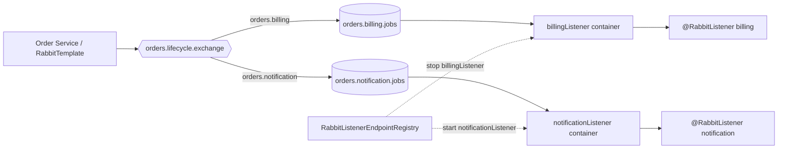

# RabbitListenerEndpointRegistry và quản lý start/stop theo id

Trong một hệ thống xử lý bất đồng bộ, đôi khi ta cần **tạm dừng riêng một nhóm consumer** nhưng vẫn để ứng dụng Spring Boot tiếp tục hoạt động. Ví dụ, dịch vụ tạo hóa đơn đang gặp lỗi ở cơ sở dữ liệu: đội vận hành muốn ngừng nhận thêm message từ queue hóa đơn, sửa sự cố, rồi cho consumer tiếp tục xử lý backlog. Việc dừng toàn bộ JVM sẽ ảnh hưởng những listener khác vốn vẫn hoạt động bình thường.

Với **Spring AMQP**, các phương thức `@RabbitListener` được framework đưa vào những **listener container**. `RabbitListenerEndpointRegistry` cho phép tìm các container đó bằng **`id` đã khai báo trên annotation**, quan sát trạng thái vòng đời và gọi `start()`/`stop()` cho từng container.

Bài học nằm trong chương **Listener khai báo** của module **SPRING_AMQP**, kết hợp ví dụ `RabbitTemplate`, exchange, queue, binding, `@RabbitListener` và tình huống vận hành thực tế. Đồng thời, ta sẽ phân biệt việc dừng container với consumer acknowledgement, retry, dead-letter, giao dịch và quan sát RabbitMQ để tránh nhầm “đã dừng” với “đã xử lý xong mọi message”.

## 1. Vì sao cần điều khiển listener riêng theo id?

Giả sử cùng một ứng dụng có hai nhiệm vụ: xử lý đơn hàng cho bộ phận hóa đơn và gửi thông báo.



Khi tạm dừng `billingListener`, Spring không còn chủ động tiêu thụ thêm delivery mới cho listener này sau khi quá trình dừng hoàn tất. Queue `orders.billing.jobs` **vẫn tồn tại**, exchange/binding **không tự biến mất**, producer **vẫn có thể publish** vào queue và các listener khác **không bắt buộc bị dừng theo**.

| Nhu cầu | Điều khiển phù hợp | Điều không nên làm |
| --- | --- | --- |
| Bảo trì bộ phận hóa đơn | `stop()` container `billingListener` | Dừng cả RabbitMQ hoặc JVM nếu chỉ một nhóm gặp lỗi |
| Tạm giữ backlog để kiểm tra payload | Dừng consumer rồi quan sát `Ready`, `Unacked` | Xóa queue hoặc binding để “tạm dừng” |
| Sau khi sửa sự cố, tiếp tục tiêu thụ | `start()` đúng container | Tạo thêm container không kiểm soát trên cùng queue |
| Chỉ một môi trường được tự chạy listener | `autoStartup=false` hoặc cấu hình lifecycle tương ứng | Phụ thuộc vào thời điểm kết nối để “hy vọng” listener chưa chạy |
| Triển khai nhiều instance | Điều phối trạng thái **trên từng instance** và cấp deployment | Giả định registry của một JVM có thể dừng consumer ở tất cả JVM |

**Registry điều khiển listener container, không điều khiển trực tiếp queue của broker.** Nó cũng không phải một công cụ để xóa, purge hay chuyển message sang DLQ.

## 2. RabbitListenerEndpointRegistry quản lý những gì?

Khi annotation processing cho `@RabbitListener` được bật, Spring tạo và đăng ký các endpoint listener, thường thông qua `RabbitListenerAnnotationBeanPostProcessor` và `RabbitListenerEndpointRegistrar`. Các endpoint tạo ra **message listener container** theo `RabbitListenerContainerFactory` phù hợp. `RabbitListenerEndpointRegistry` là nơi quản lý vòng đời các container được đăng ký qua cơ chế này.

Những API quan trọng:

```java
import org.springframework.amqp.rabbit.listener.MessageListenerContainer;
import org.springframework.amqp.rabbit.listener.RabbitListenerEndpointRegistry;

// registry được inject từ Spring context
MessageListenerContainer container =
        registry.getListenerContainer("billingListener");

if (container != null) {
    boolean running = container.isRunning();
    if (!running) {
        container.start();
    }
    // Khi cần:
    container.stop();
}
```

Đoạn trên là mảnh mã minh họa; trong ứng dụng thật cần xử lý `null`, quyền điều khiển, trạng thái chuyển tiếp và lỗi khi khởi động.

### Những ranh giới quan trọng

- **`id` của `@RabbitListener`** là khóa tra cứu container. Nó không phải routing key, queue name, consumer tag hay ID message.
- Registry thường quản lý **container được tạo cho annotated endpoints**. Một `SimpleMessageListenerContainer` do bạn tự tạo dưới dạng `@Bean` không mặc nhiên xuất hiện trong tập container này theo cùng cơ chế; muốn điều khiển nó có thể inject bean trực tiếp.
- Registry là một bean trong **ApplicationContext hiện tại**, không phải kho trạng thái phân tán. Hai replica của cùng service sẽ có **hai registry khác nhau**.
- `container.isRunning()` phản ánh **trạng thái lifecycle ở phía Spring**. Nó không khẳng định consumer đã thực sự kết nối thành công, đang được broker cấp delivery hay backlog đã cạn.
- `start()`/`stop()` quản lý hoạt động container; **không sửa cấu hình exchange, queue và binding** và không thay các quy tắc retry, acknowledgement hay DLX.

Một số phiên bản Spring AMQP có các API như `getListenerContainerIds()`, `getListenerContainers()` và `getAllListenerContainers()`. Khi cần liệt kê trạng thái hãy kiểm tra API **đúng phiên bản** dự án; đặc biệt, tập container do endpoint registry quản lý có thể khác các container bean khai báo trực tiếp trong context.

## 3. Khai báo id tường minh và autoStartup

Một listener cơ bản:

```java
@RabbitListener(
    id = "billingListener",
    queues = "orders.billing.jobs",
    autoStartup = "false"
)
public void handleBilling(String payload) {
    // Xử lý hóa đơn.
}
```

Các thuộc tính có ý nghĩa khác nhau:

| Thuộc tính | Vai trò | Hệ quả vận hành |
| --- | --- | --- |
| `id` | ID định danh listener container trong registry của context | Dùng với `getListenerContainer("billingListener")` |
| `queues` | Queue mà container tiêu thụ | Không dùng làm ID container nếu có `id` riêng |
| `autoStartup` | Quyết định container có tự khởi động cùng context không | `"false"` giúp chờ thao tác start chủ động |
| `containerFactory` | Chọn cấu hình container cho listener | Ảnh hưởng concurrency, prefetch, acknowledgement, error handler |
| `concurrency` | Điều chỉnh số consumer/container concurrency theo factory | Không thay đổi số replica của ứng dụng |

Đặt **ID tường minh, ổn định, duy nhất trong ApplicationContext**; ví dụ `billingListener`, `notificationListener`, `invoiceRetryListener`. Nếu không cung cấp `id`, framework có thể sinh tên, nhưng tên tự sinh không nên dùng làm hợp đồng điều khiển vận hành.

`autoStartup="false"` có nghĩa listener **không tự được khởi động theo vòng đời context như thông thường**; sau đó ứng dụng có thể gọi `start()` khi đúng thời điểm. Tình huống tốt để dùng: đợi một bước kiểm tra readiness, bảo trì có chủ đích hoặc xử lý dữ liệu sau migration. Tuy vậy, nếu toàn bộ ứng dụng restart, trạng thái tạm dừng bằng lời gọi `stop()` trước đó **không tự được lưu bền**. Muốn giữ listener ngừng chạy sau restart, phải có cấu hình hoặc state điều phối bên ngoài được áp dụng khi boot.

**Không dùng cùng một `id` cho hai annotated listeners** trong cùng registry. Việc trùng ID có thể khiến đăng ký endpoint thất bại hoặc khó xác định container nào thực sự được điều khiển.

## 4. Project mẫu: exchange, hai queue và hai listener

Giả sử dự án Spring Boot đã có parent/BOM quản lý các phiên bản phụ thuộc:

```xml
<!-- pom.xml -->
<dependency>
    <groupId>org.springframework.boot</groupId>
    <artifactId>spring-boot-starter-amqp</artifactId>
</dependency>
```

Ví dụ local, dùng broker đã tạo user `app_local` và virtual host `orders_local`:

```yaml
# application-local.yml
spring:
  rabbitmq:
    host: localhost
    port: 5672
    username: app_local
    password: local-demo-only
    virtual-host: orders_local
```

Đây chỉ là thông tin cho môi trường **thực hành**, không phải secrets production. Trong container/kubernetes, `localhost` không tự trỏ đến một RabbitMQ nằm ở container khác. Production nên dùng cấu hình riêng, credentials an toàn và TLS khi phù hợp.

### 4.1. Khai báo topology

```java
import org.springframework.amqp.core.Binding;
import org.springframework.amqp.core.BindingBuilder;
import org.springframework.amqp.core.DirectExchange;
import org.springframework.amqp.core.Queue;
import org.springframework.amqp.core.QueueBuilder;
import org.springframework.beans.factory.annotation.Qualifier;
import org.springframework.context.annotation.Bean;
import org.springframework.context.annotation.Configuration;
import org.springframework.amqp.rabbit.annotation.EnableRabbit;

@Configuration
@EnableRabbit
public class ListenerLifecycleTopology {
    public static final String EXCHANGE = "orders.lifecycle.exchange";
    public static final String BILLING_QUEUE = "orders.billing.jobs";
    public static final String NOTIFICATION_QUEUE = "orders.notification.jobs";
    public static final String BILLING_KEY = "orders.billing";
    public static final String NOTIFICATION_KEY = "orders.notification";

    @Bean
    public DirectExchange lifecycleExchange() {
        return new DirectExchange(EXCHANGE, true, false);
    }

    @Bean
    public Queue billingQueue() {
        return QueueBuilder.durable(BILLING_QUEUE).build();
    }

    @Bean
    public Queue notificationQueue() {
        return QueueBuilder.durable(NOTIFICATION_QUEUE).build();
    }

    @Bean
    public Binding billingBinding(
            @Qualifier("billingQueue") Queue queue,
            @Qualifier("lifecycleExchange") DirectExchange exchange) {
        return BindingBuilder.bind(queue).to(exchange).with(BILLING_KEY);
    }

    @Bean
    public Binding notificationBinding(
            @Qualifier("notificationQueue") Queue queue,
            @Qualifier("lifecycleExchange") DirectExchange exchange) {
        return BindingBuilder.bind(queue).to(exchange).with(NOTIFICATION_KEY);
    }
}
```

Spring Boot thường auto-configure `RabbitAdmin` với `spring-boot-starter-amqp` trong điều kiện phù hợp; khi tạo kết nối, các bean topology có thể được khai báo lên RabbitMQ. **Bean được tạo trong Spring không đồng nghĩa broker đã khai báo thành công.** Hãy kiểm tra tên exchange, queue, binding, quyền user và đúng virtual host qua RabbitMQ Management UI.

### 4.2. Hai listener có lifecycle khác nhau

```java
import org.slf4j.Logger;
import org.slf4j.LoggerFactory;
import org.springframework.amqp.rabbit.annotation.RabbitListener;
import org.springframework.stereotype.Component;

@Component
public class OrderLifecycleConsumers {
    private static final Logger log =
            LoggerFactory.getLogger(OrderLifecycleConsumers.class);

    @RabbitListener(
        id = "billingListener",
        queues = ListenerLifecycleTopology.BILLING_QUEUE,
        autoStartup = "false"
    )
    public void onBilling(String text) {
        log.info("Billing event received: {}", text);
        // Validate, xử lý nghiệp vụ, ghi nhận eventId/idempotency.
    }

    @RabbitListener(
        id = "notificationListener",
        queues = ListenerLifecycleTopology.NOTIFICATION_QUEUE
    )
    public void onNotification(String text) {
        log.info("Notification event received: {}", text);
        // Gửi thông báo và xử lý lỗi độc lập với billing.
    }
}
```

Điểm cần kiểm chứng sau khi boot: `billingListener` được đăng ký trong registry nhưng **không tự chạy** do `autoStartup=false`; `notificationListener` có thể tự chạy bình thường. Hai phương thức nhận `String` vì demo gửi text qua converter thích hợp. Nếu đổi sang DTO JSON, producer/consumer phải cùng cấu hình `MessageConverter` và schema.

### 4.3. Gửi message bằng RabbitTemplate

```java
import org.springframework.amqp.rabbit.core.RabbitTemplate;
import org.springframework.stereotype.Service;

@Service
public class OrderLifecyclePublisher {
    private final RabbitTemplate template;

    public OrderLifecyclePublisher(RabbitTemplate template) {
        this.template = template;
    }

    public void publishBilling(String text) {
        template.convertAndSend(
                ListenerLifecycleTopology.EXCHANGE,
                ListenerLifecycleTopology.BILLING_KEY, text);
    }

    public void publishNotification(String text) {
        template.convertAndSend(
                ListenerLifecycleTopology.EXCHANGE,
                ListenerLifecycleTopology.NOTIFICATION_KEY, text);
    }
}
```

Producer vẫn publish theo **exchange và routing key** ngay cả khi billing listener đã dừng. Nếu queue đang tồn tại và message được route đúng, message có thể được lưu chờ consumer quay lại; điều này phụ thuộc TTL, queue length, delivery mode, queue type, tình trạng broker và các chính sách liên quan. Không suy ra “mọi message chắc chắn được giữ vĩnh viễn” chỉ từ việc `stop()` container.

## 5. Service điều khiển start/stop an toàn theo id

Inject `RabbitListenerEndpointRegistry` vào service vận hành. Dùng **allowlist ID đã biết**, thay vì nhận bất kỳ tên nào từ yêu cầu không tin cậy:

```java
import java.util.Set;

import org.springframework.amqp.rabbit.listener.MessageListenerContainer;
import org.springframework.amqp.rabbit.listener.RabbitListenerEndpointRegistry;
import org.springframework.stereotype.Service;

@Service
public class ListenerLifecycleManager {
    private static final Set<String> ALLOWED_IDS =
            Set.of("billingListener", "notificationListener");

    private final RabbitListenerEndpointRegistry registry;

    public ListenerLifecycleManager(RabbitListenerEndpointRegistry registry) {
        this.registry = registry;
    }

    private MessageListenerContainer find(String id) {
        if (!ALLOWED_IDS.contains(id)) {
            throw new IllegalArgumentException("Unsupported listener id: " + id);
        }
        MessageListenerContainer container = registry.getListenerContainer(id);
        if (container == null) {
            throw new IllegalStateException("Listener not registered: " + id);
        }
        return container;
    }

    public boolean isRunning(String id) {
        return find(id).isRunning();
    }

    public void start(String id) {
        MessageListenerContainer container = find(id);
        if (!container.isRunning()) {
            container.start();
        }
    }

    public void stop(String id) {
        MessageListenerContainer container = find(id);
        if (container.isRunning()) {
            container.stop();
        }
    }
}
```

Ở đây `MessageListenerContainer` là interface trong `org.springframework.amqp.rabbit.listener`; container do `@RabbitListener` tạo thường triển khai lifecycle của Spring và cho phép gọi `start()`, `stop()`, `isRunning()`.

**Vì sao kiểm tra `isRunning()`?** Để tránh ra lệnh chuyển trạng thái không cần thiết và làm code dễ đọc. Đây **không phải khóa đồng bộ**: hai thread điều khiển cùng container cùng lúc có thể đọc trạng thái cũ. Với hệ thống thật, cần một nơi điều phối/serialization cho thao tác vận hành và cơ chế chống thao tác trùng khi nhiều quản trị viên cùng gửi lệnh.

**Không tự mở REST endpoint công khai** để gọi `start/stop`. Nếu muốn cung cấp endpoint vận hành, bắt buộc áp dụng xác thực, phân quyền quản trị, audit log và kiểm tra môi trường/instance; cân nhắc dùng công cụ điều phối deployment hoặc runbook có kiểm soát.

### 5.1. Lệnh stop có cần đợi hoàn tất không?

`stop()` khởi động quá trình dừng theo lifecycle của container; với các loại container/cấu hình, thao tác có thể đợi hoặc có phần dừng bất đồng bộ. Nếu cần thông báo **khi quá trình stop thực sự hoàn tất**, Spring `SmartLifecycle` hỗ trợ callback:

```java
MessageListenerContainer container =
        registry.getListenerContainer("billingListener");
if (container != null) {
    container.stop(() -> {
        // Được gọi khi container báo hoàn thành stop.
        // Chỉ ghi nhận trạng thái; tránh xử lý blocking tại callback.
    });
}
```

Không xem callback này là “tất cả tác vụ nghiệp vụ đã commit thành công”. Nếu listener đang xử lý message dài, cơ chế stop, shutdown timeout, outstanding deliveries và kết quả ack cần được kiểm tra riêng. Không chạy database transaction dài hoặc publish lại hàng loạt ngay trong callback lifecycle.

## 6. Điều khiển khởi động theo tình huống thực tế

### 6.1. Bắt đầu theo điều kiện readiness

Một cách đơn giản là để `billingListener` có `autoStartup=false`, sau đó gọi `start` **chỉ sau khi** ứng dụng đã xác minh dịch vụ phụ thuộc sẵn sàng. Ví dụ tạo runner **chỉ trong profile local**, không áp dụng nguyên mẫu cho production:

```java
import org.springframework.boot.ApplicationArguments;
import org.springframework.boot.ApplicationRunner;
import org.springframework.context.annotation.Bean;
import org.springframework.context.annotation.Configuration;
import org.springframework.context.annotation.Profile;

@Configuration
public class ListenerLifecycleDemo {
    @Bean
    @Profile("local")
    ApplicationRunner demoLifecycle(
            OrderLifecyclePublisher publisher,
            ListenerLifecycleManager manager) {
        return args -> {
            // Billing chưa auto-start nên có thể tích lũy message thử.
            publisher.publishBilling("bill:ORD-1001");
            publisher.publishNotification("notify:ORD-1001");

            // Trong demo, cho billing chạy sau thao tác publish.
            manager.start("billingListener");
        };
    }
}
```

**Cần phân biệt tính tương đối của thời điểm:** runner chạy sau bước khởi tạo context, nhưng notification listener có thể đã kết nối và nhận message trước đó. Nếu broker chưa sẵn sàng, thao tác publish/start có thể lỗi; production phải có chính sách readiness và recovery phù hợp, không xem runner là bộ bảo đảm delivery.

### 6.2. Dừng để bảo trì rồi tiếp tục

Runbook vận hành theo thứ tự:

1. Xác định listener ID và **instance** sẽ được dừng; ghi nhận lý do, người thao tác và thời điểm.
2. Gọi `manager.stop("billingListener")` qua đường điều khiển đã phân quyền.
3. Xác minh trên RabbitMQ Management UI: số consumer của queue do instance đó tạo giảm; nếu không còn instance khác, số consumer của queue có thể về 0.
4. Quan sát các delivery đã nhận trước đó, `Unacked`, backlog `Ready` và lỗi; đợi điều kiện xử lý/dừng phù hợp.
5. Sửa service phụ thuộc hoặc cấu hình, kiểm tra readiness và tài nguyên broker.
6. Gọi `manager.start("billingListener")`, quan sát consumer mới xuất hiện và backlog được xử lý.
7. Theo dõi tốc độ redelivery, retry, DLQ, lỗi nghiệp vụ và giới hạn tải khi catch up.

Nếu việc bảo trì cần **không có delivery mới tới mọi instance**, phải dừng đúng listener trên **tất cả replica** hoặc dùng phương án điều phối tập trung. Gọi stop ở một pod không dừng consumer đang chạy ở những pod còn lại.

### 6.3. Khởi động tất cả container không phải lúc nào cũng đúng

Registry là một `SmartLifecycle` component có thể quản lý vòng đời nhiều container. Tuy nhiên, khi nghiệp vụ cần tắt **riêng billing** và giữ notification hoạt động, **đừng dùng** `registry.stop()`/ `registry.start()` như thao tác quản trị per-listener. Hãy lấy đúng container qua ID.

Đặc biệt, khi có listener `autoStartup=false`, một lần khởi động hàng loạt không nên được coi là cách chắc chắn chọn đúng policy khởi động riêng cho từng endpoint trên mọi phiên bản Spring AMQP. Quy trình vận hành rõ nhất là điều khiển từng container cần thay trạng thái.

## 7. Stop listener ảnh hưởng đến message và ack như thế nào?

Quá trình dừng không sửa kết quả publish. **Producer vẫn có thể publish tới queue**, còn broker chỉ giao message cho các consumer đang đăng ký và có khả năng nhận.

```text
RabbitTemplate --> exchange --> queue (durable)
                                  |
                  billingListener STOPPED
                                  |
                 Ready có thể tăng theo publish rate

billingListener STARTED --> broker cấp delivery --> xử lý --> ack/nack
```

Những trường hợp cần đánh giá:

| Trạng thái khi stop | Điều có thể xảy ra | Cần quan sát |
| --- | --- | --- |
| Message còn **Ready** trong queue | Vẫn chờ consumer, trừ khi hết TTL, bị giới hạn độ dài hoặc broker áp policy khác | `messages_ready`, TTL, queue policies |
| Message đã được giao và **Unacked** | Container có thể đợi xử lý/ack hoàn tất, hoặc channel/connection đóng khiến broker giao lại | `messages_unacknowledged`, shutdown timeout, redelivery |
| Listener sử dụng **AUTO ack** của Spring | Container thường ack sau xử lý thành công; lỗi đi vào error handler/requeue theo cấu hình | Consumer exception, retry, reject/DLQ |
| Listener dùng **MANUAL ack** | Code nghiệp vụ phải tự ack/nack hợp lệ trên channel | Delivery tags, unacked tồn đọng, stop timeout |
| Nhiều consumer khác cùng đọc queue | Các consumer **còn sống** vẫn tiếp tục nhận message | Consumer count theo queue và từng instance |
| Queue có TTL, length limit, overflow policy | Backlog có thể bị loại/reject/dead-letter tùy chính sách | Effective policy, DLQ và broker metrics |

**AUTO ack của Spring AMQP** khác RabbitMQ `autoAck=true` (no-ack). `AcknowledgeMode.AUTO` thường để listener container ack khi method xử lý thành công; trong khi `AcknowledgeMode.NONE` thường tương ứng giao message không cần consumer ack. Không nhầm trạng thái start/stop với ack.

### Rủi ro với xử lý lâu và restart

Giả sử `billingListener` ghi hóa đơn vào DB, nhưng JVM chết trước khi consumer ack. Sau khi listener hoặc instance khác chạy lại, RabbitMQ có thể **giao lại cùng message**. Do đó:

- Dùng `eventId` hoặc khóa nghiệp vụ với database unique constraint/giao dịch để xử lý idempotent.
- Đảm bảo logic khôi phục chịu được message bị xử lý một phần.
- Giữ thời gian xử lý trong giới hạn hợp lý, cấu hình prefetch và concurrency phù hợp.
- Không mặc định rằng `stop()` là một “transaction” bảo đảm mọi in-flight work đã hoàn tất.

Nếu consumer liên tục lỗi, cân nhắc retry có giới hạn/backoff và DLX/DLQ. Việc stop consumer chỉ **ngăn nhận thêm delivery**, không tự đưa message lỗi vào DLQ hay chữa nguyên nhân lỗi. Khi dùng quorum queue, còn phải hiểu delivery limit và cách các phiên bản RabbitMQ xử lý failed delivery.

## 8. Registry và cấu hình listener container factory

Registry điều khiển **vòng đời**, còn `RabbitListenerContainerFactory` quyết định **cách container hoạt động**.

Ví dụ cấu hình riêng cho billing nếu cần kiểm soát prefetch/concurrency (Spring Boot thường cung cấp factory mặc định; đây chỉ là ví dụ custom):

```java
import org.springframework.amqp.rabbit.config.SimpleRabbitListenerContainerFactory;
import org.springframework.amqp.rabbit.connection.ConnectionFactory;
import org.springframework.context.annotation.Bean;
import org.springframework.context.annotation.Configuration;

@Configuration
public class BillingListenerFactoryConfig {
    @Bean
    SimpleRabbitListenerContainerFactory billingContainerFactory(
            ConnectionFactory connectionFactory) {
        SimpleRabbitListenerContainerFactory factory =
                new SimpleRabbitListenerContainerFactory();
        factory.setConnectionFactory(connectionFactory);
        factory.setConcurrentConsumers(2);
        factory.setMaxConcurrentConsumers(4);
        factory.setPrefetchCount(20);
        return factory;
    }
}
```

Khi dùng custom factory, trỏ annotation:

```java
@RabbitListener(
    id = "billingListener",
    queues = ListenerLifecycleTopology.BILLING_QUEUE,
    autoStartup = "false",
    containerFactory = "billingContainerFactory"
)
public void onBilling(String text) {
    // Xử lý event.
}
```

Đây là **minh họa phương thức thay thế** cho `onBilling` ở mục 4, không phải yêu cầu khai báo **hai** phương thức `@RabbitListener` trùng ID cùng lúc. Trong một ứng dụng thực hành, chọn **một** cách khai báo billing listener.

Khi ghi đè factory mặc định của Spring Boot, bạn phải tự kiểm tra các cấu hình khác như acknowledgement, retry/error handler, message converter, observation, transaction và executor. Tự tạo factory không mặc nhiên kế thừa toàn bộ property được cấu hình cho default factory. Với bài tập chỉ cần start/stop theo id, **không bắt buộc** phải tự tạo factory.

### Thay concurrency khác với dừng container

Với một số loại listener container, Spring AMQP cho phép điều chỉnh concurrency theo cơ chế container. Việc tăng giảm consumer ảnh hưởng throughput/prefetch nhưng **không có cùng ý nghĩa** với `stop()`. Nếu hệ thống đang quá tải, cần xác định nguyên nhân ở consumer, broker, database hay downstream trước khi tăng concurrency. Tăng số consumer có thể khiến lỗi DB hoặc API downstream trầm trọng hơn.

## 9. Quan sát trạng thái và xây dashboard vận hành

Nên kết hợp **trạng thái cục bộ của registry** với **thực tế ở RabbitMQ broker**:

| Tín hiệu | Nguồn | Câu hỏi trả lời |
| --- | --- | --- |
| `registry.getListenerContainer(id) == null` | Spring app | ID có được đăng ký trong instance này không? |
| `container.isRunning()` | Spring app | Container có đang ở trạng thái lifecycle running không? |
| Active consumer count | RabbitMQ Management | Broker đang thấy bao nhiêu consumer trên queue? |
| `messages_ready` | Broker queue | Có bao nhiêu message đang chờ được giao? |
| `messages_unacknowledged` | Broker queue | Có bao nhiêu delivery đang chờ ack? |
| Delivery/ack/redelivery rate | RabbitMQ / metrics | Listener có thực sự xử lý và hoàn tất message không? |
| Listener error count, retry, DLQ | Application + RabbitMQ | Message nào bị lỗi và đã được cách ly chưa? |
| Connection health / resource alarms | Broker + Actuator | Broker còn khả dụng và có bị chặn vì tài nguyên không? |

**`isRunning=true` không đủ làm readiness check cho consumer.** Container có thể đang cố khôi phục kết nối, queue chưa tồn tại hoặc quyền consumer bị từ chối. Ngược lại, `isRunning=false` có thể là trạng thái bảo trì được yêu cầu chứ không phải sự cố.

### Ghi lại sự kiện điều khiển

Khi thao tác qua service vận hành, ghi audit phù hợp:

```text
timestamp=2026-11-26T02:30:00Z
instance=order-worker-2
listenerId=billingListener
action=STOP
reason=database-maintenance
requestedBy=ops-user
beforeRunning=true
afterRunning=false
```

Đây là **ví dụ nội dung audit**, không phải bằng chứng mọi in-flight delivery đã kết thúc. Tránh log payload, password hoặc thông tin cá nhân. Nếu cần chứng minh đã drain hết công việc, phải theo dõi hoạt động thực tế, `Unacked` và trạng thái xử lý nghiệp vụ.

Khi dùng Spring Boot Actuator/Micrometer, có thể cung cấp metric hoặc health contribution tùy chỉnh cho listener quan trọng. Tuy nhiên, không nên đánh dấu **toàn ứng dụng DOWN** chỉ vì một listener được chủ động tạm dừng để bảo trì mà không xét chính sách service readiness.

## 10. Sai lầm phổ biến và cách xử lý

| Hiện tượng | Nguyên nhân có thể | Hướng xử lý |
| --- | --- | --- |
| `getListenerContainer("billingListener")` trả `null` | Sai ID, bean listener không được tạo, annotation processor chưa bật, profile/conditional vô hiệu | Kiểm tra `@EnableRabbit`, `@RabbitListener(id=...)`, context và ID thực tế |
| Gọi `start()` nhưng không nhận message | Queue trống, routing key sai, broker kết nối lỗi, quyền/queue sai | Kiểm tra Management UI, connection, consumer count, exchange/binding |
| Gọi `stop()` nhưng queue vẫn có người tiêu thụ | Instance khác hoặc container khác cùng đọc queue | Kiểm tra consumer tags, connection/instance, registry của mỗi replica |
| `stop()` xong vẫn thấy một vài delivery hoàn tất | Delivery đã nhận trước khi stop, shutdown đang hoàn thành | Theo dõi `Unacked` và callback stop, không suy luận là stop không hoạt động |
| Listener tự chạy lại sau restart | `autoStartup=true` hoặc cấu hình tạm dừng chỉ nằm trong RAM | `autoStartup=false`, áp policy điều phối khi boot |
| Hai listener dùng cùng ID | Trùng khóa endpoint/registry | Dùng ID duy nhất trong một ApplicationContext |
| Thêm custom factory rồi mất converter/retry | Factory mới không kế thừa cấu hình mặc định theo cách mong đợi | Cấu hình tường minh hoặc dùng Boot-provided configurer |
| Listener lỗi và backlog tăng mãi | Retry/requeue vô hạn, downstream chưa phục hồi | Phân loại lỗi, backoff, DLQ và cảnh báo |
| Pause consumer làm message “biến mất” | TTL, overflow, queue bị xóa, consumer khác vẫn chạy | Kiểm tra queue policy, DLX/DLQ, active consumers |
| Một pod stop, pod khác vẫn xử lý | Registry chỉ có phạm vi JVM | Điều phối nhiều replica khi cần dừng toàn cục |
| `isRunning=true` nhưng không thấy consumer ở broker | Container đang recovery hoặc bị lỗi kết nối/queue | Xem logs, consumer count, network/TLS, RabbitMQ health |

## 11. Thực hành: start/stop theo id và kiểm chứng backlog

### 11.1. Trước khi chạy

1. Chuẩn bị broker RabbitMQ test, user và vhost `orders_local` với quyền phù hợp.
2. Tạo các class topology, publisher, listeners và manager ở mục 4–5.
3. Chạy Spring Boot với profile `local`; để `billingListener` có `autoStartup=false`, còn `notificationListener` khởi động bình thường.
4. Xác nhận Registry có cả hai ID; billing có `isRunning=false`.
5. Kiểm tra qua Management UI exchange `orders.lifecycle.exchange`, hai queue và binding tương ứng.

### 11.2. Gửi trong khi listener chưa chạy

Gửi:

```java
publisher.publishBilling("bill:ORD-1001");
publisher.publishBilling("bill:ORD-1002");
publisher.publishNotification("notify:ORD-1001");
```

Khi chỉ có một instance và không có consumer nào khác trên billing queue, `orders.billing.jobs` sẽ có hai message chờ xử lý (nếu chưa hết TTL/overflow và broker đã nhận đúng). Trong khi đó, notification vẫn có thể tiêu thụ message của mình. Không dùng đúng số `Ready=2` làm kết luận nếu trên broker có nhiều consumer hoặc dữ liệu thử nghiệm từ lần trước.

### 11.3. Start billing và quan sát

Từ một test harness hoặc đường điều khiển nội bộ đã phân quyền:

```java
manager.start("billingListener");
boolean running = manager.isRunning("billingListener");
```

Xác nhận Management UI có consumer billing, log phương thức `onBilling` nhận message, queue `Ready` giảm và `Unacked` được ack/giải phóng sau xử lý. Nếu thấy `isRunning=true` nhưng broker không có consumer, xem logs recovery, lỗi `NOT_FOUND`, permissions và trạng thái connection.

### 11.4. Stop billing rồi thử publish thêm

```java
manager.stop("billingListener");
publisher.publishBilling("bill:ORD-1003");
```

Quan sát khi stop đã hoàn tất: consumer billing của instance này ngừng nhận message mới, nhưng producer vẫn gửi. Trong hệ thống chỉ có một consumer, message mới thường chờ ở queue. Sau đó gọi `manager.start("billingListener")` và quan sát backlog được tiêu thụ.

### 11.5. Thử tình huống lỗi và retry

Cho riêng `onBilling` ném exception sau khi nhận một message test. Quan sát listener container xử lý exception theo chế độ ack và error handler thực tế:

- Nếu requeue, message có thể được giao lại, cần giới hạn retry/backoff.
- Nếu reject không requeue và queue có DLX/binding hợp lệ, message có thể vào DLQ.
- Nếu stop giữa lúc message đang xử lý, việc ack/redelivery phụ thuộc thời điểm, shutdown timeout và tình trạng connection.

**Không dùng stop/start như một bộ đếm retry.** Stop quản lý consumer availability, còn retry/dead-letter là chính sách xử lý lỗi message. Test tình huống lỗi trên queue riêng, có cơ chế dừng vòng lặp và không làm ảnh hưởng production.

## 12. Checklist và câu hỏi tự kiểm tra

Sau bài này, bạn nên tự xác minh:

- [ ] Khai báo `@RabbitListener(id="...")` tường minh và không trùng trong cùng ApplicationContext.
- [ ] Hiểu `autoStartup="false"` khác với gọi `stop()` sau khi listener đã chạy.
- [ ] Inject `RabbitListenerEndpointRegistry` và dùng đúng `getListenerContainer(id)`.
- [ ] Xử lý trường hợp ID không tồn tại (`null`) và không cho phép tên ID không được cấp quyền.
- [ ] Dùng `isRunning()` như trạng thái lifecycle, không nhầm với consumer health hay xác nhận message.
- [ ] Biết cách gọi `start()`, `stop()` và cân nhắc callback hoàn tất stop.
- [ ] Phân biệt registry trong từng JVM với việc điều phối tất cả replica/pod.
- [ ] Kiểm chứng exchange, queue, binding và consumer count trên broker sau mỗi thao tác.
- [ ] Có kế hoạch xử lý backlog, prefetch, unacked deliveries và idempotency khi stop/restart.
- [ ] Theo dõi retry, DLQ và producer confirms độc lập với thao tác lifecycle.
- [ ] Không cung cấp API start/stop công khai, không ghi secrets hoặc payload nhạy cảm vào audit.

Tự kiểm tra:

1. Vì sao `@RabbitListener(id="billingListener")` không nhất thiết liên quan đến tên queue `orders.billing.jobs`?
2. Khi `autoStartup=false`, tại sao registry vẫn có thể tìm thấy container ngay sau khi ứng dụng khởi tạo?
3. Nếu gọi `stop()` ở một replica nhưng RabbitMQ vẫn có consumer billing, nên kiểm tra điều gì?
4. Khi listener dừng, producer có còn publish vào queue không? Những chính sách nào có thể khiến backlog không được giữ nguyên?
5. Vì sao `isRunning()` không đủ chứng minh listener đã xử lý hết message?
6. Nếu DB commit thành công nhưng consumer chết trước ack, `start()` lại có thể tạo tác dụng phụ nào? Cần cơ chế gì để phòng tránh?
7. Khi muốn điều chỉnh prefetch/concurrency và khi muốn pause listener, API và trách nhiệm có khác nhau như thế nào?

## 13. Tài liệu tra cứu

- [Spring AMQP – Annotated Listener Endpoint](https://docs.spring.io/spring-amqp/reference/amqp/receiving-messages/async-annotation-driven.html): `@RabbitListener`, ID, lifecycle và container được quản lý.
- [Spring AMQP – Listener Container](https://docs.spring.io/spring-amqp/reference/amqp/receiving-messages/containerAttributes.html): `autoStartup`, acknowledgement, concurrency, prefetch và shutdown.
- [Spring AMQP API – RabbitListenerEndpointRegistry](https://docs.spring.io/spring-amqp/docs/current/api/org/springframework/amqp/rabbit/listener/RabbitListenerEndpointRegistry.html): các phương thức tìm và điều khiển container.
- [Spring AMQP API – RabbitListener](https://docs.spring.io/spring-amqp/docs/current/api/org/springframework/amqp/rabbit/annotation/RabbitListener.html): `id`, `queues`, `autoStartup`, `containerFactory`.
- [RabbitMQ – Consumer Acknowledgements and Publisher Confirms](https://www.rabbitmq.com/docs/confirms): consumer ack và khác biệt với publisher confirms.

**Ghi nhớ:** `RabbitListenerEndpointRegistry` cung cấp cách **lấy listener container theo `@RabbitListener(id=...)`** để chủ động `start()` và `stop()` từng consumer trong **một Spring ApplicationContext**. `autoStartup=false` hữu ích khi cần chủ động thời điểm bắt đầu tiêu thụ. Nhưng stop listener **không xóa queue, không ngừng producer và không đồng nghĩa message đã được ack**. Hãy điều phối các replica, theo dõi `Ready`/`Unacked`, retry/DLQ, publisher confirms và idempotency để thực sự vận hành luồng Spring AMQP an toàn.
