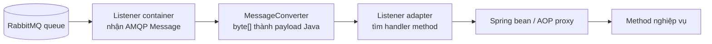
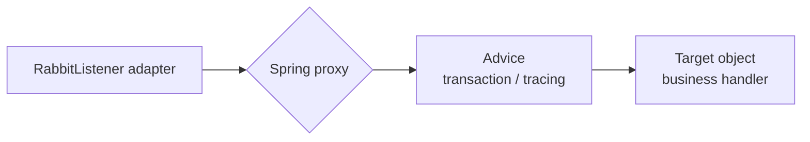
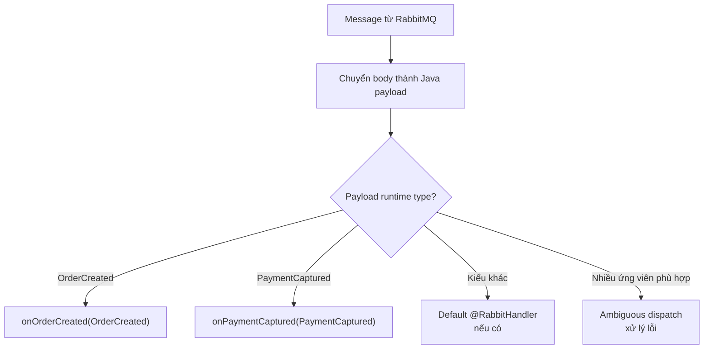
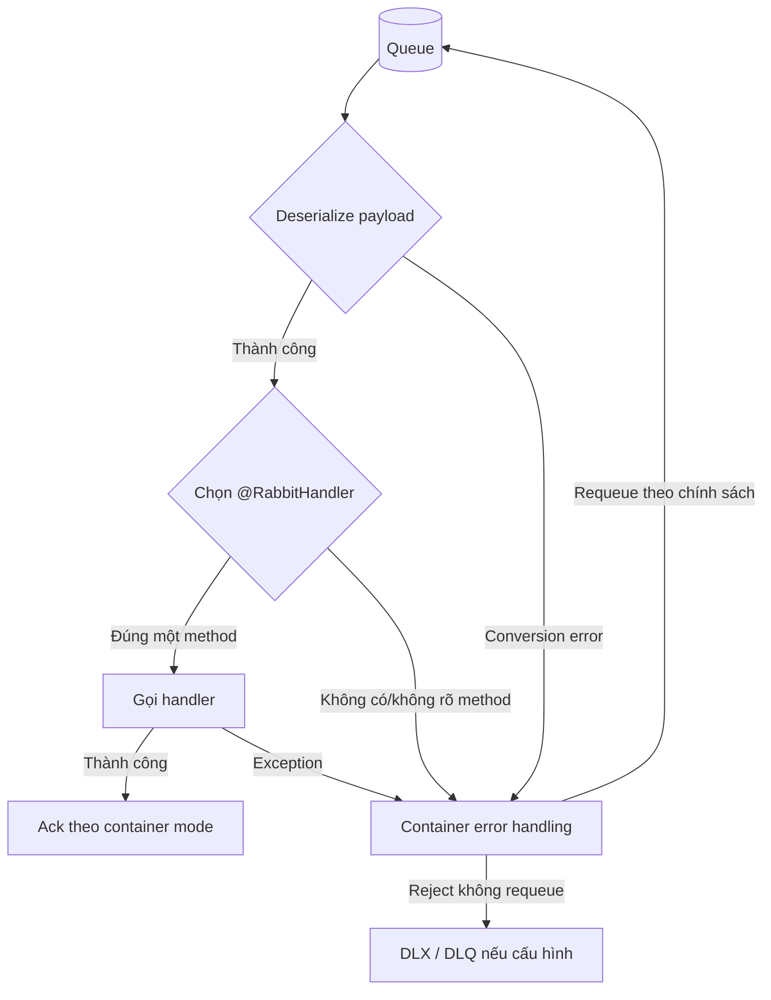

# Giới hạn proxy, phương thức generic và các trường hợp chọn handler không rõ

## Mục tiêu bài học

Trong module **SPRING_AMQP**, Spring Boot thường sử dụng `RabbitTemplate` để phát message tới exchange RabbitMQ và `@RabbitListener` để đọc message từ queue. Đối với một listener đơn giản có đúng một method nhận payload, cơ chế gọi handler có vẻ rất trực tiếp. Nhưng khi kết hợp **Spring AOP proxy**, **phương thức generic**, **nhiều `@RabbitHandler`** và **message conversion**, những lựa chọn tưởng như hợp lệ có thể dẫn đến lỗi không tìm được method, lỗi chuyển đổi kiểu hoặc **không chọn được handler duy nhất**.

Đây là nội dung thuộc chương **Listener khai báo**, với ba câu hỏi trọng tâm:

1. Listener method nào thực sự **có thể được gọi qua proxy** của Spring?
2. Java generic và **type erasure** ảnh hưởng ra sao tới cách framework xác định kiểu payload?
3. Khi một class có nhiều `@RabbitHandler`, framework **chọn method nào** và trường hợp nào trở nên nhập nhằng?

Sau bài học, bạn có thể thiết kế một annotated listener dễ bảo trì, phát hiện nguyên nhân của lỗi dispatch, cấu hình converter phù hợp và kiểm chứng hành vi của listener bằng dữ liệu thật, thay vì chỉ dựa vào chữ ký Java.

> **Phạm vi phiên bản:** Ví dụ ứng dụng sử dụng Spring Boot 3.x với Spring AMQP 3.x và Jackson 2.x. Tên class converter, quy tắc proxy mặc định và một số API có thể thay đổi theo phiên bản Spring Framework/Boot/AMQP. Phải kiểm tra bộ phiên bản đang dùng khi triển khai. Các ví dụ dùng RabbitMQ qua AMQP 0-9-1.

## 1. Đường đi từ queue đến listener method

Trước hết cần phân biệt **bốn bước** thường xảy ra với một listener khai báo:



Tùy cách cấu hình listener, thứ tự các thành phần có thể khác chi tiết triển khai, nhưng mô hình trên giúp tìm đúng nơi lỗi xảy ra:

| Giai đoạn | Trách nhiệm | Ví dụ lỗi |
|---|---|---|
| **Container** | Đăng ký consumer và lấy delivery từ queue | Sai tên queue, thiếu quyền, kết nối bị đóng |
| **Converter** | Chuyển AMQP body thành `String`, DTO hoặc payload khác | JSON sai cú pháp, thiếu type metadata |
| **Handler dispatch** | Lựa chọn method tương ứng với payload | Có hai `@RabbitHandler` cùng phù hợp |
| **Proxy invocation** | Thực thi method thực sự trên bean Spring | Method không được proxy phơi bày, advice không chạy |

Một lỗi quan trọng: **payload có vào đúng queue chưa không trả lời được câu hỏi method nào được gọi**. RabbitMQ chỉ biết exchange, binding, queue và delivery; nó **không chọn Java method `@RabbitHandler`**.

### Hai mô hình annotation khác nhau

**Một method listener:**

```java
@Component
public class SimpleOrderListener {

    @RabbitListener(queues = "orders.created")
    public void onOrder(String payload) {
        System.out.println(payload);
    }
}
```

Trong trường hợp này, `@RabbitListener` đặt trực tiếp trên **method**. Không cần `@RabbitHandler`.

**Một class listener chứa nhiều handler:**

```java
@Component
@RabbitListener(queues = "domain.events")
public class DomainEventListener {

    @RabbitHandler
    public void handle(OrderCreated event) {
        // Xu ly su kien tao don.
    }

    @RabbitHandler
    public void handle(PaymentCaptured event) {
        // Xu ly su kien thanh toan.
    }
}
```

Trong mô hình thứ hai, `@RabbitListener` đặt ở **class**, còn `@RabbitHandler` đặt ở các method. Spring AMQP lựa chọn method dựa chủ yếu vào **kiểu payload Java sau conversion**, không dùng routing key làm bộ chọn method mặc định.

Hai kiểu này có semantics khác nhau. Đừng đánh dấu nhiều `@RabbitListener` trên các method chỉ để mô phỏng dispatch của một class-level listener mà không xét tới số consumer và queue.

## 2. Spring AOP proxy ảnh hưởng listener như thế nào?

Trong Spring, một bean có thể được bọc bởi AOP proxy khi dùng `@Transactional`, `@Async`, security advice, metrics hoặc aspect tùy biến. Container gọi **bean đã đăng ký trong Spring**, và bean đó có thể là **proxy** thay vì object triển khai trực tiếp.



Proxy quyết định những method nào có thể được gọi và advice có cơ hội chạy hay không. Có hai cơ chế quan trọng:

| Đặc điểm | **JDK dynamic proxy** | **Class-based / CGLIB proxy** |
|---|---|---|
| Cơ sở proxy | Một hoặc nhiều interface | Subclass của class đích |
| Method phơi bày | Method của interface được proxy triển khai | Method có thể override trên class |
| Method chỉ có trên concrete class | **Không** có trong API của JDK proxy | Thường có thể truy cập nếu method proxy được |
| Class không implement interface | Không thể tạo proxy theo interface đó | Có thể dùng class-based proxy nếu class cho phép subclass |
| `final` class/method | Không áp dụng giới hạn subclass theo cách CGLIB | `final` class không được subclass; `final` method không thể được override để advice |
| Rủi ro với annotated listener | Listener cần method không hiện diện trên interface | Listener/advice không hoạt động đúng nếu method hoặc class bị `final`, `private`, hoặc không thể advise |

**Điểm mấu chốt:** Khi framework tìm thấy method annotated trên class đích nhưng bean cuối cùng là **JDK proxy**, method ấy phải **có thể gọi được qua API của proxy**. Một method chỉ tồn tại ở implementation mà không có trong interface có thể khiến quá trình đăng ký/gọi listener thất bại.

### 2.1. Ví dụ JDK proxy không phơi bày method

```java
public interface OrderProcessor {
    void process(String orderId);
}

@Component
public class OrderConsumer implements OrderProcessor {

    @Override
    public void process(String orderId) {
        // Nghiep vu xu ly don hang.
    }

    @RabbitListener(queues = "orders.created")
    public void receive(String payload) {
        process(payload);
    }
}
```

Nếu `OrderConsumer` bị bọc bằng **JDK proxy** chỉ triển khai `OrderProcessor`, proxy có method `process` nhưng **không có method `receive`**. Trong một cấu hình proxy-based, Spring AMQP có thể phát hiện listener method trên target class nhưng không thể invoke method đó qua bean proxy. Tùy phiên bản và thời điểm khởi tạo, bạn có thể gặp lỗi lúc tạo endpoint hoặc khi đăng ký handler.

Không phải chỉ vì `receive` là `public` mà nó tự động được thêm vào interface của JDK proxy.

### 2.2. Cách sửa thứ nhất: phơi bày listener method qua interface

Nếu muốn giữ JDK proxy, có thể thiết kế interface chứa method sẽ được gọi:

```java
public interface OrderMessagePort {
    void receive(String payload);
}

@Component
public class OrderMessageAdapter implements OrderMessagePort {

    @Override
    @RabbitListener(queues = "orders.created")
    public void receive(String payload) {
        // Xu ly payload.
    }
}
```

Method `receive` giờ tồn tại trong API interface. Tuy nhiên, cách Spring đọc annotation trên interface/implementation và cách AOP advice được áp dụng vẫn nên được **kiểm thử bằng application context thực tế**. Không suy diễn rằng mọi tổ hợp annotation, JDK proxy và nested proxy đều hoạt động giống nhau trên mọi phiên bản.

Đối với code theo kiến trúc ports/adapters, một cách khác là để **adapter listener** không bị proxy phức tạp, sau đó gọi service nghiệp vụ đã được AOP quản lý:

```java
@Component
public class OrderListenerAdapter {

    private final OrderApplicationService service;

    public OrderListenerAdapter(OrderApplicationService service) {
        this.service = service;
    }

    @RabbitListener(queues = "orders.created")
    public void receive(String payload) {
        service.processOrder(payload);
    }
}
```

Mẫu **thin listener + proxied service** thường giúp quản lý transaction, security, retry và kiểm thử đơn giản hơn.

### 2.3. Cách sửa thứ hai: dùng class-based proxy

Trong môi trường dùng Spring AOP, tùy cơ chế kích hoạt proxy và phiên bản, có thể cấu hình class-based proxy thay JDK proxy:

```java
@Configuration
@EnableTransactionManagement(proxyTargetClass = true)
public class TransactionProxyConfiguration {
    // Các bean @Transactional sẽ dùng class-based proxy theo cấu hình này.
}
```

Hoặc với Spring Boot AOP auto-configuration phù hợp, có thể dùng property:

```yaml
spring:
  aop:
    proxy-target-class: true
```

**Không phải mọi bean đều tự biến thành proxy** chỉ do đặt property. Nó ảnh hưởng đến những cơ chế AOP dùng cấu hình proxy tương ứng. Cũng không có lý do để bật class-based proxy toàn ứng dụng chỉ nhằm chữa một listener có kiến trúc chưa rõ ràng.

### 2.4. Giới hạn của CGLIB

Class-based proxy hoạt động bằng cách subclass, nên:

- `final class` không thể được subclass.
- `final method` không thể được override để áp advice.
- `private method` không được áp advice bằng cách override.
- Method không được proxy phơi bày đúng cách có thể vẫn gây lỗi listener invocation.

Đừng đánh đồng **listener method được gọi** với **AOP advice chắc chắn chạy**. Có thể handler vẫn thực thi nhưng annotation `@Transactional` hoặc aspect đặt sai vị trí không được áp dụng như kỳ vọng.

## 3. Self-invocation và thứ tự advice

Một lỗi Spring AOP phổ biến là **tự gọi method của chính object**:

```java
@Service
public class OrderService {

    public void handle(String payload) {
        saveOrder(payload); // Gọi trực tiếp trên this.
    }

    @Transactional
    public void saveOrder(String payload) {
        // Cap nhat database.
    }
}
```

Khi `handle` gọi `saveOrder` qua `this`, lời gọi thường **không đi xuyên qua Spring AOP proxy**; advice `@Transactional` trên `saveOrder` có thể không được kích hoạt theo proxy mode. Một listener chạy thành công không chứng minh transaction đã bắt đầu.

Mẫu an toàn hơn:

```java
@Component
public class OrderListener {

    private final OrderService service;

    public OrderListener(OrderService service) {
        this.service = service;
    }

    @RabbitListener(queues = "orders.created")
    public void receive(String payload) {
        service.saveOrder(payload);  // Lời gọi qua Spring bean proxy.
    }
}
```

Với annotation `@Async` hoặc xử lý qua executor, còn có một vấn đề khác: method listener có thể trả về trước khi xử lý bất đồng bộ thực sự hoàn tất. Khi thiết kế consumer acknowledgement, phải kiểm tra **listener container, loại return value, cách framework hỗ trợ async và chế độ ack**; không chỉ thêm `@Async` để chạy song song rồi mặc định message được ack đúng sau khi công việc kết thúc.

## 4. Phương thức generic và Java type erasure

Generic giúp code Java có kiểu tường minh ở lúc biên dịch, nhưng JVM thực thi theo **type erasure**. Vì vậy, generic **không tạo ra một overload độc lập ở runtime** cho mỗi kiểu tham số cụ thể.

Ví dụ:

```java
public class EventEnvelope<T> {
    private T data;

    public T getData() {
        return data;
    }
}
```

Hai chữ ký sau **không thể cùng là hai overload Java hợp lệ** chỉ nhờ generic argument khác nhau:

```java
// KHÔNG BIÊN DỊCH: name clash do type erasure.
void handle(java.util.List<OrderCreated> events) { }
void handle(java.util.List<PaymentCaptured> events) { }
```

Sau erasure, cả hai đều có tham số raw `java.util.List`. Tương tự, hai handler nhận `EventEnvelope<OrderCreated>` và `EventEnvelope<PaymentCaptured>` có **cùng raw payload type `EventEnvelope`** ở runtime.

### 4.1. Generic handler không tự xác định loại message

```java
public <T> void handle(T payload) {
    // T là type variable, không phải một loại event cụ thể ở runtime.
}
```

Trong nhiều ngữ cảnh, signature này bị erasure về `Object`. Nó không cung cấp lựa chọn rõ ràng giữa `OrderCreated` và `PaymentCaptured` trong class-level multi-handler listener.

**Đừng dùng một phương thức generic không ràng buộc để thay cho sơ đồ dispatch theo loại event**. Nếu yêu cầu xử lý hai event khác nhau, hãy cung cấp hai DTO cụ thể và các method nhận kiểu cụ thể:

```java
@RabbitHandler
public void onOrderCreated(OrderCreated payload) { }

@RabbitHandler
public void onPaymentCaptured(PaymentCaptured payload) { }
```

### 4.2. Generic được dùng tốt ở đâu?

Generic vẫn hữu ích trong:

- **Service tầng dưới**: `EventProcessor<T>` có implementation typed và được listener gọi.
- **DTO wrapper**: `EventEnvelope<T>` khi type binding đã được xác định bởi converter/schema contract.
- **API xử lý logic chung**: `handleEvent(T event)` được gọi từ những handler cụ thể.

Ví dụ:

```java
public interface EventProcessor<T> {
    void process(T event);
}

@Service
public class OrderCreatedProcessor
        implements EventProcessor<OrderCreated> {

    @Override
    public void process(OrderCreated event) {
        // Business logic.
    }
}

@Component
public class OrderCreatedListener {
    private final EventProcessor<OrderCreated> processor;

    public OrderCreatedListener(
            EventProcessor<OrderCreated> processor) {
        this.processor = processor;
    }

    @RabbitListener(queues = "orders.created")
    public void receive(OrderCreated event) {
        processor.process(event);
    }
}
```

Ở đây **listener boundary nhận `OrderCreated` cụ thể**. Generic chỉ nằm trong phần service, nơi Spring đã có thể chọn implementation theo qualifier, generic metadata hoặc bean wiring phù hợp. Với nhiều implementation, dùng `@Qualifier` nếu injection không rõ ràng.

### 4.3. `Message<List<T>>` cũng không tự giải quyết dispatch

`org.springframework.messaging.Message<List<OrderCreated>>` chứa thông tin kiểu generic ở chữ ký Java, nhưng object payload thực tế thường chỉ là một `List`. Trong multi-handler dispatch, cách chọn method dựa trên **kiểu payload sau conversion** và metadata mà converter/adapter có thể sử dụng; không được giả định rằng danh sách mang runtime type element `OrderCreated` để phân biệt hai handler.

Nếu cần phân loại message theo nghiệp vụ, ưu tiên:

1. Đặt **event type** thành một phần rõ ràng của hợp đồng dữ liệu.
2. Sử dụng các **DTO khác nhau** ở ranh giới listener.
3. Hoặc **tách queue/endpoint** nếu hai loại message có vòng đời/độ tin cậy khác nhau.
4. Với wrapper generic, dùng converter và type mapping có kiểm soát để xác định kiểu cụ thể trước khi dispatch.

## 5. Cách chọn `@RabbitHandler` trong class-level `@RabbitListener`

Khi đặt `@RabbitListener` ở class và nhiều `@RabbitHandler` ở method, Spring AMQP cố gắng lựa chọn **một handler phù hợp với kiểu payload Java đã được converter tạo ra**.



Ví dụ:

```java
@Component
@RabbitListener(queues = "domain.events")
public class MultiMethodListener {

    @RabbitHandler
    public void onOrderCreated(OrderCreated event) {
        System.out.println("Order: " + event.orderId());
    }

    @RabbitHandler
    public void onPaymentCaptured(PaymentCaptured event) {
        System.out.println("Payment: " + event.paymentId());
    }

    @RabbitHandler(isDefault = true)
    public void onUnsupported(Object payload) {
        System.err.println(
                "Unsupported converted payload: " + payload.getClass());
    }
}
```

**`@RabbitHandler(isDefault = true)`** làm một handler dự phòng khi không tìm thấy handler theo kiểu payload phù hợp. Nó **không phải cách giải quyết mọi sự nhập nhằng**: nếu có nhiều handler chuyên biệt cùng phù hợp, việc gắn một default handler không khiến Spring tự biết nên chọn nhánh nào.

### 5.1. Chọn theo kiểu, không chọn theo routing key

Giả sử có hai message:

```text
routingKey = order.created   payload class = OrderCreated
routingKey = order.updated   payload class = OrderCreated
```

Nếu class-level listener chỉ có `@RabbitHandler void handle(OrderCreated event)`, **cả hai message đều có thể đi vào cùng method** dù routing key khác nhau. Muốn rẽ nhánh theo routing key, hãy đọc `AmqpHeaders.RECEIVED_ROUTING_KEY` và sử dụng logic rõ ràng, hoặc tổ chức topology thành các queue/listener endpoint khác nhau.

```java
@RabbitHandler
public void onOrder(
        OrderCreated payload,
        @Header(AmqpHeaders.RECEIVED_ROUTING_KEY) String routingKey) {

    if ("order.created".equals(routingKey)) {
        // Xu ly created.
    } else {
        // Xem lai contract: same DTO, different routing key.
    }
}
```

`@Header` là một **tham số phụ** của method đã được chọn. Nó **không tự là một discriminator dùng để chọn method** giữa nhiều `@RabbitHandler` cùng nhận một loại payload.

### 5.2. Trường hợp nhập nhằng do interface

Giả sử một DTO implement hai interface:

```java
interface Auditable { }
interface RetryableEvent { }

final class SpecialEvent
        implements Auditable, RetryableEvent { }
```

Hai handler:

```java
@RabbitHandler
public void onAuditable(Auditable event) { }

@RabbitHandler
public void onRetryable(RetryableEvent event) { }
```

`SpecialEvent` phù hợp với **cả hai interface**. Nếu framework không thể chọn một method đặc hiệu duy nhất, listener có thể ném lỗi **ambiguous methods** thay vì tự chọn ngẫu nhiên. Trong thiết kế production, **không dựa vào thứ tự khai báo method** để giải quyết.

Giải pháp có thể là một handler `onSpecial(SpecialEvent event)` với signature cụ thể, hoặc tạo một payload dispatcher tường minh sau khi decode event type, hoặc tách queue/endpoint. Cần kiểm thử trường hợp runtime thật; class hierarchy và algorithm chọn “most specific” có thể khác nhau giữa các phiên bản.

### 5.3. Trường hợp nhập nhằng do superclass

Ví dụ một event `PremiumOrderCreated extends OrderCreatedBase`. Nếu listener có:

```java
@RabbitHandler
public void onBase(OrderCreatedBase event) { }

@RabbitHandler
public void onPremium(PremiumOrderCreated event) { }
```

Về mặt Java, payload `PremiumOrderCreated` phù hợp cả hai signature. Một số đường dispatch có thể chọn handler **cụ thể hơn**, nhưng việc dựa vào quan hệ thừa kế phức tạp để suy diễn quy tắc handler là dễ sai, đặc biệt khi còn interface và converter.

Đối với nghiệp vụ quan trọng, giữ các handler theo **payload type không chồng lấn**, hoặc có một dispatcher tường minh. Đừng lấy “chạy được một lần” làm bằng chứng không có ambiguity khi thêm subtype mới trong tương lai.

### 5.4. Hai method có cùng payload type nhưng header khác nhau

Đoạn dưới đây không phải cơ chế overload dispatch hợp lệ của class-level listener:

```java
@RabbitHandler
public void handleCreated(
        OrderCreated event,
        @Header("kind") String kind) { }

@RabbitHandler
public void handleUpdated(
        OrderCreated event,
        @Header("operation") String operation) { }
```

Cả hai handler đều có **payload `OrderCreated`**. Header `kind` và `operation` chỉ là tham số để bind **sau khi** chọn handler. Chúng không cung cấp quy tắc mặc định rằng message mang header nào thì vào method đó.

Thay bằng:

```java
@RabbitHandler
public void onOrder(
        OrderCreated event,
        @Header(value = "operation", required = false)
        String operation) {

    switch (operation == null ? "" : operation) {
        case "CREATED" -> handleCreated(event);
        case "UPDATED" -> handleUpdated(event);
        default -> throw new IllegalArgumentException(
                "Unsupported operation: " + operation);
    }
}
```

Hoặc tách event thành `OrderCreated` và `OrderUpdated` với schema cụ thể, tránh dùng một DTO có ý nghĩa đa dạng thiếu kiểm soát.

## 6. Vai trò của message converter trong dispatch

Multi-handler listener không đọc JSON/XML trực tiếp để đoán class. Nó sử dụng **payload Java sau conversion**. Vì vậy, nếu converter trả về `String` hoặc `byte[]` thay vì DTO mong đợi, handler chuyên biệt sẽ không được chọn dù JSON trong body có các field hợp lệ.

```text
RabbitMQ AMQP body: {"orderId":"O-42"}
       |
       +-- SimpleMessageConverter --> String hoặc byte[]
       |                                  |
       |                                  +--> @RabbitHandler(String/byte[])
       |
       +-- JSON converter + type metadata --> OrderCreated
                                           |
                                           +--> @RabbitHandler(OrderCreated)
```

### 6.1. Inferred type và type headers

Khi method-level `@RabbitListener` có một tham số payload cụ thể, framework có thể suy ra **target payload type** từ chữ ký handler và chuyển thông tin đó cho converter. Nhưng trong **class-level listener có nhiều `@RabbitHandler`**, không có một target type duy nhất để suy ra.

Với Jackson converter, nhiều mô hình sẽ cần **type metadata** trong AMQP headers (ví dụ header kiểu `__TypeId__` do converter tạo) hoặc một cơ chế mapping/envelope được định nghĩa rõ. Khi converter được cấu hình không nhất quán, listener có thể nhận payload dạng `Map`, `String` hoặc `byte[]` và không tìm được handler đúng.

Đừng gửi tên Java class tùy ý từ producer không tin cậy rồi cho phép deserialize tự do. Hãy giới hạn các DTO được phép và ưu tiên **type ID ổn định theo hợp đồng**, không phơi lộ mọi tên class nội bộ ra hệ thống tích hợp.

### 6.2. Khi nên tách listener theo queue

Nếu producer và consumer là các service độc lập, mỗi event có schema riêng và cơ chế retry/DLX khác nhau, cách rõ ràng nhất thường là:

```java
@RabbitListener(queues = "orders.created")
public void onCreated(OrderCreated event) { }

@RabbitListener(queues = "payments.captured")
public void onCaptured(PaymentCaptured event) { }
```

Từ đó:

- Topology xác định **loại sự kiện nào vào queue nào**.
- Mỗi listener chỉ có **một target type rõ ràng**.
- Lỗi conversion hoặc handler nghiệp vụ của một loại event ít ảnh hưởng loại khác.
- Retry, dead-letter, concurrency, prefetch và metrics có thể cấu hình khác nhau theo queue.

Multi-method `@RabbitHandler` vẫn hữu ích khi nhiều loại payload thực sự chia sẻ **cùng một queue và chính sách xử lý**, nhưng không phải luôn là lựa chọn tốt hơn.

## 7. Ví dụ Spring Boot: nhiều handler, định dạng JSON và type metadata

Ví dụ sau minh họa một class-level listener có **hai handler không chồng lấn payload type**, dùng converter Jackson thống nhất ở publisher và listener.

### 7.1. Dependency và môi trường

Với Gradle Groovy DSL:

```groovy
dependencies {
    implementation 'org.springframework.boot:spring-boot-starter-amqp'
}
```

Với Maven:

```xml
<dependency>
    <groupId>org.springframework.boot</groupId>
    <artifactId>spring-boot-starter-amqp</artifactId>
</dependency>
```

Ví dụ sử dụng class `Jackson2JsonMessageConverter` của Spring AMQP 3.x. Nếu đang dùng Spring AMQP major mới hơn, cần dùng converter tương ứng được thư viện hỗ trợ; không ghép class từ hai major khác nhau.

Có thể chạy RabbitMQ local bằng Docker:

```bash
docker run -d --name rabbitmq-listener-dispatch-lab \
  -p 5672:5672 -p 15672:15672 \
  rabbitmq:4-management
```

`src/main/resources/application.yml`:

```yaml
spring:
  rabbitmq:
    host: localhost
    port: 5672
    username: guest
    password: guest
    virtual-host: /
```

Tài khoản `guest/guest` chỉ phù hợp môi trường học local theo chính sách RabbitMQ. Môi trường thật phải dùng tài khoản riêng và bảo vệ kết nối.

### 7.2. Hai DTO không có quan hệ kế thừa

File `OrderCreated.java`:

```java
package com.example.listenerdispatch;

public record OrderCreated(String orderId, String customerId) {
}
```

File `PaymentCaptured.java`:

```java
package com.example.listenerdispatch;

public record PaymentCaptured(String paymentId, String orderId) {
}
```

Đây là hai Java record cụ thể, không có inheritance/interface giao nhau ở vị trí dùng để chọn handler. Do đó, chúng là điểm khởi đầu đơn giản cho phép thử dispatch.

### 7.3. Một exchange, một queue, nhiều routing key

File `ListenerTopology.java`:

```java
package com.example.listenerdispatch;

import org.springframework.amqp.core.Binding;
import org.springframework.amqp.core.BindingBuilder;
import org.springframework.amqp.core.Queue;
import org.springframework.amqp.core.QueueBuilder;
import org.springframework.amqp.core.TopicExchange;
import org.springframework.beans.factory.annotation.Qualifier;
import org.springframework.context.annotation.Bean;
import org.springframework.context.annotation.Configuration;

@Configuration
public class ListenerTopology {

    public static final String EXCHANGE = "demo.domain.events";
    public static final String EVENT_QUEUE = "demo.domain.handlers";

    @Bean
    TopicExchange domainExchange() {
        return new TopicExchange(EXCHANGE, true, false);
    }

    @Bean
    Queue domainQueue() {
        return QueueBuilder.durable(EVENT_QUEUE).build();
    }

    @Bean
    Binding domainBinding(
            @Qualifier("domainQueue") Queue queue,
            @Qualifier("domainExchange") TopicExchange exchange) {
        return BindingBuilder.bind(queue)
                .to(exchange)
                .with("#");
    }
}
```

Binding `#` trên topic exchange chấp nhận mọi routing key trong lab. **Routing key chỉ quyết định message vào queue**, còn method nào trong class-level listener được chọn sẽ phụ thuộc **payload sau chuyển đổi**.

### 7.4. Cấu hình converter ở cả template và container

File `ListenerJsonConfiguration.java`:

```java
package com.example.listenerdispatch;

import org.springframework.amqp.rabbit.config.SimpleRabbitListenerContainerFactory;
import org.springframework.amqp.rabbit.connection.ConnectionFactory;
import org.springframework.amqp.rabbit.core.RabbitTemplate;
import org.springframework.amqp.support.converter.Jackson2JsonMessageConverter;
import org.springframework.amqp.support.converter.MessageConverter;
import org.springframework.boot.autoconfigure.amqp.SimpleRabbitListenerContainerFactoryConfigurer;
import org.springframework.context.annotation.Bean;
import org.springframework.context.annotation.Configuration;

@Configuration
public class ListenerJsonConfiguration {

    @Bean
    MessageConverter amqpJsonConverter() {
        return new Jackson2JsonMessageConverter();
    }

    @Bean
    RabbitTemplate rabbitTemplate(
            ConnectionFactory connectionFactory,
            MessageConverter amqpJsonConverter) {
        RabbitTemplate template = new RabbitTemplate(connectionFactory);
        template.setMessageConverter(amqpJsonConverter);
        return template;
    }

    @Bean
    SimpleRabbitListenerContainerFactory rabbitListenerContainerFactory(
            SimpleRabbitListenerContainerFactoryConfigurer configurer,
            ConnectionFactory connectionFactory,
            MessageConverter amqpJsonConverter) {

        SimpleRabbitListenerContainerFactory factory =
                new SimpleRabbitListenerContainerFactory();
        configurer.configure(factory, connectionFactory);
        factory.setMessageConverter(amqpJsonConverter);
        return factory;
    }
}
```

Chú ý việc tạo listener factory dựa trên **Boot configurer** để kế thừa các thiết lập container được cấu hình qua Boot (chẳng hạn concurrency, prefetch và các cấu hình tương thích). Sau đó ta gắn AMQP converter mà ví dụ thực sự sử dụng.

Ở môi trường thực, nên cấu hình type mapper và trusted packages theo danh sách DTO được phép; ví dụ này dùng producer/consumer cùng một package để loại bỏ khác biệt tên class giữa hai service. Một hệ thống nhiều service nên thống nhất **stable type IDs** hoặc schema contract thay vì phụ thuộc hoàn toàn vào tên Java class được sinh ra trong header.

### 7.5. Class-level listener có hai `@RabbitHandler`

File `DomainHandlers.java`:

```java
package com.example.listenerdispatch;

import org.springframework.amqp.rabbit.annotation.RabbitHandler;
import org.springframework.amqp.rabbit.annotation.RabbitListener;
import org.springframework.amqp.support.AmqpHeaders;
import org.springframework.messaging.handler.annotation.Header;
import org.springframework.stereotype.Component;

@Component
@RabbitListener(queues = ListenerTopology.EVENT_QUEUE)
public class DomainHandlers {

    @RabbitHandler
    public void onOrderCreated(
            OrderCreated event,
            @Header(AmqpHeaders.RECEIVED_ROUTING_KEY) String routingKey) {
        System.out.printf(
                "ORDER: id=%s customer=%s key=%s%n",
                event.orderId(), event.customerId(), routingKey);
    }

    @RabbitHandler
    public void onPaymentCaptured(PaymentCaptured event) {
        System.out.printf(
                "PAYMENT: id=%s order=%s%n",
                event.paymentId(), event.orderId());
    }

    @RabbitHandler(isDefault = true)
    public void onUnsupported(Object payload) {
        System.err.println(
                "Unexpected payload type: " + payload.getClass().getName());
    }
}
```

Điểm cần quan sát:

- Hai handler chuyên biệt có **hai lớp DTO cụ thể và khác nhau**.
- `@Header(AmqpHeaders.RECEIVED_ROUTING_KEY)` chỉ giúp handler đọc metadata khi đã được chọn.
- `onUnsupported` là handler dự phòng cho một payload đã được chuyển đổi mà không có handler cụ thể phù hợp. Nó không xử lý thay lỗi parse JSON hoặc lỗi type mapper xảy ra **trước bước chọn handler**.

Nếu dùng lớp này với AOP, để đơn giản hãy để listener không bị proxy phức tạp và gọi các service nghiệp vụ riêng có `@Transactional` hoặc advice cần thiết.

### 7.6. Publisher gửi hai event với cùng queue

File `DomainPublisher.java`:

```java
package com.example.listenerdispatch;

import org.springframework.amqp.rabbit.core.RabbitTemplate;
import org.springframework.stereotype.Service;

@Service
public class DomainPublisher {

    private final RabbitTemplate rabbitTemplate;

    public DomainPublisher(RabbitTemplate rabbitTemplate) {
        this.rabbitTemplate = rabbitTemplate;
    }

    public void publishExamples() {
        rabbitTemplate.convertAndSend(
                ListenerTopology.EXCHANGE,
                "order.created",
                new OrderCreated("ORD-42", "CUS-7"));

        rabbitTemplate.convertAndSend(
                ListenerTopology.EXCHANGE,
                "payment.captured",
                new PaymentCaptured("PAY-99", "ORD-42"));
    }
}
```

`RabbitTemplate` sử dụng JSON converter; ví dụ trong cùng ứng dụng có thể giữ type metadata tương thích để phía listener khôi phục đúng hai DTO. Nếu một publisher bên ngoài gửi cùng JSON body nhưng thiếu type header, hãy **kiểm tra converter** thay vì mong Spring tự chọn DTO chỉ từ routing key.

### 7.7. Chạy ứng dụng

File `ListenerDispatchApplication.java`:

```java
package com.example.listenerdispatch;

import org.springframework.amqp.rabbit.annotation.EnableRabbit;
import org.springframework.boot.ApplicationRunner;
import org.springframework.boot.SpringApplication;
import org.springframework.boot.autoconfigure.SpringBootApplication;
import org.springframework.context.annotation.Bean;

@SpringBootApplication
@EnableRabbit
public class ListenerDispatchApplication {

    public static void main(String[] args) {
        SpringApplication.run(ListenerDispatchApplication.class, args);
    }

    @Bean
    ApplicationRunner publishOnce(DomainPublisher publisher) {
        return args -> publisher.publishExamples();
    }
}
```

Chạy bằng công cụ build dự án đã có:

```bash
./mvnw spring-boot:run
# Hoặc:
./gradlew bootRun
```

Khi `RabbitAdmin` tự khai báo queue/exchange/binding thành công và listener có thể deserialize đúng payload, log dự kiến:

```text
ORDER: id=ORD-42 customer=CUS-7 key=order.created
PAYMENT: id=PAY-99 order=ORD-42
```

**Không giả định thứ tự log là cam kết hệ thống** khi concurrency tăng, message được requeue hoặc consumer thực hiện xử lý bất đồng bộ. Bài này quan sát **method dispatch**, không chứng minh thứ tự xử lý end-to-end.

## 8. Những thiết kế dễ gây lỗi và cách viết lại

### 8.1. Hai handler cùng nhận Object

Sai về ý định dispatch:

```java
@RabbitHandler
public void handleOrder(Object body) { }

@RabbitHandler
public void handlePayment(Object body) { }
```

Cả hai đều chấp nhận cùng một payload type `Object`. Đổi tên method không làm chúng thành hai handler khác loại. Thay bằng hai DTO cụ thể, hoặc chỉ có **một** `@RabbitHandler` nhận Object và dispatch tường minh theo một event type đã được kiểm soát.

### 8.2. Header không được dùng để chọn handler

Sai kỳ vọng:

```java
@RabbitHandler
public void onCreated(
        String payload,
        @Header("eventType") String eventType) { }

@RabbitHandler
public void onCancelled(
        String payload,
        @Header("eventAction") String action) { }
```

Vì cả hai nhận payload `String`, header khác nhau không giải quyết sự nhập nhằng. Cách sửa là **một handler `String` duy nhất** đọc header được phép và dispatch, hoặc dùng converter tạo hai DTO riêng, hoặc tách queue.

### 8.3. Bỏ qua type header khi có nhiều DTO

Nếu producer gửi JSON bytes nhưng không đặt thông tin kiểu và listener có hai handler `OrderCreated`, `PaymentCaptured`, converter có thể không biết nên tạo lớp nào. Đừng cố khắc phục bằng cách đặt `@Header("type")` trên hai method; hãy:

1. Thống nhất format và **stable type ID** giữa producer/consumer.
2. Cấu hình converter chỉ chấp nhận những DTO đã được định nghĩa.
3. Hoặc định tuyến hai loại event vào hai queue riêng để mỗi listener có target type tường minh.

### 8.4. Listener class bị final và dùng CGLIB

Ví dụ một class `final` được gắn annotation AOP yêu cầu class-based proxy. CGLIB không thể subclass class đó. Nếu cần AOP proxy, hãy dùng class không `final`, tách service được proxied hoặc chọn cơ chế AOP phù hợp. Đừng tắt AOP chỉ để làm lỗi biến mất nếu transaction/security thực sự cần thiết.

### 8.5. Proxy interface không chứa listener method

Nếu target class bị JDK-proxy và method listener chỉ có trên implementation, Spring có thể không invoke được method qua proxy. Hãy đưa method vào interface hoặc thay đổi proxy strategy, tốt hơn là tách listener adapter nhỏ gọi vào service đã được proxied.

## 9. Lỗi conversion, dispatch và acknowledgement

Một handler lỗi có thể ảnh hưởng trực tiếp tới **consumer acknowledgement**, retry và dead-letter.



Điều cần phân biệt:

1. **Lỗi conversion** xảy ra trước khi chọn `@RabbitHandler`; handler fallback thường không thể cứu một body không deserialize được.
2. **Lỗi ambiguous handler** nghĩa là không thể quyết định handler nào phù hợp sau khi đã có payload Java; không phải lỗi binding exchange/queue.
3. **Lỗi trong handler** xảy ra sau khi đã chọn method; tùy container, exception có thể khiến message requeue, retry hoặc dead-letter.
4. Trong mặc định phổ biến với `AcknowledgeMode.AUTO` của Spring AMQP, container quản lý ack/nack dựa trên kết quả xử lý. Đừng tự gọi `basicAck` nếu chưa cấu hình `MANUAL`.
5. **Retry vô hạn** một thông điệp với schema không tương thích hoặc handler nhập nhằng không tự làm dữ liệu trở nên hợp lệ.

Nếu yêu cầu độ tin cậy cao, phân loại **lỗi vĩnh viễn** (malformed JSON, unsupported event, dispatch ambiguity) với **lỗi tạm thời** (database/network timeout) để quyết định retry, backoff và DLX phù hợp.

### 9.1. Không dùng `@Async` như một cách sửa dispatch

Một số ứng dụng thấy listener chậm rồi thêm `@Async` lên handler. Điều này **không sửa được** lỗi proxy/multiple-handler/generic conversion; ngược lại, nó có thể thay đổi thời điểm method hoàn tất so với acknowledgement của container.

Nếu cần concurrency, hãy xem `concurrency`, `prefetch`, listener container factory, số lượng queue và khả năng idempotent. Dùng mô hình async return type được framework hỗ trợ khi cần, đồng thời kiểm chứng ack và error propagation theo phiên bản sử dụng.

## 10. Chẩn đoán một lỗi chọn handler theo thứ tự

Khi thấy message vào queue nhưng không chạy đúng method, dùng quy trình sau:

| Bước | Câu hỏi | Công cụ/quan sát |
|---|---|---|
| 1 | Message đã được định tuyến vào queue chưa? | RabbitMQ Management: exchange, binding, queue metrics |
| 2 | Listener container có consumer hoạt động không? | Consumer count, Spring startup logs |
| 3 | AMQP message có content type gì? | `MessageProperties.contentType`, payload sample từ môi trường test |
| 4 | Converter tạo runtime payload class nào? | Log kiểu payload trong converter hoặc unit test converter |
| 5 | Có type headers/contract đúng không? | `__TypeId__` hoặc stable event type + mapping |
| 6 | Class-level listener có bao nhiêu `@RabbitHandler` phù hợp? | Liệt kê tham số payload thực tế và quan hệ superclass/interface |
| 7 | Bean đã bị AOP proxy chưa? | Spring AOP inspection trong test, kiểu proxy JDK/CGLIB |
| 8 | Handler có thể invoke qua proxy không? | Interface methods, `final`/`private` và annotation placement |
| 9 | Exception bị container xử lý ra sao? | Retry/requeue, DLX, listener error logs |
| 10 | Một thay đổi có làm mất vấn đề sau restart không? | Integration test với cùng converter/proxy configuration |

Ví dụ log chẩn đoán hữu ích:

```text
queue=domain.events
contentType=application/json
declaredEventType=order.created
convertedPayloadClass=com.example.listenerdispatch.OrderCreated
listenerBeanProxyType=CGLIB
selectedHandler=DomainHandlers.onOrderCreated
deliveryRedelivered=false
```

Đây là **mẫu log mong muốn**, không phải một định dạng log Spring AMQP tự động phát ra. Khi log, tránh in toàn bộ payload hoặc header nhạy cảm và không dùng event ID có cardinality rất cao làm nhãn metric.

## 11. Unit test và integration test nên kiểm tra gì?

**Unit test converter:** serialize rồi deserialize hai DTO; assert kiểu Java của payload sau `fromMessage(...)` là `OrderCreated` hoặc `PaymentCaptured`, không chỉ assert body JSON đúng cú pháp.

**Context test proxy:** khởi động Spring context với annotation AOP tương ứng, xác nhận bean listener được đăng ký và method handler có thể được invoke khi proxy đang hoạt động. Một unit test gọi new `DomainHandlers()` trực tiếp **không phát hiện** lỗi JDK proxy.

**Integration test RabbitMQ:** với broker test, chạy lần lượt:

1. Publish một `OrderCreated`, chờ quan sát handler `onOrderCreated`.
2. Publish một `PaymentCaptured`, chờ handler `onPaymentCaptured`.
3. Publish message có content type hợp lệ nhưng thiếu type metadata để quan sát cách converter xử lý.
4. Publish một event không được hỗ trợ và xác minh fallback hoặc chính sách reject.
5. Nếu muốn kiểm chứng ambiguity, tạo listener **chuyên biệt cho test** có hai interface handler cùng khớp một payload, rồi assert lỗi dispatch theo phiên bản framework.
6. Khi có `@Transactional`/AOP, xác nhận advice thật sự chạy qua bean proxy thay vì chỉ kiểm tra method được gọi.

**Không dùng message độc hại hoặc dữ liệu production** để thử lỗi handler. Với test lỗi, nên thiết lập giới hạn retry và DLQ riêng để không tạo vòng requeue vô hạn.

### Kiểm chứng thông qua listener ID

Có thể gán ID ổn định cho endpoint:

```java
@RabbitListener(
        id = "domainEventsListener",
        queues = "domain.events")
```

ID giúp tìm đúng listener container trong `RabbitListenerEndpointRegistry` và log/metrics vận hành. Tuy nhiên, endpoint ID **không giải quyết ambiguity giữa các `@RabbitHandler`**; đó vẫn là bài toán kiểu payload và method dispatch.

## 12. Bảng tổng hợp lỗi và cách sửa

| Triệu chứng | Nguyên nhân có thể | Cách sửa ưu tiên |
|---|---|---|
| Listener method không thể invoke trên JDK proxy | Method chỉ tồn tại ở implementation, không có trên interface | Expose method qua interface hoặc tách listener adapter; cân nhắc class-based proxy |
| `final` method không nhận advice | Class-based proxy không thể override | Dùng method có thể advise hoặc chuyển advice sang service riêng |
| Handler gọi được nhưng transaction không hoạt động | Self-invocation hoặc annotation nằm ở nơi proxy không intercept | Gọi bean service qua proxy, kiểm thử transaction thật |
| Hai `@RabbitHandler` cùng nhận `String` | Cùng payload type, phân biệt chỉ bằng tên/header | Một handler duy nhất hoặc hai DTO/queue riêng |
| Hai handler nhận hai interface, payload implement cả hai | Nhiều ứng viên phù hợp | Handler concrete type hoặc dispatcher tường minh |
| Chữ ký `handle(List<A>)` và `handle(List<B>)` không compile | Java type erasure | Dùng wrapper concrete / phương thức khác / endpoint khác |
| Handler chuyên biệt không được gọi, fallback nhận Map/String | Converter không tạo DTO như kỳ vọng | Kiểm tra type headers, content type, allowed types và converter |
| Không có handler dù message hợp lệ | Payload runtime class không khớp method | Đồng bộ hợp đồng dữ liệu và converter |
| Handler default không chạy với JSON hỏng | Lỗi conversion xảy ra trước dispatch | Xử lý error handler, retry/DLX; không dựa vào fallback |
| Message bị requeue liên tục khi chọn handler lỗi | Retry/requeue áp cho lỗi vĩnh viễn | Phân loại fatal error, giới hạn retry và cấu hình DLQ |
| Cùng queue có nhiều listener, kết quả không ổn định | Competing consumer, concurrency, version deployment khác nhau | Đảm bảo các consumer cùng contract hoặc tách queue |
| Header `eventType` khác nhau nhưng luôn gọi cùng method | Handler selection dựa payload type, không dựa header mặc định | Dispatch trong một method hoặc tách DTO/endpoint |

## 13. Câu hỏi và bài tập tự kiểm tra

### Câu 1. `@RabbitListener` ở method khác gì ở class?

**Đáp án:** Đặt ở method là khai báo **một handler method trực tiếp** cho endpoint. Đặt ở class kết hợp `@RabbitHandler` ở các method cho phép framework chọn handler theo **kiểu payload sau conversion**. Hai cách không thay thế nhau hoàn toàn.

### Câu 2. JDK proxy có tự cung cấp mọi public method của implementation không?

**Đáp án:** Không. JDK dynamic proxy phơi bày phương thức từ **interface** được proxy triển khai. Method chỉ có ở implementation không tự xuất hiện trên proxy.

### Câu 3. Có thể khai báo hai `@RabbitHandler` nhận `List<OrderCreated>` và `List<PaymentCaptured>` bằng cùng tên method không?

**Đáp án:** Java có thể báo name clash do **type erasure**: hai tham số có cùng raw type `List`. Ngay cả khi đặt tên method khác nhau, class-level runtime dispatch vẫn không nên dựa vào type parameter của container generic để phân biệt các event.

### Câu 4. Hai handler nhận cùng `OrderCreated` nhưng mỗi handler có `@Header` khác nhau. Framework có chọn theo header không?

**Đáp án:** Không theo cách mặc định của multi-method `@RabbitHandler`. Handler được chọn theo payload type; `@Header` dùng để bind tham số **sau** khi chọn method.

### Câu 5. Converter trả về `String` trong khi class có `@RabbitHandler(OrderCreated)`. Điều gì xảy ra?

**Đáp án:** Handler `OrderCreated` không phù hợp với payload `String`. Nếu có default handler phù hợp, fallback có thể được gọi; nếu không, có thể lỗi không tìm được method. Cần cấu hình converter tạo đúng DTO.

### Câu 6. `@RabbitHandler(isDefault = true)` có giải quyết mọi ambiguity không?

**Đáp án:** Không. Default handler dùng khi **không có handler chuyên biệt phù hợp**, không phải bộ phân xử hai handler chuyên biệt cùng khớp một payload.

### Câu 7. Vì sao một test gọi trực tiếp `new MyListener().handle(...)` chưa đủ?

**Đáp án:** Nó bỏ qua RabbitMQ delivery, AMQP conversion, listener adapter, Spring bean proxy và error handling. Những lỗi liên quan JDK/CGLIB proxy hoặc multi-handler dispatch chỉ lộ ra khi dùng context/integration test phù hợp.

### Câu 8. Vì sao thêm `@Async` không phải cách sửa handler selection?

**Đáp án:** `@Async` thay đổi cách thực thi method thông qua AOP; nó không xác định lại payload type hoặc quy tắc chọn `@RabbitHandler`. Nó còn có thể làm acknowledgement/error propagation phức tạp hơn.

### Bài tập thực hành

Từ ví dụ `DomainHandlers`:

1. Thêm một `@RabbitHandler` nhận `String` và dùng test publisher gửi một message text. Quan sát converter và handler nào chạy.
2. Đổi hai record thành cùng một wrapper `DomainEvent` và thử thêm hai `@RabbitHandler` nhận cùng wrapper nhưng header khác nhau. Dự đoán vì sao cách chọn handler không rõ.
3. Thử tách `OrderCreated` và `PaymentCaptured` sang hai queue/listener riêng; so sánh cấu hình converter và lỗi khi một DTO thay đổi schema.
4. Đưa logic `@Transactional` vào service riêng được inject, rồi kiểm tra qua integration test rằng transaction được áp dụng khi listener gọi service.
5. Giảm số lần retry trong môi trường lab và kiểm tra DLQ nhận được message lỗi conversion/dispatch theo chính sách đã cấu hình.

## 14. Tài liệu tham khảo

- [Spring AMQP — Annotation-driven Listener Endpoints](https://docs.spring.io/spring-amqp/reference/amqp/receiving-messages/async-annotation-driven.html): sử dụng `@RabbitListener`, class-level listener và `@RabbitHandler`.
- [Spring AMQP — Message Converters](https://docs.spring.io/spring-amqp/reference/amqp/message-converters.html): conversion, inferred type và type metadata.
- [Spring Framework — Proxying Mechanisms](https://docs.spring.io/spring-framework/reference/core/aop/proxying.html): JDK/CGLIB proxies, `final`/`private` và self-invocation.
- [Spring AMQP — Listener Container Configuration](https://docs.spring.io/spring-amqp/reference/amqp/receiving-messages/async-consumer.html): container, acknowledgement, concurrency và error handling.

## Ghi nhớ

- **`@RabbitListener` trên method** khai báo một listener method; **`@RabbitListener` trên class kết hợp `@RabbitHandler`** chọn method chủ yếu theo kiểu payload Java sau conversion.
- **JDK proxy chỉ phơi bày interface methods**; class-based proxy chịu giới hạn của `final` class/method. Tách listener adapter khỏi AOP service thường dễ kiểm chứng hơn.
- **Java type erasure** khiến `List<A>` và `List<B>` không thành hai loại payload runtime khác nhau để dispatch; generic không thay cho type metadata rõ ràng.
- **`@Header` không phải discriminator mặc định của `@RabbitHandler`**. Hai handler cùng payload type hoặc những interface chồng lấn có thể gây ambiguous selection.
- **Converter quyết định payload runtime type**. Với multi-handler JSON listener, phải thống nhất type metadata, schema và danh sách kiểu được phép; lỗi conversion xuất hiện trước khi handler được chọn.
- **Default handler chỉ là phương án dự phòng**, không sửa được mọi lỗi conversion hay ambiguity.
- Độ tin cậy cần đi cùng **routing đúng, consumer acknowledgements, retry có giới hạn, dead-letter, giao dịch và quan sát hệ thống**, thay vì chỉ kiểm tra listener method có chạy hay không.
