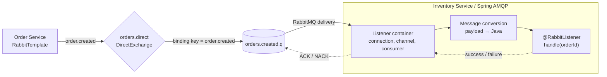
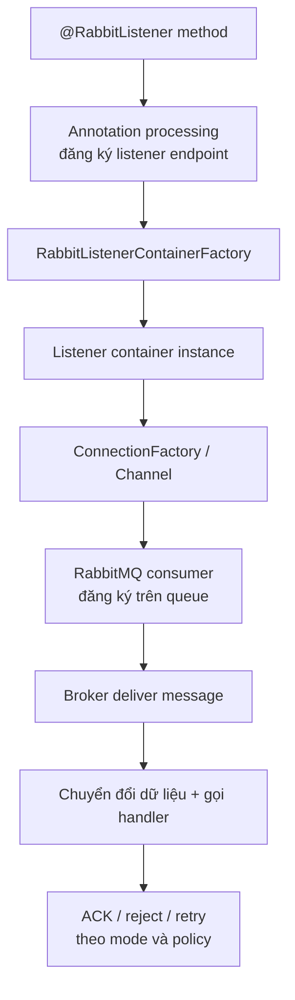
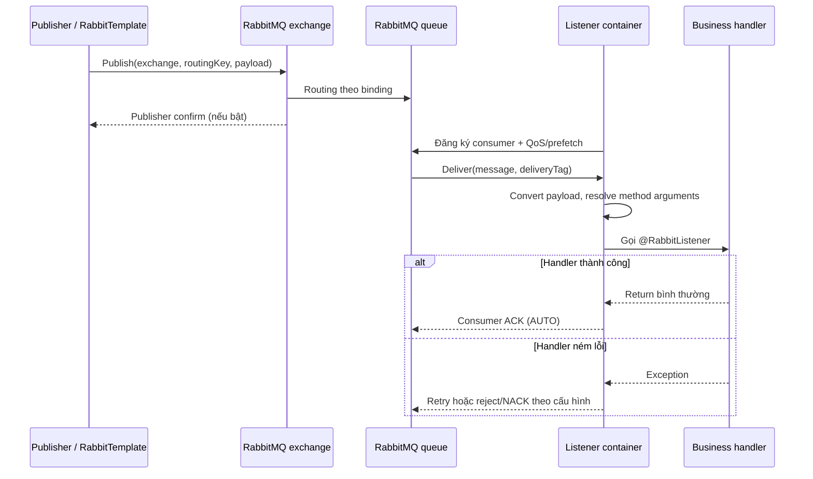
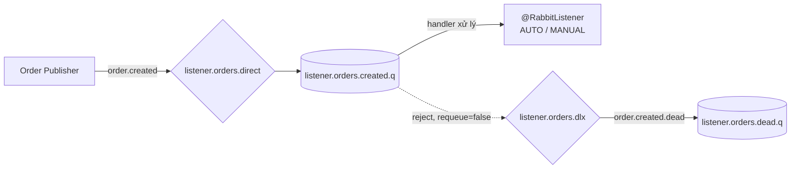
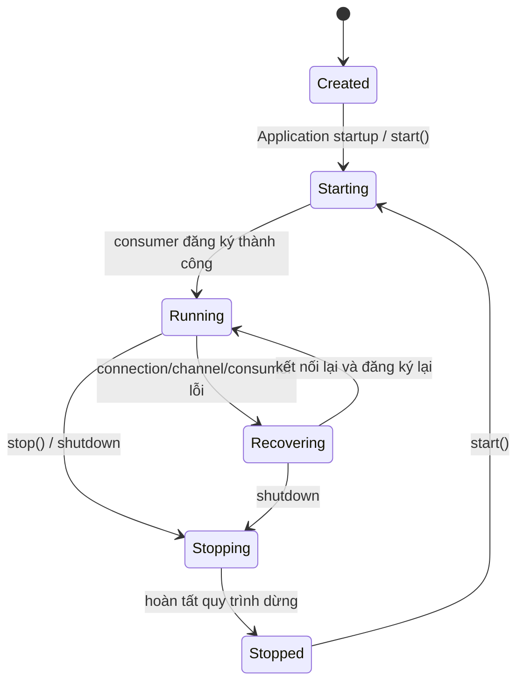
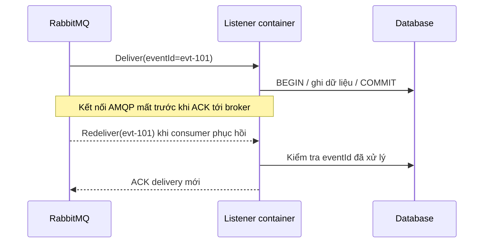

# Vai trò listener container trong luồng nhận, xử lý và xác nhận

Khi viết một phương thức `@RabbitListener`, lập trình viên thường chỉ thấy vài dòng Java: nhận đối tượng, gọi service nghiệp vụ và trả về. Nhưng để phương thức đó được gọi, Spring AMQP cần một thành phần sống lâu, kết nối với RabbitMQ, đăng ký consumer, nhận delivery, chuyển đổi dữ liệu, phân phối công việc, xử lý exception và xác nhận thông điệp với broker. Thành phần đó là **listener container**.

Bài thuộc chương **Listener container** của module **SPRING_AMQP**. Nội dung đặt listener container vào luồng tích hợp RabbitMQ với `RabbitTemplate`, `@RabbitListener`, exchange, queue và binding; đồng thời giải thích ACK/NACK, retry, dead-letter, giao dịch và quan sát hệ thống nhằm xây dựng xử lý bất đồng bộ đáng tin cậy.

> **Ý chính:** `@RabbitListener` mô tả **phương thức xử lý**; listener container quản lý **consumer và vòng đời nhận message**; RabbitMQ queue lưu/phân phối message; còn business handler quyết định điều gì được xem là **xử lý thành công**.

Sau khi học, bạn có thể:

1. Mô tả đường đi từ `RabbitTemplate.convertAndSend(...)` tới `@RabbitListener`, bao gồm vai trò exchange, binding, queue và listener container.
2. Phân biệt `@RabbitListener`, listener endpoint, listener container factory, container instance và `RabbitListenerEndpointRegistry`.
3. Giải thích cơ chế nhận delivery, sử dụng channel, message conversion, gọi handler và ACK/NACK.
4. Phân biệt `AcknowledgeMode.AUTO`, `MANUAL` và `NONE` mà không nhầm với broker auto-ack.
5. Chọn concurrency, prefetch và kiểu container phù hợp với tải, độ trễ và backpressure.
6. Dự đoán điều gì xảy ra khi handler thành công, thất bại, mất kết nối hoặc ứng dụng tắt.
7. Tổ chức retry, dead-letter, idempotency, publisher confirms và quan sát theo đúng tầng trách nhiệm.

## 1. Listener container giải quyết vấn đề nào?

Giả sử Order Service phát sự kiện `order.created`. Inventory Service cần nhận sự kiện và giữ hàng trong database.

Nếu tự viết vòng lặp gọi `RabbitTemplate.receive(...)`, ứng dụng phải tự quyết định lúc nào poll, bao nhiêu worker chạy, khi nào dừng, điều gì xảy ra khi kết nối mất và phải xử lý lỗi sau nhận như thế nào. Với một consumer chạy 24/7, các trách nhiệm này nhanh chóng phức tạp.

Spring AMQP dùng **listener container** để duy trì consumer và gọi mã nghiệp vụ khi có message.



Sơ đồ gom chung những thành phần của consumer để dễ hiểu; trong giao thức thực, ACK/NACK được gửi qua **AMQP channel về broker**, không phải một lời gọi Java trực tiếp lên object queue.

Một listener container thường chịu trách nhiệm:

- Khởi tạo và duy trì consumer gắn với những queue được chỉ định.
- Lấy connection/channel từ hạ tầng Spring AMQP.
- Áp dụng cấu hình concurrency, prefetch và acknowledgement.
- Nhận message do broker deliver.
- Chuyển message AMQP thành đối tượng hoặc tham số mà handler yêu cầu.
- Gọi phương thức handler và phân loại kết quả thành công/thất bại.
- Gửi ACK/NACK hoặc phối hợp chính sách retry/requeue khi cấu hình yêu cầu.
- Khôi phục sau một số lỗi kết nối, hủy consumer hoặc queue tạm chưa sẵn sàng theo chiến lược container.
- Phát lifecycle events, log và metrics để ứng dụng quan sát.

**Container không tự biết tiêu chí nghiệp vụ** như “đã trừ tồn kho chính xác” hay “hóa đơn đã được khách hàng nhận”. Nó chỉ có thể dựa trên việc handler trả về, ném exception hoặc cơ chế kết quả bất đồng bộ được hỗ trợ.

## 2. Các thành phần cấu thành @RabbitListener

Khi code có:

```java
@RabbitListener(queues = "orders.created.q")
public void handle(String orderId) {
    inventoryService.reserve(orderId);
}
```

ta đang dùng một hệ sinh thái gồm nhiều đối tượng:

| Thành phần | Trách nhiệm | Có phải queue của RabbitMQ không? |
|---|---|---|
| `@RabbitListener` | Đánh dấu phương thức cần đăng ký làm message listener endpoint | Không |
| Listener endpoint | Mô tả handler, queue, listener ID và thông tin cấu hình | Không |
| `RabbitListenerContainerFactory` | Tạo container được cấu hình cho endpoint | Không |
| Listener container instance | Chạy consumer, quản lý kết nối, delivery và ACK/NACK | Không |
| `RabbitListenerEndpointRegistry` | Theo dõi những container được tạo từ listener endpoints; cho phép tra cứu/start/stop | Không |
| `ConnectionFactory` | Cung cấp kết nối RabbitMQ | Không |
| `RabbitAdmin` | Khai báo topology gồm exchange, queue, binding khi cấu hình cho phép | Không |
| `Queue` trên broker | Lưu message đã được route đến và phân phối cho consumer | **Có** |

### 2.1. Từ annotation đến consumer thực tế

Khi ứng dụng khởi động và bật cơ chế hỗ trợ Rabbit listener, Spring xử lý các annotation `@RabbitListener`, đăng ký endpoint và yêu cầu một container factory tạo các listener container.



Container được quản lý bởi vòng đời của Spring application. Khi ứng dụng khởi động, nó có thể tự start consumer; khi shutdown, container dừng nhận mới và xử lý các delivery đang chạy theo cấu hình dừng phù hợp.

**Không nên tạo consumer thủ công bằng `basicConsume(...)` trên cùng channel mà container đang quản lý.** Hai cơ chế cạnh tranh quyền sở hữu channel, delivery tags và acknowledgement.

### 2.2. Annotation không tự tạo queue

`@RabbitListener(queues = "orders.created.q")` trỏ tới tên queue mà listener muốn nghe. Annotation đơn giản này **không tự bảo đảm queue đã được tạo**.

Queue có thể được tạo bằng:

- Các bean Spring AMQP `Queue`, `Exchange` và `Binding` để `RabbitAdmin` khai báo.
- Công cụ hạ tầng/triển khai RabbitMQ.
- Các dạng annotation khai báo topology như `@QueueBinding` khi có cấu hình phù hợp.

Nếu queue không tồn tại, hoặc ứng dụng kết nối sai vhost/tài khoản thiếu quyền, container có thể không khởi tạo consumer như mong đợi. Điều tra topology là bước đầu tiên trước khi nghĩ handler có lỗi.

## 3. Luồng nhận, xử lý và xác nhận chi tiết

Một message được publish vào exchange, được broker route tới queue và phân phối cho consumer thuộc listener container.



Sơ đồ dùng mũi tên từ container tới queue để biểu diễn “đăng ký consumer” và mũi tên ACK ngược về broker. Ở cấp AMQP, cả hai đi qua channel. Publisher confirm và consumer ACK **không phải một tín hiệu**.

### 3.1. Bước nhận delivery

Broker giao message đã được route vào queue đến consumer, tuân theo tình trạng kết nối, prefetch và độ sẵn sàng của các consumer. Delivery mang theo body bytes và metadata như `deliveryTag`, headers, content type, redelivered flag, exchange và routing key.

Container duy trì channel dùng để nhận những delivery đó. Nếu container có nhiều consumer, mỗi consumer thường có channel tương ứng do framework quản lý.

### 3.2. Bước chuyển đổi và gọi handler

Trước khi gọi:

```java
public void handle(OrderCreatedEvent event)
```

Spring phải chuyển `byte[]` cùng message properties thành đối tượng Java phù hợp. Các lớp converter của Spring AMQP, listener adapter và argument resolution tham gia vào bước này.

Nếu JSON không hợp lệ, type header không phù hợp hoặc payload không thể chuyển đổi, lỗi có thể xảy ra **trước khi mã trong `handle(...)` chạy**. Vì vậy, một queue có message và một listener đã đăng ký vẫn có thể có delivery thất bại do converter.

### 3.3. Bước xác nhận kết quả

Khi handler kết thúc:

- Nếu mode là `AUTO`, container xác nhận dựa trên kết quả handler và chính sách đã cấu hình.
- Nếu mode là `MANUAL`, ứng dụng chịu trách nhiệm ACK/NACK bằng channel và delivery tag.
- Nếu mode là `NONE`, broker không chờ ACK cho consumer theo chế độ auto-ack.

Xử lý exception, retry, requeue hay dead-letter phụ thuộc mode và cấu hình, **không phải chỉ phụ thuộc việc có annotation `@RabbitListener`**.

## 4. Ba chế độ acknowledgement: AUTO, MANUAL, NONE

Đây là phần quan trọng nhất để tránh mất message hoặc xử lý trùng.

| Chế độ Spring | Ai xác nhận? | Khi handler thành công | Khi handler lỗi | Phù hợp |
|---|---|---|---|---|
| `AUTO` | Spring listener container | Container ACK theo chế độ/config | Container áp dụng error handler, retry, reject/requeue | Phần lớn handler đồng bộ |
| `MANUAL` | Handler hoặc cơ chế async được hỗ trợ | Ứng dụng gửi `basicAck` | Ứng dụng cần quyết định `basicNack`/`basicReject` hoặc chiến lược được hỗ trợ | Cần kiểm soát ACK chi tiết |
| `NONE` | Broker auto-ack, không chờ consumer ACK | Không có ACK thủ công | Message có thể không được giao lại chỉ vì handler lỗi | Tình huống chấp nhận rủi ro mất delivery |

### 4.1. AUTO không phải broker auto-ack

Tên `AUTO` của Spring dễ gây hiểu sai. Trong `AcknowledgeMode.AUTO`, container thường **không dùng broker no-ack**: nó nhận delivery, chờ handler xử lý, rồi gửi ACK khi thành công.

Ngược lại, `AcknowledgeMode.NONE` có nghĩa broker không chờ consumer ACK cho delivery. Nếu handler lỗi sau khi broker coi message đã deliver thành công, không có cơ chế ACK thất bại để RabbitMQ tự giao lại delivery đó.

**Không mô tả `AUTO` là “broker tự ACK ngay sau khi gửi”.** Đó là sự nhầm lẫn giữa thuật ngữ của Spring với auto acknowledgement ở mức AMQP.

### 4.2. AUTO thành công

Ví dụ:

```java
@RabbitListener(queues = "orders.created.q")
public void onMessage(String orderId) {
    inventoryService.reserve(orderId);
}
```

Ở mode AUTO:

1. Container nhận delivery.
2. Handler được gọi.
3. `inventoryService.reserve(...)` kết thúc không ném exception.
4. Container gửi ACK theo cấu hình của container.

Nếu handler **bắt và nuốt lỗi** rồi trả về bình thường, container có thể xem như thành công và ACK, dù nghiệp vụ chưa hoàn tất:

```java
// Phản ví dụ: log rồi nuốt lỗi khiến container tin rằng đã thành công.
@RabbitListener(queues = "orders.created.q")
public void unsafe(String orderId) {
    try {
        inventoryService.reserve(orderId);
    } catch (Exception failure) {
        System.err.println(failure.getMessage());
        // Không rethrow, handler trả về bình thường.
    }
}
```

Trong xử lý quan trọng, phải phân loại lỗi và thông báo kết quả cho container theo cơ chế có chủ đích.

### 4.3. AUTO khi handler thất bại

Nếu handler ném exception, container đưa lỗi qua cơ chế xử lý của Spring AMQP. Theo cấu hình, có thể có retry nội bộ, reject/NACK với `requeue=true`, reject với `requeue=false` hoặc error handler xử lý riêng.

Một số chi tiết cần phân biệt:

- Tùy cấu hình, lỗi thông thường có thể dẫn đến **requeue**, khiến message được giao lại.
- `AmqpRejectAndDontRequeueException` thể hiện yêu cầu **không requeue** trong cơ chế xử lý lỗi phù hợp.
- Các lỗi chuyển đổi dữ liệu được Spring phân loại là fatal trong error handler mặc định có thể được reject mà không requeue, kể cả khi handler chưa chạy.
- Nếu queue có dead-letter exchange và message được reject không requeue, broker có thể route message đến DLX/DLQ.
- Nếu không có DLX/binding phù hợp, message bị reject không requeue có thể bị loại bỏ.

**Không giả định “ném exception = tự động retry đúng ba lần rồi vào DLQ”.** Retry count, backoff, DLX và cách reject là các cấu hình tách biệt.

### 4.4. MANUAL và delivery tag

Với `MANUAL`, handler có thể nhận đối tượng `Channel` của RabbitMQ Java client cùng `Message` của Spring AMQP:

```java
import com.rabbitmq.client.Channel;
import java.io.IOException;
import java.nio.charset.StandardCharsets;
import org.springframework.amqp.core.Message;
import org.springframework.amqp.rabbit.annotation.RabbitListener;

@RabbitListener(
        queues = "orders.created.q",
        ackMode = "MANUAL")
public void process(Message message, Channel channel) throws IOException {
    long tag = message.getMessageProperties().getDeliveryTag();
    String orderId = new String(
            message.getBody(), StandardCharsets.UTF_8);

    try {
        processOrder(orderId);
        channel.basicAck(tag, false);
    } catch (IllegalArgumentException invalid) {
        channel.basicNack(tag, false, false);
    }
}
```

Đây là **phương thức minh họa**, cần đặt vào một bean Spring và định nghĩa `processOrder(...)`. Không dùng đồng thời một listener AUTO trên cùng queue nếu bạn muốn thử chính xác kịch bản MANUAL.

Ba nguyên tắc:

1. `deliveryTag` chỉ có ý nghĩa trên **channel đã giao message**. ACK trên channel khác có thể tạo lỗi giao thức.
2. `basicAck(tag, false)` ACK **một delivery**. Cờ `multiple=true` ACK một dải các delivery chưa xác nhận đến tag đó trên cùng channel, dễ nhầm khi xử lý song song.
3. Sau khi gửi ACK/NACK thành công, **không xác nhận lại cùng delivery**. Double ACK hoặc tag sai có thể khiến broker đóng channel.

Channel truyền vào listener do container quản lý: **không tự gọi `channel.close()`** trong handler. Nếu ACK/NACK ném lỗi kết nối, trạng thái broker đã nhận ACK hay chưa có thể không chắc chắn.

### 4.5. NONE và rủi ro mất delivery

Trong mode `NONE`, broker coi message đã được giao theo cơ chế no-ack mà không cần nhận consumer ACK sau xử lý. Nếu consumer crash hoặc handler ném exception, delivery đó thường không thể được broker khôi phục dựa trên ACK thất lạc, vì broker không giữ trạng thái unacknowledged cho nó.

Chỉ chọn mode này khi yêu cầu nghiệp vụ thực sự chấp nhận mất delivery, ví dụ một số dữ liệu có thể tái tạo dễ dàng. Với đơn hàng, thanh toán và những event không thể mất, `AUTO` hoặc `MANUAL` thường là lựa chọn có cơ sở hơn.

## 5. Listener container factory: nơi định nghĩa hành vi consumer

Các thuộc tính của container như số lượng consumer, prefetch và ACK mode nên được cấu hình có chủ đích. Spring AMQP có hai triển khai thường gặp:

- **`SimpleMessageListenerContainer` (SMLC)**, được tạo qua `SimpleRabbitListenerContainerFactory`.
- **`DirectMessageListenerContainer` (DMLC)**, được tạo qua `DirectRabbitListenerContainerFactory`.

Cả hai đều phục vụ consumer dài hạn nhưng cách sử dụng thread, tiếp nhận delivery và một số thuộc tính concurrency khác nhau.

| Khía cạnh | Simple listener container | Direct listener container |
|---|---|---|
| Cấu hình concurrency | `concurrentConsumers` và `maxConcurrentConsumers` | `consumersPerQueue` |
| Cách dispatch message | Dùng mô hình container với các consumer task và hàng đợi nội bộ | Gọi listener gần hơn với thread dispatch của RabbitMQ client |
| Prefetch/ACK | Có | Có |
| Dynamic consumer scaling | Có những cơ chế/thuộc tính phù hợp của SMLC | Cấu hình scale khác, dựa vào consumer mỗi queue |
| Chạy `@RabbitListener` | Có | Có |
| Dùng khi nào | Lựa chọn phổ biến, dễ điều chỉnh concurrency | Khi muốn mô hình dispatch trực tiếp và đã đo đạc phù hợp |

Không có một kiểu container **luôn nhanh hơn** trong mọi workload. Độ trễ, throughput và CPU còn phụ thuộc thời gian handler, database, số queue, số connection/channel, prefetch và tài nguyên broker.

### 5.1. Cấu hình simple container bằng Spring Boot

Ví dụ `application.yml`:

```yaml
spring:
  rabbitmq:
    host: localhost
    port: 5672
    username: demo
    password: demo-local-only
    listener:
      type: simple
      simple:
        concurrency: 2
        max-concurrency: 4
        prefetch: 10
        acknowledge-mode: auto
        default-requeue-rejected: true
```

Ý nghĩa:

- `concurrency: 2`: bắt đầu với hai consumer trong cấu hình minh họa.
- `max-concurrency: 4`: cho phép tăng tới bốn consumer theo cơ chế container.
- `prefetch: 10`: giới hạn số delivery chưa ACK mà broker có thể gửi trước cho mỗi consumer theo cách QoS đang được áp dụng.
- `acknowledge-mode: auto`: handler hoàn thành bình thường thì container ACK.
- `default-requeue-rejected: true`: lỗi được reject theo đường mặc định có thể requeue; các exception đặc biệt/error handler và chính sách khác có thể thay đổi kết quả.

**Cảnh báo:** nếu handler luôn ném cùng một exception và message được requeue liên tục, có nguy cơ **hot redelivery loop**. Với dữ liệu quan trọng, cần retry có giới hạn, backoff và DLQ.

### 5.2. Cấu hình direct container

Một cấu hình khác dành cho DMLC:

```yaml
spring:
  rabbitmq:
    listener:
      type: direct
      direct:
        consumers-per-queue: 2
        prefetch: 10
        acknowledge-mode: auto
```

Khi chuyển `listener.type`, các thuộc tính `simple.*` không trở thành thuộc tính tương đương của `direct.*`. Phải dùng nhóm cấu hình đúng cho container type.

### 5.3. Tạo factory có tên riêng

Khi các nhóm listener cần chính sách riêng, có thể tạo các container factory khác nhau. Ví dụ, nếu một factory đã được đăng ký với bean name `inventoryListenerFactory`:

```java
@RabbitListener(
        queues = "orders.created.q",
        containerFactory = "inventoryListenerFactory")
public void handle(String orderId) {
    // ...
}
```

Tên trong `containerFactory` là **Spring bean name**, không phải RabbitMQ exchange hay queue. Việc tạo factory cần cấu hình `ConnectionFactory` và converter phù hợp; tránh đặt tên bean rồi quên khai báo.

Nếu không chọn `containerFactory`, Spring thường dùng factory mặc định được cấu hình cho annotation listener. Spring Boot có thể tạo sẵn factory theo điều kiện auto-configuration và loại container đang chọn.

## 6. Ví dụ end-to-end: producer, topology và listener container

Thực hành dưới đây cho thấy chính xác container làm gì khi handler thành công hoặc ném exception. Dùng một queue chính và một DLQ để kiểm chứng.

### 6.1. Chuẩn bị RabbitMQ

Trên máy có Docker, chạy broker demo:

```bash
docker run -d --rm --name rabbitmq-listener-lab -p 5672:5672 -p 15672:15672 -e RABBITMQ_DEFAULT_USER=demo -e RABBITMQ_DEFAULT_PASS=demo-local-only rabbitmq:4-management
```

- AMQP: `localhost:5672`.
- RabbitMQ Management: `http://localhost:15672`.
- Tài khoản lab: `demo` / `demo-local-only`.

Không dùng những thông tin đăng nhập này trong production. Nếu đang có broker sử dụng hai cổng trên, hãy dùng broker hiện tại hoặc cấu hình lại cổng.

### 6.2. Dependency theo phiên bản Spring Boot

Với **Spring Boot 4.2.x**, RabbitMQ AMQP 0-9-1 dùng:

```groovy
dependencies {
    implementation 'org.springframework.boot:spring-boot-starter-rabbitmq'
    implementation 'org.springframework.boot:spring-boot-starter-web'
}
```

Với **Spring Boot 3.x hoặc 4.0–4.1**, thay starter RabbitMQ ở trên bằng `spring-boot-starter-amqp`. Trong Spring Boot 4.2, tên `spring-boot-starter-amqp` dành cho tích hợp AMQP 1.0 khác; không chọn nó chỉ vì tên giống dự án cũ. Chọn **một** starter phù hợp với phiên bản Boot của project.

Để tập trung vào lifecycle, ví dụ dùng message body là `String`. Hệ thống dùng JSON DTO cần cấu hình AMQP message converter ở cả producer và consumer, cùng schema version và type mapping.

### 6.3. application.yml

Sử dụng chế độ listener đơn giản và hai consumer:

```yaml
spring:
  rabbitmq:
    host: localhost
    port: 5672
    username: demo
    password: demo-local-only
    publisher-confirm-type: correlated
    publisher-returns: true
    template:
      mandatory: true
    listener:
      type: simple
      simple:
        concurrency: 2
        max-concurrency: 4
        prefetch: 5
        acknowledge-mode: auto
```

Bật publisher confirms/returns giúp mở rộng phần quan sát producer. Để thực sự kết luận broker ACK hay message bị return, ứng dụng còn phải theo dõi kết quả callback hoặc `CorrelationData`; chỉ đặt YAML không tự tạo state machine tin cậy.

### 6.4. Khai báo queue có DLX để quan sát lỗi

Tạo file `ListenerLabTopology.java` trong package được `@SpringBootApplication` quét:

```java
import org.springframework.amqp.core.Binding;
import org.springframework.amqp.core.BindingBuilder;
import org.springframework.amqp.core.DirectExchange;
import org.springframework.amqp.core.Queue;
import org.springframework.amqp.core.QueueBuilder;
import org.springframework.beans.factory.annotation.Qualifier;
import org.springframework.context.annotation.Bean;
import org.springframework.context.annotation.Configuration;

@Configuration
public class ListenerLabTopology {
    public static final String EXCHANGE = "listener.orders.direct";
    public static final String QUEUE = "listener.orders.created.q";
    public static final String ROUTING_KEY = "order.created";

    public static final String DEAD_EXCHANGE = "listener.orders.dlx";
    public static final String DEAD_QUEUE = "listener.orders.dead.q";
    public static final String DEAD_ROUTING_KEY = "order.created.dead";

    @Bean
    DirectExchange ordersExchange() {
        return new DirectExchange(EXCHANGE, true, false);
    }

    @Bean
    DirectExchange deadLetterExchange() {
        return new DirectExchange(DEAD_EXCHANGE, true, false);
    }

    @Bean
    Queue createdQueue() {
        return QueueBuilder.durable(QUEUE)
                .deadLetterExchange(DEAD_EXCHANGE)
                .deadLetterRoutingKey(DEAD_ROUTING_KEY)
                .build();
    }

    @Bean
    Queue deadQueue() {
        return QueueBuilder.durable(DEAD_QUEUE).build();
    }

    @Bean
    Binding createdBinding(
            @Qualifier("createdQueue") Queue queue,
            @Qualifier("ordersExchange") DirectExchange exchange) {
        return BindingBuilder.bind(queue)
                .to(exchange)
                .with(ROUTING_KEY);
    }

    @Bean
    Binding deadBinding(
            @Qualifier("deadQueue") Queue queue,
            @Qualifier("deadLetterExchange") DirectExchange exchange) {
        return BindingBuilder.bind(queue)
                .to(exchange)
                .with(DEAD_ROUTING_KEY);
    }
}
```

Có hai tuyến:



Đường chấm mô tả dead-letter; nó không xảy ra với mọi message. Điều kiện dead-letter phải phát sinh và topology DLX/binding phải đúng. Trong môi trường production, nên cân nhắc RabbitMQ policy để quản lý DLX khi có nhu cầu thay đổi linh hoạt, thay vì cài cứng mọi x-argument vào queue đang hoạt động.

### 6.5. Producer với RabbitTemplate

Tạo `ListenerLabPublisher.java`:

```java
import org.springframework.amqp.rabbit.core.RabbitTemplate;
import org.springframework.stereotype.Service;

@Service
public class ListenerLabPublisher {
    private final RabbitTemplate rabbitTemplate;

    public ListenerLabPublisher(RabbitTemplate rabbitTemplate) {
        this.rabbitTemplate = rabbitTemplate;
    }

    public void publish(String orderId) {
        rabbitTemplate.convertAndSend(
                ListenerLabTopology.EXCHANGE,
                ListenerLabTopology.ROUTING_KEY,
                orderId
        );
    }
}
```

Producer không phải biết consumer container có bao nhiêu thread, prefetch bao nhiêu hoặc ACK mode là gì. Producer chỉ biết exchange, routing key và payload. RabbitMQ dùng binding để chuyển message vào queue.

### 6.6. Listener mặc định: AUTO ACK

Tạo `OrderAutoAckListener.java`:

```java
import org.springframework.amqp.AmqpRejectAndDontRequeueException;
import org.springframework.amqp.rabbit.annotation.RabbitListener;
import org.springframework.context.annotation.Profile;
import org.springframework.stereotype.Component;

@Profile("!manual-ack")
@Component
public class OrderAutoAckListener {

    @RabbitListener(
            id = "ordersAutoListener",
            queues = ListenerLabTopology.QUEUE)
    public void handle(String orderId) {
        if (orderId.startsWith("bad-")) {
            throw new AmqpRejectAndDontRequeueException(
                    "Invalid order: " + orderId);
        }

        System.out.printf("[%s] processed order=%s%n",
                Thread.currentThread().getName(), orderId);
    }
}
```

Với profile mặc định, listener AUTO được kích hoạt và listener MANUAL ở mục sau không hoạt động.

- `order-101`: handler trả về bình thường; container ACK.
- `bad-102`: handler ném `AmqpRejectAndDontRequeueException`; theo cơ chế error handling phù hợp của Spring AMQP, container reject mà không requeue. Nếu DLX/DLQ đã tồn tại và binding đúng, broker có thể chuyển message sang DLQ.

**Không nên dùng exception này để mô tả mọi lỗi đều vĩnh viễn.** Database timeout, mất kết nối tạm hoặc rate limit cần chính sách retry/backoff khác thay vì gửi thẳng vào DLQ.

### 6.7. Listener MANUAL để so sánh

Tạo `OrderManualAckListener.java`:

```java
import com.rabbitmq.client.Channel;
import java.io.IOException;
import java.nio.charset.StandardCharsets;
import org.springframework.amqp.core.Message;
import org.springframework.amqp.rabbit.annotation.RabbitListener;
import org.springframework.context.annotation.Profile;
import org.springframework.stereotype.Component;

@Profile("manual-ack")
@Component
public class OrderManualAckListener {

    @RabbitListener(
            id = "ordersManualListener",
            queues = ListenerLabTopology.QUEUE,
            ackMode = "MANUAL")
    public void handle(Message message, Channel channel)
            throws IOException {

        long tag = message.getMessageProperties().getDeliveryTag();
        String orderId = new String(
                message.getBody(), StandardCharsets.UTF_8);

        if (orderId.startsWith("bad-")) {
            channel.basicNack(tag, false, false);
            return;
        }

        // Ví dụ nhỏ: thay bằng transaction nghiệp vụ có idempotency.
        System.out.println("MANUAL processed " + orderId);
        channel.basicAck(tag, false);
    }
}
```

Ở profile `manual-ack`, lớp `OrderAutoAckListener` không được tạo; listener MANUAL được kích hoạt. Vì vậy bài lab có **một kiểu listener tại một thời điểm**.

Cần chú ý:

- `Message` được đưa vào handler cùng metadata, gồm delivery tag.
- `channel.basicAck(tag, false)` gửi ACK cho một delivery.
- `channel.basicNack(tag, false, false)` yêu cầu không requeue, phù hợp với điều tra DLQ trong demo nếu topology đầy đủ.
- Không gọi `channel.close()`. Channel do listener container sở hữu.
- Trong thực tế, `basicAck/basicNack` có thể lỗi; cần giám sát, chống duplicate và thiết kế cách xử lý khi kết quả ACK chưa rõ.

### 6.8. REST endpoint để phát message

Tạo `ListenerLabController.java`:

```java
import org.springframework.http.ResponseEntity;
import org.springframework.web.bind.annotation.PathVariable;
import org.springframework.web.bind.annotation.PostMapping;
import org.springframework.web.bind.annotation.RestController;

@RestController
public class ListenerLabController {
    private final ListenerLabPublisher publisher;

    public ListenerLabController(ListenerLabPublisher publisher) {
        this.publisher = publisher;
    }

    @PostMapping("/lab/orders/{orderId}/created")
    public ResponseEntity<Void> send(@PathVariable String orderId) {
        publisher.publish(orderId);
        return ResponseEntity.accepted().build();
    }
}
```

Chạy ứng dụng Spring Boot có `@SpringBootApplication` trong cùng package hoặc package cha phù hợp. Thử lần lượt:

```bash
curl -X POST http://localhost:8080/lab/orders/order-101/created

curl -X POST http://localhost:8080/lab/orders/bad-102/created
```

Kỳ vọng:

- `order-101` được listener xử lý và ACK. Nếu listener chạy nhanh, queue ready thường về 0.
- `bad-102` bị reject không requeue và có thể xuất hiện trong `listener.orders.dead.q`, với điều kiện DLX được khai báo/bind đúng.
- Không có handler cho DLQ trong demo, để người học quan sát message ở queue lỗi.

Để thử manual acknowledgement, khởi động lại ứng dụng với profile `manual-ack` rồi gửi hai event khác:

```bash
java -jar app.jar --spring.profiles.active=manual-ack
```

Tên `app.jar` chỉ là minh họa; dùng tên JAR thật của project. Không chạy đồng thời hai instance với hai profile nếu muốn so sánh ACK theo kiểu “mỗi lần chỉ một listener”.

## 7. Concurrency, prefetch và giới hạn xử lý

Listener container thường quản lý nhiều consumer để tăng khả năng xử lý message. Nhưng tăng concurrency không có nghĩa throughput tăng tuyến tính: handler, database, HTTP downstream và tài nguyên broker cũng có giới hạn.

### 7.1. Concurrency khác số message đang chờ ACK

Giả sử SMLC có:

```yaml
spring:
  rabbitmq:
    listener:
      simple:
        concurrency: 3
        prefetch: 10
```

Một cách ước tính sơ bộ là có tối đa khoảng **3 × 10 = 30 delivery chưa ACK** được broker phân phối cho ba consumer theo cách giới hạn prefetch áp dụng. Đây không phải cam kết số chính xác trong mọi thời điểm; batch, mode ACK, thay đổi concurrency và cấu hình QoS có thể ảnh hưởng.

| Tham số | Điều điều chỉnh | Nguy cơ khi quá cao |
|---|---|---|
| Concurrency | Số consumer đồng thời | Tăng áp lực DB, contention và số channel/thread |
| Prefetch | Số delivery có thể được gửi trước khi ACK | Nhiều message nằm ở trạng thái unacknowledged, tăng bộ nhớ và mất công bằng |
| Batch size / batch processing | Số message gom để xử lý/xác nhận theo cấu hình | Khó khống chế lỗi từng message và thời gian chờ |
| Handler timeout | Giới hạn nghiệp vụ do ứng dụng thiết kế | Timeout không được quản lý có thể giữ delivery lâu |

**Prefetch không có nghĩa container tự mở thêm thread cho mỗi message.** Nó chỉ điều chỉnh số delivery broker có thể giao trước khi nhận ACK phù hợp.

### 7.2. Nhiều consumer trên cùng một queue

Khi ba instance hoặc ba consumer cùng nghe `orders.created.q`, chúng thường là **competing consumers**. Một delivery được giao cho một consumer tại một thời điểm, không broadcast tới cả ba.

Nếu ba dịch vụ cần độc lập nhận sự kiện `order.created`, hãy tạo **ba queue riêng** cùng binding routing key thích hợp thay vì chạy ba loại handler cùng đọc một queue.

### 7.3. Không bảo đảm thứ tự hoàn tất nghiệp vụ

Dù producer gửi `order-1` rồi `order-2`, với nhiều consumer:

- Consumer A có thể nhận `order-1` nhưng xử lý chậm.
- Consumer B có thể nhận `order-2` và commit trước.
- Message có thể được redeliver sau lỗi, làm thay đổi thứ tự quan sát.

Nếu cùng một đơn hàng yêu cầu thứ tự xử lý nghiêm ngặt, phải thiết kế key phân vùng/sharding, số consumer, sequence/version validation hoặc logic nghiệp vụ phù hợp; không chỉ mặc định tăng concurrency là an toàn.

## 8. Listener container và quản lý vòng đời

Một listener container là thành phần chạy dài hạn, thường có các trạng thái:



Sơ đồ là mô hình khái niệm; trạng thái, sự kiện và retry thực tế tùy container implementation, connection factory và cấu hình recovery.

### 8.1. Khởi động và tắt ứng dụng

Khi Spring context khởi động, các listener container có thể tự start; khi context đóng, Spring yêu cầu dừng chúng. Trong quá trình dừng, cần quan tâm:

- Có message đã deliver nhưng chưa ACK không?
- Handler dài có được hoàn thành trước khi channel đóng không?
- Có thời hạn graceful shutdown hợp lý không?
- Container có nhận message mới trong lúc ứng dụng đang tắt không?
- Khi bị kill cưỡng bức, message chưa ACK có thể được broker giao lại ra sao?

**Không dùng `System.exit(0)` hoặc đóng RabbitMQ channel trực tiếp trong handler** để dừng consumer. Việc đóng cưỡng bức có thể tạo redelivery và khiến trạng thái nghiệp vụ chưa đồng bộ.

### 8.2. Tra cứu listener bằng registry

Đặt ID trên annotation:

```java
@RabbitListener(
        id = "ordersAutoListener",
        queues = ListenerLabTopology.QUEUE)
public void handle(String orderId) {
    // ...
}
```

Ứng dụng có thể tra cứu container qua `RabbitListenerEndpointRegistry`:

```java
import org.springframework.amqp.rabbit.listener.MessageListenerContainer;
import org.springframework.amqp.rabbit.listener.RabbitListenerEndpointRegistry;
import org.springframework.stereotype.Service;

@Service
public class ListenerOperations {
    private final RabbitListenerEndpointRegistry registry;

    public ListenerOperations(RabbitListenerEndpointRegistry registry) {
        this.registry = registry;
    }

    public void stopOrderListener() {
        MessageListenerContainer container =
                registry.getListenerContainer("ordersAutoListener");
        if (container != null) {
            container.stop();
        }
    }

    public void startOrderListener() {
        MessageListenerContainer container =
                registry.getListenerContainer("ordersAutoListener");
        if (container != null) {
            container.start();
        }
    }
}
```

Đây là ví dụ quản trị vòng đời; **không nên tạo endpoint HTTP công khai** cho phép bất kỳ ai dừng consumer. Với profile MANUAL, listener ID khác nên tra cứu đúng ID của listener đang hoạt động.

Việc dừng container không xóa queue. Message đã được broker route tới queue có thể tiếp tục nằm ở trạng thái ready và chờ khi consumer hoạt động trở lại, theo các giới hạn TTL, queue length và khả năng lưu giữ tương ứng.

### 8.3. Queue bị xóa hoặc kết nối gián đoạn

Nếu queue bị xóa, node broker ngắt kết nối hoặc quyền truy cập thay đổi, container có cơ chế phát hiện và thử khôi phục theo cấu hình. Tuy nhiên, không bảo đảm mọi sai cấu hình đều có thể tự sửa:

- Queue không tồn tại và không có quyền `configure` có thể gây lỗi lặp.
- Queue đã đổi type hoặc arguments không tương thích có thể làm `RabbitAdmin` khai báo thất bại.
- Sai virtual host hoặc credential khiến không kết nối được.
- Broker hoạt động nhưng binding sai khiến listener không nhận message, dù consumer vẫn đang chạy.

Vì thế cần giám sát **container startup/recovery** và **routing/topology** ở hai tầng riêng.

## 9. Thất bại, retry và dead-letter: ai chịu trách nhiệm?

Một sự kiện có thể thất bại ở nhiều bước khác nhau:

| Bước lỗi | Ví dụ | Thành phần chịu trách nhiệm xử lý |
|---|---|---|
| Producer chưa publish được | Kết nối mất trước khi nhận confirm | Publisher, retry/outbox |
| Không route đến queue | Exchange không có binding khớp | Publisher returns/mandatory, topology |
| Container không đăng ký được consumer | Queue không tồn tại hoặc thiếu quyền | Listener container recovery, vận hành broker |
| Message conversion lỗi | Body JSON sai hoặc type header không hợp lệ | Listener adapter/error handler; DLQ |
| Handler lỗi tạm thời | Database timeout | Retry có giới hạn/backoff, container error handling |
| Handler lỗi vĩnh viễn | Event vi phạm schema/nghiệp vụ | Reject không requeue, DLQ/quarantine |
| ACK thất lạc sau DB commit | Kết nối/channel bị mất | Broker redelivery, consumer idempotency |

### 9.1. Retry phía consumer không phải retry publish

Sau khi message vào queue, có hai cách retry phổ biến:

1. **Retry bên trong listener/container:** gọi lại xử lý theo chính sách retry; có thể dùng backoff và recoverer.
2. **Retry thông qua broker:** reject/requeue hoặc chuyển qua các queue retry/dead-letter với TTL và routing phù hợp.

Hai cách có đánh đổi khác nhau. Requeue nóng có thể khiến một message lỗi chiếm CPU/IO liên tục; local retry lâu có thể giữ thread consumer không xử lý message khác; retry queue làm topology phức tạp hơn.

Không áp dụng retry vô hạn cho lỗi deserialize, schema sai hoặc điều kiện nghiệp vụ không thể phục hồi. Đặt retry limit và đường điều tra DLQ rõ ràng.

### 9.2. Dead-letter là trách nhiệm của broker sau điều kiện cụ thể

Khi listener xác định message cần reject không requeue, broker có thể chuyển message tới DLX nếu queue được cấu hình. Container **không tự tạo DLQ** và không cam kết dead-letter tới đích nếu exchange, binding, quyền hoặc cấu hình đang sai.

Một vài điều kiện dead-letter có thể gồm:

- Message bị reject/NACK với `requeue=false`.
- Message hết TTL trong queue.
- Queue đạt một số giới hạn và chính sách overflow phù hợp.
- Delivery limit của quorum queue theo tính năng và cấu hình broker.

Hành vi cụ thể phụ thuộc queue type và RabbitMQ version. Đặc biệt với quorum queue, cơ chế giới hạn số lần giao lại và bảo đảm chuyển dead-letter có thể khác classic queue; phải kiểm tra cấu hình thực tế.

### 9.3. Error handler không nên nuốt exception sai chỗ

Khi handler bắt một `Exception` rồi chỉ log, container AUTO không biết nghiệp vụ thất bại, nên có thể ACK. Ngược lại, nếu handler ném exception liên tục mà cấu hình mặc định requeue, message có thể bị giao lại mãi.

Chiến lược tốt là phân loại:

- **Transient failure:** retry giới hạn, backoff.
- **Permanent failure:** reject không requeue để điều tra/DLQ.
- **Unknown outcome:** không đoán thành công hay thất bại tuyệt đối; dùng idempotency và điều tra theo event ID.
- **Malformed message:** thường không thể sửa chỉ bằng retry cùng payload.

## 10. Tính nhất quán database, transaction và idempotency

Listener container biết handler trả về hay ném lỗi; nó **không có cách tự bảo đảm** rằng dữ liệu của một database ngoài broker và ACK của RabbitMQ commit nguyên tử với nhau.

Một tình huống thực tế:



**Vấn đề:** database đã commit nhưng broker chưa nhận ACK, nên message có thể được giao lại. Nếu handler thực hiện thao tác phụ không thể lặp như trừ tiền hoặc gửi email mà không có cơ chế kiểm soát, có thể xảy ra tác dụng phụ trùng.

### 10.1. Idempotent consumer

Một cách thiết kế là gắn `eventId` ổn định cho mỗi sự kiện, lưu dấu đã xử lý và kết quả nghiệp vụ trong cùng database transaction khi khả thi.

Ví dụ ý tưởng:

```text
BEGIN TRANSACTION

INSERT INTO processed_events(event_id = 'evt-101')
  với UNIQUE(event_id)

Nếu event_id đã tồn tại:
    bỏ qua thay đổi nghiệp vụ trùng
Ngược lại:
    cập nhật tồn kho / ghi nghiệp vụ

COMMIT

Handler trả về bình thường -> container ACK
```

Dùng unique constraint để xử lý race condition giữa nhiều consumer. Không chỉ kiểm tra “đã tồn tại?” rồi insert tách rời trong hai transaction khác nhau.

### 10.2. Vì sao @Transactional không biến ACK thành distributed transaction?

`@Transactional` trong service thường quản lý transaction của database (ví dụ JDBC/JPA). RabbitMQ AMQP channel có cơ chế transaction riêng; không thể mặc định một annotation sẽ làm database và broker **commit nguyên tử xuyên hệ thống**.

Với nhu cầu phát event từ database, transactional outbox giúp ghi business row và outbox event trong cùng transaction rồi publish bằng worker có theo dõi confirms. Với chiều nhận, idempotency + transaction database thường là phần cốt lõi để chống redelivery.

### 10.3. Xử lý bất đồng bộ trong handler

Phản ví dụ:

```java
@RabbitListener(queues = "orders.created.q")
public void unsafe(String orderId) {
    executor.submit(() -> reserveInventory(orderId));
    // Handler return ngay.
    // AUTO có thể ACK khi task background còn đang chạy.
}
```

Đoạn trên là code minh họa và giả định có `executor`/`reserveInventory(...)`. Với mode AUTO và handler đồng bộ, container thấy method trả về thành công và có thể ACK **trước khi task hoàn thành**.

Khi thực sự cần xử lý bất đồng bộ, dùng kiểu trả về async và cơ chế acknowledgement được phiên bản Spring AMQP hỗ trợ, hoặc thiết kế workflow nội bộ có lưu bền vững trước khi ACK. Tránh đưa tham chiếu `Channel` do container sở hữu vào thread pool để tùy ý gọi ACK/NACK mà không kiểm soát thread, tag và lifecycle.

## 11. Quan sát listener container trong vận hành

Listener container là điểm quan trọng để kết nối log nghiệp vụ với số liệu broker.

### 11.1. Những chỉ số nên quan sát

| Chỉ số / tín hiệu | Trả lời câu hỏi |
|---|---|
| Consumer count của queue | Có consumer đang đăng ký với broker không? |
| Container running/recovery events | Listener đang chạy hay liên tục reconnect? |
| Queue messages ready | Có bao nhiêu message đang chờ được giao? |
| Queue messages unacknowledged | Có bao nhiêu delivery đã giao nhưng chưa ACK? |
| Deliver/ACK rate | Consumer có nhận và hoàn thành xử lý không? |
| Listener invocation duration | Handler có chậm vì database/downstream không? |
| Exception/retry/redelivery rate | Có message lỗi hoặc vòng lặp requeue không? |
| DLQ depth và tuổi message | Có message cần điều tra không? |
| Prefetch/concurrency/channel count | Có quá nhiều delivery hoặc tài nguyên đang được giữ không? |
| Publisher confirms/returns | Producer gửi đến broker và route đúng không? |
| eventId/traceId/correlationId | Có truy được luồng từ producer đến handler không? |

Có thể dùng RabbitMQ Management UI, metric endpoint RabbitMQ, log ứng dụng, Micrometer/Actuator và distributed tracing khi được bật đúng cách.

### 11.2. Các tình huống chẩn đoán

| Hiện tượng | Nguyên nhân có thể | Bước kiểm tra |
|---|---|---|
| Listener không bao giờ chạy | Sai tên queue/vhost, container chưa start, thiếu quyền | Kiểm tra bean, registry, consumer count và topology |
| Publisher ACK nhưng listener không có log | Message bị route sang queue khác, listener lỗi hoặc chưa đăng ký | Xem bindings, returns, queue ready/unacked |
| Queue ready tăng liên tục | Consumer quá chậm, không có consumer, hoặc có lỗi xử lý | Đo throughput, handler duration, consumer count |
| Unacknowledged tăng và không giảm | Handler giữ delivery lâu, block hoặc quên manual ACK | Kiểm tra thread dump, timeout, prefetch và ACK mode |
| DLQ tăng | Poison message, conversion error, retry exhausted | Xem exception và raw payload có kiểm soát |
| Nhiều bản ghi nghiệp vụ trùng | Redelivery sau mất ACK, retry producer | Kiểm tra eventId, unique constraint, idempotency |
| Listener liên tục restart | Kết nối broker lỗi, queue bị xóa, channel exception | Xem container recovery events và broker logs |
| Message mất sau exception | Lỗi đã bị nuốt ở handler, `NONE` hoặc reject không có DLX | Xác minh ACK mode, error handler và DLX |
| Chạy nhiều instance nhưng không tăng tốc | Database bottleneck, prefetch không hợp lý, lock contention | Đo theo chặng, tránh tăng concurrency mù quáng |

### 11.3. Đánh giá readiness thực tế

Ứng dụng Spring Boot khởi động và HTTP trả lời 200 không nhất thiết nghĩa listener đã kết nối được RabbitMQ và có consumer đang hoạt động. Với dịch vụ phụ thuộc vào xử lý queue, readiness có thể cần kiểm tra riêng tình trạng consumer/container, queue cần thiết và khả năng broker được kết nối.

Đừng dùng mỗi số queue ready bằng 0 để xác định hệ thống khỏe: queue trống có thể là tốt hoặc producer đang gửi sai routing key. Cần đối chiếu publisher confirm/return, consumer count và handler metrics.

## 12. Những hiểu lầm phổ biến

| Hiểu lầm | Cách hiểu đúng |
|---|---|
| “`@RabbitListener` tự là một RabbitMQ consumer.” | Annotation mô tả endpoint; container tạo và quản lý consumer thật |
| “Spring tự tạo mọi queue khi có `@RabbitListener(queues=...)`.” | Queue phải tồn tại hoặc được khai báo qua topology tương ứng |
| “Container quyết định route message theo routing key.” | Exchange/binding phía broker quyết định queue; container đọc từ queue |
| “`AUTO` nghĩa là RabbitMQ tự ACK ngay khi deliver.” | Trong Spring AUTO, container ACK theo kết quả xử lý |
| “Ném exception thì luôn retry ba lần rồi vào DLQ.” | Retry, requeue, reject và DLX là các cơ chế cần cấu hình |
| “`MANUAL` có nghĩa container tự ACK giúp.” | Handler/logic được hỗ trợ phải xác nhận rõ ràng |
| “`NONE` vẫn giữ message chờ ACK.” | Broker không chờ ACK trong no-ack mode |
| “Có nhiều consumer thì mọi consumer cùng nhận một event.” | Consumer cùng queue cạnh tranh nhận delivery |
| “Prefetch = số thread handler.” | Prefetch là giới hạn delivery chưa ACK, không phải số thread |
| “Thêm concurrency làm handler luôn nhanh hơn.” | Throughput bị giới hạn bởi downstream và contention |
| “Publisher confirm chứng minh listener đã chạy xong.” | Confirm thuộc producer → broker, khác consumer ACK |
| “Có `@Transactional` là ACK và DB cùng commit nguyên tử.” | Database và RabbitMQ là hai miền transaction khác nhau |
| “ACK thành công là không bao giờ xử lý trùng.” | Trường hợp mất ACK/đứt kết nối vẫn có thể gây redelivery |
| “Tắt listener là xóa queue.” | Queue thuộc broker, độc lập với vòng đời consumer |

## 13. Bài tập thực hành

### Bài 1 — Vẽ lại luồng message

Từ lời gọi `RabbitTemplate.convertAndSend("listener.orders.direct", "order.created", "order-1")`, hãy vẽ luồng tới `@RabbitListener` rồi ACK. Đánh dấu nơi thực hiện routing, nơi chuyển bytes thành String và nơi quyết định ACK/NACK.

### Bài 2 — Phân biệt ba ACK mode

Với `AUTO`, `MANUAL` và `NONE`, mô tả điều gì xảy ra khi handler thành công; khi handler ném exception; và khi process chết sau khi đã nhận delivery nhưng trước khi ghi database.

### Bài 3 — Tìm lỗi nuốt exception

Cho listener bắt `Exception`, chỉ log và trả về bình thường. Tại sao message có thể bị ACK dù tồn kho chưa cập nhật? Hãy sửa cách truyền lỗi tới container hoặc thiết kế phân loại lỗi.

### Bài 4 — Kiểm chứng dead-letter

Chạy ví dụ mục 6. Gửi `bad-102` và quan sát queue chính, DLX, DLQ. Thử đổi routing key của DLQ binding sang giá trị không khớp để xem vì sao message dead-letter không đến đích. Thực hiện thay đổi chỉ trong môi trường lab, tránh đụng topology production.

### Bài 5 — Prefetch và concurrency

Có 4 consumer, mỗi consumer có prefetch 20. Ước lượng tổng số delivery chưa ACK có thể được broker gửi đến nhóm consumer đó theo cách QoS thông thường. Nếu handler xử lý mỗi message 2 giây và database chỉ xử lý tốt tối đa 10 request đồng thời, bạn sẽ cân nhắc giới hạn concurrency và prefetch thế nào?

### Bài 6 — Manual ACK đúng channel

Listener nhận delivery tag `17` trên channel A. Một background task cố dùng channel B để gọi `basicAck(17, true)`. Có hai vấn đề gì? Trình bày lý do cần tag thuộc đúng channel và thận trọng với `multiple=true`.

### Bài 7 — Stop/start listener có kiểm soát

Gắn ID cho listener, lấy container qua `RabbitListenerEndpointRegistry` và thử dừng/start ở môi trường lab. Trong thời gian listener dừng, producer vẫn publish. Quan sát queue ready, consumer count và trạng thái sau khi start lại.

### Bài 8 — Redelivery và idempotency

Consumer đã cập nhật database thành công nhưng không ACK do kết nối mất. Broker giao lại cùng event. Hãy thiết kế bảng `processed_events(event_id UNIQUE)`, transaction cập nhật nghiệp vụ và ACK sau khi handler hoàn tất; giải thích vì sao chỉ kiểm tra một biến trong bộ nhớ không đủ.

### Bài 9 — Simple hay Direct?

Một ứng dụng xử lý 50.000 event/phút, handler chủ yếu chờ HTTP. Bạn cần đo những gì trước khi chọn Simple/Direct container, tăng consumers và prefetch? Vì sao chỉ nhìn “event/phút” là chưa đủ để quyết định?

### Bài 10 — Đề xuất hệ thống đáng tin cậy

Thiết kế luồng Order Service → Inventory Service với transactional outbox, publisher confirms/returns, direct exchange, quorum queue nếu yêu cầu, listener container, bounded retry, DLQ, idempotency và metrics. Chỉ ra ranh giới bảo đảm của từng cơ chế.

## 14. Tóm tắt

Listener container là **bộ máy vận hành consumer** trong Spring AMQP. Nó biến mô tả `@RabbitListener` thành consumer thật trên RabbitMQ, quản lý kết nối/channel, nhận delivery, chuyển đổi payload, gọi handler, phối hợp ACK/NACK, retry và vòng đời khôi phục.

Điều quan trọng nhất cần nhớ là:

- **RabbitMQ exchange và binding quyết định message vào queue nào.**
- **Listener container quyết định cách consumer nhận, chuyển đổi và gọi handler.**
- **Handler quyết định kết quả nghiệp vụ**; container chỉ suy luận thành công qua kết quả handler hoặc cơ chế bất đồng bộ được hỗ trợ.
- **`AUTO` của Spring không đồng nghĩa broker auto-ack**; `MANUAL` cần quản lý tag/channel và ACK/NACK; `NONE` đánh đổi an toàn delivery.
- **Concurrency và prefetch cần được đo**, không tăng tùy tiện khi downstream có bottleneck.
- **Không có exactly-once end-to-end chỉ từ listener container.** Cần kết hợp publisher confirms/returns, retry, DLQ, outbox, database transaction, idempotency và monitoring.

Khi hiểu đúng ranh giới trách nhiệm của listener container, bạn có thể viết các handler gọn, cấu hình consumer phù hợp và dự đoán được hệ thống sẽ làm gì ở cả nhánh thành công lẫn khi lỗi xảy ra.
