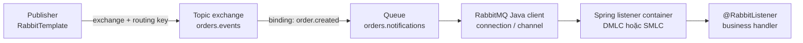
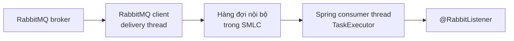
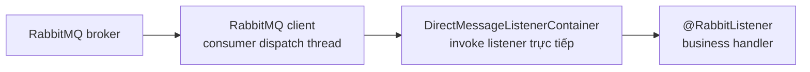
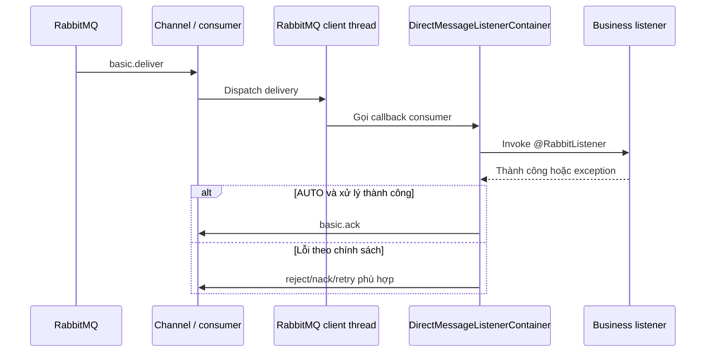
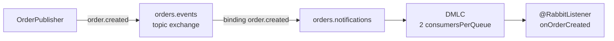

# DirectMessageListenerContainer và thực thi trên luồng RabbitMQ client

Trong ứng dụng **Spring AMQP** sử dụng RabbitMQ, `@RabbitListener` giúp xử lý message bất đồng bộ mà không phải tự gọi `basic.consume`, quản lý channel hay viết vòng lặp nhận message. Đằng sau annotation này là một **listener container**: thành phần tạo consumer, nhận delivery, chuyển payload cho phương thức Java, quản lý ACK/NACK, lỗi và vòng đời kết nối.

Spring AMQP có hai loại container thường gặp: `SimpleMessageListenerContainer` (**SMLC**) và `DirectMessageListenerContainer` (**DMLC**). Điểm phân biệt quan trọng nhất của DMLC là **gọi listener trực tiếp từ luồng dispatch của RabbitMQ Java client**, thay vì chuyển delivery qua một hàng đợi nội bộ sang luồng worker do Spring cung cấp như SMLC.

Sự khác biệt ấy ảnh hưởng đến **độ trễ, số consumer, cách cấp phát thread, tác vụ chặn luồng, retry, xác nhận giao nhận và khả năng giám sát**. Bài học thuộc chương **Listener container**, tập trung vào cách hoạt động và lựa chọn DMLC trong một hệ thống Spring AMQP xử lý sự kiện qua exchange–queue–binding bằng `RabbitTemplate` và `@RabbitListener`.

Sau bài này, bạn có thể:

- Mô tả đường đi của một delivery từ RabbitMQ client tới listener trong DMLC.
- So sánh DMLC với SMLC và chọn theo kiểu tải, đặc tính xử lý và tài nguyên thread.
- Cấu hình `DirectRabbitListenerContainerFactory`, `consumersPerQueue`, `prefetch` và ACK mode.
- Hiểu vì sao không nên làm việc chặn lâu trên luồng nhận của RabbitMQ client.
- Thiết kế xử lý lỗi, retry/dead-letter, dừng/khởi động và quan sát hệ thống mà không nhầm consumer ACK với publisher confirm.

## 1. Listener container đứng ở đâu trong kiến trúc AMQP?

Publisher đưa một message vào **exchange** bằng `RabbitTemplate`. RabbitMQ đối chiếu routing key với binding, định tuyến vào queue và giao message tới consumer đang đăng ký với queue đó.



Container là cầu nối giữa **delivery ở cấp AMQP** và **phương thức xử lý Java**. Nó có trách nhiệm điều phối:

- Đăng ký consumer trên queue và quản lý trạng thái connection/channel.
- Xử lý delivery, chuyển đổi message qua `MessageConverter`/listener adapter khi cần.
- Phát ACK/NACK theo `AcknowledgeMode` hoặc để application tự ACK khi cấu hình MANUAL.
- Phối hợp với error handler, advice/retry, sự kiện dừng/khởi động và chính sách khôi phục sau mất kết nối.
- Điều tiết tải thông qua prefetch và mức đồng thời consumer.

**Lưu ý:** Container có thể gọi listener sau khi message đã được broker giao nhưng **chưa ACK**. Lúc này message có thể nằm ở nhóm `messages_unacknowledged` trên queue. Nếu xử lý thất bại hoặc channel đóng trước ACK, message có thể được giao lại theo ngữ nghĩa RabbitMQ.

## 2. DMLC khác SMLC như thế nào về luồng thực thi?

### 2.1. SimpleMessageListenerContainer: có lớp chuyển giao nội bộ

Trong SMLC, RabbitMQ Java client nhận message, chuyển nó qua một hàng đợi nội bộ cho các thread consumer do Spring quản lý; thread từ `TaskExecutor` của container thực thi listener.



SMLC có thêm bước chuyển giao giữa client và listener. Đổi lại, hoạt động nghiệp vụ nặng/chặn lâu thường không diễn ra trực tiếp trên luồng dispatch của RabbitMQ client.

### 2.2. DirectMessageListenerContainer: gọi listener trực tiếp

DMLC bỏ qua hàng đợi chuyển giao này: message được dispatch từ **RabbitMQ client thread** và method listener được gọi trên đường dispatch đó.



Hệ quả:

- **Ít bước chuyển giao thread hơn**, có thể giảm overhead/độ trễ khi xử lý message nhỏ.
- Thời gian listener chạy trực tiếp ảnh hưởng đến **mức độ bận của luồng RabbitMQ client** đang dispatch delivery.
- Số luồng do RabbitMQ client cung cấp cần đủ cho tổng số consumer hoạt động trên các container dùng chung tài nguyên.
- Cấu hình `TaskExecutor` cho SMLC **không có cùng vai trò** là tách nghiệp vụ khỏi RabbitMQ client thread trong DMLC.

Điều đó **không** có nghĩa “DMLC không có concurrency”, cũng không đồng nghĩa “mỗi message phải có một thread mới”. RabbitMQ Java client có cơ chế executor/dispatch, còn DMLC duy trì những consumer độc lập và chạy listener trên các thread từ cơ chế đó.

### 2.3. Bảng so sánh

| Khía cạnh | SMLC | DMLC |
| --- | --- | --- |
| Nơi chạy listener | Thread của `TaskExecutor` do container/Spring sử dụng | Thread do **RabbitMQ Java client dispatch** delivery |
| Có hàng đợi chuyển giao nội bộ từ client thread? | Có | Không |
| Cấu hình concurrency thường dùng | `concurrentConsumers`, `maxConcurrentConsumers` | `consumersPerQueue` |
| Phân phối concurrency | Nhóm consumer theo container/queue được cấu hình | Số consumer **cho từng queue** |
| Thêm/bớt queue khi container chạy | Có thể yêu cầu điều chỉnh hoặc restart consumer theo cơ chế container | Hỗ trợ thêm/bớt consumer cho queue linh hoạt hơn |
| Tác vụ chặn lâu trong handler | Chiếm thread Spring consumer, ít tác động trực tiếp đến RabbitMQ client dispatcher | Chiếm thread RabbitMQ client dispatcher, cần đặc biệt cân nhắc |
| Batching ACK | `batchSize`/container settings theo phiên bản | `messagesPerAck` và `ackTimeout` khi dùng cơ chế tương ứng |
| Mục tiêu chọn | Cân bằng, phù hợp nhiều loại tác vụ xử lý lâu | Luồng xử lý ngắn, yêu cầu dispatch trực tiếp/độ trễ thấp, tài nguyên được thiết kế phù hợp |

Không thể kết luận DMLC **luôn nhanh hơn** SMLC. Với consumer gọi database chậm, gRPC, dịch vụ email hoặc tác vụ CPU nặng, thời gian xử lý thường áp đảo chi phí chuyển giao nội bộ. Cần đo tải đại diện để quyết định.

## 3. Luồng RabbitMQ client là tài nguyên quan trọng của DMLC

### 3.1. Một delivery đi qua thread như thế nào?

Với DMLC, sau khi RabbitMQ giao message đến connection/channel, RabbitMQ Java client dispatch nó vào callback của consumer; callback mà Spring quản lý gọi listener adapter, và listener adapter gọi phương thức `@RabbitListener`.



**Khi listener đang chạy, thread dispatch đó đang bận.** Nếu handler `sleep(30_000)`, gọi API chậm hoặc đợi khóa database lâu, luồng client đó không thể xử lý callback khác cùng lúc. Điều này có thể làm tăng thời gian từ lúc broker delivery đến lúc ứng dụng xử lý/ACK, và ảnh hưởng đến các consumer cùng chia sẻ nguồn dispatch thread.

Hãy tách ba nguồn lực sau:

1. **RabbitMQ connection/channel:** đơn vị giao tiếp AMQP; mỗi consumer có trạng thái delivery/ACK gắn với channel.
2. **RabbitMQ client executor/thread:** nơi client gọi callback consumer; DMLC trực tiếp chạy handler tại đây.
3. **Năng lực nghiệp vụ:** số kết nối DB, HTTP client pool, CPU, thời gian xử lý, khóa/tranh chấp.

Tăng số consumer chỉ hữu ích khi cả ba lớp còn đủ năng lực.

### 3.2. Không dùng @Async void như một giải pháp “offload miễn phí”

Một phương án dễ sai:

```java
// CẢNH BÁO: minh họa anti-pattern, không phải cách xử lý đáng tin cậy.
@RabbitListener(queues = "orders.notifications")
public void onMessage(String orderId) {
    backgroundExecutor.execute(() -> sendEmail(orderId));
    // Phương thức trả về ngay; AUTO ACK có thể được phát
    // trước khi sendEmail() thực sự hoàn thành.
}
```

Nếu container đang ở `AcknowledgeMode.AUTO`, nó thường coi listener **thành công khi method trả về bình thường**. Công việc do `backgroundExecutor` thực hiện có thể thất bại sau đó nhưng message đã ACK, broker không còn căn cứ để redeliver.

**Muốn offload**, phải giữ đúng ranh giới ACK:

- Dùng cơ chế **asynchronous `@RabbitListener` return type** được phiên bản Spring AMQP hỗ trợ (chẳng hạn `CompletableFuture`) và xác minh khi nào listener container ACK theo completion; áp dụng cấu hình ACK mode phù hợp.
- Hoặc ghi công việc vào **kho lưu bền** (DB/job queue) trước khi listener trả về để ranh giới ACK có ý nghĩa, rồi worker khác xử lý.
- Hoặc dùng MANUAL ACK với cơ chế quản lý completion, channel và thread cẩn thận; **không gọi bừa channel từ nhiều thread** vì quản lý channel và delivery tag phức tạp hơn.
- Hoặc chọn SMLC nếu chỉ cần tách handler đồng bộ khỏi RabbitMQ client threads, sau khi đánh giá đầy đủ độ trễ và tài nguyên.

Tuyệt đối không đổi sang `AcknowledgeMode.NONE` chỉ để giảm thời gian xử lý ACK; khi broker không chờ consumer ACK, lỗi sau delivery có thể dẫn đến mất cơ hội phát lại theo cơ chế ACK thông thường.

### 3.3. Quy hoạch executor của RabbitMQ Java client

DMLC phụ thuộc vào **executor/luồng của RabbitMQ Java client**. Nếu nhiều container cùng dùng connection factory, chúng có thể chia sẻ tài nguyên client. Cần đánh giá:

- Tổng consumer `@RabbitListener`, kể cả những listener ở queue khác.
- `consumersPerQueue` của mỗi container và số queue mà container phụ trách.
- Số client/factory/connection; listener khác có thể dùng chung executor.
- Độ dài xử lý trên thread dispatch và tỷ lệ callback bị chặn.
- Cơ chế cấu hình executor của **RabbitMQ Java client/Spring connection factory** trong phiên bản đang dùng.

Với nhu cầu tùy chỉnh, RabbitMQ Java client có cấu hình `ExecutorService` phục vụ consumer dispatch. Trong Spring, cấu hình executor nên được thực hiện ở **connection factory/client factory tương ứng**, không giả định chỉ đặt `TaskExecutor` trên DMLC là có thể tách callback khỏi client thread.

Không dùng bừa một thread pool quá nhỏ so với số consumer và các callback khác; cũng không mở vô hạn thread. Benchmark throughput, độ trễ, thread dump và tình trạng channel trước khi chọn số thread.

## 4. Cấu hình DMLC bằng Spring Boot

Với một phiên bản Spring Boot hỗ trợ các properties Spring Rabbit tương ứng, có thể chọn container loại **direct**:

```yaml
# application.yml
spring:
  rabbitmq:
    host: ${RABBITMQ_HOST:localhost}
    port: ${RABBITMQ_PORT:5672}
    virtual-host: ${RABBITMQ_VHOST:/orders}
    username: ${RABBITMQ_USERNAME}
    password: ${RABBITMQ_PASSWORD}
    listener:
      type: direct
      direct:
        consumers-per-queue: 2
        prefetch: 20
        acknowledge-mode: auto
        default-requeue-rejected: false
```

Ý nghĩa:

| Property | Ý nghĩa |
| --- | --- |
| `listener.type: direct` | Chọn listener container factory dạng direct trong auto-configuration phù hợp |
| `direct.consumers-per-queue: 2` | DMLC đăng ký **hai consumer cho mỗi queue** của listener |
| `direct.prefetch: 20` | Giới hạn message chưa ACK được broker cấp trước cho consumer theo cấu hình prefetch |
| `direct.acknowledge-mode: auto` | Spring ACK sau khi xử lý thành công; không phải protocol `autoAck=true` |
| `direct.default-requeue-rejected: false` | Theo chính sách container, lỗi reject cuối cùng thường không requeue; cần DLX phù hợp để không mất message lỗi |

Property path có thể được bổ sung/đổi theo phiên bản Boot; hãy đối chiếu cấu hình của **Spring Boot/Spring AMQP trong dự án** trước khi triển khai. Đặc biệt, `listener.simple.*` và `listener.direct.*` là hai nhánh **khác nhau**, không nên dùng `simple.concurrency` để điều khiển DMLC.

Khi dùng auto-configuration, `@RabbitListener` không ghi `containerFactory` thường tham chiếu factory mặc định tên `rabbitListenerContainerFactory`. Cần kiểm tra xem factory thực tế đã được Boot tạo là `DirectRabbitListenerContainerFactory` hay chưa; có thể quan sát class của factory hoặc container trong test/Actuator.

### 4.1. Ước lượng số consumer từ cấu hình

Giả sử có hai listener container DMLC:

- Container A consume một queue `orders.notifications` với `consumersPerQueue=3`.
- Container B consume hai queue `billing.created` và `billing.paid` với `consumersPerQueue=2`.

Tổng consumer đăng ký theo cấu hình là:

```text
Container A: 1 queue  x 3 consumer/queue = 3 consumer
Container B: 2 queues x 2 consumer/queue = 4 consumer
Tổng:                                      7 consumer
```

Đây là số lượng **consumer AMQP theo topology dự kiến**, không mặc nhiên là số thread Java riêng biệt được cấp cố định 1:1. RabbitMQ Java client có cơ chế điều phối executor; số thread cần đủ để callback được phục vụ theo yêu cầu. Bên cạnh đó, consumer giữ các channel tương ứng và tiêu tốn tài nguyên trên broker.

## 5. Cấu hình bằng DirectRabbitListenerContainerFactory

Nếu không muốn dùng `spring.rabbitmq.listener.type=direct` cho toàn bộ ứng dụng, có thể định nghĩa **factory có tên riêng** rồi chỉ định ở từng listener.

```java
import org.springframework.amqp.core.AcknowledgeMode;
import org.springframework.amqp.rabbit.config.DirectRabbitListenerContainerFactory;
import org.springframework.amqp.rabbit.connection.ConnectionFactory;
import org.springframework.context.annotation.Bean;
import org.springframework.context.annotation.Configuration;

@Configuration
public class DirectListenerConfiguration {

    @Bean("orderDirectListenerFactory")
    public DirectRabbitListenerContainerFactory orderDirectListenerFactory(
            ConnectionFactory connectionFactory) {

        DirectRabbitListenerContainerFactory factory =
                new DirectRabbitListenerContainerFactory();

        factory.setConnectionFactory(connectionFactory);
        factory.setConsumersPerQueue(2);
        factory.setPrefetchCount(20);
        factory.setAcknowledgeMode(AcknowledgeMode.AUTO);
        factory.setDefaultRequeueRejected(false);

        return factory;
    }
}
```

Listener chọn factory:

```java
import org.springframework.amqp.rabbit.annotation.RabbitListener;
import org.springframework.stereotype.Component;

@Component
public class NotificationListener {

    @RabbitListener(
            queues = "orders.notifications",
            containerFactory = "orderDirectListenerFactory")
    public void onOrderCreated(String orderId) {
        // Giữ handler đơn giản trong ví dụ.
        System.out.println("Notify: " + orderId);
    }
}
```

Factory là cấu hình tạo container, còn container thực sự quản lý các consumer của endpoint. Nếu cấu hình nhiều factory trong cùng project, phải biết **listener nào sử dụng factory nào**. Không nghĩ rằng `factory.setConsumersPerQueue(2)` sẽ áp dụng cho tất cả `@RabbitListener` nếu một endpoint chỉ vào factory khác.

**Lưu ý về injection:** Nếu bạn cũng dùng `RabbitTemplate` để publish, Spring Boot có thể cung cấp template từ `ConnectionFactory` đang dùng. Việc thêm một listener factory có tên riêng không tự thay đổi bean publisher.

## 6. Ví dụ end-to-end: producer, exchange, queue, DMLC listener

### 6.1. Khai báo topology

Một topic exchange `orders.events` route `order.created` tới queue `orders.notifications`:



```java
import org.springframework.amqp.core.Binding;
import org.springframework.amqp.core.BindingBuilder;
import org.springframework.amqp.core.ExchangeBuilder;
import org.springframework.amqp.core.Queue;
import org.springframework.amqp.core.QueueBuilder;
import org.springframework.amqp.core.TopicExchange;
import org.springframework.context.annotation.Bean;
import org.springframework.context.annotation.Configuration;

@Configuration
public class OrderTopology {

    public static final String EXCHANGE = "orders.events";
    public static final String QUEUE = "orders.notifications";
    public static final String KEY = "order.created";

    @Bean
    public TopicExchange orderEventsExchange() {
        return ExchangeBuilder.topicExchange(EXCHANGE)
                .durable(true)
                .build();
    }

    @Bean
    public Queue notificationsQueue() {
        return QueueBuilder.durable(QUEUE).build();
    }

    @Bean
    public Binding notificationsBinding(
            Queue notificationsQueue,
            TopicExchange orderEventsExchange) {
        return BindingBuilder.bind(notificationsQueue)
                .to(orderEventsExchange)
                .with(KEY);
    }
}
```

Spring có thể khai báo các bean này trên broker thông qua `RabbitAdmin` khi đã được cấu hình phù hợp. Queue/exchange/binding nằm trong **virtual host của connection**, không tự xuất hiện trên một vhost khác.

### 6.2. Publisher gửi sự kiện

```java
import org.springframework.amqp.rabbit.core.RabbitTemplate;
import org.springframework.stereotype.Service;

@Service
public class OrderPublisher {
    private final RabbitTemplate rabbitTemplate;

    public OrderPublisher(RabbitTemplate rabbitTemplate) {
        this.rabbitTemplate = rabbitTemplate;
    }

    public void created(String orderId) {
        rabbitTemplate.convertAndSend(
                OrderTopology.EXCHANGE,
                OrderTopology.KEY,
                orderId);
    }
}
```

Publisher **không cần biết** DMLC đang chạy mấy consumer. RabbitMQ giao message từ queue tới các consumer cạnh tranh. Tăng `consumersPerQueue` không tạo thêm bản sao sự kiện cho mỗi consumer; nó chỉ tăng khả năng tiêu thụ **một** queue.

### 6.3. Listener ghi lại thread thực thi để kiểm chứng

Thay method `NotificationListener` ở phần 5 bằng bản có log thread (không đăng ký hai handler cạnh tranh cùng queue nếu không chủ đích):

```java
import java.time.Instant;
import org.springframework.amqp.rabbit.annotation.RabbitListener;
import org.springframework.stereotype.Component;

@Component
public class NotificationListener {

    @RabbitListener(
            queues = OrderTopology.QUEUE,
            containerFactory = "orderDirectListenerFactory")
    public void onOrderCreated(String orderId) {
        System.out.printf(
                "%s thread=%s event=%s%n",
                Instant.now(),
                Thread.currentThread().getName(),
                orderId);

        // Thực tế: validate, kiểm tra event ID,
        // rồi thực hiện nghiệp vụ trước khi trả về thành công.
    }
}
```

Bật traffic rồi kiểm tra log/thread dump. Tên thread thực tế phụ thuộc RabbitMQ Java client, thread factory và cấu hình executor; đừng viết assertion phụ thuộc một prefix tên thread cứng.

Để so sánh công bằng với SMLC, có thể chạy **một biến thể cấu hình khác** dùng `SimpleRabbitListenerContainerFactory`, giữ cùng publisher, topology và payload. Đo độ trễ delivery → bắt đầu xử lý, throughput, số consumer, CPU, số thread, số message chưa ACK và khả năng phục hồi sau lỗi.

## 7. Mức đồng thời, prefetch và số channel

### 7.1. consumersPerQueue không phải prefetch

Hai tham số kiểm soát những khía cạnh khác nhau:

| Tham số | Điều khiển | Nếu quá cao |
| --- | --- | --- |
| `consumersPerQueue` | Số consumer AMQP được đăng ký **trên mỗi queue** | Tăng callback/threads/channels, áp lực DB và tài nguyên broker |
| `prefetchCount` | Số delivery chưa ACK broker có thể cấp trước cho consumer theo cấu hình | Tăng `messages_unacknowledged` và lượng dữ liệu đang nằm phía client |
| Số thread client executor | Khả năng dispatch các callback đang chạy | Thiếu thread gây trì hoãn dispatch, dư thread gây overhead |
| Connection/channel cache | Khả năng duy trì và cấp tài nguyên AMQP | Quá thấp gây nghẽn; quá cao tốn memory/socket/channel trên broker |

Với một queue có **3 consumer**, prefetch **20** nghĩa là tổng message đã giao nhưng chưa ACK có thể đạt khoảng **60** trong điều kiện các consumer đều được cấp đủ và không có giới hạn khác. Đây là **ước lượng theo consumer**, không phải công thức throughput. RabbitMQ có những quy tắc prefetch/limit và distribution cụ thể cần kiểm chứng theo phiên bản.

Với message lớn, prefetch cao có thể khiến RAM của client tăng đáng kể. Với việc xử lý theo thứ tự, tăng nhiều consumer cũng có thể khiến **thứ tự hoàn tất nghiệp vụ** khác thứ tự message được publish.

### 7.2. Không nên điều chỉnh cả ba thứ khi chưa đo

Nếu consumer bị backlog:

1. Kiểm tra **số message ready/unacked** ở queue.
2. Đo thời gian xử lý từng message, CPU, thời gian gọi database/network.
3. Xem các thread RabbitMQ client có bị chặn do handler không.
4. Tăng `consumersPerQueue` có kiểm soát và đồng thời bảo đảm executor/channel đủ.
5. Chỉ thay `prefetch` sau khi hiểu message size và thời gian ACK.
6. Đánh giá broker (CPU, memory, disk), connection/channel và DLQ.

Nếu database đã hết connection hoặc external API quá chậm, tăng consumer chỉ gây thêm áp lực và có thể khiến timeout lan rộng.

## 8. ACK, retry, dead-letter trong DMLC

DMLC không làm thay đổi **ngữ nghĩa AMQP ACK**. Nó thay đổi nơi chạy callback và cách quản lý consumer; broker vẫn cần biết delivery đã được xử lý ra sao.

### 8.1. AcknowledgeMode.AUTO

Ví dụ ở các phần trước dùng `AcknowledgeMode.AUTO`. Trong chế độ này:

- Listener xử lý thành công → container gửi ACK theo chính sách của nó.
- Listener ném exception → container áp dụng error handler, advice và chính sách reject/requeue.
- Consumer/channel chết trước khi ACK → broker có thể phát lại delivery.

**AUTO của Spring không phải `autoAck=true`** ở RabbitMQ: Spring vẫn quản lý ACK/NACK thay cho application.

Nếu cấu hình `defaultRequeueRejected=false` mà không có dead-letter exchange/queue, message bị reject cuối cùng có thể **bị loại bỏ**. Phải khai báo DLX/DLQ khi cần lưu message lỗi để điều tra hoặc phát lại.

### 8.2. AcknowledgeMode.MANUAL

Trong một số nghiệp vụ, application cần quyết định chính xác thời điểm ACK, ví dụ sau khi ghi kết quả vào DB. Khi đó tạo một factory **riêng** cho manual ACK:

```java
import org.springframework.amqp.core.AcknowledgeMode;
import org.springframework.amqp.rabbit.config.DirectRabbitListenerContainerFactory;
import org.springframework.amqp.rabbit.connection.ConnectionFactory;
import org.springframework.context.annotation.Bean;
import org.springframework.context.annotation.Configuration;

@Configuration
public class ManualDirectConfiguration {

    @Bean("manualDirectFactory")
    public DirectRabbitListenerContainerFactory manualDirectFactory(
            ConnectionFactory connectionFactory) {

        DirectRabbitListenerContainerFactory factory =
                new DirectRabbitListenerContainerFactory();
        factory.setConnectionFactory(connectionFactory);
        factory.setConsumersPerQueue(1);
        factory.setPrefetchCount(10);
        factory.setAcknowledgeMode(AcknowledgeMode.MANUAL);
        return factory;
    }
}
```

Ví dụ listener tự ACK khi hoàn tất:

```java
import java.io.IOException;
import java.nio.charset.StandardCharsets;

import com.rabbitmq.client.Channel;
import org.springframework.amqp.core.Message;
import org.springframework.amqp.rabbit.annotation.RabbitListener;
import org.springframework.stereotype.Component;

@Component
public class ManualOrderListener {

    @RabbitListener(
            queues = OrderTopology.QUEUE,
            containerFactory = "manualDirectFactory")
    public void handle(Message message, Channel channel) throws IOException {

        long tag = message.getMessageProperties().getDeliveryTag();

        String orderId = new String(
                message.getBody(), StandardCharsets.UTF_8);

        if (orderId.isBlank()) {
            // Lỗi dữ liệu vĩnh viễn: không requeue; DLX nếu cấu hình.
            channel.basicReject(tag, false);
            return;
        }

        try {
            // Thực tế: ghi trạng thái idempotent / commit DB trước ACK.
            processOrder(orderId);
            channel.basicAck(tag, false);
        } catch (Exception ex) {
            // Demo: loại khỏi queue chính (đẩy DLX nếu queue có cấu hình).
            // Trong thực tế phân loại transient/permanent và retry có giới hạn.
            channel.basicNack(tag, false, false);
        }
    }

    private void processOrder(String orderId) {
        System.out.println("Processing: " + orderId);
    }
}
```

**Đây là ví dụ về cấu hình thay thế**, không phải yêu cầu chạy thêm listener MANUAL song song với listener AUTO trên cùng queue. Nếu đăng ký cả hai, chúng sẽ cạnh tranh nhận message và khó kiểm chứng semantics của từng factory.

Những điểm cần nhớ:

- `deliveryTag` có phạm vi **channel**; phải ACK trên **đúng channel** nhận delivery.
- `basicAck(tag, false)` chỉ ACK một delivery; đừng dùng `multiple=true` vô ý khi có nhiều delivery đang xử lý đồng thời.
- `basicNack(tag, false, false)` từ chối mà không requeue, chỉ đến DLX nếu cấu hình hợp lệ.
- Không ACK trước khi side effect nghiệp vụ thực sự hoàn tất.
- Nếu exception xảy ra trước khi ứng dụng ACK/NACK được, broker có thể redeliver khi channel đóng; handler MANUAL cần được kiểm thử với trường hợp lỗi.
- DMLC thực thi callback trên RabbitMQ client thread, nên code MANUAL này vẫn cần **xử lý nhanh, tránh block dài**.

### 8.3. Batch acknowledgement trong DMLC

DMLC cung cấp khả năng **gom ACK** qua các cấu hình như `messagesPerAck` và `ackTimeout`, nhằm giảm số lệnh ACK gửi lên broker. Đây là vấn đề **tần suất xác nhận delivery**, không phải một lần gọi listener được chuyển thành một batch message Java.

Những đánh đổi:

| Khi giảm tần suất ACK | Lợi ích | Rủi ro |
| --- | --- | --- |
| ACK theo nhóm message | Giảm overhead lệnh ACK | Tăng số delivery unacked, tăng số message có thể bị giao lại nếu consumer/channel lỗi |
| Chờ tới `ackTimeout` khi chưa đủ nhóm | Tránh giữ ACK quá lâu trong giai đoạn ít message | ACK có thể không phát đúng tại thời điểm cấu hình đến từng mili giây vì phụ thuộc vòng giám sát |
| Kết hợp với prefetch | Có thể cải thiện throughput ở một số tải | Nếu prefetch/ACK batch thiếu cân đối có thể gây nghẽn và tăng memory |

Cần kiểm tra compatibility của `messagesPerAck` với transaction/ack mode và Spring AMQP version; **không kết hợp tùy tiện với transacted channel**. Nếu yêu cầu xác nhận ngay sau mỗi message hoặc cần đối soát chính xác khi lỗi, ưu tiên mặc định đơn giản và đo trước khi bật batch ACK.

### 8.4. Retry và DLX không do DMLC tự khai báo

Khi xử lý ngoại lệ, **listener container** dùng error handler và các advice/interceptor được cấu hình; **RabbitMQ** dùng queue arguments/policies để dead-letter nếu reject/nack không requeue. DMLC không tự tạo DLQ chỉ vì listener ném exception.

Phải có đủ:

1. **Chính sách phân loại lỗi:** lỗi tạm thời được retry với backoff/giới hạn, lỗi dữ liệu lỗi vĩnh viễn được từ chối.
2. **Queue DLX/DLQ:** exchange, binding, queue và quyền được khai báo đúng vhost.
3. **Idempotency:** cùng event ID có thể được xử lý nhiều lần do publisher retry hoặc broker redelivery.
4. **Quan sát:** metrics callback failure, retry count, redelivery, queue ready/unacked và DLQ depth.

Nên tránh `defaultRequeueRejected=true` với message lỗi vĩnh viễn mà không có retry limit, vì nó có thể tạo vòng lặp redelivery liên tục.

## 9. Quản lý vòng đời và khả năng phục hồi

DMLC quản lý consumer theo từng queue và có cơ chế giám sát/khởi tạo lại consumer trong các trường hợp cần thiết. Các thuộc tính như `monitorInterval`, số lần thử khởi tạo và chính sách xử lý queue bị thiếu cần được xem xét theo phiên bản Spring AMQP.

### 9.1. Thêm/bớt queue động

Một lợi ích của DMLC là có thể **điều chỉnh consumer ở các queue** linh hoạt hơn mà không cần phải dừng/khởi động lại toàn bộ nhóm như một số đường xử lý của SMLC. Tuy nhiên, thao tác topology động vẫn cần:

- Exchange/queue/binding tồn tại trước khi tiêu thụ.
- Kiểm soát concurrency mới và tài nguyên RabbitMQ client threads.
- Không đóng/mất ACK những delivery đang xử lý.
- Kiểm tra việc consumer cũ đã dừng, consumer mới đã đăng ký và không có tuyến sai.

Nếu tên queue bị thay đổi trong một đợt migration classic → quorum, cần điều phối cả publisher routing và consumer, không chỉ sửa `@RabbitListener(queues = "...")`.

### 9.2. Khi RabbitMQ restart hoặc connection bị ngắt

Khi mất connection, DMLC có thể khôi phục consumer sau khi Spring tạo lại connection/channel theo cơ chế quản lý của container. Thời gian phục hồi phụ thuộc vào retry/recovery, scheduler và điều kiện mạng/broker.

Đừng tự giả định **listener đang xử lý dở chắc chắn ACK thành công**. Nếu broker mất kết nối trước ACK, message có thể được phát lại; consumer nên idempotent và side effect cần được commit theo ranh giới phù hợp.

Ngoài ra, listener chạy trực tiếp trên client thread có thể ảnh hưởng đến thời điểm nó phát ACK, nên mọi thao tác block kéo dài cần timeout rõ ràng và được đo đạc.

## 10. Thực hành quan sát DMLC trên RabbitMQ

### 10.1. Xác minh topology và consumer

Sau khi khởi động ứng dụng với `consumersPerQueue=2` và listener ở queue `orders.notifications`, chọn đúng vhost (ví dụ `/orders`) rồi kiểm tra:

```bash
# Xem queue và số consumer
rabbitmqctl list_queues -p /orders \
  name messages_ready messages_unacknowledged consumers

# Xem các channel, số consumer và số message chưa ACK
rabbitmqctl list_channels \
  connection number consumer_count messages_unacknowledged

# Kiểm tra exchange/binding để phân biệt lỗi routing với lỗi consume
rabbitmqctl list_exchanges -p /orders name type
rabbitmqctl list_bindings -p /orders \
  source_name destination_name routing_key
```

Trong điều kiện container khởi tạo thành công, queue `orders.notifications` thường cho thấy **hai consumer** đối với một listener DMLC có `consumersPerQueue=2`. Nếu số consumer khác kỳ vọng, kiểm tra có nhiều instance ứng dụng, listener factory khác, queue bị thiếu, connection lỗi hoặc quá trình scale đang diễn ra.

### 10.2. So sánh hai kiểu container bằng thực nghiệm

Giữ nguyên **publisher, exchange, queue, payload và công việc xử lý**, rồi lần lượt thử DMLC và SMLC (không chạy song song nếu muốn so sánh một nhóm consumer độc lập).

| Thử nghiệm | Cách làm | Quan sát cần có |
| --- | --- | --- |
| Message nhỏ, xử lý nhanh | Publish vài nghìn event string với throughput vừa phải | Delivery latency, CPU, số thread, số ACK |
| Listener chặn 500 ms | Giả lập gọi API chậm trong handler | Số thread client bận, throughput giảm, ready/unacked |
| Tăng `consumersPerQueue` | Từ 1 lên 2/4 trên DMLC | Số consumer, channel, throughput và tải DB |
| Giảm prefetch | Từ 20 xuống 5 | Unacked, memory, throughput và fairness |
| Consumer ném exception | Có retry/DLX rõ ràng | Requeue/retry, message vào DLQ khi phù hợp |
| RabbitMQ restart | Khởi động lại broker thử nghiệm | Reconnect, consumer re-registration, redelivery |
| Xử lý trùng | Cho handler thành công nhưng gây mất ACK | Event ID/idempotency ngăn side effect lặp |
| Shutdown khi còn unacked | Dừng instance lúc handler đang chạy | Khả năng nhận lại message, dừng có kiểm soát |

Không dùng các bài thử cố ý block hoặc restart trên queue production chứa dữ liệu thật.

### 10.3. Chỉ số cần theo dõi

- **Client:** số thread RabbitMQ client dispatch, thread dump, CPU, thời gian listener chạy, số thread bị block, exceptions.
- **Container:** số consumer hoạt động, queue đang đăng ký, reconnect/restart attempts, thời gian xử lý, retry/error handler.
- **Broker:** connection/channel count, consumer count, `messages_ready`, `messages_unacknowledged`, delivery/ack rates, redelivery, DLQ depth.
- **Publisher:** `RabbitTemplate` publish latency, confirm ACK/NACK và return; không nhầm các chỉ số này với consumer ACK.
- **Nghiệp vụ:** số event đã xử lý, event bị khử trùng lặp, thời gian commit DB, SLA đầu cuối.

Tên metric và event phụ thuộc phiên bản Spring AMQP, cấu hình Micrometer/Actuator và hệ thống quan sát; không mặc định mọi số liệu trên đều được framework xuất sẵn dưới cùng một tên.

## 11. Lỗi thường gặp và cách xử lý

| Hiện tượng | Nguyên nhân khả dĩ | Cách kiểm tra |
| --- | --- | --- |
| Listener DMLC chạy chậm khi có vài handler block | Thread RabbitMQ client dispatch bị chiếm lâu | Thread dump, thời gian callback, external call/DB pool |
| Tăng `consumersPerQueue` nhưng không tăng throughput | Database/API downstream hoặc executor client là nút thắt | CPU/thread, connection pool, broker prefetch và ACK |
| `simple.concurrency` không thay đổi số consumer | Application đang dùng direct container | Kiểm tra `listener.type`/container factory và `consumersPerQueue` |
| Queue có nhiều `messages_unacknowledged` | Handler chậm, prefetch cao hoặc ACK batch | Listener latency, prefetch, `messagesPerAck` |
| Message lỗi bị redeliver liên tục | Requeue bật và thiếu retry limit | Error handler, `defaultRequeueRejected`, retry/DLX |
| Không thấy message vào DLQ sau exception | Queue chưa có DLX/binding hoặc message vẫn requeue | Queue arguments/policy, error logs, ACK/NACK |
| Handler `@Async void` trả về nhanh nhưng việc nền lỗi | AUTO ACK đã được phát trước side effect | Không offload vô trách nhiệm; ACK theo completion hoặc ghi trạng thái bền |
| MANUAL listener ACK sai delivery | Dùng delivery tag/channel sai hoặc ACK hai lần | Theo dõi channel shutdown, delivery tags và code ACK |
| Consumer đột ngột biến mất | Connection/channel lỗi, queue thiếu hoặc permission | Broker/server logs, DMLC recovery logs, vhost |
| Confirm ACK nhưng consumer chưa xử lý | Confirm nói về broker publish, không nói về listener | Theo dõi queue/consumer ACK, kết quả nghiệp vụ |
| Listener nhận message trùng | Publisher retry hoặc broker redelivery | Event ID, idempotency, trạng thái xử lý và logs |

## 12. Khi nào chọn DirectMessageListenerContainer?

**DMLC phù hợp** khi nghiệp vụ xử lý message ngắn, tương đối ổn định, bạn muốn giảm bước chuyển giao nội bộ và có khả năng quản lý/quan sát tài nguyên RabbitMQ client threads; hoặc hệ thống cần điều chỉnh consumer theo queue linh hoạt.

**SMLC vẫn là lựa chọn tốt** khi code listener đồng bộ, thường gọi dịch vụ ngoài hoặc cần thread pool phía Spring tách khỏi client dispatch; đặc biệt nếu đội vận hành đã có thông số concurrency, retry và giám sát ổn định với SMLC.

Một trình tự lựa chọn hợp lý:

1. Xác định **độ trễ tối đa**, throughput, thời gian xử lý mỗi message và số queue.
2. Thử SMLC làm mốc, rồi thử DMLC với **cùng workload** và cùng downstream.
3. Với DMLC, đo **thread RabbitMQ client bị chiếm bao lâu** và bố trí executor phù hợp.
4. Điều chỉnh `consumersPerQueue` và prefetch có kiểm soát; kiểm tra tác động lên channel, broker và DB.
5. Xác nhận ACK/retry/DLX, idempotency và khả năng reconnect/shutdown bằng kiểm thử lỗi.
6. Chỉ dùng DMLC cho những luồng thực sự có lợi từ mô hình trực tiếp, không chọn theo giả định “direct là luôn nhanh hơn”.

### Checklist triển khai

- [ ] Xác định listener factory thực tế là `DirectRabbitListenerContainerFactory`, không nhầm với SMLC.
- [ ] Cấu hình `consumersPerQueue` theo **từng queue**; dự trù tổng số consumer, channel và RabbitMQ client threads.
- [ ] Kiểm tra những API blocking, transaction dài, `sleep` hoặc `@Async void` trong handler.
- [ ] Phân biệt `prefetch` với số consumer và `messagesPerAck` với số message trong một callback.
- [ ] Chọn AUTO hoặc MANUAL ACK theo nghiệp vụ, không nhầm AUTO của Spring với protocol autoAck.
- [ ] Thiết kế retry có giới hạn, DLX/DLQ và tránh requeue vô hạn cho lỗi vĩnh viễn.
- [ ] Dùng event ID và consumer idempotency khi message có thể được giao lại.
- [ ] Xác nhận exchange–queue–binding đúng vhost, cấp quyền cần thiết và khai báo topology trước khi publish.
- [ ] Theo dõi queue ready/unacked, consumer count, thread dump, publisher confirms/returns và latency nghiệp vụ.
- [ ] Thử thay đổi tải, lỗi mạng, restart broker, shutdown khi còn unacked trước triển khai thực tế.

**Ghi nhớ:** `DirectMessageListenerContainer` chạy callback `@RabbitListener` **trên luồng dispatch của RabbitMQ Java client**, không qua hàng đợi chuyển giao nội bộ và thread Spring consumer như `SimpleMessageListenerContainer`. Điều này có thể giảm overhead nhưng khiến việc **giữ callback ngắn, quy hoạch executor, consumer concurrency và thời điểm ACK** trở nên đặc biệt quan trọng. Chọn container dựa trên số liệu tải và khả năng phục hồi, rồi kết hợp với routing chính xác, publisher confirms, consumer ACK, retry/dead-letter, idempotency, giao dịch nghiệp vụ phù hợp và quan sát hệ thống.

### Tài liệu tham khảo

- [Spring AMQP — Listener Concurrency](https://docs.spring.io/spring-amqp/reference/amqp/listener-concurrency.html)
- [Spring AMQP — Asynchronous Consumer](https://docs.spring.io/spring-amqp/reference/amqp/receiving-messages/async-consumer.html)
- [Spring AMQP — Annotation-driven Listener Endpoints](https://docs.spring.io/spring-amqp/reference/amqp/receiving-messages/async-annotation-driven.html)
- [Spring AMQP API — DirectMessageListenerContainer](https://docs.spring.io/spring-amqp/api/org/springframework/amqp/rabbit/listener/DirectMessageListenerContainer.html)
- [Spring AMQP API — DirectRabbitListenerContainerFactory](https://docs.spring.io/spring-amqp/api/org/springframework/amqp/rabbit/config/DirectRabbitListenerContainerFactory.html)
- [RabbitMQ — Consumers](https://www.rabbitmq.com/docs/consumers)
- [RabbitMQ — Consumer Prefetch](https://www.rabbitmq.com/docs/consumer-prefetch)
- [RabbitMQ — Channels](https://www.rabbitmq.com/docs/channels)
- [RabbitMQ — Consumer Acknowledgements and Publisher Confirms](https://www.rabbitmq.com/docs/confirms)
- [RabbitMQ — Dead Letter Exchanges](https://www.rabbitmq.com/docs/dlx)

