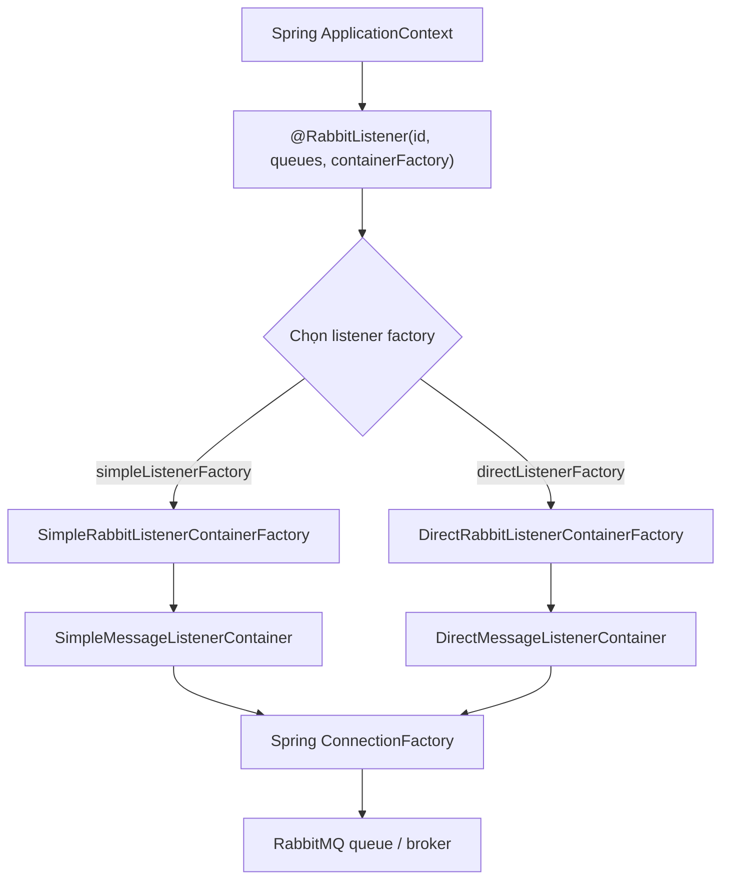
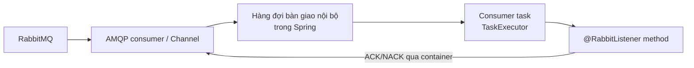
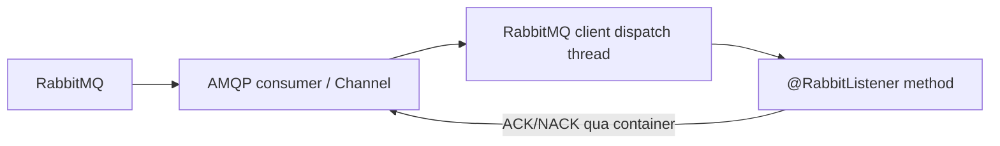
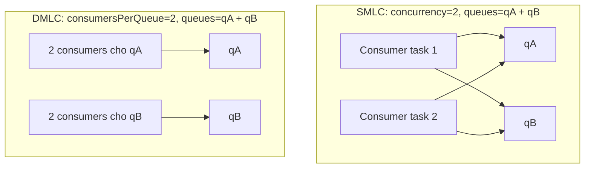
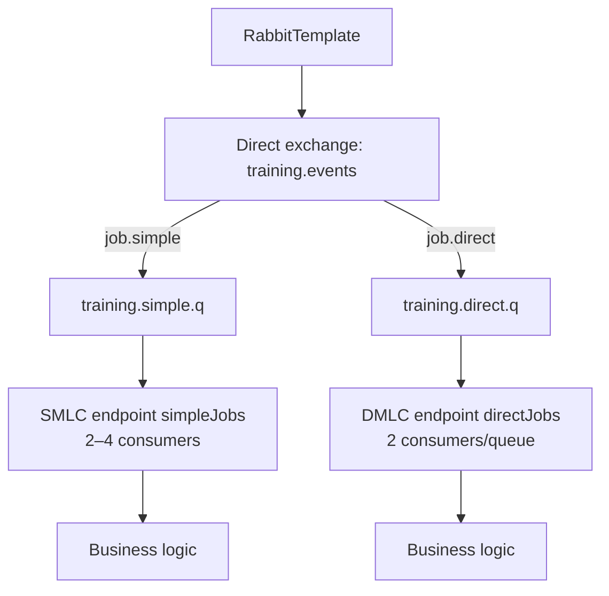
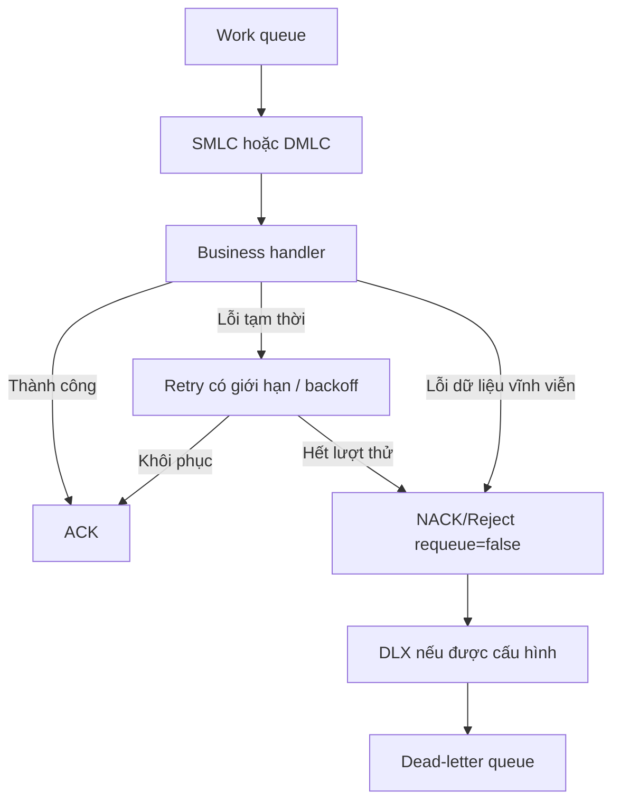

# SimpleRabbitListenerContainerFactory và DirectRabbitListenerContainerFactory

Trong Spring AMQP, `@RabbitListener` chỉ mô tả **endpoint nhận message**. Để endpoint thật sự kết nối đến RabbitMQ, đăng ký consumer, nhận delivery, chuyển đổi payload, gọi phương thức xử lý và ACK/NACK, Spring cần một **listener container**. Hai cách tạo container phổ biến là `SimpleRabbitListenerContainerFactory` và `DirectRabbitListenerContainerFactory`. Chúng cùng phục vụ `@RabbitListener` nhưng có mô hình nhận message, cách quản lý luồng và ý nghĩa của concurrency **khác nhau**.

Bài thuộc chương **Listener container** của module **SPRING_AMQP**. Chúng ta sẽ kết hợp `RabbitTemplate`, `@RabbitListener`, exchange, queue, binding, acknowledgement, retry, dead-letter, quản lý kết nối và quan sát hệ thống để hiểu nên chọn factory nào khi xây dựng một consumer bất đồng bộ đáng tin cậy.

## 1. Factory, container và listener không phải là một

| Thành phần | Vai trò |
|---|---|
| `@RabbitListener` | Khai báo **phương thức/lớp** xử lý, queue cần nghe và các tùy chọn endpoint như `id`, `containerFactory`, `concurrency`. |
| `RabbitListenerContainerFactory<?>` | **Factory** dùng để tạo container từ thông tin endpoint. |
| `SimpleRabbitListenerContainerFactory` | Tạo `SimpleMessageListenerContainer` (viết tắt **SMLC**). |
| `DirectRabbitListenerContainerFactory` | Tạo `DirectMessageListenerContainer` (viết tắt **DMLC**). |
| `RabbitListenerEndpointRegistry` | Quản lý các container được tạo cho annotation listener, cho phép tìm theo `id` để start/stop và quan sát. |
| `ConnectionFactory` | Cung cấp kết nối/channel đến broker; cả hai loại listener container đều cần Spring AMQP `ConnectionFactory`. |

Một ứng dụng có thể có **nhiều listener container factory** với chính sách khác nhau: factory xử lý công việc cần throughput cao, factory nhận message phải giới hạn concurrency, hoặc factory kết nối đến broker/vhost khác. Khi dùng nhiều factory, đừng dựa vào việc chọn bean tự động; hãy đặt tên và chỉ rõ `containerFactory` tại endpoint.



**Điểm mấu chốt:** `RabbitListenerContainerFactory` là **bean cấu hình**, không phải nơi trực tiếp chạy business logic. Nó tạo một listener container cho từng endpoint; chính container quản lý consumer, channel, luồng, ACK/NACK và lifecycle.

## 2. Khác biệt cốt lõi giữa Simple và Direct

| Khía cạnh | Simple (SMLC) | Direct (DMLC) |
|---|---|---|
| Cách chuyển delivery đến listener | Consumer nhận message từ RabbitMQ client rồi **chuyển qua hàng đợi nội bộ** của Spring sang luồng xử lý trong container. | Listener được gọi **trực tiếp hơn từ luồng phân phối delivery của RabbitMQ Java Client**, không có cùng lớp hàng đợi chuyển tiếp như SMLC. |
| Mô hình thread | Container sử dụng `TaskExecutor` cho các consumer task; có lớp bàn giao message nội bộ. | Dựa nhiều hơn vào thread do RabbitMQ client quản lý cho callback nhận, cùng các tác vụ monitor của container. |
| Cấu hình concurrency chính | `concurrentConsumers` và `maxConcurrentConsumers`. | `consumersPerQueue`. |
| `@RabbitListener(concurrency=...)` | Có thể dùng `"2"` hoặc khoảng `"2-5"` để đặt mức min/max. | Dùng **một số nguyên** như `"2"`, nghĩa là số consumer **cho mỗi queue**. |
| Tự điều chỉnh concurrency | Có cơ chế tăng/giảm consumer giữa min/max theo hoạt động/rảnh. | Không có cùng cơ chế tự scale theo khoảng min/max của SMLC. |
| Nhiều queue trong một endpoint | Mỗi consumer của container có thể consume từ nhiều queue đã cấu hình. | Số consumer được áp dụng **theo từng queue**. |
| Batching ACK | Dùng `batchSize` cùng các tham số liên quan trên SMLC; còn phải xem `prefetch` và chế độ transacted. | Có các tham số `messagesPerAck`, `ackTimeout` cho khả năng gom ACK tương ứng. |
| Thao tác hàng đợi | SMLC có cơ chế consumer task và quản lý subscription riêng. | DMLC quản lý consumer theo queue, có thể thuận tiện khi cần thay đổi tập queue được nghe. |
| Chọn khi nào? | Cần scale trong phạm vi min/max, cấu hình SMLC quen thuộc, muốn tách việc nhận khỏi luồng callback client. | Cần quản lý consumer-per-queue rõ ràng, ít lớp bàn giao, đặc biệt khi một endpoint nhận nhiều queue. |

Đừng suy ra “Direct luôn nhanh hơn Simple”. Hiệu năng thực tế còn phụ thuộc độ dài công việc, số queue, throughput, prefetch, ACK, connection/channel, kích thước message, retry và giới hạn CPU/I/O. Nên **đo trong điều kiện tải thực tế** rồi mới thay đổi container type.

### 2.1. Luồng xử lý của SimpleMessageListenerContainer



SMLC nhận delivery, chuyển qua tầng bàn giao nội bộ rồi consumer task gọi listener. Cấu trúc này tạo một ranh giới giữa thread nhận callback của RabbitMQ Java Client và thread thực hiện business logic. SMLC có các tham số như `receiveTimeout`, `batchSize`, `concurrentConsumers`, `maxConcurrentConsumers` và các khoảng thời gian tăng/giảm consumer.

### 2.2. Luồng xử lý của DirectMessageListenerContainer



DMLC gọi listener gần đường callback trực tiếp hơn, giảm một lớp hàng đợi và bàn giao thread. Vì callback xử lý có thể dùng tài nguyên executor của RabbitMQ client, **không nên chặn lâu hoặc làm công việc rất nặng ngay trong callback khi chưa có thiết kế phù hợp**. Với tác vụ CPU/IO kéo dài, cần kiểm tra số thread/consumer, giới hạn downstream và chính sách xử lý; đừng nhầm cơ chế delivery trực tiếp với việc xử lý hoàn toàn bất đồng bộ.

## 3. Concurrency: khác biệt dễ cấu hình sai nhất

Giả sử một listener endpoint được cấu hình để nhận từ **hai queue**, `orders.fast.q` và `orders.slow.q`.

| Cấu hình | Simple container | Direct container |
|---|---|---|
| `concurrency="1"` | 1 consumer của container; consumer có thể đăng ký trên cả hai queue. | 1 consumer **mỗi queue** → tổng cộng khoảng 2 consumer. |
| `concurrency="3"` | 3 consumer của container, mỗi consumer có thể đăng ký trên các queue đang cấu hình. | 3 consumer **mỗi queue** → tổng cộng khoảng 6 consumer. |
| `concurrency="2-5"` | Có thể tự điều chỉnh từ 2 đến 5 consumer **của container**. | **Không dùng cú pháp khoảng**; Direct dùng số nguyên. |

Số consumer thực tế có thể tạm thời khác dự kiến khi kết nối gián đoạn, queue không khả dụng hoặc quá trình container đang khởi động/phục hồi. Bảng mô tả ý nghĩa cấu hình khi hệ thống hoạt động bình thường.



Nếu bạn chuyển một endpoint từ SMLC sang DMLC mà giữ nguyên giá trị `concurrency`, **số consumer/channel có thể thay đổi mạnh khi nghe nhiều queue**. Việc tăng consumer không luôn cải thiện throughput: prefetch, database pool, API downstream hoặc tài nguyên broker có thể là điểm nghẽn mới.

### 3.1. Khi có nhiều replica ứng dụng

`concurrency=1` chỉ giới hạn số consumer của **endpoint/container trong một tiến trình**, không khóa queue trên toàn hệ thống. Nếu chạy ba replica cùng lắng nghe một queue với SMLC `concurrency=2`, có thể có khoảng sáu consumer cạnh tranh nhận message từ queue đó. Với DMLC `consumersPerQueue=2` trên một queue, ba replica cũng có thể có khoảng sáu consumer.

Để xử lý tuần tự bằng một consumer active trên toàn broker, cần xem **Single Active Consumer** (SAC) tương thích với queue type hoặc thiết kế khác; chỉ giảm concurrency về 1 trong từng replica không tạo ra exclusivity toàn cục.

## 4. Chuẩn bị Spring Boot và hai queue thử nghiệm

Để học được cả hai container type mà không bị **competing consumers giữa hai ví dụ**, ta tạo hai queue độc lập dùng chung một direct exchange:

- `training.simple.q` dành cho `SimpleMessageListenerContainer`.
- `training.direct.q` dành cho `DirectMessageListenerContainer`.

Publisher gửi với routing key tương ứng; broker chỉ định tuyến đến queue có binding khớp. Đây là ví dụ cấu trúc tối thiểu, không phải ý rằng SMLC/DMLC bắt buộc phải nghe các queue khác nhau trong hệ thống thật.

### 4.1. Dependency và kết nối

Với ứng dụng **Spring Boot 3.x**, dependency Maven thông dụng là:

```xml
<dependency>
    <groupId>org.springframework.boot</groupId>
    <artifactId>spring-boot-starter-amqp</artifactId>
</dependency>
```

Với **Spring Boot 4.x**, dùng starter RabbitMQ AMQP 0-9-1 tương ứng của phiên bản đó (`spring-boot-starter-rabbitmq`). Chú ý khác biệt với starter cho AMQP 1.0, không dùng nhầm giao thức trong bài về `RabbitTemplate` và `@RabbitListener`.

```yaml
# application.yml — cấu hình broker cho môi trường học tập
spring:
  rabbitmq:
    host: localhost
    port: 5672
    username: guest
    password: guest
    virtual-host: /
```

RabbitMQ mặc định giới hạn tài khoản `guest` truy cập từ loopback; môi trường thật phải dùng tài khoản được cấp quyền phù hợp, secrets và TLS khi cần.

### 4.2. Khai báo exchange, queue và binding

```java
package com.example.training;

import org.springframework.amqp.core.Binding;
import org.springframework.amqp.core.BindingBuilder;
import org.springframework.amqp.core.DirectExchange;
import org.springframework.amqp.core.Queue;
import org.springframework.beans.factory.annotation.Qualifier;
import org.springframework.context.annotation.Bean;
import org.springframework.context.annotation.Configuration;

@Configuration(proxyBeanMethods = false)
public class TrainingTopology {
    public static final String EXCHANGE = "training.events";
    public static final String SIMPLE_QUEUE = "training.simple.q";
    public static final String DIRECT_QUEUE = "training.direct.q";
    public static final String SIMPLE_KEY = "job.simple";
    public static final String DIRECT_KEY = "job.direct";

    @Bean
    public DirectExchange trainingExchange() {
        return new DirectExchange(EXCHANGE, true, false);
    }

    @Bean
    public Queue simpleJobQueue() {
        return new Queue(SIMPLE_QUEUE, true);
    }

    @Bean
    public Queue directJobQueue() {
        return new Queue(DIRECT_QUEUE, true);
    }

    @Bean
    public Binding simpleJobBinding(
            @Qualifier("simpleJobQueue") Queue queue,
            DirectExchange trainingExchange) {
        return BindingBuilder.bind(queue).to(trainingExchange)
                .with(SIMPLE_KEY);
    }

    @Bean
    public Binding directJobBinding(
            @Qualifier("directJobQueue") Queue queue,
            DirectExchange trainingExchange) {
        return BindingBuilder.bind(queue).to(trainingExchange)
                .with(DIRECT_KEY);
    }
}
```

Hai bean `Queue` có cùng kiểu nên dùng `@Qualifier` khi inject vào phương thức tạo `Binding`. `RabbitAdmin` có thể tự khai báo các bean này khi ứng dụng kết nối broker, nhưng **tạo bean Java không chứng minh broker đã có topology**. Nếu exchange hoặc queue cùng tên đã tồn tại với thuộc tính khác, RabbitMQ có thể đóng channel vì lỗi `PRECONDITION_FAILED`. Chỉ thực hành trên namespace/vhost riêng hoặc dữ liệu không quan trọng.

## 5. Cấu hình SimpleRabbitListenerContainerFactory

`SimpleRabbitListenerContainerFactory` tạo `SimpleMessageListenerContainer`. Ta đặt số consumer ban đầu là 2, tối đa 4, prefetch là 20 và ACK tự động ở **cấp container Spring**:

```java
package com.example.training;

import org.springframework.amqp.core.AcknowledgeMode;
import org.springframework.amqp.rabbit.config.SimpleRabbitListenerContainerFactory;
import org.springframework.amqp.rabbit.connection.ConnectionFactory;
import org.springframework.context.annotation.Bean;
import org.springframework.context.annotation.Configuration;

@Configuration(proxyBeanMethods = false)
public class SimpleListenerConfig {

    @Bean("simpleListenerFactory")
    public SimpleRabbitListenerContainerFactory simpleListenerFactory(
            ConnectionFactory connectionFactory) {
        SimpleRabbitListenerContainerFactory factory =
                new SimpleRabbitListenerContainerFactory();

        factory.setConnectionFactory(connectionFactory);
        factory.setConcurrentConsumers(2);
        factory.setMaxConcurrentConsumers(4);
        factory.setPrefetchCount(20);
        factory.setAcknowledgeMode(AcknowledgeMode.AUTO);
        factory.setDefaultRequeueRejected(false);
        return factory;
    }
}
```

**Giải thích cấu hình:**

| Lệnh | Ý nghĩa |
|---|---|
| `setConcurrentConsumers(2)` | Khởi tạo số consumer nền tảng là 2. |
| `setMaxConcurrentConsumers(4)` | Cho phép SMLC tăng lên tối đa 4 khi điều kiện hoạt động thỏa tiêu chí scaling. |
| `setPrefetchCount(20)` | Đề nghị broker cho consumer nhận trước tối đa khoảng 20 delivery chưa ACK (phụ thuộc cấu hình, batching và semantics của broker). |
| `setAcknowledgeMode(AUTO)` | Spring container ACK khi listener hoàn tất thành công, hoặc xử lý reject/NACK khi có lỗi. **Không phải** `autoAck=true` của broker. |
| `setDefaultRequeueRejected(false)` | Với lỗi bị container reject theo cơ chế mặc định, không yêu cầu broker requeue; nếu queue có DLX, message có thể được dead-letter. |

SMLC có thể tự tăng/giảm consumer khi hoạt động ổn định qua những chu kỳ active/idle theo các tham số như `consecutiveActiveTrigger`, `consecutiveIdleTrigger`, `startConsumerMinInterval` và `stopConsumerMinInterval`. Vì vậy, **không bảo đảm** ngay lập tức có 4 consumer chỉ bởi có backlog. Điều chỉnh các trigger cần dựa trên đo lường, vì quá nhạy có thể làm số consumer dao động liên tục.

### 5.1. @RabbitListener chọn Simple factory

```java
package com.example.training;

import org.springframework.amqp.rabbit.annotation.RabbitListener;
import org.springframework.stereotype.Component;

@Component
public class SimpleJobConsumer {

    @RabbitListener(
            id = "simpleJobs",
            queues = TrainingTopology.SIMPLE_QUEUE,
            containerFactory = "simpleListenerFactory",
            concurrency = "2-4")
    public void consume(String payload) {
        System.out.printf(
                "[SIMPLE] thread=%s payload=%s%n",
                Thread.currentThread().getName(), payload);
        // Ví dụ: xử lý nghiệp vụ, chỉ kết thúc khi đã commit thành công.
    }
}
```

`concurrency="2-4"` trên endpoint là **cấu hình ghi đè** mức min/max tương ứng lấy từ factory trong ví dụ. Nếu không đặt `concurrency`, endpoint dùng mặc định từ `simpleListenerFactory`. Mỗi endpoint được tạo từ factory có container riêng, nên thay đổi concurrency của một endpoint **không tự đổi** các endpoint khác.

## 6. Cấu hình DirectRabbitListenerContainerFactory

`DirectRabbitListenerContainerFactory` tạo `DirectMessageListenerContainer`. Thay vì `concurrentConsumers` và `maxConcurrentConsumers`, nó dùng `consumersPerQueue`:

```java
package com.example.training;

import org.springframework.amqp.core.AcknowledgeMode;
import org.springframework.amqp.rabbit.config.DirectRabbitListenerContainerFactory;
import org.springframework.amqp.rabbit.connection.ConnectionFactory;
import org.springframework.context.annotation.Bean;
import org.springframework.context.annotation.Configuration;

@Configuration(proxyBeanMethods = false)
public class DirectListenerConfig {

    @Bean("directListenerFactory")
    public DirectRabbitListenerContainerFactory directListenerFactory(
            ConnectionFactory connectionFactory) {
        DirectRabbitListenerContainerFactory factory =
                new DirectRabbitListenerContainerFactory();

        factory.setConnectionFactory(connectionFactory);
        factory.setConsumersPerQueue(2);
        factory.setPrefetchCount(20);
        factory.setAcknowledgeMode(AcknowledgeMode.AUTO);
        factory.setDefaultRequeueRejected(false);
        return factory;
    }
}
```

Trong ví dụ, `setConsumersPerQueue(2)` nghĩa là mỗi queue mà endpoint nghe sẽ có **2 consumer** khi hệ thống ổn định. Nếu endpoint được cấu hình nghe ba queue thì tổng số consumer có thể vào khoảng sáu, **không phải chỉ hai**. DMLC không có cơ chế tự scale bằng chuỗi min–max kiểu `"2-4"` của SMLC.

### 6.1. @RabbitListener chọn Direct factory

```java
package com.example.training;

import org.springframework.amqp.rabbit.annotation.RabbitListener;
import org.springframework.stereotype.Component;

@Component
public class DirectJobConsumer {

    @RabbitListener(
            id = "directJobs",
            queues = TrainingTopology.DIRECT_QUEUE,
            containerFactory = "directListenerFactory",
            concurrency = "2")
    public void consume(String payload) {
        System.out.printf(
                "[DIRECT] thread=%s payload=%s%n",
                Thread.currentThread().getName(), payload);
    }
}
```

Với Direct container, `concurrency="2"` thiết lập **2 consumer cho queue này**. Nếu bạn thêm queue vào cùng endpoint, số consumer tăng theo số queue. Không dùng `concurrency="2-4"` cho Direct: chuỗi khoảng min–max là cú pháp của Simple container.

### 6.2. Publisher dùng chung RabbitTemplate

`RabbitTemplate` **không cần biết** consumer dùng Simple hay Direct container. Nó gửi vào exchange với routing key; broker đưa message vào queue phù hợp, rồi listener container nhận:

```java
package com.example.training;

import org.springframework.amqp.rabbit.core.RabbitTemplate;
import org.springframework.stereotype.Service;

@Service
public class TrainingPublisher {
    private final RabbitTemplate rabbitTemplate;

    public TrainingPublisher(RabbitTemplate rabbitTemplate) {
        this.rabbitTemplate = rabbitTemplate;
    }

    public void sendToSimple(String payload) {
        rabbitTemplate.convertAndSend(
                TrainingTopology.EXCHANGE,
                TrainingTopology.SIMPLE_KEY,
                payload);
    }

    public void sendToDirect(String payload) {
        rabbitTemplate.convertAndSend(
                TrainingTopology.EXCHANGE,
                TrainingTopology.DIRECT_KEY,
                payload);
    }
}
```

Sơ đồ thực tế khi chạy hai listener:



Hai queue khác nhau giúp dễ quan sát rằng **không có cạnh tranh nhận message giữa hai ví dụ**. Nếu cả hai annotation cùng nghe một queue, broker có thể phân phối delivery giữa hai nhóm consumer; đó không phải phép so sánh độc lập của hai container type.

## 7. Chọn container mặc định bằng Spring Boot properties

Nếu ứng dụng không cần đăng ký **cả hai factory** như ví dụ trước, Spring Boot cho phép chọn loại listener container mặc định bằng property. Với cách này, `@RabbitListener` có thể **không cần** khai báo `containerFactory`, miễn ứng dụng đang dùng factory mặc định do Boot tạo.

### 7.1. Cấu hình Simple làm mặc định

```yaml
spring:
  rabbitmq:
    listener:
      type: simple
      simple:
        concurrency: 2
        max-concurrency: 4
        prefetch: 20
        acknowledge-mode: auto
        default-requeue-rejected: false
```

Trong đa số cấu hình Spring Boot quen thuộc, Simple là kiểu listener container mặc định. `type: simple` được ghi rõ để người học không phụ thuộc vào giá trị ngầm. `concurrency: 2` và `max-concurrency: 4` là khoảng tự điều chỉnh của SMLC, không phải hai mức ACK.

### 7.2. Cấu hình Direct làm mặc định

```yaml
spring:
  rabbitmq:
    listener:
      type: direct
      direct:
        consumers-per-queue: 2
        prefetch: 20
        acknowledge-mode: auto
        default-requeue-rejected: false
```

Với Direct, `consumers-per-queue: 2` nghĩa là **hai consumer cho mỗi queue** mà một endpoint nghe. Một listener khai báo ba queue có thể tạo sáu consumer. Không chép thuộc tính `max-concurrency` của Simple sang Direct với kỳ vọng Direct tự scale theo khoảng.

**Quy tắc chọn cách cấu hình:** một ứng dụng dùng **chỉ một loại container** có thể ưu tiên Boot properties. Nếu các listener khác nhau cần chiến lược khác nhau, đăng ký **các factory có tên riêng** như phần 5–6 rồi gắn `containerFactory` vào từng endpoint. Các property `spring.rabbitmq.listener.simple.*` / `direct.*` không nhất thiết tự động áp dụng cho **mọi factory tự tạo thủ công**; với bean thủ công, cần đặt các tham số tương ứng hoặc sử dụng cơ chế configurer của Boot đúng phiên bản.

## 8. Prefetch, ACK và batching: quan trọng hơn tên container

Hai loại container đều dùng RabbitMQ **consumer acknowledgement**. Việc chọn Simple hoặc Direct **không tự bật** retry, dead-letter hoặc exactly-once processing. Mỗi delivery còn phụ thuộc ack mode, prefetch, error handler và loại queue.

### 8.1. Prefetch và message chưa ACK

`prefetchCount` giới hạn số delivery chưa ACK mà broker có thể cấp trước cho một consumer (với cách RabbitMQ áp dụng QoS trong phạm vi consumer). Ví dụ một consumer có prefetch 20 có thể nhận tối đa khoảng 20 message chờ xử lý/ACK; điều này giúp tận dụng throughput nhưng cũng tăng số message đang được giữ bởi consumer.

| Giá trị tương đối | Lợi ích | Đánh đổi |
|---|---|---|
| Prefetch thấp (ví dụ 1) | Ít message đang unacked; dễ kiểm soát khi xử lý chậm hoặc cần giảm ảnh hưởng requeue. | Có thể không tận dụng tối đa throughput khi xử lý nhanh hoặc network latency cao. |
| Prefetch trung bình (ví dụ 10–50) | Tận dụng pipeline tốt hơn cho nhiều workload. | Có thể tăng unacked, cần cân bằng concurrency và memory. |
| Prefetch rất cao | Tăng số delivery có thể gửi trước. | Rủi ro giữ nhiều message ở consumer, mất cân bằng với consumer khác và áp lực bộ nhớ. |

**Không có một con số prefetch tối ưu cho mọi hệ thống.** Nếu handler cần vài giây để gọi API ngoài, tăng prefetch từ 20 lên 500 không khiến API xử lý nhanh hơn; nó có thể làm tăng backlog unacked và thời gian chuyển giao sau lỗi.

### 8.2. AUTO, MANUAL và NONE

| `AcknowledgeMode` | Ý nghĩa trong listener container |
|---|---|
| `AUTO` | **Spring container** ACK khi listener xử lý thành công; trên lỗi, container xử lý reject/NACK theo cấu hình. Đây **không phải** RabbitMQ autoAck/noAck. |
| `MANUAL` | Code handler chủ động gọi `Channel.basicAck(...)` hoặc `basicNack(...)`/`basicReject(...)` trên **channel nhận**. |
| `NONE` | Chế độ không đợi consumer ACK (broker auto-ack); message được xem là đã nhận khi broker giao, có nguy cơ mất nếu consumer lỗi trước khi xử lý xong. |

Với `AcknowledgeMode.AUTO`, các exception không được xử lý có thể khiến container **requeue message** theo chính sách mặc định. Nếu lỗi vĩnh viễn lặp lại, điều này có thể tạo vòng lặp nhận → lỗi → requeue gây tải lớn. `setDefaultRequeueRejected(false)` làm container từ chối mà **không requeue** trong đường xử lý tương ứng; message chỉ đi DLQ nếu queue có cấu hình dead-letter exchange/binding phù hợp, nếu không có thể bị loại.

### 8.3. Gom ACK và batch processing không hoàn toàn giống nhau

Với Simple, các tham số như `batchSize` có thể ảnh hưởng số message được xử lý/gom trước ACK (trong các chế độ có hỗ trợ), còn các tùy chọn consumer-side batching có thể gom nhiều delivery thành danh sách truyền cho batch listener khi được cấu hình rõ.

Với Direct, các tham số như `messagesPerAck` và `ackTimeout` cung cấp cơ chế gom ACK theo số message hoặc thời gian trong cấu hình được hỗ trợ. Chúng **không** mặc nhiên biến chữ ký `@RabbitListener(String)` thành batch listener nhận `List<String>`.

**Không trộn lẫn ba ý:** (1) broker prefetch bao nhiêu delivery, (2) container gom bao nhiêu ACK, (3) phương thức handler có nhận payload theo batch hay không. Mỗi ý có API, điều kiện và rủi ro khác nhau; transaction channel và manual ACK làm thay đổi hành vi. Nếu nghiệp vụ đòi ACK sau từng transaction DB, ưu tiên độ rõ ràng trước tối ưu gom ACK.

### 8.4. Manual ACK hoạt động với cả hai loại container

Ví dụ dưới đây là **phương án thay thế** listener `directJobs` của phần 6, không đăng ký cùng lúc trên `training.direct.q` nếu muốn kiểm thử độc lập:

```java
package com.example.training;

import com.rabbitmq.client.Channel;
import java.io.IOException;
import org.springframework.amqp.rabbit.annotation.RabbitListener;
import org.springframework.amqp.support.AmqpHeaders;
import org.springframework.messaging.handler.annotation.Header;
import org.springframework.stereotype.Component;

@Component
public class ManualDirectConsumer {

    @RabbitListener(
            id = "manualDirectJobs",
            queues = TrainingTopology.DIRECT_QUEUE,
            containerFactory = "directListenerFactory",
            ackMode = "MANUAL")
    public void consume(
            String payload,
            Channel channel,
            @Header(AmqpHeaders.DELIVERY_TAG) long deliveryTag)
            throws IOException {
        try {
            validateAndCommit(payload);
        } catch (IllegalArgumentException permanentFailure) {
            // Lỗi dữ liệu không thể xử lý: không requeue.
            channel.basicReject(deliveryTag, false);
            return;
        }

        // Sau khi xử lý/commit nghiệp vụ thành công.
        channel.basicAck(deliveryTag, false);
    }

    private void validateAndCommit(String payload) {
        if (payload.isBlank()) {
            throw new IllegalArgumentException("Empty payload");
        }
        // Ứng dụng thật thực hiện giao dịch DB/idempotency tại đây.
    }
}
```

Trong ví dụ, `ackMode="MANUAL"` trên annotation yêu cầu endpoint dùng manual ACK, kể cả khi factory đang có mặc định AUTO. `basicAck(deliveryTag, false)` xác nhận **một delivery trên chính channel này**. `deliveryTag` không phải ID message toàn hệ thống; không dùng tag lưu trong DB để ACK sau restart.

Đoạn code chỉ phân loại lỗi dữ liệu đơn giản, **không phải** error handler đầy đủ cho production. Các lỗi tạm thời, lỗi I/O khi ACK, exception trước khi vào method, hoặc connection đứt cần chính sách riêng. Nếu DB đã commit nhưng ACK bị mất, broker có thể giao lại message; đó là lý do consumer cần **idempotency** theo `eventId`.

## 9. Retry và dead-letter: container không tự tạo độ tin cậy

Giả sử handler xử lý một `order.created` bị lỗi do database timeout. Hai loại container đều có thể áp dụng listener error handler, retry interceptor, ACK/NACK, requeue hoặc dead-letter tùy cấu hình. **Tên Simple/Direct không tự quyết định** rằng lỗi phải retry hay phải chuyển DLQ.



Điểm cần xác định trong từng ứng dụng:

1. Retry diễn ra **trong cùng một lần delivery** (interceptor/local retry), hay broker sẽ **requeue/delay rồi redeliver**?
2. Bao nhiêu lần thử, khoảng backoff và xử lý phân loại lỗi ra sao?
3. Hết lượt thử thì reject `requeue=false`, phát thông báo lỗi hay dùng DLQ nào?
4. Message bị redeliver có ID nghiệp vụ ổn định để tránh commit hai lần không?
5. Mất kết nối trong lúc xử lý thì queue type, ack mode và recovery sẽ ảnh hưởng gì?

Với một queue durable và consumer ACK, **đặt `setDefaultRequeueRejected(false)` mà không cấu hình DLX không phải chiến lược lưu message lỗi**; broker có thể loại bỏ message. Bất kỳ thiết kế nào muốn lưu lại để điều tra phải có topology DLX/DLQ hoặc kho dữ liệu lỗi riêng.

## 10. Quản lý vòng đời, kết nối và thay đổi queue

Khi ứng dụng khởi động, Spring tạo các listener container từ `@RabbitListener` và factory tương ứng. Container đăng ký consumer trên queue, tạo channel qua Spring `ConnectionFactory` và bắt đầu nhận delivery. Khi broker restart, đường mạng gián đoạn hoặc queue được khôi phục, container cần thực hiện recovery, đăng ký consumer lại và xử lý message có thể được redeliver.

### 10.1. Quản lý qua RabbitListenerEndpointRegistry

Với `id="simpleJobs"` hoặc `id="directJobs"` trong ví dụ, có thể lấy container theo ID:

```java
package com.example.training;

import org.springframework.amqp.rabbit.listener.MessageListenerContainer;
import org.springframework.amqp.rabbit.listener.RabbitListenerEndpointRegistry;
import org.springframework.stereotype.Component;

@Component
public class ListenerControl {
    private final RabbitListenerEndpointRegistry registry;

    public ListenerControl(RabbitListenerEndpointRegistry registry) {
        this.registry = registry;
    }

    public void stop(String listenerId) {
        MessageListenerContainer container =
                registry.getListenerContainer(listenerId);
        if (container != null && container.isRunning()) {
            container.stop();
        }
    }

    public void start(String listenerId) {
        MessageListenerContainer container =
                registry.getListenerContainer(listenerId);
        if (container != null && !container.isRunning()) {
            container.start();
        }
    }
}
```

Ví dụ gọi `stop("simpleJobs")` để dừng endpoint Simple, hoặc `start("directJobs")` để khởi động endpoint Direct. Đây là thao tác vận hành ảnh hưởng xử lý message; khi triển khai thật phải có phân quyền, cơ chế điều phối replica và kế hoạch cho các delivery đang xử lý.

**Dừng container không đồng nghĩa xóa queue.** Queue còn tồn tại theo chính sách broker (durable, auto-delete, exclusive, queue type...), và message chờ xử lý có thể tích lũy khi không còn consumer. Khi khởi động lại, một số delivery chưa ACK ở lần kết nối trước có thể được broker giao lại.

### 10.2. Phục hồi khi broker hoặc connection gián đoạn

Cả SMLC và DMLC đều được Spring AMQP quản lý và có cơ chế khôi phục consumer khi kết nối gặp sự cố. Nhưng **thời điểm restart, cách monitor và chi tiết tái đăng ký có thể khác nhau**. Các tham số như consumer recovery/backoff, thời gian monitor và chính sách queue không tồn tại cần được chọn phù hợp môi trường.

- Nếu queue chưa tồn tại, listener có thể không khởi tạo được hoặc cần retry/recovery tùy container và cấu hình như `missingQueuesFatal`. Đừng coi mọi lỗi queue thiếu là lỗi tạm thời có thể chờ vô hạn.
- Nếu broker có thể bị khởi động lại, bảo đảm `RabbitAdmin` hoặc hệ thống provisioning tạo lại topology cần thiết. Nếu có nhiều admin/broker/vhost, phải chọn đúng connection factory và admin.
- Nếu connection bị mất sau khi nghiệp vụ đã commit DB nhưng trước khi ACK, message có thể redeliver khi consumer hồi phục. Simple hay Direct đều **không** tự loại bỏ nguy cơ này.
- Không chủ động bật lại automatic recovery của native RabbitMQ Java Client trong `CachingConnectionFactory` nếu Spring đang sở hữu việc phục hồi, tránh hai tầng recovery chồng chéo.

### 10.3. Thay đổi queue tại runtime

Hai container có API để thay đổi danh sách queue nhận, nhưng cách vận hành khác nhau. DMLC quản lý consumer theo từng queue, có thể thuận tiện trong một số tình huống thêm/xóa queue động mà không phải tổ chức lại toàn bộ nhóm consumer; SMLC có mô hình consumer nhận từ tập queue của container và có thể phải hủy/tạo lại các consumer khi thay đổi danh sách.

Đối với topology ít thay đổi và được provision bằng migration, **không nên** chọn container type chỉ vì khả năng thêm queue tại runtime. Với hệ thống multi-tenant tạo queue mới liên tục, cần xem thêm giới hạn broker (số queue/channel/connection), chính sách queue lifecycle, khả năng phân quyền và việc đặt nhiều queue lên cùng endpoint.

## 11. Chọn Simple hay Direct theo yêu cầu thực tế

Không có container “đúng nhất” cho mọi bài toán. Nên bắt đầu từ hành vi cần thiết, rồi benchmark:

| Bối cảnh | Lựa chọn bắt đầu hợp lý | Lý do |
|---|---|---|
| Ứng dụng Spring Boot nhỏ, một vài queue và yêu cầu ổn định | **Simple** | Cấu hình phổ biến, auto-scaling min/max và mô hình thread dễ quan sát. |
| Một queue, xử lý message nặng và cần giới hạn số consumer trong biên | **Simple** với `concurrency="m-n"`, đo CPU/DB/IO | Có thể tự điều chỉnh số consumer trong biên nhưng vẫn phải giới hạn tải downstream. |
| Một endpoint nghe nhiều queue, muốn số consumer **rõ theo từng queue** | **Direct** | `consumersPerQueue` diễn giải trực tiếp thành số consumer mỗi queue. |
| Muốn giảm lớp bàn giao delivery giữa RabbitMQ client và listener | **Direct** | Cơ chế gọi listener trực tiếp hơn, nhưng phải cân nhắc ảnh hưởng tới executor/client thread. |
| Cần chế độ batch nhận payload | **Đánh giá cụ thể** Simple/Direct cùng message converter và batch listener | Không thể chọn chỉ từ tên factory; batch-size/ACK và listener signature có điều kiện khác nhau. |
| Muốn thay đổi danh sách queue động trong cùng endpoint | **Cân nhắc Direct** | Quản lý consumer theo queue có thể thuận tiện, nhưng cần kiểm chứng với phiên bản và topology sử dụng. |
| Muốn cùng một sự kiện được nhiều nhóm xử lý | **Không giải quyết bằng chọn container** | Cần **nhiều queue** và binding/fanout/topic phù hợp; hai consumer cùng một queue sẽ cạnh tranh delivery. |
| Cần một consumer active trên toàn cluster, có standby | **Không giải quyết bằng concurrency đơn thuần** | Cần cơ chế Single Active Consumer phù hợp queue type hoặc thiết kế điều phối riêng. |
| Cần exactly-once nghiệp vụ | **Không container nào tự cung cấp** | Phải dùng event ID, transaction, idempotency, confirms và retry/DLQ. |

**Điểm xuất phát thực tế:** nếu chưa có yêu cầu rõ ràng, có thể bắt đầu bằng **Simple** cùng prefetch/concurrency phù hợp, đo tải và lỗi. Chọn **Direct** khi nhu cầu quản lý consumer-per-queue, mô hình thread hoặc benchmark cho thấy lợi thế rõ ràng. Đừng chuyển sang Direct chỉ với giả định “Direct luôn nhanh hơn”.

## 12. Quan sát metrics và đánh giá hiệu năng

Để so sánh hai factory công bằng, dùng **cùng payload, queue type, broker, prefetch, database/API downstream, acknowledgement và điều kiện mạng**. Khi kiểm tra, không nên chỉ nhìn tổng message/s mà bỏ qua độ trễ, redelivery hoặc message mất.

| Chỉ số | Câu hỏi cần trả lời |
|---|---|
| `consumer_count` theo queue | Có đúng số consumer kỳ vọng theo cấu hình Simple/Direct không? |
| `messages_ready` | Message chờ broker giao có tăng nhanh hơn tốc độ xử lý không? |
| `messages_unacknowledged` | Bao nhiêu delivery đã giao nhưng chưa ACK? Prefetch/concurrency có đang giữ quá nhiều không? |
| Tốc độ deliver/ack/nack/redelivery | Consumer có xử lý đều và thành công không, hay đang loop retry? |
| Thời gian xử lý và độ trễ cuối–cuối | Do business logic, DB/API hay container overhead? |
| Thread count và thread utilization | Simple có đủ worker? Direct có chặn client dispatch thread quá lâu không? |
| Channel/connection và bộ nhớ broker | Có mở quá nhiều channel theo số queue × consumer × replica không? |
| DLQ depth, lỗi conversion và exceptions | Những message xử lý thất bại có được giữ lại để điều tra không? |

Trong RabbitMQ Management UI, xem **Queues → Consumers**, **Ready / Unacked**, và **Connections / Channels** ở đúng virtual host. Có thể dùng lệnh quản trị trên môi trường có quyền:

```bash
rabbitmqctl -p / list_queues name consumers messages_ready messages_unacknowledged
rabbitmqctl -p / list_consumers
```

Trường CLI và định dạng có thể thay đổi theo phiên bản RabbitMQ; kiểm tra help trên máy quản trị nếu một trường không tồn tại. Khi consumer ACK rất nhanh, `messages_ready=0` không chứng minh queue không nhận message; hãy kết hợp tốc độ delivery/ack và log xử lý.

### 12.1. Thí nghiệm throughput có kiểm soát

Để thử nghiệm đơn giản, dùng các message nhỏ với một phương thức handler chỉ ghi nhận số message đã xử lý thay vì log toàn bộ payload (logging có thể trở thành nút thắt). Chạy lần lượt **chỉ một loại listener** cho một queue, giữ prefetch và business logic giống nhau, rồi so:

1. Throughput khi một consumer.
2. Throughput khi tăng hai, bốn consumer.
3. P95/P99 thời gian từ publish đến hoàn tất xử lý.
4. Số lượng unacked, redelivery và thread dưới tải.
5. Hành vi khi broker restart hoặc consumer mất kết nối.

Benchmark cần lặp lại nhiều lần trong môi trường cô lập; không dùng kết quả của một lần thử hoặc log `System.out.println` làm kết luận về hiệu năng production.

## 13. Troubleshooting: những lỗi cấu hình thường gặp

| Triệu chứng | Nguyên nhân khả dĩ | Hướng xử lý |
|---|---|---|
| `No bean named 'directListenerFactory'` hoặc endpoint không khởi động | `@RabbitListener(containerFactory=...)` trỏ đến bean không tồn tại hoặc sai tên. | Đặt tên bean đúng, bảo đảm class `@Configuration` nằm trong component scan và Spring có `ConnectionFactory`. |
| `concurrency="2-4"` hoạt động ở Simple nhưng lỗi ở Direct | Direct không sử dụng cú pháp min–max của Simple. | Với Direct dùng `concurrency="2"` hoặc `setConsumersPerQueue(2)`. |
| Số consumer tăng gấp đôi khi chuyển Simple → Direct | Một endpoint nghe hai queue; Direct có 2 consumer **mỗi queue**, Simple có 2 consumer của container. | Tính số queue × consumer/queue × replica; điều chỉnh theo áp lực broker và downstream. |
| Simple chưa tăng tới `maxConcurrentConsumers` dù backlog có | Cơ chế scaling dựa trên active/idle triggers và khoảng thời gian, không phải điều kiện chỉ có `messages_ready > 0`. | Theo dõi tải thực tế, active/idle, prefetch và các ngưỡng scaling; không ép tăng tùy tiện. |
| Thông điệp chỉ đến một trong hai `@RabbitListener` | Hai endpoint cùng đọc một queue, trở thành competing consumers. | Nếu cần broadcast, tạo hai queue với binding tương ứng; không đổi container type để giải quyết. |
| Listener không nhận vì queue thiếu | Queue/binding chưa được tạo, sai vhost hoặc quyền broker không đủ. | Kiểm tra `RabbitAdmin`, tên queue, exchange/binding, virtual host và quyền. |
| `messages_unacknowledged` liên tục tăng | Manual ACK thiếu đường kết thúc, handler chậm, prefetch quá cao hoặc consumer bị nghẽn. | Kiểm tra xử lý/ACK, thread và transaction; giảm prefetch hoặc concurrency khi cần. |
| Message lỗi lặp vô hạn, CPU cao | Exception khiến container requeue; không có giới hạn retry hoặc DLQ. | Phân loại lỗi, thiết lập retry có giới hạn, reject/NACK và DLX phù hợp. |
| Đã đặt `defaultRequeueRejected(false)` nhưng message lỗi “biến mất” | Queue không có DLX/DLQ, broker loại message khi không requeue. | Provision DLX/DLQ và binding hoặc lưu lỗi vào một kho đáng tin. |
| Direct có throughput thấp hoặc thread bị nghẽn | Handler chặn lâu trên đường client dispatch, executor/downstream không đủ tài nguyên. | Đo thread/executor, DB pool và latency; giới hạn tác vụ, dùng cơ chế bàn giao công việc có kiểm soát khi cần. |
| Simple có nhiều thread nhưng throughput không tăng | DB/API ngoài là điểm nghẽn, hoặc message/ACK quá nặng. | Đo endpoint downstream, transaction, prefetch, queue type; tăng consumer chỉ sau khi xác định giới hạn. |
| Consumer dừng/restart dẫn đến xử lý lại | Message đã giao nhưng chưa ACK được broker redeliver. | Dùng `eventId` ổn định, unique constraint và idempotency. |
| Khai báo exchange/queue lỗi `PRECONDITION_FAILED` | Topology có sẵn với thuộc tính durable/type/arguments khác. | Migration được kiểm soát, không xóa queue production tùy tiện. |
| Publisher confirm ACK nhưng không listener nào nhận | Message có thể không định tuyến được hoặc consumer không chạy. | Kiểm tra binding, mandatory/returns, queue ready/unacked và consumer count. |

Một quy trình điều tra hiệu quả: **(1) message đã được định tuyến vào queue chưa? → (2) container có đăng ký consumer không? → (3) delivery đã đến handler chưa? → (4) handler/ACK/DLQ diễn ra thế nào?**. Đừng đổi từ Simple sang Direct chỉ để “sửa” một routing key sai hoặc queue không tồn tại.

## 14. Bài thực hành

**Bài 1 — hai factory trên hai queue riêng.** Chạy `TrainingTopology`, `SimpleListenerConfig`, `DirectListenerConfig` và hai consumer. Gửi năm message vào `job.simple` và năm message vào `job.direct` qua `TrainingPublisher`. Xác minh Simple chỉ xử lý queue `training.simple.q` và Direct chỉ xử lý `training.direct.q`.

**Bài 2 — so sánh concurrency trên một queue.** Giữ Simple `concurrency="2-4"` và Direct `concurrency="2"`. Xem RabbitMQ Management UI → Consumers của hai queue. Quan sát Simple có thể tự tăng số consumer theo tải trong biên cấu hình, còn Direct có số consumer theo `consumersPerQueue`. Ghi lại tình trạng khi không có backlog.

**Bài 3 — một endpoint nghe hai queue.** Tạo một endpoint **thay thế** với `queues={"training.simple.q", "training.direct.q"}`, dùng lần lượt Simple và Direct, mỗi lần chỉ chạy **một endpoint** để tránh competing consumers. Đặt concurrency bằng 2 rồi so sánh số consumer gắn lên từng queue. Giải thích vì sao số consumer tổng trên Direct tăng theo số queue.

**Bài 4 — dùng Boot properties thay vì tự tạo factory.** Trong ứng dụng test tối giản, thử `spring.rabbitmq.listener.type=simple` với `simple.concurrency=2`, sau đó đổi thành `type=direct` với `direct.consumers-per-queue=2`. Không để các custom factory từ ví dụ trước che mất tác dụng của cấu hình Boot mặc định; kiểm tra bean đang được endpoint sử dụng.

**Bài 5 — prefetch và unacked.** Cho handler giả lập công việc chậm có giới hạn (ví dụ gọi một service test). Lần lượt đặt prefetch bằng 1 và 20, giữ các biến khác cố định. Quan sát `messages_unacknowledged`, latency và throughput; không mặc định prefetch cao là tốt hơn.

**Bài 6 — manual ACK và redelivery.** Chỉ chạy `ManualDirectConsumer` thay cho `DirectJobConsumer`, gửi message hợp lệ và không hợp lệ. Quan sát ACK/reject. Trong broker test, mô phỏng mất kết nối sau khi service đã ghi DB nhưng trước ACK, rồi kiểm chứng message có thể redeliver và cần idempotency.

**Bài 7 — DLQ cho lỗi vĩnh viễn.** Thêm dead-letter exchange, DLQ và binding trong môi trường test. Đặt `defaultRequeueRejected(false)`, cho listener ném lỗi dữ liệu không thể phục hồi và quan sát message đến DLQ. Lặp lại khi không có DLX để giải thích vì sao không requeue không đồng nghĩa đã lưu an toàn.

**Bài 8 — lifecycle.** Đặt `autoStartup="false"` cho một listener test có `id` riêng, dùng `RabbitListenerEndpointRegistry` để start/stop. Quan sát consumer count và backlog. Phân biệt stop container với delete queue.

**Bài 9 — benchmark có kiểm soát.** Dùng cùng số lượng message, cùng payload, cùng logic xử lý và prefetch, chạy lần lượt Simple và Direct **trên một queue** trong các phiên test riêng. Ghi throughput, độ trễ P95/P99, thread, số channel, unacked và error count; giải thích kết quả dựa trên dữ liệu, không dựa vào tên “Direct”.

## 15. Tự đánh giá

1. **`SimpleRabbitListenerContainerFactory` tạo container nào?** `SimpleMessageListenerContainer`, viết tắt SMLC.
2. **`DirectRabbitListenerContainerFactory` tạo container nào?** `DirectMessageListenerContainer`, viết tắt DMLC.
3. **`@RabbitListener` tự mở connection/consumer mà không cần factory không?** Không. Annotation được infrastructure xử lý để tạo container từ một `RabbitListenerContainerFactory`.
4. **Simple `concurrency="2-5"` nghĩa là gì?** SMLC có từ 2 đến tối đa 5 consumer của container, thay đổi theo cơ chế scaling nếu đủ điều kiện.
5. **Direct `concurrency="2"` nghĩa là gì nếu endpoint nghe ba queue?** Hai consumer mỗi queue, tổng khoảng sáu consumer khi hoạt động bình thường.
6. **Direct có hỗ trợ `concurrency="2-5"` giống Simple không?** Không theo ngữ nghĩa min–max; dùng một số nguyên cho `consumersPerQueue`.
7. **AUTO ACK của Spring có phải no-ack của RabbitMQ không?** Không. Spring container ACK sau xử lý thành công; `NONE` mới là no-ack ở broker.
8. **Prefetch càng cao có luôn làm handler xử lý nhanh hơn không?** Không. Nó giới hạn số delivery chưa ACK được gửi trước và có thể tăng áp lực bộ nhớ/unacked.
9. **Đặt `defaultRequeueRejected(false)` có tự tạo DLQ không?** Không. Queue cần topology DLX/DLQ tương ứng nếu muốn giữ message lỗi.
10. **Một endpoint nghe hai queue có cùng số consumer trên SMLC và DMLC khi đều đặt concurrency=2 không?** Không nhất thiết. Simple cấu hình consumer của container; Direct cấu hình consumer trên mỗi queue.
11. **Có thể quản lý các listener theo ID không?** Có. Dùng `RabbitListenerEndpointRegistry` và ID của `@RabbitListener`.
12. **Simple hay Direct có bảo đảm nghiệp vụ exactly-once không?** Không. Cần publisher confirms, consumer ACK, retry/DLQ và xử lý idempotent.
13. **Hai listener cùng nghe một queue có đều nhận một bản sao mỗi message không?** Không. Chúng là competing consumers; muốn hai nhóm nhận riêng cần hai queue/binding.
14. **Vì sao không chọn Direct chỉ vì tên gọi?** Vì trade-off thread, số consumer theo queue, prefetch và tải downstream quan trọng hơn; cần benchmark theo workload.

**Ghi nhớ:** `SimpleRabbitListenerContainerFactory` tạo **SMLC**, phù hợp khi muốn consumer task và cơ chế scaling trong biên `concurrentConsumers`–`maxConcurrentConsumers`. `DirectRabbitListenerContainerFactory` tạo **DMLC**, nhận delivery trực tiếp hơn qua callback của RabbitMQ client và cấu hình `consumersPerQueue`. Dù chọn loại nào, **exchange/binding/queue** quyết định định tuyến, **prefetch + ACK** quyết định hành vi nhận, và **retry/DLQ + idempotency + quan sát** quyết định khả năng vận hành đáng tin cậy.

### Tài liệu tham khảo

- Spring AMQP Reference — [Choosing a Container](https://docs.spring.io/spring-amqp/reference/amqp/receiving-messages/choose-container.html).
- Spring AMQP Reference — [Listener Container Configuration](https://docs.spring.io/spring-amqp/reference/amqp/containerAttributes.html).
- Spring AMQP Reference — [Listener Concurrency](https://docs.spring.io/spring-amqp/reference/amqp/listener-concurrency.html).
- Spring AMQP Reference — [Annotation-driven Listener Endpoints](https://docs.spring.io/spring-amqp/reference/amqp/receiving-messages/async-annotation-driven.html).
- Spring Boot Reference — [RabbitMQ / AMQP](https://docs.spring.io/spring-boot/reference/messaging/amqp.html).
- RabbitMQ — [Consumer Prefetch](https://www.rabbitmq.com/docs/consumer-prefetch).
- RabbitMQ — [Consumer Acknowledgements and Publisher Confirms](https://www.rabbitmq.com/docs/confirms).
