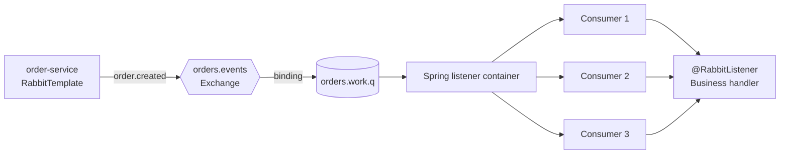
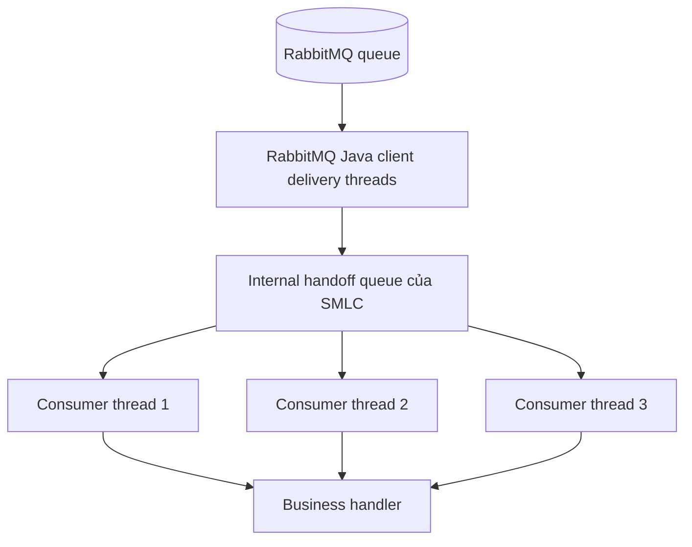
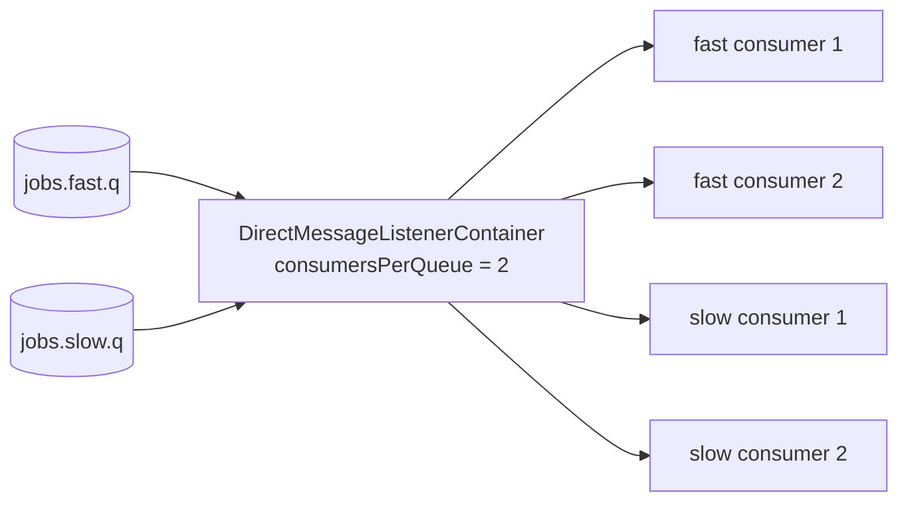
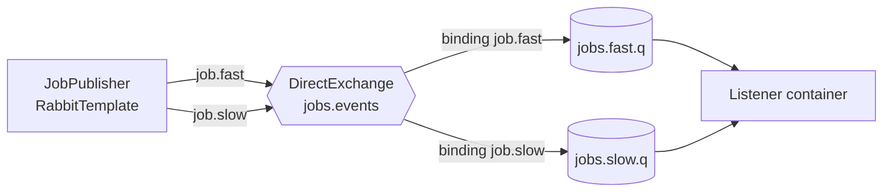

# concurrentConsumers, maxConcurrentConsumers và consumersPerQueue

**Chương:** Listener container

Trong Spring AMQP, viết một phương thức `@RabbitListener` để nhận message là phần dễ nhìn thấy nhất. Bên dưới nó, **listener container** đăng ký consumer với RabbitMQ, giữ channel, phân phối delivery cho handler, quản lý acknowledgement, retry, recovery và số lượng consumer hoạt động song song. Khi lưu lượng tăng, ba tên cấu hình rất dễ bị nhầm là **`concurrentConsumers`**, **`maxConcurrentConsumers`** và **`consumersPerQueue`**. Chúng **không đồng nghĩa** và thuộc về **hai loại container khác nhau**.

Bài học thuộc mô-đun **SPRING_AMQP**, tập trung tích hợp RabbitMQ qua `RabbitTemplate`, `@RabbitListener`, exchange, queue, binding và xây dựng xử lý bất đồng bộ đáng tin cậy có ACK, retry, dead-letter, giao dịch, giám sát. Phạm vi kỹ thuật ở đây là **`spring-rabbit` sử dụng RabbitMQ AMQP 0.9.1**, không phải generic AMQP 1.0 (`spring-amqp-client`).

**Mục tiêu:** Sau bài học, bạn có thể chọn đúng tham số theo container, tính tổng consumer/channel cho nhiều queue và nhiều instance, hiểu khi nào SMLC tự mở rộng/thu hẹp, cấu hình bằng Java và Spring Boot, đồng thời tránh việc tăng concurrency làm mất thứ tự, tăng `unacked` hoặc gây quá tải cho hệ thống downstream.

## 1. Bức tranh tổng thể: listener, container và consumer

Một ví dụ xử lý đơn hàng:



Khi có `@RabbitListener(queues = "orders.work.q")`, Spring AMQP tạo **listener endpoint** rồi nhờ một `RabbitListenerContainerFactory` tạo container. Container sử dụng `basic.consume` để đăng ký consumer dài hạn. RabbitMQ đẩy delivery tới các consumer còn khả năng nhận; **đây là cơ chế push**, không phải mỗi worker tự gọi `basic.get` liên tục.

Cần phân biệt bốn đại lượng:

| Đại lượng | Ý nghĩa | Ví dụ |
| --- | --- | --- |
| **Queue** | Nơi message chờ và được giao cho consumer | `orders.work.q` |
| **Consumer registration** | Đăng ký `basic.consume` trên một queue, có consumer tag | RabbitMQ Management UI ghi nhận 4 consumers |
| **AMQP channel** | Phiên logic chạy bên trong TCP connection, phục vụ consumer/publish | Một channel có thể đăng ký nhiều queue trong SMLC |
| **Worker / invocation đồng thời** | Số đoạn handler có thể đang chạy cùng lúc | 2–6 worker trong SMLC |
| **Service instance** | Một JVM/pod ứng dụng; mỗi instance có thể tạo nhiều consumer | 3 replica chạy cùng listener |

Một instance không nhất thiết tương đương một consumer, và một consumer không nhất thiết tương đương một TCP connection. Với `CachingConnectionFactory` ở chế độ mặc định `CHANNEL`, nhiều consumer có thể dùng nhiều channel trên **một connection vật lý dùng chung**.

### 1.1. Ba nút chính thuộc container nào?

| Tham số | Container hỗ trợ | Ý nghĩa | Có tự scale theo tải? |
| --- | --- | --- | --- |
| `concurrentConsumers` | **`SimpleMessageListenerContainer` (SMLC)** | Số consumer ban đầu và mức sàn duy trì | Không nếu không đặt trần cao hơn |
| `maxConcurrentConsumers` | **SMLC** | Trần consumer cho thuật toán tự tăng/giảm theo hoạt động | **Có**, nếu lớn hơn `concurrentConsumers` |
| `consumersPerQueue` | **`DirectMessageListenerContainer` (DMLC)** | Số consumer đăng ký **cho từng queue** trong container | Không có cơ chế tự scale min–max kiểu SMLC; có thể điều chỉnh bằng code |
| `concurrency` trên `@RabbitListener` | Cả hai, nhưng **ngữ nghĩa tùy container** | Với SMLC là số cố định hoặc dải `m-n`; với DMLC là **một số nguyên** cho `consumersPerQueue` | Tùy cách diễn giải ở trên |

Đừng đặt `maxConcurrentConsumers` với hy vọng nó sẽ điều chỉnh DMLC: DMLC không dùng tham số đó. Ngược lại, `consumersPerQueue` không phải tham số định lượng consumer của SMLC.

## 2. `SimpleMessageListenerContainer`: `concurrentConsumers` và `maxConcurrentConsumers`

### 2.1. `concurrentConsumers` là mức cơ sở

`SimpleMessageListenerContainer` thường bắt đầu với **một consumer** nếu chưa cấu hình. Khi đặt:

```java
factory.setConcurrentConsumers(3);
```

SMLC tạo **ba consumer thực thi** để xử lý message; với **một queue**, thông thường có ba subscription tương ứng trên broker. Nếu **không** đặt `maxConcurrentConsumers` cao hơn mức cơ sở, số consumer không tự tăng chỉ vì queue dài hơn.

Một consumer của SMLC có **thread xử lý riêng** được cấp qua `TaskExecutor`. Trong kiến trúc SMLC, RabbitMQ Java client nhận delivery rồi chuyển qua **hàng đợi nội bộ của container** để thread này gọi listener. Hàng đợi nội bộ chỉ là cơ chế handoff trong JVM; **broker vẫn dùng `basic.consume` push**.



Sơ đồ chỉ minh họa ý tưởng; số handoff queue và cách container tổ chức các consumer trong code không nhất thiết trùng với một hàng đợi duy nhất trong hình.

### 2.2. `maxConcurrentConsumers` mở trần để tự scale

Khi đặt:

```java
factory.setConcurrentConsumers(2);
factory.setMaxConcurrentConsumers(6);
```

SMLC cố duy trì **ít nhất 2** consumer và **không vượt quá 6** consumer **trong container đó**. Khi có tải đủ dài, nó có thể bổ sung consumer; khi nhàn rỗi đủ lâu, có thể gỡ bớt về mức 2.

**Ý nghĩa chính xác:**

- `concurrentConsumers=2` **không có nghĩa chỉ được phép chạy 2 mãi mãi** khi trần lớn hơn.
- `maxConcurrentConsumers=6` **không có nghĩa tự tạo 6 consumer ngay lúc startup**.
- `maxConcurrentConsumers` là **giới hạn trên**, không phải yêu cầu broker phải phát đủ message để sử dụng hết 6.
- Cần `concurrentConsumers > 0` và `maxConcurrentConsumers >= concurrentConsumers`. Các cấu hình không hợp lệ có thể khiến khởi tạo thất bại.
- Nếu bật **exclusive consumer** cho queue, cấu hình concurrency thường phải bằng 1; không thể vừa exclusive vừa mở nhiều competing consumers.

Ví dụ một queue chứa 10.000 job, có `concurrentConsumers=2`, `maxConcurrentConsumers=6`. SMLC **không nhất thiết nhảy ngay lên 6** khi nhìn thấy backlog. Quyết định tăng dựa vào **chu kỳ active của consumer và khoảng cách thời gian**, không chỉ dựa trên queue depth.

### 2.3. `concurrency="2-6"` là cú pháp rút gọn

Từ Spring AMQP 2.0, với SMLC có thể viết:

```java
@RabbitListener(
        id = "orders-worker",
        queues = "orders.work.q",
        concurrency = "2-6")
public void onMessage(String orderId) {
    // ...
}
```

Ở đây:

- `2` tương đương `concurrentConsumers = 2`.
- `6` tương đương `maxConcurrentConsumers = 6`.
- `concurrency = "4"` là **số consumer cố định 4**, không phải “tự tăng tới 4”.

Thuộc tính annotation **ghi đè cấu hình concurrency tương ứng của factory cho endpoint này**. Nếu factory đặt `2–6` nhưng annotation đặt `"4"`, endpoint sẽ chạy theo cấu hình cố định 4 chứ không theo dải factory.

## 3. Thuật toán auto-scale của SMLC

SMLC không tăng/giảm consumer theo một phép toán đơn giản từ `ready` hoặc `unacked`. Thuật toán xem các **chu kỳ xử lý active/idle** của consumer và giới hạn khoảng thời gian giữa các lần thay đổi.

### 3.1. Bốn tham số điều khiển

| Tham số | Giá trị mặc định thường dùng | Khi nào được xét? |
| --- | --- | --- |
| `consecutiveActiveTrigger` | **10** | Một consumer active đủ số chu kỳ liên tiếp mới có thể kích hoạt scale-up |
| `startConsumerMinInterval` | **10.000 ms** | Khoảng tối thiểu giữa hai lần khởi động consumer bổ sung |
| `consecutiveIdleTrigger` | **10** | Consumer idle đủ số chu kỳ liên tiếp mới có thể kích hoạt scale-down |
| `stopConsumerMinInterval` | **60.000 ms** | Khoảng tối thiểu giữa hai lần dừng consumer khi thu hẹp |
| `receiveTimeout` (liên quan) | Thường **1.000 ms** | Độ dài mỗi lần chờ nhận |
| `batchSize` (liên quan) | Phụ thuộc cấu hình | Góp phần quyết định độ dài một chu kỳ active/idle |

Theo tài liệu Spring AMQP, một chu kỳ active được tính khi consumer **nhận được ít nhất một message** trong khoảng tới `batchSize × receiveTimeout`; chu kỳ idle là khoảng không nhận được message. Ví dụ `receiveTimeout=1s`, `batchSize=4` thì một chu kỳ idle có thể kéo dài tới khoảng **4 giây**. Sau 10 chu kỳ idle, điều kiện thứ nhất có thể đạt sau khoảng **40 giây**, nhưng còn phải thỏa điều kiện thời gian dừng tối thiểu.

Cần chú ý: các giá trị trên là **defaults được mô tả trong tài liệu**. Các yếu tố như cấu hình batch, retry, handler latency và phiên bản thư viện có thể ảnh hưởng hành vi quan sát được; không dùng bảng như SLA rằng “mỗi 10 giây sẽ tăng đúng một consumer”.

### 3.2. Scale-up diễn ra như thế nào?

SMLC chỉ cân nhắc tăng thêm **một consumer** khi đồng thời:

1. Có một consumer đạt ngưỡng **active liên tiếp** (mặc định 10).
2. Số consumer hiện tại **chưa chạm `maxConcurrentConsumers`**.
3. Đã trôi qua ít nhất `startConsumerMinInterval` từ lần bắt đầu consumer bổ sung gần nhất.

Kết quả có thể minh họa:

```text
Configuration: concurrentConsumers = 2
               maxConcurrentConsumers = 5
               consecutiveActiveTrigger = 10
               startConsumerMinInterval = 10 seconds

Startup:       2 consumers
Sustained load
   after conditions met -> 3 consumers
   after more conditions  -> 4 consumers
   after more conditions  -> 5 consumers
Ceiling reached:           không tăng thêm
```

Đây là **timeline có điều kiện**, không phải cam kết thời điểm chính xác: nếu consumer bị ngắt quãng vì chờ DB hoặc không nhận liên tục, counter active có thể bị reset và không scale lên dù backlog từng tăng.

### 3.3. Scale-down diễn ra như thế nào?

Khi có nhiều hơn mức sàn `concurrentConsumers`, SMLC cân nhắc dừng một consumer nếu:

1. Consumer đạt ngưỡng **idle liên tiếp** (mặc định 10).
2. Đã qua ít nhất `stopConsumerMinInterval` kể từ lần dừng consumer bổ sung gần nhất.
3. Số consumer dừng đi vẫn không thấp hơn `concurrentConsumers`.

Ví dụ một container đang ở 5 consumer, min = 2. Khi tải ngừng, container có thể dần giảm `5 → 4 → 3 → 2`. Nó không tức thì biến 5 thành 2. Vì RabbitMQ chia message giữa các consumer, việc nhận diện một consumer idle thực sự có thể khó cho đến khi **toàn container gần như nhàn rỗi**.

### 3.4. Vì sao queue rất dài mà container vẫn không scale tới max?

Một vài nguyên nhân thường gặp:

- **Handler xử lý chậm** hoặc chờ một API nên chu kỳ receive không liên tiếp như dự đoán.
- Tải mới xuất hiện chưa đủ lâu để đạt `consecutiveActiveTrigger` và `startConsumerMinInterval`.
- **Prefetch rất cao** khiến một số consumer giữ sẵn nhiều delivery, nhóm khác ít nhận hơn; việc phân phối không thể suy ra chỉ từ ready depth.
- `TaskExecutor` không đủ thread để khởi tạo consumer mới.
- `maxConcurrentConsumers` đang bằng mức min hoặc annotation `concurrency="n"` ghi đè dải mong muốn.
- Nút thắt thực là DB, CPU, connection pool hoặc rate limit; tăng concurrency không tăng tốc được nghiệp vụ.

**Khuyến nghị:** nếu cần xử lý một burst ngắn trong vài giây, đừng kỳ vọng thuật toán SMLC luôn tăng tới max ngay trước khi burst kết thúc. Có thể chọn số consumer cố định cao hơn hoặc cơ chế scale instance ngoài JVM, sau khi đo chi phí.

## 4. `DirectMessageListenerContainer`: `consumersPerQueue`

DMLC dùng kiến trúc khác SMLC: callback listener được kích hoạt **trực tiếp hơn trên thread dispatch của RabbitMQ Java client**, không có cùng handoff queue/consumer worker thread của SMLC.

Tham số concurrency chính:

```java
factory.setConsumersPerQueue(3);
```

Có nghĩa **mỗi queue** mà container theo dõi được đăng ký **ba consumer**.

### 4.1. Một queue

```text
queues = ["jobs.fast.q"]
consumersPerQueue = 3

=> 3 consumer registrations
=> 3 consumer channels (xấp xỉ theo mô hình DMLC)
```

### 4.2. Ba queue trong cùng container

```text
queues = ["jobs.fast.q", "jobs.slow.q", "jobs.audit.q"]
consumersPerQueue = 3

=> 3 queues × 3 consumers/queue = 9 consumer registrations
=> 9 consumer channels cho nhóm DMLC này
```



DMLC không có `maxConcurrentConsumers` để tự tăng 2 lên 6 khi tải tăng. Bạn có thể thay đổi `consumersPerQueue` lúc container đang chạy bằng API của DMLC; framework sẽ điều chỉnh consumer tương ứng. Nhưng việc **ai quyết định thay đổi** (autoscaler/policy/operator) thuộc hệ thống điều phối của bạn, không phải thuật toán min/max của SMLC.

### 4.3. `@RabbitListener(concurrency = "3")` với DMLC

```java
@RabbitListener(
        queues = {"jobs.fast.q", "jobs.slow.q"},
        containerFactory = "directJobsFactory",
        concurrency = "3")
public void handle(String jobId) {
    // ...
}
```

Ở DMLC, `"3"` nghĩa là **3 consumers cho mỗi queue**. Không dùng `"2-6"` vì DMLC chỉ chấp nhận **một số nguyên** cho `consumersPerQueue`. Với hai queue trong annotation trên, số consumer registrations là khoảng **6** cho một instance.

### 4.4. SMLC và DMLC khác nhau khi nghe nhiều queue

Đây là điểm rất quan trọng khi sizing:

| Tình huống | SMLC `concurrentConsumers=2` | DMLC `consumersPerQueue=2` |
| --- | --- | --- |
| Một queue | 2 consumer workers, thường 2 channels | 2 registrations, 2 channels |
| Hai queue cùng container | 2 consumer workers; mỗi worker đăng ký nhận cả hai queue trên channel của mình | 2 consumer/queue × 2 queue = **4** consumer/channel |
| Bốn queue cùng container | 2 worker threads/channels; các worker đăng ký với cả bốn queue | 2 × 4 = **8** consumer/channel |
| Broker consumer tags hiển thị | Có thể có **2 × số queue** subscriptions vì mỗi SMLC worker có subscription từng queue | **2 × số queue** |
| Số handler có thể chạy đồng thời theo thiết kế | Chủ yếu giới hạn bởi **2 worker threads** trong container SMLC | Phụ thuộc số consumer và **client executor threads** trong DMLC |

Với SMLC có nhiều queue, **một consumer worker có thể đăng ký nhiều queue nhưng chỉ sử dụng một channel**; vì thế số consumer tag do broker hiển thị **không đồng nghĩa số worker threads**. Với DMLC, mỗi consumer per queue thường có channel riêng. Muốn đo đúng, xem **cả broker consumer tags, channels và số thread/callback hoạt động**.

### 4.5. Thread pool của DMLC

DMLC gọi listener trên thread của RabbitMQ Java client executor. Điều đó giảm một bước handoff nhưng có một hệ quả: **handler blocking lâu sẽ chiếm thread dispatch**. Nếu có nhiều DMLC cùng dùng connection factory, phải tính cả nhu cầu thread của chúng.

Đừng đơn giản đặt `consumersPerQueue=50` rồi kỳ vọng có 50 business handlers đồng thời chạy tốt. Thread pool, broker channels, CPU, DB pool và downstream giới hạn năng lực thật. Các phiên bản RabbitMQ Java client có chiến lược executor khác nhau; nên đo và cấu hình `TaskExecutor`/executor thích hợp thay vì áp một công thức cố định.

## 5. Chọn container trước khi chọn tham số

| Yêu cầu | Lựa chọn bắt đầu hợp lý | Vì sao |
| --- | --- | --- |
| Một queue, muốn min 2 / max 8 tự tăng giảm khi load kéo dài | **SMLC** | Có `concurrentConsumers` và `maxConcurrentConsumers` |
| Một queue, cần đúng 4 consumers ổn định | SMLC cố định 4 **hoặc** DMLC `consumersPerQueue=4` | Cả hai khả thi, khác threading |
| Nhiều queue cùng một endpoint, muốn 2 workers xử lý chung | **SMLC** | Worker threads không nhân tuyến tính theo số queue |
| Nhiều queue và cần số consumer riêng trên từng queue | **DMLC** hoặc tách nhiều listener/container | `consumersPerQueue` tính riêng cho từng queue |
| Thường xuyên thêm/bớt queue khi service đang chạy | Cân nhắc **DMLC** | Thay đổi queue có thể ít ảnh hưởng các consumer khác |
| Handler blocking nặng và cần worker thread riêng | Thường bắt đầu bằng **SMLC** | Handoff tới TaskExecutor riêng |
| Muốn batching phía consumer theo `batchSize` | **SMLC** | Hỗ trợ các chức năng batching mà DMLC không có tương đương hoàn toàn |
| Cần tối thiểu một consumer active và dự phòng standby | Xem **Single Active Consumer** | Không giải quyết bằng min/max đơn thuần |
| Bắt buộc xử lý đúng thứ tự nghiệp vụ | Ít consumer, kiểm soát prefetch / theo partition key | Concurrency cao có thể phá thứ tự hoàn tất |

Không có container luôn tốt hơn container kia; chọn theo tính chất workload và kiểm thử, không theo suy đoán “Direct chắc chắn nhanh nhất”.

## 6. Ví dụ thực hành: topology hai queue

Ta tạo hai lớp công việc độc lập trong một ứng dụng: `jobs.fast.q` và `jobs.slow.q`. Cả hai nhận message từ `jobs.events` nhưng với **routing key khác nhau**. Vì vậy một job không bị nhân bản chỉ do có hai queue.



**Topology Java — chỉ dành cho local/test có quyền khai báo:**

```java
import org.springframework.amqp.core.*;
import org.springframework.context.annotation.Bean;
import org.springframework.context.annotation.Configuration;
import org.springframework.context.annotation.Profile;

@Configuration(proxyBeanMethods = false)
@Profile("local")
class LocalJobsTopology {

    @Bean
    Declarables jobsResources() {
        DirectExchange events =
                new DirectExchange("jobs.events", true, false);
        DirectExchange dlx =
                new DirectExchange("jobs.dlx", true, false);

        Queue fast = QueueBuilder.durable("jobs.fast.q")
                .deadLetterExchange("jobs.dlx")
                .deadLetterRoutingKey("job.failed")
                .build();

        Queue slow = QueueBuilder.durable("jobs.slow.q")
                .deadLetterExchange("jobs.dlx")
                .deadLetterRoutingKey("job.failed")
                .build();

        Queue failed = QueueBuilder.durable("jobs.failed.q").build();

        return new Declarables(
                events, dlx, fast, slow, failed,
                BindingBuilder.bind(fast).to(events).with("job.fast"),
                BindingBuilder.bind(slow).to(events).with("job.slow"),
                BindingBuilder.bind(failed).to(dlx).with("job.failed"));
    }
}
```

`Declarables` chỉ mô tả tài nguyên. Để RabbitMQ có exchange/queue/binding thật, cần một `RabbitAdmin` phù hợp hoặc công cụ provisioning riêng. Trong production, đội vận hành có thể quản lý topology qua IaC; không dùng quyền quản trị broker cho tài khoản runtime chỉ để chạy listener.

**Producer:**

```java
import org.springframework.amqp.rabbit.core.RabbitTemplate;
import org.springframework.stereotype.Service;

@Service
class JobPublisher {

    private final RabbitTemplate template;

    JobPublisher(RabbitTemplate template) {
        this.template = template;
    }

    void sendFast(String jobId) {
        template.convertAndSend("jobs.events", "job.fast", jobId);
    }

    void sendSlow(String jobId) {
        template.convertAndSend("jobs.events", "job.slow", jobId);
    }
}
```

Body ví dụ dùng `String` nên có thể dùng converter mặc định trong môi trường thử nghiệm. Khi chuyển sang JSON, phải cấu hình `MessageConverter` tương thích cho producer và consumer, thống nhất `contentType` và schema.

## 7. Cấu hình SMLC bằng Java

```java
import org.springframework.amqp.core.AcknowledgeMode;
import org.springframework.amqp.rabbit.config.SimpleRabbitListenerContainerFactory;
import org.springframework.amqp.rabbit.connection.ConnectionFactory;
import org.springframework.context.annotation.Bean;
import org.springframework.context.annotation.Configuration;
import org.springframework.context.annotation.Profile;

@Configuration(proxyBeanMethods = false)
@Profile("smlc-demo")
class SmlcJobsConfig {

    @Bean("smlcJobsFactory")
    SimpleRabbitListenerContainerFactory smlcJobsFactory(
            ConnectionFactory connectionFactory) {

        SimpleRabbitListenerContainerFactory factory =
                new SimpleRabbitListenerContainerFactory();

        factory.setConnectionFactory(connectionFactory);
        factory.setConcurrentConsumers(2);
        factory.setMaxConcurrentConsumers(6);

        // Mặc định trong tài liệu, ghi ra để người học dễ theo dõi:
        factory.setConsecutiveActiveTrigger(10);
        factory.setConsecutiveIdleTrigger(10);
        factory.setStartConsumerMinInterval(10_000L);
        factory.setStopConsumerMinInterval(60_000L);

        factory.setPrefetchCount(10);
        factory.setAcknowledgeMode(AcknowledgeMode.AUTO);

        return factory;
    }
}
```

Listener:

```java
import org.springframework.amqp.rabbit.annotation.RabbitListener;
import org.springframework.context.annotation.Profile;
import org.springframework.stereotype.Component;

@Component
@Profile("smlc-demo")
class SmlcJobsHandler {

    @RabbitListener(
            id = "jobs-smlc",
            queues = {"jobs.fast.q", "jobs.slow.q"},
            containerFactory = "smlcJobsFactory")
    public void handle(String jobId) {
        // Gọi application service có idempotency theo jobId/eventId.
        System.out.println("SMLC received " + jobId);
    }
}
```

Khi listener chạy một instance, dự kiến **từ 2 đến 6 worker consumers** theo tải và giới hạn. Với hai queue, số RabbitMQ consumer registrations có thể cao hơn số worker vì mỗi worker đăng ký trên cả hai queue.

**Đừng đồng thời bật listener DMLC bên dưới** trên cùng hai queue nếu mục tiêu lab là đo một container; nếu cả hai hoạt động, chúng thành competing consumers, chia message khiến số liệu so sánh bị sai.

## 8. Cấu hình DMLC bằng Java

```java
import org.springframework.amqp.core.AcknowledgeMode;
import org.springframework.amqp.rabbit.config.DirectRabbitListenerContainerFactory;
import org.springframework.amqp.rabbit.connection.ConnectionFactory;
import org.springframework.context.annotation.Bean;
import org.springframework.context.annotation.Configuration;
import org.springframework.context.annotation.Profile;

@Configuration(proxyBeanMethods = false)
@Profile("dmlc-demo")
class DmlcJobsConfig {

    @Bean("directJobsFactory")
    DirectRabbitListenerContainerFactory directJobsFactory(
            ConnectionFactory connectionFactory) {

        DirectRabbitListenerContainerFactory factory =
                new DirectRabbitListenerContainerFactory();

        factory.setConnectionFactory(connectionFactory);
        factory.setConsumersPerQueue(2);
        factory.setPrefetchCount(10);
        factory.setAcknowledgeMode(AcknowledgeMode.AUTO);

        // Không có setMaxConcurrentConsumers() ở Direct factory.
        return factory;
    }
}
```

Listener:

```java
import org.springframework.amqp.rabbit.annotation.RabbitListener;
import org.springframework.context.annotation.Profile;
import org.springframework.stereotype.Component;

@Component
@Profile("dmlc-demo")
class DmlcJobsHandler {

    @RabbitListener(
            id = "jobs-dmlc",
            queues = {"jobs.fast.q", "jobs.slow.q"},
            containerFactory = "directJobsFactory",
            concurrency = "2")
    public void handle(String jobId) {
        System.out.println("DMLC received " + jobId);
    }
}
```

Trong ví dụ: **2 queues × 2 consumers/queue = 4 consumer registrations** ở một service instance. Số channels cũng gần tương ứng 4 theo mô hình DMLC. Không có cơ chế min2/max6 auto-scale như SMLC; nếu cần tăng lên 3 consumers/queue, phải điều chỉnh cấu hình hoặc gọi setter khi chạy.

### 8.1. Cấu hình annotation có hiệu lực ưu tiên cho endpoint

Bảng:

| Factory | Annotation | Kết quả |
| --- | --- | --- |
| SMLC min2/max6 | Không có `concurrency` | SMLC chạy 2–6 tùy tải |
| SMLC min2/max6 | `concurrency="4"` | Cố định 4 consumer cho endpoint |
| SMLC min2/max6 | `concurrency="1-3"` | Sàn 1, trần 3 cho endpoint |
| DMLC `consumersPerQueue=2` | Không có `concurrency` | 2 consumer/queue |
| DMLC `consumersPerQueue=2` | `concurrency="3"` | 3 consumer/queue |
| DMLC `consumersPerQueue=2` | `concurrency="2-6"` | **Sai**: DMLC không hỗ trợ dải min–max |

Nên xác định rõ nơi sở hữu concurrency: chung ở factory, riêng từng endpoint ở annotation hay qua cấu hình vận hành. Hai nơi đặt khác nhau mà không chủ đích dễ tạo nhầm lẫn khi quan sát.

## 9. Cấu hình qua Spring Boot

Với phiên bản Spring Boot có auto-configuration cho **RabbitMQ AMQP 0.9.1** và `spring.rabbitmq.listener.*`, cách cấu hình thường là:

### 9.1. Chọn SMLC

```yaml
spring:
  rabbitmq:
    host: localhost
    port: 5672
    listener:
      type: simple
      simple:
        concurrency: 2
        max-concurrency: 6
        prefetch: 10
        acknowledge-mode: auto
        auto-startup: true
```

- `simple.concurrency` → `concurrentConsumers` (mức sàn).
- `simple.max-concurrency` → `maxConcurrentConsumers` (mức trần).
- `simple.prefetch` giới hạn delivery outstanding của mỗi consumer.
- `acknowledge-mode: auto` nghĩa là Spring container tự ACK sau khi xử lý thành công, **không** phải AMQP `autoAck=true`.

### 9.2. Chọn DMLC

```yaml
spring:
  rabbitmq:
    host: localhost
    port: 5672
    listener:
      type: direct
      direct:
        consumers-per-queue: 3
        prefetch: 10
        acknowledge-mode: auto
        auto-startup: true
```

- `direct.consumers-per-queue` → `consumersPerQueue`.
- Không có `direct.max-concurrency` tương đương thuật toán SMLC.
- Nếu một endpoint nghe hai queue, đây là **3 × 2 = 6** consumer registrations cho endpoint ấy trên **mỗi instance**.

**Quan trọng về version:** Spring Boot có các starter AMQP/RabbitMQ khác nhau tùy release. Phải xác nhận starter đang dùng tạo `RabbitTemplate` và `@RabbitListener` thuộc `spring-rabbit`. YAML trên là mẫu cho Spring Boot **có cấu hình RabbitMQ listener tương ứng**; không tự áp dụng cho generic AMQP 1.0.

### 9.3. Java factory, YAML và annotation: chọn một nguồn sự thật

Một ứng dụng có thể vừa khai báo bean `rabbitListenerContainerFactory` thủ công vừa đặt YAML. Lúc này **không chắc mọi property trong YAML được áp dụng vào factory tự tạo** nếu không gọi Boot configurer hoặc customizer phù hợp.

Quy ước dễ quản lý:

1. Nếu muốn đơn giản: dùng **Boot auto-configured factory và YAML**, chỉ dùng `@RabbitListener` không ghi đè tùy tiện.
2. Nếu có một listener đặc biệt: dùng **factory riêng** và chỉ rõ `containerFactory` trên annotation.
3. Nếu cần cấu hình endpoint khác số mặc định: dùng `@RabbitListener(concurrency=...)` với chủ ý và ghi chú vì sao.
4. Khi debug, xem **container cuối cùng thực sự tạo ra**, không chỉ đọc một giá trị YAML trong repo.

## 10. Tính tổng consumer/channel khi deploy nhiều instance

Khi scale service trên Kubernetes hoặc nhiều JVM, **mỗi replica tự tạo listener container của nó**.

### 10.1. Một queue, SMLC

```text
instances: 4
SMLC concurrentConsumers: 2
SMLC maxConcurrentConsumers: 6

Worker consumers tối thiểu toàn hệ thống: 4 × 2 = 8
Worker consumers tối đa toàn hệ thống: 4 × 6 = 24
```

Đây là tổng theo cấu hình, giả sử tất cả instance hoạt động và không bị ràng buộc bởi exclusive mode hoặc sự cố. Không phải lúc nào broker cũng thấy 24 consumers; số thực tế phụ thuộc autoscale và trạng thái ứng dụng.

### 10.2. Ba queue, DMLC

```text
instances: 4
queues trong mỗi container: 3
DMLC consumersPerQueue: 2

Consumer registrations tối đa theo cấu hình:
4 instances × 3 queues × 2 consumers/queue = 24
```

Ở DMLC, nếu thay `consumersPerQueue=2` thành 5 trên 4 instance/3 queue, tổng lên **60 registrations/channels**. Khi RabbitMQ và hệ thống downstream đã có tải cao, thay đổi nhỏ một property có thể tăng tài nguyên gấp 2,5 lần.

### 10.3. Ba queue, SMLC

```text
instances: 4
queues trong mỗi SMLC container: 3
concurrentConsumers: 2
maxConcurrentConsumers: 6

Worker threads/consumer objects tại mỗi instance: 2..6
Worker threads toàn hệ thống: 8..24

Số basic.consume registrations trên broker có thể:
4 instances × 3 queues × (2..6) = 24..72
```

**Đừng nhầm 72 consumer tags với 72 handler threads**. Một SMLC consumer worker có thể subscribe nhiều queue thông qua một channel. Thống kê broker và số concurrency code-level cần được giải thích theo container type.

### 10.4. Số consumer không bằng năng lực xử lý

Giả sử mỗi job mất trung bình 0,2 giây CPU/đợi I/O và mỗi worker thực hiện tuần tự:

```text
1 worker: khoảng 1 / 0.2 = 5 jobs/s
6 workers:  khoảng 30 jobs/s (ước tính lý tưởng)
```

Nếu database xử lý tối đa 15 transaction/s hoặc cổng thanh toán giới hạn 10 request/s, tăng consumer trên 6 không giúp đạt 30 jobs/s mà có thể tạo retry storm. Concurrency phải được chọn bằng **đo throughput, p95 latency và giới hạn downstream**, không chỉ queue depth.

## 11. Prefetch và ACK: concurrency chỉ là một nửa bài toán

`prefetchCount` giới hạn số delivery **chưa được ACK** mà broker có thể gửi đến consumer.

Ví dụ:

```text
4 consumer workers
prefetch = 20

Cận trên gần đúng: 4 × 20 = 80 deliveries đang outstanding
```

Nếu một message lớn 1 MiB, số byte outstanding của các message đã giao có thể rất đáng kể, chưa kể object/buffer. Khi tăng consumer, tổng số outstanding cũng tăng. Không nên tăng concurrency và prefetch đồng thời rồi không biết yếu tố nào gây hiệu ứng.

### 11.1. Các chế độ acknowledgement

| Chế độ Spring AMQP | Khi nào ACK? | Hệ quả khi tăng concurrency |
| --- | --- | --- |
| `AUTO` | Container ACK sau khi listener hoàn tất thành công; khi lỗi thì xử lý reject/nack theo chính sách | Thêm consumer có thể tăng throughput nhưng cũng tăng số delivery đồng thời đang chờ ACK |
| `MANUAL` | Handler tự gọi `basicAck`/`basicNack` với delivery tag phù hợp | Dễ quên ACK hoặc ACK trùng; cần tránh chia sẻ channel tùy tiện |
| `NONE` | Broker coi delivery đã acknowledged ngay khi gửi | Mất khả năng redelivery tin cậy khi handler crash; không khuyến nghị cho job quan trọng |

**Spring `AUTO` không phải RabbitMQ auto-ack**. Đó là container điều phối manual acknowledgements ở tầng giao thức.

### 11.2. Prefetch và thứ tự

- Với nhiều consumer, các message có thể được xử lý **song song** và **hoàn tất khác thứ tự publish**.
- Với prefetch lớn, một consumer có thể nhận nhiều message trước khi consumer khác rảnh, làm phân phối không đều.
- Retry/requeue có thể đưa message quay lại trong lúc message đến sau đã hoàn tất.
- `concurrency=1` và `prefetch=1` chỉ giúp giảm mức song song, **không tự bảo đảm business ordering xuyên nhiều replica hoặc khi có redelivery**.
- Nếu cần thứ tự theo `orderId`, cân nhắc partition theo key, single active consumer, xử lý version/sequence và idempotency.

### 11.3. Consumer priority không giống concurrency

RabbitMQ hỗ trợ `x-priority` khi đăng ký consumer, cho phép nhóm priority cao được ưu tiên nhận delivery khi active. Điều đó khác với việc **tăng số consumer**: priority chọn *consumer nào*, concurrency quyết định *có bao nhiêu consumer*. Nếu muốn chỉ một active consumer tại một thời điểm, nghiên cứu **Single Active Consumer**, không dựa vào mức priority cao.

## 12. Thay đổi cấu hình khi container đang chạy

Spring AMQP cho phép điều chỉnh số consumer của các container đang hoạt động. Nhưng với các endpoint được tạo bởi `@RabbitListener`, đối tượng container thường được lưu trong `RabbitListenerEndpointRegistry`, **không phải một bean tự động autowire theo ID annotation**.

### 12.1. SMLC: điều chỉnh min/max

Ví dụ điều chỉnh một endpoint có ID `jobs-smlc`:

```java
import org.springframework.amqp.rabbit.listener.RabbitListenerEndpointRegistry;
import org.springframework.amqp.rabbit.listener.SimpleMessageListenerContainer;
import org.springframework.stereotype.Component;

@Component
class SmlcConcurrencyController {

    private final RabbitListenerEndpointRegistry registry;

    SmlcConcurrencyController(RabbitListenerEndpointRegistry registry) {
        this.registry = registry;
    }

    void changeBounds(int minimum, int maximum) {
        if (minimum < 1 || maximum < minimum) {
            throw new IllegalArgumentException("Invalid bounds");
        }

        var container = registry.getListenerContainer("jobs-smlc");

        if (container instanceof SimpleMessageListenerContainer simple) {
            // Ví dụ này dùng khi đã bảo đảm minimum <= max hiện tại.
            simple.setMaxConcurrentConsumers(maximum);
            simple.setConcurrentConsumers(minimum);
        } else {
            throw new IllegalStateException("jobs-smlc is not an SMLC");
        }
    }
}
```

**Lưu ý thứ tự khi thay đổi tại runtime:** nếu `maximum` mới **nhỏ hơn mức minimum cũ**, gọi `setMaxConcurrentConsumers(maximum)` trước có thể thất bại vì trần không được thấp hơn sàn hiện tại. Một công cụ vận hành hoàn chỉnh phải kiểm tra **trạng thái cũ** và chọn thứ tự cập nhật an toàn (giảm min trước khi giảm max, tăng max trước khi tăng min). Đoạn mã trên chỉ minh họa đường API, không phải một bộ autoscaler production hoàn chỉnh. **Không mở endpoint thay đổi concurrency công khai** thiếu xác thực/ủy quyền/audit.

### 12.2. DMLC: thay số consumer trên mỗi queue

```java
import org.springframework.amqp.rabbit.listener.DirectMessageListenerContainer;
import org.springframework.amqp.rabbit.listener.RabbitListenerEndpointRegistry;
import org.springframework.stereotype.Component;

@Component
class DmlcConcurrencyController {

    private final RabbitListenerEndpointRegistry registry;

    DmlcConcurrencyController(RabbitListenerEndpointRegistry registry) {
        this.registry = registry;
    }

    void setWorkersPerQueue(int count) {
        if (count < 1) {
            throw new IllegalArgumentException("count must be positive");
        }

        var container = registry.getListenerContainer("jobs-dmlc");

        if (container instanceof DirectMessageListenerContainer direct) {
            direct.setConsumersPerQueue(count);
        } else {
            throw new IllegalStateException("jobs-dmlc is not a DMLC");
        }
    }
}
```

`setConsumersPerQueue` có thể điều chỉnh tăng/giảm registrations khi DMLC đang chạy. Nhưng việc thay đổi **không chỉ ảnh hưởng một queue** nếu container theo dõi nhiều queue: đổi từ 2 lên 4 với 3 queue có thể tăng từ 6 lên 12 consumers trong một instance.

### 12.3. Có nên dùng autoscaler JVM hay tăng số replica?

| Cách scale | Ưu điểm | Nhược điểm |
| --- | --- | --- |
| Tăng `concurrentConsumers`/`maxConcurrentConsumers` trong một JVM | Không cần khởi động pod mới; SMLC có cơ chế min–max | Giới hạn CPU/RAM và thread/DB pool của một JVM |
| Tăng `consumersPerQueue` trong DMLC | Có thể tăng nhanh số registrations per queue | Không có autoscale tự động min–max; dễ nhân số consumer quá mức |
| Tăng số replicas | Phân tán CPU/RAM, resilience giữa host | Mỗi replica nhân toàn bộ consumer config; startup và scaling policy phải được tính |
| Tách queue/workload | Cách ly SLA, retry/DLQ và concurrency từng nhóm | Thêm topology và vận hành |

Nếu vừa dùng HPA/KEDA (autoscale số replica) vừa bật SMLC min–max rộng, tổng consumer có thể tăng theo **hai tầng**. Phải đặt **ngân sách concurrency toàn dịch vụ**, nếu không đợt spike sẽ kéo theo quá nhiều DB connections hoặc HTTP requests.

## 13. Lỗi, retry, dead-letter và tác động của concurrency

Trong ví dụ topology có `jobs.dlx` và `jobs.failed.q`. Nếu handler thất bại:

- Lỗi tạm thời: retry giới hạn, backoff hoặc retry queue có delay.
- Lỗi vĩnh viễn: reject không requeue và dead-letter nếu DLX/binding hợp lệ.
- Poison message: tránh vòng lặp `basicNack(requeue=true)` liên tục khi số consumer lớn.
- Message đã xử lý nghiệp vụ nhưng ACK thất lạc: broker có thể redeliver; consumer cần **idempotency**.

### 13.1. Concurrency cao làm rủi ro retry lớn hơn

Ví dụ mỗi consumer retry 3 lần ngay lập tức khi DB đang lỗi, và service có 30 consumer. Một sự cố ngắn có thể sinh rất nhiều lần gọi DB trong thời gian cực ngắn, làm hồi phục chậm hơn.

Biện pháp:

1. Retry có giới hạn và backoff/jitter.
2. Giới hạn số concurrent calls tới downstream (semaphore/bulkhead).
3. Giảm concurrency tạm thời khi cần bảo vệ DB.
4. Phân biệt lỗi dữ liệu không phục hồi với lỗi hạ tầng tạm thời.
5. Sử dụng DLQ và runbook replay có kiểm soát thay vì discard hoặc vòng requeue vô hạn.

### 13.2. Transactional outbox và consumer idempotency

Một event sinh từ thay đổi database có thể không được publish nếu JVM crash giữa commit DB và `RabbitTemplate.convertAndSend`. Dùng **transactional outbox** khi yêu cầu nghiệp vụ cần tránh mất sự kiện.

Đối với consumer, ngay cả khi publisher dùng confirms, delivery vẫn có thể trùng (producer retry hoặc broker redeliver). Tạo `eventId` bền và **unique constraint/atomic insert** trong DB khi thực hiện tác dụng phụ; không chỉ `existsById` rồi `save` tách rời trong nhiều consumer.

**Bật 10 consumers không làm hệ thống exactly-once.** Nó tăng năng lực xử lý đồng thời và vì vậy càng cần kiểm soát idempotency, transaction, thứ tự và conflict.

### 13.3. Consumer ACK khác publisher confirm

- **Publisher confirm**: RabbitMQ xác nhận với producer rằng broker đã xử lý publish theo điều kiện tương ứng.
- **Consumer ACK**: listener/container báo với RabbitMQ đã chấp nhận delivery.
- **Business complete**: DB/workflow xác nhận kết quả nghiệp vụ.

Concurrency tăng có thể tăng số message đang xử lý, nhưng không làm publisher confirms xác nhận thay cho business completion. Cần đo cả ba tầng độc lập.

## 14. Monitoring: biết đang chạy bao nhiêu consumer thật sự

RabbitMQ Management UI và Spring logs cung cấp nhiều tín hiệu, nhưng phải diễn giải đúng:

| Tín hiệu | Nơi xem | Ý nghĩa |
| --- | --- | --- |
| `consumers` theo queue | RabbitMQ Management UI/Prometheus | Số consumer registrations trên queue |
| `channels` theo connection/node | RabbitMQ | Chi phí channel; SMLC nhiều queue có thể ít channel hơn consumer tags |
| `messages_ready` | Broker | Message đang chờ |
| `messages_unacknowledged` | Broker | Delivery đã gửi nhưng chưa ACK |
| Deliver/ACK rate | Broker | Nhận và hoàn tất delivery ra sao |
| Processing latency p50/p95/p99 | Application metrics | Handler chậm hay không |
| Retry/redelivery/DLQ count | Broker + app | Lỗi, poison message |
| CPU, memory, thread utilization | JVM/pod/node | Giới hạn tài nguyên |
| DB pool usage, HTTP downstream p95 | APM/downstream | Có đang tăng concurrency vượt sức chịu đựng |
| Container start/stop/recovery events | Spring logs/events | SMLC scale hoặc consumer reconnect |

### 14.1. Chẩn đoán theo tổ hợp metric

| Triệu chứng | Khả năng | Kiểm tra tiếp |
| --- | --- | --- |
| `ready` tăng, `unacked` thấp, consumer count 0 | Listener chưa subscribe/queue sai/connection lỗi | Registry, container logs, vhost/permissions |
| `ready` tăng, số consumer ổn định ở min | SMLC chưa đạt active trigger, max=min hoặc executor nghẽn | `consecutiveActiveTrigger`, thời gian, thread pool |
| `ready` tăng, `unacked` cao, ACK rate thấp | Handler/DB chậm hoặc prefetch quá lớn | Thread dump, DB pool, p95 latency |
| DMLC có nhiều consumer tags nhưng CPU thấp | Client executor không đủ hoặc external API đang block | TaskExecutor, network calls và downstream |
| SMLC tăng rồi giảm chậm | 10 idle triggers + stop interval 60 s | Chu kỳ idle, `batchSize`, `receiveTimeout` |
| Sau scale-out DB connection pool cạn | Tổng consumer nhân theo số replica | Tính lại max consumers × số replica |
| Redelivery tăng khi thêm consumers | Xử lý/ACK lỗi, conflict, retry storm | Transaction, idempotency, DLQ |
| Message đến hai listener không như mong đợi | Cả hai cùng đọc **một queue** | Hai listener là competing consumers, không fan-out |

### 14.2. Đếm consumer bằng công thức trước khi triển khai

Một bảng capacity plan nên có ít nhất:

```text
Service: jobs-worker
Container: DMLC
Queues per container: 3
Replicas: 4
Consumers per queue: 2
Total RabbitMQ consumer registrations: 3 * 4 * 2 = 24
Prefetch per consumer: 10
Potential outstanding deliveries: ~24 * 10 = 240
DB connection pool per replica: 16
Max external API rate: 100 requests/s
```

Với SMLC, thay công thức thành `replicas × min/max worker consumers` cho luồng chạy handler và tính riêng broker registrations nếu có nhiều queue. Dùng số liệu thực tế để chọn max sao cho không vượt tài nguyên downstream.

## 15. Các hiểu sai thường gặp

| Nhận định | Sự thật |
| --- | --- |
| “`concurrentConsumers=3` nghĩa là 3 TCP connections” | Thường là 3 consumer workers/channels; nhiều channel có thể chung một connection |
| “`maxConcurrentConsumers=8` thì startup tạo 8 consumers” | SMLC bắt đầu ở min; scale lên theo active triggers |
| “`concurrentConsumers` đã có nên `maxConcurrentConsumers` không cần” | Không đặt trần cao hơn thì SMLC không tự mở rộng vượt min |
| “`consumersPerQueue=3` nghĩa là 3 consumers toàn container” | Với DMLC là 3 **mỗi queue** |
| “Đặt `concurrency="2-6"` trên DMLC sẽ tự scale” | Sai; DMLC chỉ nhận một số nguyên cho consumersPerQueue |
| “Tăng concurrency sẽ chắc chắn tăng throughput” | DB/CPU/HTTP downstream có thể là bottleneck |
| “Queue depth 10.000 làm SMLC lập tức lên max” | Scale dựa trên active/idle cycles và khoảng thời gian |
| “Mỗi RabbitMQ consumer tag tương đương một thread SMLC” | SMLC nghe nhiều queue có thể đăng ký nhiều tags trên một worker/channel |
| “Bật prefetch=1000 giúp tận dụng 1000 workers” | Prefetch là delivery outstanding/consumer, không phải số worker |
| “Nhiều consumers giữ thứ tự FIFO hoàn tất” | Xử lý song song, retry và ACK có thể làm thứ tự hoàn tất khác |
| “Hai listener khác service nghe một queue sẽ đều nhận mỗi event” | Competing consumers: message được chia; cần hai queue/bindings nếu muốn fan-out |
| “AUTO ACK nghĩa là broker auto-ack khi delivery” | Spring AUTO là container ACK sau khi handler thành công |
| “Publisher confirm đảm bảo listener đã xử lý” | Publisher confirm không phải consumer ACK |
| “SMLC và DMLC dùng cùng thread pool kiểu nhau” | SMLC có worker handoff; DMLC callback trên client dispatch threads |
| “DMLC không thể đổi concurrency runtime” | Có `setConsumersPerQueue` điều chỉnh consumer registrations khi chạy |
| “Thêm consumers tự sửa lỗi poison message” | Cần retry giới hạn, DLQ, validation và idempotency |

## 16. Bài thực hành có kết quả đo

**Chuẩn bị:** RabbitMQ ở local/test, Spring Boot cùng `spring-rabbit`, exchange/queues như mục 6. Chọn **một trong hai profile** `smlc-demo` hoặc `dmlc-demo` cho mỗi lượt đo; có thể bật `local` để khai báo tài nguyên. Đảm bảo message cũ được xử lý hết hoặc dùng queue mới trước mỗi phép so sánh.

### Bài A — Nhận diện ý nghĩa ba tham số

1. Sử dụng SMLC với `concurrentConsumers=2`, `maxConcurrentConsumers=6` và một queue.
2. Quan sát consumer count khi startup.
3. Gửi burst ngắn, ghi nhận có lên 6 hay không; giải thích bằng trigger thời gian.
4. Gửi tải liên tục đủ lâu, đo thời điểm consumer tăng, sau đó tạm dừng publish để quan sát scale-down.
5. Thử đặt max = min = 3, xem không còn tăng theo tải.
6. Chuyển sang DMLC `consumersPerQueue=3`; xác minh không có SMLC min/max scaling.

**Tiêu chí:** mô tả được min, max và per-queue; không diễn giải max là số consumer phải tạo ngay.

### Bài B — Nhiều queue trong một container

1. Provision `jobs.fast.q`, `jobs.slow.q` và binding tương ứng.
2. Chạy SMLC fixed `concurrentConsumers=2`, quan sát threads/channels/consumer tags.
3. Chạy DMLC `consumersPerQueue=2` cùng hai queue, quan sát số consumer tags và channels.
4. Thêm queue thứ ba vào cấu hình trên môi trường disposable.
5. Tính trước và kiểm tra sự khác nhau: DMLC tạo thêm hai consumers/channels; SMLC không tự nhân đôi worker threads.
6. Ghi lại cách RabbitMQ Management UI có thể hiển thị consumer tags khác số worker.

**Tiêu chí:** tính chính xác tổng workers, consumer registrations và channels khi có Q queue.

### Bài C — Prefetch và downstream bottleneck

1. Gửi 500 jobs có thời gian xử lý giả lập 200 ms.
2. Đặt SMLC 1 consumer, prefetch 1; đo throughput và latency.
3. Tăng 4 consumers, prefetch giữ 1; đo lại.
4. Tăng prefetch lên 20; xem outstanding/unacked và memory.
5. Giả lập downstream chỉ cho 10 request/s; đo retry/timeout khi tăng concurrency tiếp.
6. Đưa ra mức concurrency phù hợp từ số liệu, không dựa vào max 6 như một mục tiêu.

**Tiêu chí:** giải thích được tại sao độ dài queue không phải lý do duy nhất để tăng consumers.

### Bài D — Annotation override và sai cấu hình

1. Đặt factory SMLC `2–6` và annotation `concurrency="4"`.
2. Xác minh endpoint chạy cố định 4.
3. Chuyển annotation thành `"1-3"`; quan sát dải min/max thay đổi.
4. Trên DMLC, dùng `concurrency="2"`; xác minh 2 consumers/queue.
5. Thử `"2-6"` trên DMLC **chỉ trong test**, quan sát lỗi cấu hình và sửa lại số nguyên.
6. Kiểm tra liệu Java factory tự tạo có áp dụng YAML của Spring Boot hay không.

**Tiêu chí:** biết precedence và ý nghĩa annotation phụ thuộc loại container.

### Bài E — Retry, DLQ, idempotency khi tăng consumer

1. Dùng queue lab có DLX/DLQ như mục 6.
2. Gửi các job hợp lệ và một job cố ý lỗi nghiệp vụ.
3. Cấu hình retry có giới hạn, reject không requeue và quan sát job lỗi đến `jobs.failed.q`.
4. Tăng concurrency, tạo tình huống DB timeout và quan sát retry storm.
5. Ngắt consumer sau khi commit nghiệp vụ nhưng trước ACK trên môi trường test; xác minh idempotency khi broker redeliver.
6. Ghi nhận publisher confirms, consumer ACK và business completion là các mốc độc lập.

**Tiêu chí:** không dùng tăng consumers để che lỗi dữ liệu hay tuyên bố exactly-once.

### Bài F — Sizing nhiều replica

1. Giả định hệ thống có 3 replicas, 4 queues, DMLC `consumersPerQueue=3`.
2. Tính tổng consumer registrations: `3 × 4 × 3 = 36`.
3. Với prefetch 20, tính cận trên đơn giản của outstanding: `36 × 20 = 720`.
4. So sánh với SMLC min2/max5 trên 3 replicas: khoảng 6–15 worker threads, còn registrations tùy số queue.
5. Đặt giả định DB pool 10 connections/replica và API rate limit 50 req/s; đánh giá có cần giảm concurrency/tách queue không.
6. Viết bảng capacity plan và cảnh báo khi queue ready/unacked vượt SLA.

**Tiêu chí:** biết nhân số consumer theo **queue × replicas** cho DMLC và **worker min/max × replicas** cho SMLC.

## 17. Checklist production

Trước khi điều chỉnh concurrency:

- **Container:** Đang chạy SMLC hay DMLC? Có biết annotation `concurrency` ghi đè factory không?
- **Quy mô:** Một endpoint nghe bao nhiêu queue? Có bao nhiêu replicas và endpoint trên mỗi instance?
- **Giới hạn:** Tính được min/max worker threads, consumer registrations và channels chưa?
- **Autoscale:** Với SMLC, bốn tham số active/idle triggers và start/stop intervals có phù hợp kiểu tải không?
- **Thread pool:** SMLC `TaskExecutor` hoặc DMLC RabbitMQ client dispatch executor có đủ năng lực không?
- **Prefetch/ACK:** Bao nhiêu deliveries có thể outstanding? Có kiểm tra timeout, shutdown, redelivery và manual ACK nếu dùng?
- **Downstream:** DB pool, external API, CPU, broker memory/channel limit có cho phép số consumer dự kiến?
- **Reliability:** Retry/backoff có giới hạn, DLX/DLQ hợp lệ, idempotency và transactional outbox khi cần chưa?
- **Thứ tự:** Có yêu cầu ordering theo một khóa nghiệp vụ không? Nếu có, scale concurrency sẽ ảnh hưởng thế nào?
- **Observability:** Có dashboard ready/unacked, consumers/channels, processing latency, redelivery, retry, DLQ và business completion?
- **Rollout:** Có thể giảm số consumers khi thấy lỗi mà không mất message? Thử trên staging và có runbook rollback chưa?

## 18. Câu hỏi tự kiểm tra

1. `concurrentConsumers` áp dụng cho SMLC hay DMLC? Nó là mức sàn hay mức trần?
2. Khi đặt `concurrentConsumers=2` và `maxConcurrentConsumers=6`, có chắc chắn có 6 consumers ngay lúc startup không?
3. Nêu đủ bốn tham số quyết định auto-scale của SMLC và giá trị mặc định thường gặp.
4. Vì sao SMLC có thể không tăng consumer dù queue đang có backlog?
5. `consumersPerQueue=3` trên DMLC có hai queue tạo bao nhiêu consumer registrations?
6. Hai queue, SMLC `concurrentConsumers=2`: có bao nhiêu worker threads và bao nhiêu subscription tags trên broker?
7. Vì sao `@RabbitListener(concurrency="2-6")` không dùng được cho DMLC?
8. Nếu có 5 replicas, 4 queues và DMLC `consumersPerQueue=2`, tổng consumers dự kiến là bao nhiêu?
9. Tăng `prefetch` có giống tăng concurrency không? Khác ở chỗ nào?
10. Vì sao consumer ACK không phải bằng chứng một tác dụng phụ bất đồng bộ ngoài hệ thống đã hoàn tất?
11. Nếu listener đang ghi DB và JVM chết trước ACK, điều gì xảy ra và cần cơ chế bảo vệ nào?
12. Kết hợp autoscale số pod với SMLC max lớn có nguy cơ gì?
13. Khi muốn đảm bảo thứ tự xử lý theo `orderId`, vì sao chỉ đặt concurrency 1 trên một instance có thể vẫn chưa đủ?
14. Có nên tăng `maxConcurrentConsumers` để giải quyết poison message đang retry mãi không? Vì sao?
15. Một queue được hai service lắng nghe có nghĩa mỗi service nhận một bản message không?

## 19. Ghi nhớ

**`concurrentConsumers` và `maxConcurrentConsumers` thuộc về SMLC**: chúng tạo **dải số worker consumer từ min đến max** và cho phép container tự điều chỉnh chậm theo chu kỳ active/idle, với điều kiện thời gian khởi động/dừng.

**`consumersPerQueue` thuộc về DMLC**: nó xác định **số consumer cho từng queue**, không phải toàn bộ container; với nhiều queue và nhiều replicas, số registrations/channels tăng theo phép nhân. DMLC không dùng thuật toán tự tăng/giảm min–max của SMLC, dù có thể thay số consumers per queue khi đang chạy.

Cần đọc cấu hình này cùng với **prefetch, acknowledge mode, số instance, thread pool, khả năng DB/API downstream, yêu cầu thứ tự, retry, DLQ và idempotency**. Mục đích không phải đạt số consumer càng cao càng tốt, mà là đạt throughput và độ trễ cần thiết **mà vẫn kiểm soát được lỗi và tài nguyên**.

### Tài liệu tham khảo chính thức

- [Spring AMQP — Listener Concurrency](https://docs.spring.io/spring-amqp/reference/amqp/listener-concurrency.html): `concurrentConsumers`, `maxConcurrentConsumers`, autoscale triggers và `consumersPerQueue`.
- [Spring AMQP — Choosing a Container](https://docs.spring.io/spring-amqp/reference/amqp/receiving-messages/choose-container.html): kiến trúc SMLC/DMLC và trade-offs.
- [Spring AMQP — Message Listener Container Configuration](https://docs.spring.io/spring-amqp/reference/amqp/containerAttributes.html): thuộc tính concurrency, prefetch, batching và lifecycle.
- [Spring AMQP — Enable Listener Endpoint Annotations](https://docs.spring.io/spring-amqp/reference/amqp/receiving-messages/async-annotation-driven/enable.html): `@RabbitListener(concurrency)` và container factory.
- [Spring AMQP — Container Management](https://docs.spring.io/spring-amqp/reference/amqp/receiving-messages/async-annotation-driven/container-management.html): registry, start/stop và runtime management.
- [Spring AMQP — Threading](https://docs.spring.io/spring-amqp/reference/amqp/receiving-messages/threading.html): worker/client executor và hiệu năng.
- [Spring Boot — Common Application Properties](https://docs.spring.io/spring-boot/appendix/application-properties/): `spring.rabbitmq.listener.simple.concurrency`, `max-concurrency` và `direct.consumers-per-queue`.
- [RabbitMQ — Consumers](https://www.rabbitmq.com/docs/consumers): `basic.consume`, prefetch, consumer lifecycle và ưu tiên.
- [RabbitMQ — Consumer Acknowledgements and Publisher Confirms](https://www.rabbitmq.com/docs/confirms): consumer ACK, publisher confirm và giao nhận.
- [RabbitMQ — Dead Letter Exchanges](https://www.rabbitmq.com/docs/dlx): xử lý message bị reject/expired qua DLX/DLQ.
