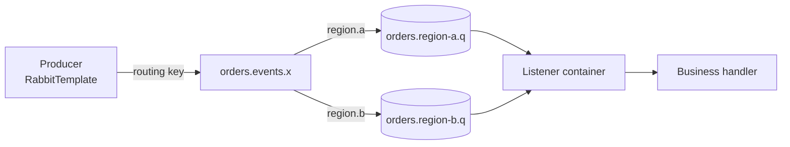
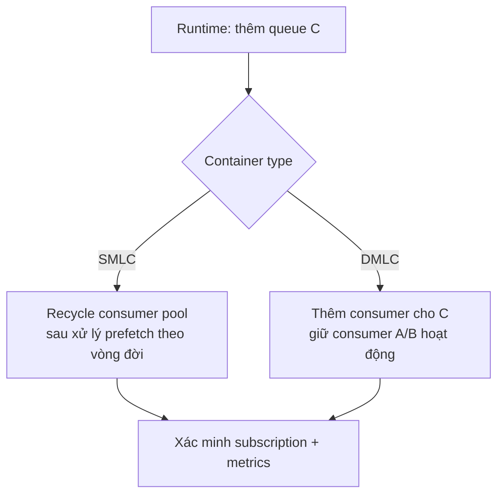
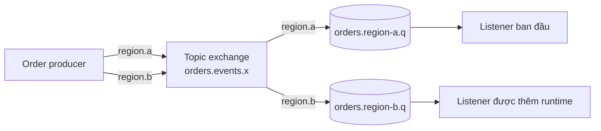
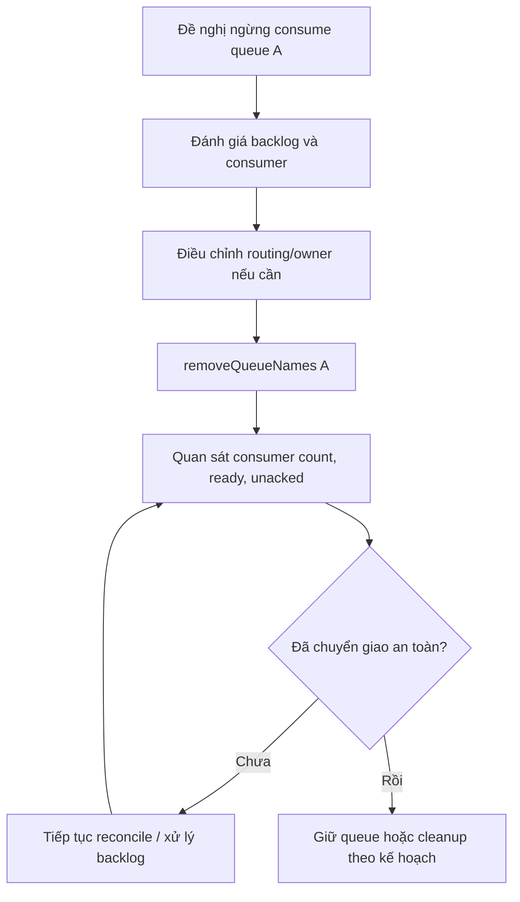
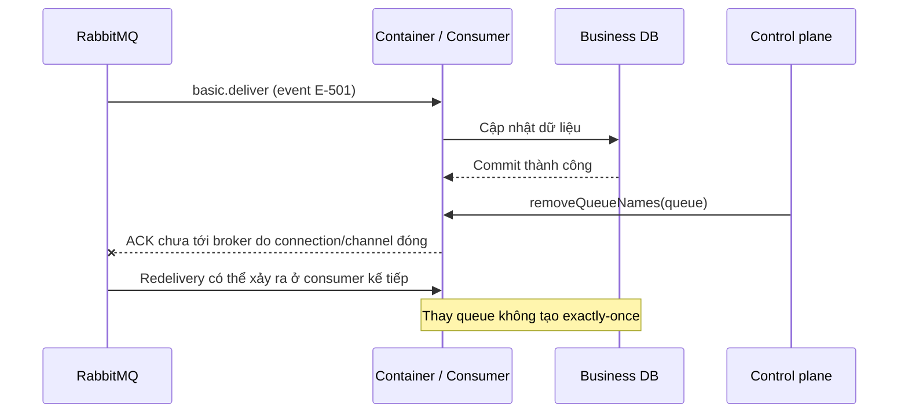

# Thêm hoặc xóa queue trong lúc chạy

Một hệ thống xử lý đơn hàng ban đầu chỉ tiêu thụ `orders.region-a.q`. Khi mở rộng sang khu vực B, đội vận hành muốn consumer bắt đầu đọc thêm `orders.region-b.q` **mà không phải deploy lại toàn bộ service**. Sau vài tháng, khi khu vực A chuyển sang một hệ thống mới, consumer phải dừng đọc queue A mà **không xóa backlog của queue đó**. Spring AMQP hỗ trợ thay đổi tập queue mà listener container theo dõi khi ứng dụng đang chạy, nhưng thay đổi này khác với việc tạo, bind hoặc xóa queue trên RabbitMQ.

Bài thuộc chương **Listener container** trong module **SPRING_AMQP**. Trọng tâm là các API `addQueueNames`, `addQueues`, `removeQueueNames` và `removeQueues`; cách `SimpleMessageListenerContainer` (SMLC) và `DirectMessageListenerContainer` (DMLC) phản ứng; cách tìm container do `@RabbitListener` tạo thông qua `RabbitListenerEndpointRegistry`; và quy trình phối hợp với `RabbitAdmin`, `RabbitTemplate`, exchange/binding, ACK, retry, dead-letter, giao dịch và observability để hệ thống bất đồng bộ tin cậy.

Sau bài học, bạn sẽ có thể:

- Phân biệt **đổi danh sách queue của consumer** và **thay đổi topology của broker**.
- So sánh cách SMLC và DMLC cập nhật consumer khi thêm hoặc xóa queue.
- Lấy container theo listener ID, rồi thêm/xóa queue ngay trong runtime bằng Java.
- Provision queue, exchange và binding đúng thứ tự trước khi chuyển luồng tiêu thụ.
- Dừng tiêu thụ một queue mà vẫn giữ queue, binding và backlog khi cần migration.
- Xử lý queue chưa tồn tại, broker cancel, race condition, restart/recovery và concurrent updates.
- Viết integration test cho thay đổi subscriptions cùng với ACK, redelivery, routing, retry và các chỉ số vận hành.

> **Phạm vi:** Ví dụ hướng tới Spring Boot 3.x / Spring AMQP 3.x, Java 17+ và RabbitMQ qua AMQP 0-9-1. Spring AMQP 4.x vẫn có cơ chế container queues nhưng hãy đối chiếu Javadoc của bản đã chọn. Các đoạn mã dùng queue **có tên do ứng dụng quản lý**, không phải queue có tên rỗng để broker tự sinh.

## 1. Mô hình: container tiêu thụ từ queue nào?

Hãy hình dung một listener container như bộ điều phối lifecycle của consumer:



Một container được cấu hình đọc một hoặc nhiều queue. Mỗi queue nhận message từ exchange qua binding; sau đó broker giao message cho consumer thuộc container.

Khi ta gọi:

```java
container.addQueueNames("orders.region-b.q");
```

thì ta **yêu cầu container thêm queue B vào tập nguồn tiêu thụ**. Lệnh này **không** tự bảo đảm rằng queue B đã được khai báo trên RabbitMQ, đã bind đúng exchange hay có message hợp lệ.

Khi gọi:

```java
container.removeQueueNames("orders.region-a.q");
```

ta **yêu cầu container dừng theo dõi queue A**. Đây **không phải** `queue.delete`: nếu A là durable queue, tài nguyên và backlog của nó có thể vẫn nằm trên broker.

### 1.1. Ba lớp trạng thái độc lập

| Lớp | Chịu trách nhiệm | Cần kiểm chứng |
| --- | --- | --- |
| **Broker topology** | RabbitMQ, provisioning, `AmqpAdmin`/`RabbitAdmin` | Queue tồn tại? Exchange và binding đúng? Arguments/permissions tương thích? |
| **Listener subscription** | SMLC/DMLC | Container đang cấu hình những queue nào? Consumer cho từng queue đã đăng ký chưa? |
| **Business processing** | `@RabbitListener`/handler và database | Payload deserialize được? Side effect thành công? ACK/NACK, retry và idempotency thế nào? |

Ví dụ, queue B đã xuất hiện trên Management UI nhưng listener vẫn không nhận message nếu container chưa được thêm B. Ngược lại, danh sách container có B nhưng broker chưa tạo queue hoặc app không có quyền read thì `basic.consume` có thể thất bại.

**Kết luận:** Thao tác dynamic subscription là **đổi nguồn đọc**, không phải hoạt động provision toàn bộ topology và càng không phải chuyển dữ liệu từ queue này sang queue khác.

## 2. Vì sao cần thay đổi queue lúc runtime?

Một số tình huống thực tế:

- **Onboarding một nhóm công việc/tenant mới:** mỗi tenant có queue riêng, service dùng chung xử lý nhưng chỉ subscribe queue được phép.
- **Chuyển lưu lượng theo khu vực:** thêm queue mới, kiểm tra xử lý, rồi rút listener khỏi queue cũ.
- **Bảo trì có kiểm soát:** tạm ngừng tiêu thụ một queue để giữ backlog trong khi các queue khác tiếp tục chạy.
- **Chia workload theo shard:** bổ sung hoặc bớt shard queue theo kế hoạch phân phối.
- **Blue–green/rolling migration:** thay tập queue được tiêu thụ mà không xóa message ở queue cũ.

Không nên tạo một queue riêng cho **mọi request** nếu không có quota, thời hạn sống, cleanup và khả năng vận hành. Queue là tài nguyên có connection/channel, metadata và chi phí giám sát; dynamic subscription không làm giới hạn quy mô này biến mất.

### 2.1. Khi không cần dynamic queue mutation

| Nhu cầu | Giải pháp có thể đơn giản hơn |
| --- | --- |
| Thêm một loại event nhưng vẫn cùng queue/schema | Thêm binding key phù hợp, giữ listener hiện tại nếu nó xử lý được. |
| Tăng throughput của cùng work queue | Tăng concurrency/instance/prefetch có kiểm soát. |
| Nhiều service cần cùng một event | Mỗi service có queue riêng, bind cùng exchange. |
| Tạm ngừng **toàn bộ** consumer | Stop/start container qua registry, không phải xóa từng queue. |
| Đổi routing key lúc publish | Điều chỉnh producer/binding; không cần đổi queue names nếu queue giữ nguyên. |
| Cần queue mới chỉ khi deploy phiên bản mới | Khai báo `@Bean`/`@QueueBinding` tĩnh có thể rõ ràng và dễ review hơn. |

## 3. API thay đổi danh sách queue của listener container

Các listener container AMQP cung cấp những phương thức:

| API | Tác dụng | Điểm cần nhớ |
| --- | --- | --- |
| `addQueueNames(String... names)` | Thêm một hoặc nhiều **tên queue**. | Queue nên tồn tại và có quyền consume; không tự khai báo binding. |
| `addQueues(Queue... queues)` | Thêm bằng đối tượng `org.springframework.amqp.core.Queue`. | `Queue` object mô tả queue, không đồng nghĩa resource đã được broker tạo. |
| `removeQueueNames(String... names)` | Loại tên khỏi danh sách consumer theo dõi. | Không xóa queue hoặc message trên broker. |
| `removeQueues(Queue... queues)` | Loại queue được chỉ định bởi object. | Không gọi RabbitMQ `queue.delete`. |
| `getQueueNames()` | Đọc những tên queue hiện container đang cấu hình. | Phải phân biệt “đã cấu hình” với “broker đã có consumer active”. |
| `setQueueNames(...)` / `setQueues(...)` | Cấu hình danh sách queue. | Thường dùng lúc khởi tạo; khi đang chạy ưu tiên API thêm/xóa được thiết kế cho runtime. |

Các phương thức trên nằm trong lớp nền của những container AMQP cụ thể. Ví dụ nếu có một tham chiếu `AbstractMessageListenerContainer`:

```java
import org.springframework.amqp.rabbit.listener.AbstractMessageListenerContainer;

public void changeSubscriptions(
        AbstractMessageListenerContainer container) {
    container.addQueueNames("orders.region-b.q");

    for (String queue : container.getQueueNames()) {
        System.out.println("Configured queue: " + queue);
    }

    container.removeQueueNames("orders.region-a.q");
}
```

Ví dụ này chỉ thao tác **cấu hình consumer**. Trước khi gọi `addQueueNames` trong môi trường thật, phải bảo đảm queue mới được provisioning hợp lệ, có binding/routing cần thiết và tài khoản có quyền.

### 3.1. Có thể bắt đầu với không queue không?

Theo tài liệu Spring AMQP hiện đại, một listener container có thể được cấu hình ban đầu với **không queue** rồi thêm các queue trong runtime. Đây là khả năng của container; không mặc nhiên đồng nghĩa mọi cách dùng `@RabbitListener` với thuộc tính `queues` rỗng đều phù hợp để đăng ký một endpoint. Với annotation, ví dụ trong bài dùng **một queue khởi đầu có tên rõ ràng** để tránh nhầm khâu đăng ký listener.

Khi chạy với Spring AMQP cũ, hãy kiểm tra lại Javadoc: có những bản lịch sử yêu cầu giữ tối thiểu một queue. Đừng giả định một thủ tục “remove cuối cùng” hoặc khởi tạo zero queue áp dụng giống nhau trên mọi phiên bản.

### 3.2. Thêm/xóa tên có phải thao tác đồng bộ hoàn tất ngay không?

Lệnh Java cập nhật **desired queue configuration** của container. Nhưng việc broker đã tạo/cancel `basic.consume` và xử lý những message đang được cấp phát có thể diễn ra theo lifecycle bất đồng bộ. Vì vậy:

- Method trả về không chứng minh consumer mới đã bắt đầu nhận message.
- Xóa tên khỏi container không bảo đảm mọi handler của queue đó đã hoàn tất ngay lập tức.
- Nếu stop/cancel ở lúc đang có message chưa ACK, broker có thể redeliver sau khi consumer/channel đóng theo cơ chế ACK.
- Muốn chuyển giao an toàn, cần quan sát consumer count, backlog, in-flight processing và business status.

## 4. SMLC và DMLC thay đổi queue khác nhau thế nào?

Spring AMQP có hai container AMQP truyền thống:

- `SimpleMessageListenerContainer` (**SMLC**): dùng các consumer/channels theo cơ chế container “simple”, có hàng đợi xử lý nội bộ và task executor riêng.
- `DirectMessageListenerContainer` (**DMLC**): consumer chạy gắn trực tiếp với Rabbit client, tạo các consumer cho từng queue và có cơ chế concurrency theo queue.

Tài liệu Spring AMQP mô tả khác biệt rõ khi thay đổi tập queue lúc đang chạy:

| Đặc tính | SMLC | DMLC |
| --- | --- | --- |
| Khi thêm/xóa một queue | **Recycle** các consumer hiện có, thường đợi những message prefetch đang xử lý trước khi hủy/tạo lại. | **Tạo/hủy consumer riêng** cho queue được thêm/xóa. |
| Ảnh hưởng đến các queue không thay đổi | Có thể chịu một giai đoạn ngắt/chuyển consumer trong lúc recycle. | Các consumer của queue khác thường không bị ảnh hưởng. |
| Cấu hình concurrency | Thường dùng `concurrentConsumers`/`maxConcurrentConsumers`. | Thường dùng `consumersPerQueue`. |
| Khi thay đổi queue thường xuyên | Cân nhắc chi phí recycle và các tác vụ đang chạy. | Thường phù hợp hơn nếu cần thay đổi từng queue độc lập. |
| Thực hiện ACK | Container quản lý theo acknowledge mode đã cấu hình. | Tương tự, nhưng cần tính đến consumer/channel của từng queue. |



**Không đánh đồng “DMLC ít làm gián đoạn các queue khác” với “DMLC đảm bảo exactly-once”**. Cả hai vẫn chịu ảnh hưởng bởi network failure, ACK chưa tới broker, retry và kết quả business chưa commit.

### 4.1. Khi nào chọn SMLC, khi nào chọn DMLC?

SMLC thường phù hợp khi số queue ổn định và muốn concurrency tự điều chỉnh theo load bằng các thuộc tính simple container. DMLC có thể là lựa chọn thuận tiện khi muốn cập nhật từng queue thường xuyên hoặc muốn cài `consumersPerQueue`. Tuy nhiên, cần xét task executor, workload, prefetch, phiên bản framework và chỉ số thực tế; không chọn theo một tiêu chí đơn lẻ.

## 5. Ví dụ 1: dùng SMLC như một Spring bean

Nếu tạo container bằng `@Bean`, ứng dụng có thể inject trực tiếp bean đó để thay đổi danh sách queue. Đây là cách dễ thấy rõ API nền trước khi dùng `@RabbitListener`.

### 5.1. Tạo container và chỉ định queue ban đầu

```java
import java.nio.charset.StandardCharsets;
import org.springframework.amqp.core.Message;
import org.springframework.amqp.core.MessageListener;
import org.springframework.amqp.rabbit.connection.ConnectionFactory;
import org.springframework.amqp.rabbit.listener.SimpleMessageListenerContainer;
import org.springframework.context.annotation.Bean;
import org.springframework.context.annotation.Configuration;

@Configuration
class SimpleContainerConfig {

    @Bean
    SimpleMessageListenerContainer ordersSimpleContainer(
            ConnectionFactory connectionFactory) {
        var container = new SimpleMessageListenerContainer(connectionFactory);
        container.setQueueNames("orders.region-a.q");
        container.setConcurrentConsumers(2);
        container.setMaxConcurrentConsumers(4);
        container.setPrefetchCount(10);
        container.setMissingQueuesFatal(false);
        container.setMessageListener((MessageListener) message -> {
            String sourceQueue =
                    message.getMessageProperties().getConsumerQueue();
            String value = new String(
                    message.getBody(), StandardCharsets.UTF_8);
            System.out.printf(
                    "SMLC received from %s: %s%n", sourceQueue, value);
        });
        return container;
    }
}
```

**Điều kiện tiên quyết:** `orders.region-a.q` phải được khai báo trên RabbitMQ, có binding phù hợp và user có quyền read. `setMissingQueuesFatal(false)` ở ví dụ giúp container không coi mọi tình huống queue bị thiếu là lỗi fatal ngay tại startup, **không tạo queue còn thiếu và không bảo đảm consumer hoạt động khi broker không có queue**.

Ở đây callback chỉ in log để trình bày API. Production phải xử lý lỗi, idempotency, message conversion và ACK/transaction theo hợp đồng nghiệp vụ.

### 5.2. Thêm và xóa queue khi ứng dụng đang chạy

```java
import org.springframework.amqp.rabbit.listener.SimpleMessageListenerContainer;
import org.springframework.stereotype.Service;

@Service
public class SimpleQueueSubscriptionService {
    private final SimpleMessageListenerContainer container;

    public SimpleQueueSubscriptionService(
            SimpleMessageListenerContainer ordersSimpleContainer) {
        this.container = ordersSimpleContainer;
    }

    public void subscribeRegionB() {
        container.addQueueNames("orders.region-b.q");
    }

    public boolean unsubscribeRegionA() {
        return container.removeQueueNames("orders.region-a.q");
    }
}
```

Khi thêm `orders.region-b.q`, SMLC phải thay đổi nhóm consumer; nó có thể chờ những message đã prefetch được xử lý trước khi recycle. Do đó không nên xem việc thêm queue là thao tác hoàn tất ngay theo đồng hồ: hãy kiểm tra consumer count/routing thực tế.

Khi xóa `orders.region-a.q` khỏi container, **broker vẫn giữ queue A**. Nếu producer tiếp tục định tuyến message vào queue A, backlog sẽ tích lũy trong queue đó, trừ khi còn consumer khác xử lý.

**Lưu ý chọn bean:** Ví dụ `@Bean` và `@RabbitListener` ở mục sau là những kiến trúc thay thế. Nếu tạo **cả hai container** cùng đọc `orders.region-a.q`, các consumer sẽ cạnh tranh delivery. Không kết luận sai rằng “container mới không nhận được message” chỉ vì container cũ đã ACK trước.

## 6. Ví dụ 2: dùng DMLC cho việc thay đổi queue độc lập

Với `DirectMessageListenerContainer`, Spring tạo/hủy consumer cho queue được thay đổi mà ít gây xáo trộn đến consumer của queue khác hơn.

```java
import java.nio.charset.StandardCharsets;
import org.springframework.amqp.core.MessageListener;
import org.springframework.amqp.rabbit.connection.ConnectionFactory;
import org.springframework.amqp.rabbit.listener.DirectMessageListenerContainer;
import org.springframework.context.annotation.Bean;
import org.springframework.context.annotation.Configuration;

@Configuration
class DirectContainerConfig {

    @Bean
    DirectMessageListenerContainer ordersDirectContainer(
            ConnectionFactory connectionFactory) {
        var container = new DirectMessageListenerContainer(connectionFactory);
        container.setQueueNames("orders.region-a.q");
        container.setConsumersPerQueue(1);
        container.setPrefetchCount(10);
        container.setMissingQueuesFatal(false);
        container.setMessageListener((MessageListener) message -> {
            String queue =
                    message.getMessageProperties().getConsumerQueue();
            String body = new String(
                    message.getBody(), StandardCharsets.UTF_8);
            System.out.printf(
                    "DMLC received from %s: %s%n", queue, body);
        });
        return container;
    }
}
```

Một service quản lý DMLC:

```java
import org.springframework.amqp.rabbit.listener.DirectMessageListenerContainer;
import org.springframework.stereotype.Service;

@Service
class DirectQueueSubscriptionService {
    private final DirectMessageListenerContainer container;

    DirectQueueSubscriptionService(
            DirectMessageListenerContainer ordersDirectContainer) {
        this.container = ordersDirectContainer;
    }

    public void subscribe(String queueName) {
        container.addQueueNames(queueName);
    }

    public void unsubscribe(String queueName) {
        container.removeQueueNames(queueName);
    }
}
```

Giả sử DMLC ban đầu đọc A và B. Khi gọi `removeQueueNames("orders.region-b.q")`, container có thể hủy các consumer của B trong khi consumer của A vẫn xử lý. Điều này hữu ích khi subscription thay đổi thường xuyên nhưng **không đảm bảo không bao giờ có khoảng chờ, redelivery hay sự cố giữa các message**.

**Không cấu hình đồng thời ví dụ SMLC và DMLC của mục 5–6 trên cùng queue** nếu bạn muốn đo riêng tác động từng loại container.

### 6.1. `consumersPerQueue` không phải `maxConcurrentConsumers`

Ví dụ DMLC đọc ba queue và `consumersPerQueue=2`: có thể có hai consumer cho mỗi queue, tổng cộng sáu consumer khi hoạt động bình thường. Khi thêm queue thứ tư, số consumer có thể tăng theo.

Ngược lại, SMLC thường cấu hình số consumer tổng qua `concurrentConsumers` và `maxConcurrentConsumers`, mỗi consumer của nó có thể đăng ký các queue được container quản lý. Vì vậy, thay đổi số queue có thể ảnh hưởng tổng channels, threads, mức prefetch và áp lực downstream theo cách khác nhau giữa hai container.

### 6.2. Chọn container cho `@RabbitListener` bằng Spring Boot

Trong ứng dụng dùng annotation listener và Spring Boot hỗ trợ những property sau, ví dụ chọn direct container:

```yaml
spring:
  rabbitmq:
    listener:
      type: direct
      direct:
        consumers-per-queue: 1
        prefetch: 10
        acknowledge-mode: auto
```

Đây là cấu hình chung cho listener factory được Boot auto-configure; nếu một listener chỉ định `containerFactory` tùy chỉnh, **nó có thể không dùng những cấu hình mặc định trên**. Xem đúng bean factory và thử nghiệm để xác nhận.

## 7. Thay đổi queue của `@RabbitListener` qua `RabbitListenerEndpointRegistry`

Trên ứng dụng thật, consumer thường được khai báo như sau:

```java
import org.springframework.amqp.core.Message;
import org.springframework.amqp.rabbit.annotation.RabbitListener;
import org.springframework.stereotype.Component;

@Component
class DynamicOrderListener {

    @RabbitListener(
            id = "orderDynamicListener",
            queues = "orders.region-a.q")
    public void onOrder(Message message) {
        String queue =
                message.getMessageProperties().getConsumerQueue();
        System.out.println("Nhận từ queue " + queue);
        // Xử lý idempotent; method thành công → container ACK theo mode.
    }
}
```

`@RabbitListener` được processor biến thành một listener container và đăng ký vào `RabbitListenerEndpointRegistry`. Từ đó, ứng dụng có thể tìm container bằng ID để thay đổi queues, thay vì cố sửa chuỗi literal trong annotation.

### 7.1. Tìm container theo ID và kiểm tra kiểu thực tế

```java
import java.util.Arrays;
import org.springframework.amqp.rabbit.listener.AbstractMessageListenerContainer;
import org.springframework.amqp.rabbit.listener.RabbitListenerEndpointRegistry;
import org.springframework.stereotype.Service;

@Service
public class DynamicOrderRegistryManager {
    private static final String LISTENER_ID = "orderDynamicListener";

    private final RabbitListenerEndpointRegistry registry;

    public DynamicOrderRegistryManager(
            RabbitListenerEndpointRegistry registry) {
        this.registry = registry;
    }

    private AbstractMessageListenerContainer container() {
        var registered = registry.getListenerContainer(LISTENER_ID);
        if (!(registered instanceof AbstractMessageListenerContainer amqp)) {
            throw new IllegalStateException(
                    "Không tìm thấy AMQP listener container: " + LISTENER_ID);
        }
        return amqp;
    }

    public void addQueue(String queueName) {
        container().addQueueNames(queueName);
    }

    public boolean removeQueue(String queueName) {
        return container().removeQueueNames(queueName);
    }

    public String[] configuredQueues() {
        return container().getQueueNames();
    }
}
```

Trong Spring AMQP 3.x, `getListenerContainer(id)` trả về interface chung `MessageListenerContainer`. Ta kiểm tra type trước khi gọi phương thức dành cho AMQP concrete containers. Nếu hệ thống dùng listener container thuộc mô hình khác, ví dụ stream container, không nên ép cast thiếu kiểm tra.

Gọi từ một admin workflow có xác thực:

```java
manager.addQueue("orders.region-b.q");

System.out.println(
        Arrays.toString(manager.configuredQueues()));

manager.removeQueue("orders.region-a.q");
```

**Đoạn gọi chỉ minh họa:** muốn thực thi cần có bean `DynamicOrderRegistryManager` được inject vào service/controller/job quản trị; `manager` không phải biến toàn cục. Trong production, không expose một endpoint HTTP công khai cho phép người ngoài cung cấp tùy ý tên queue.

### 7.2. Vì sao không sửa `@RabbitListener(queues=...)` tại runtime?

Annotation là metadata được đọc trong quá trình ứng dụng đăng ký listener. Một khi container đã được tạo, chỉnh một property cấu hình hay sửa class source code **không tự cập nhật** tập queue của container đang chạy.

Phải gọi API container, hoặc tổ chức một quy trình stop/reconfigure/start hay dynamic endpoint registration phù hợp nếu muốn thay đổi sâu hơn. `RabbitListenerEndpointRegistry` quản lý những container được tạo qua annotation; nó **không mặc nhiên chứa mọi SMLC/DMLC được đăng ký như Spring bean độc lập**. Các bean ở mục 5–6 nên được inject trực tiếp theo tên/type, không giả định tìm thấy qua registry.

### 7.3. Tránh hard-code hành vi khác nhau giữa instance

Giả sử có ba replicas của service, mỗi replica là một JVM riêng với một registry riêng. Gọi `manager.addQueue("orders.region-b.q")` trên replica 1 chỉ đổi **container trong replica 1**, không tự broadcast tới replicas 2 và 3.

Nếu yêu cầu mọi replica cùng cập nhật, cần cơ chế điều phối, ví dụ một bảng cấu hình subscriptions dùng chung, control plane có xác thực, hoặc triển khai đồng bộ cấu hình khi start/reconcile. Đừng giả định thay một listener trong một JVM là đã thay toàn bộ consumer fleet.

## 8. Thêm một queue mới: provision trước, subscribe sau

Giả sử producer publish vào topic exchange `orders.events.x`. Mỗi region có queue riêng và routing key tương ứng:



Để thêm queue B đúng nghĩa, cần **hai nhóm thao tác**:

1. **Broker:** đảm bảo queue B tồn tại, exchange tồn tại và binding `region.b` nối exchange với B.
2. **Ứng dụng:** gọi `addQueueNames("orders.region-b.q")` trên container mong muốn.

Chỉ làm (1) thì queue có thể tích lũy message nhưng chưa có consumer. Chỉ làm (2) thì consumer có thể gặp lỗi queue chưa có hoặc sai quyền. Thứ tự thông thường là provision → kiểm tra → subscribe; nhờ đó tránh consumer thử đọc một queue không tồn tại.

### 8.1. Định nghĩa topology khởi đầu

Ví dụ dùng **một** queue khởi đầu cho listener ở mục 7:

```java
import org.springframework.amqp.core.Binding;
import org.springframework.amqp.core.BindingBuilder;
import org.springframework.amqp.core.Queue;
import org.springframework.amqp.core.QueueBuilder;
import org.springframework.amqp.core.TopicExchange;
import org.springframework.beans.factory.annotation.Qualifier;
import org.springframework.context.annotation.Bean;
import org.springframework.context.annotation.Configuration;

@Configuration
class RegionTopology {
    @Bean
    TopicExchange ordersEventsExchange() {
        return new TopicExchange("orders.events.x", true, false);
    }

    @Bean
    Queue regionAQueue() {
        return QueueBuilder.durable("orders.region-a.q").build();
    }

    @Bean
    Binding regionABinding(
            @Qualifier("regionAQueue") Queue queue,
            @Qualifier("ordersEventsExchange") TopicExchange exchange) {
        return BindingBuilder.bind(queue)
                .to(exchange).with("region.a");
    }
}
```

Khi Spring AMQP có `RabbitAdmin` được cấu hình phù hợp, các bean trên có thể được declare trên broker. Nếu ứng dụng không sở hữu topology, phần này có thể do platform/operations provisioning trước. Chỉ dùng **một con đường chính thức** để quản lý thuộc tính queue, tránh các instance khai báo cùng tên với arguments khác nhau.

### 8.2. Provision queue B và binding qua `AmqpAdmin`

Lớp sau minh họa dịch vụ có quyền quản lý topology ở môi trường thực hành:

```java
import org.springframework.amqp.core.AmqpAdmin;
import org.springframework.amqp.core.BindingBuilder;
import org.springframework.amqp.core.Queue;
import org.springframework.amqp.core.QueueBuilder;
import org.springframework.amqp.core.TopicExchange;
import org.springframework.stereotype.Service;

@Service
public class RegionSubscriptionProvisioner {
    private static final String EXCHANGE = "orders.events.x";

    private final AmqpAdmin admin;
    private final DynamicOrderRegistryManager manager;

    public RegionSubscriptionProvisioner(
            AmqpAdmin admin,
            DynamicOrderRegistryManager manager) {
        this.admin = admin;
        this.manager = manager;
    }

    public void provisionAndSubscribe(
            String queueName, String routingKey) {
        validate(queueName, routingKey);

        // 1. Broker queue: phải tương đương nếu đã tồn tại.
        Queue queue = QueueBuilder.durable(queueName).build();
        admin.declareQueue(queue);

        // 2. Broker binding: exchange phải được tạo trước.
        TopicExchange exchange = new TopicExchange(
                EXCHANGE, true, false);
        admin.declareBinding(BindingBuilder.bind(queue)
                .to(exchange)
                .with(routingKey));

        // 3. Thay desired subscriptions của container hiện tại.
        manager.addQueue(queueName);
    }

    private void validate(String queueName, String routingKey) {
        if (queueName == null ||
                !queueName.matches("orders\\.region-[a-z0-9-]+\\.q")) {
            throw new IllegalArgumentException("Queue name không hợp lệ");
        }
        if (routingKey == null ||
                !routingKey.matches("region\\.[a-z0-9-]+")) {
            throw new IllegalArgumentException("Routing key không hợp lệ");
        }
    }
}
```

Điều kiện ví dụ: `orders.events.x` đã tồn tại theo `RegionTopology` hoặc đã được platform tạo **trước khi** gọi `provisionAndSubscribe`; tài khoản có quyền configure/bind/read phù hợp. `new TopicExchange(...)` ở phương thức chỉ dùng để cung cấp thông tin tên/kiểu cho `BindingBuilder`; code **không gọi `declareExchange`** trong phương thức này.

Đây là ví dụ học API, **chưa phải service quản trị production hoàn chỉnh**:

- Một lần gọi có thể thành công bước tạo queue nhưng lỗi bước binding hoặc subscribe. Cần lưu trạng thái và có tác vụ reconcile.
- Lệnh không tự dọn queue khi bước sau lỗi; xóa queue có thể làm mất message.
- Validate bằng regex chỉ là lớp kiểm tra đầu vào; ngoài ra phải kiểm tra authorization, quota, ownership và queue type.
- Nếu queue đã tồn tại với thuộc tính khác, broker có thể từ chối `declareQueue` bằng `PRECONDITION_FAILED`.
- Nếu nhiều replicas gọi cùng lúc, cần điều phối và kiểm tra idempotency trên dữ liệu cấu hình.

### 8.3. Thêm queue vào container không tự sửa các queues khác

Giả sử `orders.region-a.q` và `orders.region-b.q` đều đã bind vào exchange. Việc thêm B vào một DMLC đang nghe A sẽ đăng ký consumer mới cho B, không tạo thêm bản sao của A.

Nếu region B cần message **đã gửi trước khi binding được tạo**, việc provision queue và thêm subscription hôm nay không thể tự khôi phục các message trước đó. Cần source event có thể replay, event store, stream hoặc quy trình nghiệp vụ riêng.

### 8.4. Phân biệt tạo queue mới và dùng queue cũ

Nếu queue B đã tồn tại và có binding đúng (do platform quản lý), ứng dụng chỉ cần:

```java
manager.addQueue("orders.region-b.q");
```

Thao tác `AmqpAdmin.declareQueue(...)` là **không bắt buộc** khi nhóm consumer không sở hữu resource và không có quyền configure. Trong môi trường phân quyền chặt, chỉ consumer được phép read queue cũng có thể dùng dynamic subscription, miễn là topology đã được tạo đúng.

## 9. Xóa queue khỏi container: dừng tiêu thụ, không xóa message

Giả sử muốn ngừng xử lý `orders.region-a.q` nhưng giữ message chưa xử lý để chuyển giao cho một consumer mới.

**Thứ tự khuyến nghị:**

1. Ghi nhận mục tiêu (drain backlog, chuyển owner hay dừng tạm).
2. Nếu cần, giảm hoặc dừng routing mới đến A theo kế hoạch của producer/binding.
3. Quan sát `ready`, `unacked` và công việc đang chạy; xác định khi nào có thể chuyển giao.
4. Gọi `removeQueueNames("orders.region-a.q")` trên container cần rút.
5. Xác minh consumer count của A giảm theo kỳ vọng, các queue khác vẫn hoạt động.
6. Chỉ khi có quy trình rõ ràng mới gỡ binding hoặc xóa queue khỏi broker.



### 9.1. `removeQueueNames` không gọi `deleteQueue`

Hai hành động sau **hoàn toàn khác nhau**:

```java
// Chỉ ngừng container lắng nghe queue:
container.removeQueueNames("orders.region-a.q");

// KHÔNG tương đương với API quản trị có thể xóa dữ liệu:
// amqpAdmin.deleteQueue("orders.region-a.q");
```

Ở trường hợp đầu, queue trên broker và những message chưa tiêu thụ có thể vẫn được giữ. Ở trường hợp thứ hai, RabbitMQ nhận lệnh **xóa tài nguyên queue**, có nguy cơ làm mất backlog. Không dùng thao tác xóa queue như bước mặc định của việc unsubscribing.

### 9.2. Có message đang xử lý thì sao?

Khi thay subscriptions:

- **SMLC** có thể recycle consumer và thường xử lý các message đã prefetch theo lifecycle trước khi tạo lại.
- **DMLC** tập trung cancel consumer của queue bị bỏ, ít ảnh hưởng các queue khác.
- Delivery đã nhận có thể vẫn đang chạy trong handler; không khẳng định mọi job kết thúc ngay sau lời gọi remove.
- Nếu channel/connection đóng khi message chưa ACK, broker có thể phát lại message.

Để giảm rủi ro, đặt timeout hợp lý, kiểm soát in-flight message, dùng consumer idempotency và có trạng thái nghiệp vụ. Không xem việc remove thành công là transaction nguyên tử giữa broker, consumer và database.

### 9.3. Xóa queue khỏi broker trước khi khỏi container

Nếu queue bị xóa trên broker nhưng tên vẫn nằm trong container, broker có thể gửi **consumer cancel**. Spring AMQP cố khôi phục consumer cho những queue còn cấu hình, trong khi queue đã mất có thể tiếp tục bị tìm kiếm/kiểm tra lại.

Theo hướng dẫn Spring AMQP, nếu muốn bỏ một queue **vĩnh viễn**, hãy cập nhật danh sách queue của container trước hoặc sau khi xóa resource để tránh việc container tiếp tục cố consume queue đó. Với dữ liệu quan trọng, nên ngừng routing và chuyển backlog trước, rồi mới cleanup broker.

### 9.4. Không chỉ thao tác trên một JVM khi cả cụm consumer cần thay đổi

Nếu vùng A có ba replicas cùng đọc queue, việc remove trên một replica chỉ giảm số consumer của replica đó; hai replicas còn lại vẫn tiếp tục consume. Nếu mục tiêu là **ngừng toàn bộ service** đọc A, cần điều phối thay đổi đến mọi instance hoặc thay mô hình sở hữu subscriptions.

Để tránh cấu hình lệch giữa các instance, nên lưu desired subscriptions ở nguồn dùng chung và chạy reconciliation định kỳ/khởi động, thay vì dựa vào một thao tác thao tác cục bộ rồi quên.

## 10. Queue thiếu, broker cancel và khôi phục consumer

Dynamic subscription không tránh khỏi các lỗi môi trường. Ví dụ queue B đã có trong cấu hình container nhưng:

- Broker chưa tạo queue B;
- Queue B vừa bị xóa bởi quản trị viên;
- Connection mất giữa lúc thay subscriptions;
- User không còn quyền read;
- Exchange/binding không còn đúng sau rollout.

Các lỗi này có thể ảnh hưởng thời điểm consumer được đăng ký nhưng **không thay đổi bản chất của message đã ở trong queue**.

### 10.1. `missingQueuesFatal` là gì?

Trong các listener containers của Spring AMQP, `missingQueuesFatal` điều khiển việc coi tình huống queue không có sẵn khi startup là lỗi nghiêm trọng tới mức nào. Ví dụ:

```java
container.setMissingQueuesFatal(false);
```

Điều này giúp ứng dụng chịu đựng một số tình huống provisioning chậm và cho container cơ hội tiếp tục recovery. Nó **không**:

- Tự tạo queue B chỉ vì container muốn đọc B;
- Bỏ qua yêu cầu quyền consume của broker;
- Chuyển message từ queue A sang queue B;
- Bảo đảm ứng dụng vẫn đang xử lý công việc nếu mọi queue đều thiếu.

Khi nhiều queue được cấu hình nhưng một phần chưa tồn tại, Spring AMQP có thể tiếp tục consume từ queue sẵn có và thử passive declaration/consume lại những queue thiếu theo khoảng thời gian định kỳ. Tài liệu Spring AMQP mô tả chu kỳ thử lại khoảng **60 giây** trong trường hợp này ở cấu hình tham khảo; cần kiểm tra các retry intervals và phiên bản container đang dùng trước khi dựa vào thời gian cụ thể cho SLA.

### 10.2. Broker cancel consumer

RabbitMQ có thể gửi consumer cancel khi queue bị xóa, quyền thay đổi hoặc một điều kiện broker khiến consumer không còn hợp lệ. Container có cơ chế recovery, nhưng nếu tên queue vẫn nằm trong desired subscriptions, nó có thể tiếp tục cố gắng đọc queue đó.

Điều này có hai hệ quả:

1. Nếu queue tạm thời mất và sẽ được khôi phục, giữ subscription có thể hợp lý, kèm retry và cảnh báo.
2. Nếu queue bị bỏ **vĩnh viễn**, cần gọi `removeQueueNames` hoặc cập nhật desired configuration để container **ngừng cố phục hồi một nguồn không còn được sử dụng**.

### 10.3. `RabbitAdmin` có thể tái khai báo resource

Nếu một `Queue` bean vẫn nằm trong Spring context và `RabbitAdmin` có quyền auto-declare, resource bị mất có thể được tái khai báo trong một số giai đoạn connection/recovery. Vì vậy, “tôi đã remove queue khỏi container” và “queue không nên tồn tại trên broker nữa” là **hai yêu cầu khác nhau**:

- Remove khỏi container: thay người tiêu thụ.
- Gỡ declarables và resource trên broker: thay topology, cần quyền và kế hoạch dữ liệu.

Đừng giữ bean `Queue` cũ trong cấu hình rồi ngạc nhiên khi một lần reconnect làm broker xuất hiện queue mà bạn tưởng đã dọn dẹp. Quyền sở hữu resource phải thống nhất giữa application, admin và deployment automation.

## 11. Trường hợp đặc biệt: queue có tên do broker cấp

RabbitMQ cho phép client khai báo queue với **tên rỗng** để broker tự sinh tên. Đây là tình huống khác với các queue cố định `orders.region-a.q` và `orders.region-b.q` trong phần lớn ví dụ của bài.

Ví dụ cơ bản:

```java
import org.springframework.amqp.core.Queue;
import org.springframework.amqp.rabbit.connection.ConnectionFactory;
import org.springframework.amqp.rabbit.listener.SimpleMessageListenerContainer;
import org.springframework.context.annotation.Bean;

@Bean
Queue brokerNamedQueue() {
    return new Queue("", false, true, true);
}

@Bean
SimpleMessageListenerContainer brokerNamedContainer(
        ConnectionFactory connectionFactory, Queue brokerNamedQueue) {
    var container = new SimpleMessageListenerContainer(connectionFactory);
    container.setQueues(brokerNamedQueue);
    container.setMessageListener(message -> {
        System.out.println("Nhận message tạm thời");
    });
    container.setMissingQueuesFatal(false);
    return container;
}
```

Trong ví dụ này, khi `RabbitAdmin` khai báo queue tên rỗng, broker trả về **tên thực tế**, và đối tượng `Queue` của Spring có thể cập nhật `actualName`. Dùng `setQueues(Queue)` giúp container truy cập tên được broker cấp; chỉ lưu tên rỗng qua `setQueueNames("")` là không đủ.

**Giới hạn phải nhớ:** Theo tài liệu chính thức, **không thêm broker-named queues vào container khi nó đang chạy**. Các API runtime add queue trong bài phù hợp với **queue đặt tên rõ ràng**, không phải đường tắt để thêm một broker-named queue mới khi container đang hoạt động.

Khi connection reset, queue broker-named có thể được tạo lại với **tên mới**. Hãy dùng `missingQueuesFatal=false` phù hợp, tránh race giữa việc container reconnect và admin redeclare queue. Với subscription tạm, `AnonymousQueue` cũng là lựa chọn nên đánh giá; với backlog cần giữ lâu dài, chọn queue durable đặt tên cố định.

### 11.1. `setQueues` có thay `addQueues` không?

`setQueues` dùng để **đặt danh sách queue**, đặc biệt quan trọng khi khởi tạo container với đối tượng queue broker-named cần theo dõi `actualName`. `addQueues` là API **bổ sung vào tập hiện có**. Không sử dụng `addQueues(new Queue("", ...))` như cơ chế tạo queue tạm động khi container đang chạy.

Trong runtime mutation thông thường, sử dụng `addQueueNames` với các queue tên cố định đã provision và `removeQueueNames` khi rút subscription sẽ minh bạch hơn.

## 12. Khôi phục cấu hình subscriptions qua restart

Một thay đổi được thực hiện qua:

```java
registryManager.addQueue("orders.region-b.q");
```

chỉ thay đổi container **trong bộ nhớ của JVM hiện tại**. Khi ứng dụng restart, annotation `@RabbitListener(queues = "orders.region-a.q")` hoặc cấu hình bean ban đầu được đọc lại. Nếu không lưu desired subscriptions ở nơi bền vững, B có thể **biến mất khỏi tập consumer** sau restart, dù queue B vẫn nằm nguyên trên broker.

### 12.1. Desired state và actual state

Để vận hành một hệ thống có thay đổi subscription thường xuyên, nên duy trì:

| Trạng thái | Ví dụ | Ai quản lý? |
| --- | --- | --- |
| **Desired subscriptions** | `["orders.region-a.q", "orders.region-b.q"]` | Database/config store hoặc control plane của ứng dụng. |
| **Configured subscriptions** | Kết quả `container.getQueueNames()` | Listener container trong JVM. |
| **Active broker consumers** | Consumer count per queue, consumer tags, connections | RabbitMQ và các consumer đang kết nối. |
| **Business processing state** | Đã commit/ACK, job đang xử lý, lỗi DLQ | Service nghiệp vụ và broker. |

`getQueueNames()` chỉ cho biết lớp thứ hai; nó không thay thế Management API hoặc quan sát consumer registrations thực trên broker.

### 12.2. Reconcile sau restart

Quy trình minh họa:

```text
Khi ứng dụng khởi động:
  1. Đọc danh sách subscriptions mong muốn từ kho cấu hình.
  2. Xác minh mỗi queue được phép, đã provision và có binding hợp lệ.
  3. So sánh desired names với container.getQueueNames().
  4. Thêm những tên cần subscribe bằng addQueueNames(...).
  5. Loại những tên không còn trong desired bằng removeQueueNames(...).
  6. Kiểm tra consumer registrations trên broker, cảnh báo queue lỗi.

Khi có yêu cầu quản trị:
  1. Xác thực và phân quyền người/công cụ thay đổi.
  2. Ghi desired state bền vững và version/operation ID.
  3. Provision hoặc xác minh topology trước khi subscribe.
  4. Reconcile tất cả JVM liên quan.
  5. Chỉ báo thành công khi actual consumer state được xác minh.
```

Có thể chạy reconciliation khi `ApplicationReadyEvent` xảy ra hoặc theo một scheduled job an toàn, nhưng phải tính đến kết nối broker chưa sẵn sàng, việc replay/retry và các sửa đổi đồng thời. Tránh vòng lặp cập nhật nhiều lần làm churn consumer hoặc tạo trùng tài nguyên. **Đừng coi một HTTP 200 trả về từ hàm addQueueNames là bằng chứng cả cụm consumer đã cập nhật thành công.**

### 12.3. Idempotency và concurrent updates

Khi hai yêu cầu quản trị đến gần nhau, một yêu cầu thêm B và một yêu cầu xóa B, phải có chính sách xác định kết quả cuối. Với nhiều replicas, nên dùng:

- Version cho desired subscriptions, ví dụ `subscription_version` tăng mỗi lần thay đổi.
- Compare-and-set hoặc lock ở nguồn cấu hình để tránh mất cập nhật.
- Operation ID cho việc replay khi điều phối thất bại.
- Reconciliation có thể chạy lại an toàn khi network timeout.
- Audit trail nêu ai thay đổi, khi nào, queue nào và vì sao.

Không để người dùng tùy ý subscribe sang queue của tenant khác chỉ bằng cách thay một chuỗi. Phải kiểm tra quyền truy cập và phạm vi queue cho từng service; bảo mật API quản trị là một phần của bài toán dynamic topology.

## 13. Lưu ý ACK, retry, transaction và dữ liệu khi đổi subscriptions

Khi một consumer đang xử lý message mà container bị recycle/cancel, có thể xảy ra những sự kiện bất đồng bộ:



Khi ACK bị mất sau DB commit, broker có thể giao lại message đã xử lý. Vì vậy:

1. Mọi handler quan trọng cần **idempotency** theo event/job ID, không phải chỉ theo consumer instance.
2. Không coi `removeQueueNames` là signal nghiệp vụ “mọi job trong queue đã xong”.
3. Có giới hạn thời gian để drain in-flight jobs và cơ chế xử lý khi timeout.
4. Theo dõi số message `ready` và `unacked` trên từng queue.
5. Cấu hình retry, reject/requeue và DLX sao cho lỗi tạm thời không tạo vòng lặp nóng.

**RabbitMQ transaction** và transaction của database không tự hình thành distributed transaction nguyên tử. Nếu consumer hoàn thành side effect nhưng ACK chưa được broker ghi nhận, phải chấp nhận khả năng delivery lặp và thiết kế nhất quán nghiệp vụ phù hợp.

### 13.1. Prefetch và concurrency khi thay queue

Ví dụ DMLC có `consumersPerQueue=2` và `prefetch=10`:

| Số queue | Số consumer dự kiến khi mỗi queue đều hoạt động | Số message unacked tối đa theo giới hạn prefetch (xấp xỉ) |
| ---: | ---: | ---: |
| 2 | 4 | 40 |
| 3 | 6 | 60 |
| 5 | 10 | 100 |

Số liệu chỉ là **minh họa công suất cấp phát delivery**, không phải số message luôn có trong trạng thái unacked. Thực tế còn phụ thuộc người phát, listener, settings và broker. Khi thêm nhiều queue, tổng số consumer/channels và số message giữ trong RAM có thể tăng mạnh; phải đặt capacity/quota.

Với SMLC, cần xét concurrency tổng và việc recycle pool khi đổi queue, không áp công thức DMLC một cách máy móc.

### 13.2. Mỗi queue có thể có hợp đồng message khác nhau

Khi một method listener bắt đầu nhận từ nhiều queue:

```java
@RabbitListener(
        id = "unifiedDynamicListener",
        queues = "orders.region-a.q")
public void receive(org.springframework.amqp.core.Message message) {
    String from = message.getMessageProperties().getConsumerQueue();
    // Parse theo schema đã kiểm chứng cho queue "from".
}
```

Nếu sau đó thêm `payments.commands.q` vào listener nhận `OrderCreated`, converter hoặc logic nghiệp vụ có thể không hiểu payload, gây lỗi trước method hoặc retry vô hạn. Chỉ gộp queue khi handler xử lý được **hợp đồng message của tất cả queue**; nếu schema, ACK, concurrency hoặc error policy khác nhau, tách listener/container là lựa chọn an toàn hơn.

### 13.3. Dynamic subscription không tự chỉnh publisher

Producer vẫn publish thông qua exchange, routing key và binding như trước. Thay container subscription không chuyển message từ queue cũ sang queue mới.

Muốn migration không mất dữ liệu:

- Đảm bảo queue mới và binding được tạo trước khi chuyển producer.
- Khi cần giai đoạn cả hai queue nhận cùng event, consumer phải chịu được duplicate và chỉ dẫn business processing phù hợp.
- Drain backlog cũ trước khi remove và cleanup nếu SLA yêu cầu.
- Nếu producer tiếp tục gửi vào queue cũ sau khi mọi consumer đã remove, backlog sẽ còn tăng và cần alert.

## 14. Quan sát và chẩn đoán thay đổi subscriptions

Một thao tác quản trị chỉ được coi là vận hành thành công khi **desired state**, **container state** và **broker consumer state** nhất quán.

### 14.1. Những tín hiệu nên theo dõi

| Chỉ số / tín hiệu | Lấy ở đâu | Giúp trả lời câu hỏi nào? |
| --- | --- | --- |
| `configured_queue_names` | `container.getQueueNames()` | JVM này được cấu hình nghe queue nào? |
| `listener_running` | Container lifecycle / registry | Container đã start hay đang stop? |
| `rabbitmq_consumer_count` | RabbitMQ Management API/metrics | Broker thực sự có bao nhiêu consumer của queue? |
| `queue_messages_ready` | Broker queue metrics | Backlog nào đang chờ được xử lý? |
| `queue_messages_unacked` | Broker queue metrics | Bao nhiêu delivery đang được xử lý/chưa ACK? |
| `consumer_redelivery_rate` | Broker/ứng dụng | Có retry/requeue hoặc ACK thất lạc bất thường không? |
| `subscription_reconcile_failures` | Metrics ứng dụng | Việc áp desired state bị lỗi bao nhiêu lần? |
| `subscription_version_applied` | Config store + ứng dụng | JVM đã áp version cấu hình mới nhất chưa? |
| `consumer_start_failure` | Event/log container | Consumer nào gặp lỗi thiếu queue, không có quyền hoặc kết nối? |
| `publisher_returns` | Producer RabbitTemplate | Có event không được route tới queue nào không? |

Tên các metric trên là **gợi ý thiết kế**, không phải cam kết rằng Spring Boot/Micrometer hoặc RabbitMQ tự cung cấp y nguyên tên. Khi hiển thị tên queue trên metric label, cân nhắc cardinality: nếu có hàng nghìn queue động, không nên tạo tag tùy ý theo ID người dùng.

### 14.2. Xem log theo một operation ID

Một bản ghi thay đổi subscription nên có thông tin:

```json
{
  "operationId": "sub-2026-042",
  "listenerId": "orderDynamicListener",
  "instanceId": "orders-worker-2",
  "action": "ADD",
  "queueName": "orders.region-b.q",
  "routingKey": "region.b",
  "desiredVersion": 18,
  "result": "APPLIED_TO_CONTAINER"
}
```

Trạng thái `APPLIED_TO_CONTAINER` **không giống** `CONSUMER_ACTIVE`. Hãy kiểm tra với RabbitMQ consumer registrations trước khi báo rằng queue mới thực sự được xử lý. Khi có lỗi, ghi exception class, broker reply code và vhost; tránh log credentials hoặc toàn bộ payload.

### 14.3. Kiểm tra bằng Management UI và logs

Sau khi thêm B:

1. Kiểm tra B có đúng queue type/durability, arguments và binding tới `orders.events.x`.
2. Kiểm tra `consumer count` của B xuất hiện như dự kiến trên các instance.
3. Publish một event thử nghiệm với routing key `region.b` vào exchange, xác minh listener nhận.
4. Kiểm tra ACK, message ready/unacked và retry/DLQ trong tình huống lỗi.
5. Kiểm tra việc tiêu thụ của A vẫn hoạt động, nhất là khi dùng SMLC.

Sau khi xóa A khỏi container:

1. `getQueueNames()` không còn A tại JVM đã thay đổi.
2. Consumer count của A giảm theo số instance được rút.
3. Queue A **vẫn tồn tại**, nếu chưa có quy trình cleanup tài nguyên riêng.
4. Message publish mới vào A có thể làm `ready` tăng, nếu binding vẫn còn và không có consumer khác.
5. Queue B vẫn có consumer và xử lý message như mong đợi.

## 15. Các lỗi thường gặp

| Triệu chứng | Nguyên nhân cần nghĩ tới | Cách xử lý |
| --- | --- | --- |
| `addQueueNames` trả về nhưng không nhận message | Queue chưa tồn tại, sai vhost/permission, thiếu binding, consumer chưa active. | Kiểm tra broker topology, connection, consumer count, routing key. |
| Không tìm thấy listener ID trong registry | Annotation ID sai, bean chưa được scan, container là bean tạo thủ công. | Xác minh `@RabbitListener(id=...)`, component scanning; inject container bean trực tiếp nếu không thuộc registry. |
| `ClassCastException` khi lấy container | Code ép mọi `MessageListenerContainer` thành một concrete type không đúng. | Dùng `instanceof AbstractMessageListenerContainer` và xử lý loại container không tương thích. |
| Đổi queue trên SMLC làm queue khác tạm ngừng nhận | SMLC phải recycle các consumer khi thay subscriptions. | Quan sát prefetch/in-flight; cân nhắc DMLC hoặc chia container. |
| DMLC thêm queue làm tài nguyên tăng nhiều | `consumersPerQueue` nhân theo số queue. | Đặt quota, giám sát channels/threads, kiểm tra tải downstream. |
| Queue đã bị xóa nhưng container vẫn báo thiếu queue định kỳ | Tên cũ còn trong subscriptions; container vẫn cố recovery. | `removeQueueNames` và cập nhật desired state nếu đã bỏ vĩnh viễn. |
| Restart mất queue đã thêm runtime | Thay đổi chỉ có trong RAM; cấu hình khởi đầu vẫn cũ. | Lưu desired subscriptions và reconcile khi start. |
| Chỉ một replica ngừng đọc queue | Chỉ cập nhật registry/container của replica đó. | Điều phối trên mọi replica và xác minh consumer count toàn cụm. |
| Queue còn nhưng không có consumer | Listener đã remove, stop, bị lỗi hoặc chưa start. | Xem registry, health, logs và desired state. |
| Message bị xử lý lại sau khi remove | Delivery chưa ACK bị redeliver khi consumer/channel đóng. | Idempotent handler, ACK phù hợp và kiểm tra in-flight. |
| Message từ queue mới deserialize lỗi | Một method nhận nhiều queue có payload schemas khác nhau. | Dùng envelope chung hoặc listener/container riêng. |
| `PRECONDITION_FAILED` khi tạo queue mới | Queue đã có nhưng arguments/durability khác. | Đối chiếu resource hiện hữu; migration thay vì xóa queue production. |
| Xóa queue xong RabbitAdmin tạo lại | Declarable `Queue` bean vẫn nằm trong app hoặc provisioning khác. | Đồng bộ resource ownership và hủy configuration cũ có kiểm soát. |
| Queue tạm do broker đặt tên không thêm được lúc đang chạy | Broker-named queue có yêu cầu đặc biệt. | Dùng `setQueues(Queue)` khi cấu hình ban đầu, không runtime-add loại queue đó. |
| Producer ACK nhưng listener B không thấy message | Publisher confirm không chứng minh binding/consumer đúng; có thể đã route nơi khác. | Dùng publisher returns, kiểm tra exchange/binding và broker consumer state. |
| Queue cũ không có consumer nhưng backlog tăng mãi | Producer vẫn publish vào queue cũ sau unsubscribe. | Cập nhật routing và kiểm tra drain/retention trước cleanup. |

### 15.1. Mất kết nối và `missingQueuesFatal=false`

Nếu container thiếu queue và `missingQueuesFatal=false`, nó có thể tiếp tục retry thay vì fail ngay. Đây là lựa chọn phù hợp khi provisioning có độ trễ, nhưng **có thể che giấu một lỗi cấu hình kéo dài** nếu không có alert.

Đặt cảnh báo theo thời gian một queue nằm trong desired subscriptions mà **consumer count bằng 0**. Nếu đây là queue quan trọng, không chỉ dựa vào trạng thái JVM “running” của listener container.

### 15.2. Xóa queue có làm mất message không?

**Remove khỏi container** thường không xóa message đang chờ trên broker; nó chỉ ngừng một nhóm consumer. Tuy nhiên, delivery đã được ACK trước đó không còn trong queue, message chưa ACK có thể redeliver, và broker policies như TTL/overflow vẫn có thể hết hạn/loại bỏ message trong thời gian không có consumer.

**Delete queue trên broker** là thao tác khác, có thể làm mất backlog. Vì vậy, nếu mục tiêu là giữ công việc để khôi phục sau bảo trì, chỉ cần ngừng consume/routing theo kế hoạch, **không xóa resource**.

## 16. Bài thực hành với SMLC, DMLC và RabbitMQ

Các bài thực hành cần broker test hoặc vhost riêng. Chỉ tạo và xóa resource trong môi trường được phép; không thực hiện thao tác phá hủy trên queue production.

### Bài 1 — Tạo hai queue và cho container nghe A

1. Tạo topic exchange `orders.events.x`.
2. Khai báo `orders.region-a.q` và `orders.region-b.q` dạng durable.
3. Bind A với `region.a`, B với `region.b`.
4. Tạo SMLC hoặc DMLC **chỉ nghe A**.
5. Dùng `RabbitTemplate` gửi `A-001` tới `region.a` và `B-001` tới `region.b`.
6. Xác minh container xử lý A; B vẫn có message ready nếu không có consumer nào khác.

Ghi lại consumer count, ready/unacked và log listener.

### Bài 2 — Thêm B khi container đang chạy

Gọi:

```java
container.addQueueNames("orders.region-b.q");
```

Quan sát:

- `getQueueNames()` chứa A và B.
- Broker xuất hiện consumer của B.
- `B-001` được xử lý; các message mới từ A vẫn được nhận.
- Với SMLC, có thể thấy consumer recycle; với DMLC, consumer mới của B được bổ sung tương đối độc lập.

Nếu `addQueueNames` gọi trước khi B được provision, hãy ghi lại lỗi/recovery và đối chiếu với thứ tự provision → bind → subscribe.

### Bài 3 — Xóa A khỏi container, giữ backlog

Gọi:

```java
container.removeQueueNames("orders.region-a.q");
```

Sau khi xác minh A không còn consumer từ container thử nghiệm, publish `A-002` vào `region.a`. Kiểm tra queue A **vẫn tồn tại**, và nếu không có consumer khác thì message ở trạng thái ready. Trong khi đó B tiếp tục xử lý `B-002`.

Hãy nêu vì sao đây **không phải `deleteQueue`** và điều gì xảy ra nếu một quản trị viên xóa queue A có backlog.

### Bài 4 — So sánh SMLC và DMLC khi đổi queue

Thiết lập cùng workload trên **hai bộ queue test riêng** hoặc chạy lần lượt hai loại container, tránh consumer cạnh tranh làm sai số đo. Tạo một listener xử lý mỗi message trong một khoảng thời gian mô phỏng, gửi một backlog và thêm B khi A đang bận.

Ghi:

| Số liệu | SMLC | DMLC |
| --- | --- | --- |
| Thời điểm gọi add | Ghi thời điểm | Ghi thời điểm |
| Thời điểm B có consumer | Quan sát broker | Quan sát broker |
| Consumer A bị tái tạo? | Quan sát logs/consumer tags | Quan sát logs/consumer tags |
| Message ready/unacked của A | Ghi lại | Ghi lại |
| Message redelivered | Đếm nếu có | Đếm nếu có |
| Số channels/threads | Đo thực tế | Đo thực tế |

Không mặc định DMLC luôn nhanh hơn hay SMLC luôn chậm: kết quả còn phụ thuộc workload, prefetch, executor và loại queue.

### Bài 5 — Queue bị broker xóa nhưng container vẫn cấu hình

Trong môi trường test:

1. Cho container nghe A và B.
2. Tạm dừng publisher, bảo đảm queue B không có dữ liệu quan trọng.
3. Xóa **chỉ queue B của lab** bằng công cụ quản trị broker.
4. Quan sát broker cancel, logs/recovery và khả năng A tiếp tục xử lý.
5. Gọi `removeQueueNames("orders.region-b.q")` để container ngừng cố consume B, đồng thời cập nhật desired state.

Nếu `RabbitAdmin` hoặc provisioning tự tạo lại B, ghi rõ đây là hành vi của **resource declaration**, không phải do lời gọi `addQueueNames`.

### Bài 6 — Restart ứng dụng và phục hồi subscriptions

1. Ban đầu container nghe A.
2. Thêm B trong runtime; xác nhận A và B cùng hoạt động.
3. Restart ứng dụng **chưa có desired state persistence**; kiểm tra danh sách container trở về A.
4. Thiết kế một nguồn dữ liệu chung lưu `["orders.region-a.q", "orders.region-b.q"]`, rồi reconcile lúc khởi động.
5. Restart lần nữa và kiểm tra B được thêm lại sau khi broker sẵn sàng.

Đây là bài chứng minh dynamic change **không tự bền vững qua restart JVM**.

### Bài 7 — Xử lý trùng sau khi consumer bị ngắt

Trong lab, consumer nhận event `evt-777` rồi ghi database, nhưng ngắt connection trước ACK (theo cách thử nghiệm có kiểm soát). Khởi động lại consumer hoặc chuyển subscription sang instance khác, quan sát redelivery. Đặt unique constraint trên `processed_event(event_id)` hoặc logic idempotent, chứng minh side effect không chạy hai lần dù delivery được thử lại.

Không dùng thay đổi queue làm cách mô phỏng tính nguyên tử giữa database và RabbitMQ: các hệ thống đó vẫn cần thiết kế consistency riêng.

### Bài 8 — Giới hạn số queue và phân quyền

Giả lập một control plane có quy tắc:

- Chỉ cho phép thêm queue với prefix `orders.region-` và suffix `.q`.
- Không cho service này subscribe queue thuộc domain `payments.`.
- Giới hạn số queue tối đa trên mỗi instance.
- Mọi update phải có operation ID, người thực hiện, version và log.

Viết logic validate tên queue và kiểm tra `getQueueNames()` trước khi thêm. Mô tả cần làm gì khi desired state đã ghi nhưng broker không thể declare queue vì thiếu quyền.

## 17. Câu hỏi ôn tập và checklist áp dụng

### Câu hỏi

1. `addQueueNames` có tự tạo queue và binding trên broker không?
2. `removeQueueNames` khác `AmqpAdmin.deleteQueue` thế nào?
3. Khi thêm queue mới vào SMLC, vì sao các consumer cũ có thể được recycle?
4. DMLC xử lý một queue mới khác SMLC ở điểm nào?
5. Với `@RabbitListener(id="orderDynamicListener", queues="orders.region-a.q")`, cách tìm container trong runtime là gì?
6. Vì sao phải kiểm tra kiểu object trả về từ `RabbitListenerEndpointRegistry.getListenerContainer`?
7. Thay đổi một registry trên replica A có tự cập nhật các replicas B, C không?
8. Nếu queue B chưa có trên broker nhưng container đã cấu hình B, hệ thống có thể phản ứng thế nào?
9. `missingQueuesFatal=false` có thay thế được provisioning hay alert không?
10. Vì sao không thể thêm broker-named queue đang chạy theo cách thêm queue có tên cố định?
11. Khi remove queue A nhưng producer còn routing vào A, message sẽ đi đâu?
12. Vì sao một queue bị xóa trên broker nhưng vẫn có thể xuất hiện lại khi `RabbitAdmin` hoạt động?
13. Việc add/remove queue có chứng minh message đã được xử lý exactly-once không?
14. Một method listener nhận thêm queue có schema khác sẽ gặp rủi ro gì?
15. Những trạng thái nào cần lưu bền vững để subscriptions không bị mất sau restart?
16. Cần những bằng chứng nào trước khi thông báo thay đổi queue đã có hiệu lực trên **mọi instance**?

### Checklist trước khi triển khai production

1. **Quyền sở hữu:** Xác định rõ ai tạo queue/exchange/binding và ai được phép thay subscriptions.
2. **Tính hợp lệ:** Validate tên queue, routing key, vhost, quyền đọc và queue type.
3. **Thứ tự:** Provision queue/binding trước khi subscribe; khi remove, cân nhắc stop routing và drain backlog.
4. **Container:** Chọn SMLC/DMLC theo tác động recycle, concurrency, prefetch và workload.
5. **Dữ liệu:** Giữ event ID, idempotency, retry/DLQ, ACK và transaction boundary rõ ràng.
6. **Nhiều replicas:** Lưu desired state chung và reconcile từng instance, tránh cấu hình phân kỳ.
7. **Khôi phục:** Test broker restart, queue deletion, listener cancel, reconnect và JVM restart.
8. **Quan sát:** So sánh desired/configured/active queue state, ready/unacked, consumer count và business metrics.
9. **Cleanup:** Không xóa broker queue chỉ vì đã remove khỏi container; có kế hoạch xử lý backlog và declarables còn sót.

## 18. Tài liệu chính thức

- [Spring AMQP — Listener Container Queues](https://docs.spring.io/spring-amqp/reference/amqp/listener-queues.html): thêm/xóa queue lúc runtime, hành vi recycle SMLC và consumer per-queue của DMLC.
- [Spring AMQP — Containers and Broker-Named Queues](https://docs.spring.io/spring-amqp/reference/amqp/containers-and-broker-named-queues.html): `actualName`, `setQueues` và giới hạn broker-named queues khi container chạy.
- [Spring AMQP — Asynchronous Consumer](https://docs.spring.io/spring-amqp/reference/amqp/receiving-messages/async-consumer.html): lifecycle, queue registration và cấu hình message listener container.
- [Spring AMQP — Message Listener Container Configuration](https://docs.spring.io/spring-amqp/reference/amqp/containerAttributes.html): `missingQueuesFatal`, prefetch, concurrency và recovery.
- [Spring AMQP — Annotation-driven Listener Endpoints](https://docs.spring.io/spring-amqp/reference/amqp/receiving-messages/async-annotation-driven.html): `@RabbitListener` và `RabbitListenerEndpointRegistry`.
- [Spring AMQP — Configuring the Broker](https://docs.spring.io/spring-amqp/reference/amqp/broker-configuration.html): `RabbitAdmin`, `AmqpAdmin`, queues, exchanges và bindings.
- [RabbitMQ — Queues](https://www.rabbitmq.com/docs/queues): vòng đời queue, durability và queue type.
- [RabbitMQ — Consumer Acknowledgements and Publisher Confirms](https://www.rabbitmq.com/docs/confirms): ACK, redelivery và xác nhận publisher.
- [RabbitMQ — Dead Letter Exchanges](https://www.rabbitmq.com/docs/dlx): xử lý message bị dead-letter.

**Ghi nhớ:** `addQueueNames`/`removeQueueNames` thay đổi **danh sách queue mà một listener container tiêu thụ**, không tự tạo hay xóa tài nguyên trên RabbitMQ. Với SMLC, thay đổi có thể recycle consumer pool; với DMLC, consumer thường được tạo/hủy theo từng queue. Khi dùng `@RabbitListener`, tìm container qua `RabbitListenerEndpointRegistry` bằng ID; khi thêm queue, provision topology trước; khi bỏ queue, bảo vệ in-flight message và backlog. Muốn thay đổi sống sót qua restart và nhất quán giữa các replicas, phải lưu **desired subscriptions**, reconcile, đo consumer registrations và duy trì ACK/idempotency, retry/DLQ cùng observability phù hợp.
