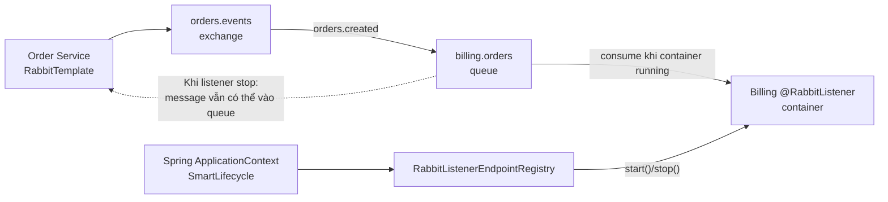
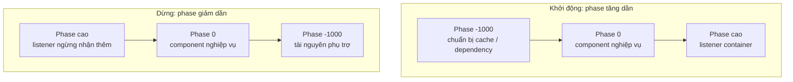
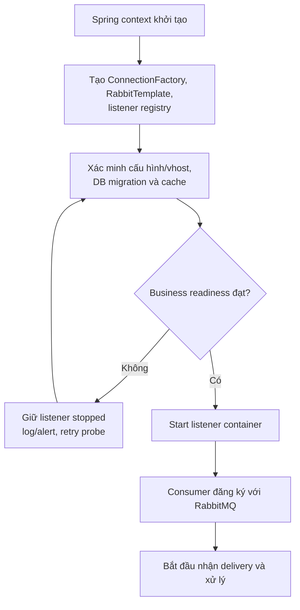
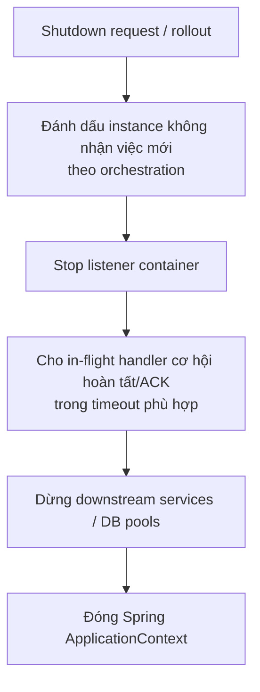

# autoStartup, SmartLifecycle và thứ tự khởi động

## 1. Vì sao thời điểm khởi động listener lại quan trọng?

Trong ứng dụng **Spring AMQP** tích hợp RabbitMQ, `RabbitTemplate` dùng để publish message qua exchange, queue và binding; `@RabbitListener` và listener container dùng để nhận, chuyển đổi, xử lý rồi ACK/NACK delivery. Một tình huống thường gặp là application context đã khởi động nhưng dịch vụ **chưa đủ điều kiện** để xử lý message:

- Billing Service đã kết nối RabbitMQ nhưng database chưa sẵn sàng.
- Dữ liệu tham chiếu hoặc cache chưa nạp xong.
- Hệ thống vừa triển khai phiên bản mới, cần kiểm tra schema trước khi consume.
- Ứng dụng muốn **tạm ngừng nhận message mới** để bảo trì hoặc graceful shutdown.
- Nhiều thành phần có quan hệ phụ thuộc và phải được khởi động, dừng theo thứ tự hợp lý.

Nếu listener khởi chạy quá sớm, nó có thể nhận hàng loạt message rồi thất bại vì dependency chưa sẵn sàng. Nếu dừng quá muộn, nó có thể nhận thêm message khi các tài nguyên bên dưới đã bị đóng. Các lỗi này ảnh hưởng trực tiếp đến retry, requeue, dead-letter, độ trễ queue, giao dịch và khả năng quan sát hệ thống.

Ba khái niệm cần nắm vững là:

1. **`autoStartup`**: một listener container có tự bắt đầu khi Spring quản lý lifecycle khởi động hay không.
2. **`SmartLifecycle`**: giao diện của Spring để điều khiển `start()`, `stop()`, trạng thái running và **phase**.
3. **Thứ tự khởi động/dừng**: các thành phần có phase thấp thường khởi động trước, trong khi thành phần có phase cao thường dừng trước; thực tế còn phụ thuộc cách chúng được đăng ký và quản lý.

Bài thuộc chương **Listener container** của module **SPRING_AMQP**, liên hệ trực tiếp với `RabbitTemplate`, `@RabbitListener`, exchange/queue/binding, publisher confirms, ACK/NACK, retry, DLX và vận hành bất đồng bộ đáng tin cậy.

Sau bài, bạn có thể:

- Phân biệt lifecycle của **Spring bean**, **listener container**, **consumer**, **channel**, **connection** và **queue**.
- Cấu hình `autoStartup` ở Spring Boot, container factory và từng `@RabbitListener`.
- Hiểu `SmartLifecycle.getPhase()`, quy tắc start/stop và giới hạn của phase.
- Tra cứu, start và stop listener bằng `RabbitListenerEndpointRegistry`.
- Chọn cách trì hoãn consume đến khi các dependency thực sự sẵn sàng.
- Thiết kế graceful shutdown để giảm requeue ngoài ý muốn và duplicate side effect.
- Quan sát lỗi startup, recovery, missing queue, xử lý chưa ACK và các tình huống rollout nhiều instance.

## 2. Phân biệt những vòng đời khác nhau

Một ứng dụng RabbitMQ không có một công tắc “start” duy nhất. Có nhiều lớp hoạt động song song.

| Thành phần | Vòng đời thuộc về ai? | Khi dừng listener có dừng thành phần đó không? |
| --- | --- | --- |
| Spring `ApplicationContext` | Spring Framework | Không; container có thể dừng khi context vẫn chạy |
| `RabbitTemplate` | Bean/connection factory của ứng dụng | Không; publisher vẫn có thể gửi message |
| `RabbitListenerEndpointRegistry` | Spring AMQP | Quản lý các container đăng ký qua `@RabbitListener` |
| Listener container | Spring AMQP / `SmartLifecycle` | Có, nếu gọi `stop()` trên đúng container |
| RabbitMQ consumer | Broker/client, được container tạo | Có thể bị cancel/đóng theo lifecycle của container |
| Connection/channel AMQP | Connection factory, container và client | Phụ thuộc thành phần đang sở hữu; không phải toàn bộ connection của ứng dụng luôn đóng |
| Exchange, queue và binding | Tài nguyên phía RabbitMQ broker | **Không** bị xóa chỉ vì listener stop |
| Message đang chờ trong queue | RabbitMQ | Tiếp tục tồn tại theo durability, TTL, queue limit và chính sách broker |



Sơ đồ muốn nhấn mạnh rằng **pause consumer không đồng nghĩa pause producer hoặc broker**. Khi một listener không còn nhận message mà exchange vẫn route được, backlog `messages_ready` có thể tăng. Nếu queue có TTL hoặc max-length, message có thể hết hạn, dead-letter hoặc bị loại trong thời gian consumer tạm dừng.

### 2.1. Những câu hỏi cần trả lời trước khi điều chỉnh startup

- Mục tiêu là **ngăn nhận message** hay **ngăn publish message**?
- Tạm dừng trên một **pod/instance** hay trên toàn bộ nhóm consumer?
- Thời gian chờ dài nhất trước khi backlog vi phạm SLA là bao nhiêu?
- Message đang in-flight có cần hoàn tất trước khi dừng không?
- Nếu container start lại và nhận redelivery, business handler có idempotent không?
- Queue có policy TTL, max-length, DLX và cơ chế giám sát phù hợp không?

Không nên dùng `autoStartup=false` như giải pháp mặc định cho mọi lỗi dependency. Nó là một công cụ điều phối lifecycle; lỗi nền tảng vẫn cần được phát hiện, báo cáo và xử lý.

## 3. SmartLifecycle của Spring: quy tắc nền tảng

`SmartLifecycle` nằm trong `org.springframework.context`, mở rộng cơ chế lifecycle của Spring. Các khái niệm quan trọng:

- `start()`: yêu cầu thành phần chuyển sang trạng thái hoạt động.
- `stop()`: yêu cầu dừng.
- `stop(Runnable callback)`: hỗ trợ dừng bất đồng bộ và báo cho lifecycle processor khi thực sự hoàn tất.
- `isRunning()`: trạng thái hoạt động do component báo.
- `isAutoStartup()`: thành phần có được Spring tự start khi context khởi động hay không.
- `getPhase()`: pha dùng để sắp xếp thứ tự start/stop trong lifecycle processor.

Trong cơ chế phase thông thường của Spring:

1. **Khởi động:** phase nhỏ hơn được start trước; phase lớn hơn start sau.
2. **Dừng:** phase lớn hơn được stop trước; phase nhỏ hơn stop sau.
3. Thành phần có quan hệ dependency `depends-on` có thể ảnh hưởng thứ tự lifecycle: component phụ thuộc được start sau dependency và stop trước dependency.
4. **Phase không phải cơ chế xác nhận readiness.** Nếu `start()` tạo một tác vụ warm-up bất đồng bộ rồi trả về ngay, phase lớn hơn có thể bắt đầu khi warm-up vẫn chưa xong.



Các giá trị trong sơ đồ chỉ minh họa **thứ tự tương đối**, không phải mặc định bắt buộc của Spring AMQP. Nhiều listener container dùng phase mặc định gần cuối chu kỳ khởi động, nhưng con số và cách registry phối hợp với từng container cần được kiểm tra trên phiên bản Spring AMQP đang dùng.

### 3.1. Phase khác thứ tự khởi tạo bean

Đừng đánh đồng:

- **Bean creation / dependency injection:** Spring tạo và wiring bean, giải quyết constructor dependencies.
- **Lifecycle start:** Spring gọi `start()` trên các `SmartLifecycle` thích hợp theo phase/dependencies.
- **RabbitMQ consumer registration:** container thiết lập consumer với broker và bắt đầu nhận delivery.
- **Business readiness:** database, API đối tác, cache, schema hoặc trạng thái triển khai đã sẵn sàng để xử lý an toàn.

Một bean đã được inject không đảm bảo hệ thống ngoài đã sẵn sàng. `@DependsOn("cacheBean")` giúp chỉ rõ bean dependency, nhưng không tự chờ một API bên ngoài đạt trạng thái healthy. `phase` cũng không thay thế một readiness check cụ thể.

### 3.2. Nếu không override phase thì sao?

Các implementation `SmartLifecycle` có default phase theo Spring Framework. Listener container của Spring AMQP và registry có thể cung cấp phase riêng; hơn nữa registry quản lý nhiều endpoint được tạo từ annotation. Vì vậy:

- Không viết logic phụ thuộc vào **một con số phase mặc định cố định** nếu chưa kiểm chứng version.
- Đừng mặc định hai `@RabbitListener` với phase khác nhau sẽ khởi động từng endpoint theo thứ tự mong muốn khi **cùng được registry điều phối**.
- Nếu cần quan hệ cứng như “chỉ consume sau khi migration hoàn tất”, dùng readiness gate + start rõ ràng; phase chỉ giúp sắp xếp lifecycle các thành phần phù hợp.

## 4. autoStartup có nghĩa gì?

Một listener container thường được khởi động tự động cùng Spring application khi cấu hình cho phép. `autoStartup=false` làm container **không tự start trong giai đoạn lifecycle startup thông thường**; nó vẫn có thể được start thủ công về sau.

| Cấu hình/trạng thái | Hành vi |
| --- | --- |
| `autoStartup=true` và context khởi động bình thường | Container được phép auto-start theo lifecycle |
| `autoStartup=false` | Container được đăng ký nhưng **không tự consume** ở lần startup thông thường |
| `autoStartup=false` rồi gọi `container.start()` | Container có thể bắt đầu consumer dù flag auto-start là false |
| Container đang running rồi gọi `container.stop()` | Container yêu cầu dừng consumer, không xóa queue/binding |
| Context đóng | Spring điều phối stop/shutdown các lifecycle components |
| Broker mất kết nối khi listener đang running | Container/connection factory có cơ chế khôi phục theo cấu hình; không đồng nghĩa đã cố ý đặt autoStartup=false |

**autoStartup không phải lệnh tắt broker.** Consumer khác, instance khác và publisher vẫn có thể hoạt động. Nếu một queue không có consumer, message hợp lệ vẫn vào queue và chờ theo chính sách broker.

### 4.1. Phạm vi cấu hình có thể khác nhau

Có nhiều tầng cấu hình:

1. **Spring Boot listener defaults** qua `spring.rabbitmq.listener.simple.*` hoặc `spring.rabbitmq.listener.direct.*`.
2. **Listener container factory** do ứng dụng khai báo, ví dụ `SimpleRabbitListenerContainerFactory#setAutoStartup(false)`.
3. **Endpoint cụ thể** qua `@RabbitListener(autoStartup = "...")`.
4. **Điều khiển runtime** bằng API `start()/stop()` của container/registry.

Một cấu hình explicit ở annotation có thể override auto-start setting mà container factory cung cấp cho endpoint đó. Để tránh bất ngờ, nên chọn một quy ước rõ: **cấu hình chung ở factory/Boot, ngoại lệ có chủ đích ở từng endpoint**.

## 5. Đặt autoStartup trong Spring Boot

### 5.1. Tắt auto-start ở nhóm simple listener

Khi dùng `SimpleRabbitListenerContainerFactory` hoặc loại listener đơn giản do Spring Boot auto-configure:

```yaml
spring:
  rabbitmq:
    host: ${RABBITMQ_HOST:localhost}
    port: ${RABBITMQ_PORT:5672}
    username: ${RABBITMQ_USERNAME:guest}
    password: ${RABBITMQ_PASSWORD:guest}
    virtual-host: ${RABBITMQ_VHOST:/}
    listener:
      type: simple
      simple:
        auto-startup: false
        acknowledge-mode: auto
        prefetch: 20
        concurrency: 2
```

`spring.rabbitmq.listener.simple.auto-startup: false` là cấu hình **cho listener factory/container simple phù hợp**, không phải flag toàn broker và không buộc mọi factory tự tạo trong ứng dụng phải tự nhận giá trị đó. Các thuộc tính factory được người dùng tạo thủ công cần được kiểm tra xem Boot configurer có áp dụng không.

Nếu ứng dụng dùng **DirectMessageListenerContainer** do Boot quản lý, các thiết lập liên quan nằm ở `spring.rabbitmq.listener.direct.*`; ví dụ:

```yaml
spring:
  rabbitmq:
    listener:
      type: direct
      direct:
        auto-startup: false
```

Đây là **phương án thay thế** cho simple listener, không cần bật cả hai block rồi mong cùng điều khiển một container. Cần kiểm tra Spring Boot release để bảo đảm tên property và factory được sử dụng tương thích.

### 5.2. Tắt chỉ một listener bằng annotation

```java
package example.messaging;

import org.springframework.amqp.rabbit.annotation.RabbitListener;
import org.springframework.stereotype.Component;

@Component
public class BillingListener {

    @RabbitListener(
            id = "billing-orders-listener",
            queues = "billing.orders",
            autoStartup = "false")
    public void onMessage(String orderId) {
        System.out.println("Billing order: " + orderId);
    }
}
```

Cách này có ích khi các listener khác cần auto-start, còn Billing phải đợi migration hoặc dependency riêng.

**Điều kiện chạy thật:** queue `billing.orders` phải tồn tại trong đúng vhost; chỉ có annotation `queues = "billing.orders"` chưa đủ để đảm bảo exchange, queue và binding đã được khai báo.

### 5.3. Lấy autoStartup từ external configuration

```yaml
app:
  messaging:
    billing:
      endpoint-id: billing-orders-listener
      queue: billing.orders
      auto-startup: false
```

```java
@RabbitListener(
        id = "${app.messaging.billing.endpoint-id}",
        queues = "${app.messaging.billing.queue}",
        autoStartup = "${app.messaging.billing.auto-startup:false}")
public void onMessage(String orderId) {
    // Handler nghiệp vụ.
}
```

Cú pháp `${...}` là Spring property placeholder được giải quyết lúc cấu hình endpoint. Nó **không** tự được đọc lại cho từng delivery. Thay file `application.yml` khi app đang chạy không mặc định làm container đang running tự dừng; muốn đổi runtime cần cơ chế quản lý container hoặc restart/refresh có chủ đích.

**Lưu ý vận hành:** mặc định `false` giúp an toàn nếu không muốn consume khi cấu hình thiếu, nhưng cũng có thể tạo tình trạng service chạy mà không consumer nào start. Hãy theo dõi registry/container running, consumer count và backlog, thay vì chỉ xem Spring Boot liveness.

## 6. Cấu hình riêng bằng listener container factory

Trong dự án Spring Boot, bạn có thể cấu hình một factory chuyên cho nhóm Billing. Ví dụ giữ các tùy chọn chung do Boot cung cấp và đổi auto-start tại factory:

```java
package example.messaging;

import org.springframework.amqp.rabbit.config.SimpleRabbitListenerContainerFactory;
import org.springframework.amqp.rabbit.connection.ConnectionFactory;
import org.springframework.boot.autoconfigure.amqp.SimpleRabbitListenerContainerFactoryConfigurer;
import org.springframework.context.annotation.Bean;
import org.springframework.context.annotation.Configuration;

@Configuration
public class BillingListenerFactoryConfig {

    @Bean("billingListenerContainerFactory")
    SimpleRabbitListenerContainerFactory billingListenerContainerFactory(
            SimpleRabbitListenerContainerFactoryConfigurer configurer,
            ConnectionFactory connectionFactory) {

        SimpleRabbitListenerContainerFactory factory =
                new SimpleRabbitListenerContainerFactory();

        // Áp dụng các thiết lập Spring Boot đang được hỗ trợ.
        configurer.configure(factory, connectionFactory);

        // Thay riêng auto-start cho các endpoint dùng factory này.
        factory.setAutoStartup(false);
        factory.setPrefetchCount(20);
        return factory;
    }
}
```

Listener gắn với factory:

```java
@RabbitListener(
        id = "billing-orders-listener",
        queues = "billing.orders",
        containerFactory = "billingListenerContainerFactory")
public void onMessage(String orderId) {
    // Chỉ consume sau khi container được start thủ công.
}
```

Điểm quan trọng:

- `containerFactory` là tên Spring bean factory, **không phải** một listener container đã running.
- Setting `factory.setAutoStartup(false)` áp dụng cho các container do factory đó tạo, trừ khi endpoint có cấu hình khác override.
- Nếu cùng một ứng dụng có vài factory, một property `spring.rabbitmq.listener.simple.auto-startup` không tự giải thích mọi factory hiện hành; cần xem code registration.
- Không copy thêm một listener cùng `id` vào ứng dụng khi đang chạy ví dụ annotation ở mục 5: **mỗi endpoint ID phải duy nhất trong cùng registry**.

### 6.1. So sánh Simple và Direct container

| Khía cạnh | SimpleMessageListenerContainer | DirectMessageListenerContainer |
| --- | --- | --- |
| Factory thường dùng | `SimpleRabbitListenerContainerFactory` | `DirectRabbitListenerContainerFactory` |
| Tổ chức consumer | Có thread/task executor và consumer scheduling riêng | Consumer gắn trực tiếp hơn với cơ chế callback của RabbitMQ client |
| Điều chỉnh concurrency | `concurrentConsumers`, `maxConcurrentConsumers` hoặc cấu hình tương ứng | `consumersPerQueue` và cấu hình tương ứng |
| autoStartup / lifecycle | Có | Có |
| Dùng với `@RabbitListener` | Có | Có |
| Thay đổi startup phase | Qua lifecycle của container hoặc cấu hình được factory hỗ trợ | Qua lifecycle của container hoặc cấu hình được factory hỗ trợ |

Đừng lấy `concurrency` của Simple rồi giả định nó có cùng nội hàm với Direct khi benchmark. Hai loại container đều dùng được mô hình `@RabbitListener`, nhưng có chiến lược quản lý consumer, scaling và recovery khác nhau. Quyết định dựa vào tải và yêu cầu vận hành, không chỉ vào tên loại.

## 7. RabbitListenerEndpointRegistry: start/stop đúng endpoint

Với `@RabbitListener`, Spring AMQP đăng ký các endpoint vào `RabbitListenerEndpointRegistry`. Registry cho phép tra cứu container bằng **endpoint ID**, đồng thời tham gia cơ chế lifecycle của Spring.

### 7.1. Một service điều khiển Billing listener

```java
package example.messaging;

import org.springframework.amqp.rabbit.listener.RabbitListenerEndpointRegistry;
import org.springframework.amqp.rabbit.listener.MessageListenerContainer;
import org.springframework.beans.factory.annotation.Value;
import org.springframework.stereotype.Service;

@Service
public class BillingListenerControl {

    private final RabbitListenerEndpointRegistry registry;
    private final String listenerId;

    public BillingListenerControl(
            RabbitListenerEndpointRegistry registry,
            @Value("${app.messaging.billing.endpoint-id:billing-orders-listener}")
                    String listenerId) {
        this.registry = registry;
        this.listenerId = listenerId;
    }

    private MessageListenerContainer target() {
        MessageListenerContainer container =
                registry.getListenerContainer(listenerId);
        if (container == null) {
            throw new IllegalStateException(
                    "Listener endpoint not registered: " + listenerId);
        }
        return container;
    }

    public boolean isRunning() {
        return target().isRunning();
    }

    public void start() {
        target().start();
    }

    public void stop() {
        target().stop();
    }
}
```

Để sử dụng service này, `@RabbitListener.id` phải resolve đúng `listenerId`. Nếu khác ID, `getListenerContainer(...)` trả null; việc queue tồn tại trên broker không chứng minh endpoint đã đăng ký.

**start/stop chỉ tác động container thuộc process hiện tại**. Với ba replica Billing Service, gọi `stop()` trên pod A không làm hai pod còn lại dừng. Hãy quan sát số consumers thật trên broker nếu mục tiêu là bảo trì toàn dịch vụ.

### 7.2. Không dùng stop/start làm cơ chế retry mỗi message

Nếu handler gặp lỗi dữ liệu, stop rồi start container không sửa schema, không làm message an toàn hơn, cũng không tự tăng giới hạn retry. Retry/error handling cần được cấu hình độc lập:

- Lỗi tạm thời: thử lại với backoff và ngân sách phù hợp.
- Lỗi dữ liệu cố định: reject/quarantine hoặc dead-letter.
- Delivery đã commit business effect nhưng ACK mất: idempotency để không xử lý trùng.
- Broker/connection mất: cơ chế recovery của listener container, theo dõi trạng thái thực.

Dừng một consumer nhiều lần có thể làm tăng redelivery và backlog. Đây là thao tác vận hành ở **mức listener**, không phải error handler cấp message.

## 8. Điều phối startup sau khi ứng dụng sẵn sàng

### 8.1. Dùng ApplicationReadyEvent và một readiness gate rõ ràng

Giả sử bạn muốn Billing chỉ consume sau khi Spring Boot đã hoàn tất khởi tạo và một kiểm tra dependency nghiệp vụ thành công. Một cách dễ hiểu là:

1. Đặt `autoStartup=false` cho endpoint Billing.
2. Đăng ký `@EventListener(ApplicationReadyEvent.class)` để chạy logic kích hoạt.
3. Kiểm tra dependency theo quy tắc của ứng dụng.
4. Nếu đạt, gọi `registry.getListenerContainer(id).start()`.

Ví dụ:

```java
package example.messaging;

import org.springframework.amqp.rabbit.listener.RabbitListenerEndpointRegistry;
import org.springframework.amqp.rabbit.listener.MessageListenerContainer;
import org.springframework.boot.context.event.ApplicationReadyEvent;
import org.springframework.context.event.EventListener;
import org.springframework.stereotype.Component;

@Component
public class BillingStartupGate {

    private final RabbitListenerEndpointRegistry registry;
    private final BillingDependencyHealth dependencyHealth;

    public BillingStartupGate(
            RabbitListenerEndpointRegistry registry,
            BillingDependencyHealth dependencyHealth) {
        this.registry = registry;
        this.dependencyHealth = dependencyHealth;
    }

    @EventListener(ApplicationReadyEvent.class)
    public void startWhenReady() {
        if (!dependencyHealth.canProcessOrders()) {
            // Cảnh báo và giữ listener dừng.
            // Xây thêm cơ chế retry/readiness riêng nếu dependency hồi phục.
            return;
        }

        MessageListenerContainer container =
                registry.getListenerContainer("billing-orders-listener");

        if (container == null) {
            throw new IllegalStateException(
                    "Missing billing listener endpoint");
        }

        container.start();
    }

    public interface BillingDependencyHealth {
        boolean canProcessOrders();
    }
}
```

`BillingDependencyHealth` ở đây là **hợp đồng cần cung cấp implementation bean thật**: ví dụ kiểm tra database migration version, một tham số sẵn sàng trong DB hoặc cache đã nạp. Không nên coi một lời gọi `isRunning()` hoặc một log startup là phép kiểm tra dependency.

**ApplicationReadyEvent không bảo đảm mọi hệ thống ngoài đã healthy**. Nó chỉ là mốc trong vòng đời Spring Boot. Vì vậy ví dụ trên mới cần `dependencyHealth.canProcessOrders()`.

Nếu dependency chưa sẵn sàng và listener không start, bạn cần **cơ chế theo dõi và thử lại chủ động**, readiness endpoint hoặc công cụ vận hành để start sau khi điều kiện đạt. Đừng chỉ return rồi bỏ quên container ở trạng thái stopped vô thời hạn.

### 8.2. Không dùng chỉ @DependsOn để chờ DB hay dịch vụ ngoài

Ví dụ:

```java
@DependsOn("databaseClient")
@Component
class BillingResources {
    // Bean được khởi tạo sau databaseClient,
    // nhưng database thực tế có thể vẫn chưa sẵn sàng.
}
```

`@DependsOn` chỉ giúp quản lý quan hệ bean và thứ tự lifecycle phụ thuộc, không tự xác minh database đang nhận query hoặc migration đã xong. Nếu consumer đòi hỏi điều kiện nghiệp vụ, phải kiểm tra điều kiện đó trước khi start listener.

### 8.3. Tránh vòng chờ khởi động

Một anti-pattern:

- `BillingStartupGate` đợi message từ queue để hoàn tất warm-up.
- Listener của queue đó lại có `autoStartup=false` và chỉ start sau warm-up.
- Không thành phần nào có thể tiến lên.

Đừng để readiness check phụ thuộc vào chính một delivery từ listener đang bị gate. Hãy tách một bootstrap channel khác, hoặc điều chỉnh quy tắc readiness sao cho không tạo deadlock logic.

## 9. SmartLifecycle phase: dùng khi cần sắp xếp thành phần trong context

### 9.1. Ví dụ component chuẩn bị dữ liệu với phase thấp

Đây là ví dụ về **một `SmartLifecycle` tự định nghĩa**, độc lập với listener:

```java
package example.messaging;

import org.springframework.context.SmartLifecycle;
import org.springframework.stereotype.Component;

@Component
public class WarmupCoordinator implements SmartLifecycle {

    private volatile boolean running;

    @Override
    public void start() {
        // Thực hiện warm-up đồng bộ quan trọng tại đây.
        // Thay bằng logic kiểm tra/nạp dữ liệu của ứng dụng thật.
        loadRequiredReferenceData();
        running = true;
    }

    private void loadRequiredReferenceData() {
        // Nếu không thể chuẩn bị dữ liệu, báo lỗi rõ và không
        // đánh dấu running=true.
    }

    @Override
    public void stop() {
        running = false;
    }

    @Override
    public void stop(Runnable callback) {
        try {
            stop();
        } finally {
            callback.run();
        }
    }

    @Override
    public boolean isRunning() {
        return running;
    }

    @Override
    public boolean isAutoStartup() {
        return true;
    }

    @Override
    public int getPhase() {
        return -1_000; // Chạy sớm hơn component có phase cao.
    }
}
```

Nếu warm-up cần nhiều thời gian, `start()` phải thực sự chờ **điều kiện sẵn sàng của chính component đó** hoặc cung cấp readiness signal khác. Một thread `CompletableFuture.runAsync(...)` khởi động rồi return không tự làm lifecycle processor chờ. Nếu warm-up thất bại, cần log/exception/quyết định vận hành rõ.

### 9.2. Ví dụ điều chỉnh phase của một container được tạo trực tiếp

Một `SimpleMessageListenerContainer` là `SmartLifecycle`. Với container khai báo trực tiếp dưới dạng bean, ứng dụng có thể đặt phase:

```java
package example.messaging;

import org.springframework.amqp.core.Message;
import org.springframework.amqp.core.MessageListener;
import org.springframework.amqp.rabbit.connection.ConnectionFactory;
import org.springframework.amqp.rabbit.listener.SimpleMessageListenerContainer;
import org.springframework.context.annotation.Bean;
import org.springframework.context.annotation.Configuration;

@Configuration
public class StandaloneAuditContainerConfig {

    @Bean
    SimpleMessageListenerContainer auditContainer(
            ConnectionFactory connectionFactory) {

        SimpleMessageListenerContainer container =
                new SimpleMessageListenerContainer(connectionFactory);

        container.setQueueNames("audit.orders");
        container.setMessageListener((MessageListener) (Message message) -> {
            // Chỉ là ví dụ raw MessageListener.
            System.out.println(message.getBody().length);
        });

        container.setAutoStartup(true);
        container.setPhase(2_000);
        return container;
    }
}
```

Khi container này là bean lifecycle được Spring điều phối, phase của nó tham gia thứ tự startup/shutdown. **Ví dụ này là cách khác với `@RabbitListener`**: không nên vừa khai báo `@RabbitListener` vừa tạo container khác cùng đọc một queue nếu không cố ý muốn competing consumers.

### 9.3. Hạn chế khi dùng phase cho endpoint đăng ký qua registry

Các `@RabbitListener` thường được đăng ký vào `RabbitListenerEndpointRegistry`, vốn có lifecycle và điều phối các containers mà nó quản lý. Vì thế, **đừng suy rằng việc đặt phase cho từng container thông qua nhiều factory sẽ tự cung cấp thứ tự deterministic giữa tất cả endpoint annotation**. Cách registry/containers phối hợp phase có thể khác tùy Spring AMQP version và cấu hình.

Khi yêu cầu thực sự là **A sẵn sàng rồi B mới consume**:

- Kiểm tra điều kiện A bằng readiness probe/business contract.
- Cấu hình endpoint B `autoStartup=false`.
- Chỉ gọi start B khi A đạt điều kiện.
- Kiểm thử sau restart, rollout song song và broker reconnect.
- Dùng phase để tăng tính hợp lý của lifecycle, **không dùng phase thay cho readiness**.

## 10. Khởi động và shutdown có chủ đích cho nhiều dependency

### 10.1. Start: chuẩn bị trước, consume sau

Một quy trình khởi động có kiểm soát:



Không nhất thiết phải chờ toàn bộ **publisher** dừng hay broker queue rỗng; mục tiêu là đảm bảo consumer có đủ điều kiện xử lý an toàn khi nhận message. Một số ứng dụng chọn cách khác: listener auto-start và các lỗi transient được retry có kiểm soát. Hai chiến lược có trade-off; nên chọn dựa trên tác động backlog, thời gian khôi phục và khả năng idempotency.

### 10.2. Stop: ngừng nhận thêm, hoàn tất in-flight, đóng dependency sau

Một quy trình dừng mong muốn:



Thực tế, thời điểm ACK, consumer cancel, executor shutdown và recovery còn phụ thuộc loại container, cấu hình và Spring version. **Stop không có nghĩa “tất cả delivery vừa nhận đã xử lý thành công”**. Nếu quá thời gian shutdown và connection/channel đóng, những delivery chưa ACK có thể được broker giao lại.

Một số thông số cần xem:

- Thời gian xử lý tối đa của handler, timeout của database/API.
- `prefetch` và số consumer đang chạy, quyết định số delivery in-flight tối đa.
- Graceful shutdown timeout của application/orchestrator.
- Shutdown timeout của listener container theo phiên bản được dùng.
- Chính sách ack mode, requeue và dead-letter.
- Idempotency với trường hợp handler đã commit business effect nhưng ACK không đến broker.

### 10.3. SmartLifecycle.stop(Runnable) và shutdown bất đồng bộ

`stop(Runnable callback)` cho phép component báo cho Spring lifecycle processor rằng bước dừng đã hoàn tất. Nếu tự viết component `SmartLifecycle` có dừng async, phải gọi callback khi công việc dừng thực sự kết thúc; quên callback có thể khiến shutdown chờ đến timeout.

Tuy nhiên, **callback được gọi** không đồng nghĩa mọi giao dịch nghiệp vụ trên toàn cluster đã thành công. Cần kiểm tra trạng thái handler, DB commit, ACK/redelivery và metric của broker. Chỉ dừng listener đúng cách là một lớp trong chiến lược graceful shutdown.

## 11. Quan hệ giữa autoStartup và recovery khi broker lỗi

Không nên nhầm **không tự start** với **đã start nhưng đang mất broker**.

| Trạng thái | Container/consumer | Cách đánh giá |
| --- | --- | --- |
| `autoStartup=false` và chưa gọi start | Container thường chưa tạo consumer | Trạng thái stopped theo ý định |
| `autoStartup=true` và broker khả dụng | Container có thể tạo consumer | Quan sát running + consumer count |
| Container running nhưng broker tạm mất | Consumer/channel có thể đang recovery | Kiểm tra connection errors, recovery logs và consumer count; `isRunning()` chưa đủ |
| `container.stop()` được gọi | Ngừng theo lifecycle cho instance đó | Không mong framework tự start lại chỉ vì broker phục hồi khi container vẫn đang stopped |
| Broker phục hồi sau mất kết nối | Container đang ở trạng thái running có thể tái tạo consumer | Phụ thuộc recovery strategy/cấu hình; kiểm tra bằng integration test |

### 11.1. Không chỉ nhìn isRunning()

`isRunning()` cho biết trạng thái của container ở mức lifecycle, **không chứng minh chắc chắn** đã có consumer hoạt động trên broker. Ví dụ connection có thể đang gián đoạn hoặc queue đang bị thiếu.

Để xác minh một instance **thực sự consume được**, nên kết hợp:

- Registry: `getListenerContainer(id)` có tồn tại không?
- Container: `isRunning()` có true không?
- Broker: queue `consumers` count, connections/channels có hoạt động không?
- Consumer logs: startup, cancellation, missing queues, recovery và errors.
- End-to-end: một event test có đến queue và được xử lý/ACK không (chỉ trong môi trường phù hợp).

### 11.2. Queue không tồn tại khi listener start

`@RabbitListener(queues = "billing.orders")` chỉ nêu tên queue cần đọc. Nếu queue bị thiếu, ứng dụng có thể báo lỗi khai báo/consume hoặc container chạy cơ chế retry/redeclaration tùy config và phiên bản.

Các lựa chọn thiết kế:

1. **Khai báo topology** với `Queue`, `Exchange`, `Binding` và `RabbitAdmin` khi được phép.
2. Để IaC/operator quản lý topology trước khi consumer start.
3. Chọn chính sách xử lý **missing queues fatal** phù hợp với môi trường và khả năng recovery.
4. Không tăng retry vô hạn với lỗi quyền truy cập hoặc vhost sai mà không cảnh báo.

Không để một listener tự tạo một queue tên khác rồi tin rằng producer đã định tuyến đúng. Queue name, exchange, binding và vhost phải khớp hợp đồng publish.

## 12. Ví dụ end-to-end với RabbitTemplate và listener được start có kiểm soát

### 12.1. Topology chính

```java
package example.messaging;

import org.springframework.amqp.core.Binding;
import org.springframework.amqp.core.BindingBuilder;
import org.springframework.amqp.core.Declarables;
import org.springframework.amqp.core.DirectExchange;
import org.springframework.amqp.core.Queue;
import org.springframework.amqp.core.QueueBuilder;
import org.springframework.context.annotation.Bean;
import org.springframework.context.annotation.Configuration;

@Configuration
public class OrdersTopology {
    public static final String EXCHANGE = "orders.events";
    public static final String ROUTING_KEY = "orders.created";
    public static final String QUEUE = "billing.orders";

    @Bean
    Declarables orderResources() {
        DirectExchange exchange =
                new DirectExchange(EXCHANGE, true, false);
        Queue queue = QueueBuilder.durable(QUEUE).build();
        Binding binding = BindingBuilder.bind(queue)
                .to(exchange)
                .with(ROUTING_KEY);
        return new Declarables(exchange, queue, binding);
    }
}
```

Khi Spring AMQP `RabbitAdmin` được cấu hình và broker chấp nhận khai báo, những tài nguyên này có thể được tạo trước/ở giai đoạn ứng dụng sử dụng connection. Tuy nhiên, không mặc định việc có bean `Declarables` chứng minh broker đã tạo queue thành công; cần kiểm tra vhost và quyền, và tránh xung đột resource đã tồn tại.

### 12.2. Publisher vẫn gửi khi listener chưa start

```java
package example.messaging;

import org.springframework.amqp.rabbit.core.RabbitTemplate;
import org.springframework.stereotype.Service;

@Service
public class OrderPublisher {
    private final RabbitTemplate template;

    public OrderPublisher(RabbitTemplate template) {
        this.template = template;
    }

    public void publishCreated(String orderId) {
        template.convertAndSend(
                OrdersTopology.EXCHANGE,
                OrdersTopology.ROUTING_KEY,
                orderId);
    }
}
```

Khi listener auto-start bị tắt, producer vẫn publish vào exchange và broker route tới queue nếu topology hợp lệ. Message có thể ở trạng thái `ready` cho đến khi listener start. Để ứng dụng biết publish có được broker nhận/route không, cần thiết kế publisher confirms/returns phù hợp; **`convertAndSend()` return bình thường không chứng minh listener đã xử lý**.

### 12.3. Listener tạm dừng từ ban đầu

```java
package example.messaging;

import org.springframework.amqp.rabbit.annotation.RabbitListener;
import org.springframework.stereotype.Component;

@Component
public class BillingOrdersConsumer {
    @RabbitListener(
            id = "billing-orders-listener",
            queues = OrdersTopology.QUEUE,
            autoStartup = "false")
    public void consume(String orderId) {
        // Xử lý thật nên có transaction và idempotency theo event ID.
        System.out.println("Billing consumes " + orderId);
    }
}
```

Bước lab: publish `order-001`, `order-002` khi chưa start container. RabbitMQ queue `billing.orders` có thể giữ hai message `ready` (nếu không có consumer khác). Sau đó gọi `BillingListenerControl.start()` ở mục 7 để container bắt đầu nhận message.

**Quan sát:** nếu queue có TTL, expiration hoặc capacity limit, message có thể hết hạn/bị loại trong thời gian listener chưa chạy; đừng mặc định backlog giữ nguyên mãi. Nếu có instance khác đang consume cùng queue, queue depth cũng có thể giảm mặc dù instance đang thử nghiệm chưa start.

## 13. Các lỗi startup và lifecycle thường gặp

| Triệu chứng | Nguyên nhân có thể | Cách kiểm tra / xử lý |
| --- | --- | --- |
| Ứng dụng báo ready nhưng không có consumer | `autoStartup=false` ở annotation/factory/Boot; chưa start thủ công | Kiểm tra effective config, registry ID, broker consumer count |
| Gọi registry trả `null` | Endpoint ID sai, annotation không được scan, khác context | Đối chiếu `@RabbitListener.id` và registry |
| start() được gọi nhưng consumer vẫn bằng 0 | Broker chưa kết nối, queue thiếu, quyền read sai, container đang recovery | Xem RabbitMQ Management, logs, vhost/credentials và lỗi startup |
| Consumer bắt đầu nhận trước khi DB sẵn sàng | Chỉ dựa vào startup order, dependency thực tế chưa healthy | Dùng readiness gate, autoStartup=false và start sau khi check đạt |
| Listener không start sau khi dependency hồi phục | Gate chỉ kiểm tra một lần rồi return | Thêm retry/probe có giới hạn, alert hoặc thao tác start có kiểm soát |
| Dừng listener nhưng queue vẫn giảm message | Có instance khác đang consume cùng queue | Kiểm tra consumers theo connection/pod, điều phối toàn cluster |
| Queue backlog tăng khi listener stopped | Producer vẫn publish, queue vẫn có binding | Theo dõi publish rate, TTL, max-length và storage |
| Shutdown kéo dài | Handler còn chạy, chờ API/DB, timeout quá lớn hoặc callback không hoàn tất | Điều chỉnh handler timeout, graceful timeout và tài nguyên phụ thuộc |
| Sau restart message bị xử lý lại | DB commit thành công nhưng consumer ACK chưa tới broker | Idempotency, unique event ID, xử lý trùng trong cùng DB transaction |
| Message lỗi bị requeue vô hạn | Retry/requeue không có giới hạn, sai dead-letter config | Chọn retry budget, error handler, DLX/DLQ và metric |
| `PRECONDITION_FAILED` khi admin khai báo queue | Queue đã có durability/arguments khác | Đối chiếu topology và kế hoạch migration |
| Chỉ định phase nhưng thứ tự vẫn không như kỳ vọng | Registry và containers có lifecycle riêng; warm-up async | Kiểm tra lifecycle version, dependencies và gate thực sự |
| Sau reconnect listener chưa nhận lại | Container stopped có chủ đích hoặc recovery lỗi | Phân biệt `isRunning`, connection state, consumer count và logs |

### 13.1. Không dùng listener ID như consumer tag mặc định

`@RabbitListener(id = "billing-orders-listener")` đặt tên endpoint để registry quản lý. Nó **không mặc nhiên** là RabbitMQ consumer tag hay message ID. Nếu cần liên kết log/metric với broker connection/consumer, cấu hình observability hoặc consumer tag strategy phù hợp phiên bản; không suy từ tên endpoint.

### 13.2. Không dùng SmartLifecycle để "đảm bảo exactly once"

Thứ tự start/stop giúp **giảm** delivery xử lý vào thời điểm dependency chưa sẵn sàng, nhưng không loại bỏ các khoảng hở:

- Broker đã giao message nhưng connection bị ngắt khi consumer đang xử lý.
- Consumer commit DB nhưng ACK mất.
- Publisher retry sau timeout và gửi lại cùng event.
- Có nhiều replica cùng consume một queue.

Vì vậy, consumer vẫn cần **idempotency** và producer cần **publisher confirms/outbox/retry** khi nghiệp vụ yêu cầu. Graceful shutdown chỉ là một lớp bảo vệ, không thay thế bảo đảm giao nhận.

## 14. Quan sát startup, shutdown và backlog

### 14.1. Những tín hiệu tối thiểu

| Tín hiệu | Ý nghĩa | Cảnh báo thường gặp |
| --- | --- | --- |
| Endpoint registered | Registry có container theo ID | Config/scan sai hoặc ID trùng |
| Container running | `isRunning()` theo lifecycle | Listener vẫn stopped ngoài ý định |
| RabbitMQ consumer count | Số consumer phía broker | Zero khi cần xử lý; giảm khi rollout |
| `messages_ready` | Backlog chờ giao | Tăng khi listener stopped/consumer chậm |
| `messages_unacknowledged` | Delivery đã giao, chưa ACK | Tăng bất thường khi handler kẹt |
| Publish/ack rates | Cân bằng producer và consumer | Producer quá nhanh hoặc consumer giảm |
| Connection recovery events | Broker/network có gián đoạn | Reconnect liên tục, không ổn định |
| Listener exceptions/retries/DLQ | Lỗi xử lý | Poison messages hoặc lỗi dependency |
| Time-to-ready | Từ context start đến business-ready | Gate thất bại/chờ quá lâu |
| Shutdown duration | Thời gian ngừng consumer/in-flight | Quá termination grace period |

Mọi dashboard nên phân biệt **theo pod/application instance** và **theo queue toàn broker**. Registry ở pod A chỉ biết containers trong context A; broker queue depth/consumer count là dữ liệu tổng hợp từ nhiều kết nối.

### 14.2. Cách đọc tình huống

**Container stopped, queue ready tăng:** không hẳn RabbitMQ hỏng. Publisher có thể hoạt động bình thường; cần xác định việc stop có chủ đích hay do lỗi và kiểm tra TTL/queue limit.

**Container running, consumer count bằng 0:** có thể broker đang inaccessible, queue không tồn tại hoặc listener chưa đăng ký consumer thành công. Xem connection/recovery logs thay vì gọi start lặp lại vô tội vạ.

**Shutdown hết timeout, message xuất hiện lại:** có thể còn delivery chưa ACK lúc connection đóng. Kiểm tra commit nghiệp vụ và bảo vệ idempotency, đừng chỉ tăng shutdown timeout mà bỏ qua lỗi kéo dài.

## 15. Bài thực hành: kiểm chứng autoStartup, phase và shutdown

Dùng broker RabbitMQ local/test, không thay đổi listener lifecycle trên môi trường production nếu chưa có quy trình vận hành.

### Lab A — autoStartup=false vẫn có message trong queue

1. Tạo `orders.events`, `billing.orders` và binding `orders.created` như mục 12.
2. Bật `autoStartup=false` cho `billing-orders-listener`.
3. Khởi động ứng dụng và kiểm tra registry trả về container, nhưng `isRunning()` ban đầu không chạy.
4. Publish lần lượt `order-001`, `order-002`, `order-003`.
5. Quan sát `messages_ready` trên broker tăng (khi không có consumer khác và message chưa hết TTL).
6. Gọi `BillingListenerControl.start()` rồi quan sát listener xử lý và ACK.
7. Gọi `stop()`, gửi thêm event và kiểm tra listener đó không tiếp tục tiêu thụ sau khi stop hoàn tất.

### Lab B — Phân biệt pause một pod và toàn service

1. Chạy hai instance Billing trỏ cùng `billing.orders`.
2. Dừng container trên instance A bằng registry của A.
3. Gửi nhiều message mới.
4. Xác minh instance B vẫn có thể consume; queue không nhất thiết tăng backlog.
5. Dừng instance B, lặp lại gửi và quan sát queue `ready`.
6. Start lần lượt các instance và đo throughput, số consumer và message in-flight.

Kết luận phải ghi theo **instance/pod**, không chỉ dựa vào tên endpoint ID giống nhau trên nhiều pod.

### Lab C — Readiness gate sau Spring Boot startup

1. Giữ Billing listener ở `autoStartup=false`.
2. Cấu hình `BillingDependencyHealth` trả false trong môi trường test.
3. Phát `ApplicationReadyEvent` theo chu kỳ khởi động thực; xác minh listener chưa start và có cảnh báo rõ.
4. Đổi dependency thành ready bằng cơ chế test, gọi start qua service quản lý hoặc retry gate có chủ đích.
5. Xác minh listener bắt đầu nhận message.
6. Thử trường hợp dependency mất sau khi container đã start; xác định liệu handler retry có giới hạn, listener bị pause hay readiness được báo unhealthy.

**Một lần kiểm tra ở startup không đủ thay thế runtime health strategy.**

### Lab D — Quan sát SmartLifecycle phase

1. Thêm `WarmupCoordinator` có `getPhase()=-1000` ở mục 9 và log khi `start()`/`stop()` được gọi.
2. Chạy `auditContainer` programmatic có phase 2000 trên một queue test riêng đã được khai báo.
3. Quan sát log thứ tự startup: component phase thấp được điều phối sớm hơn phase cao (khi không có ràng buộc phụ thuộc khác).
4. Shutdown ứng dụng; kiểm tra thứ tự dừng ngược lại.
5. Thay warm-up thành async trả về ngay; chứng minh phase không tự đợi readiness thật, sau đó sửa bằng readiness gate.
6. Ghi chú khác biệt nếu có registry/container auto-configuration tham gia.

### Lab E — Graceful shutdown khi handler chậm

1. Viết một handler test xử lý có delay hữu hạn, tránh gọi dịch vụ production.
2. Publish vài message với event ID ổn định.
3. Trigger shutdown có kiểm soát khi một số delivery đang unacknowledged.
4. Quan sát thời gian chờ và số delivery hoàn tất/ACK trước khi connection đóng.
5. Khởi động lại consumer; kiểm tra message redelivery nếu có.
6. Xác minh idempotency ngăn xử lý tác dụng phụ trùng khi một event đã commit trước shutdown.

### Bảng kết quả lab

| Case | Container trước thao tác | Queue/consumer kỳ vọng | Điều cần chứng minh |
| --- | --- | --- | --- |
| autoStartup=false | Registered, không running | Broker vẫn nhận publish; backlog có thể tăng | Auto-start chỉ ảnh hưởng consumer |
| registry.start() | Stopped | Consumer đăng ký và nhận delivery | Manual start override mục đích autoStartup=false |
| registry.stop() | Running | Ngừng consumer trong instance | Không xóa queue/binding, không dừng pod khác |
| Phase thấp/high | Hai SmartLifecycle bean khác phase | Start tăng, stop giảm | Phase sắp thứ tự, không kiểm tra readiness |
| ApplicationReadyEvent + gate | Listener stopped | Chỉ start sau khi điều kiện đạt | Ready event và dependency health khác nhau |
| Graceful stop khi in-flight | Handler đang chạy | Có thể hoàn tất hoặc redelivery tùy timeout | ACK và idempotency vẫn quan trọng |

## 16. Checklist trước khi đưa vào production

- [ ] Xác định rõ listener nào auto-start và listener nào được gate, vì lý do nghiệp vụ nào.
- [ ] Có một nguồn cấu hình `autoStartup` dễ kiểm tra ở Boot/factory/annotation; tránh override mâu thuẫn.
- [ ] Mỗi `@RabbitListener` có ID duy nhất và có runbook để start/stop qua registry.
- [ ] Không nhầm endpoint ID với queue name, consumer tag hay business message ID.
- [ ] Hiểu `SmartLifecycle` start phase tăng/stop phase giảm, nhưng không dựa vào phase để thay readiness check.
- [ ] Dependency cần cho business handler đã được xác thực **trước khi consume** hoặc có cơ chế retry an toàn.
- [ ] Nếu startup gate thất bại, hệ thống có alert và cách tự/ thủ công start lại sau khi phụ thuộc hồi phục.
- [ ] Topology exchange/queue/binding/vhost được khai báo đúng và có quyền read/configure cần thiết.
- [ ] Không coi `container.isRunning()` là bằng chứng duy nhất cho consumer availability; đo broker consumer count và event flow.
- [ ] Có chiến lược graceful shutdown cho in-flight ACK, handler timeout và termination grace period.
- [ ] Producer có publisher confirms/returns và outbox/retry khi cần; pause consumer không làm publisher ngừng gửi.
- [ ] Consumer idempotent, xử lý retry/requeue/DLX có giới hạn và giám sát DLQ.
- [ ] Có dashboard backlog, ready/unacked, consumer count, startup/recovery và shutdown duration theo instance.
- [ ] Đã chạy test local cho autoStartup=false, start/stop registry, phase, missing queue và crash/reconnect.

## 17. Câu hỏi tự đánh giá

1. `autoStartup=false` ngăn việc gì? Nó có dừng `RabbitTemplate` publisher hoặc xóa queue khỏi RabbitMQ không?
2. Với `SmartLifecycle.getPhase()`, hai component có phase -100 và 500 được start và stop theo thứ tự nào?
3. Vì sao một `SmartLifecycle.start()` chỉ gọi `CompletableFuture.runAsync(...)` rồi return không đảm bảo dependency đã sẵn sàng trước khi listener khác start?
4. `@DependsOn` khác gì với readiness check của một database hoặc external API?
5. Cấu hình auto-start ở `spring.rabbitmq.listener.simple.auto-startup` có tác động đến một factory tự tạo mà không đi qua Boot configurer không?
6. Vì sao `RabbitListenerEndpointRegistry.getListenerContainer("billing-orders-listener")` có thể trả null dù queue `billing.orders` tồn tại?
7. Một listener có `autoStartup=false` nhưng `registry.getListenerContainer(id).start()` được gọi. Listener có thể consume không? Giải thích.
8. Gọi `stop()` trên pod A của Billing Service nhưng backlog queue không tăng. Cần kiểm tra điều gì?
9. `isRunning()=true` có đủ để khẳng định broker đang có consumer hoạt động không? Nêu thêm hai tín hiệu cần đo.
10. Trong shutdown, consumer commit DB thành công nhưng ACK không tới broker. Message có thể xuất hiện lại không? Cần bảo vệ nào?
11. Khi queue thiếu lúc startup, tại sao chỉ thêm listener ID hoặc tăng phase không sửa được lỗi routing/topology?
12. Lúc tạm dừng consumer để migration, TTL và queue max-length có thể ảnh hưởng đến backlog theo cách nào?
13. Vì sao thứ tự của nhiều `@RabbitListener` đăng ký qua registry không nên được suy ra chỉ từ phase riêng mà chưa kiểm tra cách registry điều phối?
14. Bạn sẽ thiết kế kế hoạch rollout nhiều pod ra sao để tránh cả cụm dừng tiêu thụ quá lâu và không để consumer mới đọc dữ liệu trước khi schema migration hoàn tất?

**Ghi nhớ:** **`autoStartup` quyết định việc container tự khởi chạy, `SmartLifecycle` điều phối start/stop và phase, còn `RabbitListenerEndpointRegistry` quản lý endpoint theo ID.** Phase giúp sắp thứ tự, nhưng **không tự xác minh business readiness**; dừng listener không xóa queue và không chặn publisher. Trong Spring AMQP, cần phối hợp readiness gate, topology đúng, graceful shutdown, publisher confirms/returns, consumer ACK/NACK, retry, dead-letter, idempotency và metrics để đảm bảo xử lý bất đồng bộ đáng tin cậy.
