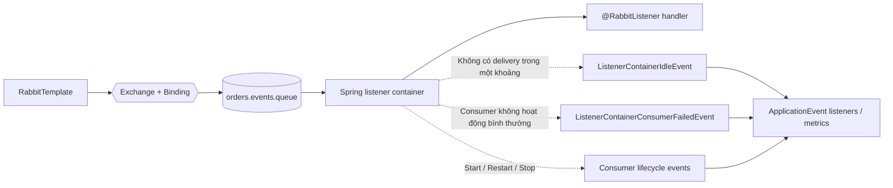
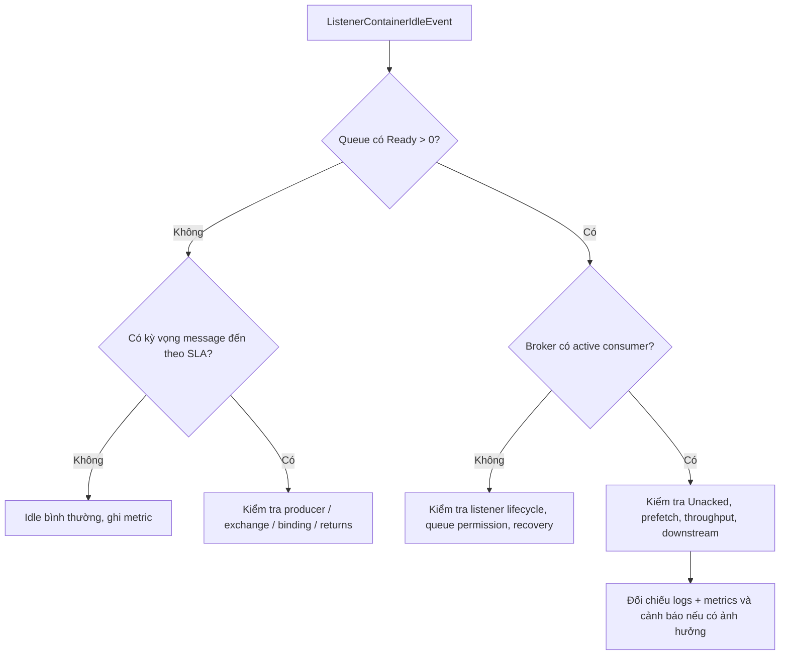

# Sự kiện idle, consumer thất bại và thay đổi trạng thái

Một `@RabbitListener` đang chạy có thể **không nhận message mới** trong nhiều phút mà không hề có lỗi. Ngược lại, ứng dụng có thể vẫn báo “running” nhưng consumer RabbitMQ đang cố khôi phục kết nối. Nếu chỉ nhìn vào log “đã khởi động Spring Boot”, chúng ta khó phân biệt hệ thống rảnh thực sự, sai routing, mất consumer hay backlog bị kẹt.

Trong **Spring AMQP**, listener container phát các **application events** giúp quan sát tình trạng này. Ba nhóm quan trọng là **idle event** (không có delivery mới trong một khoảng thời gian), **consumer failed event** (consumer gặp sự cố) và **các sự kiện/vòng đời thay đổi trạng thái** (consumer bắt đầu, dừng, tái khởi động hoặc container bị điều khiển `start()/stop()`).

Bài thuộc chương **Listener container** của module **SPRING_AMQP**. Chúng ta sẽ cấu hình `SimpleRabbitListenerContainerFactory`, xử lý `ListenerContainerIdleEvent`, `ListenerContainerConsumerFailedEvent`, liên hệ với `RabbitListenerEndpointRegistry`, và thực hành một luồng có `RabbitTemplate`, exchange, queue, binding, `@RabbitListener`. Việc hiểu sự kiện vòng đời là nền tảng để vận hành acknowledgement, retry, dead-letter, transaction và monitoring của hệ xử lý bất đồng bộ đáng tin cậy.

## 1. Phân biệt sự kiện container, message và trạng thái broker

Đừng xem “consumer không nhận message” là một nguyên nhân duy nhất. Có ít nhất ba lớp độc lập:

| Lớp | Câu hỏi | Tín hiệu tiêu biểu |
| --- | --- | --- |
| **RabbitMQ broker** | Queue có message không, có consumer đăng ký không? | `Ready`, `Unacked`, consumer count, publish/deliver/ack rate |
| **Spring listener container** | Container có hoạt động, tạo consumer, recovery hay shutdown không? | `isRunning()`, consumer events, logs về connection/channel |
| **Business handler** | Message đến method chưa, nghiệp vụ thành công không? | `@RabbitListener` logs, processing duration, lỗi converter, retry, DB outcome |



**Idle event không phải consumer acknowledgement.** Consumer ACK/NACK là thao tác ở cấp **delivery**. Idle/failure/start/stop là các tín hiệu ở cấp **container hoặc consumer**; chúng không chứng minh message đã được ghi vào database hay producer đã nhận publisher confirm.

### Khái niệm vòng đời

Một container có thể trải qua các trạng thái **mang tính khái niệm** sau:

```text
Spring context tạo bean
        |
        v
Container STARTING -> Consumer RUNNING -> nhận message -> xử lý -> ack/nack
                           |
                           +--> IDLE: vẫn running, nhưng không có delivery mới
                           |
                           +--> CONSUMER FAILED -> RECOVERY / RESTART
                           |                           |
                           +<---------------------------+
                           |
                      STOP REQUESTED
                           |
                           v
                    Consumer STOPPED
```

`STARTING`, `IDLE`, `RECOVERY` trong sơ đồ là **các nhãn giải thích**, không phải enum trạng thái chung do `MessageListenerContainer` cung cấp. Tùy `SimpleMessageListenerContainer` (SMLC), `DirectMessageListenerContainer` (DMLC), bản Spring AMQP và mức tải, các callback có thể khác nhau. Không viết business logic phụ thuộc tuyệt đối vào một trình tự sự kiện cố định.

## 2. ListenerContainerIdleEvent: khi listener không có message mới

`ListenerContainerIdleEvent` được Spring AMQP phát khi listener container **không nhận delivery mới trong một khoảng đủ dài**, nếu cấu hình `idleEventInterval` được bật. Đây là sự kiện quan sát, **không tự stop container và không làm message hết hạn**.

Ví dụ, đặt `idleEventInterval = 30_000L` nghĩa là yêu cầu container kiểm tra khoảng idle **30.000 mili-giây = 30 giây**. Sự kiện có thể lặp lại khi container tiếp tục không nhận message; mốc thực tế phụ thuộc nhịp kiểm tra của container và đặc điểm từng container.

Thông tin thường có trong event:

- `getListenerId()`: định danh listener/container, thường liên quan `id` trên `@RabbitListener`; với nhiều consumer hoặc cấu hình cụ thể, cần kiểm tra cách ID được biểu diễn.
- `getIdleTime()`: khoảng thời gian idle được báo, tính bằng **mili-giây**; không phải “tuổi message lâu nhất”.
- `getQueueNames()`: các queue mà container giám sát.
- `getSource()`: nguồn sự kiện từ phía container; không nên giả định đây là một RabbitMQ `Channel` hoặc `Message`.

### Idle có nghĩa queue trống không?

**Không nhất thiết.** Idle biểu thị **không có delivery mới tới listener container**, còn RabbitMQ có thể ở một trạng thái khác:

| Tình huống | Có thể có idle event? | Broker cần kiểm tra |
| --- | --- | --- |
| Không có publisher gửi message vào queue | Có | `Ready=0`, consumer count bình thường |
| Producer gửi sang exchange/routing key sai | Có | Publisher returns, binding, publish rate, vhost |
| Broker/consumer không giao được message do cấu hình hoặc tài nguyên | Có thể | Queue `Ready`, consumer count, `Unacked`, broker alarms |
| Listener đang xử lý tác vụ dài và không có delivery mới | Có thể, tùy container và phiên bản | Processing time, prefetch, `Unacked` |
| Một instance không nhận message vì instance khác đã tiêu thụ | Có | Consumer count trên cùng queue, tổng deliver rate |
| Message đã được chuyển sang DLQ trước khi tới listener này | Có | DLQ depth, dead-letter reason và policy |

**Không tự coi idle là lỗi.** Một queue chỉ có sự kiện vài lần mỗi ngày mà vẫn idle trong nhiều giờ là bình thường. Cảnh báo hợp lý cần kết hợp **SLA có message kỳ vọng**, **producer publish rate**, **queue backlog**, **consumer health** và ngữ cảnh triển khai.

## 3. ListenerContainerConsumerFailedEvent: consumer gặp sự cố

`ListenerContainerConsumerFailedEvent` thông báo khi consumer do listener container quản lý gặp lỗi hoạt động. Nó hữu ích để biết những tình huống như không khởi tạo được consumer, lỗi truy cập queue hoặc consumer bị kết thúc bất thường; nguyên nhân cụ thể cần đọc từ event và logs.

Các phương thức thường dùng:

```java
String reason = event.getReason();
boolean fatal = event.isFatal();
Throwable cause = event.getThrowable();
```

| Dữ liệu event | Giải thích | Lưu ý sử dụng |
| --- | --- | --- |
| `reason` | Lý do tóm tắt do container cung cấp | Dùng để phân loại và tra logs; không suy ra hoàn toàn từ text |
| `fatal` | Container báo lỗi thuộc loại nghiêm trọng đối với consumer | Có thể yêu cầu can thiệp/cấu hình lại; kiểm tra container còn running hoặc có recovery |
| `throwable` | Exception liên quan, nếu có | Ghi tên loại exception, stack trace có kiểm soát; lọc dữ liệu nhạy cảm |

Sự kiện `consumer failed` **không có nghĩa tất cả message nghiệp vụ đã thất bại**. Một method `@RabbitListener` ném exception có thể được listener container xử lý qua error handler, ack/reject/requeue và tiếp tục tiêu thụ. Tình huống đó **không nhất thiết** phát ra `ListenerContainerConsumerFailedEvent`.

Ngược lại, consumer mất kết nối có thể làm các message đã giao nhưng **chưa ACK** được broker giao lại khi kết nối cũ mất hiệu lực. Spring có thể khởi động lại consumer theo chính sách recovery; **không mặc định** một failure event tương ứng với đúng một lần mất message.

### Các trường hợp lỗi đáng kiểm tra

| Triệu chứng | Nguyên nhân thường gặp | Nơi xác minh |
| --- | --- | --- |
| `consumer failed` kèm lỗi quyền | User thiếu `read` trên queue/vhost | RabbitMQ permission, broker logs |
| Consumer không khởi động do queue thiếu | Queue chưa được khai báo, sai vhost hoặc topology mismatch | RabbitAdmin, `missingQueuesFatal`, queue list |
| Consumer dừng khi broker restart | Kết nối TCP/AMQP mất hiệu lực | Connection logs, heartbeat và recovery backoff |
| Consumer liên tục restart | Queue bị xóa, kết nối chập chờn, tranh chấp exclusive consumer | Logs container, broker consumer detail |
| Consumer hoạt động nhưng handler luôn lỗi | Data/schema hoặc dependency nghiệp vụ sai | Listener exception, retry, DLQ; chưa chắc có consumer failed event |

Một số lỗi có `fatal=true` vì container không thể tiếp tục với trạng thái hiện tại; nhưng **cách phục hồi phụ thuộc loại container, cấu hình và Spring AMQP version**. Đừng chỉ dùng cờ fatal để tự động restart vô hạn. Cần phân biệt lỗi cấu hình cố định với sự cố mạng tạm thời.

## 4. Các sự kiện bắt đầu, dừng và tái khởi động consumer

Ngoài idle và failure, Spring AMQP có các **consumer lifecycle events**. Trên những phiên bản Spring Rabbit hỗ trợ và trong điều kiện listener container tương ứng, có thể gặp các loại sự kiện sau:

| Event | Ý nghĩa khái quát | Tác vụ vận hành phù hợp |
| --- | --- | --- |
| `AsyncConsumerStartedEvent` | Consumer bắt đầu hoạt động | Ghi nhận hoạt động, đối chiếu số consumer trên broker |
| `AsyncConsumerRestartedEvent` | Consumer được tái khởi động sau một sự kiện vòng đời | Theo dõi churn/recovery; xem nguyên nhân trước đó |
| `AsyncConsumerTerminatedEvent` | Consumer kết thúc | Ghi lại tình trạng và nguyên nhân liên quan |
| `AsyncConsumerStoppedEvent` | Consumer dừng theo vòng đời được container báo | Phân biệt stop chủ động với consumer thất bại |
| `ListenerContainerIdleEvent` | Container idle quá interval | Theo dõi độ rảnh của một listener |
| `ListenerContainerConsumerFailedEvent` | Một consumer thất bại | Phân loại fatal/nonfatal và điều tra |

**Tên loại sự kiện và thời điểm phát có thể khác theo phiên bản Spring AMQP và container SMLC/DMLC**. Khi triển khai, dùng đúng tài liệu/API của bản `spring-rabbit` đã được Spring Boot quản lý. Không giả định **mọi event trong bảng luôn được phát** trong mọi mode hoặc một lần `start()/stop()` sẽ tương ứng một cặp started/stopped duy nhất.

### Sự kiện thay đổi trạng thái không đồng nghĩa một state machine tuyệt đối

- `isRunning()` là trạng thái lifecycle ở **Spring**; nó có thể là `true` khi container đang cố recovery nhưng broker chưa có active consumer.
- `AsyncConsumerStartedEvent` hoặc một callback tương tự phản ánh sự kiện từ container, không phải xác nhận downstream DB sẵn sàng.
- `stop()` được gọi có chủ đích có thể phát sự kiện kết thúc consumer; đừng gắn nhãn “sự cố” cho mọi sự kiện shutdown.
- Trong một container có concurrency lớn, **nhiều consumer** có thể bắt đầu/kết thúc gần nhau; một event không đại diện cho toàn bộ container.
- Ứng dụng nhiều replica sẽ có nhiều application context; event chỉ phản ánh **instance đang phát** chứ không tổng trạng thái toàn hệ thống.

## 5. Chuẩn bị Spring Boot và topology thực hành

Phụ thuộc Maven (dùng Spring Boot parent hoặc BOM để quản lý phiên bản):

```xml
<dependency>
    <groupId>org.springframework.boot</groupId>
    <artifactId>spring-boot-starter-amqp</artifactId>
</dependency>
```

Hoặc với Gradle:

```groovy
implementation 'org.springframework.boot:spring-boot-starter-amqp'
```

Ví dụ `application-local.yml` khi RabbitMQ test đã có user `app_local` và vhost `orders_local`:

```yaml
spring:
  rabbitmq:
    host: localhost
    port: 5672
    username: app_local
    password: local-demo-only
    virtual-host: orders_local
```

Đây **không phải credentials production**. Khi triển khai thực, cấp secrets qua kênh quản lý thích hợp, cấu hình TLS/permission và xác minh network. Nếu Spring Boot chạy trong container khác broker, `localhost` không tự trỏ đến container RabbitMQ.

### 5.1. Khai báo exchange, queue và binding

```java
import org.springframework.amqp.core.Binding;
import org.springframework.amqp.core.BindingBuilder;
import org.springframework.amqp.core.DirectExchange;
import org.springframework.amqp.core.Queue;
import org.springframework.amqp.core.QueueBuilder;
import org.springframework.context.annotation.Bean;
import org.springframework.context.annotation.Configuration;

@Configuration
public class ConsumerEventTopology {
    public static final String EXCHANGE = "orders.consumer.events";
    public static final String QUEUE = "orders.consumer.events.queue";
    public static final String KEY = "orders.created";

    @Bean
    DirectExchange consumerEventExchange() {
        return new DirectExchange(EXCHANGE, true, false);
    }

    @Bean
    Queue consumerEventQueue() {
        return QueueBuilder.durable(QUEUE).build();
    }

    @Bean
    Binding consumerEventBinding(
            Queue consumerEventQueue,
            DirectExchange consumerEventExchange) {
        return BindingBuilder.bind(consumerEventQueue)
                .to(consumerEventExchange).with(KEY);
    }
}
```

Spring Boot có thể auto-configure `RabbitAdmin` để khai báo topology trên broker khi đủ điều kiện. Tuy nhiên, **bean tồn tại trong Spring context chưa chứng minh queue đã được khai báo**. Hãy kiểm tra exchange, queue, binding và virtual host trong RabbitMQ Management UI trước khi thực hành.

### 5.2. Cấu hình listener factory phát idle event

Ví dụ **Spring Boot 3.x và Spring AMQP tương thích**: sử dụng `SimpleRabbitListenerContainerFactoryConfigurer` của Boot để giữ những thiết lập mặc định đã được cấu hình (converter, ack mode, retry, v.v.) trước khi thêm `idleEventInterval` cho một nhóm listener riêng.

```java
import org.springframework.amqp.rabbit.config.SimpleRabbitListenerContainerFactory;
import org.springframework.amqp.rabbit.connection.ConnectionFactory;
import org.springframework.boot.autoconfigure.amqp.SimpleRabbitListenerContainerFactoryConfigurer;
import org.springframework.context.annotation.Bean;
import org.springframework.context.annotation.Configuration;

@Configuration
public class ConsumerEventContainerConfiguration {

    @Bean("observedRabbitListenerFactory")
    SimpleRabbitListenerContainerFactory observedRabbitListenerFactory(
            ConnectionFactory connectionFactory,
            SimpleRabbitListenerContainerFactoryConfigurer configurer) {

        SimpleRabbitListenerContainerFactory factory =
                new SimpleRabbitListenerContainerFactory();

        configurer.configure(factory, connectionFactory);
        factory.setIdleEventInterval(30_000L); // 30 giây
        factory.setConcurrentConsumers(1);
        factory.setPrefetchCount(10);
        return factory;
    }
}
```

Không phải mọi phiên bản Spring Boot dùng cùng package `SimpleRabbitListenerContainerFactoryConfigurer`; nếu ứng dụng ở dòng mới hơn, kiểm tra API của bản thực tế. Từ góc nhìn Spring AMQP, phần quan trọng là **`setIdleEventInterval(30_000L)`** trên factory/container phù hợp và annotation chọn **đúng** factory này.

**Đừng nhầm với Connection idle timeout.** Cài đặt này theo dõi sự rảnh của **listener container về message delivery**, không bắt broker cắt kết nối sau 30 giây và không quản lý TCP heartbeat.

### 5.3. Listener nghiệp vụ có id tường minh

```java
import org.slf4j.Logger;
import org.slf4j.LoggerFactory;
import org.springframework.amqp.AmqpRejectAndDontRequeueException;
import org.springframework.amqp.rabbit.annotation.RabbitListener;
import org.springframework.stereotype.Component;

@Component
public class ConsumerEventOrderHandler {
    private static final Logger log =
            LoggerFactory.getLogger(ConsumerEventOrderHandler.class);

    @RabbitListener(
        id = "ordersConsumerEvents",
        queues = ConsumerEventTopology.QUEUE,
        containerFactory = "observedRabbitListenerFactory"
    )
    public void onOrder(String payload) {
        log.info("Order message received, bodySize={}", payload.length());

        if ("INVALID".equals(payload)) {
            // Mô phỏng lỗi dữ liệu không thể sửa bằng retry.
            // Chỉ đi DLQ nếu queue đã cấu hình DLX/binding phù hợp.
            throw new AmqpRejectAndDontRequeueException(
                    "Demo invalid event");
        }

        // Thực tế: validate schema, xử lý idempotent, lưu DB thành công.
        // Khi dùng Spring AUTO ack, container quyết định ACK sau xử lý.
    }
}
```

Ở đây `@RabbitListener(id="ordersConsumerEvents")` giúp liên hệ log event với listener cụ thể. `containerFactory` phải trỏ đúng tên bean ở mục 5.2; nếu dùng factory mặc định không có idle interval, có thể **không nhận idle event** như mong đợi.

Với payload `INVALID`, `AmqpRejectAndDontRequeueException` nhằm yêu cầu xử lý lỗi **không requeue** theo cơ chế Spring AMQP tương ứng. **Đừng coi đây là phép thử consumer failed event**: nó minh họa lỗi xử lý **một message**, còn consumer vẫn có thể tiếp tục chạy. Chỉ dùng demo ở local/test và có kế hoạch DLQ để tránh mất message lỗi.

## 6. Lắng nghe application events bằng @EventListener

Spring phát các sự kiện container qua `ApplicationEventPublisher`. Ta đăng ký listener ứng dụng bằng annotation `@EventListener`, không cần một RabbitMQ queue phụ dành cho event nội bộ.

Ví dụ xử lý cả **idle** lẫn **consumer failed**:

```java
import java.util.Arrays;

import org.slf4j.Logger;
import org.slf4j.LoggerFactory;
import org.springframework.amqp.rabbit.listener.ListenerContainerConsumerFailedEvent;
import org.springframework.amqp.rabbit.listener.ListenerContainerIdleEvent;
import org.springframework.context.event.EventListener;
import org.springframework.stereotype.Component;

@Component
public class RabbitListenerContainerEvents {
    private static final Logger log =
            LoggerFactory.getLogger(RabbitListenerContainerEvents.class);

    @EventListener
    public void onIdle(ListenerContainerIdleEvent event) {
        log.info("Rabbit listener idle, id={}, idleMs={}, queues={}",
                event.getListenerId(),
                event.getIdleTime(),
                Arrays.toString(event.getQueueNames()));
    }

    @EventListener
    public void onConsumerFailed(ListenerContainerConsumerFailedEvent event) {
        Throwable cause = event.getThrowable();
        String exceptionType = cause == null
                ? "none"
                : cause.getClass().getSimpleName();

        log.warn("Rabbit consumer failed, fatal={}, reason={}, exceptionType={}",
                event.isFatal(),
                event.getReason(),
                exceptionType);
    }
}
```

Đặc điểm của ví dụ:

1. **`@EventListener` nhận event nội bộ Spring** của **JVM này**, không phải message đến từ queue nghiệp vụ.
2. `onIdle` cung cấp `listenerId`, thời gian idle và queue names để đối chiếu với `@RabbitListener(id=...)`.
3. `onConsumerFailed` ghi mức cảnh báo và phân loại lỗi, tránh log thẳng toàn bộ body hoặc thông tin kết nối nhạy cảm.
4. `@EventListener` có thể nhận sự kiện từ **nhiều listener container** trong cùng application context. Khi cần lọc, kiểm tra `listenerId` hoặc thông tin source thích hợp, không coi mọi idle là cùng một queue.
5. Nếu muốn gửi metrics, chuyển event thành bộ đếm/timer với nhãn giới hạn cardinality như `listenerId`, `queue`, `fatal`; không biến từng `messageId`, consumer tag tự sinh hoặc exception text thành metric label.

### Có cần nhận sự kiện started/restarted/stopped không?

Có thể đăng ký `@EventListener` cho các loại `AsyncConsumerStartedEvent`, `AsyncConsumerRestartedEvent` hay sự kiện kết thúc phù hợp **nếu phiên bản đang dùng có phát chúng**. Nên kiểm tra version và log thực tế trước khi dựng logic theo tên event. Một chương trình theo dõi production có thể ghi `consumer_started_total`, `consumer_restart_total`, `consumer_failed_total` và `listener_idle_total` để đánh giá **tần suất thay đổi vòng đời**, không chỉ snapshot trạng thái.

**Thận trọng:** Listener xử lý event có thể được gọi trên thread của container/consumer khi dùng event multicaster mặc định. Đừng chạy query DB nặng, gọi API ngoài, khóa lâu hoặc **gọi `stop()` container ngay trong idle event**. Những hành động có thể chặn shutdown hoặc tạo deadlock; nếu cần điều khiển, **đưa tín hiệu sang executor/queue công việc vận hành khác** rồi xử lý theo policy, có backoff và xác thực.

## 7. Gửi thử bằng RabbitTemplate và quan sát idle

Một producer đơn giản:

```java
import org.springframework.amqp.rabbit.core.RabbitTemplate;
import org.springframework.stereotype.Service;

@Service
public class ConsumerEventPublisher {
    private final RabbitTemplate template;

    public ConsumerEventPublisher(RabbitTemplate template) {
        this.template = template;
    }

    public void publish(String text) {
        template.convertAndSend(
                ConsumerEventTopology.EXCHANGE,
                ConsumerEventTopology.KEY,
                text);
    }
}
```

Với `SimpleMessageConverter` phù hợp, `String` được gửi thành text và method `onOrder(String)` có thể xử lý trực tiếp. Đây là ví dụ về **text payload**, không phải DTO JSON; muốn JSON DTO cần cấu hình `MessageConverter` ở cả producer/consumer.

### 7.1. Các bước thực nghiệm idle

1. Khởi chạy RabbitMQ **test/local** và Spring Boot với cấu hình ở mục 5. Kiểm tra listener có active consumer trên queue `orders.consumer.events.queue`.
2. **Không publish message trong một khoảng dài hơn idle interval** (ví dụ 45–60 giây với interval 30 giây), rồi xem log `Rabbit listener idle`.
3. Publish `"ORDER-1001"` qua `ConsumerEventPublisher.publish`; kiểm tra log method `onOrder` nhận message.
4. Ngừng publish, tiếp tục quan sát event idle sau khi khoảng không có delivery đạt ngưỡng.
5. Thử đổi idle interval trên **môi trường test** rồi khởi chạy lại; so sánh tần suất log. Không mặc định event xuất hiện **chính xác** tại mili-giây 30.000.
6. Kiểm tra Management UI: queue `Ready`, `Unacked`, active consumers và publish/deliver rate.

Nếu idle event không xuất hiện: kiểm tra `containerFactory`, `idleEventInterval`, listener ID, ứng dụng có đang tiêu thụ message mới liên tục không, và log level. Một `@EventListener` trong class không được Spring component-scan cũng sẽ không nhận được application events.

### 7.2. Thử lỗi handler không đồng nghĩa consumer failure

```java
publisher.publish("INVALID");
```

Method `onOrder` ném `AmqpRejectAndDontRequeueException`. Dưới chế độ AUTO acknowledgement và error handling phù hợp, container có thể reject delivery **không requeue**, sau đó tiếp tục phục vụ message khác. Nếu queue chưa có DLX, message có thể **bị loại bỏ**; muốn quan sát DLQ cần khai báo dead-letter exchange, queue đích và binding riêng.

Đây là một **negative test về xử lý message**, không phải cách đáng tin cậy để ép `ListenerContainerConsumerFailedEvent`. Nếu sau thử nghiệm `onIdle` vẫn xuất hiện và `onOrder` vẫn xử lý message mới, điều đó minh họa sự khác biệt giữa **lỗi nghiệp vụ một delivery** và **consumer không hoạt động**.

## 8. Thử sự cố consumer và theo dõi thay đổi trạng thái

### 8.1. Dừng RabbitMQ test rồi khởi động lại

Nếu broker local chạy trong container có tên `rabbit-local` (điều chỉnh đúng tên container thật):

```bash
docker stop rabbit-local
# Theo dõi logs của Spring Boot và RabbitMQ.
docker start rabbit-local
```

Kỳ vọng: khi broker mất kết nối, listener container có thể ghi log connection/channel shutdown, consumer failure/recovery và tạo consumer mới sau khi broker hoạt động trở lại. **Không bảo đảm mọi sự cố đều phát cùng bộ event hoặc đúng một lần**: thời điểm heartbeat, timeout, container implementation và phiên bản framework có ảnh hưởng.

Trong Management UI, kiểm tra consumer count trên queue và trạng thái broker sau khi khôi phục; nếu có message `Unacked` trước sự cố, chúng có thể được broker giao lại. Consumer phải xử lý **idempotent** theo eventId/business key.

### 8.2. Thử lỗi queue hoặc permission trong môi trường cách ly

Trong virtual host **thực hành riêng**, bạn có thể cấu hình listener trỏ tới queue chưa tồn tại, hoặc dùng account thiếu quyền đọc để quan sát container báo lỗi khởi tạo consumer. Các phương án này **có thể gây startup failure** tùy `missingQueuesFatal` và cấu hình container; hãy lưu log và trả môi trường về hợp lệ sau thử nghiệm.

Không xóa queue đang có message nghiệp vụ chỉ để tạo lỗi `consumer failed`; xóa queue có thể làm mất dữ liệu. Không thử permission failures trên broker production.

### 8.3. Stop/start listener container có chủ đích

`RabbitListenerEndpointRegistry` cho phép lấy container theo `@RabbitListener(id)`. Ví dụ trong service đã được phân quyền:

```java
import org.springframework.amqp.rabbit.listener.MessageListenerContainer;
import org.springframework.amqp.rabbit.listener.RabbitListenerEndpointRegistry;

MessageListenerContainer container =
        registry.getListenerContainer("ordersConsumerEvents");

if (container == null) {
    throw new IllegalStateException("Unknown listener id");
}

boolean wasRunning = container.isRunning();
container.stop();
// Chờ quá trình stop hoàn tất theo contract container nếu cần.
container.start();
```

Đây là **mảnh mã minh họa**, giả định `registry` được inject. Trong ứng dụng thật, **không stop/start liên tiếp không có điều kiện** vì muốn kiểm tra lifecycle: nên stop, chờ kết thúc, xác minh trạng thái broker, rồi chủ động start khi có quyết định vận hành.

Quan trọng: `container.isRunning()` là **trạng thái lifecycle Spring**, không bảo đảm broker đã đăng ký consumer. Một container ở trạng thái running vẫn có thể đang recovery. Ngược lại, khi stop có chủ đích, event stopped/terminated xuất hiện **không phải mặc nhiên là lỗi**.

Với nhiều replica/pod, registry của một JVM **không điều khiển** consumer ở JVM khác. Muốn dừng tiêu thụ toàn bộ queue, cần điều phối mọi instance hoặc sử dụng giải pháp vận hành tập trung; theo dõi consumer count toàn broker để xác nhận.

## 9. Thiết kế metric và cảnh báo có ý nghĩa

Sử dụng event như **dữ liệu quan sát**, kết hợp các phép đo từ broker:

| Metric/điều kiện | Nguồn | Khi nào nên cảnh báo? |
| --- | --- | --- |
| `listener_idle_total{listenerId}` | `ListenerContainerIdleEvent` | Chỉ khi nghiệp vụ mong đợi message đều đặn hoặc có backlog nhưng consumer không tiến triển |
| `consumer_failed_total{fatal}` | `ListenerContainerConsumerFailedEvent` | Fatal hoặc tần suất failure vượt ngưỡng trong khoảng thời gian |
| `consumer_restart_total` | Consumer lifecycle events | Consumer churn bất thường, lặp lại liên tục |
| Active consumer count | RabbitMQ Management/metrics | Về 0 ngoài thời gian bảo trì |
| `messages_ready` | RabbitMQ queue | Backlog tăng mà deliver/ack rate thấp |
| `messages_unacknowledged` | RabbitMQ queue | Unacked tồn lâu, consumer kẹt hoặc prefetch không phù hợp |
| Publish vs deliver rate | RabbitMQ | Producer gửi đều nhưng consumer không nhận |
| Listener processing latency | Application | Xử lý chậm, timeout downstream hoặc DB bottleneck |
| DLQ depth, redelivery rate | RabbitMQ/Application | Lỗi dữ liệu hoặc retry loop gây tăng backlog |
| Connection failures / broker alarms | ConnectionFactory và broker | Mạng/TLS/quyền, disk/memory vượt giới hạn |

**Không lập quy tắc “mỗi idle event là một alert”.** Nếu `idleEventInterval=30s`, một queue không nhận message trong nhiều giờ có thể phát lượng lớn event; việc gửi thông báo mỗi 30 giây sẽ gây nhiễu và quá tải kênh cảnh báo. Dùng rate limiting/deduplication và ngưỡng dựa trên SLA.

### Sơ đồ quyết định khi phát hiện idle



Các nhánh này là **quy trình điều tra**, không phải logic nhất thiết phải chạy đồng bộ trong `@EventListener`. Việc truy vấn Management API/broker khi gặp idle nên chạy qua một worker điều phối riêng, có timeout và giới hạn tần suất.

## 10. Những lỗi và ngộ nhận thường gặp

| Hiện tượng | Nguyên nhân có thể | Hướng xử lý |
| --- | --- | --- |
| Không có `ListenerContainerIdleEvent` | Chưa bật `idleEventInterval`, chọn sai factory, luôn có delivery | Kiểm tra factory/annotation, interval và log |
| Event idle xuất hiện nhưng queue có message | Message ở queue khác, consumer khác xử lý, listener bị giới hạn bởi prefetch/downstream hoặc snapshot khác thời điểm | Đối chiếu đúng vhost/queue, `Ready`, `Unacked`, consumer count |
| `consumer failed` xuất hiện nhiều lần | Broker/network bất ổn, queue thiếu, quyền sai | Đọc `reason`, `fatal`, exception type và broker logs |
| Handler ném lỗi nhưng không thấy consumer failed event | Error handler xử lý delivery và consumer vẫn sống | Theo dõi listener exceptions, reject/requeue và DLQ riêng |
| `isRunning=true` nhưng consumer count = 0 | Container đang recovery hoặc lỗi tạo consumer | Xem logs, connection, queue và permission |
| Consumer stop do redeploy tạo cảnh báo lỗi | Sự kiện dừng có chủ đích bị coi là failure | Đối chiếu deployment/audit và shutdown reason |
| Tăng concurrency nhưng throughput không cải thiện | Bottleneck DB/API, broker hoặc không đủ message | Benchmark tải, đo thời gian xử lý và prefetch |
| Chỉ log events mà không có metric | Log khó tổng hợp, cảnh báo trễ | Bổ sung Micrometer và broker metrics có nhãn giới hạn |
| Dùng `@EventListener` gọi `container.stop()` trực tiếp | Có thể chặn thread container và gây vấn đề lifecycle | Chuyển lệnh qua executor điều phối khác |
| Restart consumer xử lý lại một message | Delivery chưa ack bị giao lại | Idempotency theo eventId và ghi DB an toàn |
| Idle biến mất sau khi đổi JSON converter | Consumer có thể lỗi deserialize/requeue liên tục, vẫn có delivery | Kiểm tra conversion errors, redelivery và DLQ |

## 11. Độ tin cậy: events không thay ack, retry, DLQ và confirms

Để bảo đảm message xử lý đúng, phải quan sát những ranh giới riêng:

1. **Publisher confirms/returns:** `RabbitTemplate` gửi tới exchange; broker có thể xác nhận publish hoặc trả message unroutable. Consumer idle event **không cung cấp** tín hiệu publish confirm.
2. **Consumer acknowledgement:** `@RabbitListener` xử lý message; container có thể ack sau thành công hoặc reject/requeue theo error handler. Việc container phát `IdleEvent` không có nghĩa mọi delivery trước đó đã ack.
3. **Retry có giới hạn/backoff:** Lỗi tạm thời cần chính sách retry, tránh requeue tức thời vô hạn. Lỗi sai schema/không thể sửa nên reject/DLQ theo policy.
4. **Dead-letter queue:** Chỉ xuất hiện khi queue đã có dead-letter exchange và binding hợp lệ; `ListenerContainerConsumerFailedEvent` không tự tạo DLQ.
5. **Transaction boundary:** Consumer ghi DB thành công nhưng chết trước ack có thể nhận message lại. Dùng idempotency; khi phát event sau ghi DB, cân nhắc transactional outbox.
6. **Connection/channel recovery:** Broker restart có thể khiến container tạo consumer mới. Việc tạo lại consumer không chứng minh đã xử lý xong backlog.

### Một ví dụ dễ nhầm

```text
10:00:00  Producer publish orders.created, nhận publisher ACK.
10:00:01  Broker giao message cho consumer.
10:00:02  Consumer ghi DB thành công.
10:00:03  JVM crash trước khi basic.ack.
10:00:10  Spring Boot khởi động lại; consumer được tạo mới.
10:00:11  Broker có thể redeliver cùng message.
```

`AsyncConsumerStartedEvent` (nếu có) chỉ cho biết consumer mới bắt đầu; nó **không giải quyết** tác dụng phụ bị lặp ở DB. Cần `eventId` và cơ chế chống trùng trong cùng transaction nghiệp vụ.

## 12. Bài tập thực hành và checklist

### Bài tập A — Quan sát idle bình thường

1. Chạy ứng dụng demo có `idleEventInterval=30_000`.
2. Không gửi message quá 30 giây, ghi lại `listenerId`, `idleMs` và queue names.
3. Gửi một message text, kiểm tra handler chạy; quan sát khoảng idle tiếp theo.
4. Giải thích vì sao idle **không phải** trạng thái `stopped`.

### Bài tập B — Phân biệt lỗi handler và consumer

1. Publish `INVALID` trên queue test với cơ chế reject không requeue có kiểm soát.
2. Kiểm tra lỗi xử lý message trong logs, sau đó publish message hợp lệ.
3. Quan sát consumer vẫn có thể nhận message tiếp, dù đã có listener exception.
4. Giải thích vì sao không nhất thiết có `ListenerContainerConsumerFailedEvent`.

### Bài tập C — Quan sát recovery

1. Dừng broker local (không phải production), quan sát connection/consumer logs và events.
2. Khởi động broker lại, kiểm tra consumer count và delivery rate.
3. Nếu có message redelivered, giải thích cách xử lý idempotent.
4. Ghi nhận những events **thực sự xuất hiện**, không giả định phiên bản nào cũng phát đúng cùng tên event.

### Bài tập D — Phân biệt start/stop và sự cố

1. Dùng `RabbitListenerEndpointRegistry` tìm container theo `ordersConsumerEvents`.
2. Stop theo runbook nội bộ; theo dõi `isRunning` và consumer count.
3. Publish thêm một message vào queue (nếu queue giữ message theo cấu hình), kiểm tra backlog.
4. Start lại, quan sát backlog và các event lifecycle, phân biệt stop chủ động với failure.

### Checklist vận hành

- [ ] `idleEventInterval` đã được cấu hình trên **factory của đúng listener**, không nhầm TCP idle/heartbeat.
- [ ] `@RabbitListener` có `id` ổn định để đối chiếu event và registry.
- [ ] `@EventListener` nhận được `ListenerContainerIdleEvent` và `ListenerContainerConsumerFailedEvent` trong môi trường test.
- [ ] Có kiểm thử riêng cho **lỗi handler** và **lỗi consumer/connection**.
- [ ] Phân biệt trạng thái `isRunning` với active consumer count trên broker.
- [ ] Không thực hiện I/O/blocking hoặc `container.stop()` trực tiếp trong event callback.
- [ ] Metrics/alerts dựa trên SLA, backlog, delivery/ack rate và consumer count, không cảnh báo với mọi idle event.
- [ ] Có publisher confirms/returns, consumer ack, retry/DLQ và idempotency riêng.
- [ ] Đã đánh giá kịch bản broker restart, prefetch/unacked và hệ thống có nhiều replica.
- [ ] Không ghi payload, credentials hoặc thông tin cá nhân không cần thiết vào log.

## 13. Tài liệu tham khảo

- [Spring AMQP – Consumer Events](https://docs.spring.io/spring-amqp/reference/amqp/receiving-messages/consumer-events.html): idle events, consumer failed events, consumer lifecycle events và những lưu ý khi gọi container lifecycle trong event listener.
- [Spring AMQP – Listener Container Configuration](https://docs.spring.io/spring-amqp/reference/amqp/receiving-messages/containerAttributes.html): `idleEventInterval`, concurrency, prefetch, acknowledgement và recovery.
- [Spring AMQP – Asynchronous Consumer](https://docs.spring.io/spring-amqp/reference/amqp/receiving-messages/async-consumer.html): sự khác biệt giữa listener container, `@RabbitListener` và consumer.
- [Spring AMQP – Annotation-Driven Listener Endpoints](https://docs.spring.io/spring-amqp/reference/amqp/receiving-messages/async-annotation-driven.html): listener id, container factory và đăng ký endpoint.
- [RabbitMQ – Consumer Acknowledgements and Publisher Confirms](https://www.rabbitmq.com/docs/confirms): phạm vi của consumer ack và publisher confirm.

**Ghi nhớ:** `ListenerContainerIdleEvent` giúp biết một listener đã **không nhận message mới trong khoảng thời gian cấu hình**, còn `ListenerContainerConsumerFailedEvent` cung cấp tín hiệu **consumer gặp lỗi**. Các consumer lifecycle events và `RabbitListenerEndpointRegistry` hỗ trợ quan sát vòng đời/start/stop, nhưng chỉ phản ánh **trạng thái của Spring instance**. Để kết luận hệ thống RabbitMQ khỏe mạnh, phải kết hợp sự kiện với **consumer count, queue Ready/Unacked, delivery/ack rate, publisher confirms, retry/DLQ và kết quả nghiệp vụ**.
