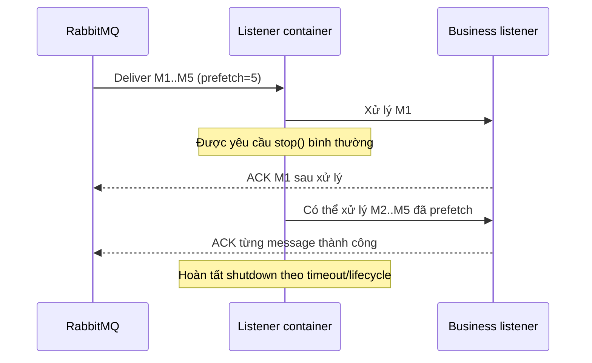
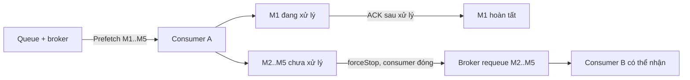
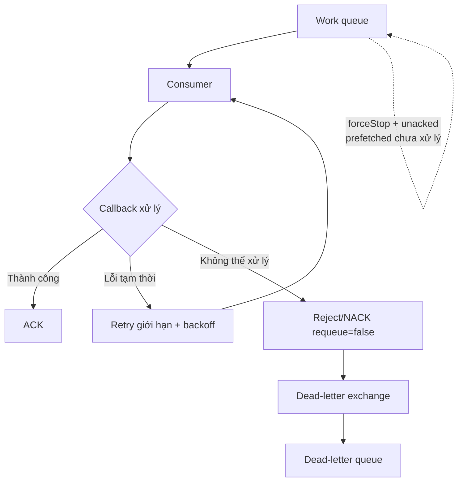

# Dừng an toàn, forceStop và thông điệp đã được prefetch

## 1. Tình huống: container được yêu cầu dừng nhưng queue vẫn đang bận

Trong module **SPRING_AMQP**, một ứng dụng gửi công việc bằng `RabbitTemplate` tới exchange của RabbitMQ, exchange dựa vào routing key/binding để đưa message vào queue, còn phía nhận có thể dùng `@RabbitListener` hoặc `MessageListenerContainer`. Khi deploy một phiên bản mới, ứng dụng cần **dừng consumer** để bàn giao công việc cho instance khác.

Giả sử queue `payments.work.q` có 100 message; consumer A được cấu hình:

- `prefetchCount = 10`.
- `concurrentConsumers = 1`.
- Xử lý mỗi job mất 2 giây.
- ACK sau khi xử lý thành công.

Tại thời điểm triển khai, A đã nhận một nhóm delivery từ broker. Một message đang được xử lý, những message còn lại **đã được prefetch** nhưng chưa chạy business logic. Nếu bạn gọi `container.stop()`, các delivery ấy đi đâu? Khi nào container dừng hẳn? Nếu bật `forceStop=true`, broker có giao chúng cho consumer B được không? Có khả năng xử lý trùng không?

Đó là trọng tâm của chương **Listener container**, bài **“Dừng an toàn, forceStop và thông điệp đã được prefetch”**.

**Thông điệp quan trọng nhất:** dừng listener không đồng nghĩa xóa queue, nhưng việc **ACK, NACK, requeue và xử lý các delivery đã được prefetch** quyết định liệu tác vụ bị chậm, được bàn giao hay có nguy cơ chạy lại.

### Sau bài này, bạn có thể

1. Phân biệt `Ready`, `Unacked`, **đang xử lý** và **đã prefetch nhưng chưa xử lý**.
2. Mô tả **graceful stop** mặc định của Spring AMQP listener container.
3. Hiểu `forceStop=true`: xử lý nốt delivery hiện tại rồi trả phần prefetch chưa xử lý về broker theo cơ chế phù hợp.
4. Không nhầm `forceStop` với `shutdownTimeout` hoặc `forceCloseChannel`.
5. Đánh giá ảnh hưởng khi dùng `AcknowledgeMode.AUTO`, `MANUAL` hay `NONE`.
6. Thực hành với `SimpleMessageListenerContainer`, `RabbitTemplate` và RabbitMQ Management UI.
7. Lập kế hoạch dừng consumer lúc deploy/scale down mà không tin nhầm vào bảo đảm exactly-once.

## 2. Prefetch hoạt động như thế nào?

### 2.1. Prefetch không phải batch message đã xử lý

RabbitMQ dùng consumer prefetch để giới hạn số delivery **chưa được ACK** mà broker có thể gửi đến một consumer trước khi phải chờ tiến độ xử lý.

Ví dụ với `prefetchCount=5` và một consumer:

```text
RabbitMQ queue:
  Ready:     [M6] [M7] [M8] [M9] ...

Consumer A:
  Đang xử lý:   [M1]
  Đã prefetch:  [M2] [M3] [M4] [M5]
  Unacked:      M1, M2, M3, M4, M5

Consumer chưa xử lý M2..M5 nhưng broker đã giao chúng.
```

Vì vậy:

- **Ready:** message đang chờ broker giao cho một consumer.
- **Unacked:** delivery đã được giao nhưng broker chưa nhận ACK.
- **Đang xử lý:** một hoặc một số delivery đã vào logic nghiệp vụ.
- **Prefetched, chưa xử lý:** delivery đã được broker giao và nằm trong bộ đệm/đường xử lý của consumer, nhưng callback chưa thực thi nghiệp vụ cho delivery đó.

Hai nhóm sau có thể cùng nằm trong **Unacked**, nên RabbitMQ Management UI **không tự phân biệt** “đang chạy business logic” và “đang chờ trong bộ đệm prefetch”.

### 2.2. Prefetch theo consumer, không nhất thiết theo toàn ứng dụng

Trong RabbitMQ, prefetch thường được thực thi theo từng consumer theo cấu hình QoS phù hợp. Nếu có 3 consumer và mỗi consumer có prefetch 10, ứng dụng có thể có **xấp xỉ tối đa 30 delivery chưa ACK** phân bố giữa các consumer (trong điều kiện không có giới hạn bổ sung).

| Số consumer | Prefetch mỗi consumer | Giới hạn unacked danh nghĩa |
| ---: | ---: | ---: |
| 1 | 1 | Khoảng 1 |
| 1 | 10 | Khoảng 10 |
| 3 | 10 | Khoảng 30 |
| 5 | 20 | Khoảng 100 |

Đây là **giới hạn theo khả năng giao trước**, không phải cam kết broker luôn gửi đúng số lượng ấy. Có thể ít hơn do queue ít message, giới hạn broker, cấu hình `globalQos`, consumer throughput hoặc tình trạng kết nối.

Một số cấu hình container còn sử dụng batch size hoặc cách ACK theo lô; chúng có thể ảnh hưởng độ trễ ACK. Khi thiết kế shutdown, phải tính cả **số delivery còn unacked**, chứ không chỉ thời gian xử lý một message.

### 2.3. Prefetch cao có lợi và có giá phải trả

| Lợi ích có thể có | Chi phí/rủi ro |
| --- | --- |
| Giảm round trip nhận message | Nhiều delivery nằm sẵn ở consumer, chưa được xử lý |
| Tăng throughput khi callback nhanh | Hàng đợi nhìn có vẻ ít Ready dù job vẫn chưa hoàn tất |
| Giữ consumer bận liên tục | Bàn giao công việc khi dừng có thể lâu |
| Giảm thời gian chờ message mới | Khi một consumer chậm, delivery bị giữ ở consumer ấy |
| Tăng khả năng pipeline hóa | Nhiều Unacked và khả năng redelivery/trùng khi mất channel |

Vì thế **prefetch lớn không tự đồng nghĩa hiệu năng tổng thể tốt hơn**. Hãy đo throughput, độ trễ, Unacked, thời gian xử lý, tải downstream và thời gian shutdown.

## 3. Dừng container bình thường: graceful stop

### 3.1. Container chịu trách nhiệm gì khi dừng?

Một listener container như `SimpleMessageListenerContainer` quản lý:

- Consumer subscription với RabbitMQ.
- Connection/channel lấy từ `ConnectionFactory`.
- Thread/consumer concurrency và prefetch.
- Cách chuyển message tới callback hoặc `@RabbitListener`.
- Acknowledgement, error handler, retry và vòng đời start/stop.

Khi ứng dụng yêu cầu `stop()` hoặc Spring đóng context, container cố gắng **ngừng nhận thêm công việc** và xử lý những delivery còn trong phạm vi shutdown theo chính sách của container.

Với hành vi dừng bình thường của các Spring AMQP listener container hiện đại, **những message đã được prefetch có thể tiếp tục được đưa qua listener để xử lý trước khi container dừng**. Điều này giúp hoàn tất công việc đã nhận, nhưng làm tăng thời gian dừng nếu prefetch lớn hoặc xử lý chậm.



**Sơ đồ là mô hình khái niệm, không phải cam kết mọi container luôn xử lý chính xác năm message trước khi dừng.** Thời điểm cancel, callback đang chạy, ACK mode, connection error, broker delivery và shutdown timeout làm kết quả thực tế thay đổi.

### 3.2. Ưu điểm của graceful stop

- Những job đã được consumer nhận có cơ hội hoàn thành trước khi kết thúc.
- Giảm số delivery phải giao lại chỉ vì triển khai.
- Có thể phù hợp với tác vụ ngắn và cần hạn chế redelivery.
- Dễ kết hợp với quy trình rolling deployment khi thời gian shutdown được cấp đủ.

### 3.3. Khi graceful stop trở nên quá chậm

Nếu một consumer có prefetch 20, xử lý từng job 3 giây và nhiều delivery đã được đưa vào bộ đệm, việc cố hoàn tất toàn bộ delivery ấy có thể kéo dài đáng kể.

Điều đó ảnh hưởng:

- Thời gian rolling deployment.
- Kubernetes termination grace period.
- Bàn giao single-active-consumer/exclusive consumer.
- Khả năng instance mới bắt đầu phục vụ.
- SLA khi service cũ đang shutdown nhưng giữ nhiều công việc.

**Không nên chỉ tăng số replica và nghĩ ngay rằng mọi message prefetched sẽ được phân phối lại.** Nếu delivery vẫn nằm ở consumer cũ dưới trạng thái Unacked, broker không giao lại nó cho replica mới chỉ vì replica mới đang rảnh.

## 4. forceStop: dừng sau delivery hiện tại, trả phần prefetch chưa xử lý

### 4.1. Ý nghĩa của forceStop

Trong các phiên bản Spring AMQP có hỗ trợ `forceStop`, thiết lập:

```java
container.setForceStop(true);
```

khi stop được yêu cầu sẽ hướng container **dừng sau khi hoàn tất message hiện đang được xử lý**, thay vì tiếp tục tiêu thụ toàn bộ các message đã prefetch. Những delivery prefetched **chưa được xử lý và chưa ACK** sẽ được đưa về khả năng giao lại khi consumer/channel được hủy theo cơ chế của broker.

Điều này phù hợp khi muốn:

- Bàn giao queue cho một consumer khác sớm hơn.
- Scale down consumer đang có nhiều message prefetched.
- Rút ngắn shutdown của container mà không cố tình ngắt ngang callback hiện tại.
- Tăng tốc chuyển quyền xử lý khi dùng **single active consumer** hoặc consumer độc quyền, nếu các cấu hình khác phù hợp.

**`forceStop=true` không đồng nghĩa “kill thread ngay lập tức”.** Nó hướng đến việc **để message đang xử lý hoàn tất**, rồi không tiếp tục xử lý phần buffer prefetch còn lại. Nếu business callback treo vô hạn, forceStop một mình **không giải quyết** việc callback không bao giờ kết thúc.

### 4.2. Ví dụ một consumer, prefetch bằng 5

Tại thời điểm nhận lệnh stop:

```text
Queue:
  Ready: [M6] [M7] [M8] ...

Consumer A:
  M1 : đang xử lý
  M2 : prefetched, chưa xử lý
  M3 : prefetched, chưa xử lý
  M4 : prefetched, chưa xử lý
  M5 : prefetched, chưa xử lý
```

So sánh hai lựa chọn:

| Chế độ | Hành vi sau khi nhận lệnh stop | Kết quả dự kiến |
| --- | --- | --- |
| `forceStop=false` (dừng bình thường) | Cho phép xử lý nốt các delivery đã được nhận/prefetch theo shutdown lifecycle và timeout | M2..M5 có thể tiếp tục được callback xử lý, rồi ACK |
| `forceStop=true` | Xử lý xong M1 rồi dừng nhận/xử lý các delivery prefetch chưa chạy | M2..M5 còn unacked có thể được broker requeue và giao cho consumer khác |

Sơ đồ:



**Không nên gắn số message cụ thể như một cam kết tuyệt đối.** ACK có thể đến sát thời điểm stop, broker có thể đã phát delivery mới, một số delivery có thể đã bắt đầu xử lý, và consumer khác có thể nhận message requeued rất nhanh.

### 4.3. Vì sao lại nói “requeue” mà không nói “vẫn Ready”?

Khi một delivery chưa được ACK và consumer/channel mất đi, broker đưa message vào khả năng được giao lại theo ngữ nghĩa queue. Nó có thể xuất hiện ngắn ở **Ready**, rồi ngay lập tức chuyển sang **Unacked** nếu consumer B nhận.

Do đó dashboard có thể **không kịp hiển thị một đỉnh Ready** mặc dù đã xảy ra bàn giao. Hãy kết hợp:

- Số delivery/ACK và redelivery.
- ID nghiệp vụ của message.
- Thời điểm stop/start.
- Consumer count và container ID.
- Log ứng dụng A/B.
- Số message chưa xử lý cuối cùng, không chỉ một lần đọc metric.

### 4.4. forceStop không phải chính sách “không trùng lặp”

Giả sử consumer A đã ghi database cho M1 rồi connection mất trước ACK. Broker có thể giao M1 lại cho B, bất kể `forceStop` đang bật hay tắt.

Vì vậy hệ thống vẫn phải có:

- `eventId`/`commandId` hoặc một khóa idempotency ổn định.
- Ràng buộc duy nhất hoặc cơ chế deduplication tại nơi tạo side effect.
- Transaction boundary rõ ràng.
- Retry có giới hạn và dead-letter cho lỗi không thể xử lý.

**forceStop tối ưu cách bàn giao delivery; không cung cấp exactly-once end-to-end.**

## 5. Bốn thuộc tính dễ bị nhầm với nhau

| Thuộc tính / thao tác | Trả lời câu hỏi gì? | Tác dụng chính |
| --- | --- | --- |
| `prefetchCount` | Broker có thể giao trước bao nhiêu delivery chưa ACK? | Giới hạn lượng công việc đang “nằm ở consumer” |
| `forceStop` | Khi stop, có cần tiếp tục xử lý các delivery đã prefetch nhưng chưa bắt đầu không? | Dừng sau message đang xử lý và trả phần prefetch còn lại cho broker theo cơ chế phù hợp |
| `shutdownTimeout` | Container có thể đợi các consumer hoàn thành shutdown bao lâu? | Giới hạn thời gian chờ shutdown |
| `forceCloseChannel` | Khi shutdown timeout nhưng consumer vẫn chưa dừng, container có nên cưỡng bức đóng channel không? | Giúp kết thúc quá trình shutdown; delivery chưa ACK có thể bị redeliver |

### 5.1. shutdownTimeout không tự bật forceStop

Ví dụ:

```java
container.setShutdownTimeout(45_000L);
```

Nghĩa là container có một khoảng chờ shutdown theo cấu hình, **không phải** sau 45 giây mọi message đã được xử lý chắc chắn. Nếu callback vượt timeout, hệ thống cần quyết định xử lý tiếp thế nào theo `forceCloseChannel`, lifecycle và môi trường chạy.

Một timeout quá ngắn có thể khiến channel đóng trước khi side effect/ACK hoàn tất, làm phát sinh redelivery. Một timeout quá dài lại khiến deploy bị giữ lâu.

### 5.2. forceCloseChannel khác forceStop

- **`forceStop=true`:** thay đổi hành vi xử lý **phần message prefetched** khi stop; không chủ đích ngắt message hiện tại.
- **`forceCloseChannel=true`:** liên quan xử lý trường hợp consumer không dừng đúng thời gian shutdown; cưỡng bức đóng channel có thể khiến **delivery đang chạy chưa ACK** được giao lại.

Hai flag giải quyết **hai vấn đề khác nhau**. Nếu cần graceful handover, thử `forceStop` và prefetch phù hợp trước; đừng dùng timeout cực ngắn cùng force-close như một cách “đảm bảo dừng sạch”.

### 5.3. Dừng container không xóa queue

Gọi `container.stop()`:

- Không xóa exchange.
- Không xóa queue.
- Không tự thay binding.
- Không xóa message Ready chỉ vì consumer dừng.
- Không bảo đảm producer dừng gửi.

Nếu publisher vẫn hoạt động, backlog có thể tăng trong thời gian không có consumer. Việc giữ được backlog qua restart cần cân nhắc queue durability, message persistence, publisher confirms, queue type và hạ tầng.

### 5.4. Tắt autoStartup khác stop ở runtime

`autoStartup=false` ngăn listener container tự khởi động khi Spring context lên. `stop()` tác động lên container **đã chạy**.

Nếu muốn phát message rồi quan sát chúng nằm Ready trước khi bắt đầu consumer, có thể dùng `autoStartup=false` trong lab; nhưng điều này không kiểm chứng `forceStop`, vì chưa có message prefetched tại container.

## 6. Acknowledge mode quyết định phần nào có thể giao lại

### 6.1. AUTO: container ACK sau khi callback thành công

Với `AcknowledgeMode.AUTO`:

```java
@RabbitListener(queues = "orders.work.q")
public void handle(String orderId) {
    orderService.process(orderId);
    // Container ACK sau khi method thành công, theo chế độ này.
}
```

Nếu callback ném exception, container có thể reject/nack, requeue hoặc dead-letter theo cấu hình xử lý lỗi.

Khi `forceStop=true`, message chưa được callback xử lý và còn unacked có thể được giao lại. Message đang chạy nên được cho hoàn thành, nhưng nếu connection/channel lỗi trước ACK thì vẫn có khả năng redelivery.

**Đừng nuốt exception rồi trả về bình thường** khi nghiệp vụ đã thất bại: container có thể ACK nhầm một công việc chưa hoàn thành.

### 6.2. MANUAL: ứng dụng phải xác nhận từng delivery

Với `AcknowledgeMode.MANUAL`, code có thể gọi:

```java
long deliveryTag = message.getMessageProperties().getDeliveryTag();

// Sau khi transaction/side effect thành công:
channel.basicAck(deliveryTag, false);

// Hoặc khi chủ động không xử lý và không requeue:
channel.basicReject(deliveryTag, false);
```

Đây là **các lệnh thay thế**, không chạy cả hai cho cùng delivery. Delivery tag chỉ hợp lệ trên **channel đã giao message**.

Trong quá trình forceStop:

- Những delivery **đã ACK** không cần requeue.
- Những delivery còn **Unacked** có thể được broker giao lại khi consumer/channel đóng.
- Nếu code quên ACK và channel vẫn mở, chúng có thể nằm Unacked cho tới khi channel được đóng.
- Nếu callback làm side effect xong nhưng chưa ACK, redelivery có thể làm side effect trùng nếu không có idempotency.

**Không tự truyền RabbitMQ `Channel` sang thread khác tùy tiện** để ACK trễ. Khi channel bị đóng hoặc được phục hồi, delivery tag cũ không còn hợp lệ cho channel mới.

### 6.3. NONE: không có bảo đảm requeue cho delivery đã auto-ack

`AcknowledgeMode.NONE` thường tương ứng consumer dùng RabbitMQ auto-ack: broker coi delivery đã được chấp nhận mà không chờ ACK từ business callback.

Nếu broker đã auto-ack message, khi dừng hoặc mất process **không thể trông đợi broker khôi phục message chỉ vì business chưa xử lý**. Đặc biệt, đừng bật `NONE` rồi cho rằng `forceStop=true` sẽ tự cứu toàn bộ prefetch backlog.

| Mode | Một message chưa được xử lý khi consumer mất | Điểm cần chú ý |
| --- | --- | --- |
| AUTO | Nếu chưa ACK, broker có thể redeliver | Consumer phải idempotent |
| MANUAL | Nếu chưa ACK, broker có thể redeliver | Code chịu trách nhiệm ACK/NACK đúng |
| NONE | Có thể đã bị broker coi là delivered/acknowledged | Không phù hợp khi cần khôi phục công việc chưa làm |

**Điều kiện để requeue là message thực tế vẫn thuộc tập delivery chưa ACK.** Không thể sử dụng forceStop để phục hồi message đã được ACK hoặc bị xóa trước đó.

## 7. Prefetch, requeue và thứ tự xử lý

### 7.1. Prefetched message có thể đổi consumer

Hai replica cùng đăng ký queue `payments.work.q`:

```text
Trước shutdown:
  Consumer A: Unacked [M1 ... M10]
  Consumer B: Đang hoạt động, có chỗ nhận tiếp

A được gọi stop(forceStop=true):
  M1 đang xử lý -> nếu hoàn tất sẽ ACK
  M2..M10 chưa xử lý -> có thể được requeue
  B có thể nhận một phần trong số đó

Sau shutdown:
  B nhận message đã requeue và xử lý theo nghiệp vụ.
```

Số message được giao lại phụ thuộc trạng thái tại lúc stop. Không nên lập dashboard dựa trên giả định rằng “mỗi lần forceStop sẽ tạo đúng prefetchCount - 1 redelivery”.

### 7.2. Thứ tự publish không phải thứ tự hoàn tất

Các tình huống sau có thể làm thứ tự hoàn tất khác thứ tự publish:

- Nhiều competing consumers cùng đọc một queue.
- Consumer B nhận message requeued trong khi đang xử lý message khác.
- Một message bị retry hoặc chuyển DLQ.
- Callback có thời gian xử lý khác nhau.
- Consumer A ACK message đầu nhưng B xử lý xong message sau trước.

Nếu nghiệp vụ đòi hỏi thứ tự theo `orderId`, nên thiết kế phân vùng/serialization hoặc cơ chế single active consumer phù hợp. **forceStop không duy trì thứ tự hoàn tất toàn cục.**

### 7.3. Redelivered flag có hữu ích không?

Khi broker giao lại message, delivery có thể có cờ `redelivered`:

```java
boolean redelivered =
        message.getMessageProperties().isRedelivered();
```

Cờ này hữu ích để chẩn đoán, nhưng **không thay thế khóa idempotency**:

- Nó không phải số lần retry chính xác.
- Một message có thể được xử lý lại do producer gửi lại một bản sao khác, không chỉ vì redelivery của cùng queue.
- Nó không bảo đảm mọi side effect đã hoặc chưa được thực hiện.

Hãy dùng **business event ID ổn định** để nhận biết công việc trùng lặp, không dùng delivery tag/redelivered bit.

## 8. SimpleMessageListenerContainer và DirectMessageListenerContainer

Spring AMQP có các container thông dụng:

- **`SimpleMessageListenerContainer` (SMLC):** thường có thread/queue nội bộ để chuyển delivery từ RabbitMQ client sang listener, hỗ trợ concurrency động trong những cấu hình nhất định.
- **`DirectMessageListenerContainer` (DMLC):** callback listener thường được thực thi trực tiếp trên thread của RabbitMQ client; cách thiết lập consumer concurrency khác SMLC.

Cả hai đều quản lý delivery, ACK và lifecycle. Tuy nhiên, **bố trí thread và thời điểm callback nhận một delivery đã prefetch có thể khác nhau**; khi kiểm thử forceStop phải dùng đúng loại container thực tế chạy production.

| Câu hỏi | SMLC | DMLC |
| --- | --- | --- |
| Có listener container quản lý consumer và ACK? | Có | Có |
| Cấu hình prefetch? | Có | Có |
| Có thể dùng với `@RabbitListener`? | Có, qua factory thích hợp | Có, qua factory thích hợp |
| Cấu hình concurrency | `concurrentConsumers` / `maxConcurrentConsumers` | `consumersPerQueue` và cơ chế riêng |
| Thực thi callback | Có bước điều phối qua container/thread | Gần RabbitMQ client delivery thread hơn |
| Force-stop khi phiên bản hỗ trợ | Có cơ chế dừng sau message đang xử lý | Cần xác minh hành vi trên phiên bản/factory tương ứng |
| Kiểm chứng số prefetched chưa xử lý | Theo ACK + log/metric | Theo ACK + log/metric |

**Đừng chuyển code cấu hình concurrency của SMLC sang DMLC mà không kiểm tra API.** Các factory và thuộc tính theo container type có khác biệt.

Khi đọc tài liệu `forceStop`, hãy kiểm tra phiên bản Spring AMQP đang sử dụng: thuộc tính này được bổ sung trong các bản cập nhật của các nhánh Spring AMQP hiện đại. Nếu một project cũ không có setter/cấu hình tương ứng, không giả định hành vi dừng sẽ giống phiên bản mới.

## 9. Demo Spring Boot: stop thường so với forceStop

Lab sau dùng một SMLC với **một consumer**, `prefetch=10`, 20 message công việc và callback xử lý khoảng 1,5 giây/message. Ứng dụng tự gọi `container.stop()` sau khi publish để so sánh phần công việc đã prefetch.

**Chạy các lần thử trên queue lab sạch và không có consumer ngoài ý muốn.** Bài thực hành không phục hồi dữ liệu production và không chạy fault injection trên queue thật.

### 9.1. Điều kiện

- Java 17+ và Spring Boot tương thích với Spring AMQP có `setForceStop`.
- RabbitMQ local, ví dụ qua Docker.
- Maven hoặc Maven Wrapper.

Tạo RabbitMQ lab nếu chưa chạy broker ở hai cổng:

```bash
docker run -d --name rabbitmq-force-stop-demo \
  -p 5672:5672 -p 15672:15672 rabbitmq:4-management
```

RabbitMQ Management UI ở `http://localhost:15672`, tài khoản local mặc định thường là `guest/guest`. Trong production phải dùng tài khoản/secret riêng; `guest` có những giới hạn kết nối từ xa.

Dependency Maven:

```xml
<dependency>
    <groupId>org.springframework.boot</groupId>
    <artifactId>spring-boot-starter-amqp</artifactId>
</dependency>
```

Nếu chạy application trong container riêng, `localhost` ở `application.yml` sẽ trỏ vào **container ứng dụng**, không phải RabbitMQ. Khi đó dùng tên service trong Docker network hoặc host đúng.

### 9.2. Cấu hình application.yml

```yaml
spring:
  application:
    name: rabbitmq-force-stop-lab
  rabbitmq:
    host: localhost
    port: 5672
    username: guest
    password: guest
    publisher-confirm-type: correlated
    publisher-returns: true
    template:
      mandatory: true

lab:
  force-stop: false
  prefetch: 10
```

Đặt `force-stop: false` để chạy kịch bản graceful trước. Trong lần thử force stop, đổi thành `true`. Thuộc tính `lab.force-stop` là **biến cấu hình riêng của demo**, không phải một property chuẩn của Spring Boot.

Việc bật publisher confirms và returns chỉ tạo điều kiện thu tín hiệu; demo chưa triển khai handler để xác nhận từng lần publish. Khi chạy production, phải thực sự quan sát confirm/return trước khi kết luận broker đã nhận đúng đích.

### 9.3. Khai báo exchange, queue và binding

Tạo `LabTopology.java`:

```java
package com.example.forcestop;

import org.springframework.amqp.core.Binding;
import org.springframework.amqp.core.BindingBuilder;
import org.springframework.amqp.core.DirectExchange;
import org.springframework.amqp.core.Queue;
import org.springframework.amqp.core.QueueBuilder;
import org.springframework.context.annotation.Bean;
import org.springframework.context.annotation.Configuration;

@Configuration
public class LabTopology {

    public static final String EXCHANGE = "lab.shutdown.events";
    public static final String QUEUE = "lab.shutdown.work.q";
    public static final String ROUTING_KEY = "jobs.run";

    @Bean
    DirectExchange shutdownExchange() {
        return new DirectExchange(EXCHANGE);
    }

    @Bean
    Queue shutdownQueue() {
        return QueueBuilder.durable(QUEUE).build();
    }

    @Bean
    Binding shutdownBinding(
            Queue shutdownQueue,
            DirectExchange shutdownExchange) {

        return BindingBuilder.bind(shutdownQueue)
                .to(shutdownExchange)
                .with(ROUTING_KEY);
    }
}
```

Demo này không tạo DLQ vì đường xử lý thành công là chính; phần lỗi/retry/DLQ được bàn riêng ở mục 12. Trong thực tế, nếu listener ném exception và bị reject không requeue mà **không có DLX**, message có thể bị loại. Lab giả định callback bình thường không bị lỗi.

Spring Boot với `RabbitAdmin` trong cấu hình thông dụng có thể declare topology khi kết nối broker. Nếu có resource cùng tên đã tồn tại với arguments khác, cần dùng tên lab mới hoặc lập kế hoạch migration; không xóa queue đang chứa message thật.

### 9.4. Container với prefetch và forceStop cấu hình được

Tạo `LabContainerConfig.java`:

```java
package com.example.forcestop;

import java.nio.charset.StandardCharsets;

import org.springframework.amqp.core.AcknowledgeMode;
import org.springframework.amqp.core.MessageListener;
import org.springframework.amqp.rabbit.connection.ConnectionFactory;
import org.springframework.amqp.rabbit.listener.SimpleMessageListenerContainer;
import org.springframework.beans.factory.annotation.Value;
import org.springframework.context.annotation.Bean;
import org.springframework.context.annotation.Configuration;

@Configuration
public class LabContainerConfig {

    @Bean
    SimpleMessageListenerContainer labContainer(
            ConnectionFactory connectionFactory,
            @Value("${lab.force-stop:false}") boolean forceStop,
            @Value("${lab.prefetch:10}") int prefetch) {

        SimpleMessageListenerContainer container =
                new SimpleMessageListenerContainer(connectionFactory);

        container.setQueueNames(LabTopology.QUEUE);
        container.setConcurrentConsumers(1);
        container.setPrefetchCount(prefetch);
        container.setAcknowledgeMode(AcknowledgeMode.AUTO);

        container.setForceStop(forceStop);
        container.setShutdownTimeout(45_000L);
        container.setForceCloseChannel(true);

        // Chỉ dùng lab này để xử lý message hợp lệ thành công.
        MessageListener listener = message -> {
            String jobId = new String(
                    message.getBody(),
                    StandardCharsets.UTF_8
            );

            System.out.printf(
                    "[CONSUMER] start job=%s redelivered=%s%n",
                    jobId,
                    message.getMessageProperties().isRedelivered()
            );

            try {
                Thread.sleep(1_500L);
            } catch (InterruptedException ex) {
                Thread.currentThread().interrupt();
                throw new IllegalStateException(
                        "Interrupted while processing " + jobId, ex
                );
            }

            System.out.println("[CONSUMER] done job=" + jobId);
            // Container AUTO gửi ACK sau callback thành công.
        };

        container.setMessageListener(listener);
        return container;
    }
}
```

Giải thích:

- `setConcurrentConsumers(1)` giúp việc quan sát tương đối đơn giản.
- `setPrefetchCount(10)` cho phép có nhiều message đã được broker giao trước khi ACK.
- `setAcknowledgeMode(AUTO)`: container ACK sau mỗi callback hoàn thành bình thường theo quy tắc cấu hình.
- `setForceStop(forceStop)`: lựa chọn graceful drain hoặc dừng sau delivery hiện tại.
- `setShutdownTimeout(45_000L)`: cho shutdown thời gian đủ dài trong demo để thấy sự khác nhau, thay vì timeout quá sớm.
- `setForceCloseChannel(true)`: trong trường hợp vượt thời gian shutdown, container có thể cưỡng bức đóng channel; điều này **khác** với forceStop.
- Callback ngủ 1,5 giây để quan sát xử lý chậm, **không phải mô hình xử lý nghiệp vụ thật**.

Với dữ liệu thật, đừng lấy việc ngủ xong làm tiêu chí nghiệp vụ thành công; chỉ ACK sau khi side effect cần thiết đã thành công và an toàn với redelivery.

### 9.5. Publisher và lệnh stop trong ApplicationRunner

Tạo `StopScenario.java`:

```java
package com.example.forcestop;

import org.springframework.amqp.rabbit.core.RabbitTemplate;
import org.springframework.boot.ApplicationRunner;
import org.springframework.context.annotation.Bean;
import org.springframework.context.annotation.Configuration;
import org.springframework.beans.factory.annotation.Qualifier;
import org.springframework.amqp.rabbit.listener.SimpleMessageListenerContainer;

@Configuration
public class StopScenario {

    @Bean
    ApplicationRunner runScenario(
            RabbitTemplate rabbitTemplate,
            @Qualifier("labContainer")
                    SimpleMessageListenerContainer container) {

        return args -> {
            System.out.println("[LAB] publish 20 jobs");

            for (int i = 1; i <= 20; i++) {
                rabbitTemplate.convertAndSend(
                        LabTopology.EXCHANGE,
                        LabTopology.ROUTING_KEY,
                        "job-" + i
                );
            }

            Thread.sleep(1_000L);

            System.out.println("[LAB] requesting container.stop()");
            long startedAt = System.nanoTime();

            container.stop();

            long elapsedMillis =
                    (System.nanoTime() - startedAt) / 1_000_000L;

            System.out.printf(
                    "[LAB] stop() returned, elapsed=%d ms%n",
                    elapsedMillis
            );
        };
    }
}
```

Tạo `ForceStopLabApplication.java`:

```java
package com.example.forcestop;

import org.springframework.boot.SpringApplication;
import org.springframework.boot.autoconfigure.SpringBootApplication;

@SpringBootApplication
public class ForceStopLabApplication {

    public static void main(String[] args) {
        SpringApplication.run(ForceStopLabApplication.class, args);
    }
}
```

Các class đều trong package `com.example.forcestop`, được Spring Boot component scan. Listener container là `@Bean` và được quản lý lifecycle bởi Spring; `ApplicationRunner` chạy sau khi context khởi động.

**Trình tự có thể khác ở mức thời gian:** consumer có thể nhận message ngay khi chúng được publish, thậm chí trước khi vòng lặp publish hết 20 message. Vì vậy không được dự đoán số message Unacked hoặc Ready chính xác tại giây thứ nhất.

### 9.6. Kịch bản A — forceStop=false

Giữ:

```yaml
lab:
  force-stop: false
  prefetch: 10
```

Chạy:

```bash
./mvnw spring-boot:run
```

Khi `container.stop()` được yêu cầu, container sẽ dừng theo **graceful lifecycle**: có thể xử lý tiếp các message đã prefetch trước khi kết thúc, trong giới hạn timeout và điều kiện thực tế.

Quan sát:

- Log `[CONSUMER] start/done` sau dòng `[LAB] requesting container.stop()`.
- Số message hoàn thành trước khi stop.
- Thời gian `container.stop()` trả về.
- Ready/Unacked trước và sau shutdown.
- Message chưa được delivery vẫn nằm Ready nếu không có consumer khác.

**Điều cần thấy:** stop bình thường có thể **mất thời gian lâu hơn** vì đang cố hoàn thành lượng delivery đã prefetched.

### 9.7. Kịch bản B — forceStop=true

Để so sánh công bằng, dùng **queue lab sạch** và không có consumer ngoài ý muốn, nạp cùng số message, giữ nguyên prefetch và thời gian xử lý. Chuyển:

```yaml
lab:
  force-stop: true
  prefetch: 10
```

Chạy lại ứng dụng. Khi container stop:

- Message đang được callback xử lý có cơ hội hoàn thành.
- Container không cố chạy hết toàn bộ buffered prefetch.
- Những delivery chưa ACK trong phần prefetch có thể được requeue khi consumer/channel dừng.
- Nếu không có consumer khác, chúng có thể ở Ready chờ lần khởi động sau.
- Nếu có consumer B đang hoạt động cùng queue, B có thể nhận ngay những message được trả lại.

**Đừng khẳng định sẽ còn chính xác 19 message Ready.** Tại thời điểm stop, có thể nhiều message đã chạy, đã ACK hoặc đang được giao; kết quả chịu ảnh hưởng scheduling và ACK timing.

### 9.8. Cách kiểm tra queue trong RabbitMQ

Dùng Management UI ở `http://localhost:15672`, mở queue `lab.shutdown.work.q`:

- `Ready`: đang chờ delivery.
- `Unacked`: đã được giao nhưng chưa ACK.
- `Consumers`: số consumer đang được broker ghi nhận.
- `Deliver / Ack / Redeliver rates`: hỗ trợ xác minh tiến độ và khả năng message được giao lại.

Có thể kiểm tra bằng RabbitMQ CLI trong container:

```bash
docker exec rabbitmq-force-stop-demo rabbitmqctl list_queues \
  name messages_ready messages_unacknowledged consumers
```

Các metric được cập nhật theo nhịp quan sát; hãy đọc nhiều thời điểm và đối chiếu ID log. Nếu consumer khác đang chạy, queue Ready có thể thấp vì delivery được chuyển ngay sang B.

### 9.9. Thử nghiệm lại có dữ liệu sạch

Khi chạy `ApplicationRunner`, **mỗi lần chạy thêm 20 message**. Nếu giữ queue cũ, kết quả lần thứ hai lẫn với backlog lần thứ nhất.

Chỉ với môi trường lab không có dữ liệu quan trọng, có thể purge queue bằng Management UI trước mỗi thí nghiệm. **Purge xóa message Ready và không phải bản backup; không dùng trên queue production.**

Một cách khác là tạo tên queue mới cho mỗi lượt chạy, nhưng phải đổi topology/routing và quan sát đúng queue tương ứng. Không xóa bất kỳ queue thật nào chỉ để đạt một số lượng message mong muốn.

## 10. Dùng forceStop với @RabbitListener

Ví dụ trước dùng SMLC bean trực tiếp. Với `@RabbitListener`, ứng dụng thường dùng `SimpleRabbitListenerContainerFactory` để áp cấu hình khi tạo container.

Một cấu hình **thay thế** cho demo, không khởi tạo đồng thời listener khác trên cùng queue:

```java
@Configuration
@EnableRabbit
public class ListenerFactoryConfig {

    @Bean("handoverListenerFactory")
    SimpleRabbitListenerContainerFactory handoverListenerFactory(
            ConnectionFactory connectionFactory) {

        SimpleRabbitListenerContainerFactory factory =
                new SimpleRabbitListenerContainerFactory();

        factory.setConnectionFactory(connectionFactory);
        factory.setConcurrentConsumers(1);
        factory.setPrefetchCount(10);
        factory.setAcknowledgeMode(AcknowledgeMode.AUTO);
        factory.setForceStop(true);
        factory.setShutdownTimeout(45_000L);

        return factory;
    }
}
```

Các import cần thiết:

```java
import org.springframework.amqp.core.AcknowledgeMode;
import org.springframework.amqp.rabbit.annotation.EnableRabbit;
import org.springframework.amqp.rabbit.connection.ConnectionFactory;
import org.springframework.amqp.rabbit.config.SimpleRabbitListenerContainerFactory;
import org.springframework.context.annotation.Bean;
import org.springframework.context.annotation.Configuration;
```

Đăng ký method:

```java
@Component
public class OrderWorker {

    @RabbitListener(
        id = "handover-worker",
        queues = "lab.shutdown.work.q",
        containerFactory = "handoverListenerFactory"
    )
    public void handle(String jobId) {
        process(jobId);
    }
}
```

**Lưu ý:** `process(jobId)` trong snippet là logic bạn phải triển khai. Ví dụ này minh họa cách chọn factory, không phải class chạy độc lập. Nếu Spring AMQP phiên bản đang dùng không cung cấp `setForceStop` ở factory, cần tham khảo API của phiên bản tương ứng và cấu hình container ở nơi thích hợp.

### Điều khiển container của @RabbitListener theo ID

Thay vì giữ tham chiếu tới `SimpleMessageListenerContainer` như lab, có thể dùng `RabbitListenerEndpointRegistry`:

```java
@Autowired
RabbitListenerEndpointRegistry registry;

public void pauseConsumer() {
    MessageListenerContainer container =
            registry.getListenerContainer("handover-worker");

    if (container != null && container.isRunning()) {
        container.stop();
    }
}
```

Với annotation listener, ID `handover-worker` là **ID endpoint**, không phải tên queue. `stop()` trên container sẽ thực thi theo cấu hình forceStop của factory đã tạo container.

**Không dùng đồng thời một raw SMLC bean và một `@RabbitListener` trên cùng queue trong cùng lab** nếu muốn so sánh chính xác; chúng sẽ là competing consumers và chia nhau message.

## 11. Rolling deployment, Kubernetes và single active consumer

### 11.1. Bàn giao consumer khi rolling update

Một chu trình mong muốn:

```text
T0  Replica A đang nhận và xử lý messages.
T1  Replica B được khởi động, kết nối RabbitMQ.
T2  Hệ thống gửi tín hiệu dừng tới A.
T3  Container A ngừng nhận delivery mới.
T4  A hoàn tất delivery đang chạy.
T5  Với forceStop, delivery prefetched chưa xử lý được trả về broker.
T6  B nhận các message đang Ready/được requeue và tiếp tục công việc.
```

Điều kiện:

- B thực sự đã sẵn sàng consume và có quyền queue.
- Queue không bị xóa khi A dừng.
- Producer/consumer sử dụng cùng topology và message schema tương thích.
- B xử lý idempotent khi message bị redeliver.
- Có đủ **termination grace period** để A hoàn tất callback và shutdown.

### 11.2. Kubernetes terminationGracePeriodSeconds

Nếu triển khai trên Kubernetes, khi Pod bị terminate, ứng dụng thường nhận tín hiệu để shutdown. Nhưng **container chỉ có thể graceful nếu còn đủ thời gian và process xử lý shutdown phù hợp**.

Một cấu hình triển khai minh họa:

```yaml
spec:
  terminationGracePeriodSeconds: 60
```

Con số 60 chỉ là ví dụ. Chọn dựa trên **p99 thời gian xử lý một message**, thời gian đóng connection/channel, lifecycle Spring và các phụ thuộc ngoài, không dựa vào một công thức duy nhất.

**`server.shutdown=graceful` của Spring Boot chủ yếu đề cập HTTP web server**, không phải một đảm bảo riêng cho RabbitMQ consumer. Phải kiểm tra lifecycle của listener container và Pod termination thực tế.

### 11.3. Single active consumer và forceStop

RabbitMQ có cơ chế **single active consumer** cho queue type/tình huống được hỗ trợ, chỉ cho một consumer nhận delivery tại một thời điểm. Khi consumer A rời queue, consumer B có thể được chọn làm active.

Nếu A đang giữ lượng lớn message prefetched và shutdown cố xử lý hết, quá trình bàn giao có thể kéo dài. `forceStop=true` có thể giúp bàn giao nhanh hơn vì nó xử lý nốt delivery hiện tại rồi trả các delivery khác về queue.

Nhưng:

- ForceStop không tự bật single active consumer.
- Dùng nhiều pod không có nghĩa broker tự đảm bảo active consumer duy nhất.
- B cần chờ cơ chế broker chọn active theo queue type/topology.
- Redelivery và thứ tự hoàn tất sau failover vẫn phải được kiểm thử.

### 11.4. Exclusive consumer cũng có ràng buộc riêng

Exclusive consumer chỉ cho một consumer có quyền consume queue trong phạm vi tính năng broker. Khi A giữ exclusive consumer, B có thể không nhận được cho tới khi A thực sự hủy subscription/đóng connection.

ForceStop có thể giúp A sớm trả phần prefetch, nhưng **không thay thế việc giải phóng exclusive consumer đúng cách** hoặc giải quyết mọi cạnh tranh do cấu hình cluster.

## 12. Lỗi, retry và dead-letter khi dừng container

### 12.1. ForceStop không thay listener error handler

`forceStop` chủ yếu quyết định cách dừng khi có delivery prefetched. Nếu callback đã bắt đầu và ném lỗi, container vẫn áp dụng chính sách lỗi:

- Requeue theo cấu hình.
- Retry có giới hạn và backoff.
- Reject không requeue.
- Dead-letter tới DLX/DLQ, nếu topology được cấu hình đúng.

Chính sách đó **khác** việc requeue các delivery chưa xử lý vì consumer bị dừng. Không nên dùng forceStop như một cơ chế thay thế retry/DLQ.

### 12.2. Mô hình DLQ cho poison message



**DLQ không tự xuất hiện chỉ vì message được requeue khi shutdown.** Requeue là yêu cầu broker đặt lại message vào queue có thể giao; dead-letter xảy ra theo nguyên nhân/policy tương ứng.

### 12.3. Không dùng requeue vô hạn cho lỗi cấu trúc

Một message sai JSON hoặc vi phạm schema sẽ không tự sửa sau mỗi lần requeue. Nếu default requeue luôn bật mà không có retry limit, consumer có thể bị mắc kẹt trong vòng lỗi nóng sau khi khởi động lại.

Hãy phân biệt:

| Nguyên nhân | Cách xử lý hợp lý |
| --- | --- |
| Consumer dừng, delivery chưa ACK | Broker có thể redeliver; consumer idempotent |
| DB timeout tạm thời | Retry/backoff có giới hạn |
| JSON/schema hỏng | Quarantine/DLQ, sửa producer/contract |
| Callback xử lý xong nhưng mất ACK | Redelivery có thể xảy ra; deduplicate theo ID |
| Publisher chưa biết broker đã nhận | Publisher confirm/return, outbox và retry an toàn |
| Broker mất queue/disk | Xem durability, queue type, backups và hạ tầng |

### 12.4. Giao dịch và ACK

Giả sử business listener cập nhật database, sau đó ACK:

```text
Nhận OrderPaid(eventId=E1)
  -> DB transaction commit
  -> Container gửi ACK RabbitMQ
```

Nếu crash sau commit nhưng trước ACK, message E1 có thể được giao lại. **Graceful stop hay forceStop không loại trừ hoàn toàn cửa sổ này**. Muốn tránh ghi hai lần, cần event ID duy nhất/transaction DB và idempotency.

Đồng thời, `@Transactional` trên phương thức producer ghi DB rồi `RabbitTemplate.convertAndSend` **không** tự tạo distributed atomic transaction giữa database và RabbitMQ. Với nguồn event quan trọng, cân nhắc transactional outbox.

## 13. Đo lường shutdown: nhìn metric nào?

| Metric hoặc tín hiệu | Ý nghĩa | Cách sử dụng |
| --- | --- | --- |
| `messages_ready` | Message còn chờ ở queue | Backlog broker chưa giao |
| `messages_unacknowledged` | Message đã giao, chưa ACK | Phát hiện prefetch/in-flight |
| Consumer count | Số consumer đang đăng ký | Xác nhận A đã rời, B đã nhận |
| ACK rate | Tốc độ delivery được xác nhận | Phân biệt đang làm và đã hoàn tất |
| Redelivery rate / redelivered flag | Message bị giao lại | Hỗ trợ quan sát bàn giao |
| Time to stop | Thời gian từ yêu cầu stop đến container dừng | So sánh graceful với forceStop |
| Callback duration | Thời gian business xử lý message | Thiết kế prefetch và termination window |
| DLQ length/rate | Message lỗi được dead-letter | Phát hiện poison/retry exhaustion |
| Business completed IDs | Công việc đã commit thành công | Tránh kết luận sai chỉ từ broker counters |

### Dashboard dễ gây nhầm

**Trước stop:** Ready thấp, Unacked cao. Người vận hành nghĩ queue sắp hết việc, nhưng hàng loạt message đang được giữ bởi consumer A.

**Sau forceStop:** Ready có thể tăng ngắn hạn rồi giảm ngay khi B nhận. Đừng suy “message đã mất” từ một snapshot Ready.

**Sau crash:** Redelivery tăng, nhưng có thể bao gồm message mà A đã làm xong side effect trước khi mất ACK. Đây là lý do cần **đo unique business ID đã hoàn tất**, không chỉ đếm delivery.

### Log có ích

Nên log dạng có cấu trúc:

```text
timestamp | instance | listenerId | queue | eventId | phase
10:01:00  | A        | worker-1   | work  | E101    | received
10:01:02  | A        | worker-1   | work  | E101    | completed
10:01:02  | A        | worker-1   | work  | -       | stop-requested
10:01:03  | B        | worker-1   | work  | E102    | received-redelivered
```

Các dòng log chỉ mang tính minh họa. Không log toàn bộ payload có thông tin cá nhân/secret; dùng correlation ID, event ID, queue và latency.

## 14. Các kịch bản thực hành mở rộng

### Kịch bản A — Prefetch=1 rồi dừng

Đổi `lab.prefetch=1`, giữ một consumer và cùng thời gian xử lý. Khi chỉ có một delivery Unacked, gần như không có nhiều message nằm trong buffer prefetch để trả lại. **ForceStop có thể ít khác biệt hơn** so với graceful stop.

Câu hỏi: trade-off throughput/latency có chấp nhận được không?

### Kịch bản B — Prefetch=20, xử lý chậm

Tăng prefetch lên 20, giữ một consumer, rồi so thời gian dừng. Nếu forceStop false, container có thể phải xử lý lượng prefetched lớn trước khi hoàn tất; forceStop true hướng tới trả phần chưa xử lý về broker.

Câu hỏi: tăng prefetch có cải thiện throughput đủ để đánh đổi shutdown latency không?

### Kịch bản C — Hai consumer trên cùng queue

Cho hai instance ứng dụng dùng cùng RabbitMQ queue. Yêu cầu A dừng với forceStop, tiếp tục quan sát B.

Câu hỏi:

1. Message prefetched ở A có xuất hiện tại B không?
2. Có message ID nào B xử lý lại trong khi A đã từng ghi side effect không?
3. Thứ tự hoàn tất có còn giống thứ tự publish không?

### Kịch bản D — Callback bị treo

Giả lập business API không có read timeout khiến callback treo. Yêu cầu forceStop.

Câu hỏi: forceStop có tự giết callback ngay không? **Không nên giả định có.** Hãy đặt timeout ở HTTP/DB client, giám sát callback duration, thiết kế cancellation và tránh chờ vô hạn.

### Kịch bản E — MANUAL nhưng quên ACK

Trên queue lab riêng, tạo listener MANUAL không ACK. Xem Unacked tăng đến prefetch, sau đó dừng container và quan sát requeue khi channel bị đóng.

Câu hỏi: nếu consumer đang chạy mà không ACK, vì sao message chưa quay về Ready? Vì broker vẫn giữ delivery **Unacked trên channel đang mở**.

### Kịch bản F — AUTO ACK trước/sau DB commit

Trong môi trường kiểm thử, phân biệt:

- Callback đã ghi DB và trả về bình thường → container ACK.
- Callback ghi DB xong nhưng process lỗi trước ACK → có thể redelivery.
- Callback nuốt lỗi ghi DB và trả về bình thường → container có thể ACK nhầm.

Câu hỏi: idempotency và transaction boundary nào ngăn xử lý trùng nhưng vẫn cho phép retry khi lỗi tạm thời?

## 15. Troubleshooting

| Triệu chứng | Nguyên nhân có thể | Cách xử lý |
| --- | --- | --- |
| Gọi `stop()` mà process lâu thoát | Container đang drain prefetched deliveries; callback chậm | Đo Unacked/duration, giảm prefetch nếu phù hợp, xem `forceStop` |
| ForceStop được bật nhưng current job vẫn chạy lâu | ForceStop không chủ đích ngắt message đang xử lý | Đặt timeout nghiệp vụ; kiểm soát shutdown grace period |
| B vẫn không nhận message prefetched ở A | A chưa stop/đóng consumer; delivery còn Unacked; có exclusive/SAC | Xem lifecycle/channel/consumer count và cơ chế ownership |
| Không thấy spike Ready sau forceStop | B nhận lại quá nhanh | Xem redelivery/delivery logs, IDs và multiple snapshots |
| Message được xử lý trùng sau shutdown | Side effect đã xong nhưng ACK chưa tới broker | Idempotency theo business ID |
| `forceCloseChannel` gây message xử lý lại | Shutdown timeout đóng channel khi ACK chưa được broker nhận | Tăng timeout phù hợp, sửa callback, idempotency |
| Setting `forceStop` không compile | Phiên bản Spring AMQP chưa có API hoặc factory khác | Kiểm tra API/version container thực tế |
| Dừng @RabbitListener không tác động đúng consumer | Dùng nhầm endpoint ID hoặc registry khác | Kiểm tra `RabbitListenerEndpointRegistry` và container ID |
| Ready thấp nhưng backlog nghiệp vụ lớn | Nhiều delivery đang Unacked do prefetch | Xem Ready + Unacked và tiến độ callback |
| Message không được requeue dù consumer crash | ACK mode NONE hoặc message đã ACK | Xác minh acknowledge mode và điểm ACK |
| Message lỗi lặp mãi sau restart | Poison message + requeue vô hạn | Retry giới hạn, dead-letter, cảnh báo |
| DLQ trống khi forceStop | Requeue không phải dead-letter | Xem Ready/Unacked của work queue thay vì mong DLQ tăng |
| Shutdown bị kill khi vẫn xử lý | Pod/service manager timeout ngắn hơn work duration | Điều chỉnh termination window và timeout nghiệp vụ |
| Đổi prefetch mà không đổi thời gian dừng | Không có nhiều delivery prefetch ở thời điểm stop | Kiểm tra Unacked, số consumer và tải thực tế |
| Publisher báo confirm nhưng consumer chưa xử lý | Confirm và consumer ACK là hai cơ chế độc lập | Theo dõi business completion riêng |

## 16. Checklist trước khi rolling deploy production

1. **Queue type nào?** Classic/quorum/stream có ngữ nghĩa tiêu thụ và giao lại riêng; bài này tập trung AMQP work queue.
2. **Container nào?** `SimpleMessageListenerContainer` hay `DirectMessageListenerContainer`? Phiên bản có hỗ trợ `forceStop` không?
3. **Prefetch và concurrency bao nhiêu?** Số delivery tối đa có thể đang Unacked tại lúc dừng là bao nhiêu?
4. **ACK mode nào?** AUTO/MANUAL có bảo vệ delivery chưa xử lý không? Có vô tình dùng NONE không?
5. **Callback p99 mất bao lâu?** Timeout DB/HTTP bên ngoài có đủ ngắn để hoàn tất trong grace period không?
6. **Có cần bàn giao nhanh không?** Nếu scale down hoặc single active consumer, `forceStop` có phù hợp không?
7. **shutdownTimeout và forceCloseChannel ra sao?** Có tình huống channel bị đóng trước khi side effect/ACK hoàn tất không?
8. **Có idempotency không?** Redelivery sau crash/force close có khiến thu tiền/gửi email trùng không?
9. **Retry/DLQ đã sẵn sàng?** Không requeue vô hạn poison message, không ngộ nhận forceStop tự đẩy message vào DLQ.
10. **Đã thử trên staging chưa?** Kiểm tra Ready, Unacked, redelivery, thời gian stop, consumer B và business completed IDs.

## 17. Kết luận

Có ba câu hỏi khác nhau khi dừng một Spring AMQP consumer:

**Một là, broker đã giao trước bao nhiêu message?** Đó là **prefetch**. Message đã prefetch nhưng chưa ACK nằm trong phạm vi **Unacked**, dù callback nghiệp vụ chưa chắc đã chạy.

**Hai là, khi stop có cần xử lý hết phần prefetch không?** Graceful stop thường cố hoàn thành delivery đã nhận theo lifecycle và timeout. `forceStop=true` hướng container **hoàn tất message đang xử lý rồi dừng**, trả các delivery prefetched chưa xử lý về khả năng giao lại thay vì cố drain tất cả.

**Ba là, nếu shutdown quá lâu có nên đóng channel?** `shutdownTimeout` và `forceCloseChannel` giải quyết chuyện giới hạn chờ và cưỡng bức đóng kết nối/channel; chúng **khác** quyết định forceStop.

```text
RabbitTemplate -> Exchange -> Queue -> ListenerContainer(prefetch=N)
                                        |
                                        +-- callback đang xử lý -> ACK khi thành công
                                        |
                                        +-- message prefetched chưa xử lý
                                              |
                           graceful stop ------+--> có thể tiếp tục xử lý
                           forceStop=true -----+--> trả lại broker khi chưa ACK
```

**Lựa chọn đúng không phải “luôn bật forceStop”, mà là cân bằng throughput, shutdown latency và khả năng bàn giao.** Để hệ thống xử lý bất đồng bộ đáng tin cậy, kết hợp topology đúng, publisher confirms/returns, ACK đúng thời điểm, retry/dead-letter, transaction/outbox, idempotency và quan sát end-to-end.

### Tài liệu tham khảo chính thức

- [Spring AMQP — Listener Container Attributes](https://docs.spring.io/spring-amqp/reference/amqp/containerAttributes.html)
- [Spring AMQP — Choosing a Container](https://docs.spring.io/spring-amqp/reference/amqp/receiving-messages/choose-container.html)
- [Spring AMQP — Asynchronous Consumer](https://docs.spring.io/spring-amqp/reference/amqp/receiving-messages/async-consumer.html)
- [Spring AMQP — Annotation-driven Listener Endpoints](https://docs.spring.io/spring-amqp/reference/amqp/receiving-messages/async-annotation-driven.html)
- [RabbitMQ — Consumer Prefetch](https://www.rabbitmq.com/docs/consumer-prefetch)
- [RabbitMQ — Consumer Acknowledgements and Publisher Confirms](https://www.rabbitmq.com/docs/confirms)
- [RabbitMQ — Consumer Cancel Notifications](https://www.rabbitmq.com/docs/consumer-cancel)
- [RabbitMQ — Dead Letter Exchanges](https://www.rabbitmq.com/docs/dlx)
