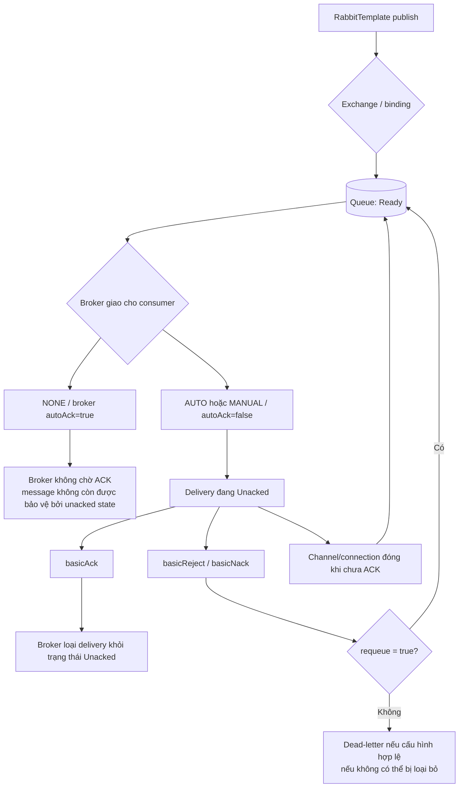
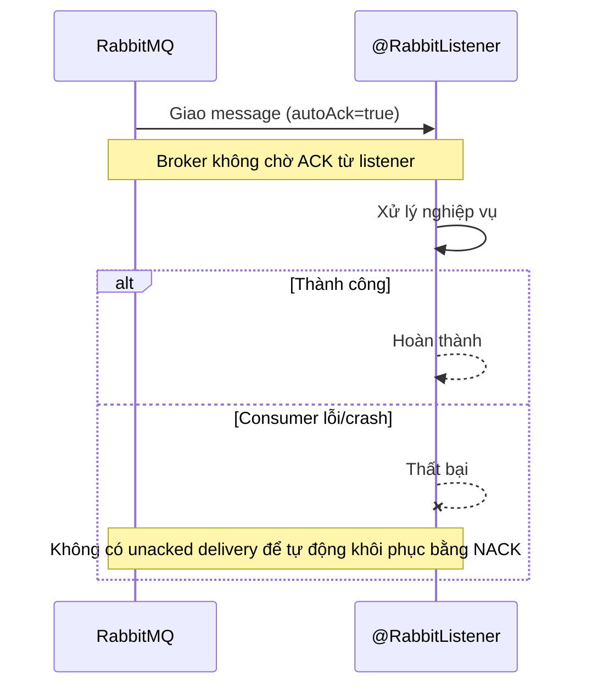
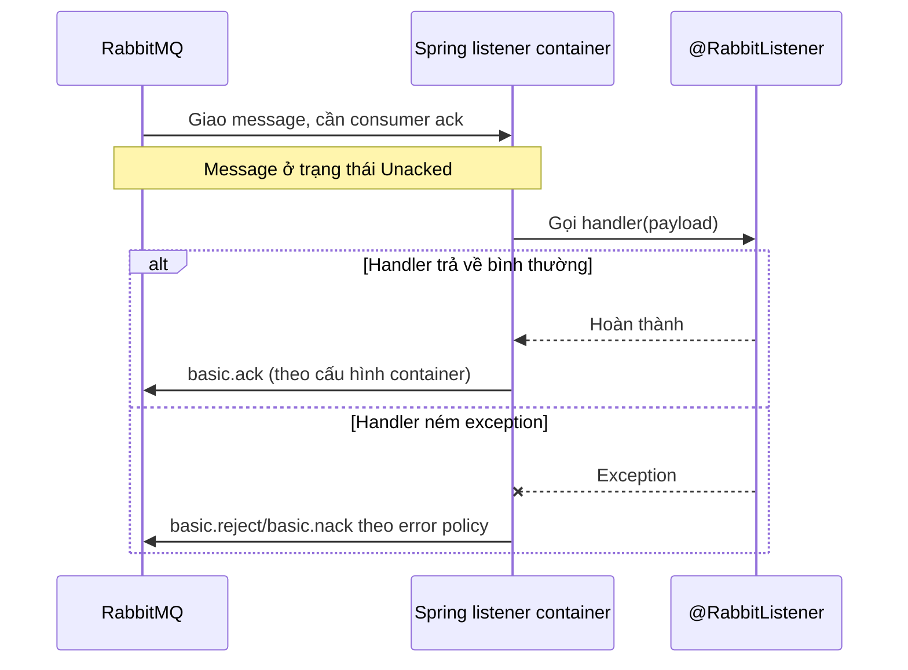
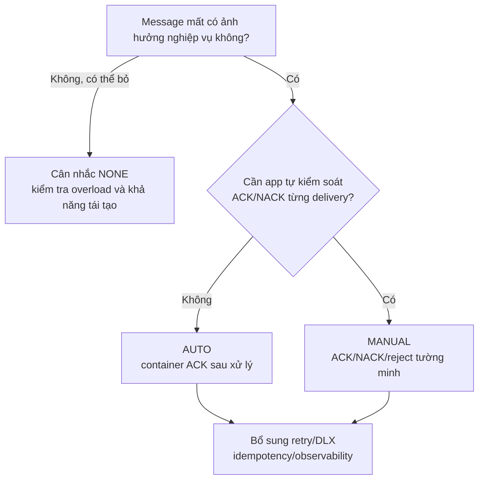

# AcknowledgeMode.NONE, AUTO và MANUAL của Spring

## 1. Vì sao consumer phải xác nhận thông điệp?

Trong **SPRING_AMQP**, `RabbitTemplate` phát thông điệp đến exchange, RabbitMQ định tuyến vào queue thông qua binding, và `@RabbitListener` nhận dữ liệu để xử lý bất đồng bộ. Sau khi broker **giao một message cho consumer**, câu hỏi quan trọng là: **khi nào RabbitMQ được phép coi message ấy đã xử lý xong và loại khỏi trạng thái chờ xác nhận?**

RabbitMQ cung cấp **consumer acknowledgement** để consumer xác nhận hoặc từ chối một lần giao. Spring AMQP đóng gói cơ chế này thành enum:

```java
org.springframework.amqp.core.AcknowledgeMode
```

Enum có ba giá trị:

- **`NONE`**: không gửi acknowledgement từ consumer; broker được yêu cầu coi message đã được nhận ngay khi giao (RabbitMQ gọi là **automatic acknowledgement / auto-ack**).
- **`AUTO`**: **Spring listener container** tự gửi ACK khi listener hoàn thành bình thường, và xử lý thất bại bằng cơ chế NACK/reject theo error policy. Đây là chế độ mặc định thông dụng.
- **`MANUAL`**: **code của consumer** chịu trách nhiệm gọi `Channel.basicAck(...)`, `basicNack(...)` hoặc `basicReject(...)` cho delivery thích hợp.

Bài thuộc chương **Xác nhận tiêu thụ**. Sau khi học, bạn có thể:

1. Phân biệt rõ **Spring AUTO** với **RabbitMQ auto-ack**.
2. Dự đoán số message `Ready` và `Unacked` trong từng chế độ.
3. Cấu hình ack mode bằng `application.yml`, listener container factory hoặc `@RabbitListener(ackMode = "...")`.
4. Thiết kế đường thành công, lỗi tạm thời và lỗi vĩnh viễn cho listener.
5. Thực hành manual ACK/NACK/reject với đúng `deliveryTag` và `Channel`.
6. Phối hợp acknowledgement với prefetch, concurrency, retry, dead-letter, giao dịch, idempotency và observability.

> **Nguyên tắc thiết kế:** ACK chỉ nên phản ánh ranh giới thành công mà hệ thống đã định nghĩa. **ACK không khiến xử lý trở thành exactly-once**, và không thể thay thế việc kiểm soát trùng lặp hoặc lỗi giữa database và RabbitMQ.

## 2. Sơ đồ vòng đời một delivery

RabbitMQ quản lý các message ở queue và gửi tới consumer đã đăng ký. Trong chế độ **yêu cầu acknowledgement**, một message đã giao nhưng chưa được ACK/NACK còn ở trạng thái **unacknowledged** trên broker.



**Lưu ý:** Sơ đồ là mô hình khái quát. Khi channel/connection đóng còn message chưa xác nhận, broker sẽ đưa các delivery đó trở lại trạng thái có thể giao theo quy tắc của queue. Với quorum queue, delivery limit hoặc các policy khác có thể thay đổi kết quả (ví dụ dead-letter thay vì tiếp tục giao lại).

### 2.1. `Ready` và `Unacked` là gì?

| Chỉ số queue | Ý nghĩa |
|---|---|
| **Ready** | Message đang sẵn sàng để broker giao cho consumer |
| **Unacked** | Message đã được giao nhưng broker vẫn chờ consumer xác nhận |
| **Total messages** | Tổng message trong queue theo cách RabbitMQ báo cáo; thông thường gồm Ready và Unacked |

Trong `NONE`, broker không giữ mỗi delivery lại ở `Unacked` để chờ ứng dụng xử lý. Trong `AUTO` hoặc `MANUAL`, `Unacked` có thể tăng trong thời gian listener đang xử lý.

Các chỉ số này thay đổi rất nhanh. Nếu listener xử lý trong vài mili giây, bạn có thể không thấy `Unacked` tăng trong giao diện Management dù ACK vẫn đang hoạt động đúng.

## 3. So sánh ba chế độ trong một bảng

| Tiêu chí | `AcknowledgeMode.NONE` | `AcknowledgeMode.AUTO` | `AcknowledgeMode.MANUAL` |
|---|---|---|---|
| Ai chịu trách nhiệm ACK? | **Không ai gửi ACK**; broker tự coi delivery đã được xác nhận khi gửi | **Listener container** của Spring | **Code ứng dụng** (hoặc cơ chế async acknowledgement mà framework hỗ trợ) |
| RabbitMQ consumer `autoAck` | `true` | `false` | `false` |
| Sau khi method listener trả về thành công | Không có ACK bổ sung | Container gửi ACK theo cấu hình | Phải có ACK/NACK/reject do code hoặc cơ chế async phù hợp thực hiện |
| Khi method ném exception | Không thể lấy lại chỉ nhờ NACK của delivery đã auto-ack | Container xử lý exception và quyết định reject/requeue theo policy | Ứng dụng phải bảo đảm một đường xử lý ACK/NACK/reject rõ ràng |
| Message đang xử lý thể hiện `Unacked`? | Thường **không** | **Có thể có** | **Có thể có** |
| Broker có thể giao lại sau consumer crash trước ACK? | Không dựa vào consumer acknowledgement | Có, nếu delivery chưa được ACK | Có, nếu delivery chưa được ACK |
| Điều khiển requeue từng message từ application | Không | Chủ yếu qua exception/policy container | Trực tiếp qua `basicNack` / `basicReject` |
| Rủi ro đặc trưng | Mất message khi consumer thất bại sau khi broker gửi | Requeue vô hạn nếu xử lý lỗi chưa hợp lý | Quên ACK, ACK sai channel, ACK hai lần, làm đầy `Unacked` |
| Mức độ kiểm soát | Thấp | Cân bằng, thường đủ tốt | Cao nhưng cần kỷ luật |
| Trường hợp phù hợp | Telemetry có thể bỏ qua, dữ liệu không quan trọng | Đa số ứng dụng nghiệp vụ thông thường | Xác nhận có điều kiện, xử lý theo giao thức riêng hoặc cần kiểm soát tinh |

**Cảnh báo về cách gọi:** `AcknowledgeMode.AUTO` của Spring **không phải** RabbitMQ `autoAck=true`. Tên giống nhau nhưng ý nghĩa đối lập ở điểm quan trọng: Spring AUTO **vẫn chờ listener kết thúc** rồi mới gửi ACK; RabbitMQ automatic acknowledgement **không chờ** kết quả listener.

## 4. `AcknowledgeMode.NONE` — broker tự coi đã nhận

### 4.1. Cơ chế

Trong chế độ `NONE`, Spring đăng ký consumer với RabbitMQ bằng `autoAck=true`. Broker không đòi consumer gửi `basic.ack` sau từng delivery. Từ góc nhìn broker, việc giao message đồng nghĩa message **không còn được giữ lại để chờ acknowledgement của consumer**.



Ví dụ một message dùng để cập nhật biểu đồ realtime có thể được chấp nhận mất nếu một tiến trình consumer tắt đột ngột. Chế độ `NONE` có thể phù hợp với những dữ liệu **có nguồn tái tạo** hoặc **mất một vài mẫu không ảnh hưởng đến đúng đắn nghiệp vụ**.

### 4.2. Điều gì xảy ra nếu listener ném exception?

`NONE` không giữ một delivery đang chờ xác nhận. Nếu handler ném exception sau khi broker đã giao message, container **không thể biến lần giao đã auto-ack thành một delivery chưa ACK để yêu cầu broker tự giao lại**. Muốn retry trong ứng dụng, bạn phải thiết kế cơ chế riêng; không thể trông chờ `basicNack(tag, ..., true)` của message đã auto-ack.

Ví dụ listener chỉ để quan sát:

```java
import org.springframework.amqp.rabbit.annotation.RabbitListener;
import org.springframework.stereotype.Component;

@Component
public class EphemeralMetricsListener {

    @RabbitListener(
            queues = "demo.acks.metrics",
            ackMode = "NONE")
    public void consumeMetric(String text) {
        System.out.println("Metric: " + text);
    }
}
```

Code này **giả định** queue `demo.acks.metrics` đã tồn tại hoặc được khai báo ở một bean `Queue`. `ackMode` ở annotation yêu cầu chế độ NONE đối với listener endpoint đó.

### 4.3. Giới hạn cần nhớ

- `NONE` không phù hợp với luồng thanh toán, thay đổi tồn kho, xử lý đơn hàng hoặc dữ liệu không được phép mất.
- Spring AMQP không cho kết hợp `AcknowledgeMode.NONE` với `channelTransacted=true` trong listener container.
- **Prefetch dựa trên unacknowledged deliveries** không giới hạn inflight theo cách mong muốn đối với auto-ack; tài liệu Spring AMQP ghi nhận `prefetchCount` bị bỏ qua ở chế độ `NONE`.
- Tốc độ broker gửi có thể vượt khả năng xử lý của consumer; cần quan tâm giới hạn bộ nhớ, backpressure và mức đồng thời ở các tầng khác.

## 5. `AcknowledgeMode.AUTO` — container xác nhận sau listener

### 5.1. Chế độ mặc định

`AUTO` là chế độ mặc định phổ biến của Spring AMQP listener container. Trong chế độ này, consumer được đăng ký với `autoAck=false` ở RabbitMQ, nhưng **application code không cần tự gọi `Channel.basicAck(...)`**.

Quy trình thường gặp:



Điểm quan trọng: `AUTO` nghĩa là **Spring container tự quản lý ACK**, **không phải ACK trước khi xử lý**. Nếu listener làm việc đồng bộ và phương thức ném exception ra ngoài, container sẽ thấy thất bại và có cơ hội xử lý requeue/reject.

### 5.2. Listener thành công

```java
import org.springframework.amqp.rabbit.annotation.RabbitListener;
import org.springframework.stereotype.Component;

@Component
public class OrderCreatedListener {

    private final OrderService orderService;

    public OrderCreatedListener(OrderService orderService) {
        this.orderService = orderService;
    }

    @RabbitListener(
            queues = "demo.acks.orders",
            ackMode = "AUTO")
    public void onOrder(String orderId) {
        orderService.processOrder(orderId);
        // Không gọi basicAck ở đây: container quản lý ACK.
    }
}
```

Trong ví dụ, nếu `processOrder(...)` trả về bình thường và không có cấu hình khác làm thay đổi vòng đời xử lý, container xem listener thành công và ACK theo chính sách của nó.

**Đừng cho rằng ACK xảy ra chính xác tại từng dòng cuối của method:** Một số listener container có chế độ **batch acknowledgement** (ví dụ `batchSize` với `SimpleMessageListenerContainer`, hoặc cấu hình tương đương khác tùy loại container) nên thời điểm frame ACK có thể được gom theo lô.

### 5.3. Listener thất bại và mặc định requeue

```java
@RabbitListener(
        queues = "demo.acks.orders",
        ackMode = "AUTO")
public void onOrder(String orderId) {
    if (orderId.isBlank()) {
        throw new IllegalArgumentException(
                "orderId must not be blank");
    }
    orderService.processOrder(orderId);
}
```

Nếu một exception được ném **ra ngoài** listener, container sẽ áp dụng quy tắc xử lý lỗi. Thông thường, `defaultRequeueRejected=true` khiến nhiều lỗi xử lý được **requeue**, nhưng **đừng giả định mọi exception đều được requeue**:

- Một số exception về chuyển đổi message, chữ ký handler hoặc điều kiện được phân loại là **fatal** bởi error handler mặc định, có thể bị reject **không requeue**.
- `AmqpRejectAndDontRequeueException` cho phép thể hiện ý định reject không requeue.
- `ImmediateRequeueAmqpException` có thể yêu cầu requeue ngay trong ngữ cảnh phù hợp.
- Retry advice, recoverer, transaction manager và container type cũng có thể thay đổi hành vi cuối cùng.

Ví dụ từ chối không requeue khi dữ liệu chắc chắn sai:

```java
import org.springframework.amqp.AmqpRejectAndDontRequeueException;
import org.springframework.amqp.rabbit.annotation.RabbitListener;

@RabbitListener(queues = "demo.acks.orders", ackMode = "AUTO")
public void handle(String payload) {
    if (!payload.startsWith("ORDER:")) {
        throw new AmqpRejectAndDontRequeueException(
                "Unsupported message format");
    }
    // Xử lý nghiệp vụ thông thường.
}
```

Đoạn này chỉ minh họa cách báo lỗi trong listener; không đặt nó cùng một queue với nhiều listener cạnh tranh khi thử nghiệm nếu không có chủ đích.

**Nếu queue đã cấu hình dead-letter exchange (DLX):** message bị reject/NACK với `requeue=false` có thể được chuyển sang DLX và queue đích tương ứng. Nếu không có DLX/binding hợp lệ, nó có thể bị loại bỏ. Cơ chế dead-letter **không phải** một tính năng tự bật chỉ nhờ `AUTO`.

### 5.4. Một bẫy đặc biệt: nuốt exception

```java
// Sai nếu lỗi nghiệp vụ cần được broker nhận biết.
@RabbitListener(queues = "demo.acks.orders", ackMode = "AUTO")
public void handleSilently(String payload) {
    try {
        orderService.processOrder(payload);
    } catch (Exception ex) {
        log.error("Processing failed", ex);
        // Method vẫn trả về bình thường!
    }
}
```

Với `AUTO`, container **không biết lỗi đã bị code nuốt**, vì method kết thúc bình thường. Message có thể được **ACK như đã xử lý thành công**. Nếu muốn lỗi làm message được retry/requeue/reject, hãy:

- Ném lại exception phù hợp để container xử lý; hoặc
- Chủ động đưa message vào một workflow phục hồi được thiết kế rõ ràng trước khi trả về bình thường.

Đây là một trong những nguyên nhân phổ biến khiến queue hết message nhưng dữ liệu nghiệp vụ không được cập nhật.

## 6. `AcknowledgeMode.MANUAL` — ứng dụng quyết định từng delivery

### 6.1. Ba thao tác của RabbitMQ Java client

Trong chế độ `MANUAL`, code ứng dụng có thể dùng `com.rabbitmq.client.Channel` nhận cùng delivery:

| Thao tác | Cú pháp | Ý nghĩa |
|---|---|---|
| **ACK** | `channel.basicAck(tag, false)` | Xác nhận đã xử lý delivery tương ứng |
| **NACK, requeue** | `channel.basicNack(tag, false, true)` | Từ chối delivery và cho phép broker xếp lại để giao |
| **NACK, không requeue** | `channel.basicNack(tag, false, false)` | Từ chối; dead-letter nếu có DLX hợp lệ, nếu không có thể bị loại bỏ |
| **Reject, không requeue** | `channel.basicReject(tag, false)` | Từ chối **một** delivery; không requeue |
| **Reject, requeue** | `channel.basicReject(tag, true)` | Từ chối **một** delivery và cho phép giao lại |

`tag` là `deliveryTag` từ message được broker giao. **Delivery tag thuộc phạm vi channel**, không phải ID duy nhất toàn broker. Phải ACK/NACK/reject trên **đúng channel** đã nhận message đó.

### 6.2. `multiple=false` và `multiple=true`

Phương thức `basicAck` và `basicNack` nhận tham số `multiple`:

```java
channel.basicAck(tag, false); // Chỉ delivery có tag này.
channel.basicAck(tag, true);  // Các delivery còn pending tới tag này trên channel.
```

Khi `multiple=true`, RabbitMQ xử lý **các delivery chưa xác nhận có tag không lớn hơn tag đã chỉ định** trên channel. Ví dụ một channel còn tag `7`, `8`, `9` chờ ACK; gọi `basicAck(9, true)` có thể ACK cả ba.

Đây là tối ưu hữu ích khi bạn **cố ý xử lý theo lô có thứ tự**, nhưng nguy hiểm nếu các tác vụ được giao cho worker đồng thời: ACK tag `9` khi `7` chưa xử lý xong có thể đánh dấu nhầm `7` thành công.

**Khuyến nghị cho ví dụ một-message-một-handler:** dùng `multiple=false` và chỉ ACK sau khi công việc đã hoàn tất.

### 6.3. Manual ACK sau công việc nghiệp vụ

Ví dụ độc lập:

```java
import com.rabbitmq.client.Channel;
import java.io.IOException;
import java.nio.charset.StandardCharsets;
import org.springframework.amqp.core.Message;
import org.springframework.amqp.rabbit.annotation.RabbitListener;
import org.springframework.stereotype.Component;

@Component
public class ManualOrderListener {

    private final OrderService orderService;

    public ManualOrderListener(OrderService orderService) {
        this.orderService = orderService;
    }

    @RabbitListener(
            queues = "demo.acks.manual",
            ackMode = "MANUAL")
    public void handle(Message message, Channel channel)
            throws IOException {

        long tag = message.getMessageProperties().getDeliveryTag();
        String orderId = new String(
                message.getBody(), StandardCharsets.UTF_8);

        try {
            orderService.processOrder(orderId);
        } catch (IllegalArgumentException permanentError) {
            // Payload sai vĩnh viễn: không đưa về queue chính.
            channel.basicReject(tag, false);
            return;
        } catch (RuntimeException processingError) {
            // Minh họa chính sách đưa về DLX thay vì requeue vô hạn.
            channel.basicNack(tag, false, false);
            return;
        }

        // ACK nằm NGOÀI try xử lý nghiệp vụ để không vô tình
        // NACK lại cùng tag nếu chính thao tác ACK ném IOException.
        channel.basicAck(tag, false);
    }
}
```

**Điều kiện chạy:** Queue phải tồn tại. Trường hợp trên sử dụng `ackMode="MANUAL"` ngay ở annotation; ở những phiên bản Spring AMQP hỗ trợ thuộc tính này, nó ghi đè chế độ được listener container factory cấu hình cho endpoint.

**Vì sao không đơn giản ACK trong `finally`?** Vì `finally` chạy cả khi nghiệp vụ thất bại. ACK trong `finally` có thể làm mất một message chưa được xử lý. Thay vào đó, phải định nghĩa **một nhánh rõ ràng cho mỗi kết quả**.

**Vì sao bắt exception nghiệp vụ trước ACK?** Nếu `channel.basicAck(...)` ném lỗi do channel/connection bị đóng, **không biết chắc** broker đã ghi nhận ACK hay chưa. Tự động gọi tiếp `basicNack` cùng tag có thể tạo double-ack/unknown-delivery-tag. Cần xử lý lỗi transport bằng chiến lược phù hợp và chấp nhận khả năng redelivery.

### 6.4. Manual mà quên ACK thì sao?

```java
@RabbitListener(queues = "demo.acks.manual", ackMode = "MANUAL")
public void forgetToAck(String payload) {
    System.out.println(payload);
    // Không gửi ACK, NACK hoặc reject.
}
```

Container **không tự ACK vì method trả về bình thường**. Delivery có thể còn ở `Unacked`; khi đạt giới hạn prefetch, broker dừng cấp thêm delivery mới cho consumer đó cho tới khi các delivery được xác nhận hoặc channel/connection thay đổi trạng thái.

Khi channel/connection đóng, message chưa được ACK thường có thể được giao lại. Nếu ứng dụng có nhiều message treo, queue có thể bị nghẽn dù handler log “đã nhận”.

### 6.5. MANUAL không tương đương yêu cầu requeue ngay mọi lỗi

`basicNack(tag, false, true)` yêu cầu broker requeue. Nếu message tiếp tục được giao cho cùng consumer và lỗi vẫn còn, bạn có thể tạo **vòng lặp retry cực nhanh**, tăng CPU, network và logs mà không giải quyết vấn đề.

Với lỗi tạm thời (dịch vụ phụ trợ down), cân nhắc:

- Retry trong ứng dụng có **giới hạn lần thử và backoff**.
- Dead-letter tới một cơ chế delay/retry được thiết kế rõ ràng.
- Dừng hoặc giảm tốc độ consumer khi dependency không sẵn sàng.
- Dùng idempotency và business event ID để chịu được redelivery.

Với lỗi dữ liệu vĩnh viễn, reject/NACK `requeue=false` tới DLX thường phù hợp hơn requeue vô hạn.

## 7. Cấu hình acknowledge mode trong Spring Boot

### 7.1. Dependency

Với Gradle Groovy DSL:

```groovy
dependencies {
    implementation 'org.springframework.boot:spring-boot-starter-amqp'
}
```

Với Maven:

```xml
<dependency>
    <groupId>org.springframework.boot</groupId>
    <artifactId>spring-boot-starter-amqp</artifactId>
</dependency>
```

Sử dụng BOM hoặc dependency management của Spring Boot để chọn phiên bản Spring AMQP tương thích. Ví dụ Java phía dưới dựa trên API `@RabbitListener`, `AcknowledgeMode` và RabbitMQ Java client thông dụng trong các dòng Spring AMQP hiện đại.

### 7.2. Cấu hình toàn cục cho Simple listener container

`src/main/resources/application.yml`:

```yaml
spring:
  rabbitmq:
    host: localhost
    port: 5672
    username: guest
    password: guest
    listener:
      type: simple
      simple:
        acknowledge-mode: auto
        prefetch: 10
        concurrency: 2
        default-requeue-rejected: false
```

Giải thích:

- `spring.rabbitmq.listener.type=simple` chọn **SimpleRabbitListenerContainerFactory** của Spring Boot.
- `listener.simple.acknowledge-mode=auto` yêu cầu Spring container quản lý ACK cho listener mặc định.
- `prefetch=10` giới hạn số delivery chưa được ACK có thể đang chờ trên consumer theo thiết lập QoS tương ứng; giá trị thực tế còn phụ thuộc các cấu hình batch/container.
- `concurrency=2` tạo hai consumer đồng thời theo cấu hình `SimpleMessageListenerContainer`.
- `default-requeue-rejected=false` làm nhiều lỗi xử lý không được requeue theo mặc định; **không có nghĩa mọi lỗi đều biến thành DLQ** nếu queue không cấu hình DLX.

**Đừng copy `default-requeue-rejected=false` vào production mà không kiểm tra retry/DLQ.** Nó giúp tránh poison message lặp vô hạn nhưng cũng có thể làm mất dữ liệu nếu không có đường lưu/quan sát thất bại.

Đối với factory kiểu **direct**, dùng nhánh cấu hình tương ứng:

```yaml
spring:
  rabbitmq:
    listener:
      type: direct
      direct:
        acknowledge-mode: auto
        prefetch: 10
```

Không coi `listener.simple.*` và `listener.direct.*` là hai cấu hình luôn áp dụng đồng thời. Cần biết ứng dụng đang chọn loại listener container nào.

**Tài khoản `guest/guest`** chỉ dành cho bài lab trên broker local; môi trường vận hành thật phải sử dụng credentials riêng, secret management, TLS và cấu hình virtual host phù hợp.

### 7.3. Ghi đè theo từng `@RabbitListener`

Nếu đa số listener dùng AUTO nhưng một queue cần MANUAL:

```java
@RabbitListener(queues = "demo.acks.auto", ackMode = "AUTO")
public void handleAuto(String message) {
    // Container ACK sau khi phương thức hoàn thành.
}

@RabbitListener(queues = "demo.acks.manual", ackMode = "MANUAL")
public void handleManual(
        org.springframework.amqp.core.Message message,
        com.rabbitmq.client.Channel channel) throws java.io.IOException {

    long tag = message.getMessageProperties().getDeliveryTag();
    // Thực hiện nghiệp vụ ...
    channel.basicAck(tag, false);
}
```

Hai method trên là **minh họa cấu hình endpoint**, nên đặt trong một hoặc hai bean Spring hợp lệ, và các queue phải được khai báo. `ackMode` ở `@RabbitListener` là cách chỉ rõ chế độ cho một endpoint; không nhất thiết phải tạo ba application context riêng cho ba mode.

Nếu phần lớn hệ thống có những chính sách retry, concurrency hoặc connection khác nhau, sử dụng **container factory riêng cho nhóm queue** có thể rõ ràng hơn cấu hình một mode toàn cục.

### 7.4. Cấu hình bằng Java listener container factory

Ví dụ:

```java
import org.springframework.amqp.core.AcknowledgeMode;
import org.springframework.amqp.rabbit.config.SimpleRabbitListenerContainerFactory;
import org.springframework.amqp.rabbit.connection.ConnectionFactory;
import org.springframework.boot.autoconfigure.amqp.SimpleRabbitListenerContainerFactoryConfigurer;
import org.springframework.context.annotation.Bean;
import org.springframework.context.annotation.Configuration;

@Configuration
public class ManualListenerFactoryConfig {

    @Bean
    SimpleRabbitListenerContainerFactory manualListenerFactory(
            ConnectionFactory connectionFactory,
            SimpleRabbitListenerContainerFactoryConfigurer bootConfigurer) {

        SimpleRabbitListenerContainerFactory factory =
                new SimpleRabbitListenerContainerFactory();
        bootConfigurer.configure(factory, connectionFactory);
        factory.setAcknowledgeMode(AcknowledgeMode.MANUAL);
        factory.setPrefetchCount(10);
        return factory;
    }
}
```

Listener sử dụng:

```java
@RabbitListener(
        queues = "demo.acks.manual",
        containerFactory = "manualListenerFactory")
public void receive(
        org.springframework.amqp.core.Message message,
        com.rabbitmq.client.Channel channel) throws java.io.IOException {
    long tag = message.getMessageProperties().getDeliveryTag();
    // Sau khi xử lý thành công:
    channel.basicAck(tag, false);
}
```

Đây là **một cách thay thế** cho `ackMode="MANUAL"` trên annotation, không bắt buộc khai báo cả hai. Dùng `SimpleRabbitListenerContainerFactoryConfigurer` để kế thừa những thiết lập thích hợp của Spring Boot trước khi đổi ack mode/prefetch cho nhóm listener cần thiết.

### 7.5. Khi nào channel transactional được phép?

`AcknowledgeMode.NONE` **không tương thích** với `channelTransacted=true`. `AUTO` và `MANUAL` có thể dùng với transactional channel, nhưng khi channel có giao dịch, **ACK còn chịu ràng buộc commit của giao dịch AMQP**; các cấu hình transaction manager/rollback ảnh hưởng thời điểm và kết quả thực tế.

Không nên coi bật `channelTransacted=true` là bảo đảm một transaction nguyên tử giữa **RabbitMQ và database**. Nếu cần nhất quán giữa ghi database và phát/nhận sự kiện, cần đánh giá transaction boundary, idempotency và mô hình như **transactional outbox**.

## 8. Ví dụ Spring Boot hoàn chỉnh: AUTO và MANUAL trên hai queue

Ví dụ tạo:

- Queue `demo.acks.auto` dùng `AcknowledgeMode.AUTO`.
- Queue `demo.acks.manual` dùng `AcknowledgeMode.MANUAL` và DLX để giữ message bị từ chối.
- DLX `demo.acks.dlx` và queue `demo.acks.dead` nhận những message bị reject không requeue.

Không đặt hai consumer AUTO và MANUAL cùng nghe **một queue** trong phép thử, vì chúng sẽ trở thành competing consumers, khiến việc quan sát ack mode không rõ ràng.

### 8.1. Topology

File `DemoQueues.java` trong package `com.example.consumeracks`:

```java
package com.example.consumeracks;

import org.springframework.amqp.core.Binding;
import org.springframework.amqp.core.BindingBuilder;
import org.springframework.amqp.core.DirectExchange;
import org.springframework.amqp.core.Queue;
import org.springframework.amqp.core.QueueBuilder;
import org.springframework.beans.factory.annotation.Qualifier;
import org.springframework.context.annotation.Bean;
import org.springframework.context.annotation.Configuration;

@Configuration
public class DemoQueues {

    public static final String AUTO_QUEUE = "demo.acks.auto";
    public static final String MANUAL_QUEUE = "demo.acks.manual";
    public static final String DLX = "demo.acks.dlx";
    public static final String DEAD_QUEUE = "demo.acks.dead";

    @Bean
    Queue autoQueue() {
        return QueueBuilder.durable(AUTO_QUEUE).build();
    }

    @Bean
    Queue manualQueue() {
        return QueueBuilder.durable(MANUAL_QUEUE)
                .deadLetterExchange(DLX)
                .deadLetterRoutingKey("rejected")
                .build();
    }

    @Bean
    DirectExchange deadLetterExchange() {
        return new DirectExchange(DLX, true, false);
    }

    @Bean
    Queue demoDeadQueue() {
        return QueueBuilder.durable(DEAD_QUEUE).build();
    }

    @Bean
    Binding deadLetterBinding(
            @Qualifier("demoDeadQueue") Queue deadQueue,
            @Qualifier("deadLetterExchange") DirectExchange exchange) {
        return BindingBuilder.bind(deadQueue)
                .to(exchange).with("rejected");
    }
}
```

Các bean này có thể được Spring AMQP `RabbitAdmin` khai báo khi Spring Boot mở kết nối tới broker, nếu auto-declaration được bật và user có quyền tạo tài nguyên. Queue AUTO không cần cấu hình DLX cho ví dụ thành công; queue MANUAL có DLX riêng để quan sát tác dụng của `requeue=false`.

### 8.2. Service nghiệp vụ

File `DemoWorkService.java`:

```java
package com.example.consumeracks;

import org.springframework.stereotype.Service;

@Service
public class DemoWorkService {

    public void process(String payload) {
        if (payload.startsWith("INVALID:")) {
            throw new IllegalArgumentException(
                    "Payload is permanently invalid");
        }

        if (payload.startsWith("FAIL:")) {
            throw new IllegalStateException(
                    "Simulated processing failure");
        }

        System.out.println("PROCESSED: " + payload);
    }
}
```

`INVALID:` là minh họa lỗi dữ liệu vĩnh viễn. `FAIL:` là lỗi xử lý giả lập để quan sát nhánh thất bại. Trong ứng dụng thật, loại lỗi cần được xác định bằng logic nghiệp vụ, không chỉ bằng tiền tố chuỗi.

### 8.3. AUTO listener

File `DemoAutoListener.java`:

```java
package com.example.consumeracks;

import org.springframework.amqp.rabbit.annotation.RabbitListener;
import org.springframework.stereotype.Component;

@Component
public class DemoAutoListener {

    private final DemoWorkService service;

    public DemoAutoListener(DemoWorkService service) {
        this.service = service;
    }

    @RabbitListener(
            queues = DemoQueues.AUTO_QUEUE,
            ackMode = "AUTO")
    public void onMessage(String payload) {
        service.process(payload);
        // AUTO: không gọi Channel.basicAck().
    }
}
```

Message thành công khiến listener trả về bình thường. Container quản lý ACK. **Trong demo khởi động ban đầu chỉ gửi message thành công vào queue AUTO** để tránh lỗi giả lập làm requeue liên tục nếu error policy chưa được thiết kế.

### 8.4. MANUAL listener

File `DemoManualListener.java`:

```java
package com.example.consumeracks;

import com.rabbitmq.client.Channel;
import java.io.IOException;
import java.nio.charset.StandardCharsets;
import org.springframework.amqp.core.Message;
import org.springframework.amqp.rabbit.annotation.RabbitListener;
import org.springframework.stereotype.Component;

@Component
public class DemoManualListener {

    private final DemoWorkService service;

    public DemoManualListener(DemoWorkService service) {
        this.service = service;
    }

    @RabbitListener(
            queues = DemoQueues.MANUAL_QUEUE,
            ackMode = "MANUAL")
    public void onMessage(Message message, Channel channel)
            throws IOException {

        long tag = message.getMessageProperties().getDeliveryTag();
        String payload = new String(
                message.getBody(), StandardCharsets.UTF_8);

        try {
            service.process(payload);
        } catch (IllegalArgumentException invalid) {
            channel.basicReject(tag, false);
            System.err.println("REJECTED: " + payload);
            return;
        } catch (RuntimeException failed) {
            // Demo: đẩy về DLX sau lỗi, không retry vô hạn.
            channel.basicNack(tag, false, false);
            System.err.println("NACKED: " + payload);
            return;
        }

        channel.basicAck(tag, false);
        System.out.println("ACKED: " + payload);
    }
}
```

Giải thích:

- `MessageProperties.deliveryTag` lấy từ delivery do broker cấp.
- `Channel` được framework truyền vào method, tương ứng với channel consumer nhận message.
- Nếu xử lý thành công, code gọi `basicAck(tag, false)`.
- Nếu dữ liệu sai, `basicReject(tag, false)` từ chối **không requeue**.
- Nếu lỗi khác, ví dụ cũng `basicNack(tag, false, false)` để đưa vào DLX của lab, tránh tạo retry loop vô hạn.
- Trong production, lỗi transient có thể cần một **retry policy/backoff có giới hạn** thay vì đưa ngay vào DLQ. Cần quyết định theo business SLA.

**Giới hạn:** Đoạn code chủ động xử lý các exception từ `service.process(...)`. Những exception xảy ra **trước khi listener method được gọi** (ví dụ message conversion/argument binding) hoặc exception của chính lệnh ACK/NACK còn chịu cách xử lý của listener container. Không nên coi đoạn này là error handler bao phủ mọi lỗi có thể xảy ra ở production.

### 8.5. Publisher gửi message để thử

File `DemoPublisher.java`:

```java
package com.example.consumeracks;

import org.springframework.amqp.rabbit.core.RabbitTemplate;
import org.springframework.stereotype.Service;

@Service
public class DemoPublisher {

    private final RabbitTemplate rabbitTemplate;

    public DemoPublisher(RabbitTemplate rabbitTemplate) {
        this.rabbitTemplate = rabbitTemplate;
    }

    public void publishDemo() {
        rabbitTemplate.convertAndSend(
                "", DemoQueues.AUTO_QUEUE, "ORDER:AUTO-1");
        rabbitTemplate.convertAndSend(
                "", DemoQueues.MANUAL_QUEUE, "ORDER:MANUAL-1");
        rabbitTemplate.convertAndSend(
                "", DemoQueues.MANUAL_QUEUE, "INVALID:MANUAL-2");
        rabbitTemplate.convertAndSend(
                "", DemoQueues.MANUAL_QUEUE, "FAIL:MANUAL-3");
    }
}
```

Đoạn này dùng **default exchange** tên `""`: queue được khai báo sẽ có binding ngầm theo tên queue. Chúng ta không cần tạo exchange riêng cho publisher, còn DLX được sử dụng khi message trên queue MANUAL bị từ chối.

### 8.6. Spring Boot application

File `ConsumerAcksApplication.java`:

```java
package com.example.consumeracks;

import org.springframework.amqp.rabbit.annotation.EnableRabbit;
import org.springframework.boot.ApplicationRunner;
import org.springframework.boot.SpringApplication;
import org.springframework.boot.autoconfigure.SpringBootApplication;
import org.springframework.context.annotation.Bean;

@SpringBootApplication
@EnableRabbit
public class ConsumerAcksApplication {

    public static void main(String[] args) {
        SpringApplication.run(ConsumerAcksApplication.class, args);
    }

    @Bean
    ApplicationRunner publishOnce(DemoPublisher publisher) {
        return args -> publisher.publishDemo();
    }
}
```

Ví dụ có thể chạy với cấu hình kết nối:

```yaml
spring:
  rabbitmq:
    host: localhost
    port: 5672
    username: guest
    password: guest
    listener:
      simple:
        acknowledge-mode: auto
        prefetch: 10
```

Chế độ AUTO trong YAML là mặc định cho listener không có override; listener MANUAL ghi `ackMode="MANUAL"` nên ghi đè. Dự án nên chọn **một** cách khai báo cùng mục đích để dễ theo dõi.

Nếu đã cài Docker và không có broker local, có thể chạy:

```bash
docker run -d --name rabbitmq-consumer-acks-lab \
  -p 5672:5672 -p 15672:15672 \
  rabbitmq:4-management
```

Khởi động ứng dụng bằng wrapper của dự án:

```bash
./mvnw spring-boot:run
# Hoặc:
./gradlew bootRun
```

Log dự kiến (thứ tự có thể khác):

```text
PROCESSED: ORDER:AUTO-1
PROCESSED: ORDER:MANUAL-1
ACKED: ORDER:MANUAL-1
REJECTED: INVALID:MANUAL-2
NACKED: FAIL:MANUAL-3
```

Trong RabbitMQ Management tại `http://localhost:15672`, bạn có thể quan sát `demo.acks.dead` chứa những message bị từ chối không requeue từ queue MANUAL, nếu topology được khai báo đầy đủ và không có consumer khác đọc DLQ.

### 8.7. Một ca thử cho `NONE` nhưng tách biệt topology

Để quan sát NONE, tạo queue `demo.acks.metrics` trong lab và đăng ký `EphemeralMetricsListener` từ mục 4. Gửi message vào queue này khi listener hoạt động:

```java
rabbitTemplate.convertAndSend(
        "", "demo.acks.metrics", "cpu=0.42");
```

Kiểm tra rằng broker không đợi ACK của message sau khi đã gửi cho consumer. Để tránh nhầm kết quả, không dùng queue `demo.acks.auto` hoặc `demo.acks.manual` để đồng thời đăng ký một listener NONE; các consumer đó sẽ cạnh tranh nhận message thay vì tái hiện riêng ba chính sách.

## 9. Prefetch, concurrency và luồng message Unacked

### 9.1. Prefetch kiểm soát bao nhiêu delivery đang chờ ACK

Khi broker đòi consumer acknowledgements, prefetch/QoS giới hạn số delivery chưa được ACK có thể đang outstanding cho consumer theo ngữ nghĩa RabbitMQ. Ví dụ đặt prefetch bằng `3`:

```text
Consumer C (prefetch=3)
  deliveryTag=1 → Unacked
  deliveryTag=2 → Unacked
  deliveryTag=3 → Unacked

Broker tạm chưa giao message thứ tư cho consumer C
cho đến khi có ACK/NACK phù hợp giải phóng slot.
```

Với `AUTO`, số delivery đang xử lý chưa ACK phụ thuộc tốc độ listener và cách container vận hành. Với `MANUAL`, nếu quên ACK, những slot này có thể không được giải phóng và hệ thống dường như “đứng”.

Trong `NONE`, broker không đợi consumer ACK, nên prefetch theo **unacked deliveries** không phát huy tác dụng như ở AUTO/MANUAL.

### 9.2. Concurrency khác prefetch

| Cấu hình | Vai trò |
|---|---|
| `concurrency` hoặc số consumer | Có bao nhiêu consumer xử lý đồng thời |
| `prefetch` | Mỗi consumer có thể giữ bao nhiêu delivery chưa được xác nhận theo QoS |
| `acknowledge-mode` | Ai và khi nào gửi ACK/NACK/reject |
| `batchSize` / `messagesPerAck` | Nếu có hỗ trợ, container có thể gom acknowledgement theo lô |

Ví dụ 4 consumers và prefetch 10 nghĩa là broker có thể có **nhiều delivery unacked trên tổng các consumer**, chứ không có nghĩa cả ứng dụng chỉ xử lý đúng 10 message tại một thời điểm.

Đừng tăng prefetch quá cao khi mỗi message lớn hoặc xử lý chậm: message có thể tích tụ trong bộ nhớ consumer và ảnh hưởng công bằng giữa các consumer. Nếu yêu cầu thứ tự xử lý chặt chẽ, còn phải xem số consumer, requeue, retry và chính sách queue.

### 9.3. NACK requeue có thể ảnh hưởng thứ tự

Khi một message bị requeue, broker có thể đặt lại message ở vị trí phụ thuộc hoạt động đồng thời và loại queue; **không được giả định xử lý cuối cùng luôn theo đúng thứ tự publish ban đầu**. Nếu luồng nghiệp vụ yêu cầu ordering theo key, cần thiết kế partitioning/serial processing hoặc sequence/version check, ngoài việc chọn ack mode.

## 10. Consumer crash, redelivery và xử lý trùng lặp

Trong `AUTO` hoặc `MANUAL`, nếu consumer chết **trước khi broker ghi nhận ACK**, message thường được đưa vào diện có thể giao lại cho consumer khác hoặc cho chính service khi khởi động lại.

```mermaid
sequenceDiagram
    participant Q as RabbitMQ
    participant C1 as Consumer 1
    participant DB as Database
    participant C2 as Consumer 2

    Q->>C1: Giao event-42
    C1->>DB: Cập nhật dữ liệu nghiệp vụ
    DB-->>C1: Commit thành công
    C1--xQ: Crash trước basicAck
    Note over Q: Delivery chưa ACK<br/>có thể được đưa trở lại queue
    Q->>C2: Redeliver event-42
    C2->>DB: Kiểm tra idempotency event-42
    DB-->>C2: Đã xử lý; không lặp side effect
    C2->>Q: basicAck
```

Đây là tình huống kinh điển của **at-least-once processing**: tác vụ nghiệp vụ có thể **đã thành công**, nhưng ACK bị mất do lỗi mạng/crash. Broker giao lại message, dẫn đến **xử lý lặp** nếu code không có cơ chế idempotency.

Các cách phòng tránh:

1. Publisher gắn **event ID ổn định** như `messageId` hoặc application header có hợp đồng rõ ràng.
2. Consumer kiểm tra event ID trong **bảng đã xử lý** hoặc một cơ chế idempotency đáng tin cậy.
3. Nếu cập nhật nghiệp vụ và đánh dấu ID đã xử lý trong cùng database, nên dùng một **transaction DB** để đảm bảo tính nhất quán nội bộ.
4. Sau khi transaction DB hoàn thành, ACK message.
5. Nếu có crash ngay trước ACK, consumer mới nhìn thấy ID đã xử lý và ACK mà không lặp side effect.

**Đừng dùng `deliveryTag` làm idempotency key:** tag chỉ có phạm vi một channel và có thể khác giữa các lần redelivery.

### 10.1. Cờ redelivered không đủ để phát hiện mọi duplicate

`MessageProperties.getRedelivered()` cho biết broker đánh dấu message đã được giao lại. Nhưng publisher có thể tự gửi **hai message khác nhau có cùng business event ID**; cả hai có thể mang `redelivered=false` ở lần giao đầu.

Vì vậy, idempotency nên dựa trên **event ID**, không dựa vào cờ redelivered hay số thứ tự delivery.

### 10.2. ACK không đồng nghĩa transaction nhiều hệ thống

Với database và RabbitMQ:

```text
DB commit thành công → trước ACK mất kết nối → message redeliver.
ACK quá sớm → DB commit thất bại → message đã biến mất khỏi queue.
```

Không có lựa chọn ACK nào tự làm hai thao tác này trở nên nguyên tử. Kết hợp **idempotency, transaction boundary, outbox/inbox pattern và quan sát trạng thái** khi nghiệp vụ yêu cầu xử lý chắc chắn.

## 11. Phân biệt consumer ACK và publisher confirm

Trong RabbitMQ, hai cơ chế đều sử dụng tên frame `basic.ack` ở những ngữ cảnh khác nhau nhưng **không liên quan trực tiếp**:

| Nội dung | Publisher confirm | Consumer acknowledgement |
|---|---|---|
| Ai xác nhận? | RabbitMQ broker → publisher | Consumer → RabbitMQ broker |
| Xác nhận điều gì? | Broker đã xử lý lần publish theo cơ chế confirms | Consumer đã hoàn tất (hoặc từ chối) delivery theo chính sách |
| API Spring thường gặp | `CachingConnectionFactory.ConfirmType.CORRELATED`, `RabbitTemplate.ConfirmCallback` | `AcknowledgeMode.AUTO/MANUAL/NONE`, `Channel.basicAck/basicNack` |
| Quan hệ với queue | Publish có thể được confirm dù message không route được, nếu không bật returns | Message đã được giao từ queue |
| Có chứng minh business success phía consumer? | Không | ACK từ consumer phản ánh quy trình xác nhận của consumer; bản thân broker không kiểm tra side effect DB |

Publisher confirm đi cùng publisher returns để kiểm tra publish/routing. Consumer acknowledgement đi cùng retry, DLX, prefetch và idempotent processing để kiểm soát **lần giao nhận**. Cần cả hai nhóm cơ chế nếu xây một hệ thống bất đồng bộ đáng tin cậy.

## 12. Lỗi phổ biến và hướng xử lý

| Triệu chứng / hiểu lầm | Nguyên nhân có thể | Hướng xử lý |
|---|---|---|
| “Spring AUTO nghĩa là RabbitMQ tự ACK ngay khi gửi” | Nhầm Spring container AUTO với broker autoAck | Nhớ `AUTO` = container ACK sau xử lý; `NONE` = broker autoAck |
| Queue không thấy `Unacked` khi listener xử lý | Mode `NONE` hoặc xử lý rất nhanh | Kiểm tra ack mode thực và tốc độ listener |
| Listener MANUAL log thành công nhưng queue ngừng giao message | Quên `basicAck`; đạt prefetch | Dọn đường xác nhận từng delivery, theo dõi `Unacked` |
| `PRECONDITION_FAILED: unknown delivery tag` | ACK sai channel, ACK hai lần hoặc `multiple=true` không đúng | Dùng đúng channel, tag, `multiple=false` theo từng message |
| AUTO listener nuốt exception rồi trả về | Container coi method thành công và ACK | Ném lại exception hoặc đưa lỗi vào workflow phục hồi tường minh |
| Message bị giao lại quá nhiều lần | Requeue vô hạn vì lỗi không sửa được | Phân loại lỗi, giới hạn retry, cấu hình DLX |
| Message bị loại bỏ khi `requeue=false` | Queue không có DLX/binding thích hợp | Khai báo DLX và DLQ, kiểm tra quyền và policy |
| Consumer báo lỗi nhưng không retry ở AUTO | Error handler nhận diện fatal exception hoặc policy không requeue | Kiểm tra exception type, ConditionalRejectingErrorHandler, retry advice |
| NONE kết hợp `channelTransacted=true` báo lỗi | Hai chế độ không tương thích | Chọn AUTO/MANUAL hoặc bỏ transactional channel |
| NACK với `requeue=true` nhưng message không về ngay cùng consumer | Broker scheduling, nhiều consumer, queue policy | Đừng phụ thuộc thứ tự/giao lại cho cùng instance |
| Tạo thread mới để ACK cùng tag | Channel bị dùng không đúng thread hoặc đã đóng | Giữ phạm vi xử lý/ACK cùng lifecycle; dùng async listener API được framework hỗ trợ |
| AUTO được dùng nhưng gọi `basicAck` thủ công | Trùng quyền sở hữu ACK giữa container và ứng dụng | Chọn MANUAL nếu tự ACK, hoặc bỏ lệnh basicAck |
| `prefetch` lớn làm message dồn tại consumer | Quá nhiều delivery Unacked | Tinh chỉnh prefetch/concurrency theo memory/latency |
| Broker confirm ACK nhưng consumer chưa xử lý | Publisher confirm không phải consumer ACK | Theo dõi riêng publisher và consumer |

### 12.1. Vì sao không nên ACK từ thread khác một cách tùy tiện?

Khi đưa công việc sang thread pool, code có thể giữ một `Channel` rồi gọi `basicAck(...)` từ worker khác. Nhưng RabbitMQ Java client channel có trạng thái giao thức và không được chia sẻ đồng thời một cách tùy tiện. Đặc biệt, `multiple=true` khi có concurrent processing dễ ACK nhầm message chưa hoàn tất.

Nếu cần xử lý async, hãy dùng **kiểu async listener được Spring AMQP hỗ trợ**, cấu hình ack mode phù hợp (thường là MANUAL theo hướng dẫn async replies) và kiểm tra cách completion/failure được framework ACK/NACK. Không chỉ gửi một `Runnable` sang executor rồi trả về ngay trong `AUTO`, vì container có thể ACK trước khi worker hoàn tất.

### 12.2. Luồng lỗi conversion trước khi vào listener

`@RabbitListener` dùng message converter để đổi bytes thành payload Java. Nếu conversion thất bại **trước khi method được gọi**, code trong handler (kể cả nhánh try/catch MANUAL) **không chạy**. Khi đó, listener container và error handler quyết định reject/requeue theo phiên bản và policy. Cần cấu hình, kiểm thử những lỗi như JSON không hợp lệ, type header sai hoặc thiếu DTO, thay vì chỉ xử lý exception bên trong method.

## 13. Quan sát ACK/NACK trên RabbitMQ

### 13.1. RabbitMQ Management

Nếu dùng image RabbitMQ có Management, truy cập `http://localhost:15672`. Khi kiểm thử:

1. Tìm queue đang được listener tiêu thụ.
2. So sánh `Ready` và `Unacked` trước, trong và sau quá trình xử lý.
3. Kiểm tra số consumers, queue DLQ và các chỉ số deliver/ack/redeliver (tên hiển thị phụ thuộc phiên bản Management).
4. Quan sát log Java: điểm bắt đầu xử lý, hoàn tất, ACK, NACK và lý do thất bại.
5. Khi thử lỗi, sử dụng một queue riêng; tránh gửi message lỗi vào queue production có cơ chế retry chưa được giới hạn.

### 13.2. CLI

Trên môi trường có `rabbitmqctl`:

```bash
rabbitmqctl list_queues -p / name consumers messages_ready messages_unacknowledged
```

Nếu muốn so sánh ba ack mode, hãy dùng **ba queue độc lập**, một consumer mỗi queue, cùng thời gian xử lý (ví dụ cố tình đợi trong lab):

| Mode | Khi listener đang xử lý chậm | Sau khi listener hoàn tất |
|---|---|---|
| `NONE` | Thường không xuất hiện delivery ở `Unacked` | Không có consumer ACK bổ sung |
| `AUTO` | Delivery có thể ở `Unacked` | Container ACK sau khi handler kết thúc thành công |
| `MANUAL` | Delivery ở `Unacked` cho đến khi code xác nhận | Sau `basicAck` / reject / NACK, trạng thái thay đổi tương ứng |

**Cảnh báo với “Get messages” trên Management UI:** Thao tác lấy message bằng giao diện cũng có thể gây delivery/ack/requeue tùy lựa chọn. Nếu cần quan sát chính xác ACK behavior, ưu tiên queue thí nghiệm, log consumer và metrics broker; tránh vô tình dùng UI lấy mất message rồi nghĩ listener đã xử lý.

### 13.3. Gợi ý metrics

| Chỉ số gợi ý | Ý nghĩa |
|---|---|
| `consumer_processing_success_total` | Handler hoàn tất thành công |
| `consumer_processing_failure_total` | Lỗi nghiệp vụ/conversion đã được phân loại |
| `consumer_ack_total` | Số lần ứng dụng/container xác nhận theo thiết kế quan sát |
| `consumer_nack_total` | Số lần từ chối delivery |
| `consumer_redelivered_total` | Số delivery có cờ redelivered |
| `consumer_processing_duration` | Thời gian xử lý message |
| `queue_messages_unacknowledged` | Backlog message đã giao nhưng chưa ACK |

Đây là **tên metric đề xuất**, không khẳng định Spring AMQP hoặc RabbitMQ tự xuất mặc định đúng các tên này. Có thể dùng Micrometer và công cụ monitoring hiện có với bộ nhãn được kiểm soát cardinality. Không log body hoặc headers chứa dữ liệu nhạy cảm.

## 14. Chọn ack mode theo yêu cầu thực tế

### 14.1. Cây quyết định



| Kịch bản | Lựa chọn khởi đầu | Lý do |
|---|---|---|
| Thống kê realtime có thể bỏ mẫu | `NONE` khi chấp nhận mất message rõ ràng | Giảm chi phí acknowledgement, nhưng không phù hợp dữ liệu quan trọng |
| Xử lý đơn hàng, gửi email, cập nhật dữ liệu | `AUTO` | Listener rõ ràng; container quản lý ACK sau xử lý |
| Tự phân loại mã lỗi và điều khiển từng message đi requeue/DLX | `MANUAL` | Cho phép quyết định ACK/NACK/reject ở code |
| Xử lý theo lô với yêu cầu tối ưu acknowledgement | `AUTO` với container batch config hoặc `MANUAL` có kiểm soát | Cần thử nghiệm đúng lifecycle, tránh `multiple=true` ngoài ý muốn |
| Tác vụ dài hoặc xử lý async | Đánh giá `AUTO`/`MANUAL` theo API async cụ thể | Tránh ACK trước khi tác vụ thật hoàn tất |
| Thanh toán hoặc nghiệp vụ không được phép mất sự kiện | `AUTO`/`MANUAL` + idempotency và retry/DLX | Ack mode một mình không bảo đảm exactly-once |

**Gợi ý chung:** Bắt đầu bằng **AUTO** khi không có yêu cầu đặc biệt; chuyển sang **MANUAL** chỉ khi cần một lý do rõ ràng để điều khiển xác nhận ở code. `NONE` là quyết định chấp nhận rủi ro mất message, không phải một “AUTO nhanh hơn nhưng vẫn đáng tin như cũ”.

## 15. Bài tập tự kiểm tra

### Câu 1. `AcknowledgeMode.AUTO` có đồng nghĩa `autoAck=true` ở RabbitMQ không?

**Đáp án:** Không. Spring `AUTO` khiến **listener container tự gửi ACK** sau khi handler xử lý thành công theo cơ chế của container; broker vẫn yêu cầu acknowledgement. RabbitMQ `autoAck=true` tương ứng Spring `NONE`.

### Câu 2. Consumer chết khi xử lý message trong `NONE`, broker có giữ nó để tự giao lại không?

**Đáp án:** Không dựa vào consumer acknowledgement. Broker đã được yêu cầu auto-ack khi giao; việc listener chết sau delivery không tạo một delivery `Unacked` để tự NACK/requeue.

### Câu 3. Listener `AUTO` bắt exception, ghi log rồi return bình thường. Broker có biết nghiệp vụ thất bại không?

**Đáp án:** Không. Container thấy method hoàn thành và có thể ACK. Muốn container nhận biết lỗi, phải ném exception ra ngoài hoặc xử lý lỗi qua một cơ chế phục hồi tường minh trước khi kết thúc.

### Câu 4. Listener `MANUAL` xử lý xong nhưng quên `basicAck`, điều gì có thể xảy ra?

**Đáp án:** Message còn `Unacked`; khi đạt prefetch, consumer có thể không nhận thêm delivery. Khi channel/connection đóng, message chưa ACK thường được giao lại theo chính sách của broker.

### Câu 5. `basicAck(tag, true)` có nghĩa gì?

**Đáp án:** ACK các delivery chưa xác nhận có tag **không lớn hơn tag chỉ định** trên **cùng channel**; không chỉ delivery hiện tại. Khi xử lý đồng thời, đây có thể là lỗi nghiêm trọng nếu các delivery trước chưa hoàn thành.

### Câu 6. `basicNack(tag, false, false)` sẽ tự đưa message vào DLQ?

**Đáp án:** Chỉ khi queue có **DLX/binding hợp lệ** và broker có thể định tuyến dead-letter. Nếu không có đường đó, message có thể bị loại bỏ.

### Câu 7. Vì sao `basicNack(tag, false, true)` với lỗi dữ liệu không sửa được là nguy hiểm?

**Đáp án:** Message có thể bị requeue rồi giao lại liên tục, tạo **retry loop**. Hãy phân loại lỗi vĩnh viễn, giới hạn retry và sử dụng dead-letter khi phù hợp.

### Câu 8. Có thể dùng `NONE` cùng `channelTransacted=true` không?

**Đáp án:** Không. Spring AMQP xem hai cấu hình này không tương thích.

### Câu 9. Broker thấy ACK nhưng database chưa cập nhật do consumer ACK sớm. Đây là vấn đề của publisher confirm?

**Đáp án:** Không. Đây là vấn đề **consumer acknowledgement và thứ tự side effect**. Publisher confirm chỉ nói về xác nhận publish từ broker, không bảo đảm consumer đã commit dữ liệu.

### Câu 10. AUTO hay MANUAL có tự ngăn duplicate khi consumer crash sau DB commit nhưng trước ACK?

**Đáp án:** Không. Message có thể được redeliver. Cần **business event ID và idempotency**, cùng chiến lược transaction phù hợp.

### Bài thực hành mở rộng

1. Với queue AUTO riêng, gửi một message xử lý thành công và ghi lại `Ready/Unacked` trong Management.
2. Với queue MANUAL riêng, gửi một message được ACK và một message `requeue=false`; quan sát chúng ở queue chính và DLQ.
3. Trong lab, tạm bỏ lệnh `basicAck` ở MANUAL listener; đặt `prefetch=1` và kiểm tra tại sao delivery tiếp theo không được cấp cho consumer khi message trước vẫn unacked.
4. Thử xử lý chậm bằng `Thread.sleep(...)` chỉ trong môi trường thử nghiệm, so sánh NONE với AUTO/MANUAL khi đang xử lý.
5. Tạo business event ID và bảng/record idempotency; giả lập crash giữa DB commit và ACK để chứng minh có thể redelivery mà không lặp side effect.

## 16. Tài liệu tham khảo

- [Spring AMQP — Message Listener Container Configuration](https://docs.spring.io/spring-amqp/reference/amqp/containerAttributes.html): định nghĩa `NONE`, `AUTO`, `MANUAL`, `prefetchCount` và batch acknowledgement.
- [Spring AMQP — Annotation-driven Listener Endpoints](https://docs.spring.io/spring-amqp/reference/amqp/receiving-messages/async-annotation-driven.html): khai báo `@RabbitListener`, `ackMode` và mapping method parameters.
- [Spring AMQP — Asynchronous @RabbitListener Return Types](https://docs.spring.io/spring-amqp/reference/amqp/receiving-messages/async-returns.html): acknowledgement khi xử lý bất đồng bộ và các lưu ý error propagation.
- [RabbitMQ — Consumer Acknowledgements and Publisher Confirms](https://www.rabbitmq.com/docs/confirms): `basic.ack`, `basic.nack`, `basic.reject`, `deliveryTag`, prefetch và sự khác biệt với publisher confirms.
- [RabbitMQ — Consumers](https://www.rabbitmq.com/docs/consumers): consumer subscriptions, auto-ack, prefetch và quản lý delivery.

## Ghi nhớ

- **`NONE`** = RabbitMQ `autoAck=true`: không chờ consumer acknowledgement; có thể mất message khi consumer lỗi sau delivery.
- **`AUTO`** = Spring container tự ACK/NACK dựa trên kết quả listener và error policy; đây là lựa chọn mặc định, **không phải** RabbitMQ auto-ack.
- **`MANUAL`** = ứng dụng chủ động gọi `basicAck`, `basicNack` hoặc `basicReject` trên **đúng channel và delivery tag**; không ACK trong `finally` khi xử lý có thể thất bại.
- **`requeue=true`** có thể tạo vòng lặp với message lỗi vĩnh viễn; **`requeue=false`** chỉ dẫn tới DLQ nếu DLX được cấu hình và định tuyến đúng.
- **Prefetch** giới hạn các delivery chưa được ACK trong AUTO/MANUAL; quên ACK khiến message kẹt ở `Unacked` và có thể làm consumer ngừng nhận thêm.
- **ACK không đồng nghĩa exactly-once**. Phải kết hợp idempotency, chính sách retry/dead-letter, transaction boundary, publisher confirms/returns và monitoring để xây xử lý bất đồng bộ đáng tin cậy.
