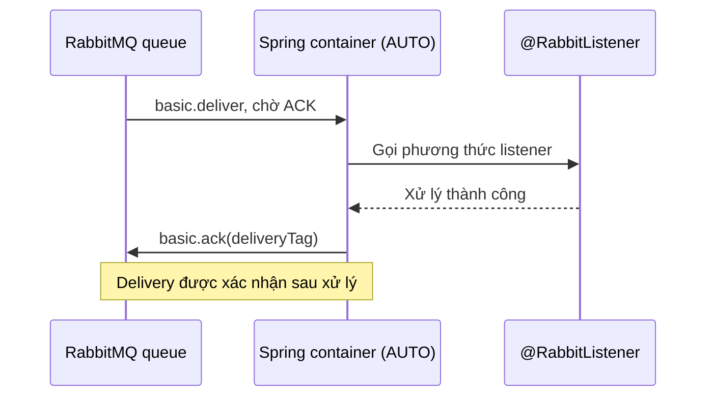
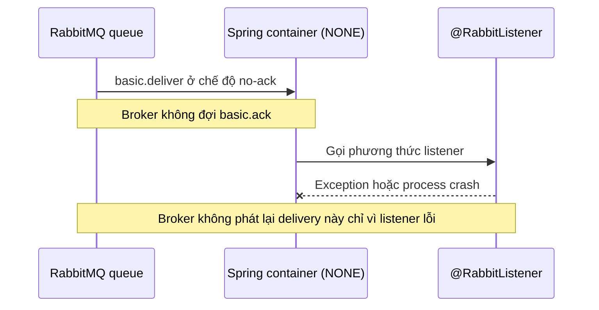
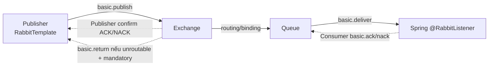
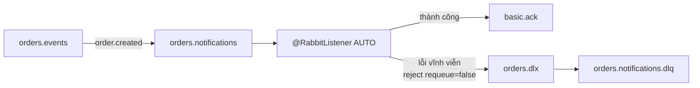

# Phân biệt AUTO của Spring với auto-ack tại broker

Trong hệ thống xử lý bất đồng bộ bằng **RabbitMQ và Spring AMQP**, câu hỏi “message đã được xác nhận chưa?” có ít nhất hai cách hiểu: **Spring đã quyết định gửi ACK sau khi xử lý** hay **RabbitMQ không yêu cầu ACK ngay từ lúc giao message**. Cả hai cách đều có thể bị gọi là *automatic acknowledgement*, nhưng chúng tạo ra **hợp đồng độ tin cậy hoàn toàn khác nhau**.

Bài học thuộc chương **Xác nhận tiêu thụ**, tập trung vào sự khác biệt quan trọng:

- **`AcknowledgeMode.AUTO` của Spring AMQP:** Spring listener container **chủ động gửi ACK sau khi listener xử lý thành công**, và quyết định reject/NACK khi xử lý lỗi theo chính sách.
- **Broker auto-ack/no-ack của AMQP 0-9-1:** RabbitMQ **không đợi ACK của consumer**; sau khi giao delivery, nó coi delivery đó đã được xử lý ở mức giao thức. Trong Spring AMQP, chế độ tương ứng thường là **`AcknowledgeMode.NONE`**, không phải `AUTO`.

Sự phân biệt này ảnh hưởng trực tiếp đến khả năng giao lại message, rủi ro mất công việc, xử lý trùng, retry, dead-letter, prefetch và cách bạn triển khai `@RabbitListener`. Đồng thời, cần giữ ranh giới với **publisher confirms/returns**, giao dịch database và việc quan sát trạng thái queue.

Sau bài học, bạn có thể giải thích chính xác hai kiểu “auto”, cấu hình ba chế độ AUTO/MANUAL/NONE, biết ACK/NACK xảy ra ở đâu, chọn mô hình phù hợp với mức độ bảo đảm nghiệp vụ và kiểm tra hành vi trên RabbitMQ.

## 1. Phân biệt hai chữ “automatic” ngay từ đầu

Trong RabbitMQ Java client, một consumer được đăng ký qua lệnh AMQP `basic.consume`; một tham số boolean thường gọi là `autoAck` hoặc `noAck` (tùy API/thuật ngữ) cho biết broker **có cần chờ consumer gửi `basic.ack` hay không**.

Trong Spring, `AcknowledgeMode` là cách **container quản lý ACK thay cho code ứng dụng**. Tên chế độ được đặt theo *ai gửi ACK*, không theo cách RabbitMQ đặt trạng thái delivery.

| Chế độ của Spring | Ngữ nghĩa với broker | Ai xác nhận delivery? | Khi listener lỗi sau khi đã nhận |
| --- | --- | --- | --- |
| **`AcknowledgeMode.AUTO`** | Consume **có yêu cầu consumer ACK** (broker không ở chế độ no-ack) | **Spring container** gửi `basic.ack` sau khi xử lý thành công; khi lỗi dùng reject/NACK theo policy | Có thể requeue, retry hoặc DLX tùy chính sách |
| **`AcknowledgeMode.MANUAL`** | Consume **có yêu cầu consumer ACK** | Code/application quyết định `basicAck`, `basicNack` hoặc `basicReject`; phải làm đúng và đủ | Nếu không ACK/NACK, delivery còn unacked cho đến khi channel/connection đóng hoặc ứng dụng quyết định |
| **`AcknowledgeMode.NONE`** | Consume với **broker auto-ack/no-ack** | Không có ACK thủ công cho từng delivery | Message đã được broker coi là xử lý; lỗi listener không khiến broker tự giao lại delivery đó bằng cơ chế ACK |

**Kết luận cốt lõi:** `AUTO` của Spring **không phải** `autoAck=true` của RabbitMQ. Đối với phần lớn xử lý nghiệp vụ có lỗi và cần phục hồi, AUTO (hoặc MANUAL khi thật sự cần) thường phù hợp hơn NONE.

### 1.1. Hình dung bằng hai luồng thời gian





Cả hai mô hình đều có thể chạy trên **một queue durable**, nhận từ exchange đúng binding, nhưng **durable queue không cứu được một delivery đã được coi là hoàn tất do broker auto-ack**.

## 2. ACK xác nhận điều gì, và không xác nhận điều gì?

Ở AMQP 0-9-1, RabbitMQ giao message cho consumer trên channel. Khi dùng chế độ có xác nhận, mỗi delivery có một **`deliveryTag` có phạm vi trên chính channel đó**. ACK nói với broker rằng consumer đã nhận trách nhiệm xử lý delivery này, để RabbitMQ có thể loại bỏ nó khỏi trạng thái chưa xác nhận.

### 2.1. Một chuỗi publish–consume đầy đủ



Cần phân biệt:

- **Publisher confirm:** broker phản hồi về **một lần publish**, không chứng minh listener đã thực thi thành công.
- **Publisher return:** message `mandatory` không thể được route từ exchange đến queue theo các điều kiện tương ứng; khác với consumer reject.
- **Consumer ACK/NACK:** phản hồi của phía nhận về **một delivery đã được giao**, độc lập với confirm của publisher.
- **Kết quả nghiệp vụ:** database đã commit, email thực sự đã gửi hay giao dịch bên ngoài đã thành công là việc **ứng dụng phải tự đảm bảo**; ACK không tự tạo transaction với những hệ thống đó.

ACK thường làm delivery rời tập `messages_unacknowledged` và được broker coi là hoàn tất. Nó **không bảo đảm exactly-once end-to-end**: cùng sự kiện vẫn có thể được publish hai lần hoặc redeliver nếu ACK bị mất.

### 2.2. Vì sao luôn cần nghĩ tới cửa sổ lỗi?

Ví dụ Notification xử lý event `evt-1001`:

1. Consumer nhận message và ghi log.
2. Consumer gọi hệ thống gửi email; email đã được gửi.
3. Trước khi Spring kịp gửi `basic.ack`, connection bị mất.
4. RabbitMQ không nhận được ACK nên có thể giao lại message sau khi connection/channel đóng.

Trong AUTO, cơ chế này **giảm nguy cơ mất công việc**, đổi lại phải chấp nhận khả năng **xử lý trùng**. Consumer nên dùng event ID, bảng trạng thái hoặc idempotency key để không gửi cùng một email nghiệp vụ hai lần.

Ngược lại, ở NONE, broker không chờ bước 3. Nếu process chết giữa bước 1 và 2, delivery đó **không được khôi phục nhờ consumer ACK**. Đây là lý do lựa chọn mode phải gắn với yêu cầu nghiệp vụ.

## 3. AUTO của Spring: container gửi ACK sau khi xử lý

`AcknowledgeMode.AUTO` là chế độ phổ biến khi dùng `@RabbitListener`. Listener chỉ viết logic nghiệp vụ và có thể trả về bình thường hoặc ném exception; Spring container quản lý `basic.ack`, `basic.reject`/`basic.nack`.

```java
import org.springframework.amqp.rabbit.annotation.RabbitListener;
import org.springframework.stereotype.Component;

@Component
public class OrderNotificationListener {

    @RabbitListener(queues = "orders.notifications")
    public void onMessage(String orderId) {
        // Trong hệ thống thật, kiểm tra event ID/idempotency.
        // Nếu tác vụ này ném exception, Spring xử lý theo error policy.
        sendNotification(orderId);
    }

    private void sendNotification(String orderId) {
        System.out.println("Send notification for " + orderId);
    }
}
```

### 3.1. Khi phương thức trả về bình thường

Theo mô hình đồng bộ thông thường:

1. Broker giao message và đánh dấu nó đang chờ xác nhận.
2. Spring chuyển message cho listener, có thể thông qua `MessageConverter`.
3. Listener chạy thành công và trả về.
4. Container gửi ACK theo cấu hình container.

Cụm từ “sau khi xử lý” cần đọc đúng: với một số cấu hình **batch ACK**, transaction hoặc listener bất đồng bộ được framework hỗ trợ, thời điểm phát lệnh ACK có thể không trùng chính xác thời điểm một method sync trả về. Nhưng điểm quan trọng vẫn là **Spring chịu trách nhiệm về ACK**, không phải broker no-ack.

### 3.2. Khi listener ném exception

Nếu listener ném lỗi, container có thể:

- Áp dụng retry interceptor (nếu có), thử lại theo giới hạn/backoff.
- Reject/NACK và **requeue** để broker giao lại, khi policy yêu cầu.
- Reject/NACK **không requeue** để broker dead-letter nếu queue có DLX hợp lệ.
- Sử dụng error handler để phân loại lỗi fatal, ví dụ chuyển đổi message sai; kết quả thực tế phụ thuộc Spring AMQP version/config.

Ví dụ thiết lập `defaultRequeueRejected=false` khiến lỗi bị từ chối cuối cùng thường **không đưa lại queue gốc**. **Điều đó không tự tạo DLQ**: phải khai báo dead-letter exchange, queue và binding thích hợp, nếu không message có thể bị loại bỏ.

### 3.3. AUTO không đảm bảo mọi công việc chạy nền đã xong

Một anti-pattern nguy hiểm:

```java
// Ví dụ KHÔNG NÊN dùng cho side effect quan trọng:
@RabbitListener(queues = "orders.notifications")
public void onMessage(String orderId) {
    executor.execute(() -> sendNotification(orderId));
    // Method trả về trước khi task thực sự hoàn tất.
}
```

Với listener `void` đồng bộ, container có thể coi việc **lên lịch task thành công** là listener đã hoàn tất và gửi ACK. Nếu background task thất bại sau ACK, broker không còn delivery để redeliver.

Các cách an toàn hơn:

1. Thực hiện công việc đồng bộ trong listener, chỉ trả về sau khi side effect đã hoàn tất.
2. Ghi nhận một job vào **storage bền vững** trong một transaction phù hợp trước khi ACK, rồi worker riêng xử lý.
3. Dùng **asynchronous listener return type** có hỗ trợ ở phiên bản Spring AMQP đang dùng; xác nhận framework trì hoãn ACK tới khi future/mono hoàn tất và xử lý lỗi đúng cách.
4. Dùng MANUAL ACK nếu thực sự cần điều phối completion, nhưng phải quản lý channel/delivery tag/thread cẩn thận.

**Chỉ thêm `@Async` hoặc sử dụng `CompletableFuture.runAsync(...)` mà không thay đổi hợp đồng ACK không giải quyết độ tin cậy.**

## 4. Broker auto-ack: tương ứng với Spring AcknowledgeMode.NONE

Trong RabbitMQ Java client, có thể đăng ký consumer:

```java
// RabbitMQ Java client API minh họa, không phải Spring:
channel.basicConsume("orders.notifications", true, deliverCallback, cancelCallback);
//                                           ^^^^
// true = autoAck: broker không đợi basic.ack từ consumer.
```

Khi dùng `AcknowledgeMode.NONE` với Spring AMQP, ý tưởng tương tự: broker không đợi client ACK thủ công. Trong chế độ đó:

- Message được RabbitMQ coi là hoàn tất khi nó giao cho consumer theo ngữ nghĩa auto-ack, không chờ xử lý Java.
- Lỗi parse, lỗi database hoặc JVM chết sau delivery **không khiến broker tự requeue delivery này vì thiếu ACK**.
- Application **không nên tự gọi `basicAck`/`basicNack`** cho những delivery không có trạng thái chờ xác nhận.
- Broker không duy trì delivery đó trong `messages_unacknowledged` theo cách giống AUTO/MANUAL.
- Consumer backpressure dựa trên unacked-prefetch **không hoạt động theo cùng cách**; auto-ack có nguy cơ đẩy nhiều dữ liệu tới client và tăng tiêu thụ tài nguyên nếu nó không theo kịp.

### 4.1. NONE có trường hợp sử dụng hợp lý không?

Có, nhưng hẹp: dữ liệu **best effort**, message có thể bỏ qua, telemetry không quan trọng hoặc thông báo tạm thời mà nguồn có thể phát lại đầy đủ từ hệ thống khác, và mất một số delivery được nghiệp vụ chấp nhận.

Ví dụ một dashboard hiển thị gợi ý trạng thái realtime có thể dùng broker auto-ack nếu sự kiện đó chỉ ảnh hưởng một lần cập nhật giao diện, hệ thống có snapshot mới ở lần sau. Nhưng gửi hóa đơn, ghi tiền, đặt hàng hoặc xử lý batch không thể mất thường **không phù hợp**.

Cần cân nhắc rằng lưu lượng lớn qua NONE có thể dồn vào bộ nhớ phía client; nó **không tự là chiến lược tăng throughput an toàn**.

### 4.2. Đừng suy luận từ chữ “automatic” trong tài liệu cũ

Thuật ngữ:

| Cách gọi | Đúng về mặt kỹ thuật | Hiểu nhầm phổ biến |
| --- | --- | --- |
| **Spring AUTO** | Spring container ACK theo kết quả listener | Tưởng broker đã ACK ngay khi delivery |
| **RabbitMQ autoAck=true / noAck** | Broker không cần consumer gửi `basic.ack` | Tưởng Spring còn giám sát thành công để ACK |
| **Spring NONE** | Cấu hình Spring chọn tiêu thụ không ACK theo broker | Tưởng tương đương “mặc định không cấu hình” |
| **Spring MANUAL** | Application tự gửi ACK/NACK trên đúng channel | Tưởng phải ACK khi mới bắt đầu xử lý |

Ở phần lớn cấu hình listener container thông thường, **AUTO của Spring là mặc định thực tế**, nhưng phải xem cấu hình Boot, listener factory và override tại từng listener trước khi khẳng định.

## 5. MANUAL: khi ứng dụng tự chọn thời điểm xác nhận

Với `AcknowledgeMode.MANUAL`, code nhận `Channel` và `deliveryTag`, sau đó gọi `basicAck` hoặc `basicNack`/`basicReject`. Phù hợp khi cần điều phối ACK với một điểm commit nghiệp vụ rõ ràng, kiểm soát retry đặc biệt hoặc xử lý bất đồng bộ được thiết kế có chủ đích.

```java
import java.io.IOException;
import com.rabbitmq.client.Channel;
import org.springframework.amqp.core.Message;
import org.springframework.amqp.rabbit.annotation.RabbitListener;
import org.springframework.stereotype.Component;

@Component
public class ManualOrderConsumer {

    @RabbitListener(
            queues = "orders.notifications",
            containerFactory = "manualAckListenerFactory")
    public void onMessage(Message message, Channel channel)
            throws IOException {

        long tag = message.getMessageProperties().getDeliveryTag();

        try {
            // Xử lý nghiệp vụ đồng bộ, idempotent.
            processOrder(message);
            channel.basicAck(tag, false);
        } catch (IllegalArgumentException badPayload) {
            // Message lỗi vĩnh viễn: đẩy DLX nếu queue có cấu hình.
            channel.basicReject(tag, false);
        } catch (Exception transientError) {
            // Ví dụ: không requeue ngay; dùng DLX/retry được thiết kế.
            channel.basicNack(tag, false, false);
        }
    }

    private void processOrder(Message message) {
        if (message.getBody().length == 0) {
            throw new IllegalArgumentException("Empty event");
        }
        // Ghi nghiệp vụ vào DB và commit trước khi ACK.
        System.out.println("Handled event");
    }
}
```

Giải thích các tham số:

- `basicAck(tag, false)`: xác nhận đúng một delivery. Với `multiple=true`, ACK toàn bộ các delivery chưa xác nhận có tag nhỏ hơn hoặc bằng tag trên cùng channel; không dùng tùy tiện.
- `basicReject(tag, false)`: reject một delivery, **không requeue**.
- `basicNack(tag, false, false)`: NACK một delivery và không requeue; nếu broker có DLX phù hợp, message có thể đi vào dead-letter flow.
- `basicNack(tag, false, true)`: NACK và yêu cầu **requeue**; cần tránh vòng lặp nóng khi lỗi vĩnh viễn.
- `deliveryTag` chỉ có giá trị trên **channel nhận message**. ACK trên channel khác hoặc ACK trùng tag có thể gây lỗi giao thức và đóng channel.

Đoạn trên minh họa **chính sách xử lý**, không phải chuẩn cho mọi nghiệp vụ: với hệ thống thật, cần tách transient/permanent, số lần retry, DLQ/quarantine, giao dịch DB và báo lỗi vận hành. Nếu lệnh ACK/NACK thất bại hoặc connection bị ngắt, trạng thái xử lý có thể chưa xác định; idempotency vẫn cần thiết.

**Không chạy đồng thời listener MANUAL này và listener AUTO trong phần 3 trên cùng queue trong bài thử**, vì cả hai sẽ cạnh tranh delivery, khiến việc quan sát ACK khó hiểu.

## 6. Cấu hình Spring Boot cho AUTO, MANUAL và NONE

Dùng Spring Boot với Spring Rabbit/AMQP 0-9-1 có thể chọn chế độ ACK ở listener container. Ví dụ cho **SimpleRabbitListenerContainerFactory**:

```yaml
# application.yml: cấu hình chính khuyến nghị để bắt đầu
spring:
  rabbitmq:
    host: ${RABBITMQ_HOST:localhost}
    port: ${RABBITMQ_PORT:5672}
    virtual-host: ${RABBITMQ_VHOST:/orders}
    username: ${RABBITMQ_USERNAME}
    password: ${RABBITMQ_PASSWORD}
    listener:
      simple:
        acknowledge-mode: auto
        concurrency: 2
        max-concurrency: 4
        prefetch: 20
        default-requeue-rejected: false
```

Những trường quan trọng:

| Property | Diễn giải |
| --- | --- |
| `listener.simple.acknowledge-mode: auto` | Spring container gửi ACK/NACK dựa vào kết quả xử lý |
| `listener.simple.concurrency` | Số consumer khởi đầu |
| `listener.simple.max-concurrency` | Trần tăng consumer theo điều kiện của container |
| `listener.simple.prefetch` | Giới hạn delivery chưa ACK mà consumer có thể được cấp trước (khi dùng chế độ có ACK) |
| `listener.simple.default-requeue-rejected: false` | Theo chính sách, lỗi cuối cùng thường reject không requeue; DLQ cần cấu hình riêng |

Nếu dùng `DirectMessageListenerContainer`, cấu hình nằm ở **`spring.rabbitmq.listener.direct.*`** và concurrency thông dụng là `consumers-per-queue`, không phải `simple.concurrency`. Cần xác định loại container thực tế khi phân tích số message unacked và hành vi ACK.

### 6.1. Cấu hình factory riêng để thực hành ba mode

Khi muốn thử AUTO, MANUAL và NONE mà không sửa toàn bộ ứng dụng, có thể tạo các factory đặt tên tường minh:

```java
import org.springframework.amqp.core.AcknowledgeMode;
import org.springframework.amqp.rabbit.config.SimpleRabbitListenerContainerFactory;
import org.springframework.amqp.rabbit.connection.ConnectionFactory;
import org.springframework.context.annotation.Bean;
import org.springframework.context.annotation.Configuration;

@Configuration
public class AckModeConfiguration {

    private SimpleRabbitListenerContainerFactory base(ConnectionFactory cf) {
        SimpleRabbitListenerContainerFactory factory =
                new SimpleRabbitListenerContainerFactory();
        factory.setConnectionFactory(cf);
        factory.setPrefetchCount(10);
        factory.setConcurrentConsumers(1);
        return factory;
    }

    @Bean("autoAckListenerFactory")
    public SimpleRabbitListenerContainerFactory autoFactory(
            ConnectionFactory cf) {
        SimpleRabbitListenerContainerFactory f = base(cf);
        f.setAcknowledgeMode(AcknowledgeMode.AUTO);
        f.setDefaultRequeueRejected(false);
        return f;
    }

    @Bean("manualAckListenerFactory")
    public SimpleRabbitListenerContainerFactory manualFactory(
            ConnectionFactory cf) {
        SimpleRabbitListenerContainerFactory f = base(cf);
        f.setAcknowledgeMode(AcknowledgeMode.MANUAL);
        return f;
    }

    @Bean("brokerAutoAckListenerFactory")
    public SimpleRabbitListenerContainerFactory brokerAutoFactory(
            ConnectionFactory cf) {
        SimpleRabbitListenerContainerFactory f = base(cf);
        f.setAcknowledgeMode(AcknowledgeMode.NONE);
        return f;
    }
}
```

Ví dụ listener chọn rõ factory:

```java
@RabbitListener(
        queues = "orders.notifications",
        containerFactory = "autoAckListenerFactory")
public void onEvent(String orderId) {
    process(orderId);
}
```

Các factory là **ba lựa chọn thay thế**. Trong thử nghiệm so sánh, chỉ bật **một listener trên queue** tại một thời điểm hoặc tạo **các queue độc lập**; nếu cùng đọc queue, listener sẽ cạnh tranh và một delivery không được phát cho cả ba.

Với `NONE`, việc đặt `prefetch` ở factory không biến chế độ đó thành cơ chế ACK có giới hạn delivery giống AUTO/MANUAL. Cần quan sát resource và số message chờ thật thay vì giả định `prefetch=10` luôn giới hạn dữ liệu đang bay theo cùng một cách.

### 6.2. Có thể override ở cấp @RabbitListener?

Một số phiên bản Spring AMQP cho phép chỉ định `ackMode` trực tiếp trên annotation, ví dụ:

```java
import org.springframework.amqp.core.AcknowledgeMode;
import org.springframework.amqp.rabbit.annotation.RabbitListener;

@RabbitListener(
        queues = "orders.notifications",
        ackMode = "MANUAL")
public void handleManually(
        org.springframework.amqp.core.Message message,
        com.rabbitmq.client.Channel channel) throws java.io.IOException {
    long tag = message.getMessageProperties().getDeliveryTag();
    channel.basicAck(tag, false);
}
```

Đây là **ví dụ thay thế** cho cấu hình factory và chỉ nên dùng khi Spring AMQP version hỗ trợ thuộc tính `ackMode`. Nó không tạo thêm queue hay làm mọi listener khác chuyển sang MANUAL. Một endpoint cụ thể phải được kiểm tra mode thực tế khi chạy.

## 7. Vì sao AUTO thường phù hợp với nghiệp vụ quan trọng?

Bài toán: xử lý một sự kiện `order.created` dẫn tới cập nhật trạng thái vận chuyển.

| Thời điểm lỗi | Spring AUTO (có ACK) | Broker auto-ack / Spring NONE |
| --- | --- | --- |
| JVM chết trước khi listener bắt đầu | Broker có thể redeliver delivery chưa ACK khi connection/channel đóng | Delivery đã giao ở chế độ no-ack không được khôi phục qua ACK |
| Listener lỗi trước khi commit DB | Container có thể NACK/requeue/DLX theo policy | Broker không chờ ACK; delivery có thể bị mất về phía nghiệp vụ |
| DB commit xong nhưng ACK chưa tới broker | Có thể redeliver → cần idempotency | Không redeliver do cơ chế ACK; nhưng không bảo đảm caller biết kết quả |
| Listener xử lý thành công và ACK tới broker | Delivery hoàn tất theo ngữ nghĩa ACK | Delivery vốn đã được broker coi là xử lý tại thời điểm giao |

Nếu mọi message đều quan trọng, **AUTO giúp giới hạn cửa sổ mất message vì consumer crash**, nhưng đánh đổi là khả năng trùng. Kết quả xử lý **at-least-once** không tự xuất hiện chỉ vì bật AUTO: cần publisher đảm bảo phát, queue tồn tại và bền đúng kỳ vọng, xử lý lỗi/requeue/DLX hợp lý, event ID và idempotency.

NONE thường hướng đến **at-most-once delivery cho từng lần giao** trong phạm vi broker consumer acknowledgement; nếu xử lý Java thất bại, không có redelivery dựa trên trạng thái unacked. Dù vậy, nếu publisher gửi trùng thì application vẫn có thể thấy message trùng—at-most-once ở cấp delivery **không phải** cam kết toàn hệ thống sẽ không thấy cùng event logic hai lần.

## 8. Retry, DLX và các exception đặc biệt trong AUTO

Một hiểu nhầm phổ biến là “AUTO = khi lỗi Spring luôn requeue”. Thực tế, AUTO chỉ xác định **ai gửi ACK/NACK**; quyết định **requeue hay không** phụ thuộc cấu hình và loại lỗi.

### 8.1. defaultRequeueRejected và lỗi vĩnh viễn

Với listener container có `defaultRequeueRejected=true`, nhiều lỗi thông thường có thể dẫn đến reject và requeue, khiến message quay về consumer. Nếu message luôn sai định dạng, chu kỳ đó sẽ lặp lại.

Đặt `defaultRequeueRejected=false` giúp hạn chế requeue vô hạn, nhưng nếu không có DLX/quarantine, message bị reject có thể bị loại bỏ. Cần thiết kế đường xử lý lỗi trước.

Spring có các exception điều khiển requeue, ví dụ:

- `AmqpRejectAndDontRequeueException`: yêu cầu không requeue đối với message lỗi.
- `ImmediateRequeueAmqpException`: yêu cầu requeue ngay theo ngữ nghĩa container tương ứng.

Lưu ý các exception này thuộc **cơ chế Spring listener**; không phải broker sẽ tự hiểu tên class Java. Khi chuyển sang MANUAL/NONE, cách phối hợp với error handler có thể khác; không sao chép nguyên hành vi kỳ vọng giữa các mode.

### 8.2. DLX/DLQ chỉ hoạt động khi topology phù hợp

Sơ đồ:



Để message lỗi thực sự đến DLQ, queue chính phải chỉ định **dead-letter exchange** qua policy hoặc queue argument, DLX phải tồn tại, và binding của DLQ phải khớp routing key của dead-lettered message.

Ví dụ topology bằng Spring AMQP:

```java
import org.springframework.amqp.core.Binding;
import org.springframework.amqp.core.BindingBuilder;
import org.springframework.amqp.core.DirectExchange;
import org.springframework.amqp.core.Queue;
import org.springframework.amqp.core.QueueBuilder;
import org.springframework.amqp.core.TopicExchange;
import org.springframework.amqp.core.ExchangeBuilder;
import org.springframework.context.annotation.Bean;
import org.springframework.context.annotation.Configuration;

@Configuration
public class OrderAckTopology {
    public static final String EXCHANGE = "orders.events";
    public static final String MAIN = "orders.notifications";
    public static final String DLX = "orders.dlx";
    public static final String DLQ = "orders.notifications.dlq";

    @Bean public TopicExchange ordersEvents() {
        return ExchangeBuilder.topicExchange(EXCHANGE).durable(true).build();
    }

    @Bean public DirectExchange ordersDlx() {
        return ExchangeBuilder.directExchange(DLX).durable(true).build();
    }

    @Bean public Queue orderNotifications() {
        return QueueBuilder.durable(MAIN)
                .deadLetterExchange(DLX)
                .deadLetterRoutingKey("order.failed")
                .build();
    }

    @Bean public Queue orderNotificationsDlq() {
        return QueueBuilder.durable(DLQ).build();
    }

    @Bean public Binding mainBinding(
            Queue orderNotifications, TopicExchange ordersEvents) {
        return BindingBuilder.bind(orderNotifications)
                .to(ordersEvents).with("order.created");
    }

    @Bean public Binding deadLetterBinding(
            Queue orderNotificationsDlq, DirectExchange ordersDlx) {
        return BindingBuilder.bind(orderNotificationsDlq)
                .to(ordersDlx).with("order.failed");
    }
}
```

Ví dụ dùng DLX/DLQ để **quan sát dữ liệu lỗi**. Không dùng `defaultRequeueRejected=false` để làm “mất message nhanh” nếu nghiệp vụ vẫn cần xử lý sau. Với RabbitMQ production, cũng cần cân nhắc quyền publish vào DLX, dead-letter reliability và chính sách retention phù hợp queue type/version.

### 8.3. Lỗi conversion có thể xảy ra trước @RabbitListener

Nếu message body không parse được hoặc converter không ánh xạ sang tham số listener, exception có thể xuất hiện **trước khi method được gọi**. Khi đó:

- `try/catch` bên trong method listener không bắt được lỗi.
- Error handler của container có vai trò quyết định ACK/reject/requeue.
- Những lỗi được Spring coi là fatal có thể được xử lý không requeue tùy phiên bản và handler, kể cả khi default requeue khác.

Vì vậy cần **thử nghiệm với message sai schema** và kiểm tra cả logs, error handler và DLQ, thay vì chỉ kiểm tra lỗi phát sinh trong code nghiệp vụ.

## 9. AUTO và MANUAL khi có transaction, batching hoặc async

### 9.1. ACK và database transaction không tự nguyên tử

Giả sử listener chạy với Spring `@Transactional` ghi database:

```java
@RabbitListener(queues = "orders.notifications")
@Transactional
public void onOrder(String orderId) {
    orderRepository.markNotified(orderId);
}
```

**Ví dụ ngắn này có các dependency/hàm giả định**; phần quan trọng là Spring database transaction không biến việc ACK qua RabbitMQ thành cùng một transaction phân tán với database.

- DB commit có thể thành công nhưng ACK thất bại → message bị giao lại.
- DB rollback có thể làm method ném lỗi, container xử lý NACK/requeue theo policy.
- Nếu dùng transaction AMQP riêng, cần hiểu giới hạn; nó không mặc nhiên atomic với transaction DB.
- Xây listener **idempotent**, ví dụ lưu `eventId` đã xử lý bằng unique constraint hoặc dùng nghiệp vụ update theo trạng thái.

### 9.2. Batching ACK làm thay đổi thời điểm gửi, không đổi người gửi

SMLC và DMLC có các cơ chế điều chỉnh tần suất ACK khác nhau, tùy phiên bản: `batchSize`, `messagesPerAck`, `ackTimeout` hoặc related container settings.

Ở `AcknowledgeMode.AUTO`, việc container gom nhiều ACK **không biến mode thành NONE**. Broker vẫn đang chờ consumer ACK và có thể thấy số `messages_unacknowledged` tăng trong thời gian batch chờ đủ điều kiện.

Nếu consumer chết trước khi ACK batch, những delivery chưa xác nhận có thể redeliver; số message phải xử lý lại có thể lớn hơn so với ACK từng message. Đặt batch ACK theo throughput/SLA và khả năng idempotency.

### 9.3. Listener bất đồng bộ cần biết chính xác ai hoàn tất ACK

Trong một số phiên bản Spring AMQP, listener trả `CompletableFuture<?>`, `Mono<?>` hoặc dạng asynchronous return type được container hỗ trợ. Khi dùng đúng API, framework có thể **đợi completion của kết quả async** rồi quyết định ACK/NACK, và điều chỉnh ACK mode phù hợp.

Nhưng **không suy diễn** rằng mọi lần trả về một future hoặc gọi `@Async` đều được container hiểu như nhau. Phải đối chiếu version, cách listener adapter xử lý async result, lỗi và thread/channels; có test mô phỏng **future thất bại sau khi method gốc trả về**.

Đối với code nhiều side effect, cách an toàn thường là **làm việc đồng bộ với AUTO**, hoặc ghi một job/outbox bền trước khi ACK và để worker riêng xử lý, thay vì tự ghép nhiều channel/thread và hy vọng ACK đúng.

## 10. Thực hành: quan sát AUTO, MANUAL và NONE

### 10.1. Chuẩn bị

Dùng vhost thử nghiệm, ví dụ `/orders`, khai báo queue và exchange/binding như phần 8.2, rồi publish message bằng `RabbitTemplate`:

```java
import org.springframework.amqp.rabbit.core.RabbitTemplate;
import org.springframework.stereotype.Service;

@Service
public class OrderEventPublisher {
    private final RabbitTemplate rabbitTemplate;

    public OrderEventPublisher(RabbitTemplate rabbitTemplate) {
        this.rabbitTemplate = rabbitTemplate;
    }

    public void publish(String orderId) {
        rabbitTemplate.convertAndSend(
                "orders.events",
                "order.created",
                orderId);
    }
}
```

Bật từng mode **lần lượt**, không chạy ba listener cạnh tranh cùng một queue khi muốn so sánh rõ tác động. Nếu muốn test lỗi, dùng message với event ID để đối chiếu và tránh tác động nghiệp vụ thật.

### 10.2. Bài thử A: listener xử lý chậm

Ở AUTO, tạm cho listener xử lý 3 giây:

```java
@RabbitListener(
        queues = "orders.notifications",
        containerFactory = "autoAckListenerFactory")
public void slowHandler(String orderId) throws InterruptedException {
    Thread.sleep(3000L);
    System.out.println("Finished " + orderId);
}
```

Khi vừa có delivery mà method chưa hoàn tất, RabbitMQ thường ghi nhận message là **unacked**. Khi method trả về và container gửi ACK, unacked giảm.

Ở NONE với cùng body handler (chọn factory `brokerAutoAckListenerFactory` thay vì AUTO), queue **không chờ ACK** và `messages_unacknowledged` không biểu diễn những delivery đang xử lý theo cách trên. Vì thế không dùng chỉ số `unacked=0` để kết luận listener NONE đã hoàn tất nghiệp vụ.

### 10.3. Bài thử B: listener ném exception

```java
@RabbitListener(
        queues = "orders.notifications",
        containerFactory = "autoAckListenerFactory")
public void failedHandler(String orderId) {
    throw new IllegalStateException("Simulated downstream failure");
}
```

Nếu AUTO cùng `defaultRequeueRejected=false` và queue có DLX như phần 8.2, message thường bị reject không requeue sau khi error handler xử lý và chuyển vào DLQ. Với NONE, exception trong Java không thể yêu cầu broker giao lại delivery theo consumer ACK, vì broker đã ở chế độ no-ack.

Lưu ý các tình huống còn tùy error handler, retry advice và phiên bản; **dùng quan sát broker để kiểm chứng**, không dựa duy nhất vào exception trên console.

### 10.4. Bài thử C: mất kết nối trước ACK

Trong môi trường thử nghiệm, tắt consumer process hoặc ngắt connection trong lúc listener AUTO còn xử lý message. Sau khi broker phát hiện channel/connection đóng, delivery chưa ACK có thể được **requeue và redeliver**. Khi có consumer mới, kiểm tra:

- `message.getMessageProperties().isRedelivered()` (nếu lấy raw `Message`).
- Event ID đã xử lý hay chưa (idempotency).
- `messages_ready` và `messages_unacknowledged` trước/sau phục hồi.

Với NONE, nếu message đã được broker giao ở chế độ no-ack, việc ngắt kết nối sau đó **không làm broker khôi phục delivery đó từ trạng thái unacked**.

### 10.5. Lệnh RabbitMQ CLI và chỉ số

```bash
# Quan sát queue trong vhost thử nghiệm
rabbitmqctl list_queues -p /orders \
  name messages_ready messages_unacknowledged consumers

# Quan sát channel và lượng unacked
rabbitmqctl list_channels \
  connection number consumer_count messages_unacknowledged

# Kiểm tra binding và dead-letter queue
rabbitmqctl list_bindings -p /orders \
  source_name destination_name routing_key
```

RabbitMQ Management UI cũng hiển thị delivery, ack, redelivery, queue ready/unacked và consumer mode. Các con số có thể thay đổi rất nhanh khi consumer đang chạy; với bài thực hành, nên có logging theo event ID và quan sát snapshot gần thời điểm phát sinh message.

## 11. Những hiểu nhầm thường gặp

| Khẳng định sai | Vì sao sai? | Cách hiểu đúng |
| --- | --- | --- |
| “Spring AUTO chính là broker auto-ack.” | Chữ AUTO dùng ở hai tầng khác nhau | Spring AUTO **gửi ACK sau xử lý**; broker auto-ack tương ứng với Spring NONE |
| “AUTO nghĩa là không mất message và exactly-once.” | ACK có thể mất, publisher có thể gửi trùng | AUTO hỗ trợ recovery qua redelivery; vẫn cần idempotency |
| “NONE nhanh hơn nên dùng cho mọi queue.” | Không chờ ACK có thể làm mất nghiệp vụ và tăng buffer phía client | Chỉ dùng với dữ liệu chấp nhận mất, sau khi đo tải |
| “Nếu method trả về thì task `@Async` bên trong chắc đã xong.” | Method có thể trả về khi task mới được đưa vào executor | ACK theo completion thật hoặc lưu job bền trước ACK |
| “`defaultRequeueRejected=false` tự tạo DLQ.” | Đây chỉ là chính sách reject không requeue | Phải cấu hình DLX, queue, binding và quyền |
| “ACK một delivery đồng nghĩa database cũng commit.” | Hai hệ thống có ranh giới transaction khác nhau | Commit DB trước ACK và dùng idempotency |
| “`unacked=0` tức mọi thứ đã xử lý xong.” | NONE không có delivery unacked theo nghĩa đó | Kiểm tra mode, job state và metrics nghiệp vụ |
| “MANUAL chỉ cần gọi ACK ở bất kỳ channel nào.” | Delivery tag có scope channel | ACK đúng tag trên đúng channel; tránh ACK trùng |
| “Publisher confirm ACK nghĩa consumer đã ACK.” | Là hai luồng xác nhận khác nhau | Theo dõi riêng publisher confirm và consumer ACK |
| “Lỗi parse trong listener sẽ luôn được catch trong method.” | Có thể lỗi xảy ra trước khi dispatch | Kiểm tra message converter và container error handler |

## 12. Chọn mode nào cho bài toán?

Dùng các câu hỏi sau để quyết định:

1. **Message có quan trọng và cần được xử lý sau khi consumer crash?** Ưu tiên **AUTO**; cân nhắc MANUAL khi cần ranh giới ACK đặc biệt.
2. **Chỉ cần hiển thị hoặc xử lý best effort, có thể bỏ qua delivery nếu client chết?** **NONE** có thể phù hợp.
3. **Ứng dụng phải xác nhận sau một bước xử lý/commit cụ thể mà container không tự bao phủ?** Dùng **MANUAL** với code ACK/NACK được kiểm soát.
4. **Consumer có chạy công việc bất đồng bộ không?** Xác định chính xác **completion và ACK**; không trả về sớm rồi mặc định được giao lại khi background task lỗi.
5. **Lỗi vĩnh viễn đi đâu?** Thiết kế DLX/DLQ/quarantine và retry/backoff có giới hạn trước production.
6. **Cần xử lý sự kiện đúng một lần về mặt nghiệp vụ?** Dùng event ID ổn định, idempotency, unique constraint hoặc transactional outbox; không dựa vào tên ACK mode.

### Checklist triển khai

- [ ] Kiểm tra loại listener container và `AcknowledgeMode` thực tế của từng `@RabbitListener`.
- [ ] Phân biệt Spring `AUTO`, `MANUAL`, `NONE` và AMQP `autoAck=true`/no-ack.
- [ ] Với AUTO, hiểu thời điểm Spring ACK, error handler, default requeue và retry advice.
- [ ] Với MANUAL, ACK/NACK đúng `deliveryTag` trên đúng `Channel`; test lỗi trước/sau commit.
- [ ] Với NONE, chỉ chọn khi nghiệp vụ **cho phép mất delivery**, không suy ra bảo đảm từ queue durable.
- [ ] Cấu hình queue/exchange/binding và DLX/DLQ đúng virtual host; phân quyền RabbitMQ phù hợp.
- [ ] Kiểm tra prefetch, consumer concurrency, `messages_ready`, `messages_unacknowledged` và redelivery.
- [ ] Tránh `void` listener offload side effect rồi ACK trước completion.
- [ ] Thử listener exception, conversion failure, connection drop trước ACK và broker reconnect.
- [ ] Phân biệt publisher confirms/returns với consumer ACK và kết quả transaction nghiệp vụ.
- [ ] Dùng event ID/idempotency để chống xử lý trùng sau redelivery/publisher retry.
- [ ] Quan sát DLQ depth, retry rate, ACK rate, latency và trạng thái nghiệp vụ sau deployment.

**Ghi nhớ:** **`AcknowledgeMode.AUTO` của Spring** có nghĩa *container gửi ACK sau khi listener xử lý thành công và quyết định reject/NACK nếu lỗi*. **Broker auto-ack** có nghĩa *RabbitMQ không đợi consumer ACK ngay từ lúc giao*, tương ứng **`AcknowledgeMode.NONE`** ở Spring. Nhầm hai cơ chế có thể dẫn tới mất message khi consumer crash hoặc tưởng rằng đã có retry/DLQ trong khi broker đã coi delivery là hoàn tất. Xây xử lý bất đồng bộ đáng tin cậy cần cấu hình đúng ACK mode, exchange–queue–binding, publisher confirm, retry/dead-letter, idempotency và quan sát hệ thống.

### Tài liệu tham khảo

- [Spring AMQP — Listener Acknowledge Mode](https://docs.spring.io/spring-amqp/reference/amqp/receiving-messages/async-consumer.html)
- [Spring AMQP — Message Listener Container Configuration](https://docs.spring.io/spring-amqp/reference/amqp/containerAttributes.html)
- [Spring AMQP — Handling Listener Exceptions](https://docs.spring.io/spring-amqp/reference/amqp/exception-handling.html)
- [Spring AMQP API — AcknowledgeMode](https://docs.spring.io/spring-amqp/api/org/springframework/amqp/core/AcknowledgeMode.html)
- [Spring AMQP — Listener Concurrency](https://docs.spring.io/spring-amqp/reference/amqp/listener-concurrency.html)
- [RabbitMQ — Consumer Acknowledgements and Publisher Confirms](https://www.rabbitmq.com/docs/confirms)
- [RabbitMQ — Consumer Prefetch](https://www.rabbitmq.com/docs/consumer-prefetch)
- [RabbitMQ — Dead Letter Exchanges](https://www.rabbitmq.com/docs/dlx)
- [RabbitMQ — Consumers](https://www.rabbitmq.com/docs/consumers)

