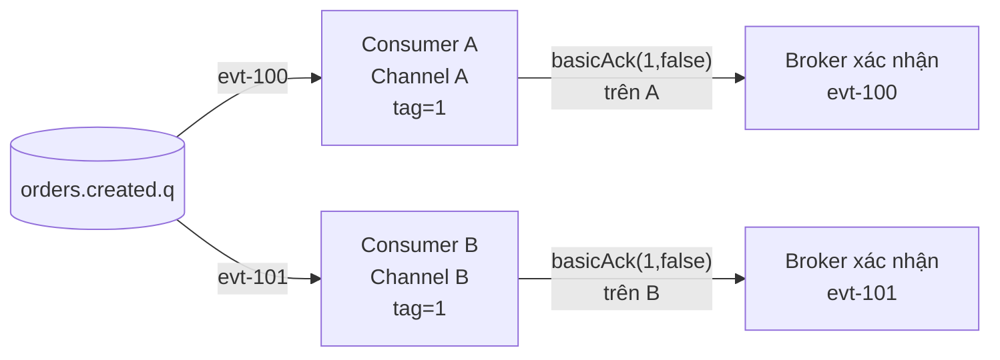
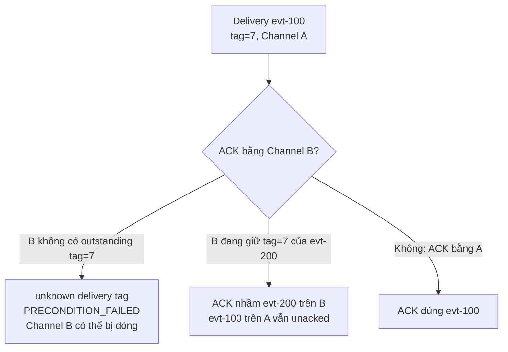
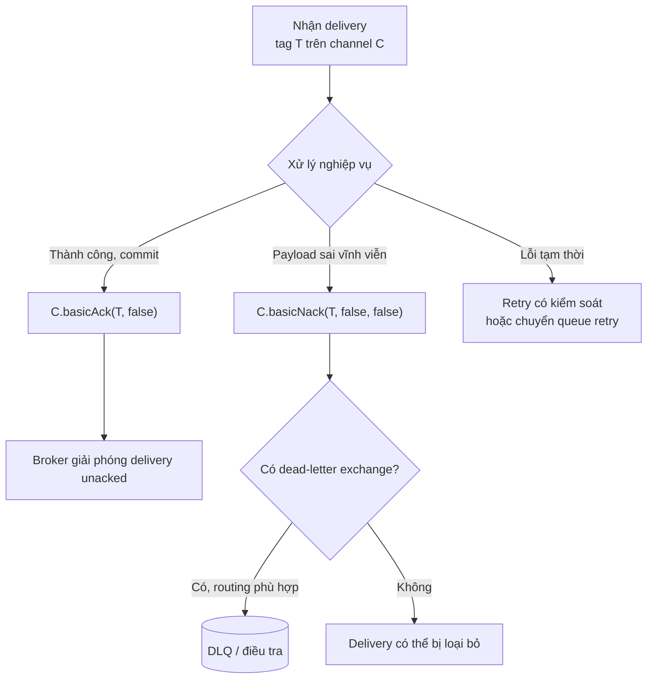
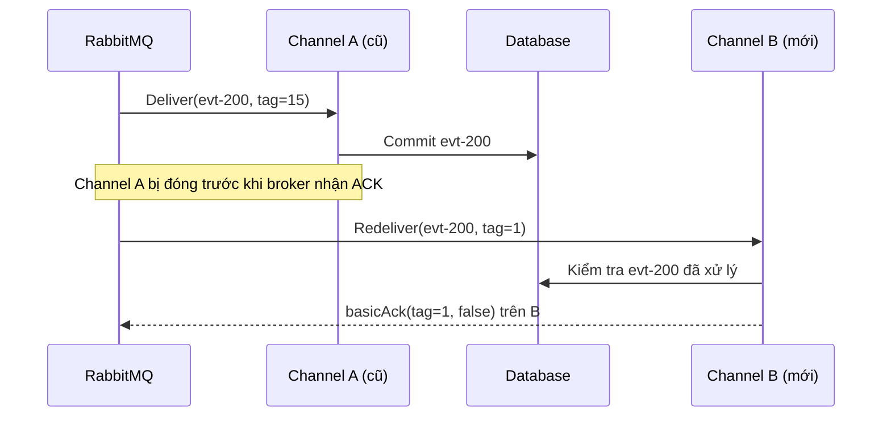
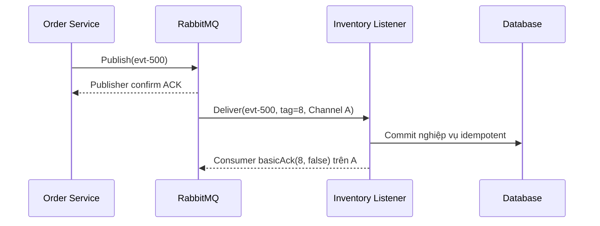

# Delivery tag chỉ có ý nghĩa trong channel nhận tương ứng

Một consumer Spring AMQP nhận được thông điệp và gọi `channel.basicAck(deliveryTag, false)`. Nếu `deliveryTag = 7` thì số 7 dùng để nhận diện điều gì? Có thể lấy số 7 từ một listener rồi ACK trên channel khác không? Khi listener mất kết nối và tạo channel mới, ta có thể dùng lại delivery tag cũ hay không?

**Câu trả lời ngắn:** trong RabbitMQ AMQP 0-9-1, **delivery tag là số định danh delivery trong phạm vi đúng AMQP channel đã nhận delivery đó**. Broker không dùng delivery tag làm ID toàn cục của message, queue, kết nối TCP hay một sự kiện nghiệp vụ. Khi xác nhận thủ công, phải dùng **đúng channel đã nhận** và **đúng delivery tag của lần giao**.

Bài thuộc chương **Xác nhận tiêu thụ** trong module **SPRING_AMQP**. Ta sẽ dùng `RabbitTemplate` để publish message qua exchange, queue và binding; dùng `@RabbitListener` cùng `Channel` để nhận và ACK/NACK; rồi phân tích các lỗi khi dùng sai tag/channel, retry, dead-letter, giao dịch và khả năng quan sát. Chủ đề trung tâm xuyên suốt là **phạm vi và vòng đời của delivery tag**, không phải chỉ học thuộc chữ ký của `basicAck`.

Sau bài học, bạn có thể:

1. Giải thích vì sao hai channel khác nhau có thể cùng có delivery tag `1` mà không hề trùng một delivery.
2. Phân biệt delivery tag với `messageId`, `correlationId`, `CorrelationData.id` và publisher confirm sequence number.
3. Dùng `basicAck`, `basicNack` và `basicReject` đúng channel, đúng phạm vi `multiple` và đúng thời điểm.
4. Hiểu kết quả có thể xảy ra khi ACK nhầm channel, ACK hai lần hoặc ACK tag thuộc channel đã đóng.
5. Cấu hình `@RabbitListener(ackMode = "MANUAL")`, lấy channel/delivery tag đúng cách và không tự đóng channel do container sở hữu.
6. Thiết kế xử lý khi có nhiều consumer, nhiều thread, prefetch, reconnect và redelivery.
7. Kết hợp xác nhận tiêu thụ với retry, DLQ, idempotency, transaction và giám sát để giảm rủi ro mất hoặc xử lý trùng message.

## 1. Delivery tag được tạo ra để làm gì?

RabbitMQ giao message tới consumer qua lệnh AMQP `basic.deliver`. Mỗi delivery có metadata, trong đó có **delivery tag** để consumer báo lại với broker:

- “Tôi đã xử lý delivery này” — `basic.ack`.
- “Tôi chưa thể xử lý delivery này” — `basic.nack`.
- “Tôi từ chối delivery này” — `basic.reject`.

Broker dùng xác nhận để quản lý những delivery đang ở trạng thái **unacknowledged** (đã giao nhưng chưa được consumer xác nhận) trong chế độ consumer acknowledgement thủ công.

Một message trong queue có thể được deliver nhiều lần, ví dụ khi consumer chết trước ACK. **Mỗi lần deliver lại có thể có delivery tag khác**, bởi delivery tag gắn với **lần giao trên channel**, không cố định với message.

### 1.1. Delivery tag có phạm vi channel

Trong một channel, delivery tag là giá trị số dương tăng dần được broker gán cho các delivery của channel đó. Hai channel có không gian tag riêng, vì vậy cùng một số có thể xuất hiện trên cả hai:

```text
Connection tới RabbitMQ
│
├── Channel A
│   ├── deliveryTag = 1  → message evt-100
│   ├── deliveryTag = 2  → message evt-102
│   └── deliveryTag = 3  → message evt-104
│
└── Channel B
    ├── deliveryTag = 1  → message evt-101
    ├── deliveryTag = 2  → message evt-103
    └── deliveryTag = 3  → message evt-105

A: basicAck(2, false)  → xác nhận delivery #2 của A (evt-102)
B: basicAck(2, false)  → xác nhận delivery #2 của B (evt-103)
```

Hai dòng `basicAck(2, false)` **không thay thế cho nhau**. Nếu truyền nhầm channel, ứng dụng không còn xác nhận đúng lần giao ban đầu.

### 1.2. Không gian tag không phải không gian queue

Một queue có thể có nhiều competing consumers. Các consumer này có thể dùng những channel khác nhau nhưng đọc cùng một queue. Khi đó:

- Consumer A trên channel A nhận một message với tag `1`.
- Consumer B trên channel B nhận một message khác với tag `1`.
- Cả hai message đều thuộc `orders.created.q`.
- Mỗi consumer ACK trên channel của mình.

Vì vậy, **không thể suy ra message nào chỉ từ `queueName + deliveryTag`** nếu không có thông tin channel và thời điểm/vòng đời liên quan. Ngay cả `channelNumber` cũng không phải ID toàn cục vĩnh viễn: số channel có thể được tái sử dụng trên các connection và sau reconnect.



### 1.3. Delivery tag không phải là message ID

| Thuộc tính | Được tạo/quản lý bởi | Phạm vi | Giữ nguyên khi redelivery/retry? |
|---|---|---|---|
| **Delivery tag** | RabbitMQ khi gửi delivery | **Một AMQP channel** | Không được giả định giữ nguyên |
| AMQP `messageId` | Thường do producer đặt trong message properties | Theo hợp đồng ứng dụng; có thể đi cùng message | Có thể giữ nguyên nếu message gốc được giao lại |
| AMQP `correlationId` | Producer/ứng dụng | Thường phục vụ request/reply, tracing | Phụ thuộc hợp đồng |
| `CorrelationData.id` | Spring AMQP phía publisher | Liên hệ một lần publish với publisher confirm | Nên tạo mới cho từng publish attempt |
| `eventId` trong payload | Nghiệp vụ | Danh tính của sự kiện | **Nên giữ ổn định** khi gửi lại |
| Publisher confirm sequence number | Broker/client cho publisher confirms | Channel publish và cơ chế confirms | Khác delivery tag của consumer |

**Không lưu delivery tag vào database làm khóa chống xử lý trùng.** Nó không bền vững qua reconnect, chuyển consumer hay redelivery. Hãy dùng một `eventId` nghiệp vụ ổn định, có ràng buộc duy nhất khi cần.

## 2. Quy tắc bất biến: ACK/NACK trên đúng channel đã nhận

Giả sử consumer nhận:

```text
Message:
  eventId        = evt-100
  deliveryTag    = 7
  receivedOn     = Channel A
```

Thao tác xác nhận hợp lệ của delivery đó là:

```java
channelA.basicAck(7L, false);
```

Không phải:

```java
channelB.basicAck(7L, false); // SAI: tag 7 thuộc channel A
```

### 2.1. Nếu dùng channel B thì điều gì xảy ra?

Có **hai tình huống nguy hiểm**:

1. **Channel B không có delivery nào còn chờ ACK với tag 7:** broker có thể báo lỗi giao thức `PRECONDITION_FAILED - unknown delivery tag 7` và đóng **channel B**.
2. **Channel B đang có một delivery khác với tag 7:** broker có thể hiểu câu lệnh là xác nhận **delivery của B**, khiến ứng dụng ACK nhầm message khác. Delivery của A vẫn chưa được xác nhận.

Vì vậy câu “ACK nhầm channel chắc chắn bị báo lỗi” là **không chính xác**. Nó có thể âm thầm xác nhận một delivery khác nếu tag tình cờ hợp lệ trên channel bị dùng nhầm.



### 2.2. Broker đóng channel nào?

Khi ACK một delivery tag không hợp lệ, RabbitMQ thường phát sinh **channel-level exception** như `PRECONDITION_FAILED - unknown delivery tag` và đóng channel nhận lệnh lỗi. Không mặc định toàn bộ TCP connection bị đóng. Tuy nhiên một lỗi channel có thể khiến listener container khởi tạo lại consumer, làm message chưa ACK bị giao lại.

Trong log có thể thấy các cụm như:

```text
PRECONDITION_FAILED - unknown delivery tag 7
reply-code=406
channel.close
```

Những dòng trên là **mẫu biểu hiện**, không phải log bắt buộc có cùng định dạng ở mọi RabbitMQ/Spring AMQP version.

### 2.3. Tag tăng theo delivery, không theo số message còn trong queue

Giả sử trên Channel A:

1. Nhận tag 1, tag 2, tag 3.
2. ACK tag 2.
3. Nhận tiếp tag 4.

Tag mới có thể là 4, không quay về 2 chỉ vì tag 2 đã ACK. Bộ đếm tag phục vụ nhận diện **các lần delivery trong channel**, không biểu diễn vị trí hiện tại trong queue.

Khi channel cũ bị đóng và ứng dụng tạo **channel mới**, bộ đếm trên channel mới có vòng đời riêng; các giá trị thấp như 1 có thể xuất hiện lại. Không dùng lại tag của channel cũ trên channel mới.

## 3. Cú pháp ACK, NACK, reject và phạm vi của multiple

RabbitMQ Java client cung cấp:

```java
// Xác nhận delivery đã xử lý thành công.
channel.basicAck(long deliveryTag, boolean multiple);

// Phản hồi âm; có thể chọn giao lại.
channel.basicNack(
        long deliveryTag,
        boolean multiple,
        boolean requeue);

// Từ chối một delivery, không hỗ trợ multiple.
channel.basicReject(long deliveryTag, boolean requeue);
```

Bảng quyết định:

| Lệnh | Ý nghĩa | Điều cần chú ý |
|---|---|---|
| `basicAck(tag, false)` | ACK đúng **một delivery** với tag đó trên channel | Thường là lựa chọn an toàn nhất cho xử lý độc lập |
| `basicAck(tag, true)` | ACK **nhiều delivery chưa ACK** đến tag đó trên **cùng channel** | Có thể ACK cả message chưa xử lý nếu dùng sai |
| `basicNack(tag, false, true)` | NACK một delivery và yêu cầu requeue | Có thể gây redelivery liên tục khi lỗi không biến mất |
| `basicNack(tag, false, false)` | NACK một delivery, không requeue | Có thể dead-letter nếu queue cấu hình DLX hợp lệ; nếu không có thể bị loại bỏ |
| `basicNack(tag, true, false)` | NACK theo nhóm delivery trên channel, không requeue | Rất nguy hiểm nếu không chủ đích xử lý cả nhóm |
| `basicReject(tag, false)` | Reject một delivery, không requeue | Không có tham số `multiple` |
| `basicReject(tag, true)` | Reject một delivery và requeue | Không phù hợp để retry vô hạn poison message |

**Mọi lệnh trong bảng vẫn dùng không gian tag của channel đang gọi.** Cờ `multiple` không mở rộng phạm vi sang queue khác, connection khác hay consumer khác.

### 3.1. Ví dụ khi multiple=true đúng

Giả sử Channel A có các delivery chưa ACK với tag 11, 12, 13. Một worker **xử lý tuần tự**, bảo đảm cả ba đều thành công. Nó có thể gọi:

```java
channelA.basicAck(13L, true);
```

Lệnh này biểu thị ACK các delivery chưa được xác nhận có tag **không lớn hơn 13** trên **Channel A**. Nó tiết kiệm một số lệnh ACK nhưng chỉ an toàn nếu ứng dụng biết chắc các delivery liên quan đã xử lý xong.

### 3.2. Ví dụ multiple=true sai

Giả sử hai task chạy đồng thời:

```text
Channel A:
  tag 11 → Task 1 đang chậm, chưa commit database
  tag 12 → Task 2 đã commit database

Task 2 gọi basicAck(12, true)

Hệ quả:
  Cả tag 11 và tag 12 có thể được ACK.
  Nếu Task 1 thất bại sau đó, broker không còn delivery tag 11
  để giao lại theo điều kiện consumer ACK thông thường.
```

Với xử lý không bảo đảm hoàn tất theo thứ tự, **dùng `multiple=false` cho từng delivery**. Ngoài ra phải kiểm soát việc sử dụng channel từ nhiều thread; không mặc định ACK từ thread pool tùy ý là an toàn.

### 3.3. Không ACK cùng một delivery hai lần

Sau khi ACK/NACK một tag, ứng dụng không được xác nhận lại cùng delivery. Ví dụ:

```java
// Sai: double ACK tag 10.
channel.basicAck(10L, false);
channel.basicAck(10L, false);
```

Nếu tag không còn outstanding, broker có thể trả `unknown delivery tag` và đóng channel. Một tình huống tương tự xảy ra khi:

- Container AUTO đã ACK nhưng handler vẫn tự gọi `basicAck`.
- Handler MANUAL ACK trước khi trả về, rồi một nhánh callback khác ACK lần nữa.
- Hai thread cùng nghĩ mình là chủ sở hữu ACK của một delivery.
- Lỗi được xử lý bằng NACK, nhưng nhánh `finally` vẫn gọi ACK.

**Mỗi delivery cần một quyết định xác nhận phù hợp; tuyệt đối tránh ACK/NACK lặp không được điều phối.**

## 4. Phân biệt ACK mode trước khi dùng delivery tag trong Spring

Spring AMQP có ba chế độ thường gặp:

| Spring ACK mode | Ai chịu trách nhiệm xác nhận? | Dùng delivery tag thế nào? |
|---|---|---|
| `AUTO` | Listener container gửi ACK nếu xử lý thành công và áp dụng error handler/reject khi lỗi | Handler thường **không gọi basicAck/Nack** |
| `MANUAL` | Handler hoặc cơ chế async theo hợp đồng của Spring gửi ACK/NACK | Handler lấy tag và **đúng Channel** để xác nhận |
| `NONE` | Broker auto-ack/no-ack, không chờ ACK sau xử lý | Không được tự ACK delivery như chế độ MANUAL |

**Bẫy thuật ngữ:** `AcknowledgeMode.AUTO` của Spring **không** đồng nghĩa `autoAck=true` ở RabbitMQ Java client. Trong Spring AUTO, container thường ACK **sau** handler trả về thành công. Ở Spring NONE, broker không chờ ACK cho message đã deliver.

### 4.1. Khi nào nên để AUTO?

```java
@RabbitListener(queues = "orders.created.q")
public void onOrderCreated(String orderId) {
    orderService.applyOrder(orderId);
}
```

Với handler đồng bộ và cấu hình AUTO:

1. Container nhận delivery.
2. Container gọi handler.
3. Handler hoàn tất bình thường.
4. Container gửi ACK phù hợp trên channel đã nhận.

Nếu handler ném exception, container/error handler quyết định retry, requeue hay reject theo cấu hình. Đây là cách dễ tránh lỗi dùng nhầm tag, phù hợp với đa số handler đồng bộ.

### 4.2. Khi nào cần MANUAL?

Chọn MANUAL nếu logic thực sự cần quyết định khi nào ACK, ví dụ:

- Xử lý theo một quy trình cần xác định ranh giới commit.
- Phân biệt lỗi tạm thời và lỗi vĩnh viễn để chọn requeue/NACK.
- Kiểm soát ACK của một message riêng biệt sau khi xử lý có kết quả.
- Một cơ chế listener bất đồng bộ yêu cầu ACK thủ công theo hợp đồng framework/phiên bản.

Không chọn MANUAL chỉ để “có thêm quyền kiểm soát” nếu handler không xử lý kỹ exception, timeout, channel reset và duplicate. Quên ACK là nguyên nhân phổ biến khiến `messages_unacknowledged` tăng liên tục.

## 5. Lấy đúng delivery tag và channel trong @RabbitListener

Với Spring AMQP, một method-level `@RabbitListener` có thể nhận `org.springframework.amqp.core.Message` cùng `com.rabbitmq.client.Channel`. Hai đối tượng này thuộc **cùng lời gọi nhận delivery** do listener container quản lý.

Ví dụ tối giản:

```java
import com.rabbitmq.client.Channel;
import java.io.IOException;
import org.springframework.amqp.core.Message;
import org.springframework.amqp.rabbit.annotation.RabbitListener;
import org.springframework.stereotype.Component;

@Component
public class OrderListener {

    @RabbitListener(
            queues = "orders.created.q",
            ackMode = "MANUAL")
    public void handle(Message message, Channel channel)
            throws IOException {

        long tag = message.getMessageProperties().getDeliveryTag();

        // Thực hiện công việc nghiệp vụ.
        handleMessage(message);

        // Channel và delivery tag đều thuộc delivery đang xử lý.
        channel.basicAck(tag, false);
    }

    private void handleMessage(Message message) {
        System.out.println("Body bytes=" + message.getBody().length);
    }
}
```

**Giải thích:**

- `message.getMessageProperties().getDeliveryTag()` trả tag của lần delivery mà container đưa vào method.
- `Channel channel` là channel của listener đang xử lý delivery này.
- `basicAck(tag, false)` ACK đúng một delivery.
- Không lưu channel/tag vào singleton field để handler khác dùng lại.
- Không gọi `channel.close()`: channel thuộc listener container; việc đóng chủ động có thể phá vòng đời consumer.

### 5.1. Lấy tag từ @Header

Có thể nhận trực tiếp delivery tag từ Spring AMQP header:

```java
import com.rabbitmq.client.Channel;
import java.io.IOException;
import org.springframework.amqp.rabbit.annotation.RabbitListener;
import org.springframework.amqp.support.AmqpHeaders;
import org.springframework.messaging.handler.annotation.Header;

@RabbitListener(
        queues = "orders.created.q",
        ackMode = "MANUAL")
public void handleWithHeader(
        String payload,
        @Header(AmqpHeaders.DELIVERY_TAG) long tag,
        Channel channel) throws IOException {

    processPayload(payload);
    channel.basicAck(tag, false);
}
```

Đây là **phương thức minh họa thay thế**, không đăng ký song song với listener ở mục 5 cho cùng queue trong một bài thử mà bạn kỳ vọng chỉ có một consumer. Hàm `processPayload(...)` là logic của ứng dụng.

Dù tag được lấy từ `MessageProperties` hay `@Header`, **nguyên tắc không đổi**: ACK bằng chính `Channel` gắn với delivery tương ứng.

### 5.2. Không tự đóng channel của listener

Sai lầm thường gặp:

```java
// Phản ví dụ: KHÔNG đóng channel do listener container sở hữu.
@RabbitListener(queues = "orders.created.q", ackMode = "MANUAL")
public void unsafe(Message message, Channel channel) throws Exception {
    long tag = message.getMessageProperties().getDeliveryTag();
    try {
        process(message);
        channel.basicAck(tag, false);
    } finally {
        channel.close(); // SAI: container còn quản lý consumer này.
    }
}
```

Lỗi đóng channel có thể hủy consumer, tạo retry/recovery không cần thiết hoặc khiến những delivery khác trên channel đó trở thành unacknowledged rồi bị giao lại.

Nếu ứng dụng **tự tạo** channel qua `ConnectionFactory.createConnection().createChannel(...)` bên ngoài listener, quy tắc sở hữu khác: ứng dụng phải giải phóng channel đã mượn/tạo theo hợp đồng của API. Nhưng channel đó **không phải channel dùng để ACK message từ @RabbitListener**.

## 6. Quy trình xác nhận có kiểm soát với lỗi nghiệp vụ

Trong hệ thống đáng tin cậy, cần phân biệt việc xử lý nghiệp vụ thành công với lỗi không thể phục hồi.

Ví dụ ý tưởng:



Trong Spring, logic retry có thể được tổ chức ở listener container, retry interceptor, recoverer hoặc broker thông qua queue retry/DLX. **Đừng biến mọi exception thành `basicNack(tag, false, true)` rồi lặp vô hạn.**

### 6.1. Ví dụ MANUAL không ACK/NACK hai lần

```java
import com.rabbitmq.client.Channel;
import java.io.IOException;
import java.nio.charset.StandardCharsets;
import org.springframework.amqp.core.Message;
import org.springframework.amqp.rabbit.annotation.RabbitListener;
import org.springframework.stereotype.Component;

@Component
public class IdempotentOrderConsumer {

    private final OrderProcessingService processingService;

    public IdempotentOrderConsumer(
            OrderProcessingService processingService) {
        this.processingService = processingService;
    }

    @RabbitListener(
            queues = "orders.created.q",
            ackMode = "MANUAL")
    public void onMessage(Message message, Channel channel)
            throws IOException {

        long tag = message.getMessageProperties().getDeliveryTag();
        String eventId = new String(
                message.getBody(), StandardCharsets.UTF_8);

        try {
            processingService.applyOnce(eventId);
        } catch (InvalidOrderEventException invalid) {
            // Lỗi dữ liệu không thể sửa bằng retry cùng payload.
            channel.basicNack(tag, false, false);
            return;
        } catch (RuntimeException transientOrUnknown) {
            // Demo chọn không requeue để tránh vòng lặp nóng.
            // Production: cần phân loại lỗi và retry có giới hạn.
            channel.basicNack(tag, false, false);
            return;
        }

        // Chỉ đến đây khi nghiệp vụ hoàn thành thành công.
        // Nếu basicAck lỗi, KHÔNG lập tức gọi basicNack cho cùng tag:
        // broker có thể đã nhận ACK mà client chưa biết chắc.
        channel.basicAck(tag, false);
    }
}
```

`OrderProcessingService` và `InvalidOrderEventException` là các lớp thuộc ứng dụng, cần triển khai/định nghĩa riêng trong project. Mục 9 có một demo Java hoàn chỉnh hơn sử dụng điều kiện lỗi đơn giản, không cần các lớp này.

**Vì sao `basicAck` nằm ngoài `try/catch` nghiệp vụ?** Nếu bọc cả `processingService.applyOnce(...)` và `channel.basicAck(...)` vào cùng `catch(RuntimeException)` rồi NACK, một lỗi trong xác nhận hoặc callback có thể bị hiểu nhầm thành nghiệp vụ thất bại. Đặc biệt, khi ACK chưa rõ kết quả, gửi một ACK/NACK khác không giúp khôi phục sự chắc chắn.

### 6.2. Nhận ACK không chắc chắn vì lỗi kết nối

Xét chuỗi:

1. Consumer xử lý database và commit thành công.
2. Consumer gọi `channel.basicAck(tag, false)`.
3. Kết nối bị mất ngay sau đó, ứng dụng không biết broker đã nhận ACK chưa.

Nếu broker chưa nhận ACK và channel đóng, message có thể được **redeliver** trên channel mới. Dù ứng dụng thấy một exception tại `basicAck`, điều đó **không chứng minh xử lý nghiệp vụ chưa thành công**.

Cách bảo vệ là dùng `eventId` ổn định, lưu dấu xử lý trong database bằng unique constraint và trả về thành công nếu cùng event đã hoàn tất trước đó. Không lưu mỗi delivery tag làm khóa idempotency.

## 7. Sau reconnect, tag cũ không còn dùng được

Khi kết nối/channel bị đóng, các delivery chưa ACK có thể quay trở lại trạng thái sẵn sàng để broker giao lại theo quy tắc consumer acknowledgements. Sau khi container khôi phục, delivery mới xảy ra trên **channel mới** và có tag thuộc vòng đời mới đó.



Trong sơ đồ, tag `15` và `1` chỉ là **ví dụ**. Điều cần hiểu là:

- Delivery trên channel mới có tag độc lập.
- ACK tag 15 trên channel B là sai, dù body vẫn là `evt-200`.
- ACK tag 1 trên channel B là đúng nếu đó là tag của redelivery mới.
- Việc handler đã commit trước đó cần được nhận diện bằng `eventId`, không bằng tag.

### 7.1. Vì sao không thể lưu cặp (channelNumber, deliveryTag) để dùng sau restart?

`channel.getChannelNumber()` hữu ích cho log chẩn đoán trong vòng đời hiện tại. Nhưng channel number được đánh số **trong một connection** và có thể được tái sử dụng. Sau khi JVM/container restart, connection và channel cũ đã mất.

Vì vậy, lưu:

```text
channelNumber = 3
deliveryTag   = 15
```

vào database **không cấp quyền** cho instance mới ACK delivery cũ. ACK của AMQP là thao tác gửi trên channel **đang sống** sở hữu delivery. Nếu channel cũ mất, phải xử lý và xác nhận **lần giao mới** do broker cung cấp.

### 7.2. Có thể dùng channel khác trong cùng TCP connection không?

**Không.** “Cùng connection” không làm tag trở nên hợp lệ trên channel khác. Channel A và Channel B có bộ đếm delivery tag và tập outstanding delivery tách biệt.

Đây là khác biệt quan trọng giữa:

- Kết nối TCP chung để tiết kiệm tài nguyên.
- Channel logic của từng consumer và scope ACK.
- Message ID nghiệp vụ dùng xuyên suốt nhiều connection, nhiều lần phát lại.

## 8. Khi có nhiều consumer, concurrency và prefetch

Spring AMQP cho phép nhiều consumer xử lý cùng một queue thông qua concurrency của listener container.

Ví dụ:

```yaml
spring:
  rabbitmq:
    listener:
      simple:
        concurrency: 2
        max-concurrency: 4
        prefetch: 10
        acknowledge-mode: manual
```

Đây là cấu hình cho **SimpleMessageListenerContainer**. Với Direct container, các thuộc tính nằm dưới nhóm `spring.rabbitmq.listener.direct.*` và cách đặt concurrency khác.

### 8.1. Concurrency không thay đổi phạm vi tag

Khi container có hai consumer:

```text
orders.created.q
   ├─ Consumer 1 → Channel C1 → tags 1, 2, 3, ...
   └─ Consumer 2 → Channel C2 → tags 1, 2, 3, ...

C1.basicAck(3, false): ACK delivery tag 3 của C1
C2.basicAck(3, false): ACK delivery tag 3 của C2
```

Hai consumer có thể xử lý message từ cùng queue và có cùng giá trị tag **3**, hoàn toàn bình thường.

### 8.2. Prefetch và outstanding delivery

`prefetch=10` giới hạn số delivery chưa ACK mà broker được phép gửi trước cho mỗi consumer theo cách RabbitMQ QoS áp dụng. Với hai consumer, thường có thể có khoảng 20 delivery đang unacknowledged nếu cả hai đều có tải và giới hạn tương ứng.

Nếu ứng dụng quên ACK trong MANUAL mode, lượng delivery unacknowledged có thể đạt prefetch và broker ngừng đẩy thêm message tới những consumer đó. Queue vẫn có thể tích lũy message ready trong khi handler không nhận thêm.

### 8.3. Vấn đề ACK theo nhóm khi nhiều task hoàn tất khác thứ tự

Giả sử một consumer prefetch 5 message trên cùng channel và handler giao công việc tới executor:

```text
Tag 1 → Task 1: xử lý chậm
Tag 2 → Task 2: xử lý xong
Tag 3 → Task 3: xử lý xong
Tag 4 → Task 4: đang chạy
Tag 5 → Task 5: xử lý xong
```

Nếu task 5 gọi `basicAck(5, true)`, delivery tag 1 và 4 chưa xong cũng có thể được ACK. Khi chúng thất bại sau đó, broker không thể suy ra phải redeliver những delivery đã được xác nhận.

**Giải pháp thường an toàn:** để listener xử lý đồng bộ và dùng AUTO, hoặc MANUAL ACK từng delivery với `multiple=false`. Nếu cần async thật sự, sử dụng kiểu trả về bất đồng bộ mà Spring AMQP hỗ trợ và/hoặc thiết kế điều phối ACK trên channel an toàn, không chia sẻ tùy tiện raw channel cho các task.

## 9. Thực hành Spring Boot: quan sát tag và ACK đúng channel

Ví dụ sau minh họa một consumer nhận message từ RabbitMQ, log số channel/tag và ACK/NACK theo kết quả xử lý. Queue chính có DLX để quan sát message lỗi vĩnh viễn.

### 9.1. Khởi chạy RabbitMQ cục bộ

```bash
docker run -d --rm --name rabbitmq-tag-lab -p 5672:5672 -p 15672:15672 -e RABBITMQ_DEFAULT_USER=demo -e RABBITMQ_DEFAULT_PASS=demo-local-only rabbitmq:4-management
```

- AMQP: `localhost:5672`.
- Management UI: `http://localhost:15672`.
- Tài khoản chỉ dùng cho bài lab: `demo` / `demo-local-only`.

Trong production, không dùng credentials demo, mở cổng quản trị rộng hoặc bỏ qua phân quyền/TLS.

### 9.2. Chọn dependency phù hợp

Với Spring Boot **4.2.x** và RabbitMQ AMQP 0-9-1:

```groovy
dependencies {
    implementation 'org.springframework.boot:spring-boot-starter-rabbitmq'
    implementation 'org.springframework.boot:spring-boot-starter-web'
}
```

Với Spring Boot **3.x hoặc 4.0–4.1**, dùng `spring-boot-starter-amqp` thay cho starter RabbitMQ ở trên. Từ Spring Boot 4.2, `spring-boot-starter-amqp` dành cho tích hợp AMQP 1.0 generic, không phải cách thay thế tương đương cho `RabbitTemplate`/`@RabbitListener` của RabbitMQ AMQP 0-9-1.

Chỉ khai báo **một starter RabbitMQ phù hợp với Boot version**, theo cơ chế dependency management của project.

### 9.3. Cấu hình application.yml

```yaml
spring:
  rabbitmq:
    host: localhost
    port: 5672
    username: demo
    password: demo-local-only
    publisher-confirm-type: correlated
    publisher-returns: true
    template:
      mandatory: true
    listener:
      type: simple
      simple:
        concurrency: 2
        max-concurrency: 2
        prefetch: 5
        acknowledge-mode: manual
```

Hai consumer giúp bạn thấy rõ **delivery tag trùng số trên hai channel là bình thường**. Publisher confirms/returns được bật để có thể thêm chẩn đoán producer, nhưng ví dụ chính tập trung vào **consumer ACK**. Chỉ có thuộc tính cấu hình chưa đủ để ứng dụng biết kết quả publisher confirm; cần theo dõi callback/future riêng nếu nghiệp vụ phụ thuộc nó.

### 9.4. Khai báo exchange, queue, DLX và binding

Tạo `AckLabTopology.java`:

```java
import org.springframework.amqp.core.Binding;
import org.springframework.amqp.core.BindingBuilder;
import org.springframework.amqp.core.DirectExchange;
import org.springframework.amqp.core.Queue;
import org.springframework.amqp.core.QueueBuilder;
import org.springframework.beans.factory.annotation.Qualifier;
import org.springframework.context.annotation.Bean;
import org.springframework.context.annotation.Configuration;

@Configuration
public class AckLabTopology {
    public static final String EXCHANGE = "ack.orders.direct";
    public static final String QUEUE = "ack.orders.created.q";
    public static final String KEY = "order.created";

    public static final String DLX = "ack.orders.dlx";
    public static final String DLQ = "ack.orders.dead.q";
    public static final String DEAD_KEY = "order.created.dead";

    @Bean
    DirectExchange ordersExchange() {
        return new DirectExchange(EXCHANGE, true, false);
    }

    @Bean
    DirectExchange deadExchange() {
        return new DirectExchange(DLX, true, false);
    }

    @Bean
    Queue mainQueue() {
        return QueueBuilder.durable(QUEUE)
                .deadLetterExchange(DLX)
                .deadLetterRoutingKey(DEAD_KEY)
                .build();
    }

    @Bean
    Queue deadQueue() {
        return QueueBuilder.durable(DLQ).build();
    }

    @Bean
    Binding mainBinding(
            @Qualifier("mainQueue") Queue queue,
            @Qualifier("ordersExchange") DirectExchange exchange) {
        return BindingBuilder.bind(queue).to(exchange).with(KEY);
    }

    @Bean
    Binding deadBinding(
            @Qualifier("deadQueue") Queue queue,
            @Qualifier("deadExchange") DirectExchange exchange) {
        return BindingBuilder.bind(queue).to(exchange).with(DEAD_KEY);
    }
}
```

Hai queue là hai đích riêng: main queue cho xử lý bình thường và dead queue cho message được broker dead-letter theo điều kiện đã cấu hình. **Delivery tag của một message được consume từ DLQ sau này là tag mới thuộc channel của DLQ consumer**, không kế thừa tag từ main queue.

### 9.5. Gửi message qua RabbitTemplate

Tạo `AckLabPublisher.java`:

```java
import org.springframework.amqp.rabbit.core.RabbitTemplate;
import org.springframework.stereotype.Service;

@Service
public class AckLabPublisher {
    private final RabbitTemplate rabbitTemplate;

    public AckLabPublisher(RabbitTemplate rabbitTemplate) {
        this.rabbitTemplate = rabbitTemplate;
    }

    public void send(String eventId) {
        rabbitTemplate.convertAndSend(
                AckLabTopology.EXCHANGE,
                AckLabTopology.KEY,
                eventId
        );
    }
}
```

Trong demo, body chỉ chứa event ID để log dễ đọc. Trong hệ thống thực tế, payload thường là JSON có `eventId`, `orderId`, `schemaVersion` và metadata được chuẩn hóa.

### 9.6. Consumer MANUAL ACK với channel được container cấp

Tạo `AckLabListener.java`:

```java
import com.rabbitmq.client.Channel;
import java.io.IOException;
import java.nio.charset.StandardCharsets;
import org.slf4j.Logger;
import org.slf4j.LoggerFactory;
import org.springframework.amqp.core.Message;
import org.springframework.amqp.rabbit.annotation.RabbitListener;
import org.springframework.stereotype.Component;

@Component
public class AckLabListener {
    private static final Logger log =
            LoggerFactory.getLogger(AckLabListener.class);

    @RabbitListener(
            queues = AckLabTopology.QUEUE,
            ackMode = "MANUAL")
    public void handle(Message message, Channel channel)
            throws IOException {

        long tag = message.getMessageProperties().getDeliveryTag();
        String eventId = new String(
                message.getBody(), StandardCharsets.UTF_8);

        int channelNumber = channel.getChannelNumber();
        log.info(
                "RECEIVED channel={} tag={} eventId={} redelivered={}",
                channelNumber,
                tag,
                eventId,
                message.getMessageProperties().isRedelivered());

        try {
            if (eventId.startsWith("bad-")) {
                throw new IllegalArgumentException(
                        "Invalid event ID: " + eventId);
            }

            // Thay bằng xử lý nghiệp vụ có idempotency khi dùng thật.
            log.info("PROCESSED eventId={}", eventId);

        } catch (IllegalArgumentException invalid) {
            log.warn(
                    "REJECT channel={} tag={} eventId={}",
                    channelNumber, tag, eventId);

            // NACK đúng channel; không requeue để quan sát DLQ.
            channel.basicNack(tag, false, false);
            return;
        }

        // ACK đúng delivery này, không ACK theo dải.
        channel.basicAck(tag, false);
        log.info(
                "ACK_SENT channel={} tag={} eventId={}",
                channelNumber, tag, eventId);
    }
}
```

Trong ví dụ:

- `Channel` do listener container cấp cùng delivery.
- `tag` lấy từ chính `MessageProperties` của delivery.
- `multiple=false` tránh vô tình xác nhận nhiều message chưa hoàn tất.
- `bad-*` được NACK không requeue; broker có thể dead-letter sang DLQ theo topology đã khai báo.
- Không có `channel.close()` trong handler.
- Log `ACK_SENT` chứng tỏ mã đã gọi gửi ACK; nếu kết nối gián đoạn, việc ACK đã được broker nhận chắc chắn hay chưa vẫn phải xét theo tình huống.

Đừng thêm một listener khác cùng queue để “kiểm tra log cho dễ” nếu bạn muốn toàn bộ message đi qua lớp này: các listener sẽ thành competing consumers.

### 9.7. HTTP endpoint gửi message

Tạo `AckLabController.java`:

```java
import org.springframework.http.ResponseEntity;
import org.springframework.web.bind.annotation.PathVariable;
import org.springframework.web.bind.annotation.PostMapping;
import org.springframework.web.bind.annotation.RestController;

@RestController
public class AckLabController {
    private final AckLabPublisher publisher;

    public AckLabController(AckLabPublisher publisher) {
        this.publisher = publisher;
    }

    @PostMapping("/lab/events/{eventId}")
    public ResponseEntity<Void> publish(@PathVariable String eventId) {
        publisher.send(eventId);
        return ResponseEntity.accepted().build();
    }
}
```

Đặt các lớp cùng package được `@SpringBootApplication` quét, chạy broker và ứng dụng rồi gửi:

```bash
curl -X POST http://localhost:8080/lab/events/evt-100
curl -X POST http://localhost:8080/lab/events/evt-101
curl -X POST http://localhost:8080/lab/events/bad-102
```

Kỳ vọng:

- Hai event thường được listener xử lý rồi gửi ACK.
- `bad-102` bị NACK với `requeue=false`, có thể đến `ack.orders.dead.q`.
- Log có thể ghi cùng tag `1` hoặc `2` trên **hai channelNumber khác nhau**. Đây không phải duplicate delivery.
- Thứ tự log có thể khác thứ tự publish vì có hai consumer.

Vào RabbitMQ Management UI (`http://localhost:15672`) để quan sát messages ready, unacknowledged, consumer count và DLQ.

### 9.8. Một thí nghiệm an toàn: ghi nhận channel/tag, không ACK chéo thật

Để thấy sự khác biệt của tag, bật hai consumer như cấu hình rồi publish nhiều message, log:

```text
channel=2 tag=1 eventId=evt-100
channel=3 tag=1 eventId=evt-101
channel=2 tag=2 eventId=evt-102
channel=3 tag=2 eventId=evt-103
```

Đây là **minh họa**, không bảo đảm RabbitMQ cấp channel number hoặc phân phối message đúng thứ tự này. Quan sát thực tế của bạn có thể khác.

**Không cần cố tình gọi `channelB.basicAck(tagA, ...)` trong hệ thống đang có dữ liệu**, vì nó có thể ACK nhầm message khác một cách hợp lệ và không hiện lỗi. Thay vào đó, dùng sơ đồ và log để kiểm chứng tính độc lập của tag trên từng channel; nếu cần thử lỗi giao thức, chỉ làm trong broker/queue lab hoàn toàn tách biệt.

## 10. Những kiểu lỗi thường tạo unknown delivery tag

| Tình huống | Cơ chế lỗi | Hướng sửa |
|---|---|---|
| ACK bằng channel khác | Tag không thuộc tập delivery đang chờ của channel đó | Truyền đúng `Channel` của lần nhận |
| ACK hai lần cùng tag | Tag đã được ACK, không còn outstanding | Một nhánh xác nhận duy nhất cho mỗi delivery |
| Listener AUTO nhưng code vẫn manual ACK | Container có thể tiếp tục ACK sau handler | Chọn rõ AUTO **hoặc** MANUAL |
| NACK rồi ACK trong `finally` | Delivery đã được NACK, ACK tiếp không hợp lệ | Tách nhánh lỗi và thành công, `return` sau NACK |
| ACK từ background task sau reconnect | Channel cũ đóng/tag không còn hợp lệ | Không giữ channel/tag ngoài lifecycle; thiết kế async có kiểm soát |
| ACK bằng tag của delivery trước đó | Tag đã bị ack/nack hoặc thuộc channel cũ | Luôn lấy tag của lần delivery hiện tại |
| `multiple=true` khi task hoàn thành khác thứ tự | ACK cả các delivery chưa xử lý | Dùng `multiple=false` hoặc điều phối ACK theo thứ tự an toàn |
| Dùng tag 0/default ngoài delivery | Không phải outstanding delivery hợp lệ | Chỉ xác nhận tag của message thực sự được deliver |

### 10.1. “Unknown delivery tag” không phải lỗi message body

Khi broker báo `unknown delivery tag`, nguyên nhân thường liên quan **trạng thái ACK của channel** chứ không phải JSON bị sai, queue thiếu binding hay exchange không tồn tại.

Một quy trình điều tra hợp lý:

1. Kiểm tra `acknowledge-mode` thực tế của listener container.
2. Xác định có code path nào tự gọi `basicAck/basicNack/basicReject` không.
3. Log `deliveryTag`, `channelNumber` và consumer/listener ID.
4. Kiểm tra khả năng ACK/NACK hai lần, đặc biệt trong `catch` và `finally`.
5. Kiểm tra task async, thread pool, reconnect, channel shutdown và thời điểm callback hoàn thành.
6. Kiểm tra việc dùng `multiple=true` có vô tình xác nhận các tag chưa xử lý.
7. Đối chiếu unacknowledged count, redelivery count và RabbitMQ logs.

Không nên “chữa” bằng cách tăng prefetch vô hạn hoặc tắt manual ACK mà chưa hiểu vì sao application đang xác nhận sai.

### 10.2. ACK sai channel đôi khi không xuất hiện trong log lỗi

Nếu tag có giá trị hợp lệ trên channel khác, broker có thể ACK một delivery khác. Triệu chứng có thể là:

- Một message khác bị đánh dấu hoàn thành khi handler của nó chưa xong.
- Message gốc vẫn unacknowledged trên channel ban đầu.
- Sau khi channel gốc đóng, message gốc được giao lại.
- Không thấy `PRECONDITION_FAILED` ở lệnh ACK nhầm ban đầu.

Vì vậy, **thiếu log lỗi không chứng minh ACK đã đúng message**. Kiểm tra luồng truyền channel/tag trong code quan trọng hơn chỉ tìm exception.

## 11. Dùng nhiều thread và xử lý bất đồng bộ

Một handler có thể nhận delivery rồi đưa công việc sang thread pool:

```java
// Phản ví dụ: không dùng kiểu fire-and-forget này để ACK tin cậy.
@RabbitListener(
        queues = "orders.created.q",
        ackMode = "MANUAL")
public void unsafe(Message message, Channel channel) {
    long tag = message.getMessageProperties().getDeliveryTag();

    executor.submit(() -> {
        process(message);
        channel.basicAck(tag, false);
    });
}
```

Đoạn trên là **phản ví dụ không hoàn chỉnh** (bỏ qua exception checked, executor và lifecycle); mục tiêu là cho thấy rủi ro: một task giữ channel/tag do container sở hữu sau khi method đã trả về. Nếu connection bị mất, container restart hoặc task hoàn thành lệch thứ tự, ACK có thể đến sai thời điểm hoặc dùng channel đã đóng.

### 11.1. RabbitMQ Java client có cho ACK từ thread khác không?

Một số tình huống ACK một delivery riêng lẻ từ thread khác được RabbitMQ Java client hỗ trợ, nhưng phải tuân theo:

- Đúng channel đã nhận.
- Channel còn hoạt động và delivery vẫn outstanding.
- ACK một tag cụ thể với `multiple=false`.
- Điều phối rõ ai chịu trách nhiệm ACK, đảm bảo không bị gọi lặp.
- Xử lý channel shutdown, callback failure, cancellation và graceful stop.

**Không suy từ ngoại lệ ACK đơn lẻ này thành “Channel an toàn để các thread publish/consume/ACK tùy ý”.** RabbitMQ Java client không khuyến nghị chia sẻ channel giữa các producer thread cho những thao tác không được đồng bộ, và batch ACK với `multiple=true` rất nguy hiểm nếu nhiều task hoàn tất ngoài thứ tự.

### 11.2. Ưu tiên xử lý đồng bộ hoặc API async được hỗ trợ

- Với handler nghiệp vụ không quá lâu, xử lý trong thread của listener và để AUTO ACK sau khi handler trả về.
- Với MANUAL, giữ quá trình ACK trong phạm vi handler khi có thể.
- Với nghiệp vụ thật sự bất đồng bộ, dùng kiểu trả về async/khả năng listener container phù hợp với Spring AMQP version; kiểm tra hợp đồng về ACK, timeout và exception propagation.
- Nếu cần lưu bền vững kết quả trước ACK, có thể ghi vào database/queue nội bộ có cơ chế đảm bảo rồi trả về khi đã hoàn tất bước chuyển giao trách nhiệm.

Một pattern không nên dùng là giữ một `static Map<Long, Channel>` toàn cục. Vì tag có thể trùng giữa các channel, khóa `Long` đơn độc không đủ nhận diện delivery; ngay cả khóa ghép cũng không làm channel tồn tại qua restart.

## 12. Delivery tag khi message bị dead-letter hoặc redeliver

### 12.1. Requeue và redelivery

Khi consumer NACK với `requeue=true`, broker có thể giao lại message. Delivery tag mới phụ thuộc **channel nhận lần sau**, kể cả nếu message quay lại cùng consumer.

```text
Lần nhận 1:
  eventId = evt-400
  Channel A, tag=20
  basicNack(20, false, true)

Lần nhận 2:
  eventId = evt-400
  Channel A hoặc B, tag=21 hoặc 1 (minh họa)
  ACK theo tag của lần nhận 2
```

**Không dùng tag 20 của lần đầu** khi xử lý redelivery thứ hai. Luôn lấy tag từ `MessageProperties` của message mới được deliver.

Các cờ/headers như `redelivered` hoặc `x-death` có thể giúp quan sát một số lần xử lý lại, nhưng không thay thế `eventId` và không đủ để bảo đảm “đã xử lý một lần duy nhất”.

### 12.2. Dead-letter tạo chặng tiêu thụ mới

Với `basicNack(tag, false, false)` và queue đã cấu hình DLX, broker có thể phát message sang dead-letter exchange và đưa vào DLQ theo binding. Khi một DLQ consumer sau này nhận message:

- Nó nhận delivery tag **của channel DLQ consumer**.
- Tag trên main queue **không được gửi sang DLQ để dùng ACK**.
- Có thể tồn tại metadata dead-letter để giải thích nguyên nhân/lịch sử.
- Event ID nên được giữ trong payload để tra cứu và phát lại có kiểm soát.

Việc dead-letter bảo vệ một số luồng lỗi, nhưng không cam kết mọi NACK đều tới DLQ nếu chưa cấu hình exchange, binding và quyền phù hợp. Với quorum queue, các chiến lược dead-letter và delivery limit cần kiểm tra theo phiên bản broker.

## 13. Consumer ACK không thay thế transaction và idempotency

Mốc quan trọng trong một handler thường là:

```text
Receive delivery (channel A, tag=8)
    ↓
BEGIN DATABASE TRANSACTION
    ↓
Kiểm tra eventId chưa xử lý
    ↓
Ghi thay đổi nghiệp vụ + processed_events
    ↓
COMMIT DATABASE
    ↓
basicAck(tag=8, false) trên channel A
```

Điểm không thể tránh: commit database và ACK RabbitMQ thuộc **hai hệ thống khác nhau**. Nếu database đã commit nhưng ACK không tới broker, message có thể được redeliver và được xử lý lần nữa.

### 13.1. Mẫu idempotency

Giả sử event có `eventId=evt-500`. Trong cùng database transaction:

1. Thử ghi `evt-500` vào bảng `processed_events` với unique constraint.
2. Nếu đã tồn tại, bỏ qua tác dụng phụ nghiệp vụ trùng.
3. Nếu chưa tồn tại, thực hiện thay đổi nghiệp vụ và commit cùng dấu xử lý.
4. Handler hoàn thành; ACK **delivery hiện tại** trên **channel hiện tại**.

```sql
CREATE TABLE processed_events (
    event_id VARCHAR(128) PRIMARY KEY,
    processed_at TIMESTAMP NOT NULL
);
```

DDL trên minh họa một ràng buộc khóa chính. Cách upsert/kiểm tra duplicate và kiểu timestamp phải phù hợp database thực tế. Chỉ kiểm tra `SELECT EXISTS` rồi `INSERT` ở hai transaction tách rời có thể gặp race condition giữa các consumer.

### 13.2. Vì sao publisher confirm khác consumer ACK?



Publisher confirm xác nhận chặng producer → broker; delivery tag và consumer ACK thuộc chặng broker → consumer. Nếu producer retry sau khi không nhận confirm, cùng một event có thể được phát lại; nếu consumer mất ACK, cùng event có thể được redeliver. Cả hai rủi ro đều yêu cầu event ID ổn định và xử lý chống trùng.

### 13.3. Transactional outbox

Nếu Order Service commit đơn hàng vào database nhưng publish `order.created` thất bại, event có thể bị bỏ lỡ. Transactional outbox giúp ghi trạng thái đơn và bản ghi sự kiện trong **một database transaction**, sau đó một tiến trình publish với publisher confirms rồi đánh dấu đã gửi.

Outbox **không làm delivery tag trở thành toàn cục**. Consumer vẫn phải ACK trên channel nhận message hiện tại và xử lý idempotent. Đây là hai phần bảo đảm khác nhau của một hệ thống bất đồng bộ.

## 14. Quan sát và kiểm thử lỗi có kiểm soát

### 14.1. Các chỉ số nên theo dõi

| Chỉ số / dữ liệu log | Ý nghĩa |
|---|---|
| Queue messages ready | Message đang chờ được giao |
| Queue messages unacknowledged | Delivery đã giao nhưng chưa được ACK |
| Consumer count | Số consumer đăng ký, giúp đánh giá concurrency |
| `deliveryTag` + `channelNumber` + listener ID | Chẩn đoán phạm vi ACK trong phiên làm việc hiện tại |
| `eventId` | Theo dõi cùng một sự kiện qua redelivery/retry |
| `redelivered` flag và redelivery rate | Phát hiện delivery được giao lại |
| `PRECONDITION_FAILED` / channel shutdown | Dấu hiệu ACK tag sai, ACK lặp hoặc lỗi giao thức khác |
| Consumer ACK/NACK/reject rates | Biết luồng xử lý đang xác nhận ra sao |
| DLQ depth và `x-death` | Theo dõi message lỗi, dead-letter và điều tra |
| Handler latency/exception count | Phân biệt handler chậm với ACK sai |
| Publisher confirms/returns | Phân biệt lỗi gửi/routing với lỗi tiêu thụ |
| Database duplicate constraint conflicts | Tín hiệu xử lý trùng hoặc redelivery |

Log tag nên kèm **channel, thời điểm và consumer identity**. Không ghi log `deliveryTag=7` đơn độc rồi kết luận hai dịch vụ đã nhận cùng message.

### 14.2. Kiểm thử ba tình huống

**Kịch bản A — Hai consumer song song**

1. Bật concurrency = 2.
2. Publish 20 event IDs khác nhau.
3. Log channel number và tag cho từng delivery.
4. Tìm các tag bằng nhau trên những channel khác nhau.
5. Xác minh từng delivery được ACK trên đúng channel.

**Kịch bản B — Handler lỗi vĩnh viễn**

1. Gửi event `bad-600`.
2. Consumer nhận rồi NACK `requeue=false`.
3. Quan sát DLQ, bảo đảm DLX/binding đúng.
4. Kiểm tra queue chính không lặp giao cùng message vô hạn.
5. Kiểm tra metadata dead-letter và event ID, không coi tag cũ là tag có thể ACK ở DLQ.

**Kịch bản C — Reconnect giữa xử lý và ACK**

1. Chạy một bản lab/staging riêng biệt; dùng xử lý idempotent.
2. Chủ động gây mất kết nối trong lúc handler chưa ACK, trong môi trường được kiểm soát.
3. Quan sát consumer recovery và redelivery.
4. Kiểm tra delivery mới có tag của channel mới.
5. Đảm bảo thay đổi nghiệp vụ không bị áp dụng hai lần dù message xuất hiện lại.

Không thử cố ý ACK nhầm channel trên production. Nếu tag tình cờ hợp lệ trên channel khác, bạn có thể xác nhận sai một message mà không thấy lỗi.

## 15. Các hiểu lầm cần tránh

| Hiểu lầm | Cách hiểu đúng |
|---|---|
| “Delivery tag là ID duy nhất của message trên toàn broker.” | Nó chỉ nhận diện delivery trong **một channel** |
| “Hai consumer có tag 1 nghĩa là cùng xử lý một message.” | Hai channel khác nhau có thể cùng bắt đầu từ tag 1 cho hai delivery khác |
| “Cùng TCP connection thì có thể ACK bằng channel nào cũng được.” | ACK phải gửi trên **channel đã nhận delivery** |
| “ACK tag trên channel sai luôn trả lỗi.” | Có thể ACK nhầm delivery khác nếu tag hợp lệ trên channel sai |
| “Tag đã ACK xong sẽ được dùng lại trong chính channel.” | Tag tăng theo delivery trong vòng đời channel, không tái sử dụng theo số outstanding |
| “Khi reconnect có thể ACK lại bằng tag cũ.” | Channel mới có không gian tag riêng; phải xử lý delivery mới |
| “Dùng multiple=true luôn nhanh và an toàn hơn.” | Nó ACK/NACK theo dải và có thể xác nhận cả delivery chưa xử lý |
| “AUTO của Spring là broker auto-ack.” | Spring AUTO thường ACK theo kết quả handler |
| “Quên ACK thì broker tự ACK sau một lúc.” | Delivery có thể ở trạng thái unacknowledged cho tới khi xác nhận hoặc channel/consumer bị đóng |
| “ACK hai lần không có hậu quả.” | Có thể tạo channel-level exception và làm consumer phải recover |
| “NACK requeue=true là retry có backoff.” | Requeue có thể gây vòng lặp nóng; backoff cần cơ chế riêng |
| “Dead-letter giữ nguyên delivery tag để DLQ consumer ACK.” | DLQ consumer nhận delivery mới với tag của channel nó |
| “Lưu tag vào database giúp exactly-once.” | Cần event ID ổn định và idempotency theo nghiệp vụ |
| “Publisher confirm ACK chứng minh consumer ACK.” | Hai tín hiệu thuộc hai chặng độc lập |
| “Đóng Channel trong listener để chắc chắn giải phóng tài nguyên.” | Channel thuộc listener container; không tự đóng |

## 16. Bài tập thực hành

### Bài 1 — Trùng số tag nhưng không trùng delivery

Channel A nhận `evt-A` với tag 4, channel B nhận `evt-B` với tag 4. Hãy nêu kết quả khi gọi `basicAck(4, false)` trên A, trên B và lý do hai tag không mâu thuẫn.

### Bài 2 — ACK nhầm channel có thể gây gì?

Channel A nhận `evt-10` với tag 8. Developer lại gọi `basicAck(8, false)` trên channel B. Phân tích hai tình huống: B không có tag 8 outstanding, và B có tag 8 thuộc `evt-20`. Trường hợp nào có nguy cơ gây mất tác dụng phụ nghiệp vụ mà không xuất hiện exception?

### Bài 3 — Multiple ACK và thứ tự xử lý

Một channel có tag 20, 21, 22 chưa ACK. Handler của tag 22 hoàn thành trước tag 20. Nếu gọi `basicAck(22, true)`, broker hiểu thế nào? Hãy đưa ra lời gọi an toàn hơn khi các task xử lý độc lập.

### Bài 4 — Double ACK

Một listener khai báo `acknowledge-mode: auto` nhưng bên trong vẫn gọi `channel.basicAck(tag, false)`. Hãy giải thích tại sao có thể phát sinh `unknown delivery tag` và sửa bằng một trong hai chiến lược ACK rõ ràng.

### Bài 5 — Kết nối bị ngắt và redelivery

Một message `evt-500` được giao trên channel A với tag 18. Database đã commit, nhưng A đóng trước khi broker nhận ACK. Message được redeliver trên channel B với tag 1. Consumer cần ACK bằng tag nào? Nên lưu gì trong database để tránh trừ tiền hai lần?

### Bài 6 — So sánh ACK/NACK/reject

Giải thích `basicAck(7,false)`, `basicNack(7,false,true)`, `basicNack(7,false,false)` và `basicReject(7,false)` khi tag 7 là delivery hợp lệ trên channel hiện tại. Nếu queue không có DLX, trường hợp nào có nguy cơ loại bỏ message?

### Bài 7 — Prefetch và quên ACK

Listener container có 3 consumer, prefetch 5 và MANUAL ACK. Tất cả handler quên gọi ACK. Điều gì xảy ra với `messages_unacknowledged` và tốc độ nhận mới? Vì sao tăng số consumer không sửa lỗi gốc?

### Bài 8 — Tìm lỗi async

Một singleton lưu `Map<Long, Channel>` để background tasks ACK sau. Hãy chỉ ra ít nhất ba vấn đề về tag trùng giữa channel, channel lifetime, thread safety và cleanup. Đề xuất thay bằng listener đồng bộ hoặc cơ chế async được framework hỗ trợ.

### Bài 9 — Vẽ luồng dead-letter

Message `bad-900` nhận tag 3 trên channel A, được NACK không requeue và vào DLQ. DLQ consumer nhận lại message với tag 2 trên channel C. Hãy giải thích tag nào được dùng cho ACK ở từng bước và vì sao không thể ACK DLQ delivery bằng tag 3 của A.

### Bài 10 — Thiết kế consumer đáng tin cậy

Thiết kế hệ thống Order Service → Inventory Service có `RabbitTemplate`, publisher confirm, direct exchange, binding, queue, MANUAL hoặc AUTO listener, DLQ, bounded retry, idempotency và transactional outbox. Chỉ ra rõ **nơi phát sinh delivery tag**, **nơi ACK hợp lệ** và **ID nghiệp vụ nào phải bền vững**.

## 17. Tổng kết

- **Delivery tag chỉ có ý nghĩa trong channel nhận tương ứng.** Hai channel có thể cùng nhận tag 1, 2, 3 cho những message khác nhau mà không có xung đột.
- **ACK/NACK phải dùng đúng channel và đúng tag của lần delivery hiện tại.** Dùng channel sai có thể gây `unknown delivery tag` hoặc xác nhận nhầm delivery khác.
- **ACK từng message với `multiple=false`** khi xử lý độc lập hoặc hoàn tất ngoài thứ tự. `multiple=true` chỉ thích hợp khi chắc chắn mọi delivery liên quan đã xử lý xong.
- **Không ACK/NACK hai lần**, không tự đóng channel do `@RabbitListener` container cấp và không giữ delivery tag qua reconnect.
- **Spring `AUTO` và `MANUAL` khác nhau:** AUTO để container xác nhận theo kết quả handler; MANUAL để handler xác nhận rõ ràng trên channel của mình.
- **Redelivery tạo một lần giao mới**, có thể trên channel mới với tag mới. Delivery tag không thay thế `eventId`, `messageId` hay khóa idempotency.
- **Độ tin cậy end-to-end** còn cần publisher confirms/returns, bounded retry, DLQ, database transaction, outbox, idempotent consumer và quan sát message unacknowledged.

Khi hiểu rằng delivery tag là **định danh tạm thời của một lần giao trên một channel**, bạn sẽ tránh được nhóm lỗi ACK khó phát hiện nhất trong hệ thống Spring AMQP nhiều consumer, nhiều luồng và có khả năng khôi phục sau sự cố.
