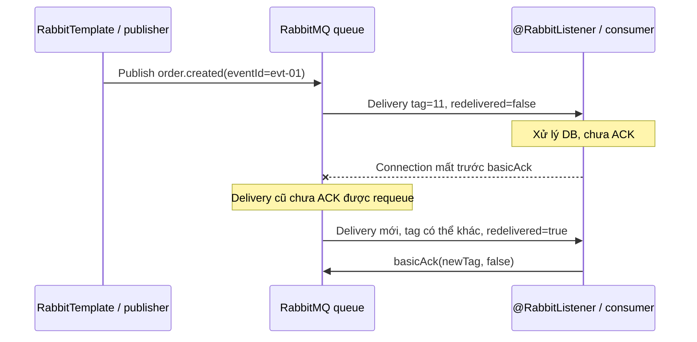
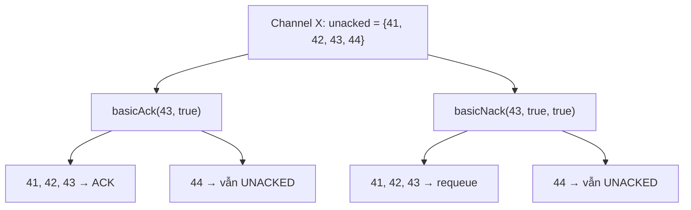
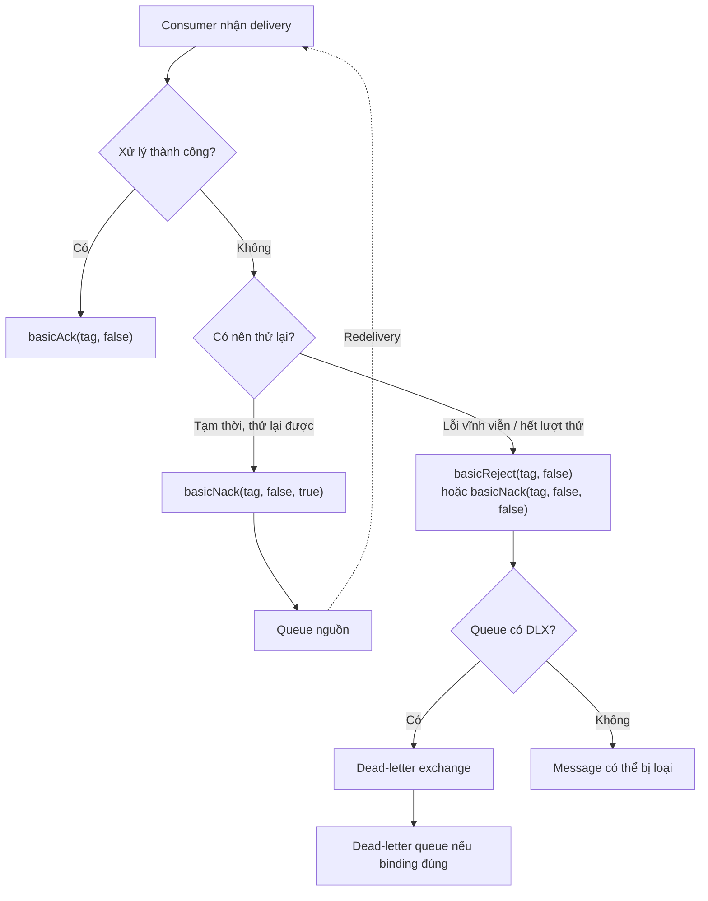
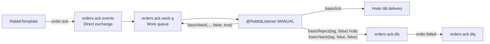

# Tham số multiple, requeue và ảnh hưởng tới các delivery khác

Trong RabbitMQ, một consumer có thể nhận nhiều message trước khi xác nhận bất kỳ message nào. Khi viết `@RabbitListener` dùng **manual acknowledgement** trong Spring AMQP, việc lựa chọn `basicAck(tag, multiple)`, `basicNack(tag, multiple, requeue)` hay `basicReject(tag, requeue)` sẽ quyết định **delivery nào được xác nhận, delivery nào bị trả lại queue và delivery nào có thể vào dead-letter exchange (DLX)**. Đặc biệt, đặt `multiple=true` không chỉ tác động đến message mang `deliveryTag` hiện tại mà còn có thể ảnh hưởng đến **những delivery chưa ACK khác trên cùng channel**.

Bài học thuộc chương **Xác nhận tiêu thụ** của module **SPRING_AMQP**. Chúng ta sẽ kết hợp RabbitMQ Java Client API với `RabbitTemplate`, `@RabbitListener`, exchange/queue/binding, prefetch, retry, dead-letter và transaction/idempotency để xây consumer bất đồng bộ đáng tin cậy. Trọng tâm không phải “gọi ACK thế nào cho nhanh”, mà là **ACK/NACK đúng phạm vi và đúng thời điểm**, tránh vô tình xác nhận công việc chưa hoàn thành hoặc requeue cả nhóm message không liên quan.

## 1. Một delivery khác một message nghiệp vụ

RabbitMQ giao message đến consumer dưới dạng một **delivery**. Khi sử dụng chế độ ACK thủ công, broker giữ delivery đó ở trạng thái **unacknowledged** cho đến khi nhận được xác nhận hoặc channel/connection bị đóng. Khi message được requeue rồi giao lại, nó tạo ra **một delivery mới** có thể thuộc consumer/channel khác; các dữ liệu nghiệp vụ như `eventId` có thể giữ nguyên, nhưng `deliveryTag` không phải mã định danh ổn định của message.

| Thuật ngữ | Ý nghĩa | Phạm vi |
|---|---|---|
| Message/event | Nội dung và ngữ nghĩa nghiệp vụ như `order.created`, `eventId`. | Do ứng dụng định nghĩa; có thể trải qua nhiều lần giao. |
| Delivery | Một lần broker giao message cho consumer. | Một lần nhận cụ thể, có thể bị redeliver. |
| `deliveryTag` | Số nguyên dương do broker cấp, tăng theo từng delivery trên channel. | **Chỉ có ý nghĩa trong channel nhận**. |
| Unacked | Delivery đã được giao nhưng broker chưa nhận ACK/NACK/Reject tương ứng. | Tập delivery đang outstanding ở broker/channel. |
| `redelivered` | Cờ broker gửi khi message có thể đã được giao trước. | Thuộc lần delivery, không phải số retry nghiệp vụ. |
| Prefetch | Giới hạn số delivery chưa ACK được broker đưa trước đến consumer. | Phụ thuộc cấu hình QoS và cơ chế của RabbitMQ. |

**Quy tắc số 1:** chỉ ACK/NACK delivery trên **chính channel đã nhận**. Lấy `deliveryTag=12` ở channel A rồi gọi `basicAck(12, false)` trên channel B là sai, cho dù channel B cũng có delivery mang số 12. Broker có thể đóng channel do `PRECONDITION_FAILED - unknown delivery tag`.



Lần giao thứ hai có thể đến **một consumer khác**. Nếu công việc đã ghi DB trước khi channel lỗi, xử lý lại phải được bảo vệ bằng idempotency, không thể dựa vào `deliveryTag` hay `redelivered` để xác định đã commit hay chưa.

## 2. Ba API cơ bản và ý nghĩa tham số

Trong RabbitMQ Java Client, có ba lệnh chính (Spring AMQP có thể gọi chúng thông qua listener container hoặc cho ứng dụng gọi trực tiếp khi ở `MANUAL`):

```java
channel.basicAck(long deliveryTag, boolean multiple);

channel.basicNack(long deliveryTag, boolean multiple, boolean requeue);

channel.basicReject(long deliveryTag, boolean requeue);
```

| Lệnh | Tham số `multiple` | Tham số `requeue` | Tác động |
|---|---|---|---|
| `basicAck(tag, false)` | `false` | Không có | Xác nhận **đúng một delivery**. Broker có thể loại nó khỏi tập unacked. |
| `basicAck(tag, true)` | `true` | Không có | Xác nhận **tất cả delivery vẫn unacked với tag ≤ giá trị đã cho trên cùng channel**. |
| `basicNack(tag, false, true)` | `false` | `true` | Từ chối **một delivery**, yêu cầu broker **requeue**. |
| `basicNack(tag, false, false)` | `false` | `false` | Từ chối **một delivery**, không requeue; dead-letter nếu queue có DLX phù hợp, nếu không có thể bị loại. |
| `basicNack(tag, true, true)` | `true` | `true` | **NACK cả nhóm delivery chưa ACK đến tag**, yêu cầu requeue **cả nhóm**. |
| `basicNack(tag, true, false)` | `true` | `false` | **NACK cả nhóm delivery chưa ACK đến tag**, không requeue; từng message có thể bị dead-letter/loại. |
| `basicReject(tag, true)` | Không hỗ trợ | `true` | Từ chối và requeue **một delivery**. |
| `basicReject(tag, false)` | Không hỗ trợ | `false` | Từ chối **một delivery**, không requeue. |

`basic.reject` thuộc AMQP 0-9-1 và không có tham số `multiple`. RabbitMQ bổ sung `basic.nack` để hỗ trợ **negative acknowledgement theo lô**. Hai loại negative acknowledgement có thể có khác biệt trong cách broker tính delivery limit của quorum queue ở những phiên bản cụ thể, sẽ phân tích ở phần sau.

### 2.1. `multiple` không phải số lượng message

`multiple` là **boolean**:

- `false`: chỉ chọn delivery mang đúng `deliveryTag`.
- `true`: chọn **mọi delivery vẫn outstanding có tag ≤ deliveryTag trên cùng channel**.

Không phải `multiple=3` nghĩa là chọn ba message, cũng không phải `multiple=true` chọn “message gần nhất và một message trước”. Broker xác định tập tác động theo **delivery tag và trạng thái unacked**, không theo body, routing key, event ID hay queue.

## 3. Minh họa bằng bảng trạng thái delivery

Giả sử trên **cùng một channel** broker đã giao bốn delivery với tag `41`, `42`, `43` và `44`. Ban đầu cả bốn đều chưa ACK.

| Delivery tag | 41 | 42 | 43 | 44 |
|---|---|---|---|---|
| Trạng thái ban đầu | Unacked | Unacked | Unacked | Unacked |

Đây là các **thí nghiệm độc lập, mỗi dòng bắt đầu lại từ trạng thái ban đầu**:

| Lệnh được gửi | Delivery 41 | Delivery 42 | Delivery 43 | Delivery 44 |
|---|---|---|---|---|
| `basicAck(43, false)` | Unacked | Unacked | **ACK** | Unacked |
| `basicAck(43, true)` | **ACK** | **ACK** | **ACK** | Unacked |
| `basicNack(43, false, true)` | Unacked | Unacked | **Requeue** | Unacked |
| `basicNack(43, true, true)` | **Requeue** | **Requeue** | **Requeue** | Unacked |
| `basicNack(43, false, false)` | Unacked | Unacked | **DLX/loại** | Unacked |
| `basicNack(43, true, false)` | **DLX/loại** | **DLX/loại** | **DLX/loại** | Unacked |
| `basicReject(43, true)` | Unacked | Unacked | **Requeue** | Unacked |

Ở đây, “DLX/loại” nghĩa là broker dead-letter nếu có cấu hình hợp lệ, **không tự tạo DLQ**; nếu không có tuyến DLX, message có thể bị xóa. Delivery có tag `44` không bị `basicAck(43, true)` hay `basicNack(43, true, ...)` tác động chỉ vì nó đến **sau** tag 43.



**Lưu ý “vẫn unacked”:** nếu tag `41` đã được ACK riêng trước đó, một `basicAck(43, true)` chỉ xác nhận **những delivery còn outstanding ≤ 43** (ví dụ 42 và 43). Điều quan trọng là **tag chỉ định một ranh giới**, không phải một tập ID tùy chọn. Không nên gửi ACK/NACK lại cho tag đã hoàn tất; có thể gặp lỗi protocol khi broker không nhận ra một delivery tag còn hiệu lực.

### 3.1. Cùng channel có thể có nhiều consumer

Hãy hình dung channel X đăng ký hai consumer:

```text
Channel X:
  tag=41: queue A / consumer A / chưa xử lý
  tag=42: queue B / consumer B / đã xử lý
  tag=43: queue A / consumer A / đã xử lý

Consumer A gọi basicAck(43, true)
→ ACK cả 41, 42, 43 nếu cả ba còn unacked trên channel X.
```

`multiple=true` **không giới hạn phạm vi theo consumer tag hoặc queue**. Nếu nhiều consumer thực sự chia sẻ một channel, batch ACK/NACK có thể ảnh hưởng đến delivery của consumer khác. Không suy luận rằng mỗi `@RabbitListener` luôn chia sẻ channel với listener khác; việc chia sẻ tùy container, connection factory và cấu hình. Cần xem **channel thực tế** trước khi áp dụng batch acknowledgement.

## 4. Ảnh hưởng của multiple khi hoàn thành xử lý không theo thứ tự

Giả sử consumer đưa các delivery trên một channel vào ba worker để xử lý bất đồng bộ:

```text
tag=51  → Worker A: gọi API chậm, CHƯA hoàn tất
tag=52  → Worker B: ghi DB xong
tag=53  → Worker C: ghi DB xong
```

Nếu Worker C gọi:

```java
channel.basicAck(53L, true);
```

thì **tag 51 cũng bị ACK**, dù Worker A vẫn đang làm việc. Nếu Worker A tiếp tục thất bại hoặc process chết, broker đã nhận ACK và sẽ **không tự redeliver tag 51**. Đây là nguy cơ **mất công việc** do dùng `multiple=true` khi xử lý out-of-order.

Ngược lại:

```java
// Chỉ xác nhận các delivery thực sự đã hoàn thành.
channel.basicAck(52L, false);
channel.basicAck(53L, false);
// Tag 51 tiếp tục unacked, được giải quyết khi Worker A xong.
```

Trong ví dụ này, dùng ACK riêng là cách dễ hiểu hơn. Nếu muốn tối ưu ACK theo lô, ứng dụng phải theo dõi **ranh giới hoàn thành liên tục (highest contiguous completed delivery tag)**: chỉ phát `basicAck(lastSafeTag, true)` khi **mọi delivery chưa ACK có tag tới ranh giới đó đã xử lý an toàn**. Bên cạnh đó cần điều phối thứ tự gửi ACK trên **cùng channel**, tránh nhiều callback chạy cạnh tranh.

### 4.1. Batch NACK cũng ảnh hưởng đến delivery đã xử lý thành công

Giả sử `tag=61` xử lý thành công nhưng chưa ACK, `tag=62` thất bại tạm thời và `tag=63` vẫn đang xử lý. Nếu bạn gọi:

```java
channel.basicNack(62L, true, true);
```

thì **cả tag 61 và 62** còn outstanding đều được yêu cầu requeue. Message của tag 61 **có thể bị xử lý lại** dù nghiệp vụ đã thành công. Tag 63 giữ nguyên, nhưng điều đó **không bảo đảm** thứ tự hoàn thành nghiệp vụ hoặc thứ tự giao lại giống ban đầu.

Nếu chỉ tag 62 lỗi, dùng:

```java
channel.basicNack(62L, false, true); // Requeue chỉ delivery 62.
```

và xử lý tag 61 riêng:

```java
channel.basicAck(61L, false); // Chỉ nếu nghiệp vụ của 61 đã commit.
```

**Quy tắc an toàn mặc định:** khi xử lý riêng từng sự kiện hoặc có concurrency/async, đặt `multiple=false`. Chỉ dùng `multiple=true` nếu bạn **chủ ý** xác nhận/từ chối *toàn bộ* các delivery outstanding tới một tag, sau khi đã kiểm soát trạng thái từng delivery.

### 4.2. Trường hợp đặc biệt với deliveryTag = 0

AMQP 0-9-1 có một quy ước giao thức cho lệnh batch:

```java
channel.basicAck(0L, true);         // Xác nhận tất cả delivery đang outstanding trên channel.
channel.basicNack(0L, true, true);  // NACK/requeue tất cả delivery outstanding trên channel.
```

Đây là thao tác **toàn channel**, không chỉ một consumer hay một queue. Không dùng các lệnh này như cách “dọn sạch” không kiểm soát trong listener bình thường. Chúng có thể xác nhận message chưa được xử lý hoặc requeue message đã hoàn tất nghiệp vụ.

## 5. Requeue: broker sẽ làm gì với message?

Tham số `requeue` chỉ có ở **negative acknowledgement**:

- `requeue=true`: yêu cầu RabbitMQ đưa message trở lại queue để có thể được giao lần nữa.
- `requeue=false`: broker không đưa message trở lại queue nguồn; nếu queue có **dead-letter exchange** phù hợp, message được chuyển qua DLX, nếu không có thể bị loại.



### 5.1. Requeue không bảo đảm giữ nguyên thứ tự

RabbitMQ cố đưa message về vị trí ban đầu trong queue **nếu có thể**. Nhưng khi nhiều consumer đang nhận, ACK hoặc requeue đồng thời, broker có thể đặt message gần đầu queue thay vì đúng vị trí cũ. Bởi vậy:

1. `requeue=true` **không cam kết** message được giao lại ngay cho **cùng consumer**.
2. Không cam kết giữ thứ tự hoàn thành xử lý khi có prefetch/concurrency lớn.
3. Message được requeue có thể được giao lại **rất nhanh**, thậm chí gây vòng lặp khi mọi consumer tiếp tục NACK với `requeue=true`.
4. Cờ `redelivered=true` báo một delivery có thể từng được gửi trước đó; không phải bộ đếm retry và không chứng minh lần trước đã commit DB hay chưa.

Ví dụ một message gây lỗi schema khiến tất cả consumer đều:

```java
channel.basicNack(tag, false, true);
```

Nếu không sửa được payload, nó sẽ **được giao lại rồi tiếp tục lỗi**, gây tiêu tốn CPU/network và có thể làm nghẽn queue. Đây không phải chiến lược retry có giới hạn.

### 5.2. Khi nào nên requeue, khi nào nên dead-letter?

| Loại lỗi | Chiến lược có thể cân nhắc | Vì sao |
|---|---|---|
| Database timeout ngắn, dịch vụ ngoài tạm unavailable | Retry có giới hạn với backoff hoặc delayed retry; chỉ requeue trực tiếp khi thực sự phù hợp. | Tình trạng có thể phục hồi; tránh vòng lặp nóng. |
| JSON hỏng, thiếu trường bắt buộc, schema không hỗ trợ | Reject/NACK `requeue=false`, đưa vào DLQ có giám sát. | Gửi lại y nguyên thường không sửa được dữ liệu. |
| Message hợp lệ nhưng tài nguyên nghiệp vụ chưa sẵn sàng | Xem lại contract thứ tự; cân nhắc delay queue/workflow state. | Requeue tức thì có thể lặp liên tục và đảo thứ tự. |
| Consumer shutdown / mất kết nối trước ACK | Broker tự requeue các outstanding deliveries khi channel/connection đóng. | Không phải lúc nào ứng dụng cũng chủ động gọi `basicNack`. |
| Phát hiện message đã xử lý trước đó | ACK delivery sau khi kiểm tra idempotency thành công. | Không nên requeue chỉ vì event trùng; có thể tạo lặp vô hạn. |

Với hệ thống production, cơ chế retry nên quy định **số lần thử, backoff, điều kiện từ bỏ, DLX/DLQ, alert và thao tác replay**. Consumer ACK/NACK là cơ chế điều phối delivery; bản thân nó **không** cung cấp toàn bộ chiến lược xử lý lỗi nghiệp vụ.

### 5.3. Quorum queue: delivery limit thay đổi theo phiên bản RabbitMQ

Quorum queue có cơ chế xử lý poison message bằng **delivery limit**, nhưng cần đặc biệt chú ý khác biệt giữa các bản RabbitMQ:

- RabbitMQ **4.0** đưa ra delivery limit mặc định 20 cho quorum queue (có thể cấu hình lại).
- Tài liệu RabbitMQ hiện hành nêu thay đổi từ **4.3**: message requeue qua `basic.nack` **không tăng bộ đếm dùng cho delivery limit**; nếu ứng dụng dựa vào limit để chuyển poison message sang DLQ, nên xem xét `basic.reject(tag, true)` thay vì `basic.nack(tag, false, true)`.
- Trong RabbitMQ **4.2 trở về trước**, hành vi đếm delivery của `basic.nack` khác; **không suy diễn quy tắc của 4.3 cho mọi phiên bản**.
- Các bản Spring AMQP cũng có thay đổi cách container NACK một delivery riêng so với NACK theo lô. Luôn đối chiếu **RabbitMQ version, Spring AMQP version và loại lệnh mà container thực sự gửi** trước khi dựa vào poison message limit.

Điều này đặc biệt quan trọng với `multiple=true`: NACK theo lô không tương đương “mỗi message bị xử lý lỗi thêm một lần” trong bộ đếm của quorum queue. Nếu yêu cầu chắc chắn chặn vòng lặp, hãy bổ sung **giới hạn retry ở tầng ứng dụng** và topology DLQ thay vì đặt niềm tin hoàn toàn vào một loại ACK/NACK.

Tham khảo [RabbitMQ — Quorum Queues](https://www.rabbitmq.com/docs/quorum-queues) và [RabbitMQ — Negative Acknowledgements](https://www.rabbitmq.com/docs/nack) khi triển khai theo version cụ thể.

## 6. Cấu hình manual acknowledgement trong Spring AMQP

Spring listener container có các chế độ ACK phổ biến:

| `AcknowledgeMode` | Ý nghĩa | Ai gửi ACK/NACK? |
|---|---|---|
| `AUTO` (thường là mặc định) | Container xác nhận khi listener xử lý thành công; nếu lỗi, container dùng chính sách reject/requeue/error handler. | **Spring container**, không phải code trong handler. |
| `MANUAL` | Handler chịu trách nhiệm xác nhận hoặc từ chối delivery. | **Code ứng dụng**, sử dụng `Channel` và `deliveryTag`. |
| `NONE` | Broker được yêu cầu delivery **không cần xác nhận** (`autoAck/noAck` của RabbitMQ). | Không có consumer ACK riêng; nguy cơ mất delivery nếu handler lỗi. |

Chú ý: `AcknowledgeMode.AUTO` của Spring **không phải RabbitMQ auto-ack**. Cùng có chữ “auto” nhưng Spring AUTO nghĩa là **container gửi ACK sau xử lý**, còn RabbitMQ auto-ack tương ứng với `AcknowledgeMode.NONE`.

Nếu cần gọi trực tiếp `channel.basicAck`, `basicNack` hoặc `basicReject` trong `@RabbitListener`, phải chọn `MANUAL`. Nếu để container `AUTO` nhưng code cũng gửi ACK thủ công, dễ dẫn đến **double acknowledgement**: broker nhận thêm ACK cho tag đã xử lý, trả lỗi `unknown delivery tag` rồi đóng channel.

### 6.1. Cấu hình MANUAL ngay trên @RabbitListener

```java
import com.rabbitmq.client.Channel;
import java.io.IOException;
import org.springframework.amqp.core.Message;
import org.springframework.amqp.rabbit.annotation.RabbitListener;

@RabbitListener(
        queues = "orders.ack.work.q",
        ackMode = "MANUAL",
        concurrency = "1")
public void onMessage(Message message, Channel channel) throws IOException {
    long tag = message.getMessageProperties().getDeliveryTag();

    // Sau khi thực hiện xử lý nghiệp vụ thành công:
    channel.basicAck(tag, false);
}
```

Đoạn code trên chỉ minh họa **cú pháp của một phương thức**. Queue `orders.ack.work.q` phải tồn tại; code nghiệp vụ và xử lý exception cần được bổ sung để không ACK message khi DB chưa commit. Trong Spring, `MessageProperties.getDeliveryTag()` là metadata delivery; có thể lấy tag từ tham số `@Header(AmqpHeaders.DELIVERY_TAG)` thay thế.

Bạn cũng có thể cấu hình chế độ ACK cho một factory chuyên dụng:

```java
import org.springframework.amqp.core.AcknowledgeMode;
import org.springframework.amqp.rabbit.config.SimpleRabbitListenerContainerFactory;
import org.springframework.amqp.rabbit.connection.ConnectionFactory;
import org.springframework.context.annotation.Bean;
import org.springframework.context.annotation.Configuration;

@Configuration(proxyBeanMethods = false)
public class ManualAckListenerConfig {

    @Bean("manualAckListenerFactory")
    SimpleRabbitListenerContainerFactory manualAckListenerFactory(
            ConnectionFactory connectionFactory) {
        SimpleRabbitListenerContainerFactory factory =
                new SimpleRabbitListenerContainerFactory();
        factory.setConnectionFactory(connectionFactory);
        factory.setAcknowledgeMode(AcknowledgeMode.MANUAL);
        factory.setPrefetchCount(10);
        factory.setConcurrentConsumers(1);
        return factory;
    }
}
```

Khi đặt `containerFactory="manualAckListenerFactory"` trên annotation, listener sử dụng các thiết lập của factory đó. Nếu đồng thời đặt `ackMode="MANUAL"` tại annotation, giá trị endpoint ghi đè chế độ ACK của factory (các phiên bản Spring AMQP hỗ trợ thuộc tính này).

Không cần tự tạo factory nếu Spring Boot đã đáp ứng nhu cầu và bạn chỉ muốn một policy toàn ứng dụng:

```yaml
spring:
  rabbitmq:
    listener:
      type: simple
      simple:
        acknowledge-mode: manual
        prefetch: 10
```

Đây là **ví dụ thay thế** cho việc tạo factory chuyên dụng; đảm bảo biết chính xác listener đang sử dụng factory nào. Tham số prefetch ảnh hưởng lượng delivery có thể outstanding, nhưng không tự đặt timeout/retry hoặc bảo đảm transaction nghiệp vụ.

## 7. Topology thực hành có work queue và dead-letter queue

Ta tạo một direct exchange nhận sự kiện, một work queue, DLX và DLQ để quan sát được kết quả khi `requeue=false`. Để dễ đọc, tất cả nằm trong **cùng virtual host**.



### 7.1. Spring bean khai báo exchange, queue và binding

```java
package com.example.ack;

import org.springframework.amqp.core.Binding;
import org.springframework.amqp.core.BindingBuilder;
import org.springframework.amqp.core.DirectExchange;
import org.springframework.amqp.core.Queue;
import org.springframework.amqp.core.QueueBuilder;
import org.springframework.beans.factory.annotation.Qualifier;
import org.springframework.context.annotation.Bean;
import org.springframework.context.annotation.Configuration;

@Configuration(proxyBeanMethods = false)
public class AckTopology {
    public static final String EXCHANGE = "orders.ack.events";
    public static final String WORK_QUEUE = "orders.ack.work.q";
    public static final String WORK_KEY = "order.ack";
    public static final String DLX = "orders.ack.dlx";
    public static final String DLQ = "orders.ack.dlq";
    public static final String DEAD_KEY = "order.failed";

    @Bean
    DirectExchange ackExchange() {
        return new DirectExchange(EXCHANGE, true, false);
    }

    @Bean
    DirectExchange ackDeadLetterExchange() {
        return new DirectExchange(DLX, true, false);
    }

    @Bean
    Queue ackWorkQueue() {
        return QueueBuilder.durable(WORK_QUEUE)
                .deadLetterExchange(DLX)
                .deadLetterRoutingKey(DEAD_KEY)
                .build();
    }

    @Bean
    Queue ackDeadLetterQueue() {
        return QueueBuilder.durable(DLQ).build();
    }

    @Bean
    Binding ackWorkBinding(
            @Qualifier("ackWorkQueue") Queue queue,
            @Qualifier("ackExchange") DirectExchange exchange) {
        return BindingBuilder.bind(queue).to(exchange).with(WORK_KEY);
    }

    @Bean
    Binding ackDeadLetterBinding(
            @Qualifier("ackDeadLetterQueue") Queue queue,
            @Qualifier("ackDeadLetterExchange") DirectExchange exchange) {
        return BindingBuilder.bind(queue).to(exchange).with(DEAD_KEY);
    }
}
```

`@Qualifier` ở đây quan trọng vì có **hai bean `Queue` và hai bean `DirectExchange`**. Nếu chỉ inject theo kiểu mà không phân biệt bean, Spring có thể gặp nhập nhằng dependency.

Với `spring-boot-starter-amqp` trong Spring Boot 3.x hoặc starter RabbitMQ AMQP 0-9-1 phù hợp trên Spring Boot mới hơn, `RabbitAdmin` thường hỗ trợ khai báo các bean khi kết nối được thiết lập. Chỉ tạo bean **không bảo đảm** topology đã sẵn sàng trên broker. Nếu queue đã tồn tại với các arguments khác, RabbitMQ có thể trả `PRECONDITION_FAILED`; không nên tự xóa queue production để thử lại.

**Ghi chú vận hành:** các tham số `x-dead-letter-exchange` và `x-dead-letter-routing-key` cũng có thể được quản lý bằng RabbitMQ policy phù hợp, tránh gắn cứng topology vào ứng dụng khi có quy trình vận hành độc lập. Ví dụ trên chọn `QueueBuilder` để người học nhìn thấy rõ liên kết DLX/DLQ.

### 7.2. Publisher gửi message test

```java
package com.example.ack;

import org.springframework.amqp.rabbit.core.RabbitTemplate;
import org.springframework.stereotype.Component;

@Component
public class AckDemoPublisher {
    private final RabbitTemplate rabbitTemplate;

    public AckDemoPublisher(RabbitTemplate rabbitTemplate) {
        this.rabbitTemplate = rabbitTemplate;
    }

    public void send(String eventId, String body) {
        rabbitTemplate.convertAndSend(
                AckTopology.EXCHANGE,
                AckTopology.WORK_KEY,
                body,
                message -> {
                    message.getMessageProperties().setMessageId(eventId);
                    message.getMessageProperties().setHeader("eventId", eventId);
                    return message;
                });
    }
}
```

Publisher không cần biết consumer dùng AUTO hay MANUAL ACK; nó publish đến exchange và broker định tuyến theo binding. `messageId` và header `eventId` do ứng dụng đặt giúp consumer/ops đối soát sự kiện qua redelivery, nhưng **không phải** `deliveryTag` dùng để ACK.

## 8. Consumer Spring AMQP: mặc định ACK/NACK từng delivery

Đây là mẫu manual ACK ưu tiên **độ an toàn và dễ đọc** thay vì tối ưu batch:

```java
package com.example.ack;

import com.rabbitmq.client.Channel;
import java.io.IOException;
import java.nio.charset.StandardCharsets;
import org.springframework.amqp.core.Message;
import org.springframework.amqp.rabbit.annotation.RabbitListener;
import org.springframework.stereotype.Component;

@Component
public class AckDemoConsumer {

    @RabbitListener(
            id = "ackDemoConsumer",
            queues = AckTopology.WORK_QUEUE,
            ackMode = "MANUAL",
            concurrency = "1")
    public void handle(Message message, Channel channel) throws IOException {
        long tag = message.getMessageProperties().getDeliveryTag();
        String eventId = message.getMessageProperties().getMessageId();
        boolean redelivered = message.getMessageProperties().isRedelivered();
        String body = new String(message.getBody(), StandardCharsets.UTF_8);

        System.out.printf(
                "eventId=%s tag=%d redelivered=%s body=%s%n",
                eventId, tag, redelivered, body);

        try {
            processBusiness(body);
        } catch (IllegalArgumentException invalidPayload) {
            // Lỗi dữ liệu: đẩy sang DLX/DLQ (nếu đã cấu hình).
            channel.basicReject(tag, false);
            return;
        } catch (RuntimeException processingFailure) {
            // Ví dụ: lỗi không xử lý được ngay -> đưa sang DLQ
            // để chẩn đoán / retry có giám sát, tránh requeue vô hạn.
            channel.basicNack(tag, false, false);
            return;
        }

        // ACK CHỈ khi nghiệp vụ hoàn tất thành công.
        channel.basicAck(tag, false);
    }

    private void processBusiness(String body) {
        if (body.startsWith("invalid:")) {
            throw new IllegalArgumentException("Unsupported payload");
        }
        if (body.startsWith("failed:")) {
            throw new IllegalStateException("Simulated processing failure");
        }
        // Ứng dụng thật: xác thực, cập nhật DB và idempotency trong transaction.
    }
}
```

Trong ví dụ này:

1. `ackMode="MANUAL"` cho phép ứng dụng chủ động ACK/NACK; container không gửi ACK thành công thay cho handler.
2. `basicAck(tag, false)` chỉ xác nhận delivery hiện tại sau khi `processBusiness` hoàn tất.
3. `basicReject(tag, false)` và `basicNack(tag, false, false)` chỉ từ chối **một delivery** rồi nhờ DLX giữ lỗi; nếu queue chưa có DLX hợp lệ, message có thể bị loại.
4. `basicAck` nằm **ngoài `try/catch` xử lý nghiệp vụ**, tránh vô tình gọi NACK sau khi chính lệnh ACK phát sinh IOException.
5. Cùng một `eventId` có thể xuất hiện nhiều lần nếu broker redeliver sau sự cố; ứng dụng phải dùng transaction/idempotency để tránh thực thi nghiệp vụ lặp.

Đoạn mẫu dùng `System.out.printf` và các điều kiện `startsWith` chỉ để minh họa, không phải validator hoặc error handling production. Cần có structured logging, schema validation, retry policy, cảnh báo DLQ và xử lý failure khi chính lệnh reject/NACK không gửi được.

### 8.1. Nếu thực sự muốn requeue một delivery

Trong nhánh lỗi **tạm thời có khả năng phục hồi**, có thể thay lệnh NACK không requeue:

```java
channel.basicNack(tag, false, true);
// tag: delivery hiện tại
// multiple=false: không ảnh hưởng delivery khác
// requeue=true: broker có thể giao lại message
```

Nhưng **không dùng trực tiếp như chiến lược retry vô hạn**. Nếu cùng một body luôn làm ứng dụng ném exception, consumer sẽ nhận → NACK → requeue → nhận lại liên tục. Trong production, áp dụng retry có giới hạn/backoff/delay và DLQ, đồng thời tính đến thay đổi delivery limit của quorum queue theo phiên bản broker.

## 9. Khi nào multiple=true mới thực sự an toàn?

ACK theo lô tiết kiệm số frame `basic.ack` phải gửi qua mạng, nhưng nó chỉ đúng khi **tất cả delivery được chọn đã được xử lý và commit thành công**.

Một trường hợp đơn giản: ứng dụng chủ động lấy **hai** message từ một **channel mới, không có delivery outstanding khác**, xử lý cả hai **tuần tự**, rồi ACK đến tag của message thứ hai.

```java
package com.example.ack;

import com.rabbitmq.client.Channel;
import com.rabbitmq.client.Connection;
import com.rabbitmq.client.ConnectionFactory;
import com.rabbitmq.client.GetResponse;
import java.nio.charset.StandardCharsets;

public final class BulkAckProbe {

    public static void consumeTwoForDemo(ConnectionFactory nativeFactory)
            throws Exception {
        try (Connection connection = nativeFactory.newConnection();
             Channel channel = connection.createChannel()) {

            // Chỉ chạy trên queue thử nghiệm và dừng @RabbitListener
            // khác để chắc chắn có ít nhất hai message đang chờ.
            GetResponse first = channel.basicGet(
                    AckTopology.WORK_QUEUE, false);
            GetResponse second = channel.basicGet(
                    AckTopology.WORK_QUEUE, false);

            if (first == null || second == null) {
                // Đóng channel -> những delivery chưa ACK sẽ requeue.
                throw new IllegalStateException("Need two test messages");
            }

            process(first);
            process(second);

            // Chỉ an toàn vì cả hai đã xử lý xong trên channel riêng.
            long lastTag = second.getEnvelope().getDeliveryTag();
            channel.basicAck(lastTag, true);
        }
    }

    private static void process(GetResponse delivery) {
        String text = new String(
                delivery.getBody(), StandardCharsets.UTF_8);
        System.out.println("Processed in demo: " + text);
        // Ứng dụng thật cần commit nghiệp vụ và idempotency ở đây.
    }
}
```

Ví dụ dùng **RabbitMQ Java Client thuần** để dễ nhìn rõ tập delivery outstanding trên **một channel**. Nó không sử dụng Spring listener container, dù vẫn tiêu thụ queue do Spring topology tạo. Không chạy đồng thời với `AckDemoConsumer` khi muốn kiểm chứng chính xác việc lấy hai message; nếu consumer khác đang hoạt động, nó có thể lấy message trước.

Đoạn code không phải hệ thống xử lý nghiệp vụ production: `process` chỉ in log. Muốn dùng batch ACK thật, phải đảm bảo **mọi transaction nghiệp vụ đã commit**, xác định đúng tập delivery chưa ACK và kiểm soát failure giữa các bước. Nếu xử lý message đầu thành công nhưng message thứ hai ném exception, khi channel đóng cả hai sẽ có thể được requeue; **idempotency** cần chịu được tình huống xử lý lại message đầu tiên.

### 9.1. Không dùng multiple=true khi hoàn thành bất đồng bộ không theo thứ tự

Giả sử một listener nhận tag `71`, `72`, `73` rồi chuyển sang ba tác vụ bất đồng bộ. Tag 72 và 73 hoàn thành trước nhưng 71 còn đang chạy:

| Tag | Trạng thái nghiệp vụ | Có thể gọi `basicAck(tag, false)`? | Có thể gọi `basicAck(73, true)`? |
|---|---|---|---|
| 71 | Chưa hoàn tất | Không | **Không** — sẽ ACK nhầm 71 |
| 72 | Đã commit | Có | Không an toàn nếu 71 vẫn outstanding |
| 73 | Đã commit | Có | Không an toàn nếu 71 vẫn outstanding |

Nếu dùng CompletableFuture, Reactor hoặc worker pool, cần cân nhắc cơ chế ACK bất đồng bộ mà Spring AMQP hỗ trợ cho loại listener tương ứng. Không gửi ACK từ nhiều thread trên **cùng Channel** mà không có cơ chế điều phối; vấn đề không chỉ là `multiple` mà còn là tính an toàn thread, vòng đời channel và việc handler có còn sở hữu delivery khi callback hoàn tất hay không.

**Khuyến nghị cho người mới:** dùng `multiple=false` với một delivery tại một thời điểm, rồi tối ưu khi benchmark xác nhận ACK frame là điểm nghẽn. Nếu Spring container đang dùng `AUTO` và có cơ chế gom ACK nội bộ, **đừng tự gọi thêm ACK** để “tối ưu” ngoài framework.

## 10. Prefetch, batch ACK và ảnh hưởng đến các delivery còn lại

**Prefetch** kiểm soát số delivery **chưa ACK** có thể được gửi trước đến consumer. Trong RabbitMQ, QoS có thể áp dụng theo consumer; cần đối chiếu loại queue và cấu hình khi có nhiều consumer/channel.

Giả sử consumer có `prefetch=4` và đang giữ tag 81, 82, 83, 84 đều unacked:

```text
Broker → Consumer: 81, 82, 83, 84
Unacked window = 4/4 (đạt prefetch)

basicAck(83, false)
→ chỉ tag 83 được giải phóng
→ 81, 82, 84 vẫn unacked
→ broker có thể giao thêm một delivery mới

basicAck(84, true) (sau đó, và giả định 81/82/84 đã hoàn tất)
→ ACK các tag đang outstanding đến 84
→ broker có thể mở thêm nhiều vị trí nhận
```

Trường hợp thứ hai **chỉ hợp lệ** khi 81, 82 và 84 đều xử lý xong. Batch ACK giúp giải phóng nhiều vị trí trong cửa sổ prefetch, nhưng nếu ACK quá sớm sẽ đổi an toàn lấy throughput.

| Cấu hình | Tác động | Cần tránh |
|---|---|---|
| Prefetch thấp, ví dụ 1 | Ít delivery outstanding, dễ lập luận về ACK và redelivery. | Có thể giảm throughput nếu xử lý nhanh nhưng round-trip/network latency cao. |
| Prefetch vừa, ví dụ 10–50 | Cho phép pipeline nhiều delivery, thường phù hợp workload vừa phải. | Phải tính đến memory và số message có thể bị giao lại khi channel mất. |
| Prefetch rất cao | Broker có thể gửi nhiều delivery trước ACK. | Tăng unacked, chiếm bộ nhớ, giảm khả năng chia tải công bằng và tăng số message ảnh hưởng khi connection lỗi. |
| ACK theo lô | Giảm số ACK frame. | Không được ACK delivery chưa hoàn tất, không được batch NACK vô ý. |

Trong **SimpleMessageListenerContainer**, cấu hình như `batchSize` có thể điều khiển cách container gom acknowledgement trong `AUTO` tùy chế độ. Trong **DirectMessageListenerContainer**, các tùy chọn như `messagesPerAck` / `ackTimeout` có thể gom ACK theo số message/thời gian khi được hỗ trợ. Đây là cơ chế **container quản lý**, không phải lời khuyên cho handler ở `MANUAL` gọi `basicAck(..., true)` tùy tiện.

**Phân biệt ba mức:** (1) prefetch giới hạn delivery chưa ACK; (2) batching ACK là cách tiết kiệm frame; (3) batch listener là cách truyền nhiều payload vào một lần gọi handler. Ba thứ này **không đồng nghĩa**. Một handler nhận `String` đơn lẻ vẫn có thể chạy trong container gom ACK; ngược lại, một handler nhận danh sách chưa chắc đã có semantics transaction/ACK giống mong đợi.

## 11. ACK không đồng nghĩa transaction nghiệp vụ đã an toàn

Giả sử consumer nhận sự kiện `evt-900`, cần cập nhật cơ sở dữ liệu. Hai trình tự sau có mức độ rủi ro khác nhau:

### 11.1. ACK trước, commit DB sau — dễ mất công việc

```text
Receive(tag=91)
→ basicAck(91, false)
→ UPDATE database
→ Process crash trước DB commit
```

Broker đã nhận ACK, nên **không tự giao lại delivery 91**. DB chưa commit và công việc có thể bị mất. Tránh ACK trước khi nghiệp vụ hoàn tất.

### 11.2. Commit DB trước, ACK sau — có thể xử lý trùng

```text
Receive(tag=92)
→ UPDATE database + COMMIT
→ Connection crash trước basicAck
→ Broker requeue unacked delivery
→ Consumer khác nhận lại cùng eventId
```

Trình tự này bảo vệ chống **mất công việc**, nhưng tạo nguy cơ **áp dụng nghiệp vụ hai lần** nếu consumer không idempotent. Cần dùng ID sự kiện ổn định:

```sql
-- Lược đồ minh họa: cùng transaction với update nghiệp vụ.
CREATE TABLE processed_events (
    event_id VARCHAR(128) PRIMARY KEY,
    processed_at TIMESTAMP NOT NULL
);

-- Trong một transaction DB:
-- 1. INSERT event_id (nếu đã tồn tại, coi sự kiện đã xử lý).
-- 2. Nếu INSERT thành công, cập nhật trạng thái nghiệp vụ.
-- 3. COMMIT transaction.
-- 4. Sau đó mới ACK delivery trên đúng channel.
```

`eventId` là khóa nghiệp vụ; `deliveryTag` **không** được dùng làm khóa idempotency vì thay đổi theo delivery và channel. Nếu hai consumer xử lý cùng eventId, unique constraint/transaction phải đảm bảo chỉ một lần thực thi tác động nghiệp vụ.

### 11.3. channelTransacted và database transaction

Spring AMQP có hỗ trợ channel transaction và phối hợp với Spring transaction manager trong các trường hợp thích hợp. Nhưng `@Transactional` ở DB **không tự biến DB commit và RabbitMQ ACK thành một giao dịch phân tán atomic**. Khi cần đảm bảo dữ liệu và sự kiện phát/nhận nhất quán, phải hiểu giới hạn của transaction cục bộ, ack sau commit, publisher confirms và/hoặc transactional outbox/inbox.

Đặc biệt, nếu channel được cấu hình transacted, ACK/NACK có thể cần được **commit trên AMQP channel** để broker áp dụng, bên cạnh transaction DB. Đừng phối hợp thủ công `basicAck`/`txCommit` cùng container transaction manager mà chưa nắm rõ ai sở hữu lifecycle và commit.

## 12. Consumer ACK khác publisher confirm dù tên method giống nhau

Trong AMQP 0-9-1 có cả publisher confirms và consumer acknowledgements, cùng sử dụng tên phương thức giao thức `basic.ack`/`basic.nack` trong những ngữ cảnh khác nhau:

| Cơ chế | Bên gửi tín hiệu | Xác nhận điều gì? | Tag/sequence nào? |
|---|---|---|---|
| **Consumer ACK** | Consumer → broker | Consumer chấp nhận **delivery đã nhận**. | `deliveryTag` của **channel tiêu thụ**. |
| **Publisher confirm** | Broker → publisher | Broker đã xử lý/xác nhận lần **publish**. | Publish sequence trên **channel phát**. |
| **Publisher return** | Broker → publisher | Message không được định tuyến được khi mandatory/returns áp dụng. | Thông tin return gồm exchange/routing key/reply code; không phải consumer delivery tag. |

Một publisher confirm ACK **không chứng minh consumer đã ACK**. Một consumer ACK cũng không khiến publisher nhận confirm cho từng lần xử lý nghiệp vụ. Để xây hệ thống bất đồng bộ đáng tin cậy, kết hợp:

- Publisher confirms và returns để quan sát bước gửi và routing.
- Queue có durability, retry/dead-letter và policy phù hợp.
- Consumer ACK/NACK đúng phạm vi, xử lý sau commit DB và idempotency.
- Logging/metrics/tracing theo `eventId` và correlation ID ổn định.

Không copy delivery tag từ consumer sang `CorrelationData` của publisher với kỳ vọng broker hiểu chúng là cùng một ID; chúng thuộc **hai không gian đánh số độc lập**.

## 13. Quan sát tác động đến những delivery khác

RabbitMQ Management UI và metrics giúp thấy các chuyển trạng thái:

| Chỉ số/trạng thái | Cách đọc khi thử `multiple` hoặc `requeue` |
|---|---|
| `messages_ready` | Message đang sẵn sàng để giao. Khi requeue, con số này **có thể tăng**, nhưng giảm rất nhanh nếu consumer khác nhận ngay. |
| `messages_unacknowledged` | Delivery đã giao nhưng chưa được ACK/NACK/Reject. `basicAck(tag, true)` có thể làm giảm **nhiều** unacked cùng lúc. |
| Consumer count | Số consumer đang đăng ký; giải thích vì sao message được requeue có thể đi sang consumer khác. |
| Delivery / acknowledgement rate | Theo dõi lượng delivery và ACK, phát hiện thay đổi khi dùng batch acknowledgement. |
| Redelivery rate | Tăng khi message được giao lại, có thể chỉ ra lỗi consumer hoặc vòng lặp requeue. |
| Dead-letter rate / DLQ depth | Cho thấy message không requeue được chuyển vào đường lỗi, nếu topology DLX/DLQ đã cấu hình đúng. |
| Channel state và exceptions | Phát hiện `PRECONDITION_FAILED - unknown delivery tag` do ACK trùng hoặc sai channel. |
| Tracing/log `eventId` + tag + queue | Giúp phân biệt cùng sự kiện bị giao nhiều lần với các delivery khác nhau. |

Ví dụ dùng RabbitMQ CLI trên môi trường có quyền truy cập:

```bash
rabbitmqctl -p / list_queues name consumers messages_ready messages_unacknowledged
rabbitmqctl -p / list_consumers
```

Đảm bảo chọn **đúng virtual host**. Tên trường hỗ trợ có thể thay đổi theo phiên bản RabbitMQ; khi cần, xem `rabbitmqctl help list_queues` hoặc `rabbitmqctl help list_consumers` trên broker tương ứng.

**Lưu ý:** ở môi trường có nhiều consumer xử lý rất nhanh, số `ready` có thể vẫn bằng 0 dù `requeue=true` đã xảy ra, vì broker ngay lập tức giao message trở lại. Đừng chỉ so một snapshot; hãy xem tốc độ redelivery, message ID và logs có timestamp.

### 13.1. Kịch bản có thể kiểm tra bằng log

Giả sử một sự kiện `evt-901` được giao lần đầu:

```text
eventId=evt-901 channel=A deliveryTag=15 redelivered=false
→ basicNack(15, false, true)

eventId=evt-901 channel=B deliveryTag=8 redelivered=true
→ xử lý thành công → basicAck(8, false)
```

Giá trị `deliveryTag` ở lần hai **không cần lớn hơn lần một** vì channel B có bộ đếm riêng. `eventId` vẫn không đổi do producer cung cấp, nhưng delivery tag, consumer tag và channel có thể thay đổi. Nếu muốn tổng hợp số lần xử lý thực sự trong ứng dụng, cần metrics/tracking riêng; cờ redelivered không phải bộ đếm đáng tin cho mục đích đó.

## 14. Troubleshooting: lỗi multiple và requeue thường gặp

| Hiện tượng | Nguyên nhân có thể | Cách xử lý |
|---|---|---|
| Message “biến mất” dù handler đang chạy | Một handler khác gọi `basicAck(laterTag, true)` và vô tình ACK luôn delivery đang xử lý. | Dùng `multiple=false` khi hoàn thành không theo thứ tự; chỉ ACK batch khi mọi tag trước đã commit. |
| Những message đã xử lý thành công bị giao lại | `basicNack(laterTag, true, true)` bao trùm cả delivery thành công chưa ACK. | NACK riêng delivery lỗi (`multiple=false`) và ACK những delivery đã commit. |
| Nhiều queue cùng bị ảnh hưởng bởi một lệnh batch | Hai consumer dùng cùng channel, `multiple=true` không giới hạn theo queue. | Kiểm tra channel thực tế; batch theo tập outstanding trên channel, không theo tên queue. |
| `PRECONDITION_FAILED - unknown delivery tag` | ACK hai lần, ACK sai channel, gọi manual ACK lẫn container AUTO hoặc dùng tag không còn outstanding. | Chọn một chủ thể ACK duy nhất, dùng đúng channel, không lặp ACK/NACK. |
| Listener đang `MANUAL` nhưng unacked tăng mãi | Code bỏ sót ACK/NACK ở một đường xử lý, hoặc future/callback không hoàn tất. | Bảo đảm mọi delivery được settle, xem exception paths và timeout xử lý. |
| Queue nhận lại cùng message liên tục | Lỗi vĩnh viễn nhưng consumer liên tục `NACK requeue=true`. | Giới hạn retry, backoff, reject không requeue và cấu hình DLQ. |
| Đã `NACK requeue=false` nhưng DLQ không có message | DLX thiếu, binding sai, sai vhost, DLQ không tồn tại hoặc quyền không phù hợp. | Kiểm tra dead-letter exchange/routing key và đường đi thực tế. |
| Message bị redeliver sau broker restart | Channel/connection đóng khi delivery còn unacked. | Dự kiến khả năng redelivery, idempotency, điều tra commit DB trước ACK. |
| Prefetch tăng nhưng throughput không cải thiện | DB/API downstream chậm; delivery chỉ bị giữ nhiều hơn trong unacked. | Đo latency nghiệp vụ, thread, DB pool; chỉnh concurrency/prefetch dựa trên số liệu. |
| Quorum queue poison message không vào DLQ như dự đoán | Dựa vào delivery limit với lệnh `basic.nack` không tăng bộ đếm trên RabbitMQ 4.3+, hoặc dùng batch nack. | Đối chiếu version và loại lệnh; dùng `basic.reject` khi phù hợp, retry có giới hạn và DLQ. |
| Có ACK trong log nhưng dữ liệu DB thiếu | Code ACK trước khi commit, transaction rollback sau ACK. | Commit nghiệp vụ trước ACK; không giả định AMQP ACK và DB transaction atomic. |
| Broker trả publisher confirm ACK nhưng consumer chưa ACK | Nhầm publisher confirm với consumer acknowledgement. | Theo dõi publish/route/consume như ba tầng khác nhau. |

Với sự cố phức tạp, nên điều tra theo thứ tự **message đã đến queue chưa → đã được giao đến consumer nào → còn unacked không → lệnh ACK/NACK nào được gửi trên channel nào → kết quả DB/DLX ra sao**. Đổi loại listener container hay tăng prefetch sẽ không tự sửa một lỗi ACK quá rộng.

## 15. Bài thực hành từng bước

**Bài 1 — ACK riêng một delivery.** Tạo topology `AckTopology` và chạy `AckDemoConsumer`. Gửi hai sự kiện hợp lệ bằng `AckDemoPublisher`, quan sát mỗi lần listener gọi `basicAck(tag, false)`. Giải thích vì sao `deliveryTag` của hai sự kiện tăng trên cùng channel nhưng có thể thay đổi sau khi connection được tạo lại.

**Bài 2 — phát hiện ACK quá rộng.** Trên một channel test riêng, nhận bốn delivery 41–44 hoặc các tag thực tế tương ứng. Giả lập 41 chưa xử lý, 42–43 đã hoàn tất. Trước khi chạy, dự đoán `basicAck(43, true)` sẽ làm gì. **Không dùng dữ liệu production.** Sửa bằng ACK riêng 42 và 43, giữ 41 outstanding cho đến khi hoàn thành.

**Bài 3 — batch NACK ảnh hưởng các delivery khác.** Nhận ba delivery trên một channel test; giả sử delivery đầu đã commit DB nhưng chưa ACK, delivery thứ hai lỗi. So sánh `basicNack(secondTag, true, true)` với `basicNack(secondTag, false, true)` và ghi lại những message nào có thể được broker giao lại.

**Bài 4 — multiple=false, requeue=true.** Tạm sửa consumer thử nghiệm để `basicNack(tag, false, true)` chỉ cho một message `retry-once` có khả năng phục hồi sau một lần thất bại. Đặt giới hạn lần thử bên ứng dụng rồi ACK khi thành công. Quan sát `redelivered` và giải thích vì sao không nên requeue vô hạn cho dữ liệu sai schema.

**Bài 5 — reject không requeue và DLQ.** Gửi `invalid:evt-001` vào work queue ở phần 7. Consumer gọi `basicReject(tag, false)`. Kiểm tra `orders.ack.dlq` nhận message khi topology DLX đầy đủ; quan sát headers `x-death` của message trong DLQ. Phân biệt dead-letter với publisher return.

**Bài 6 — NACK không requeue.** Gửi `failed:evt-002`. Consumer gọi `basicNack(tag, false, false)`. So với bài 5: cùng có thể đến DLQ nhưng khác method protocol. Đọc tài liệu quorum queue của broker version đang dùng trước khi suy luận bộ đếm delivery limit.

**Bài 7 — kiểm chứng window prefetch.** Đặt `prefetch=2` trên listener test, chặn xử lý hai delivery trước ACK. Xác minh broker thường không đẩy delivery thứ ba cho consumer đó cho tới khi một vị trí unacked được giải phóng. Thử `basicAck(firstTag, false)` rồi quan sát khả năng nhận thêm. Không làm bài này trên queue đang phục vụ nghiệp vụ thật.

**Bài 8 — double ACK.** Trong broker test, cố ACK cùng một tag lần hai sau khi đã ACK thành công. Quan sát lỗi channel và tên lỗi `unknown delivery tag`; sửa code để **mỗi delivery chỉ có một chủ thể settle**, không ACK trong cả listener lẫn container AUTO.

**Bài 9 — channel mất sau DB commit.** Ghi một `eventId` vào bảng `processed_events` cùng transaction cập nhật dữ liệu, cố tình ngắt connection trước ACK. Xác minh cùng event ID có thể được giao lại, nhưng unique constraint/idempotency ngăn tác động nghiệp vụ lặp. ACK delivery mới sau khi xác nhận dữ liệu đã commit.

**Bài 10 — phân biệt version quorum queue.** Trên broker test biết rõ version và có quyền tạo quorum queue, đặt delivery limit và DLX. Thử retry bằng `basic.nack` và `basic.reject` riêng lẻ, sau đó thử cumulative `basic.nack(multiple=true)`. So sánh với tài liệu **RabbitMQ 4.2/4.3+** của phiên bản đang chạy; ghi lại bộ đếm, redelivery và thời điểm message đi DLQ. Không áp dụng kết quả sang broker version khác một cách máy móc.

## 16. Câu hỏi tự đánh giá

1. **`basicAck(tag, true)` có chỉ ACK message mang tag đó không?** Không. Nó ACK **tất cả delivery còn unacked có tag đến và bao gồm tag đó trên cùng channel**.
2. **`multiple=true` là số lượng message cần ACK/NACK?** Không. Đây là cờ boolean chọn phạm vi cumulative theo delivery tag.
3. **`basicReject` có tham số `multiple` không?** Không. Nó chỉ reject một delivery; `basicNack` hỗ trợ batch.
4. **`basicNack(43, true, true)` có ảnh hưởng tag 44 không?** Không, nếu 44 là tag sau 43 trên cùng channel; nhưng các tag còn unacked ≤ 43 đều bị chọn.
5. **Hai consumer dùng chung channel có thể ảnh hưởng nhau khi batch ACK không?** Có. `multiple` không giới hạn theo consumer hoặc queue.
6. **Đã xử lý xong tag 53, nhưng tag 51 còn chạy, có an toàn gọi `basicAck(53, true)` không?** Không. Cần ACK riêng hoặc chờ mọi delivery tới 53 được xử lý xong.
7. **`requeue=true` có đảm bảo message được giao lại ngay đúng consumer cũ không?** Không. Message có thể đến consumer khác, vị trí queue/thứ tự có thể đổi.
8. **`requeue=false` có tự tạo DLQ không?** Không. Broker chỉ chuyển qua DLX khi cấu hình hợp lệ; không có thì message có thể bị loại.
9. **Vì sao không NACK requeue=true vô hạn cho JSON hỏng?** Vì dữ liệu sẽ không tự sửa, tạo vòng lặp redelivery tiêu tốn tài nguyên.
10. **Spring `AcknowledgeMode.AUTO` có tương đương RabbitMQ no-ack không?** Không. Spring container ACK sau xử lý; `AcknowledgeMode.NONE` là no-ack ở broker.
11. **Tại sao trong `@RabbitListener(ackMode="MANUAL")` cần `Channel`?** Để gửi `basicAck/basicNack/basicReject` đúng channel nhận delivery.
12. **`deliveryTag` có thể làm ID lưu DB để chống trùng không?** Không. Tag chỉ có phạm vi channel và thay đổi qua redelivery.
13. **Commit DB trước ACK có bảo đảm exactly-once không?** Không. Có thể redelivery sau commit trước ACK; cần ID nghiệp vụ và idempotency.
14. **Publisher confirm và consumer ACK có phải một không?** Không. Confirm xác nhận broker xử lý publish; consumer ACK xác nhận delivery đã giao.
15. **RabbitMQ 4.3+ có điểm gì cần chú ý khi dùng `basic.nack` với quorum queue?** Theo tài liệu hiện hành, requeue bằng `basic.nack` không tăng delivery-limit counter như trước; không thể dựa duy nhất vào nó để chống poison message vô hạn.
16. **Khi nào `basicAck(lastTag, true)` phù hợp?** Khi mọi delivery outstanding đến lastTag **trên channel đó** đã xử lý/commit an toàn và ứng dụng điều phối được thứ tự ACK.

**Ghi nhớ:** `multiple` quyết định **phạm vi các delivery còn outstanding trên cùng channel**; `requeue` quyết định **đưa delivery bị NACK/Reject trở lại queue hay chuyển sang DLX/loại**. Kết hợp sai hai cờ có thể ACK nhầm công việc chưa hoàn thành hoặc requeue cả nhóm message đã xử lý thành công. Với Spring AMQP, hãy ưu tiên **`MANUAL` + `multiple=false` cho xử lý từng sự kiện**, ACK sau commit nghiệp vụ, xử lý retry có giới hạn, cấu hình DLQ và idempotency. Chỉ tối ưu cumulative ACK khi thật sự kiểm soát được toàn bộ tập delivery liên quan.

### Tài liệu tham khảo

- RabbitMQ — [Consumer Acknowledgements and Publisher Confirms](https://www.rabbitmq.com/docs/confirms).
- RabbitMQ — [Negative Acknowledgements](https://www.rabbitmq.com/docs/nack).
- RabbitMQ — [Quorum Queues và Delivery Limit](https://www.rabbitmq.com/docs/quorum-queues).
- RabbitMQ — [Dead Letter Exchanges](https://www.rabbitmq.com/docs/dlx).
- RabbitMQ — [Consumer Prefetch](https://www.rabbitmq.com/docs/consumer-prefetch).
- Spring AMQP — [Listener Container Configuration](https://docs.spring.io/spring-amqp/reference/amqp/containerAttributes.html).
- Spring AMQP — [Enable Listener Endpoint Annotations](https://docs.spring.io/spring-amqp/reference/amqp/receiving-messages/async-annotation-driven/enable.html).
- Spring AMQP — [Resilience and Recovering From Errors](https://docs.spring.io/spring-amqp/reference/amqp/resilience-recovering-from-errors-and-broker-failures.html).
