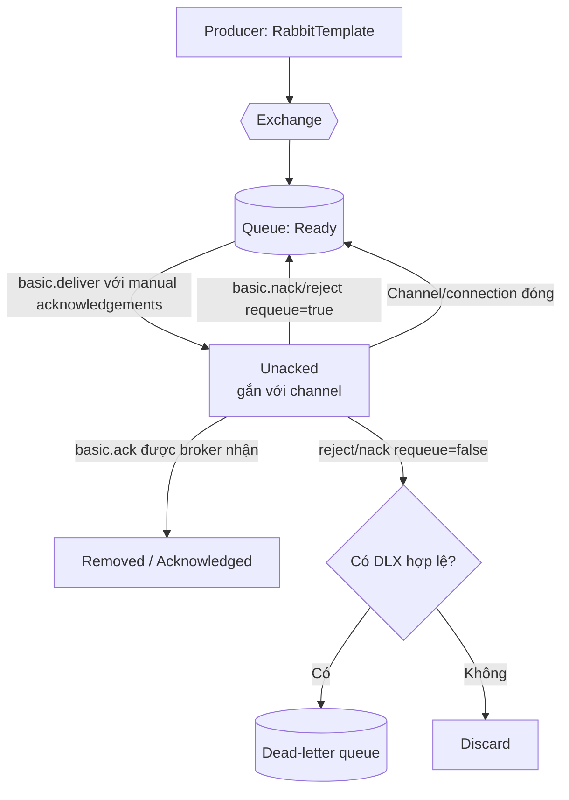
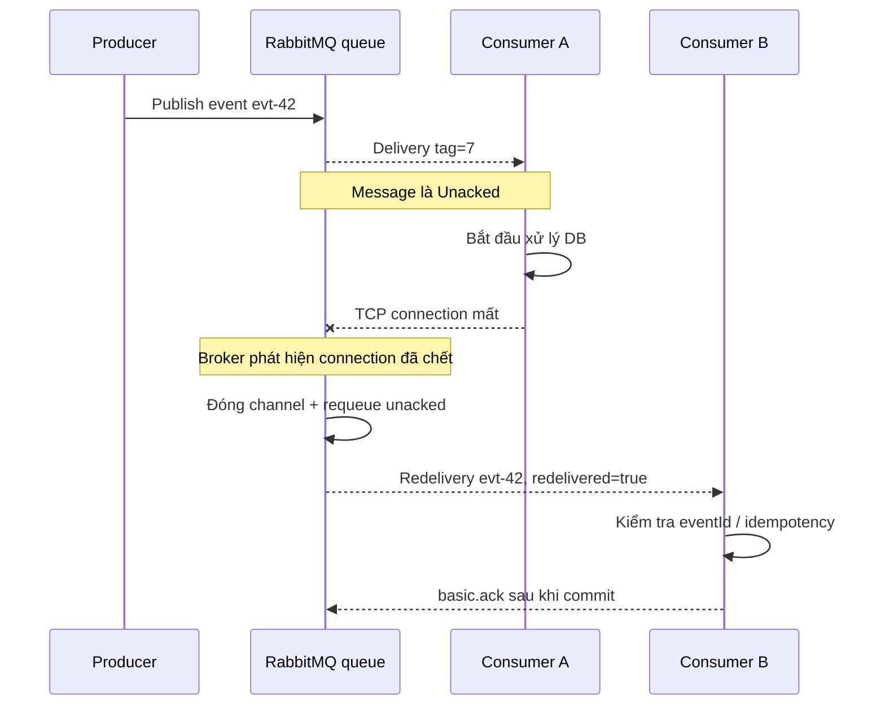
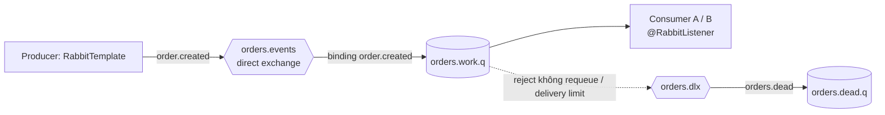
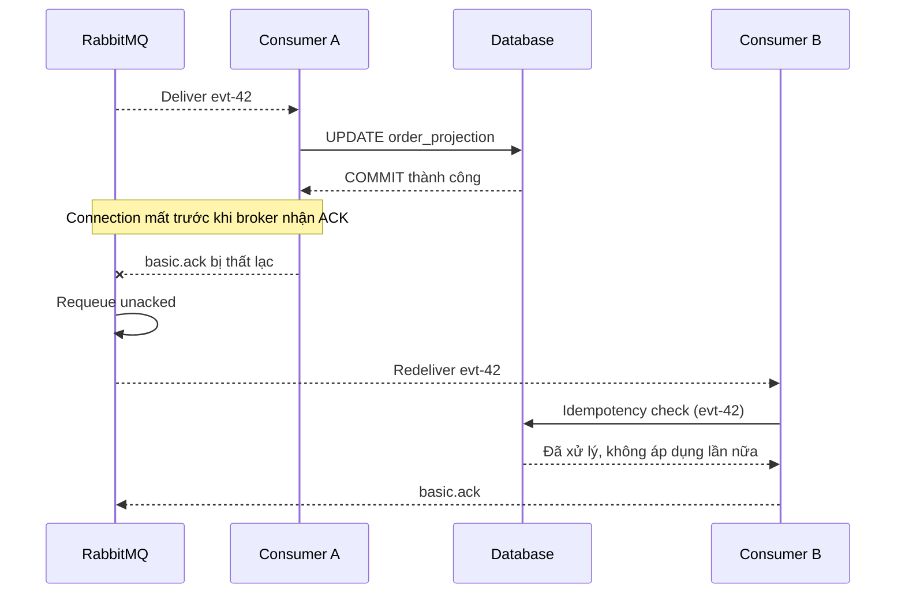

# Thông điệp unacked khi consumer mất kết nối

**Chương:** Xác nhận tiêu thụ

**Phạm vi:** Spring AMQP (`spring-rabbit`), RabbitMQ AMQP 0.9.1, `@RabbitListener` và listener container.

Hãy hình dung `order-service` phát sự kiện `order.created` bằng `RabbitTemplate`. `notification-service` nhận được message, bắt đầu ghi cơ sở dữ liệu, rồi JVM bất ngờ dừng. Trên RabbitMQ Management UI, message trước đó được hiển thị là **Unacked**. Liệu message đã mất? RabbitMQ có gửi lại không? Nếu worker đã ghi DB thành công nhưng chưa ACK thì điều gì xảy ra?

Câu trả lời phụ thuộc **chế độ acknowledgement và trạng thái channel/connection**:

- Với **manual acknowledgement ở cấp AMQP**, khi **channel hoặc connection mang delivery bị đóng**, RabbitMQ tự đưa các delivery **chưa ACK** trở lại queue để có thể giao lại, dù không có lệnh `basic.nack` từ consumer.
- Việc mất kết nối **không luôn được phát hiện ngay**. Trong khoảng chờ heartbeat/TCP xác định client đã chết, broker vẫn có thể hiển thị các message ở trạng thái **unacked**.
- Nếu broker đã nhận ACK trước khi connection mất, message đã được xác nhận và không được tự động requeue chỉ vì consumer biến mất.
- Nếu dùng **automatic acknowledgement của RabbitMQ** (`autoAck=true`, tương ứng `AcknowledgeMode.NONE` trong Spring AMQP), broker xem delivery được xác nhận ngay khi gửi; không có cùng bảo đảm redelivery khi consumer chết.
- **Redelivery không bảo đảm exactly-once.** Một message đã gây tác dụng phụ vẫn có thể được giao lại nếu ACK đến muộn hoặc thất lạc.

Bài học này đi sâu vào vòng đời của unacked delivery, các tình huống mất kết nối, `prefetch`, ACK/NACK, Spring AMQP listener container, queue type và cách kiểm chứng thực tế để xây hệ thống xử lý bất đồng bộ đáng tin cậy.

## 1. Mô hình trạng thái: Ready, Unacked và Acknowledged

Một message đi vào queue không mặc nhiên bị xóa khi broker đẩy đến consumer. Trong chế độ yêu cầu consumer ACK, RabbitMQ cần ghi nhớ delivery nào **đã giao nhưng chưa được xác nhận**.

| Trạng thái/khái niệm | Ý nghĩa | Có thể được broker giao ngay cho consumer khác? |
| --- | --- | --- |
| **Ready** | Message đang nằm trong queue, sẵn sàng để dispatch | Có, nếu consumer đủ điều kiện nhận |
| **Unacked** | Broker đã giao message qua một channel nhưng chưa nhận ACK/NACK cuối cùng | Thông thường **chưa**; vẫn thuộc delivery đang outstanding |
| **Acknowledged** | Broker đã nhận `basic.ack` hợp lệ, hoàn tất delivery | Không; message đã được loại khỏi queue |
| **Requeued** | Delivery chưa hoàn tất được đưa lại vào queue | Có thể, sau khi đủ điều kiện dispatch |
| **Dead-lettered** | Message bị reject/expired/vượt giới hạn và được định tuyến qua DLX khi có cấu hình | Không còn là delivery ở queue ban đầu; cần xem DLQ |
| **Discarded** | Message bị loại bỏ theo cấu hình/trường hợp tương ứng | Không; có thể mất nếu không có DLX/quy trình khác |



**Không nhầm việc message đã rời nhóm `Ready` với việc nghiệp vụ đã hoàn tất.** Message vẫn có thể là `Unacked` trong lúc handler đang chạy. Khi connection mất và broker đóng channel, message này có thể xuất hiện trở lại ở `Ready`.

### 1.1. ACK có phạm vi theo channel

Mỗi delivery trên một AMQP channel có một **`deliveryTag`** do broker gán. Consumer ACK bằng:

```java
channel.basicAck(deliveryTag, false);
```

Trong đó `false` có nghĩa là **`multiple=false`**, chỉ xác nhận delivery với tag cụ thể.

Ba quy tắc quan trọng:

1. Delivery tag **chỉ có ý nghĩa trong channel nơi message được giao**.
2. Không dùng tag của channel cũ để ACK trên channel mới sau reconnect. Điều này có thể gây `PRECONDITION_FAILED - unknown delivery tag`, khiến broker đóng channel mới.
3. ACK hai lần cùng một delivery tag hoặc ACK nhiều delivery ngoài ý muốn cũng có thể làm channel bị đóng, từ đó **các delivery chưa ACK khác trên channel lại bị requeue**.

### 1.2. Publisher confirm là chuyện khác

`RabbitTemplate` có thể dùng publisher confirms để biết broker chấp nhận publish. Nhưng **publisher ACK** là thông tin **broker → producer**, còn **consumer ACK** là thông tin **consumer → broker**.

```text
Producer  --basic.publish-->  RabbitMQ  --basic.deliver-->  Consumer
Producer  <--publisher ack--  RabbitMQ  <--consumer ack---  Consumer
```

Publisher confirm thành công **không** nói rằng consumer đã ACK hoặc đã ghi DB. Các tầng xử lý này phải được quan sát riêng.

## 2. Điều gì xảy ra khi consumer mất connection?

Quy tắc nền tảng RabbitMQ: với **manual acknowledgement**, khi channel hoặc connection chứa delivery bị đóng, **mọi delivery chưa được ACK trên đó được tự động requeue**. Quy tắc áp dụng cho các tình huống như:

- JVM/process consumer bị kill hoặc crash.
- Kết nối TCP bị đóng bình thường/bất thường.
- RabbitMQ đóng channel do protocol exception, chẳng hạn unknown delivery tag.
- Broker phát hiện connection chết sau khi không nhận heartbeat/traffic.
- Channel bị đóng khi worker dừng hoặc khi container shutdown theo chế độ tương ứng.



Đây là mô hình logic; thời gian thực tế tùy heartbeat, TCP và tốc độ recovery. **Consumer B có thể là một pod khác, hoặc chính pod A sau khi reconnect**, nếu broker chọn nó làm người nhận tiếp theo.

### 2.1. Broker cần thời gian để biết consumer không còn sống

Nếu consumer được kill và TCP socket đóng rõ ràng, RabbitMQ có thể nhận biết tương đối nhanh. Nhưng trong tình huống **network blackhole**, NAT, load balancer hoặc packet loss, broker có thể phải chờ heartbeat/TCP timeout.

Trong khoảng đó:

- RabbitMQ vẫn thấy connection/consumer có vẻ đang tồn tại.
- Message đã giao vẫn hiện **Unacked**.
- Một consumer khác chưa chắc được nhận lại message này.
- Khi broker phát hiện peer chết và đóng connection, các unacked deliveries được xử lý requeue.

RabbitMQ đề xuất heartbeat timeout thường trong khoảng **5–20 giây** cho nhiều môi trường; server mặc định gợi ý 60 giây, nhưng giá trị cuối cùng được **thương lượng** với client. Đặt heartbeat cực thấp có thể gây false positive trong lúc GC pause, nghẽn mạng hoặc flow control.

**Không xây SLA “luôn redeliver đúng sau N giây” chỉ dựa vào heartbeat**, vì còn các bước đóng channel, cập nhật queue và lịch dispatch.

### 2.2. Message requeued có nhất thiết vào đúng vị trí cũ?

Không nên coi redelivery là bảo đảm FIFO tuyệt đối.

RabbitMQ cố trả message về vị trí phù hợp nếu có thể, nhưng concurrent consumers, ACK khác nhau, redelivery, priority queue, quorum queue và tình trạng backlog có thể thay đổi thứ tự quan sát được. Một message cũ bị requeue có thể được giao **sau** message mới hoặc đến một consumer khác.

Nếu nghiệp vụ yêu cầu event cho cùng `orderId` xử lý đúng version, cần đánh số phiên bản/sequence và kiểm soát concurrency/partition thay vì chỉ dựa vào thứ tự queue.

### 2.3. `redelivered` là tín hiệu, không phải khóa idempotency

Delivery được giao lại thường có cờ `redelivered=true` trong envelope/message properties. Spring AMQP cho phép đọc qua `MessageProperties.isRedelivered()`.

Nhưng:

- `redelivered=true` nói delivery có thể đã được gửi trước đó, **không chứng minh business effect đã thành công**.
- Không nên lấy `redelivered=false` làm bằng chứng tuyệt đối rằng đây là một sự kiện nghiệp vụ hoàn toàn mới; producer có thể publish lại một message trùng có `eventId` cũ.
- Cờ redelivered không thay `eventId` và idempotency record.
- Với quorum queue còn có các counter/header về delivery attempts tùy version; không tự đồng nhất chúng với `redelivered`.

## 3. Phân biệt sáu tình huống rất hay bị nhầm

| Sự kiện | Số message Unacked | Broker sẽ làm gì? | Rủi ro nghiệp vụ |
| --- | --- | --- | --- |
| Consumer nhận message, handler đang làm việc, connection còn sống | Message còn unacked | Chờ ACK hoặc sự kiện kết thúc phù hợp | Nếu handler làm lâu, backlog/unacked có thể tăng |
| **Channel/connection bị đóng trước khi broker nhận ACK** | Các delivery outstanding được giải phóng sau khi broker xử lý đóng | **Tự requeue** với manual ACK, trừ các trường hợp giới hạn/queue policy khác | Có thể trùng tác dụng phụ |
| Consumer gửi ACK và broker đã xử lý ACK, sau đó connection đóng | Delivery đã ACK | **Không requeue** delivery này | Nếu ACK trước khi DB commit, có thể mất nghiệp vụ |
| ACK đã gửi nhưng connection đóng trước khi broker nhận ACK | Trạng thái phía consumer không chắc chắn | Có thể requeue delivery | Có thể xử lý trùng khi retry/redelivery |
| **`basic.cancel` consumer nhưng channel vẫn mở** | In-flight deliveries **vẫn outstanding** | Dừng delivery mới; **không tự requeue** các delivery cũ chỉ vì cancel | Unacked có thể còn nếu ứng dụng không ACK/đóng channel |
| Spring `AcknowledgeMode.NONE` / RabbitMQ `autoAck=true` | Không tồn tại window unacked thủ công tương tự | Broker xem delivery là đã ACK khi gửi | Consumer chết giữa xử lý có thể **mất message** |

**Điểm đặc biệt cần nhớ:** `basic.cancel` (hủy subscription) **khác** `channel.close()`. Hủy consumer chỉ ngừng delivery mới; các delivery in-flight **không tự bị discard hoặc requeue**. Nếu muốn release chúng khi không xử lý, phải xử lý ACK/NACK hợp lệ hoặc đóng channel theo quy trình. Listener container khi shutdown có thể cancel và drain message; điều này không mâu thuẫn với quy tắc trên.

### 3.1. “Unacked biến mất” chưa chắc message đã mất

Khi connection A mất và unacked được requeue, chỉ số `messages_unacknowledged` có thể giảm, nhưng đồng thời:

- `messages_ready` tăng nếu chưa có consumer mới.
- Hoặc message được giao **rất nhanh** cho consumer B, nên `messages_unacknowledged` lại tăng.
- Nếu message bị dead-letter do delivery limit, cần xem DLQ và chính sách của queue type.
- Nếu queue có TTL/length limit, hoặc không bền vững trước broker restart, cần phân biệt những lý do khác khiến message biến mất.

Không kết luận chỉ từ **một ảnh chụp** Management UI; xem thêm deliver/redeliver/ACK rates, queue depth, logs và trạng thái kết nối.

## 4. Spring AMQP: `AUTO`, `MANUAL` và `NONE`

`@RabbitListener` chạy thông qua listener container. Phần lớn ứng dụng dùng `AcknowledgeMode.AUTO`, nhưng **Spring AUTO khác RabbitMQ autoAck**.

| Spring AMQP `AcknowledgeMode` | RabbitMQ AMQP 0.9.1 | Ai gửi ACK? | Khi connection mất trước ACK |
| --- | --- | --- | --- |
| **`AUTO`** | Consumer được đăng ký để broker chờ acknowledgements | Container gửi `basic.ack` sau khi listener hoàn thành thành công | Delivery chưa ACK được tự requeue khi channel/connection đóng |
| **`MANUAL`** | Consumer được đăng ký để broker chờ acknowledgements | Handler tự gọi `channel.basicAck/basicNack/basicReject` | Delivery chưa ACK được tự requeue khi channel/connection đóng |
| **`NONE`** | RabbitMQ `autoAck=true` | Broker coi message acknowledged khi delivery | **Không** tự requeue chỉ vì handler chưa kịp hoàn tất |

Với `AUTO`, nếu listener ném exception, container quyết định reject/nack/requeue qua `defaultRequeueRejected`, error handler và retry advice. Mặc định `defaultRequeueRejected=true` trong cấu hình container Spring AMQP; một số lỗi fatal có thể được error handler phân loại khác. Không khẳng định “mọi exception đều retry mãi” mà chưa xem cấu hình thực tế.

### 4.1. `AUTO`: trường hợp phổ biến

```java
import org.springframework.amqp.rabbit.annotation.RabbitListener;
import org.springframework.context.annotation.Profile;
import org.springframework.stereotype.Component;

@Component
@Profile("auto-demo")
class AutoOrderListener {

    private final OrderWorkService workService;

    AutoOrderListener(OrderWorkService workService) {
        this.workService = workService;
    }

    @RabbitListener(
            id = "orders-auto",
            queues = "orders.work.q",
            ackMode = "AUTO")
    public void handle(String eventId) {
        // Nghiệp vụ phải có cơ chế idempotency theo eventId.
        workService.processOnce(eventId);

        // Thành công: container ACK sau khi phương thức trả về.
        // Throw exception: error handler/requeue/retry quyết định.
    }
}
```

`OrderWorkService` là interface ứng dụng sẽ tự triển khai. Khi method return bình thường, container có thể ACK; vì vậy **không nuốt exception khi xử lý nghiệp vụ chưa hoàn tất**.

### 4.2. `MANUAL`: ACK rõ ràng sau commit

```java
import java.io.IOException;
import java.nio.charset.StandardCharsets;
import com.rabbitmq.client.Channel;
import org.springframework.amqp.core.Message;
import org.springframework.amqp.rabbit.annotation.RabbitListener;
import org.springframework.context.annotation.Profile;
import org.springframework.stereotype.Component;

@Component
@Profile("manual-demo")
class ManualOrderListener {

    private final OrderWorkService workService;

    ManualOrderListener(OrderWorkService workService) {
        this.workService = workService;
    }

    @RabbitListener(
            id = "orders-manual",
            queues = "orders.work.q",
            ackMode = "MANUAL")
    public void handle(Message message, Channel channel)
            throws IOException {

        long tag = message.getMessageProperties().getDeliveryTag();
        boolean redelivered =
                message.getMessageProperties().isRedelivered();
        String eventId = new String(
                message.getBody(), StandardCharsets.UTF_8);

        try {
            workService.processOnce(eventId);
            // Chỉ ACK sau khi hiệu ứng nghiệp vụ bền vững.
            channel.basicAck(tag, false);
        } catch (IllegalArgumentException permanentFailure) {
            // Ví dụ lỗi dữ liệu vĩnh viễn: DLX nếu có.
            channel.basicReject(tag, false);
        } catch (RuntimeException temporaryFailure) {
            // Minh họa cơ chế requeue trực tiếp; KHÔNG dùng
            // retry vô hạn trong production.
            channel.basicNack(tag, false, true);
        }
    }
}
```

Ghi chú để không áp dụng sai:

- `Channel` **phải là channel đã nhận delivery**. Không mở channel mới để ACK tag cũ.
- `deliveryTag` là số **có phạm vi theo channel**, không phải message ID để dùng sau reconnect.
- `basicAck(tag, false)` ACK một message; `multiple=true` có thể ACK **nhiều delivery cùng channel** và gây lỗi nếu dùng bất cẩn.
- `basicReject(tag, false)` có nghĩa **requeue=false**: broker dead-letter nếu có DLX phù hợp, nếu không thì discard.
- `basicNack(tag, false, true)` requeue ngay; với lỗi lặp lại có thể gây hot loop. Production cần delay, backoff, attempt limit hoặc DLQ.
- Biến `redelivered` ở đây minh họa cách đọc cờ. Hãy dùng nó làm log/metric, **không** để quyết định bỏ qua event nếu thiếu kiểm tra `eventId`.
- Khi ACK qua network thất bại sau commit DB, message vẫn có thể được broker giao lại; `processOnce` phải an toàn khi gọi lần nữa.

### 4.3. `NONE`: lý do mất message

Nếu listener đặt `ackMode="NONE"`, broker dùng automatic acknowledgement. Delivery coi như thành công **khi broker gửi đi**, không đợi phương thức xử lý Java trả về.

```java
@RabbitListener(
        queues = "metrics.ephemeral.q",
        ackMode = "NONE")
public void consumeBestEffort(String metric) {
    // Chỉ phù hợp khi có thể bỏ qua một số metric.
}
```

**Không dùng `NONE` cho đơn hàng, thanh toán, email có nghĩa vụ gửi, điều phối kho hoặc công việc yêu cầu retry sau crash.** Mất connection giữa lúc xử lý trong mode này không mang lại tự động requeue vì broker đã coi delivery là acknowledged.

## 5. Thiết lập topology để quan sát redelivery

Dùng một queue làm việc và một DLQ riêng, tránh tác động lên hàng đợi production.



**Ví dụ `Declarables` trong profile local/test:**

```java
import org.springframework.amqp.core.Binding;
import org.springframework.amqp.core.BindingBuilder;
import org.springframework.amqp.core.Declarables;
import org.springframework.amqp.core.DirectExchange;
import org.springframework.amqp.core.Queue;
import org.springframework.amqp.core.QueueBuilder;
import org.springframework.context.annotation.Bean;
import org.springframework.context.annotation.Configuration;
import org.springframework.context.annotation.Profile;

@Configuration(proxyBeanMethods = false)
@Profile("local")
class LocalAckTopology {

    @Bean
    Declarables ackResources() {
        DirectExchange events =
                new DirectExchange("orders.events", true, false);
        DirectExchange dlx =
                new DirectExchange("orders.dlx", true, false);

        Queue work = QueueBuilder.durable("orders.work.q")
                .deadLetterExchange("orders.dlx")
                .deadLetterRoutingKey("orders.dead")
                .build();
        Queue dead = QueueBuilder.durable("orders.dead.q").build();

        Binding workBinding = BindingBuilder.bind(work)
                .to(events).with("order.created");
        Binding deadBinding = BindingBuilder.bind(dead)
                .to(dlx).with("orders.dead");

        return new Declarables(
                events, dlx, work, dead, workBinding, deadBinding);
    }
}
```

Ví dụ dùng durable classic queue theo mặc định của môi trường nếu không có default queue type khác. **Không giả định queue type** khi chạy lab: xem thông tin queue thật trong RabbitMQ Management UI. Nếu cần kiểm thử **quorum queue**, provision một queue mới với `x-queue-type=quorum` đúng version, thay vì đổi argument trên queue đang tồn tại.

`Declarables` chỉ là khai báo Spring. Cần `RabbitAdmin` đủ quyền hoặc công cụ quản trị tạo tài nguyên. Ở production nên thống nhất đội vận hành sở hữu exchange/queue/binding/DLX và không tự thay arguments của queue có backlog.

### 5.1. Publisher gửi eventId ổn định

```java
import org.springframework.amqp.rabbit.core.RabbitTemplate;
import org.springframework.stereotype.Service;

@Service
class OrderEventPublisher {

    private final RabbitTemplate template;

    OrderEventPublisher(RabbitTemplate template) {
        this.template = template;
    }

    void sendEvent(String eventId) {
        template.convertAndSend(
                "orders.events",
                "order.created",
                eventId,
                message -> {
                    message.getMessageProperties().setMessageId(eventId);
                    return message;
                });
    }
}
```

Trong bài lab, body là chuỗi `eventId` cho đơn giản. Với hệ thống thật, payload nên có `eventId`, `orderId`, `schemaVersion`, timestamps và content type/schema rõ ràng. Nếu producer cần chắc broker đã chấp nhận publish, cấu hình **publisher confirms/returns**; consumer ACK không trả ngược thông tin xác nhận publish cho producer.

### 5.2. Cấu hình listener container

```yaml
spring:
  rabbitmq:
    host: localhost
    port: 5672
    listener:
      type: simple
      simple:
        concurrency: 2
        prefetch: 5
        acknowledge-mode: auto
        default-requeue-rejected: false
```

`default-requeue-rejected: false` trong lab giúp quan sát lỗi handler không được requeue mặc định; cần **DLX/DLQ đúng** để message lỗi không bị discard. Nếu dùng `@RabbitListener(ackMode="MANUAL")`, ACK/NACK do code manual quyết định thay vì phụ thuộc mặc định này.

Với profile thử nghiệm, **chỉ bật một trong hai** listener `auto-demo` hoặc `manual-demo` trên cùng queue trong một lần test. Nếu bật cả hai, chúng là **competing consumers**, khiến message có thể được nhận bởi handler khác với handler đang đo.

## 6. Prefetch và lượng message Unacked khi crash

`prefetchCount` giới hạn số delivery chưa ACK mà broker có thể đưa cho mỗi consumer. RabbitMQ coi đây là một cửa sổ outstanding deliveries.

Giả sử:

```text
2 consumers
prefetch = 5
mỗi consumer xử lý từng message, chưa ACK

Tối đa gần đúng: 2 × 5 = 10 deliveries outstanding
```

Nếu một instance có hai consumer cùng connection rồi **connection mất**, có thể có đến khoảng 10 delivery chưa ACK phải xử lý lại. Nếu có 8 instances, mỗi instance 4 consumers, prefetch 50:

```text
8 × 4 × 50 = 1.600 deliveries outstanding
```

Con số trên là **cận trên đơn giản** cho những consumer này khi mọi cửa sổ prefetch đều đầy, không phải số message chắc chắn mất hoặc redeliver một lần. Nếu tất cả consumers cùng crash trong một đợt deployment lỗi, broker có thể requeue và phân phối một lượng lớn delivery, tạo **redelivery storm**.

### 6.1. Chọn prefetch theo đặc tính công việc

| Trường hợp | Điểm bắt đầu hợp lý | Lý do |
| --- | --- | --- |
| Công việc chậm, thay đổi DB quan trọng | Prefetch thấp, ví dụ 1–10 | Ít outstanding/consumer và dễ quan sát |
| Payload lớn | Prefetch thấp | Hạn chế memory của client/broker |
| Cần xử lý gần thứ tự trong một queue | Prefetch 1 và giới hạn concurrency | Giảm delivery “đặt trước”; chưa bảo đảm thứ tự xuyên replicas |
| Event nhỏ, xử lý nhanh và throughput cao | Prefetch có thể cao hơn | Ít overhead trao đổi; cần benchmark |
| Hay rolling restart / crash | Prefetch vừa đủ | Giảm số delivery phải redeliver cùng lúc |

Từ Spring AMQP 2.0, giá trị prefetch mặc định phổ biến là **250**. Đó là tối ưu tổng quát cho nhiều workload, **không phải khuyến nghị cố định** cho mọi job. Đừng tăng prefetch để chữa lỗi handler xử lý chậm do database bị nghẽn.

### 6.2. Unacked cao không tự nói handler bị lỗi

Unacked tăng có thể do:

- Handler xử lý lâu, đang chờ DB/API.
- Prefetch cao khiến client nhận sẵn message chưa xử lý.
- Manual ACK bị quên.
- Consumer/channel bị treo nhưng broker chưa phát hiện connection chết.
- ACK bị batch/transaction trì hoãn theo cấu hình.
- Xử lý async chưa hoàn thành (future/Mono).

Cần xem **ACK rate, consumer count, thread dumps, connection status, delivery rate và handler latency**, không chỉ một con số Unacked.

## 7. Hai cuộc đua giữa commit DB, ACK và mất connection

### 7.1. Tình huống A: DB đã commit nhưng broker chưa nhận ACK



Nếu consumer B không có idempotency, nó có thể gửi thêm email, ghi thêm khoản tiền hoặc gọi hệ thống ngoài lần thứ hai. Đây là lý do kiến trúc **at-least-once** cần guard nghiệp vụ.

### 7.2. Tình huống B: ACK trước khi DB commit

```text
1. Consumer nhận evt-42.
2. Consumer gửi basic.ack và broker chấp nhận.
3. Consumer bắt đầu hoặc chuẩn bị commit DB.
4. JVM crash trước khi DB commit.
5. Broker KHÔNG requeue evt-42, vì delivery đã ACK.
```

Khi business processing quan trọng, **không ACK trước khi tác dụng phụ được hoàn tất bền vững**.

### 7.3. Timeline tổng quát

| Thời điểm lỗi | Điều broker có thể làm | Bài học |
| --- | --- | --- |
| Chết trước khi handler chạy | Requeue unacked sau khi channel đóng | Không mất delivery chỉ vì consumer chưa xử lý |
| Chết trong khi DB transaction chưa commit | Requeue, DB transaction có thể rollback | Cần xử lý rollback và retries |
| Chết sau DB commit nhưng trước ACK | Requeue → **duplicate processing attempt** | Idempotency |
| Gửi ACK rồi channel chết trước khi broker xử lý ACK | Có thể requeue | ACK gửi đi không có “ACK của ACK” đáng tin cậy tới client |
| Broker xử lý ACK rồi consumer chết | Message không requeue | Chỉ ACK khi business effect đã an toàn |
| Handler báo success nhưng external API mới *nhận yêu cầu* chưa hoàn tất | Broker có thể ACK vì handler return | Cần xác nhận nghiệp vụ end-to-end riêng |

Trong môi trường phân tán, chỉ từ phía consumer không thể biết chắc ACK đã đến broker trước lúc đường truyền bị cắt. Thiết kế đúng phải **chịu được trường hợp message được gửi lại**.

## 8. Idempotency: xử lý redelivery mà không nhân đôi tác dụng phụ

### 8.1. Đừng dùng `existsById` rồi `save` tách rời

Nếu hai consumers cùng nhận các bản event trùng (do producer retry hoặc hai delivery của cùng logical event), hai thread có thể:

1. Cùng kiểm tra `existsById(eventId)` và đều thấy `false`.
2. Cùng thực hiện side effect.
3. Sau đó mới ghi rằng event đã xử lý.

Đây là **race condition**. Cần một phép ghi **nguyên tử**, thường dùng **unique constraint** trong database.

### 8.2. Pattern idempotent với database

Ví dụ lược đồ:

```sql
CREATE TABLE processed_event (
    event_id VARCHAR(128) PRIMARY KEY,
    processed_at TIMESTAMP NOT NULL DEFAULT CURRENT_TIMESTAMP
);
```

Ý tưởng với PostgreSQL (minh họa, không phải SQL portable cho mọi DB):

```sql
BEGIN;

INSERT INTO processed_event (event_id)
VALUES (:eventId)
ON CONFLICT (event_id) DO NOTHING;

-- Chỉ thực hiện cập nhật nghiệp vụ nếu INSERT tạo một dòng mới.
-- Việc thêm processed_event và cập nhật business data
-- PHẢI commit/rollback trong cùng transaction.

UPDATE order_projection
   SET notifications_sent = notifications_sent + 1
 WHERE order_id = :orderId
   AND :insertedWasTrue;

COMMIT;
```

`:insertedWasTrue` là **biến do ứng dụng tính từ kết quả INSERT**, không phải cú pháp SQL chạy độc lập. Bản production phải thực hiện **INSERT và business update trong cùng DB transaction**, không chỉ copy đoạn trên rồi giả định đã atomic.

Khi redelivery tới, unique constraint từ chối `eventId` đã xử lý; handler kết thúc thành công, container ACK. Tránh làm phát sinh hiệu ứng lần nữa.

### 8.3. Tác dụng phụ ngoài database

Nếu handler gửi email hoặc gọi cổng thanh toán bên ngoài, transaction DB không tự bọc luôn side effect đó. Một số chiến lược:

- Gửi `Idempotency-Key = eventId` cho API downstream có hỗ trợ.
- Lưu state machine (PENDING/SENT/CONFIRMED) và reconciliation.
- Tách thao tác outbound vào transactional outbox/workflow idempotent.
- Thực hiện kiểm tra trạng thái remote khi có kết quả không chắc chắn.

**Cảnh báo về “zombie consumer”:** khi kết nối mạng bị cắt, broker có thể requeue cho consumer B, nhưng consumer A vẫn tiếp tục chạy business code vì JVM chưa biết broker đã đóng channel. Hai phiên xử lý **có thể chồng lên nhau**. Chỉ `prefetch=1` không giải quyết được chuyện này; cần unique constraints, fencing/leases nếu thao tác độc quyền, và idempotency ở downstream.

## 9. Cách Spring listener container phát hiện và phục hồi

`@RabbitListener` được vận hành bởi container, thường là `SimpleMessageListenerContainer` (SMLC) hoặc `DirectMessageListenerContainer` (DMLC).

### 9.1. Khi broker mất connection

Các bước điển hình:

1. Client/broker phát hiện lỗi connection.
2. RabbitMQ đóng channel và xử lý requeue unacked.
3. Spring AMQP listener container nhận shutdown/cancel signal hoặc gặp exception.
4. Container thực hiện recovery/recreate consumer theo retry và cấu hình hiện hành.
5. Sau khi kết nối trở lại và queue sẵn có, listener subscribe tiếp.
6. Message đang Ready có thể được giao lại; `redelivered` có thể là `true`.

Không nên coi recovery là “message được replay từ chính Java method đang chạy”. Recovery là việc **khôi phục subscription/channel**, còn message nằm trong RabbitMQ và được broker quyết định dispatch.

### 9.2. Graceful shutdown khác crash

Khi Spring container nhận lệnh stop một cách bình thường, mặc định nó thường **cancel consumer rồi xử lý nốt các message đã prefetch** trong phạm vi shutdown policy. Điều này giảm redelivery không cần thiết.

Từ các nhánh Spring AMQP hỗ trợ `forceStop`, khi bật tính năng này, container có thể dừng **sau message hiện tại**, và những delivery prefetched còn lại được **requeue**. Khi vượt `shutdownTimeout`, nếu `forceCloseChannel=true`, container có thể đóng channel, khiến unacked tự requeue.

| Kịch bản | Diễn biến tiêu biểu | Tác động |
| --- | --- | --- |
| Stop bình thường, đủ thời gian | Drain prefetched, ACK các item đã xong | Ít redelivery hơn |
| Stop bình thường, handler quá chậm | Hết shutdown timeout, channel có thể bị đóng | Message outstanding được requeue |
| `forceStop=true` | Sau message hiện tại, prefetched còn lại được requeue | Chuyển quyền xử lý nhanh hơn; cần idempotency |
| `kill -9` / container mất điện | Không có graceful shutdown | Broker nhận biết connection mất, requeue unacked |
| `basic.cancel` nhưng vẫn giữ channel | Chỉ dừng nhận mới | **Không tự requeue** in-flight; app phải xử lý tiếp hoặc đóng channel |

Trong Kubernetes, phối hợp `terminationGracePeriodSeconds` với p95/p99 handler duration và Spring `shutdownTimeout`. Nếu pod bị kill trước khi ACK, broker sẽ redeliver; đó là hành vi dự kiến, không phải lỗi của queue.

### 9.3. Consumer còn chạy nhưng không ACK: acknowledgement timeout

RabbitMQ có cơ chế **delivery acknowledgement timeout** để ngăn consumer giữ delivery chưa ACK vô hạn. Đây là **vấn đề khác** với connection loss: TCP có thể vẫn khỏe, nhưng handler không kết thúc hoặc quên ACK.

**Khác biệt phiên bản rất quan trọng:**

- Trong RabbitMQ **trước 4.3**, consumer acknowledgement timeout được áp dụng với các queue type theo hỗ trợ của phiên bản.
- **Từ RabbitMQ 4.3**, tài liệu chính thức nêu acknowledgement timeouts **chỉ hỗ trợ quorum queues**.
- Giá trị mặc định được tài liệu mô tả là **30 phút**, có thể điều chỉnh qua `consumer_timeout` ở node và policy/argument per queue theo phiên bản.
- Với AMQP 0.9.1 ở RabbitMQ 4.3, broker có thể **cancel consumer** có hỗ trợ consumer cancel notifications khi timeout; nếu không hỗ trợ thì đóng channel với `PRECONDITION_FAILED`. Message được trả lại queue theo cơ chế timeout.

Đừng lẫn **consumer ack timeout** với **TCP heartbeat timeout**: một cái phát hiện delivery giữ quá lâu, một cái phát hiện kết nối không còn lưu thông.

## 10. Quorum queue, delivery-limit và redelivery sau crash

Classic và quorum queue cùng có nguyên tắc chung về manual ACK + connection loss, nhưng **quorum queue** có thêm cơ chế bảo vệ khỏi message liên tục thất bại.

### 10.1. RabbitMQ 4.0+ mặc định giới hạn 20 failed deliveries

Từ RabbitMQ **4.0**, quorum queue có **delivery limit mặc định 20**. Khi số failed deliveries vượt giới hạn, message có thể bị **dead-letter** nếu queue có DLX hợp lệ; nếu không, **có thể bị drop**.

Điều này đặc biệt quan trọng nếu consumer liên tục crash trước ACK:

```text
evt-99 -> consumer A -> crash (unacked)
       -> consumer B -> crash (unacked)
       -> consumer C -> crash (unacked)
       -> ...
       -> quorum delivery-limit exceeded
       -> DLQ nếu có cấu hình hợp lệ, không thì drop
```

Với `prefetch>1`, một đợt crash có thể requeue **nhiều message outstanding cùng lúc**. Nếu nhóm chúng cứ bị trả lại nhiều lần, có thể nhiều message cùng chạm delivery limit.

**Không nên tắt limit `-1` như một cách xử lý mặc định**: có thể khiến poison message lặp vô hạn. Thay vào đó phải sửa lỗi consumer, đặt DLX/DLQ và có quy trình điều tra.

### 10.2. RabbitMQ 4.3 thay đổi cách đếm thất bại

Tài liệu RabbitMQ 4.3 phân biệt **`x-acquired-count`** và **`x-delivery-count`**. Với AMQP 0.9.1:

| Hành vi | Có thể tăng số lần acquired? | Có tính là failed delivery trong quorum 4.3? |
| --- | --- | --- |
| Client crash/connection loss còn unacked | Có | **Có** |
| `basic.reject` | Có | **Có** |
| `basic.nack(requeue=true)` | Có | **Không** theo quy tắc 4.3 |
| Consumer ack timeout | Có | Theo mô tả 4.3, **không** tăng failed delivery count |
| Intra-cluster suspicion/partition | Có | Theo mô tả 4.3, **không** tăng failed delivery count |

Ở các phiên bản **4.0–4.2**, cách đếm liên quan `basic.nack` khác, và `basic.nack` có thể làm tăng delivery count. Vì thế **không lấy một hành vi retry từ RabbitMQ 4.2 rồi giả định y hệt trên 4.3**.

Hệ quả thực tế: nếu ứng dụng dựa vào `basic.nack(requeue=true)` để tự động đưa poison message vào DLQ sau 20 lượt, **trên 4.3 có thể bị lặp mãi** vì loại requeue này không tăng failed count. Cần **retry policy/attempt limit ở ứng dụng**, và dùng reject/dead-letter hoặc retry queue phù hợp.

### 10.3. DLX là lưới bảo vệ, không phải lời hứa tuyệt đối

Một quorum queue được cấu hình DLX phù hợp giúp giữ dấu vết message vượt delivery limit. Nhưng tính đáng tin cậy của đường dead-letter còn phụ thuộc queue type, vhost/permissions, chính sách và trạng thái broker.

Nếu không có DLX hoặc binding đúng, message vượt limit có thể biến mất. Với queue quan trọng, nên test **cả khi consumer crash liên tục lẫn khi DLQ tạm không khả dụng**, và đo thực tế có message đến DLQ hay không.

## 11. Lỗi dữ liệu, retry và requeue đúng cách

### 11.1. Đừng dùng immediate requeue cho mọi lỗi

`basicNack(tag, false, true)` làm broker đưa message trở lại queue để giao lại khi có consumer phù hợp. Nếu lỗi do JSON sai schema hoặc thiếu trường bắt buộc, retry ngay thường không giúp được gì.

```text
Delivery -> parse error -> nack(requeue=true)
         -> redelivery -> parse error -> nack(requeue=true)
         -> ... (poison message loop)
```

Nguy cơ:

- CPU/network bị tiêu tốn cho cùng một message.
- `redeliver` rate tăng.
- Consumer xử lý ít message hợp lệ.
- Nếu tăng concurrency để “giải quyết” backlog, tình trạng có thể tệ hơn.
- Quorum 4.3 không tự tăng `delivery-count` khi chỉ dùng `basic.nack`.

### 11.2. Phân loại lỗi

| Lỗi | Chiến lược |
| --- | --- |
| JSON/schema không hợp lệ | Reject không requeue; lưu DLQ/quarantine và alert |
| Thiếu dữ liệu không thể sửa bằng chờ | Không requeue liên tục; ghi lý do và xử lý nghiệp vụ |
| HTTP 503/DB timeout tạm thời | Retry có giới hạn và backoff; dùng delayed retry nếu cần |
| Consumer process crash | Broker tự requeue unacked sau khi phát hiện đóng connection |
| ACK thất lạc nhưng DB đã commit | Redelivery + idempotent handler |
| Lỗi topology/queue bị xóa | Sửa cấu hình/permissions, phục hồi queue; không retry message vô hạn trong handler |
| Handler kéo dài vượt consumer timeout | Điều chỉnh thời gian xử lý, chia job hoặc cấu hình timeout phù hợp queue type/version |

Nếu cần **dead-letter**, queue phải được thiết lập `x-dead-letter-exchange` hoặc policy tương ứng, có binding hợp lệ; message reject không requeue mà thiếu DLX có thể bị loại bỏ.

### 11.3. Spring `defaultRequeueRejected` và error handler

Ở mode `AUTO`, Spring quyết định requeue khi listener ném exception dựa trên cấu hình:

```yaml
spring:
  rabbitmq:
    listener:
      simple:
        default-requeue-rejected: false
```

Thuộc tính này không nói gì về chuyện **connection mất tự động requeue unacked**. Nó chỉ ảnh hưởng nhánh container xử lý **lỗi listener bị reject**. Hai trường hợp phải tách riêng:

1. **Listener throw exception, channel còn hoạt động:** error handler/advice và `defaultRequeueRejected` định hướng reject/NACK/requeue.
2. **Channel bị đóng trước ACK:** broker tự requeue outstanding deliveries; một property Spring về reject không thể “tắt” quy tắc giao thức này.

Một số lỗi fatal (conversion/type mismatch) có thể bị `ConditionalRejectingErrorHandler` xử lý trước khi handler chạy. Không chỉ đặt `try/catch` bên trong `@RabbitListener` rồi giả định đã bắt mọi lỗi.

## 12. Giám sát Unacked và xử lý sự cố

RabbitMQ Management UI/HTTP API có ít nhất ba số liệu cần phân biệt:

- **`messages_ready`**: message còn có thể dispatch.
- **`messages_unacknowledged`**: delivery đã gửi nhưng chưa ACK.
- **`messages`**: tổng ready + unacked (theo định nghĩa thống kê queue tương ứng).

Quan sát thêm `consumer count`, `deliver rate`, `ack rate`, `redeliver rate`, connection/channel status và listener logs.

### 12.1. Ví dụ chuỗi số liệu khi một consumer mất connection

Giả sử queue có 100 message, hai consumer, mỗi consumer đang giữ 5 unacked:

| Thời điểm | Ready | Unacked | Ghi chú |
| --- | ---: | ---: | --- |
| Trước lỗi | 90 | 10 | Cả hai consumer đang nhận việc |
| Consumer A biến mất nhưng broker chưa biết | Có thể vẫn 90 | Có thể vẫn 10 | Connection vẫn đang được theo dõi |
| Broker phát hiện A chết, A còn 5 unacked | Có thể 95 | Có thể 5 | 5 delivery của A được requeue |
| Consumer B nhận lại 5 message | Có thể 90 | Có thể 10 | Message nhanh chóng lại thành unacked |
| B xử lý và ACK tất cả | 90 hoặc thấp hơn | Giảm dần | Tùy có message mới được giao tiếp |

Các con số **là snapshot minh họa** giả định không có publish mới/ACK xen giữa. Trên broker thật, số liệu có thể thay đổi quá nhanh để nhìn thấy từng bước.

### 12.2. Runbook điều tra “Unacked tăng mãi”

1. Xác định **queue và vhost**. Kiểm tra `ready`, `unacked`, số consumer, deliver/ACK rates.
2. Xem consumer/channel/connection đang sở hữu deliveries, heartbeat/connection status và client names.
3. So sánh **số unacked với prefetch × consumer count**. Nếu gần chạm mức này, có thể consumer đang bị blocked vì chưa ACK.
4. Kiểm tra thread dump, DB pool, HTTP calls, lock contention, GC pauses và handler latency.
5. Xem listener `ackMode`: `MANUAL` có nhánh exception quên ACK không? Có giữ delivery tag trên thread khác sau reconnect không?
6. Tìm connection shutdown, missed heartbeat, `PRECONDITION_FAILED - unknown delivery tag` và consumer timeout trong logs.
7. Kiểm tra retry/DLQ: có poison message quay lại liên tục hay quorum delivery-limit đang đẩy message sang DLQ?
8. Nếu cần khôi phục, xử lý bằng **graceful stop/cancel/close channel theo quy trình**, cân nhắc lượng unacked sẽ requeue; không tùy tiện xóa queue đang có backlog.
9. Kiểm chứng idempotency và business outcomes trước/sau incident: không chỉ thấy `unacked=0` rồi kết luận tất cả job thành công.

### 12.3. Metric và alert đề xuất

| Metric / quan sát | Tín hiệu hữu ích |
| --- | --- |
| `rabbitmq_queue_messages_unacked` (tên tùy exporter) | Unacked cao kéo dài |
| `rabbitmq_queue_messages_ready` | Backlog còn chờ |
| `consumer_ack_rate` | Handler đang hoàn tất giao nhận hay bị nghẽn |
| `consumer_redelivery_rate` | Connection churn, retry loop, poison messages |
| `consumer_count` | Số consumer active/subscribed |
| `handler_duration_p95/p99` | Long-running handler và timeout |
| `idempotency_duplicate_total` | Các redelivery/republish đã được chặn tác dụng phụ |
| `dlq_message_count` | Lỗi không tự phục hồi hoặc delivery limit |
| `connection_recovery_total` | Mạng/broker instability |
| `oldest_unacked_age` nếu tự đo | Delivery bị giữ quá lâu |

Tên một số metric ở đây là **đề xuất**; không khẳng định broker hay Micrometer tự phát đúng những tên đó. Không dùng `eventId` làm label metric có cardinality lớn; eventId nên nằm trong structured logs/tracing.

## 13. Thực hành kiểm chứng hành vi sau mất kết nối

**Chuẩn bị chung:** RabbitMQ local/test, Spring Boot ứng dụng `spring-rabbit`, một vhost thử nghiệm, topology `orders.events` → `orders.work.q` và `orders.dlx` → `orders.dead.q`. Có ít nhất hai instance consumer hoặc một listener concurrency ≥ 2 để quan sát consumer khác nhận lại message. Chỉ chạy **một profile `auto-demo` hoặc `manual-demo`** cho một phép thử.

### Bài A — Crash consumer đang giữ Unacked

1. Tạo handler xử lý lâu vài giây, không ACK trước khi hoàn tất.
2. Đặt prefetch = 1 để dễ quan sát và publish `evt-001`.
3. Xác minh queue chuyển từ `ready` sang `unacked` trong Management UI.
4. Kill **process consumer trong môi trường local/test** khi handler còn chạy; không xóa RabbitMQ queue.
5. Quan sát thời điểm broker phát hiện connection đóng, message chuyển về `ready` hoặc được consumer B nhận lại.
6. Xem `redelivered` và logs `eventId`; ACK sau khi consumer B xử lý.

**Kết quả mong đợi:** với `AUTO` hoặc `MANUAL` chưa ACK, broker requeue sau channel/connection closure. Không cần handler gửi explicit NACK.

### Bài B — So sánh AUTO và NONE

1. Dùng queue khác cho phép thử `NONE` để không ảnh hưởng lab A.
2. Gửi 5 message, cho handler sleep giữa xử lý.
3. Crash consumer giữa chừng.
4. So sánh số message được giao lại giữa `AUTO` chưa ACK và `NONE`.
5. Ghi nhận rằng `NONE` broker đã coi delivery là hoàn tất khi giao.

**Kết quả mong đợi:** `NONE` có thể mất business processing vì không có requeue sau crash, dù producer publish thành công.

### Bài C — ACK sau DB commit và idempotency

1. Tạo bảng `processed_event(event_id PRIMARY KEY)` và một nghiệp vụ cập nhật DB trong cùng transaction.
2. Publish `evt-commit-42`; để consumer commit DB thành công.
3. Mô phỏng crash trước khi broker nhận ACK.
4. Cho consumer khác nhận lại cùng eventId.
5. Xác minh unique constraint chặn cập nhật nghiệp vụ lần hai, handler coi event đã xử lý là thành công và ACK.
6. Thử tắt idempotency chỉ trên môi trường disposable để chứng minh side effect có thể bị nhân đôi.

**Kết quả mong đợi:** recovery của RabbitMQ bảo vệ delivery chưa ACK, **không tự bảo vệ** business side effects.

### Bài D — Prefetch và nhiều Unacked sau crash

1. Chạy 2 consumers, prefetch = 1, publish 100 message và ghi số unacked.
2. Tăng prefetch lên 20, giữ handler xử lý chậm, tạo backlog.
3. Crash một consumer khi nó còn nhiều delivery outstanding.
4. Quan sát số message được requeue và phân phối sang consumer còn sống.
5. Lặp lại với concurrency lớn hơn; tính số outstanding tối đa theo `consumers × prefetch`.
6. Đánh giá memory, ordering, redelivery burst và mức prefetch phù hợp SLA.

**Kết quả mong đợi:** prefetch cao làm tăng lượng delivery bị ảnh hưởng bởi một lần connection loss.

### Bài E — `basic.cancel` khác đóng channel

1. Trong lab riêng, tạo một manual consumer bằng RabbitMQ Java client và giữ một delivery chưa ACK.
2. Gọi `basic.cancel(consumerTag)` nhưng **giữ channel mở**.
3. Quan sát không còn delivery mới đến consumer đó, nhưng delivery cũ vẫn unacked.
4. ACK hợp lệ delivery cũ trên **chính channel đó** hoặc đóng channel.
5. Nếu đóng channel trước ACK, quan sát message được requeue.
6. So sánh với hành vi Spring listener container stop bình thường (có thể drain prefetched messages).

**Kết quả mong đợi:** hủy subscription **không đồng nghĩa** requeue in-flight. Channel closure mới kích hoạt requeue tự động nếu còn unacked.

### Bài F — Quorum delivery-limit sau crash liên tục

1. Tạo quorum queue **riêng** trên broker RabbitMQ 4.x, có DLX/DLQ hợp lệ.
2. Gửi một message; liên tục cho consumer nhận rồi crash trước ACK trong môi trường thử nghiệm.
3. Theo dõi `redelivered` và các counter/header quorum theo version.
4. Quan sát khi đạt delivery limit, message đi sang DLQ theo cấu hình thay vì retry vô hạn.
5. Nếu dùng RabbitMQ 4.3, so sánh `basic.reject` với `basic.nack(requeue=true)` và xác nhận chúng ảnh hưởng `delivery-count` khác nhau.
6. Kiểm tra khi DLX thiếu hoặc sai binding, bảo đảm alert phát hiện nguy cơ message bị drop.

**Kết quả mong đợi:** mặc dù automatic requeue sau crash hoạt động, **quorum delivery-limit có thể kết thúc vòng redelivery**. DLQ là bắt buộc về mặt thiết kế nếu cần lưu message lỗi để điều tra.

### Bài G — Heartbeat/ACK timeout và thời gian phát hiện

1. Giữ broker và app trong môi trường test quan sát được logs.
2. Giả lập ngắt mạng thay vì kill process, ghi thời gian broker nhận biết peer mất.
3. Kiểm tra heartbeat negotiated và connection shutdown events.
4. Với quorum queue và RabbitMQ 4.3, thử handler giữ delivery quá `consumer_timeout` được cấu hình ở môi trường thử nghiệm.
5. Phân biệt connection-loss redelivery với consumer ACK timeout (timeout có thể cancel consumer hoặc close channel theo client support).
6. Khôi phục kết nối và kiểm tra có xử lý trùng hay không; điều chỉnh timeout phù hợp công việc dài.

**Kết quả mong đợi:** không lẫn TCP heartbeat timeout với thời gian tối đa được phép xử lý một delivery.

## 14. Những nhận định sai thường gặp

| Nhận định | Thực tế |
| --- | --- |
| “Consumer nhận message thì RabbitMQ xóa nó ngay” | Chỉ đúng với AMQP autoAck hoặc sau khi broker nhận ACK hợp lệ; manual ACK giữ Unacked |
| “Mất connection làm mất toàn bộ Unacked” | RabbitMQ tự requeue unacked khi channel/connection đóng trong manual ACK mode |
| “Crash xong broker requeue ngay lập tức” | Phải đợi broker phát hiện connection đã chết; heartbeat/TCP có thể gây trễ |
| “`basic.cancel` sẽ requeue tất cả in-flight” | Cancel không tự requeue; channel close hoặc ACK/NACK phù hợp mới giải phóng |
| “Spring `AUTO` nghĩa là RabbitMQ `autoAck=true`” | Spring AUTO là container gửi ACK **sau xử lý thành công** |
| “`NONE` cũng tự redeliver nếu handler crash” | Broker đã xem message là acknowledged khi giao |
| “`redelivered=true` có nghĩa nghiệp vụ đã được thực hiện” | Có thể mới nhận rồi crash, chưa làm gì; phải kiểm tra eventId |
| “`redelivered=false` nghĩa chắc chắn event chưa từng được xử lý” | Producer có thể publish bản sao logical event với fresh delivery |
| “Tăng prefetch sẽ giảm message bị ảnh hưởng khi crash” | Prefetch cao có thể khiến **nhiều delivery unacked** cùng bị requeue |
| “ACK gửi đi rồi là broker chắc chắn nhận” | Connection có thể mất khi ACK vẫn chưa được broker xử lý |
| “DB commit sau ACK vẫn an toàn” | Crash giữa ACK và DB commit có thể mất business effect |
| “DB commit trước ACK thì không bị xử lý trùng” | Có thể redeliver sau commit nếu ACK thất lạc |
| “Manual ACK tag dùng được sau reconnect” | Delivery tag có phạm vi theo channel và không thể chuyển sang channel mới |
| “Auto requeue bảo đảm đúng thứ tự hoàn tất” | Redelivery có thể phá FIFO và chạy ở consumer khác |
| “Quorum luôn retry vô hạn khi consumer crash” | RabbitMQ 4.0+ có default delivery limit 20 |
| “Quorum 4.3 `basic.nack` tăng delivery-limit count” | Quorum 4.3 không tăng failed delivery count do `basic.nack`; cần đọc version |
| “Unacked=0 nghĩa tất cả nghiệp vụ đã thành công” | Message có thể đã requeue, vào DLQ, drop hoặc ACK sớm |
| “Publisher confirm ACK thay thế consumer ACK” | Hai hướng xác nhận độc lập |

## 15. Checklist production cho consumer có khả năng recovery

- **ACK mode:** Đã xác nhận listener dùng `AUTO`/`MANUAL` thay vì `NONE` cho nghiệp vụ quan trọng?
- **Thời điểm ACK:** Handler chỉ ACK sau khi transaction/business effect bền vững?
- **Idempotency:** Event có `eventId` ổn định và unique constraint/atomic guard? Side effect ngoài DB có idempotency key?
- **Prefetch:** Có tính được số outstanding tối đa cho số consumers × instances × prefetch và ảnh hưởng khi đồng loạt crash?
- **Connectivity:** Heartbeat được thương lượng phù hợp, có logs về connection shutdown/recovery?
- **Timeout:** Có kiểm tra consumer ack timeout theo RabbitMQ version/queue type và độ dài p99 handler?
- **Queue type:** Classic hay quorum? Nếu quorum 4.0+, delivery-limit/policy và DLX/DLQ có đúng không?
- **Retry:** Có phân loại lỗi dữ liệu/tạm thời, backoff và attempt limit? Tránh immediate requeue storm?
- **Graceful shutdown:** Có drain timeout đủ, hiểu `forceStop` và hành vi channel close khi pod bị kill?
- **Observability:** Có dashboard `ready`/`unacked`, deliver/ACK/redelivery rates, consumer count, DLQ và business metrics?
- **Recovery test:** Đã thử kill process, network blackhole, ACK thất lạc và broker restart trên môi trường disposable?
- **Publisher side:** Exchange/queue/binding đúng, publisher confirms/returns và outbox khi publish từ DB transaction đã được xem xét?
- **Runbook:** Có người chịu trách nhiệm điều tra, replay DLQ và xử lý zombie consumer khi dữ liệu nhạy cảm?

## 16. Câu hỏi tự kiểm tra

1. Khi một delivery ở trạng thái Unacked, broker đã coi nghiệp vụ hoàn tất chưa?
2. Khi consumer crash trước ACK, điều kiện nào khiến broker tự requeue message?
3. Vì sao network blackhole có thể làm Unacked tồn tại một thời gian dù JVM của consumer đã chết?
4. Spring `AUTO` khác `NONE` như thế nào ở cấp AMQP protocol?
5. Khi `basic.cancel` được gọi trên một consumer, các delivery in-flight có tự requeue không?
6. Điều gì xảy ra nếu ACK dùng delivery tag của channel cũ sau khi reconnect?
7. Khi DB commit trước ACK mà connection mất, hệ thống có nguy cơ gì?
8. Vì sao ACK trước DB commit dễ làm mất business processing?
9. `redelivered=true` có đủ để quyết định “không cần xử lý message này” không?
10. Với 5 instances, mỗi instance 4 consumers, prefetch=20, tối đa giản lược có bao nhiêu delivery outstanding?
11. Vì sao một queue có Unacked cao nhưng ACK rate thấp có thể do handler chậm thay vì lỗi broker?
12. RabbitMQ 4.3 khác 4.2 ở cách đếm `basic.nack(requeue=true)` đối với quorum delivery limit ra sao?
13. RabbitMQ 4.3 hỗ trợ consumer acknowledgement timeout cho queue type nào?
14. Vì sao DLQ cần được cấu hình dù broker tự requeue khi connection mất?
15. Nếu consumer A vẫn chạy business code sau network partition và consumer B nhận lại message, cần thiết kế nào để tránh side effect trùng?
16. Publisher confirms có giúp biết consumer đã ACK delivery không? Cần thêm quan sát gì?
17. Prefetch lớn ảnh hưởng shutdown và redelivery storm thế nào?
18. Khi `unacked` về 0 sau incident, có thể kết luận toàn bộ job đã thành công không?

## 17. Ghi nhớ

**Unacked là trạng thái giao nhận chưa được broker xác nhận**, không phải trạng thái “message đã mất”. Với RabbitMQ AMQP 0.9.1 sử dụng **manual ACK**, khi **channel hoặc connection đóng**, các delivery chưa ACK được broker tự requeue và có thể được giao cho consumer khác. **Nhưng broker có thể mất thời gian phát hiện kết nối chết**, và các chính sách queue như quorum delivery-limit, dead-letter, TTL hay queue lifecycle vẫn ảnh hưởng kết cục cuối cùng.

Trong Spring AMQP:

- **`AcknowledgeMode.AUTO`**: container ACK sau handler thành công; khi connection mất trước ACK, redelivery vẫn có thể xảy ra.
- **`AcknowledgeMode.MANUAL`**: code tự ACK/NACK; phải dùng đúng channel và delivery tag, đồng thời có lối xử lý exception rõ ràng.
- **`AcknowledgeMode.NONE`**: RabbitMQ auto-ack khi giao; không phù hợp message cần bảo đảm recovery.
- **`basic.cancel` không giống channel close**: cancel không tự requeue in-flight deliveries.
- **ACK thành công không có nghĩa exactly-once**: commit DB và ACK là hai sự kiện khác nhau; idempotency theo `eventId` là bắt buộc với nghiệp vụ có rủi ro duplicate.

Một hệ thống đáng tin cậy cần phối hợp `RabbitTemplate`/`@RabbitListener`, exchange, queue, binding, publisher confirms/returns, consumer ACK, prefetch, retry có giới hạn, DLX/DLQ, outbox khi cần và quan sát end-to-end. **Khả năng requeue giúp không đánh mất delivery chưa ACK vì consumer crash; idempotency giúp không nhân đôi tác dụng phụ khi delivery quay lại.**

### Tài liệu tham khảo chính thức

- [RabbitMQ — Consumer Acknowledgements and Publisher Confirms](https://www.rabbitmq.com/docs/confirms): manual ACK, automatic requeue khi channel/connection đóng, redelivery flag, delivery tags, reject/nack và publisher confirm.
- [RabbitMQ — Consumers](https://www.rabbitmq.com/docs/consumers): `basic.cancel`, in-flight deliveries, consumer acknowledgement timeout và đặc điểm phiên bản 4.3.
- [RabbitMQ — Channels](https://www.rabbitmq.com/docs/channels): phạm vi delivery tag, đóng channel và ACK thất lạc.
- [RabbitMQ — Heartbeats](https://www.rabbitmq.com/docs/heartbeats): phát hiện TCP peer mất, thời gian thương lượng heartbeat và false positives.
- [RabbitMQ — Quorum Queues](https://www.rabbitmq.com/docs/quorum-queues): delivery-limit, `x-delivery-count`/`x-acquired-count` và thay đổi từ 4.0 đến 4.3.
- [RabbitMQ — Monitoring](https://www.rabbitmq.com/docs/monitoring): `messages_ready`, `messages_unacknowledged`, queue/connection metrics.
- [Spring AMQP — Asynchronous Consumer](https://docs.spring.io/spring-amqp/reference/amqp/receiving-messages/async-consumer.html): listener container, prefetch và cơ chế tiêu thụ.
- [Spring AMQP — Message Listener Container Configuration](https://docs.spring.io/spring-amqp/reference/amqp/containerAttributes.html): `acknowledgeMode`, `defaultRequeueRejected`, `forceCloseChannel`, `forceStop`, `prefetchCount` và `shutdownTimeout`.
- [Spring AMQP — Enable Listener Endpoint Annotations](https://docs.spring.io/spring-amqp/reference/amqp/receiving-messages/async-annotation-driven/enable.html): `@RabbitListener(ackMode="MANUAL")`, `Channel` và delivery tag.
- [Spring AMQP — Container Management](https://docs.spring.io/spring-amqp/reference/amqp/receiving-messages/async-annotation-driven/container-management.html): stop/start và requeue prefetched messages.
- [Spring AMQP — Asynchronous Listener Return Types](https://docs.spring.io/spring-amqp/reference/amqp/receiving-messages/async-returns.html): ACK gắn với completion của `CompletableFuture`/`Mono`.
- [RabbitMQ — Dead Letter Exchanges](https://www.rabbitmq.com/docs/dlx): xử lý delivery bị reject, expired hoặc vượt giới hạn sang DLX/DLQ.
