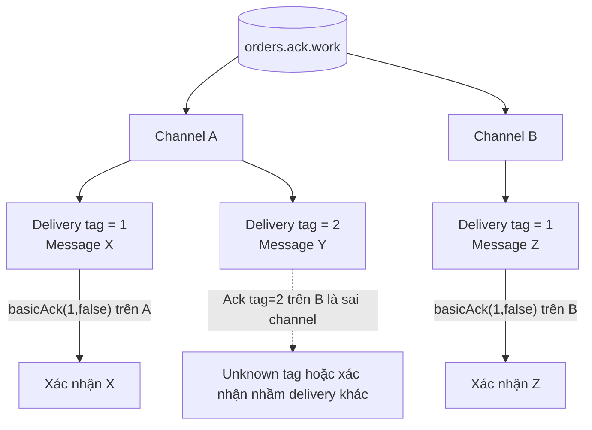
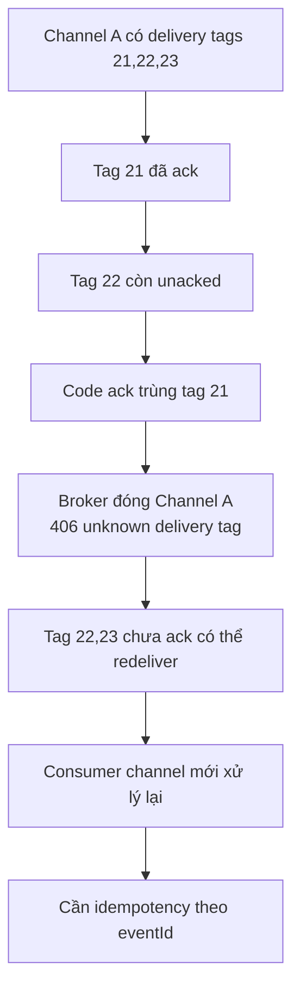

# Lỗi unknown delivery tag do ack sai channel hoặc ack hai lần

Trong RabbitMQ, khi consumer nhận được một delivery ở chế độ yêu cầu xác nhận thủ công, broker gửi kèm **delivery tag**. Consumer phải dùng tag đó để trả lời bằng `basic.ack`, `basic.nack` hoặc `basic.reject` trên **chính channel đã nhận delivery**. Nếu dùng một channel khác, xác nhận lại message đã được xác nhận, hoặc trộn cơ chế ack của Spring AMQP với lệnh ack thủ công không đúng, broker có thể đóng channel và báo:

```text
PRECONDITION_FAILED - unknown delivery tag 1
reply-code=406
```

Trong chương **Xác nhận tiêu thụ** của module **SPRING_AMQP**, bài này phân tích nguyên nhân kỹ thuật, cách tái hiện và cách phòng tránh lỗi **unknown delivery tag** khi dùng `@RabbitListener`, `Channel`, `RabbitTemplate`, exchange, queue và binding. Đồng thời, ta sẽ liên hệ lỗi xác nhận với **redelivery, idempotency, retry, DLQ và quan sát hệ thống**, vì một thao tác ack sai có thể ảnh hưởng nhiều message đang xử lý trên cùng channel.

## 1. Delivery tag là gì và thuộc phạm vi nào?

Mỗi delivery mà RabbitMQ gửi tới một consumer trên channel AMQP 0-9-1 đều có một **delivery tag**. Tag là số nguyên tăng dần trong **phạm vi channel**; nó **không phải ID duy nhất trên toàn broker**, không phải `messageId`, cũng không phải khóa nghiệp vụ.



Trong sơ đồ, **Channel A và Channel B đều có thể cùng xuất hiện tag `1`**, vì tag không có ý nghĩa toàn cục. Do đó, chuyển một tag từ channel này sang channel khác là lỗi thiết kế:

| Giá trị | Phạm vi | Có dùng để ack không? |
| --- | --- | --- |
| `deliveryTag` từ `MessageProperties` | **Channel đang giao message** | Có, trên **đúng channel** |
| `consumerTag` | Đăng ký consumer tại broker | Không; đây là định danh consumer, không phải delivery |
| AMQP `messageId` | Metadata do producer gắn | Không; broker không dùng nó thay delivery tag |
| `eventId` | Định danh nghiệp vụ | Không; dùng cho idempotency/tracing |
| `correlationId` | Liên kết request/workflow | Không; không phải tag xác nhận |
| Channel number | Số channel trong một connection | Không; một channel có nhiều delivery tags |

**Mỗi lần delivery có thể được gán một tag khác khi được giao lại.** Nếu consumer đang xử lý `eventId=evt-42`, sau đó channel mất và message được broker redeliver trên channel mới, tag mới không cần trùng tag trước. Logic nghiệp vụ phải dựa trên `eventId` hoặc khóa DB, không dựa trên delivery tag.

## 2. Lỗi unknown delivery tag được RabbitMQ phát hiện như thế nào?

RabbitMQ duy trì trạng thái của các **delivery chưa được xác nhận** trên từng channel. Khi nhận `basic.ack`, `basic.nack` hoặc `basic.reject`, broker kiểm tra tag có hợp lệ trong tập delivery của channel đó hay không.

Các tình huống phổ biến:

1. **Ack hai lần:** cùng một `deliveryTag` đã được ack, nhưng code lại gửi `basicAck(tag, false)` lần thứ hai.
2. **Ack sai channel:** consumer nhận trên channel A nhưng gọi `basicAck(tag, false)` trên channel B.
3. **Vừa auto ack vừa manual ack:** Spring listener container đã ack delivery theo chế độ `AUTO`, code lại gửi ack thủ công.
4. **Consumer ở chế độ no-ack:** broker coi delivery đã được chấp nhận khi gửi (`AcknowledgeMode.NONE`), nhưng ứng dụng vẫn cố ack theo tag.
5. **Ack trùng với `multiple=true`:** một lệnh ack hàng loạt đã xác nhận cả nhóm delivery rồi code vẫn ack riêng một tag thuộc nhóm đó.
6. **Settling sau khi channel đã thay đổi:** callback bất đồng bộ giữ tag cũ hoặc dùng channel mới sau reconnect, không còn đúng phạm vi delivery ban đầu.

Lỗi thường thấy trong RabbitMQ broker log hoặc log của Java client:

```text
channel error; protocol method: #method<channel.close>
reply-code=406
reply-text=PRECONDITION_FAILED - unknown delivery tag 7
class-id=60
method-id=80
```

Đây là **ví dụ dạng log thường gặp**; số tag, class/method và cách formatter ghi log có thể khác tùy thao tác lỗi và phiên bản client. Mã `406 PRECONDITION_FAILED` thường làm RabbitMQ đóng **channel liên quan**, chứ không nhất thiết đóng toàn bộ connection TCP.

### Lỗi không nhất thiết xuất hiện ở dòng basicAck ngay lập tức

`basicAck` gửi một lệnh AMQP một chiều; nhiều lúc client hoàn tất lời gọi gửi trước khi nhận phản hồi **`channel.close`** từ broker. Vì thế, stack trace có thể nổi lên ở **lệnh AMQP tiếp theo**, khi listener container chạy recovery, hoặc trong callback `ShutdownSignalException`.

**Không kết luận lỗi ở câu lệnh Java vừa được ghi log ngay trước exception** nếu chưa đối chiếu delivery tag, channel và đường ack thực tế.

### Cảnh báo: ack sai channel có thể còn nguy hiểm hơn 406

Nếu channel B **tình cờ có một delivery chưa ack mang cùng giá trị số**, `basicAck(tag, false)` gọi nhầm trên B có thể **xác nhận nhầm message của B** thay vì báo unknown tag. Không được xem việc “không thấy 406” là bằng chứng dùng đúng channel.

## 3. Ba chế độ acknowledgement trong Spring AMQP

`AcknowledgeMode` của Spring AMQP quyết định **ai gửi consumer ack** và khi nào.

| Chế độ | Ai ack? | Hành vi chính | Có tự gọi `channel.basicAck` trong listener không? |
| --- | --- | --- | --- |
| `AcknowledgeMode.AUTO` | **Spring listener container** | Thường ack sau khi listener xử lý thành công; thất bại được error handler xử lý | **Không**, vì có nguy cơ double ack |
| `AcknowledgeMode.MANUAL` | **Code ứng dụng** | Ứng dụng phải quyết định ack/nack/reject hợp lệ | **Có**, dùng channel/tag của delivery đó |
| `AcknowledgeMode.NONE` | Broker xử lý theo no-ack | Delivery không chờ consumer xác nhận | **Không**, vì broker không giữ outstanding ack cho delivery |

**Quan trọng:** `AUTO` của Spring **không phải** AMQP `autoAck=true` (no-ack). `AUTO` nghĩa là Spring quyết định ack theo kết quả method; `NONE` mới là chế độ tương ứng với không cần xác nhận từ consumer.

### Chọn chế độ phù hợp

- Với nghiệp vụ bình thường, ưu tiên `@RabbitListener` dùng cơ chế **AUTO** và để error handler/retry quản lý lỗi.
- Khi có yêu cầu xác nhận **chủ động**, điều phối nhiều bước hoặc xử lý theo batch đặc biệt, chọn **MANUAL** và kiểm soát chặt một đường ack cuối.
- Không trộn gọi `basicAck` thủ công vào listener đang chạy **AUTO** chỉ vì đã nhận được tham số `Channel`. Một method có `Channel` không tự chuyển ack mode sang `MANUAL`.
- Khi tích hợp API bất đồng bộ, phải xem cách listener container hỗ trợ asynchronous returns/ack và vòng đời channel của **phiên bản Spring AMQP đang chạy**, không tự lưu channel vào một task độc lập mà không có hợp đồng về lifetime.

## 4. Nguyên nhân A: ack cùng một delivery hai lần

Ví dụ **sai** trong listener MANUAL:

```java
@RabbitListener(queues = "orders.ack.work", ackMode = "MANUAL")
public void broken(Message message, Channel channel) throws IOException {
    long tag = message.getMessageProperties().getDeliveryTag();

    processOrder(message);
    channel.basicAck(tag, false);

    // SAI: tag này đã được xác nhận.
    channel.basicAck(tag, false);
}
```

Đoạn này **chỉ dùng để phân tích lỗi hoặc thí nghiệm trong queue cách ly**, không nên triển khai. Lệnh ack thứ hai có thể dẫn đến `PRECONDITION_FAILED - unknown delivery tag`. Khi channel đóng, các delivery **chưa ack khác** trên cùng channel có thể được broker giao lại.

Trong thực tế, double ack không phải lúc nào cũng hiển hiện thành hai dòng liền nhau:

```java
try {
    processOrder(message);
    channel.basicAck(tag, false); // Đã ack
    publishResult();             // Có thể throw exception
} catch (Exception ex) {
    channel.basicNack(tag, false, true); // SAI: settling lần hai
}
```

Nếu `publishResult()` ném exception **sau khi ack**, nhánh `catch` sẽ cố nack cùng tag. Ngoài ra, khi có `IOException` từ chính `basicAck`, ứng dụng **không được suy đoán chắc chắn** broker đã hoặc chưa ghi nhận ack; gọi tiếp một lệnh nack trên tag đó có thể sai.

### Cách sửa: tách nghiệp vụ và bước xác nhận

Một nguyên tắc an toàn là:

```text
Nhận delivery
    |
    +--> validate + xử lý nghiệp vụ
             |
             +--> Thành công --> basicAck(tag, false) --> return
             |
             +--> Lỗi không thể retry --> basicReject(tag, false) --> return
             |
             +--> Lỗi tạm thời --> chiến lược retry/backoff
                                        |
                                        +--> Thành công --> basicAck(tag, false)
                                        +--> Hết retry --> reject/nack có chính sách --> return
```

Sau khi đã gửi một lệnh **settlement**, không chạy một nhánh chung phía sau làm ack/nack lại. Tránh đặt toàn bộ **ack + publish + DB call** trong một `try/catch` rồi mặc định `catch` luôn gọi nack; cần biết lỗi xảy ra **trước hay sau khi** settlement đã được gửi.

## 5. Nguyên nhân B: ack qua channel khác hoặc sau reconnect

Xét hai channel cùng thuộc một connection:

```text
Channel A:
    nhận message X, deliveryTag=9
    đang chờ ACK của X

Channel B:
    chưa từng nhận deliveryTag=9

Ứng dụng gọi Channel B.basicAck(9, false)
    -> RabbitMQ kiểm tra tag 9 trên B
    -> 406 PRECONDITION_FAILED - unknown delivery tag 9
```

Lỗi thường do developer nghĩ `deliveryTag` là ID message, sau đó lấy **một channel bất kỳ** từ `RabbitTemplate` hoặc `ConnectionFactory` để ack.

**Anti-pattern, tuyệt đối không sử dụng trong hệ thống thật:**

```java
long tag = incomingMessage.getMessageProperties().getDeliveryTag();

// SAI: channel do RabbitTemplate mượn không phải channel nhận delivery.
rabbitTemplate.execute(otherChannel -> {
    otherChannel.basicAck(tag, false);
    return null;
});
```

`RabbitTemplate` được thiết kế chủ yếu cho thao tác gửi/request/reply và mượn channel theo nhu cầu; **channel được mượn để publish không có quyền ack delivery trên channel consumer**. Trong thí nghiệm có tải, lệnh ack nhầm còn có thể tác động một delivery khác nếu trùng tag.

### Vấn đề với callback bất đồng bộ

Ví dụ listener lấy tag, gửi payload vào một `CompletableFuture` rồi **trả về ngay**, sau đó một thread khác tự tạo channel mới để ack. Khi đó:

1. Channel gốc có thể bị listener container đóng, trả về cache hoặc thay đổi sau recovery.
2. Delivery tag cũ **không dùng được** trên channel mới.
3. Có thể xảy ra race giữa container acknowledgement và callback ứng dụng.
4. Một `Channel` của RabbitMQ Java client không nên được chia sẻ tùy tiện giữa nhiều thread mà không tuân thủ quy tắc sử dụng channel của client/framework.

Nếu cần xử lý bất đồng bộ, xem **async listener support** của phiên bản Spring AMQP (ví dụ listener trả `CompletableFuture`/reactive result khi được hỗ trợ), hoặc thiết kế một worker xử lý có trạng thái rõ ràng. Đừng tự chuyển một `deliveryTag` rời rạc sang một channel khác để “ack về sau”.

## 6. Nguyên nhân C: multiple=true và các đường settlement cạnh tranh

`basicAck(deliveryTag, multiple)` có tham số thứ hai:

```java
channel.basicAck(tag, false); // Ack đúng một delivery tag.
channel.basicAck(tag, true);  // Ack tất cả delivery CHƯA ACK có tag <= tag
                              // trên cùng channel.
```

`multiple=true` **không phải** “ack một message nhanh hơn”; nó là thao tác xác nhận **nhiều delivery**. Giả sử channel đang giữ:

```text
Unacked: tag 10, tag 11, tag 12

basicAck(12, true)
  -> Xác nhận 10, 11, 12

basicAck(11, false)
  -> Sai: tag 11 đã được xác nhận
  -> Có thể dẫn đến unknown delivery tag 11
```

Nếu xử lý message song song trên cùng channel, một task hoàn thành tag 12 trước tag 11 và gọi `basicAck(12, true)`, nó có thể xác nhận **cả delivery 11 chưa hoàn thành nghiệp vụ**. Đây là lỗi tính đúng đắn, kể cả khi broker **chưa báo 406**.

Do đó:

- Dùng `multiple=false` theo từng delivery khi không có yêu cầu batch acknowledgement được thiết kế kỹ.
- Chỉ dùng `multiple=true` nếu có một bộ điều phối **biết chắc toàn bộ delivery <= tag đã xử lý xong**, cùng channel và chưa được settle.
- Không trộn batch ack và từng ack/nack riêng trên cùng tập delivery mà thiếu quản lý trạng thái.
- **`basicReject` không có tham số multiple**; `basicNack` có thể hỗ trợ multiple và requeue, nhưng vẫn phải đúng phạm vi channel/tập outstanding deliveries.

## 7. Ví dụ Spring Boot: MANUAL ack đúng cách

Phần này dùng môi trường local/test với `spring-boot-starter-amqp`. Ví dụ giả định RabbitMQ đã có user và virtual host phù hợp; không tạo credentials cố định cho production.

### 7.1. Dependency và kết nối

```xml
<dependency>
    <groupId>org.springframework.boot</groupId>
    <artifactId>spring-boot-starter-amqp</artifactId>
</dependency>
```

```yaml
# application-local.yml
spring:
  rabbitmq:
    host: localhost
    port: 5672
    username: app_local
    password: local-demo-only
    virtual-host: orders_local
```

Spring Boot quản lý dependency theo parent/BOM; đừng tự chọn phiên bản Spring AMQP và RabbitMQ Java client không tương thích. Khi production, sử dụng secret manager, TLS và quyền tối thiểu.

### 7.2. Exchange, work queue, DLX và DLQ

Ta khai báo `DirectExchange` cho message nghiệp vụ, queue `orders.ack.work` và dead-letter topology để message **bị reject không requeue** có đích kiểm tra.

```java
import org.springframework.amqp.core.Binding;
import org.springframework.amqp.core.BindingBuilder;
import org.springframework.amqp.core.DirectExchange;
import org.springframework.amqp.core.Queue;
import org.springframework.amqp.core.QueueBuilder;
import org.springframework.beans.factory.annotation.Qualifier;
import org.springframework.context.annotation.Bean;
import org.springframework.context.annotation.Configuration;

@Configuration
public class AckDemoTopology {
    public static final String EXCHANGE = "orders.ack.exchange";
    public static final String WORK_QUEUE = "orders.ack.work";
    public static final String WORK_KEY = "orders.execute";
    public static final String DLX = "orders.ack.dlx";
    public static final String DLQ = "orders.ack.dlq";
    public static final String DL_KEY = "orders.failed";

    @Bean
    public DirectExchange ackWorkExchange() {
        return new DirectExchange(EXCHANGE, true, false);
    }

    @Bean
    public DirectExchange ackDeadLetterExchange() {
        return new DirectExchange(DLX, true, false);
    }

    @Bean
    public Queue ackWorkQueue() {
        return QueueBuilder.durable(WORK_QUEUE)
                // Demo local. Production thường ưu tiên policy cho DLX.
                .withArgument("x-dead-letter-exchange", DLX)
                .withArgument("x-dead-letter-routing-key", DL_KEY)
                .build();
    }

    @Bean
    public Queue ackDeadLetterQueue() {
        return QueueBuilder.durable(DLQ).build();
    }

    @Bean
    public Binding ackWorkBinding(
            @Qualifier("ackWorkQueue") Queue queue,
            @Qualifier("ackWorkExchange") DirectExchange exchange) {
        return BindingBuilder.bind(queue).to(exchange).with(WORK_KEY);
    }

    @Bean
    public Binding ackDeadLetterBinding(
            @Qualifier("ackDeadLetterQueue") Queue queue,
            @Qualifier("ackDeadLetterExchange") DirectExchange exchange) {
        return BindingBuilder.bind(queue).to(exchange).with(DL_KEY);
    }
}
```

Khi `RabbitAdmin` được Spring Boot cấu hình và có quyền, các bean topology có thể được khai báo trên broker. **Khai báo bean không bảo đảm queue thực sự tồn tại**; kiểm tra exchange, queue, binding và vhost qua RabbitMQ Management. Với queue đã có arguments khác, redeclare có thể gặp `PRECONDITION_FAILED` **khác** với unknown delivery tag: lúc này phải sửa cấu hình topology, không đi sửa logic ack.

### 7.3. Listener MANUAL: một delivery được settle một lần

```java
import java.io.IOException;
import java.nio.charset.StandardCharsets;
import com.rabbitmq.client.Channel;
import org.slf4j.Logger;
import org.slf4j.LoggerFactory;
import org.springframework.amqp.core.Message;
import org.springframework.amqp.rabbit.annotation.RabbitListener;
import org.springframework.context.annotation.Profile;
import org.springframework.stereotype.Component;

@Component
@Profile("ack-local")
public class SafeManualAckListener {
    private static final Logger log =
            LoggerFactory.getLogger(SafeManualAckListener.class);

    @RabbitListener(
            id = "safeManualAckConsumer",
            queues = AckDemoTopology.WORK_QUEUE,
            ackMode = "MANUAL"
    )
    public void consume(Message message, Channel channel) throws IOException {
        long tag = message.getMessageProperties().getDeliveryTag();
        String payload = new String(message.getBody(), StandardCharsets.UTF_8);

        log.info("received tag={}, channelNo={}, redelivered={}",
                tag, channel.getChannelNumber(),
                message.getMessageProperties().isRedelivered());

        try {
            processOrder(payload);
        } catch (IllegalArgumentException invalid) {
            // Payload không hợp lệ: đẩy sang DLX/DLQ, nếu đã cấu hình.
            channel.basicReject(tag, false);
            return; // Không rơi xuống basicAck phía dưới.
        } catch (IllegalStateException dependencyFailure) {
            // Demo: đưa message sang DLQ để triage.
            // Production: phân loại lỗi và retry có giới hạn/backoff.
            channel.basicNack(tag, false, false);
            return;
        }

        // Chỉ ack sau khi xử lý nghiệp vụ hoàn tất an toàn.
        // Không bọc basicAck trong catch sẽ gọi nack lại cùng tag.
        channel.basicAck(tag, false);
    }

    private void processOrder(String payload) {
        if ("BAD_DATA".equals(payload)) {
            throw new IllegalArgumentException("Unsupported message payload");
        }
        if ("DOWNSTREAM_UNAVAILABLE".equals(payload)) {
            throw new IllegalStateException("Temporary dependency failure");
        }
        // Thực tế: validate, ghi DB bằng transaction và chống duplicate.
    }
}
```

**Vì sao mã này tránh double ack?**

1. Listener dùng `ackMode = "MANUAL"`, không để container tự ack cùng delivery theo luồng AUTO thông thường.
2. `tag` được lấy từ **message hiện tại** và `channel` là channel **do listener container đưa vào cùng lời gọi**.
3. Mỗi nhánh lỗi gửi **một** lệnh `basicReject` hoặc `basicNack`, sau đó `return`.
4. Nhánh thành công đi đến **một** lệnh `basicAck(tag, false)` sau xử lý.
5. Lệnh ack ở ngoài `try/catch` nghiệp vụ, nên exception khi gửi ack không kích hoạt nhánh nack của chính tag đó.

**Giới hạn của ví dụ:** `DOWNSTREAM_UNAVAILABLE` bị đưa sang DLQ ngay để thí nghiệm dễ kiểm chứng, **không phải** retry strategy production. Lỗi tạm thời thường cần retry có giới hạn và backoff hoặc retry queue phù hợp; đừng mặc định reject mọi timeout vĩnh viễn. Khi `basicAck`/`basicNack` phát sinh `IOException`, trạng thái broker có thể **không chắc chắn**; Spring container sẽ xử lý hậu quả kết nối/channel theo cấu hình, còn nghiệp vụ vẫn phải idempotent.

### 7.4. Producer gửi ba message mẫu

```java
import java.util.UUID;
import org.springframework.amqp.rabbit.core.RabbitTemplate;
import org.springframework.stereotype.Service;

@Service
public class AckDemoPublisher {
    private final RabbitTemplate template;

    public AckDemoPublisher(RabbitTemplate template) {
        this.template = template;
    }

    public void publish(String payload) {
        String eventId = UUID.randomUUID().toString();
        template.convertAndSend(
                AckDemoTopology.EXCHANGE,
                AckDemoTopology.WORK_KEY,
                payload,
                message -> {
                    message.getMessageProperties().setMessageId(eventId);
                    return message;
                });
    }
}
```

Thử gọi:

```java
publisher.publish("OK");
publisher.publish("BAD_DATA");
publisher.publish("DOWNSTREAM_UNAVAILABLE");
```

`publisher` ở đoạn cuối giả định đã inject bean `AckDemoPublisher`. Khi chạy đúng profile `ack-local` và topology:

- `OK` được listener xử lý và `basicAck` một lần.
- `BAD_DATA` được `basicReject(requeue=false)`, đi theo DLX/DLQ nếu topology hoạt động.
- `DOWNSTREAM_UNAVAILABLE` được `basicNack(requeue=false)` trong **demo**, cũng đi DLQ nếu binding đúng.

Không chạy song song một listener khác ở chế độ AUTO/MANUAL trên cùng `orders.ack.work` khi muốn xác minh một message vào chính listener nào. Những consumer cùng queue là **competing consumers**, không broadcast.

## 8. Cách tái hiện lỗi trên local/test mà không ảnh hưởng dữ liệu thật

### 8.1. Tái hiện ack hai lần

Trong **môi trường RabbitMQ cách ly**, tạm sửa listener demo chỉ cho payload `TEST_DOUBLE_ACK`:

```java
if ("TEST_DOUBLE_ACK".equals(payload)) {
    channel.basicAck(tag, false); // Lần thứ nhất.
    channel.basicAck(tag, false); // Cố ý lỗi: không dùng ở production.
    return;
}
```

Theo dõi log ứng dụng và RabbitMQ. Thường broker đóng channel với `406 PRECONDITION_FAILED - unknown delivery tag <n>`. Nếu không thấy exception ngay ở lệnh thứ hai, hãy quan sát `ShutdownSignalException`/consumer recovery vì phản hồi protocol có thể đến bất đồng bộ.

Sau test, **bỏ nhánh lỗi**, khởi động lại listener nếu cần, kiểm tra message `Ready`/`Unacked` và consumer count. Không để nhánh broken có thể được kích hoạt trên production.

### 8.2. Tái hiện ack sai channel

Thay vì cố lấy một connection/channel khác trong business code, hãy dùng một **thí nghiệm chủ đích** với hai channel độc lập trên broker test:

1. Channel A nhận một delivery đang chờ ack với tag `n`.
2. Channel B **không có outstanding delivery** mang tag `n`.
3. Gọi `basicAck(n, false)` trên B.
4. Quan sát channel B bị đóng do unknown delivery tag; channel A vẫn đang giữ delivery của A và cần được settle đúng.

Thí nghiệm này cần kiểm soát trạng thái B trước khi gọi; nếu B tình cờ có tag `n` đang chờ, bạn có thể **ack nhầm dữ liệu khác** chứ không tạo lỗi mong đợi. Vì vậy **không thử trên queue hay connection đang phục vụ nghiệp vụ thật**.

### 8.3. Tái hiện lỗi do AUTO + manual

Nếu xóa `ackMode="MANUAL"` nhưng vẫn giữ `channel.basicAck(tag,false)`, listener có thể chuyển sang **AUTO**, rồi container tự ack sau khi method thành công. Khi đó cùng tag bị xác nhận hai lần và broker có thể đóng channel. Khôi phục `MANUAL` sau khi quan sát.

**Lưu ý:** Nếu custom `RabbitListenerContainerFactory` đang được sử dụng, kiểm tra acknowledge mode thực tế của nó; không suy luận từ config YAML của factory khác.

## 9. Lỗi 406 làm gì với channel và những message chưa ack?

RabbitMQ xử lý một ack sai như **lỗi protocol ở channel**. Channel liên quan bị đóng; những delivery trên channel đó chưa được ack cuối cùng có thể được broker **đưa trở lại để giao lại** theo quy tắc queue/connection, dù chúng không phải message gây ra lệnh sai.



Không đánh đồng:

- **Ack sai / channel close:** chủ yếu là lỗi lifecycle/protocol; có thể gây redelivery những message outstanding.
- **Reject không requeue:** consumer chủ động từ chối một delivery; nếu queue có DLX hợp lệ, message có thể vào DLQ.
- **Delivery limit của quorum queue:** broker theo dõi những lần giao thất bại theo semantics của phiên bản RabbitMQ; có thể dead-letter khi vượt ngưỡng.
- **Publisher NACK:** tín hiệu ở phía producer cho một publish, không phải kết quả của `basicAck` tại consumer.

Đóng channel do unknown tag **không tự đưa tất cả message sang DLQ**. Với classic/quorum queue, còn phụ thuộc loại queue, DLX, delivery limit, số lần redelivery và chính sách cụ thể. Nếu consumer tiếp tục crash hoặc ack sai, các message có thể quay vòng và sau đó vượt limit ở quorum queue, nhưng không nên dựa vào cơ chế đó để “sửa” code.

## 10. Chẩn đoán production theo từng bằng chứng

Khi thấy `unknown delivery tag`, kiểm tra theo một thứ tự có thể lặp lại:

1. **Tìm mã lỗi và phạm vi:** `406 PRECONDITION_FAILED`, channel number, connection, vhost và thời điểm. Phân biệt với `406` khi redeclare queue/exchange sai properties.
2. **Xác định listener nào liên quan:** `@RabbitListener(id=...)`, queue, consumer tag, container type (`SMLC`/`DMLC`), concurrency và ack mode.
3. **Tìm mọi chỗ gọi settlement:** `basicAck`, `basicNack`, `basicReject`, retry recoverer, manual error handler và callback bất đồng bộ.
4. **Đối chiếu tag và channel:** tag có lấy từ **message đang xử lý trên cùng channel** không? Có lưu tag vào hàng đợi khác hoặc lấy channel từ `RabbitTemplate` không?
5. **Kiểm tra một delivery được settle mấy lần:** có `finally { basicAck(...); }` sau một nhánh đã nack/reject không? Có `multiple=true` hoặc callback chạy lại không?
6. **Đối chiếu thời điểm broker đóng channel:** sau đó có consumer recovery, redelivery rate tăng, `Unacked` giảm đột ngột hoặc backlog tăng không?
7. **Xác nhận idempotency:** kiểm tra cùng `eventId` có bị xử lý lại, tạo hóa đơn hoặc gửi notification trùng không?
8. **Khắc phục và kiểm chứng:** sửa code, triển khai canary trên test, xác minh không còn channel error, số `Ready`/`Unacked` hợp lý và DLQ không tăng bất thường.

### Bảng triệu chứng nhanh

| Triệu chứng | Khả năng cao | Hành động |
| --- | --- | --- |
| `unknown delivery tag 1` xuất hiện sau mỗi message | AUTO + ack thủ công, hoặc ack hai lần | Chọn một cơ chế ack; rà mọi đường settlement |
| 406 xuất hiện khi dùng `RabbitTemplate.execute(...basicAck...)` | Ack trên channel publish khác channel consumer | Ack trên `Channel` được truyền cho listener |
| Lỗi chỉ khi concurrency/prefetch tăng | Race hoặc `multiple=true` ack cả tag chưa xong | Dùng `multiple=false`, quản lý in-flight từng delivery |
| Lỗi sau callback `CompletableFuture` | Tag cũ được dùng trên channel mới/đã đóng | Dùng async listener support đúng phiên bản, tránh chia sẻ channel |
| Consumer liên tục restart, message bị xử lý lặp | Channel bị đóng bởi protocol error; unacked redeliver | Sửa lỗi ack và bổ sung idempotency |
| Payload lỗi chạy lại mãi, nhưng không có 406 | Retry/requeue vô hạn, không nhất thiết sai tag | Cấu hình retry có backoff, DLX/DLQ |
| 406 có text `inequivalent arg` | Redeclare topology không tương đương, **không phải** unknown delivery tag | Sửa arguments/policy và migration queue |
| Broker không ghi nhận ACK, app đã ghi DB | Kết nối mất ở cửa sổ giữa commit và ack | Dự phòng redelivery bằng eventId/business key |

### Ghi log đủ để phân tích nhưng không lộ dữ liệu

Một dòng log tốt có thể gồm:

```text
listenerId=safeManualAckConsumer
queue=orders.ack.work
eventId=evt-2042
channelNo=3
deliveryTag=21
redelivered=false
decision=ACK
processingMs=42
```

**Không dùng channel number một mình làm ID duy nhất**: channel number có thể trùng ở các connection khác hoặc tái sử dụng sau reconnect. Khi tra lỗi, kết hợp channel, connection, instance, consumer tag và timestamp; hạn chế log `payload` hoặc secrets. Không nên đưa `eventId` hay tag có cardinality lớn vào label metric; để chúng trong structured logs/traces.

## 11. Kết hợp retry, dead-letter và idempotency

Một consumer có thể xử lý DB thành công nhưng chết trước khi ack. RabbitMQ nhìn thấy **delivery chưa được xác nhận** và có thể giao lại. Vì thế, dù ack code hoàn toàn đúng, **at-least-once processing** vẫn có thể gây duplicate effect:

```text
1. @RabbitListener nhận eventId=evt-42, deliveryTag=9 trên channel A.
2. Ghi DB thành công và commit.
3. TCP connection đứt trước khi ACK được broker ghi nhận.
4. Broker giao lại eventId=evt-42 trên channel mới với tag mới.
5. Consumer nhận lại và cần nhận biết nghiệp vụ đã xử lý.
```

Cách bảo vệ:

- **Idempotent consumer:** lưu `eventId` hoặc business key trong database có unique constraint; việc kiểm tra và ghi tác dụng phụ phải được thiết kế **trong transaction phù hợp** để tránh race.
- **Retry có giới hạn:** phân biệt lỗi transient với lỗi payload vĩnh viễn. Tránh `basicNack(tag,false,true)` lặp liên tục nếu chưa có backoff.
- **DLX/DLQ:** cho message không thể xử lý vào queue cách ly khi reject không requeue/hết retry, với exchange, binding và quyền hợp lệ. DLQ cần quy trình phân tích/replay.
- **Quorum delivery limit:** là lớp bảo vệ broker cho poison messages, không phải thay thế quy tắc settlement và idempotency trong Spring; ngữ nghĩa tăng delivery count có thể thay đổi theo RabbitMQ version.
- **Publisher confirms:** producer xác minh publish ở cấp broker; không nói gì về việc consumer đã `basicAck` hay DB commit. Cần thiết kế riêng khi vừa ghi DB vừa phát event, ví dụ transactional outbox.
- **Giao dịch:** `channel.basicAck` không tự gộp với JDBC commit thành một atomic distributed transaction. Khi có rủi ro lặp, chọn idempotency/outbox thay vì tin vào ack order.

**Đừng “chữa” unknown tag bằng cách tắt acknowledgement** (`AcknowledgeMode.NONE`). No-ack có thể làm message mất khi consumer chết giữa chừng; nó chỉ che giấu lỗi sai protocol bằng cách bỏ đi cơ chế đảm bảo quan trọng.

## 12. Bài tập và kiểm tra hiểu biết

### Bài tập A — ACK đúng một lần

1. Cấu hình local profile `ack-local`, bảo đảm chỉ có một listener demo trên queue.
2. Publish `OK`, quan sát `deliveryTag`, channel number và trạng thái `Ready`/`Unacked`.
3. Xác nhận listener gửi một `basicAck(tag,false)`, không có channel error 406.
4. Dừng và khởi động lại ứng dụng, gửi eventId khác; so sánh tag giữa các channel/lần kết nối.

### Bài tập B — Double ack gây lỗi

1. Trong broker test riêng, thêm nhánh `TEST_DOUBLE_ACK` ở mục 8.1.
2. Gửi đúng một message thử và quan sát `PRECONDITION_FAILED` trong RabbitMQ/server logs.
3. Xác nhận container/consumer khôi phục phù hợp sau khi channel bị đóng.
4. Bỏ nhánh lỗi, khởi động lại, kiểm tra không còn unknown tag.

### Bài tập C — Nhiều message unacked

1. Tăng prefetch ở môi trường test và cho consumer có vài delivery chưa ack trên cùng channel.
2. Mô phỏng `basicAck(tag,true)` chỉ khi đã chứng minh toàn bộ delivery <= tag xử lý xong.
3. So sánh với `basicAck(tag,false)` từng message; ghi lại điều gì xảy ra nếu ack riêng một tag đã được batch ack.
4. Giải thích nguy cơ **ack sớm một message chưa hoàn tất DB** ngay cả khi chưa thấy lỗi 406.

### Bài tập D — Phân tích ca sự cố

Giả sử producer publish `evt-52`, consumer có tag `12` trên channel A, code gửi ack qua channel B; sau đó thấy log 406 và queue có redelivery. Hãy trả lời:

- Vì sao tag `12` không dùng được như ID toàn hệ thống?
- Channel nào bị đóng, và message trên channel A sẽ ra sao?
- Nếu channel B cũng có outstanding tag `12`, điều nguy hiểm gì có thể xảy ra?
- Cần sửa chỗ lấy channel, chế độ ack và khóa idempotency như thế nào?

### Checklist review pull request

- [ ] `@RabbitListener` dùng đúng `AUTO` hoặc `MANUAL`; không trộn ack hai nguồn.
- [ ] Nếu MANUAL, tag lấy từ **delivery hiện tại**, ack/nack/reject trên **channel nhận delivery**.
- [ ] Mỗi nhánh xử lý có **đúng một** điểm settlement; không ack/nack thêm trong `finally`.
- [ ] Không truyền tag cũ sang channel mới hoặc lấy channel từ `RabbitTemplate` để ack consumer.
- [ ] `multiple=true` chỉ dùng khi tất cả delivery trước đó trên cùng channel đều đã xử lý và chưa settle.
- [ ] Không xử lý channel đồng thời từ nhiều thread nếu chưa tuân thủ contract của RabbitMQ client/Spring.
- [ ] Có kiểm thử consumer crash/redelivery, DB idempotency và DLQ trong môi trường cách ly.
- [ ] Có metric channel errors, consumer recovery, `Ready`/`Unacked`, redelivery và DLQ.
- [ ] Tách rõ publisher confirms, consumer acknowledgement và transaction nghiệp vụ.

## 13. Tài liệu tham khảo

- [RabbitMQ – Consumer Acknowledgements and Publisher Confirms](https://www.rabbitmq.com/docs/confirms): channel-scoped delivery tags, double acknowledgement, unknown delivery tag, `multiple`, `basic.ack`, `basic.nack`, `basic.reject`.
- [RabbitMQ – Channels](https://www.rabbitmq.com/docs/channels): phạm vi lỗi channel, `PRECONDITION_FAILED`, cách broker đóng channel khi dùng protocol sai.
- [RabbitMQ – Consumers](https://www.rabbitmq.com/docs/consumers): consumer lifecycle, prefetch và redelivery.
- [Spring AMQP – Listener Container Attributes](https://docs.spring.io/spring-amqp/reference/amqp/receiving-messages/containerAttributes.html): `AcknowledgeMode.AUTO`, `MANUAL`, `NONE`, error handling, retry và prefetch.
- [Spring AMQP – Annotation-Driven Listener Endpoints](https://docs.spring.io/spring-amqp/reference/amqp/receiving-messages/async-annotation-driven.html): `@RabbitListener`, method arguments, listener container factory.
- [Spring AMQP – Exception Handling](https://docs.spring.io/spring-amqp/reference/amqp/exception-handling.html): exception/reject policy và xử lý lỗi listener.

**Ghi nhớ:** RabbitMQ delivery tag **chỉ có ý nghĩa trên channel đã giao delivery**. `unknown delivery tag` thường do **ack sai channel**, **ack lặp**, trộn `AUTO` và `MANUAL`, hoặc `multiple=true` không được điều phối đúng; broker có thể đáp `406 PRECONDITION_FAILED` và đóng channel. Hãy chọn một chiến lược acknowledgement rõ ràng, settle mỗi delivery đúng một lần trên channel gốc, kiểm thử redelivery và bảo vệ nghiệp vụ bằng idempotency, retry/backoff, DLQ và quan sát vận hành.
