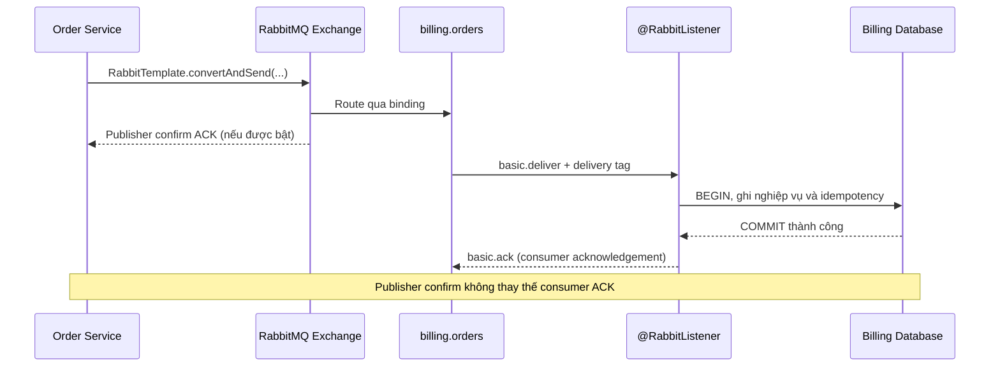
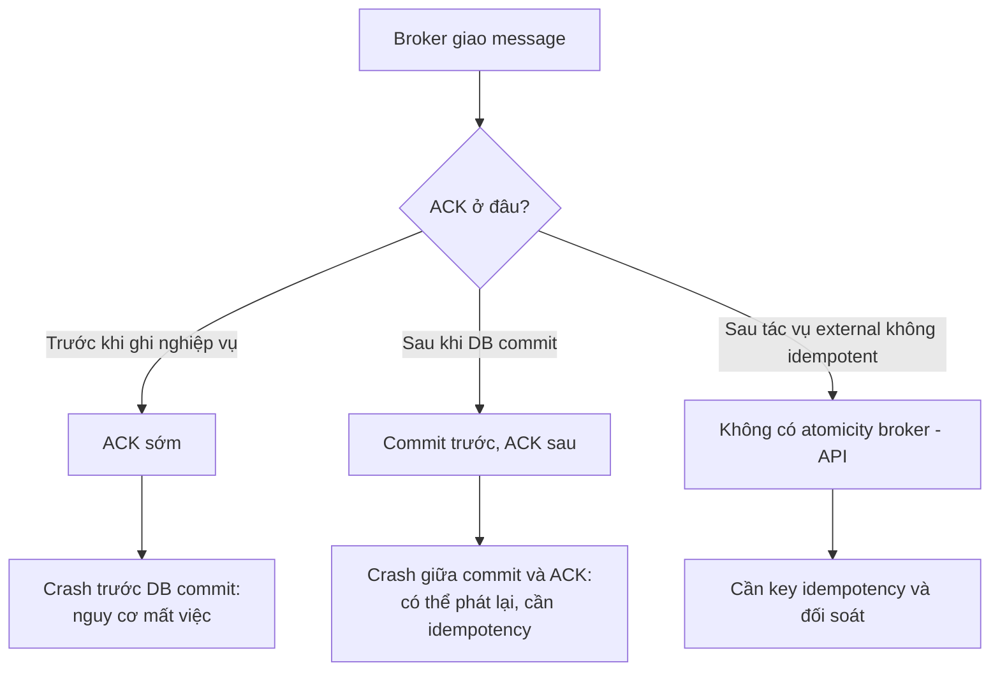
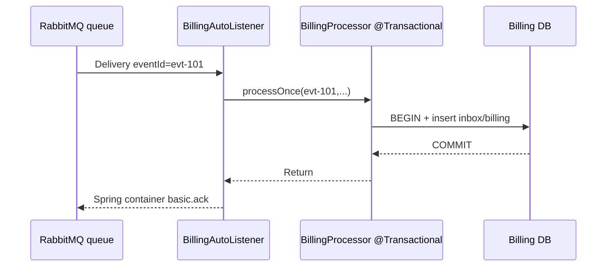
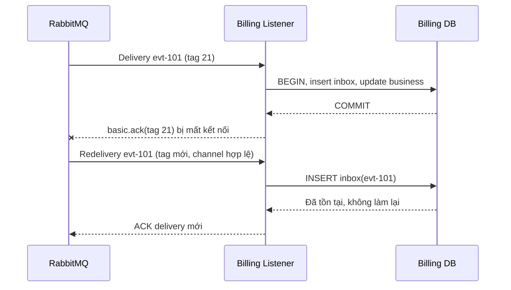
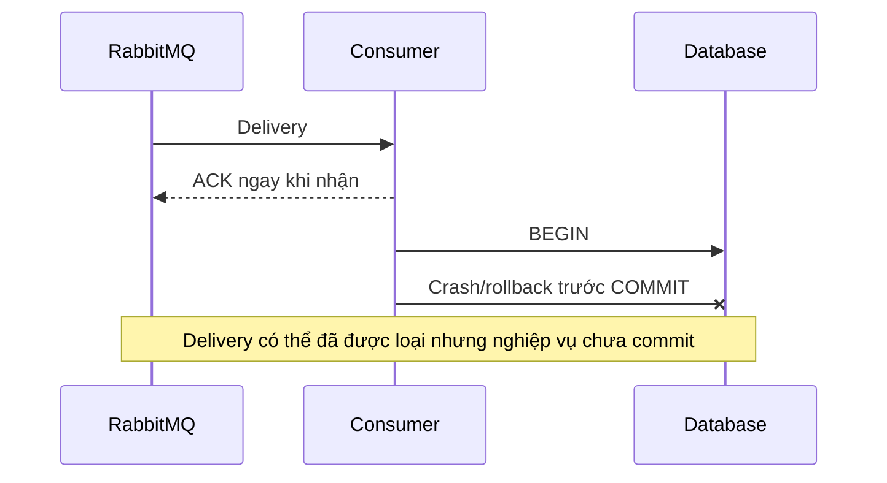

# Chọn chiến lược ack theo ranh giới hoàn tất nghiệp vụ

## 1. Bài toán: khi nào một message thực sự được xem là xử lý xong?

Trong một hệ thống **Spring AMQP**, `Order Service` gửi sự kiện qua `RabbitTemplate` đến exchange `orders.events`; binding đưa message vào queue `billing.orders`; phương thức `@RabbitListener` của `Billing Service` tiếp nhận và cập nhật database. Nếu kết nối RabbitMQ bị ngắt trong lúc xử lý, broker phải quyết định có phát lại delivery hay không.

Câu hỏi quan trọng không phải chỉ là “gọi `basicAck` ở đâu”, mà là:

> **Tại thời điểm broker nhận ACK, tác dụng phụ nghiệp vụ nào đã được hoàn tất và lưu bền vững?**

Nếu ACK **quá sớm**, message có thể biến mất khỏi queue trong khi database chưa commit. Nếu ACK **quá muộn**, một message đã được xử lý thành công vẫn có thể được phát lại khi connection mất trước lúc ACK đến broker. Vì vậy, chiến lược thực tế thường là:

- **Không xác nhận delivery trước khi công việc cần thiết đã hoàn tất bền vững.**
- **Chấp nhận khả năng redelivery** sau khi commit thành công nhưng ACK chưa đến broker.
- **Thiết kế idempotency** để bản phát lại không nhân đôi side effect.
- **Phân loại lỗi**: lỗi tạm thời cần retry có giới hạn; lỗi dữ liệu cố định cần reject/quarantine/dead-letter thay vì requeue mãi.

Bài này thuộc chương **Xác nhận tiêu thụ**, trong module **SPRING_AMQP**: học tích hợp RabbitMQ với Spring AMQP bằng `RabbitTemplate`, `@RabbitListener`, exchange, queue, binding và vận hành hệ thống bất đồng bộ đáng tin cậy. Nội dung gắn consumer acknowledgement với publisher confirms, retry, DLX, transaction database và quan sát hệ thống.

Sau bài học, bạn có thể:

1. Phân biệt chính xác `AcknowledgeMode.AUTO`, `MANUAL`, `NONE` của Spring.
2. Chọn thời điểm ACK theo ranh giới **database commit**, **xử lý ngoại vi** và **xác thực payload**.
3. Dùng `basicAck`, `basicNack`, `basicReject` đúng channel và delivery tag.
4. Tránh lỗi “ACK trước commit” và giải thích vì sao “commit trước ACK” vẫn có duplicate.
5. Thiết kế listener với inbox/idempotency key, transaction và retry/DLQ.
6. Kiểm thử các khoảng hở giữa việc nhận delivery, commit nghiệp vụ và gửi ACK.
7. Đọc `messages_ready`, `messages_unacknowledged` và redelivery để chẩn đoán consumer.

## 2. Mô hình giao nhận: publish, deliver, xử lý, ACK là bốn chặng khác nhau



**Publisher confirm ACK** cho biết broker đã xử lý publish theo semantics của confirm; nó không có nghĩa consumer đã cập nhật xong database. **Consumer ACK** cho biết delivery được consumer xác nhận với broker; nó không phải câu trả lời tự động cho HTTP request hay nghiệp vụ gốc.

Nếu không có queue phù hợp, publisher returns hoặc alternate exchange thuộc **chặng định tuyến**, còn consumer ACK/NACK chỉ có ý nghĩa khi message **đã được giao** cho consumer.

### 2.1. Ready, unacknowledged và delivery tag

| Khái niệm | Nghĩa | Điểm cần nhớ |
| --- | --- | --- |
| `messages_ready` | Message nằm trong queue chờ được giao | Có thể tăng khi consumer offline/chậm |
| `messages_unacknowledged` | Message đã giao cho consumer nhưng broker chưa nhận ACK/NACK hoàn tất phù hợp | Có thể tăng khi xử lý lâu hoặc prefetch lớn |
| Delivery tag | Số định danh delivery trên **một channel AMQP** | Phải ACK/NACK bằng **chính channel nhận delivery** |
| `redelivered` flag | Broker báo delivery có khả năng đã được giao trước đó | Không phải khóa chống trùng đầy đủ |
| Message ID / event ID | Danh tính sự kiện do ứng dụng quy định | Dùng làm khóa idempotency ổn định |
| Consumer prefetch | Giới hạn số delivery chưa ACK mà broker cho phép đưa tới consumer | Điều chỉnh in-flight, không thay thế timeout nghiệp vụ |

Ví dụ `messages_ready=300` và `messages_unacknowledged=40` nghĩa là có 300 message đang đợi và 40 delivery đang ở phía consumer chưa được xác nhận. Con số 40 không đồng nghĩa 40 nghiệp vụ chưa commit: có delivery đã commit nhưng chưa ACK và cũng có delivery còn đang xử lý.

### 2.2. ACK là một lệnh lên broker, không phải transaction giữa các hệ thống

RabbitMQ không biết một câu lệnh SQL `COMMIT` hoặc một API thanh toán đã thành công hay chưa. Spring có thể điều phối ACK theo kết quả callback listener, nhưng **không tự tạo giao dịch ACID phân tán giữa broker và database**.

Khi ACK được gửi nhưng connection mất, ứng dụng cũng không nhất thiết biết broker đã nhận ACK hay chưa. Vì vậy, “ACK exactly once” và “business side effect exactly once” là hai khái niệm khác nhau.

## 3. Ba chế độ acknowledge của Spring AMQP

Spring AMQP cung cấp `AcknowledgeMode` cho listener container. Cần phân biệt với tên tham số của RabbitMQ Java client.

| Chế độ | Broker delivery `autoAck` | Ai gửi ACK/NACK | Khi thích hợp | Rủi ro chính |
| --- | --- | --- | --- | --- |
| **`AUTO`** | `false` | **Spring listener container** theo kết quả listener và error policy | Handler đồng bộ thông thường, DB transaction được gọi đúng ranh giới | Method return trước khi tác dụng phụ hoàn thành, hoặc lỗi bị swallow |
| **`MANUAL`** | `false` | **Code ứng dụng** qua `Channel.basicAck/basicNack/basicReject` | Cần điều khiển chính xác thời điểm ACK, workflow đặc biệt | Quên ACK, ACK sai channel/tag, ACK kép, requeue loop |
| **`NONE`** | `true` | Broker coi message đã được nhận theo cơ chế automatic acknowledgement; không chờ ACK của consumer | Tác vụ có thể mất không cần replay; rất ít hợp đồng nghiệp vụ quan trọng phù hợp | Consumer crash sau delivery có thể mất message |

**Tên `AUTO` của Spring dễ gây nhầm:** nó **không** đồng nghĩa `autoAck=true` ở RabbitMQ Java client. Trong Spring `AUTO`, delivery thông thường vẫn là **manual acknowledgement ở cấp protocol** nhưng container gửi ACK giúp bạn khi listener xử lý thành công.

### 3.1. Khi nào chọn từng chế độ?

- **Mặc định cho handler đồng bộ có giao dịch DB:** thường bắt đầu bằng `AUTO` và đặt business transaction trong một Spring service được gọi đồng bộ. Container ACK sau khi method trả về bình thường.
- **Khi phải tự quyết định ACK/NACK tại một ranh giới đặc biệt:** cân nhắc `MANUAL`, nhưng cần sở hữu **đầy đủ các nhánh lỗi** và vòng đời channel.
- **Khi chấp nhận mất message sau khi delivery:** `NONE` có thể giảm chi phí xác nhận, nhưng không phù hợp với thanh toán, đơn hàng, cập nhật tồn kho hoặc tác vụ có yêu cầu retry.
- **Khi handler dùng async:** không được mặc định rằng Spring `AUTO` sẽ chờ một tác vụ được fire-and-forget trong thread pool. Phải kiểm tra khả năng hỗ trợ asynchronous return types/ack mode của phiên bản Spring AMQP và cấu hình riêng phù hợp.

Trong hệ thống có độ tin cậy cao, `AUTO` đúng cấu trúc thường **đơn giản và ít lỗi hơn** `MANUAL`. Việc dùng `MANUAL` không tự khiến message đáng tin cậy hơn.

## 4. Quy tắc chọn ACK theo ranh giới nghiệp vụ

Một cách thực dụng là liệt kê những việc **bắt buộc hoàn tất** trước khi message được bỏ khỏi queue.

### 4.1. Bảng quyết định

| Việc listener làm | Ranh giới hoàn tất đáng tin cậy | Chiến lược gợi ý |
| --- | --- | --- |
| Đọc và log một telemetry item có thể mất | Log/buffer đã nhận hoặc nghiệp vụ chấp nhận mất | Cân nhắc `AUTO`; `NONE` chỉ khi thật sự chấp nhận mất |
| Ghi dữ liệu một database | **DB transaction COMMIT** | `AUTO` + gọi service `@Transactional` đồng bộ |
| Ghi hai bảng cùng database | Commit cả hai bảng **trong cùng DB transaction** | `AUTO` + transactional service; inbox unique key |
| Gọi HTTP API đối tác | Phải có kết quả bền vững, idempotency key hoặc khả năng đối soát | Không ACK chỉ vì đã “bắt đầu gọi”; cân nhắc lưu job/outbox và ACK sau commit job |
| Gửi email hoặc thông báo | Job đã được ghi bền vững vào outbox/hàng chờ tiếp theo; hoặc chấp nhận retry có dedup | `AUTO` hoặc `MANUAL` theo ranh giới đã thống nhất |
| Giải mã payload không hợp lệ | Lỗi không thể phục hồi tự thân | Reject không requeue/DLQ, không retry vô hạn |
| Database tạm thời không kết nối | Chưa hoàn tất nghiệp vụ | Retry/backoff có giới hạn, sau đó xử lý lỗi theo policy |
| Đã nhận bản trùng event ID đã commit trước đó | Xác nhận trạng thái đã xử lý trong DB | Return thành công để container ACK duplicate |
| Công việc chạy rất lâu | Thường nên ghi công việc bền vững rồi xử lý ở worker khác | ACK sau khi ghi bền vững, không phải sau khi tạo thread in-memory |

### 4.2. Ba lựa chọn thời điểm ACK và cái giá của chúng



**Không có thời điểm ACK nào tự xoá được cả hai rủi ro mất việc và xử lý trùng** khi broker và database là hai hệ thống độc lập. Tư duy phổ biến là **at-least-once delivery + idempotent business processing**.

## 5. Cấu hình Spring Boot và topology thử nghiệm

### 5.1. Dependency và thuộc tính listener

Ví dụ Maven với Spring Boot dependency management:

```xml
<dependency>
    <groupId>org.springframework.boot</groupId>
    <artifactId>spring-boot-starter-amqp</artifactId>
</dependency>
```

```yaml
spring:
  rabbitmq:
    host: ${RABBITMQ_HOST:localhost}
    port: ${RABBITMQ_PORT:5672}
    username: ${RABBITMQ_USERNAME:guest}
    password: ${RABBITMQ_PASSWORD:guest}
    virtual-host: ${RABBITMQ_VHOST:/}
    publisher-confirm-type: correlated
    publisher-returns: true
    template:
      mandatory: true
    listener:
      type: simple
      simple:
        acknowledge-mode: auto
        default-requeue-rejected: false
        concurrency: 2
        max-concurrency: 4
        prefetch: 20
```

Ở đây, `acknowledge-mode: auto` là **Spring AUTO**. `default-requeue-rejected: false` làm những exception đi tới bước reject cuối cùng thường được xử lý theo hướng **không requeue**; nếu queue có dead-letter exchange, chúng có thể được chuyển tới DLQ. Cấu hình như vậy **không tự tạo một chu kỳ retry có giới hạn** cho lỗi tạm thời. Nếu cần retry trước khi reject, phải cấu hình thêm retry advice hoặc retry topology và kiểm thử thực tế.

Đoạn YAML là cấu hình minh họa cho **simple listener container**. Nếu dùng direct container, hãy xem `spring.rabbitmq.listener.direct.*`. Username/password mặc định `guest` thường chỉ thích hợp cho RabbitMQ local; production dùng thông tin xác thực và quyền tách biệt.

### 5.2. Khai báo exchange, queue, binding và DLQ

```java
package example.messaging;

import org.springframework.amqp.core.Binding;
import org.springframework.amqp.core.BindingBuilder;
import org.springframework.amqp.core.Declarables;
import org.springframework.amqp.core.DirectExchange;
import org.springframework.amqp.core.Queue;
import org.springframework.amqp.core.QueueBuilder;
import org.springframework.context.annotation.Bean;
import org.springframework.context.annotation.Configuration;

@Configuration
public class BillingTopology {

    public static final String EXCHANGE = "orders.events";
    public static final String ROUTING_KEY = "orders.created";
    public static final String QUEUE = "billing.orders";

    public static final String DLX = "orders.dead";
    public static final String DLQ = "billing.orders.dlq";
    public static final String DEAD_KEY = "orders.failed";

    @Bean
    Declarables billingResources() {
        DirectExchange primary =
                new DirectExchange(EXCHANGE, true, false);
        DirectExchange deadExchange =
                new DirectExchange(DLX, true, false);

        Queue workQueue = QueueBuilder.durable(QUEUE)
                .deadLetterExchange(DLX)
                .deadLetterRoutingKey(DEAD_KEY)
                .build();
        Queue deadQueue = QueueBuilder.durable(DLQ).build();

        Binding workBinding = BindingBuilder.bind(workQueue)
                .to(primary)
                .with(ROUTING_KEY);
        Binding deadBinding = BindingBuilder.bind(deadQueue)
                .to(deadExchange)
                .with(DEAD_KEY);

        return new Declarables(
                primary, deadExchange,
                workQueue, deadQueue,
                workBinding, deadBinding);
    }
}
```

Khi `RabbitAdmin` được cấu hình phù hợp và broker cho phép, Spring có thể khai báo các resource. Nếu đã có queue cùng tên với arguments khác, broker có thể trả `PRECONDITION_FAILED`; không xóa queue production chỉ để khắc phục lỗi này.

DLX **không tự thực hiện retry**; nó cung cấp đường chuyển message bị dead-letter. DLQ cần có policy giám sát, thời hạn giữ, quy trình phân tích và cách redrive an toàn.

### 5.3. Publisher minh họa

```java
package example.messaging;

import org.springframework.amqp.rabbit.core.RabbitTemplate;
import org.springframework.stereotype.Service;

@Service
public class OrdersPublisher {
    private final RabbitTemplate template;

    public OrdersPublisher(RabbitTemplate template) {
        this.template = template;
    }

    public void publishCreated(String eventId, String orderId) {
        template.convertAndSend(
                BillingTopology.EXCHANGE,
                BillingTopology.ROUTING_KEY,
                orderId,
                message -> {
                    message.getMessageProperties().setMessageId(eventId);
                    message.getMessageProperties()
                            .setType("orders.created");
                    return message;
                });
    }
}
```

`eventId` được tạo **một lần khi sinh sự kiện**, không tạo lại mỗi lần publish retry. Nếu producer mất confirm, nó có thể gửi lại cùng event ID; consumer cần dedup. Phần xác nhận publish của broker **không liên quan trực tiếp tới thời điểm consumer ACK**.

## 6. Chiến lược AUTO: ACK sau khi database commit thành công

Giải pháp đơn giản cho một consumer xử lý đồng bộ bằng database là:

1. Listener nhận message và lấy `eventId`.
2. Listener gọi một **Spring service khác bean**, có `@Transactional`.
3. Service kiểm tra event ID bằng ràng buộc duy nhất và thực hiện thay đổi nghiệp vụ **trong cùng giao dịch**.
4. Phương thức service trả về sau khi transaction interceptor commit thành công.
5. Listener return bình thường; Spring container gửi **ACK**.
6. Nếu xử lý lỗi, service ném exception/rollback; container xử lý exception theo retry/requeue policy.

### 6.1. Inbox chống trùng và bảng nghiệp vụ

Ví dụ PostgreSQL:

```sql
CREATE TABLE processed_events (
    consumer_name VARCHAR(100) NOT NULL,
    event_id VARCHAR(100) NOT NULL,
    processed_at TIMESTAMP WITH TIME ZONE NOT NULL
        DEFAULT CURRENT_TIMESTAMP,
    PRIMARY KEY (consumer_name, event_id)
);

CREATE TABLE billing_requests (
    event_id VARCHAR(100) PRIMARY KEY,
    order_id VARCHAR(100) NOT NULL,
    status VARCHAR(40) NOT NULL
);
```

Không nên làm hai bước riêng lẻ kiểu “`SELECT exists` rồi xử lý” bởi hai consumer đồng thời có thể đều thấy chưa tồn tại. `PRIMARY KEY` hoặc unique constraint ở database mới là cơ chế phân xử concurrency đáng tin cậy.

### 6.2. Transactional service hoàn tất trước khi listener trả về

```java
package example.billing;

import org.springframework.jdbc.core.JdbcTemplate;
import org.springframework.stereotype.Service;
import org.springframework.transaction.annotation.Transactional;

@Service
public class BillingProcessor {

    private final JdbcTemplate jdbc;

    public BillingProcessor(JdbcTemplate jdbc) {
        this.jdbc = jdbc;
    }

    @Transactional
    public void processOnce(String eventId, String orderId) {
        int inserted = jdbc.update(
                "INSERT INTO processed_events(consumer_name, event_id) "
                + "VALUES (?, ?) ON CONFLICT DO NOTHING",
                "billing-orders-created", eventId);

        if (inserted == 0) {
            // Event đã commit trước đó. Không làm lại side effect.
            return;
        }

        jdbc.update(
                "INSERT INTO billing_requests(event_id, order_id, status) "
                + "VALUES (?, ?, ?)",
                eventId, orderId, "PENDING");
    }
}
```

Trong ví dụ, cả record inbox và billing request nằm trong **cùng một transaction DB**. Nếu insert billing thất bại, transaction rollback luôn record inbox; lần giao sau có thể thử lại. Nếu đã commit, lần giao trùng chỉ phát hiện conflict và return.

`@Transactional` cần transaction manager/database tương ứng. Lời gọi từ listener sang bean `BillingProcessor` giúp đi qua Spring proxy; **self-invocation** nội bộ không bảo đảm interceptor `@Transactional` hoạt động theo mặc định.

### 6.3. Listener ở chế độ AUTO

```java
package example.billing;

import java.nio.charset.StandardCharsets;

import org.springframework.amqp.AmqpRejectAndDontRequeueException;
import org.springframework.amqp.core.Message;
import org.springframework.amqp.rabbit.annotation.RabbitListener;
import org.springframework.stereotype.Component;

@Component
public class BillingAutoListener {
    private final BillingProcessor processor;

    public BillingAutoListener(BillingProcessor processor) {
        this.processor = processor;
    }

    @RabbitListener(
            id = "billing-auto-listener",
            queues = "billing.orders")
    public void onOrderCreated(Message message) {
        String eventId =
                message.getMessageProperties().getMessageId();

        if (eventId == null || eventId.isBlank()) {
            // Payload thiếu danh tính ổn định: không requeue vô hạn.
            throw new AmqpRejectAndDontRequeueException(
                    "Missing eventId/messageId");
        }

        String orderId =
                new String(message.getBody(), StandardCharsets.UTF_8);

        if (orderId.isBlank()) {
            throw new AmqpRejectAndDontRequeueException(
                    "Invalid orderId");
        }

        processor.processOnce(eventId, orderId);
        // Return bình thường sau DB commit: container AUTO sẽ ACK.
    }
}
```

Đây là **success path và lỗi dữ liệu cố định**; ví dụ chưa gắn một interceptor retry cho lỗi DB tạm thời. Với cấu hình `default-requeue-rejected: false`, exception DB sau khi đến container có thể dẫn tới reject không requeue/DLQ ngay. Muốn retry 3 lần trước DLQ, cần cấu hình bounded retry hoặc retry topology phù hợp và kiểm thử đường lỗi. Không bật requeue vô hạn rồi tin rằng database cuối cùng luôn tự hồi phục.

### 6.4. Vì sao service method return là ranh giới quan trọng?



Nếu `BillingProcessor.processOnce` ném exception ở bước SQL/commit, lời gọi không return thành công; listener không đi qua success path. Container nhận lỗi để thực hiện logic retry/reject đã cấu hình.

**Cảnh báo:** nếu listener tự bắt lỗi rồi log và return bình thường, `AUTO` sẽ có thể ACK dù nghiệp vụ thất bại:

```java
// SAI nếu lỗi này nghĩa là nghiệp vụ CHƯA hoàn tất:
@RabbitListener(queues = "billing.orders")
public void unsafe(String orderId) {
    try {
        billingApi.call(orderId);
    } catch (Exception ex) {
        logError(ex);      // Chỉ log mà nuốt exception.
    }
    // Spring coi callback hoàn tất thành công và có thể ACK.
}
```

Nếu muốn xử lý lỗi mà không để message âm thầm mất, hoặc **ném lại exception**, hoặc trả trạng thái thành công **chỉ sau khi đã lưu trách nhiệm xử lý vào nơi bền vững**, ví dụ outbox/inbox job.

## 7. Khoảng hở giữa commit và ACK: vì sao vẫn cần idempotency?

Một kịch bản đặc biệt quan trọng:

1. RabbitMQ giao `evt-101`.
2. Billing transaction ghi inbox và billing request, rồi COMMIT thành công.
3. Container chuẩn bị gửi `basicAck`.
4. Connection đứt trước khi ACK được broker ghi nhận.
5. Broker phát lại delivery sau khi phát hiện channel/connection đã đóng.
6. Billing nhận lại `evt-101`, insert inbox conflict, bỏ qua side effect và return bình thường.
7. Container ACK lại lần giao mới.



**Kết luận:** commit trước ACK giúp tránh mất công việc chưa commit, nhưng không loại bỏ duplicate. Chống trùng thuộc về **ứng dụng**, với event ID ổn định, constraint/giao dịch và kiểm soát side effect.

### 7.1. Redelivered flag không thay inbox

Broker có thể đánh dấu một delivery là `redelivered=true` khi giao lại. Nhưng nếu **publisher gửi lại cùng event** sau timeout, cả hai message độc lập có thể lần đầu được giao với `redelivered=false`.

Không viết logic:

```java
// SAI: Không thể suy ra không trùng chỉ từ cờ redelivered.
if (!message.getMessageProperties().isRedelivered()) {
    performPayment();
}
```

Khóa chống trùng phải theo **logical event/operation ID**, không theo cờ delivery của broker. Cờ `redelivered` hữu ích cho chẩn đoán, không phải cơ chế dedup đầy đủ.

## 8. MANUAL: tự quyết định ACK, NACK và reject

`MANUAL` có ích khi cần điều khiển rõ ràng thời điểm xác nhận, ví dụ ứng dụng chỉ ACK sau khi một quy trình đặc thù hoàn tất hoặc đang chuyển việc sang một cơ chế bền vững khác. Đổi lại, ứng dụng phải quản lý đầy đủ mọi đường đi của delivery.

### 8.1. Cấu hình MANUAL cho một listener riêng

Nếu muốn minh họa song song với listener AUTO, hãy dùng **queue khác** (ví dụ `billing.manual.orders`), không copy hai consumer tranh nhau cùng `billing.orders` rồi kết luận kết quả khác biệt do ack mode.

```yaml
spring:
  rabbitmq:
    listener:
      simple:
        acknowledge-mode: manual
        prefetch: 10
```

Đây là **cấu hình thay thế** cho `acknowledge-mode: auto` của mục 5 khi tất cả simple listeners được quản lý bằng factory này. Nếu chỉ một listener cần MANUAL, trong các phiên bản Spring AMQP hỗ trợ, có thể dùng `@RabbitListener(ackMode = "MANUAL")` hoặc tách một listener container factory chuyên dụng; xem phiên bản thực tế.

### 8.2. Ví dụ ACK/NACK theo kết quả xử lý

```java
package example.billing;

import java.io.IOException;
import java.nio.charset.StandardCharsets;

import com.rabbitmq.client.Channel;

import org.springframework.amqp.core.Message;
import org.springframework.amqp.rabbit.annotation.RabbitListener;
import org.springframework.stereotype.Component;

@Component
public class BillingManualListener {
    private final BillingProcessor processor;

    public BillingManualListener(BillingProcessor processor) {
        this.processor = processor;
    }

    @RabbitListener(
            id = "billing-manual-listener",
            queues = "billing.manual.orders",
            ackMode = "MANUAL")
    public void onMessage(Message message, Channel channel)
            throws IOException {

        long tag = message.getMessageProperties().getDeliveryTag();
        String eventId = message.getMessageProperties().getMessageId();

        if (eventId == null || eventId.isBlank()) {
            // Dữ liệu lỗi cố định: reject không requeue.
            channel.basicReject(tag, false);
            return;
        }

        String orderId =
                new String(message.getBody(), StandardCharsets.UTF_8);
        if (orderId.isBlank()) {
            channel.basicReject(tag, false);
            return;
        }

        try {
            // processOnce hoàn tất COMMIT DB trước khi return.
            processor.processOnce(eventId, orderId);
            channel.basicAck(tag, false);
        } catch (RuntimeException ex) {
            // Minh họa đường lỗi tạm thời; chưa phải retry policy hoàn chỉnh.
            channel.basicNack(tag, false, true);
            // Đã tự NACK: ghi log/metrics phù hợp, không ACK tiếp tag này.
        }
    }
}
```

Ở đây, `basicNack(tag, false, true)` yêu cầu **requeue ngay** sau lỗi runtime; nếu lỗi kéo dài, message có thể lặp vô hạn. **Không dùng ví dụ nguyên xi cho production** khi chưa có bounded retry, delayed retry hoặc DLQ/quarantine. Một implementation thực tế nên phân loại lỗi DB tạm thời, lỗi định dạng cố định, lỗi authorization, và ghi metric/log cho từng quyết định.

Lưu ý thêm: nếu `basicAck` hoặc `basicNack` tự ném `IOException` vì connection/channel mất, ứng dụng không thể khẳng định broker đã nhận lệnh. Đó là đường lỗi giao thức; đừng cố ACK trên channel mới với delivery tag cũ.

### 8.3. Ý nghĩa các tham số của RabbitMQ Java client

| Method | Ý nghĩa | Chú ý |
| --- | --- | --- |
| `channel.basicAck(tag, false)` | ACK đúng delivery có tag được chỉ ra | Thường an toàn nhất khi xử lý từng message |
| `channel.basicAck(tag, true)` | ACK nhiều delivery chưa ACK với tag **tới và bao gồm** tag này trên cùng channel | Dễ ACK nhầm message khác nếu xử lý song song |
| `channel.basicNack(tag, false, true)` | NACK một delivery và yêu cầu requeue | Có thể tạo vòng lặp nóng nếu không giới hạn |
| `channel.basicNack(tag, false, false)` | NACK một delivery, không requeue | Có thể dead-letter nếu DLX hợp lệ; nếu không, message bị loại |
| `channel.basicReject(tag, true)` | Reject một delivery và requeue | Không có tham số multiple |
| `channel.basicReject(tag, false)` | Reject một delivery, không requeue | Có thể đi DLX |
| `channel.basicRecover(true)` | Yêu cầu phát lại các delivery chưa ACK trên channel theo giao thức | Không dùng thay chính sách retry nghiệp vụ |

**Delivery tag thuộc về channel đã giao message.** Không gọi `RabbitTemplate.execute(channel -> channel.basicAck(tag,...))` để ACK message do một `@RabbitListener` khác nhận nếu đó không phải chính channel consumer. Ack sai tag/channel, hoặc ack hai lần, có thể dẫn đến `PRECONDITION_FAILED - unknown delivery tag` và đóng channel.

### 8.4. Tại sao `multiple=true` cần cực kỳ cẩn thận?

Giả sử channel đã giao các tag `11`, `12`, `13` và ứng dụng xử lý các task song song:

- Tag `13` hoàn tất trước.
- Tag `11` và `12` vẫn đang chạy.
- Nếu gọi `basicAck(13, true)`, broker xem các delivery chưa ACK **tới tag 13** được xác nhận, bao gồm cả `11` và `12`.

Nếu process crash lúc `11`/`12` chưa hoàn tất, những message đó đã bị ACK sớm. Vì thế, với xử lý từng message có thể lệch thứ tự, ưu tiên `multiple=false` và không chia sẻ raw `Channel` qua nhiều thread.

### 8.5. Không quên ACK ở MANUAL

Một method MANUAL return bình thường mà **chưa ACK/NACK** sẽ khiến delivery có thể tiếp tục ở trạng thái unacknowledged khi channel còn mở. Sau khi đạt giới hạn prefetch, broker có thể không phát thêm delivery cho consumer đó. Đây là lỗi rất dễ nhầm thành “RabbitMQ tự ngừng gửi message”.

Bắt buộc thống kê đầy đủ đường đi: dữ liệu hợp lệ, lỗi cố định, lỗi tạm thời, duplicate, exception từ thao tác ACK/NACK, shutdown, timeout và nhánh async nếu có.

## 9. NONE: tự động xác nhận lúc delivery và nguy cơ mất message

`AcknowledgeMode.NONE` là chế độ Spring tương ứng với **RabbitMQ automatic acknowledgement** (`autoAck=true`): broker không đợi application gửi ACK cho delivery.

```yaml
spring:
  rabbitmq:
    listener:
      simple:
        acknowledge-mode: none
```

Ví dụ:

1. Broker chuyển delivery tới connection của consumer.
2. Delivery được xem là đã được xác nhận theo auto-ack.
3. Consumer mới bắt đầu cập nhật database.
4. Ứng dụng crash trước commit.

Message có thể đã không còn là trách nhiệm của queue để phát lại. Đây là rủi ro **mất công việc** khi consumer chết sau delivery.

`NONE` có thể phù hợp với telemetry hoặc event không cần đảm bảo replay, khi mất một bản tin được nghiệp vụ chấp nhận. Nhưng ngay cả các hệ thống này cũng nên xem xét burst, flow control, memory pressure và tác động producer/consumer. Với thanh toán hoặc cập nhật đơn hàng, **không chọn NONE chỉ để đạt throughput cao hơn** mà không đánh giá rủi ro.

## 10. Lỗi nghiệp vụ: retry, requeue và dead-letter

### 10.1. Đừng đồng nhất mọi exception

Chọn hành động dựa trên khả năng khôi phục:

| Loại lỗi | Ví dụ | Chiến lược gợi ý |
| --- | --- | --- |
| Lỗi tạm thời | Database down, network timeout, API trả 503 | Retry có backoff và giới hạn attempt; sau giới hạn đưa vào kênh xử lý lỗi |
| Lỗi payload cố định | Thiếu eventId, schema không hỗ trợ, field sai kiểu | Reject không requeue, lưu quarantine/DLQ để điều tra |
| Event trùng đã commit | Inbox primary key đã tồn tại | Return thành công và ACK duplicate |
| Lỗi nghiệp vụ không thể thực thi | Order không hợp lệ, trạng thái đã huỷ | Quyết định nghiệp vụ: ACK có audit hoặc reject/quarantine; không retry mù |
| Broker/channel mất | ACK/NACK không gửi được hoặc chưa biết kết quả | Dựa vào recovery/redelivery, idempotency; không dùng tag cũ trên channel mới |
| Side effect ngoài DB có trạng thái không rõ | Charge API đã xử lý nhưng response timeout | Idempotency key của provider + reconciliation |

**Requeue không phải lịch retry có backoff.** Với `basicNack(requeue=true)`, message có thể sớm được giao lại, gây vòng lặp nóng cùng lỗi. Một cơ chế retry hoàn chỉnh phải có delay, retry budget, phân loại lỗi và observability.

### 10.2. AUTO và exception điều khiển requeue

Trong Spring AMQP, ứng dụng có thể dùng những exception có ý nghĩa:

- `AmqpRejectAndDontRequeueException`: yêu cầu reject delivery không requeue; thích hợp để đánh dấu lỗi không thể phục hồi với cấu hình phù hợp.
- `ImmediateRequeueAmqpException`: trong ngữ cảnh container hỗ trợ, yêu cầu requeue dù cấu hình mặc định có thể đang không requeue; chỉ dùng khi có lý do và kiểm soát vòng lặp.
- Các exception khác: được listener container/retry interceptor/error handler xử lý theo cấu hình, bao gồm `defaultRequeueRejected`.

**Không mặc định mọi lỗi conversion sẽ đi qua cùng method listener.** Message converter hoặc argument resolver có thể ném exception trước khi handler chạy. Các error handler mặc định của Spring AMQP có thể coi một số lỗi là fatal; chi tiết thay đổi theo release/config. Hãy kiểm tra đường lỗi đó trong integration test, đặc biệt với queue có DLX.

### 10.3. Ví dụ cấu hình retry có giới hạn

Một lựa chọn là listener retry interceptor với backoff và recoverer thích hợp. Pseudocode để làm rõ cơ chế:

```text
on listener exception:
  if transient:
    retry trong một ngân sách giới hạn (ví dụ 3 attempts)
    áp dụng backoff khi thích hợp
    nếu vẫn lỗi -> reject không requeue hoặc chuyển DLQ
  if non-recoverable:
    reject không requeue / quarantine sớm
  if duplicate already committed:
    return normally -> ACK
```

Nếu ứng dụng dùng `spring.rabbitmq.listener.simple.retry.*` hoặc advice chain, cần kiểm tra **trạng thái retry và recoverer** cụ thể theo phiên bản Spring Boot/Spring AMQP. Một retry interceptor in-memory có thể giữ delivery trong thời gian chờ; với thời gian trì hoãn dài, retry queue với TTL/DLX hoặc một scheduler/outbox có thể phù hợp hơn.

### 10.4. Dead-letter exchange không thay thế xử lý lỗi

Khi broker nhận `basicReject(tag,false)` hoặc `basicNack(tag,false,false)`, message có thể được dead-letter nếu queue có cấu hình DLX và binding phù hợp. Nếu không có DLX hợp lệ, message có thể bị loại.

Một DLQ cần:

1. Có exchange và queue/binding đích hoạt động.
2. Có retention/storage policy và cảnh báo queue depth.
3. Có metadata để tìm nguyên nhân (event ID, exception category, x-death khi có).
4. Có quy trình **redrive sau sửa lỗi**, tránh tạo vòng DLX/retry bất tận.
5. Có idempotency vì message redrive cũng có thể là bản trùng của side effect đã hoàn tất.

Đưa message sang DLQ không có nghĩa nghiệp vụ được xử lý xong; nó chỉ đưa vấn đề đến một tuyến vận hành khác.

## 11. Giao dịch database, transaction AMQP và ranh giới ACK

### 11.1. Một Spring @Transactional không tự tạo distributed transaction

`@Transactional` của `BillingProcessor` trong ví dụ dùng database transaction manager. Spring listener container dùng AMQP channel và gửi ACK theo protocol RabbitMQ. Đây là **hai hệ thống có commit khác nhau**.

| Thao tác | Bảo đảm tại đâu? |
| --- | --- |
| DB `COMMIT` | Dữ liệu được commit trong transaction DB |
| `basicAck` đến broker | Broker giải phóng delivery khỏi trạng thái unacked theo protocol |
| `channelTransacted=true` / AMQP transaction | Transaction broker trên channel theo khả năng của AMQP, không tự là XA với DB |
| Publisher confirms | Broker xác nhận publish trên channel publish |
| Inbox unique key | Tránh xử lý lại cùng event logic trong phạm vi transaction/khóa nghiệp vụ |

Spring AMQP có khả năng tham gia transaction synchronization trong một số cấu hình, nhưng không mặc định đạt **atomic exactly-once giữa DB và RabbitMQ**. Nếu cần consistency giữa cập nhật DB và publish event, mẫu transactional outbox là một lựa chọn thực dụng.

### 11.2. Tại sao không ACK trước DB COMMIT?



Khi broker đã nhận ACK, một lần mất connection sau đó không khiến chính delivery ấy tự phát lại. Đặt ACK trước commit tạo nguy cơ **mất việc**.

### 11.3. Tại sao commit trước ACK lại cho at-least-once?

Khi commit thành công nhưng ACK mất, broker có thể phát lại. Nhờ inbox transaction/unique key, consumer nhận diện message trùng và ACK mà không làm lại side effect. Đây là cơ sở để xây **at-least-once + idempotency**.

Không gọi cách này là “RabbitMQ exactly-once”. Bản chất broker có thể giao nhiều lần, còn business effect được ứng dụng kiểm soát để đạt **effectively-once trong phạm vi được thiết kế**, ví dụ một row billing duy nhất cho một event ID.

### 11.4. Nếu xử lý liên quan hai database hoặc API bên ngoài

Giả sử consumer muốn gọi một payment gateway sau khi nhận event:

- Nếu gọi API rồi **chưa ghi trạng thái DB**, crash có thể khiến gateway đã thu tiền nhưng hệ thống chưa biết.
- Nếu ACK trước khi gateway phản hồi, consumer crash có thể bỏ lỡ việc thu tiền.
- Nếu API timeout, bạn không biết gateway có thực thi hay không.

Hướng thiết kế thường dùng:

1. Nhận event, ghi **một command/job bền vững** vào database trong cùng transaction với inbox.
2. Sau COMMIT, listener có thể ACK vì đã bàn giao trách nhiệm an toàn cho job/outbox.
3. Worker riêng xử lý gateway với **idempotency key ổn định** gắn với business operation.
4. Ghi kết quả, có chiến lược retry và đối soát trạng thái không rõ.

**ACK sau khi lưu job bền vững** khác với ACK sau khi gateway thực sự thành công: hai hợp đồng hoàn tất khác nhau. Cần định nghĩa điều nào đúng với SLA và ownership của hệ thống.

## 12. Async handler: vì sao fire-and-forget khiến AUTO ACK quá sớm?

Phản ví dụ:

```java
@RabbitListener(queues = "billing.orders")
public void onMessage(String orderId) {
    CompletableFuture.runAsync(() -> chargePayment(orderId));
    // Method return ngay khi task mới được schedule!
}
```

Nếu listener container xử lý callback đồng bộ theo `AUTO`, method return bình thường có thể khiến container ACK trong khi `chargePayment` chưa chạy xong. Task chạy thất bại sau đó không thể “thu hồi” ACK đã gửi.

Các phương án an toàn hơn:

- Ghi job vào một kho bền vững trong transaction rồi return; worker khác xử lý job.
- Dùng **asynchronous listener return type** (`CompletableFuture`, `Mono` hoặc kiểu được phiên bản Spring AMQP hỗ trợ) với ack behavior/ack mode phù hợp, kiểm tra kỹ release và error flow.
- Trong kiến trúc MANUAL đặc biệt, quản lý channel và ACK trên đúng channel khi task hoàn tất, bảo đảm không dùng chung raw channel tùy tiện giữa nhiều thread; tránh để callback hoàn tất trước khi ranh giới ownership rõ ràng.

Spring AMQP ở một số phiên bản hỗ trợ asynchronous @RabbitListener return types với cấu hình acknowledgement tương ứng. **Không coi mã fire-and-forget trên là cách bật async acknowledgement**. Nếu lựa chọn async, phải có integration test cả success, exception, shutdown và connection recovery.

## 13. Prefetch, concurrency và thời gian giữ delivery

### 13.1. Prefetch không phải ACK

`prefetch` giới hạn số delivery **chưa được xác nhận** mà broker cấp theo phạm vi consumer/channel tương ứng. Ví dụ prefetch `20` không có nghĩa Spring sẽ ACK từng 20 message hay tự đợi 20 nghiệp vụ hoàn tất; đó là giới hạn in-flight.

Một số trade-off:

- Prefetch cao có thể cải thiện throughput khi message ngắn và handler ổn định, nhưng tăng số in-flight khi consumer đứt kết nối.
- Prefetch cao có thể làm một consumer giữ nhiều message trong khi consumer khác đang rảnh, nhất là với handler chậm.
- Prefetch thấp thường dễ kiểm soát hơn khi message nặng, thời gian xử lý dài hoặc cần fairness.
- Concurrency tăng có thể giúp song song hóa, nhưng mỗi consumer cần connection/channel/DB resources tương ứng và nghiệp vụ phải an toàn trước concurrent handling.

### 13.2. Ước lượng số delivery có thể đang in-flight

Với `concurrency=4` và `prefetch=20`, có thể có cỡ **80 delivery chưa ACK** trong điều kiện phù hợp (quy tắc áp dụng cụ thể phụ thuộc loại container và cấu hình prefetch). Điều này không phải lời đảm bảo chính xác tại mọi thời điểm.

Nếu các handler đang ghi database, việc giữ nhiều delivery chưa ACK còn làm tăng áp lực lên connection pool DB, memory và thời gian shutdown.

### 13.3. MANUAL và chuyện “consumer đứng im”

Một consumer manual đã nhận đủ số message đến prefetch nhưng không ACK/NACK sẽ không tiếp tục nhận vô hạn. Triệu chứng:

- Queue có message ready.
- `messages_unacknowledged` tăng rồi đứng ở một mức cao.
- CPU listener có thể thấp dù backlog tăng.
- Listener method có nhánh return thiếu ACK hoặc chờ một task không bao giờ hoàn thành.

Kiểm tra code các nhánh exception và log delivery tag/channel thay vì chỉ tăng prefetch. Tăng prefetch có thể che lỗi trong thời gian ngắn nhưng sẽ giữ thêm nhiều message chưa được xác nhận.

## 14. Shutdown và mất kết nối khi message đang xử lý

### 14.1. Graceful shutdown là một cơ hội, không phải cam kết tuyệt đối

Khi service nhận yêu cầu shutdown, listener container cố gắng dừng nhận thêm delivery và cho các task đang chạy cơ hội hoàn tất theo cấu hình. Nếu timeout hết hoặc process bị kill, delivery chưa ACK có thể được broker phát lại sau khi channel/connection đóng.

Cần cân đối:

- Thời gian xử lý lâu nhất và timeout của DB/API.
- Số in-flight từ prefetch × concurrency.
- Thời hạn termination của orchestrator.
- Shutdown timeout của Spring listener container.
- Transaction boundaries và idempotency của handler.

Không thể dùng một giá trị shutdown timeout để loại trừ hoàn toàn việc redelivery; mất điện, crash và network partition vẫn có thể xảy ra.

### 14.2. Đừng ACK delivery cũ sau reconnect

Delivery tag có hiệu lực **trên channel nhận**. Khi connection bị mất và tạo channel mới, tag từ channel cũ **không thể dùng lại** để ACK trên channel mới. Để broker giao lại và xử lý bằng event ID ổn định là lựa chọn an toàn hơn so với cố “khôi phục” ACK bằng tag cũ.

### 14.3. Lưu event ID để phân biệt retry và redelivery

Có ít nhất hai nguồn tạo duplicate:

1. **Publisher retry:** producer không nhận publisher confirm nên publish lại cùng event.
2. **Consumer redelivery:** consumer chưa ACK hoặc ACK mất, broker giao lại message.

Một event có thể vừa được publisher gửi hai lần, vừa bị consumer giao lại nhiều lần. Inbox key theo `(consumerName,eventId)` giúp chặn side effect trùng trong cả hai trường hợp.

## 15. Quan sát và phân tích một consumer ACK sai

| Tín hiệu | Ý nghĩa và câu hỏi cần đặt |
| --- | --- |
| `messages_ready` | Có backlog chưa giao không? Producer có tiếp tục gửi khi consumer stopped? |
| `messages_unacknowledged` | Có nhiều delivery chưa được xử lý/ACK không? |
| Publish vs deliver vs ack rate | Ingress có vượt throughput xử lý? ACK rate có giảm đột ngột? |
| Consumer count | Listener có thực sự kết nối? Có instance khác cạnh tranh? |
| `redelivered` | Broker có thể đang giao lại delivery; cần đối chiếu event ID |
| Inbox duplicate count | Có bao nhiêu event logic bị lặp và được chặn side effect? |
| Listener exceptions | Là lỗi DB tạm thời, conversion, hay business validation? |
| Requeue/retry counts | Có vòng lặp nóng hoặc retry storm không? |
| DLQ depth và lý do dead-letter | Có poison message bị reject, TTL hay giới hạn queue không? |
| DB commit vs ACK timing | Có khoảng hở crash giữa commit và ACK không? |
| Channel shutdown errors | Có `unknown delivery tag` hoặc closed channel do ACK sai không? |

### 15.1. Dấu hiệu cần phân biệt

**Ready tăng, unacked gần 0:** consumer có thể chưa start, thiếu consumer, queue khác, hoặc throughput thấp; kiểm tra listener status, consumer count, binding.

**Unacked tăng và giữ lâu:** handler chậm, DB treo, prefetch lớn hoặc manual ACK thiếu nhánh. Kiểm tra thời gian xử lý và thread dumps/metrics.

**DLQ tăng nhanh:** lỗi payload cố định, retry exhausted, hoặc policy `default-requeue-rejected=false` đang đưa cả lỗi transient vào DLQ ngay. Cần phân loại lỗi, không chỉ tự redrive.

**Side effect trùng dù redelivered=false:** có thể producer đã publish nhiều bản cùng event ID. Kiểm tra outbox attempts và inbox constraint.

### 15.2. Log theo event ID, không dùng delivery tag làm business ID

Trong log nên có `eventId`, queue, listener ID, handler duration, DB transaction outcome, retry category và trạng thái ACK/NACK nếu được ghi nhận. Delivery tag có ích khi debug protocol, nhưng chỉ hợp lệ trong phạm vi channel; log tag riêng không đủ nối event qua retry/reconnect.

Không log mật khẩu, token, payload tài chính nhạy cảm hoặc toàn bộ headers khi không cần.

## 16. Bài thực hành: chọn chiến lược ACK đúng ranh giới nghiệp vụ

Thực hiện trên RabbitMQ local/test, không cố ý tạo channel errors hoặc shutdown broker trên production.

### Lab A — AUTO và commit database

1. Tạo `orders.events`, `billing.orders`, binding `orders.created` và DLQ như mục 5.
2. Dùng Spring listener `AUTO` và transactional `BillingProcessor`.
3. Gửi event `evt-001` có body `order-001`.
4. Quan sát row `processed_events` và `billing_requests` cùng xuất hiện sau commit.
5. Xác minh listener return thành công, queue không còn delivery `evt-001`.
6. Cho SQL cố ý thất bại trong môi trường test, kiểm tra rollback cả inbox và billing.
7. Quan sát behavior reject/retry/DLQ theo cấu hình, không mặc định một failure tự retry vô hạn.

### Lab B — Commit thành công nhưng ACK không đến broker

1. Gửi event `evt-002`.
2. Đảm bảo consumer đã commit DB, sau đó trong lab mô phỏng mất ACK/kết nối ở thời điểm phù hợp.
3. Nếu khó tái hiện khoảng hở chính xác, gửi lại **cùng event ID** để kiểm chứng inbox.
4. Consumer nhận duplicate, `ON CONFLICT DO NOTHING` bỏ qua business side effect.
5. Xác minh chỉ có một row billing cho `evt-002` dù số lần nhận có thể lớn hơn một.

### Lab C — MANUAL ACK/NACK

1. Khai báo queue `billing.manual.orders` riêng, binding thử nghiệm riêng.
2. Dùng listener MANUAL ở mục 8.
3. Gửi message hợp lệ với `messageId`, quan sát `basicAck(tag,false)` sau commit.
4. Gửi message thiếu `messageId`, quan sát `basicReject(tag,false)` và DLQ nếu đã cấu hình.
5. Cho processor ném lỗi transient; xem `basicNack(tag,false,true)` requeue và xác nhận nguy cơ vòng lặp nóng.
6. Thay đường lỗi bằng **retry có giới hạn**, rồi quan sát message đến DLQ sau khi hết ngân sách.
7. Thử cố tình bỏ ACK trong queue test và quan sát `messages_unacknowledged` khi đạt prefetch.

### Lab D — ACK trước commit là phản ví dụ

1. Trên môi trường test, dùng một handler giả lập gửi ACK trước khi update DB.
2. Chủ động làm DB update thất bại sau ACK.
3. Quan sát không có cơ chế tự động phát lại **chính delivery đã ACK**.
4. So sánh với AUTO + transactional service, nơi exception xảy ra trước khi container ACK.
5. Ghi kết luận về **mất việc** và vì sao chọn ranh giới sau commit.

### Lab E — Graceful shutdown và redelivery

1. Thiết lập handler test chạy lâu hữu hạn và phát một số event ID ổn định.
2. Trigger shutdown khi vẫn có `messages_unacknowledged`.
3. Quan sát số task hoàn tất, ACK nhận được và task bị giao lại khi listener khởi động lại.
4. Kiểm tra inbox chặn side effect trùng.
5. Thử thay đổi prefetch/concurrency hợp lý và ghi lại số delivery in-flight.

### Bảng tổng hợp kỳ vọng

| Tình huống | Khi nào ACK? | Nếu crash? | Bảo vệ cần có |
| --- | --- | --- | --- |
| AUTO + DB transaction | Sau listener/service return thành công sau commit | Có thể phát lại nếu ACK chưa đến | Inbox unique key, idempotency |
| MANUAL + basicAck sau commit | Do code gửi sau commit | Có thể phát lại nếu ACK mất | Ack đúng channel/tag, idempotency |
| NONE | Không chờ ACK sau xử lý | Có thể mất message sau delivery | Chỉ dùng khi chấp nhận mất |
| ACK trước commit | Trước durable business state | Có thể mất công việc | **Tránh thiết kế này** |
| Lỗi payload cố định | Không ACK success; reject không requeue theo policy | DLQ/quarantine nếu cấu hình đúng | Validation, DLX, redrive |
| Lỗi DB transient | Chưa ACK success | Retry/redelivery theo policy | Backoff, retry budget, alert |
| External API timeout sau side effect | Chưa biết business outcome | Retry có thể nhân đôi tác dụng | Provider idempotency key, đối soát |

## 17. Checklist trước khi đưa vào production

- [ ] Xác định **business completion boundary** cho từng loại event trước khi chọn ACK mode.
- [ ] Với handler đồng bộ ghi DB, ưu tiên `AUTO` + service transaction đúng Spring proxy khi phù hợp.
- [ ] Không ACK trước khi tác dụng phụ cần thiết đã được commit hoặc được bàn giao bền vững.
- [ ] Consumer có idempotency key ổn định và unique constraint đủ để chống race concurrent deliveries.
- [ ] Chấp nhận redelivery sau khi DB commit nhưng ACK bị mất.
- [ ] Nếu dùng MANUAL, đã kiểm tra **mọi nhánh** đều ACK/NACK/reject đúng một lần và đúng channel/tag.
- [ ] Tránh `basicAck(multiple=true)` nếu delivery có thể hoàn tất khác thứ tự.
- [ ] Không dùng `NONE` cho tác vụ cần retry sau consumer crash.
- [ ] Không dùng requeue=true vô hạn với lỗi payload hoặc dependency lỗi kéo dài.
- [ ] Có bounded retry/backoff và DLX/DLQ/quarantine cho các loại lỗi phù hợp.
- [ ] Có policy cho conversion errors xảy ra trước khi listener method được gọi.
- [ ] Nếu side effect là API ngoài DB, có idempotency key/đối soát hoặc durable job boundary.
- [ ] Handler async không được ACK chỉ vì đã schedule một task in-memory.
- [ ] Prefetch/concurrency phù hợp khả năng DB, thời gian xử lý và yêu cầu shutdown.
- [ ] Có metrics ready/unacked, ack/requeue rate, inbox duplicates, DLQ và transaction failures.
- [ ] Đã test happy path, DB rollback, publisher retry, consumer redelivery, shutdown và broker disconnect.

## 18. Câu hỏi tự đánh giá

1. Vì sao `AcknowledgeMode.AUTO` của Spring không đồng nghĩa broker `autoAck=true`?
2. Nếu listener gọi `@Transactional` service rồi return bình thường, Spring thường ACK ở thời điểm nào?
3. Vì sao ACK trước database commit có thể làm mất công việc khi process crash?
4. Khi DB commit xong nhưng broker chưa nhận ACK, tại sao message có thể được phát lại?
5. Vì sao chỉ kiểm tra `redelivered` flag không đủ chống duplicate từ publisher retry?
6. MANUAL mode cần dùng delivery tag và channel nào để gọi `basicAck`?
7. `basicAck(tag,true)` có thể gây lỗi gì khi một channel có nhiều delivery xử lý song song?
8. Sự khác biệt giữa `basicNack(tag,false,true)` và `basicNack(tag,false,false)` là gì?
9. Vì sao `basicReject(requeue=false)` không đảm bảo message chắc chắn đến DLQ nếu thiếu DLX/binding?
10. `default-requeue-rejected=false` có tự tạo retry ba lần cho database outage không? Cần thêm gì?
11. Nếu listener bắt exception, chỉ log rồi return thành công, Spring AUTO có thể làm gì?
12. Một listener gọi `CompletableFuture.runAsync(...)` rồi return: vì sao có nguy cơ ACK quá sớm?
13. `messages_unacknowledged` tăng tới ngưỡng prefetch và đứng im cho biết những khả năng nào?
14. Khi gọi payment gateway, vì sao một transaction DB chưa đủ để bảo đảm không charge hai lần?
15. Khi có ba pod cùng consume một queue, idempotency dựa trên bộ nhớ trong từng pod có đủ không?
16. Bạn sẽ viết integration test ra sao để kiểm chứng **DB commit trước consumer ACK**, và xác nhận duplicate không tạo thêm side effect?

**Ghi nhớ:** **Chiến lược ACK phải dựa trên ranh giới hoàn tất nghiệp vụ chứ không chỉ dựa vào việc method đã chạy xong.** Với giao dịch database, hãy hoàn tất commit trước khi ACK và dùng inbox/idempotency để chịu được redelivery. `AUTO` của Spring thường phù hợp với xử lý đồng bộ đúng cấu trúc; `MANUAL` dùng khi cần kiểm soát từng delivery nhưng phải quản lý đủ mọi nhánh lỗi; `NONE` chỉ thích hợp khi nghiệp vụ chấp nhận mất message. Kết hợp publisher confirms, retry/backoff có giới hạn, dead-letter, transaction và quan sát consumer để xây dựng xử lý bất đồng bộ đáng tin cậy bằng Spring AMQP.
