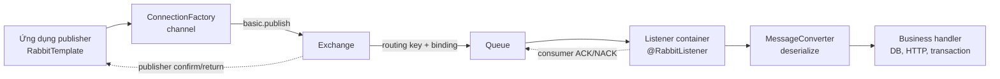
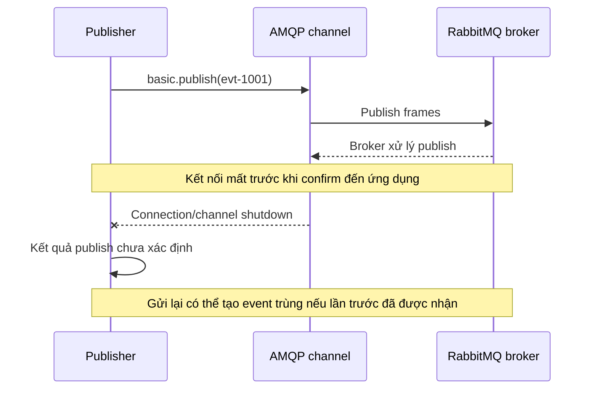
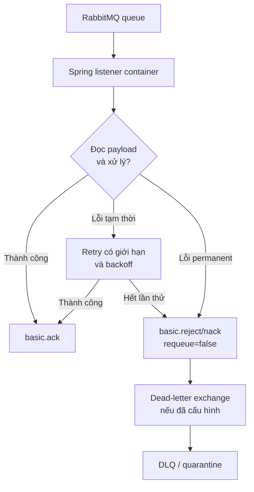
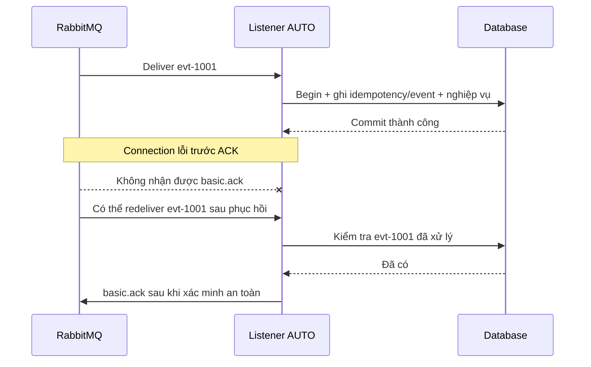

# Lỗi kết nối, lỗi chuyển đổi thông điệp và lỗi nghiệp vụ trong Spring AMQP

Một hệ thống dùng **RabbitMQ và Spring AMQP** có thể gặp lỗi ở nhiều thời điểm khác nhau: ứng dụng chưa kết nối được broker, một message đến queue nhưng không thể giải mã, hoặc `@RabbitListener` nhận payload hợp lệ rồi thất bại khi ghi database. Cả ba trường hợp có thể xuất hiện trong log dưới dạng exception, nhưng **không nên áp dụng cùng một chiến lược retry**.

Ví dụ, service xử lý đơn hàng nhận sự kiện `order.created`:

- RabbitMQ tạm thời không thể truy cập → lỗi **kết nối/hạ tầng**; cần phát hiện, khôi phục connection và tránh làm mất trạng thái publish chưa xác nhận.
- Producer gửi body không phải JSON, trong khi consumer chỉ nhận JSON → lỗi **chuyển đổi/hợp đồng dữ liệu**; retry vô hạn không tự sửa byte đã sai.
- JSON hợp lệ nhưng database của consumer đang quá tải → lỗi **nghiệp vụ hoặc phụ thuộc tạm thời**; có thể retry với backoff và giới hạn.
- JSON hợp lệ nhưng đơn hàng đã bị hủy hoặc vi phạm quy tắc → lỗi **nghiệp vụ vĩnh viễn**; cần quyết định reject, DLQ hoặc ghi nhận kết quả từ chối.

Bài học thuộc chương **Xử lý lỗi**, nằm trong phạm vi Spring AMQP: `RabbitTemplate`, `@RabbitListener`, exchange, queue, binding, xác nhận giao nhận, retry, dead-letter, giao dịch và quan sát hệ thống. Mục tiêu không chỉ là bắt exception, mà là **xác định message đang ở đâu, ai có trách nhiệm xử lý tiếp và tín hiệu nào đủ để ghi nhận thành công**.

Sau bài học, bạn có thể phân loại các nhóm lỗi theo tầng, nhận diện lỗi xảy ra trước hoặc sau khi gọi listener, cấu hình ACK/NACK và retry an toàn, xây DLQ cho poison message, rồi kiểm chứng bằng log, metrics và các bài thử lỗi có chủ đích.

## 1. Đặt lỗi vào đúng vị trí của pipeline



Trong thực tế, converter ở phía nhận được listener adapter/container gọi trước khi method nhận DTO, và connection/channel cũng tồn tại phía consumer. Sơ đồ đặt các bước theo trách nhiệm chính, không phải mô tả mọi lớp nội bộ của framework.

| Nhóm lỗi | Bước có thể gặp | Ví dụ | Có nên thử lại y nguyên? |
| --- | --- | --- | --- |
| **Kết nối/hạ tầng** | Mở TCP/TLS, xác thực, AMQP channel, publish/consume | Broker mất kết nối, network timeout, connection bị đóng | Có thể sau khi kiểm tra điều kiện, với backoff |
| **Topology/quyền** | Declare/publish/bind/consume | Exchange không tồn tại, sai vhost, `ACCESS_REFUSED` | Không retry nóng trước khi sửa cấu hình |
| **Chuyển đổi thông điệp** | Encode payload khi gửi; decode trước listener | JSON sai cú pháp, `contentType` sai, DTO không tương thích | Thường **không**, nếu payload cố định đã sai |
| **Validation/hợp đồng** | Kiểm tra dữ liệu sau decode | Thiếu `orderId`, version không hỗ trợ | Thường không; cần sửa nguồn hoặc xử lý dữ liệu lỗi |
| **Nghiệp vụ tạm thời** | Chạy listener | DB timeout, HTTP 503, lock contention | Thường có, với backoff và giới hạn |
| **Nghiệp vụ vĩnh viễn** | Chạy listener | Đơn hàng không hợp lệ, quy tắc không cho phép | Không retry cùng dữ liệu vô hạn |
| **Không rõ kết quả** | Mất connection giữa publish và confirm/ACK | Broker đã nhận nhưng ACK/confirm chưa tới caller | Cần truy vết và idempotency, không đoán |

**Một exception Java không tự cho biết broker đã nhận message hay chưa.** Muốn hiểu chính xác cần xác định **giai đoạn lỗi**, **vhost/queue**, **exchange/routing key**, **event ID** và **trạng thái xác nhận**.

## 2. Lỗi kết nối: thất bại trước, trong và sau khi giao message

RabbitMQ sử dụng connection và channel theo AMQP 0-9-1. Spring AMQP thường quản lý chúng qua `CachingConnectionFactory`; `RabbitTemplate` và listener container mượn hoặc duy trì tài nguyên tùy nhu cầu.

### 2.1. Những nguyên nhân điển hình

| Tình huống | Triệu chứng thường gặp | Điều cần kiểm tra |
| --- | --- | --- |
| Broker chưa chạy, host/port sai | Kết nối thất bại, timeout, connection refused | DNS, TCP 5672/5671, service, firewall |
| TLS hoặc credential sai | Lỗi handshake, authentication failure, connection shutdown | Truststore, hostname, user/password, TLS policy |
| Virtual host sai/không tồn tại | Kết nối vào vhost thất bại hoặc publish không thấy tài nguyên | Cấu hình `virtual-host`, quyền user |
| Mạng chập chờn | Connection đóng/mở lại, heartbeat timeout | Network path, broker logs, heartbeat, timeouts |
| Broker restart/failover | Listener reconnect, channel/consumer được khởi tạo lại | Recovery, topology, queue availability |
| Channel bị broker đóng | `404 NOT_FOUND`, `403 ACCESS_REFUSED`, `406 PRECONDITION_FAILED` tùy thao tác | Exchange/queue, quyền, khai báo tương đương |
| Broker báo thiếu tài nguyên | Connection blocked, publish chậm | Memory/disk alarms, queue backlog |
| Client hết tài nguyên | Chờ channel/connection, checkout timeout | Channel cache, concurrency, executor, số connection |

Ví dụ `NOT_FOUND - no exchange ...` khi publish vào exchange không tồn tại thường **đóng channel**, không nhất thiết đóng cả connection. Đây là lỗi topology/protocol, **không phải** message bị return vì routing key không khớp binding.

Một lỗi `PRECONDITION_FAILED` khi declare queue cùng tên nhưng durability/arguments khác cũng có thể khiến channel bị đóng; thử lại cùng declaration không thay đổi kết quả nếu không giải quyết xung đột topology.

### 2.2. Retry kết nối khác retry publish

Giả sử client gửi event `evt-1001`:



Khi connection được khôi phục, **không được tự suy luận** lần publish trước chắc chắn thất bại. Publisher confirm/return giúp theo dõi kết quả; nếu mất phản hồi, trường hợp đó có thể là **UNKNOWN**. Muốn phát lại an toàn, cần:

- Đặt **event ID ổn định** trên mỗi sự kiện nghiệp vụ.
- Với giao dịch DB tạo sự kiện, cân nhắc **transactional outbox** để giữ bản ghi chưa được xác nhận.
- Chỉ xóa/đánh dấu outbox hoàn tất theo điều kiện publish đã xác định (ví dụ confirm ACK và không có return khi routing bắt buộc).
- Thiết kế **consumer idempotency** vì publish retry có thể tạo bản trùng.
- Dùng retry với backoff, hạn mức và cảnh báo; không tạo vòng lặp vô hạn khi broker chưa sẵn sàng.

**Publisher confirm** là phản hồi cho lần publish; **consumer ACK** xác nhận một delivery sau xử lý. Chúng không thay thế nhau, cũng không tạo transaction nguyên tử với database.

### 2.3. Phục hồi listener khi mất connection

Listener container của Spring AMQP có cơ chế thiết lập lại consumer khi connection/channel bị ngắt theo điều kiện phục hồi. Tuy nhiên:

1. Lúc mất connection, delivery **chưa ACK** có thể được broker giao lại sau khi phát hiện channel đóng.
2. Listener có thể đã commit side effect trong DB trước khi ACK bị mất.
3. Container khôi phục không tự khử trùng lặp event.
4. Việc tái khai báo exchange/queue/binding tùy cấu hình `RabbitAdmin` hoặc quy trình provisioning.
5. Queue đang thiếu, quyền không đúng hoặc khai báo xung đột có thể khiến listener không khởi động/recover như mong đợi.

`missingQueuesFatal`, chiến lược recovery/backoff và cách xử lý queue lỗi là những thiết lập khác với retry xử lý **một message lỗi nghiệp vụ**. Không dùng chúng để “chữa” một message JSON sai.

### 2.4. Timeout không có một nghĩa duy nhất

| Timeout | Diễn giải |
| --- | --- |
| TCP connection timeout | Không thiết lập được kết nối tới RabbitMQ trong hạn |
| Heartbeat / socket read failure | Phát hiện kết nối đã lỗi hoặc peer không phản hồi |
| `channelCheckoutTimeout` | Chờ channel/connection từ `CachingConnectionFactory` khi cơ chế giới hạn được bật |
| Publisher confirm wait timeout | Chưa nhận xác nhận publish trong thời hạn theo dõi |
| `RabbitTemplate.replyTimeout` | Chưa nhận reply cho lời gọi request–reply/RPC |
| Listener retry backoff | Đợi giữa các lần thử xử lý message, không phải timeout mạng |

Khi điều tra, ghi lại **loại exception, cause gốc, thời điểm và API đang chạy**, không gom tất cả thành “RabbitMQ timeout”.

## 3. Lỗi chuyển đổi thông điệp: dữ liệu bị từ chối trước nghiệp vụ

Spring AMQP trao đổi body ở dạng `byte[]` và properties như `contentType`, `contentEncoding`, message ID và headers. `MessageConverter` quyết định cách chuyển giữa object Java và message.

### 3.1. Có thể lỗi ở publisher hoặc consumer

**Publisher:**

```java
// Converter được cấu hình trong RabbitTemplate biến payload thành Message.
rabbitTemplate.convertAndSend("orders.events", "order.created", event);
```

Lỗi encode có thể xảy ra **trước khi publish** nếu object không hỗ trợ converter, dữ liệu không serialize được hoặc định dạng không hợp lệ. Cần phân biệt lỗi này với lỗi broker.

**Consumer:**

```java
@RabbitListener(queues = "orders.created")
public void handle(OrderCreatedEvent event) {
    // Method chỉ được gọi khi adapter/converter đã ánh xạ được payload.
}
```

Nếu incoming body không phải JSON hợp lệ, có `contentType` sai hoặc metadata type không khớp, conversion có thể thất bại **trước khi method `handle` được gọi**. Lúc đó:

- `try/catch` **bên trong** `handle` không thể bắt exception phát sinh trước khi gọi method.
- Lỗi xuất hiện trong listener adapter/container hoặc `MessageConverter`.
- Chính sách xử lý phụ thuộc error handler, retry advice, Spring AMQP version và trạng thái ACK.
- Message có thể trở thành **poison message**: mỗi lần nhận lại đều thất bại theo cùng cách.

### 3.2. Các loại lỗi conversion phổ biến

| Lỗi | Nguyên nhân | Hành động nên làm |
| --- | --- | --- |
| Body JSON sai cú pháp | Byte bị hỏng hoặc producer gửi sai định dạng | Reject/quarantine, sửa producer |
| `contentType` sai | Gửi JSON nhưng khai báo là text hoặc Java serialization | Thống nhất converter và contract |
| Class/DTO không tương thích | Đổi tên trường, cấu trúc hoặc schema version | Versioning/migration, hỗ trợ tương thích |
| Header type không được tin cậy | Sender điều khiển type mapping không hợp lệ | Giới hạn trusted types; dùng DTO cụ thể |
| Java native deserialization không an toàn | Dữ liệu serialized object không đáng tin | Tránh Java serialization; dùng allowlist/filter khi buộc phải giữ legacy |
| Payload quá lớn | JSON sâu, mảng khổng lồ, body vượt hạn mức | Giới hạn kích thước/độ sâu trước và trong parse |
| Encoding không đúng | Byte UTF-8 nhưng consumer đọc theo encoding khác | Sửa encoding contract |
| Message có gzip nhưng chưa giải nén | Converter parse byte GZIP như JSON | Giải nén có kiểm soát trước conversion |

**Không tự thêm mọi class vào danh sách tin cậy** chỉ vì gặp lỗi deserialization. Việc đó có thể mở rộng quyền dựng object từ dữ liệu không đáng tin. Với hợp đồng mới, ưu tiên JSON/schema được kiểm soát và DTO xác định.

### 3.3. Error handler mặc định xử lý lỗi nào?

Trong các phiên bản Spring AMQP thường dùng, listener container có `ConditionalRejectingErrorHandler` làm error handler mặc định. Handler có cơ chế phân loại một số lỗi **fatal**, ví dụ lỗi chuyển đổi/đối số listener không hợp lệ, để từ chối mà không requeue nhằm tránh xử lý vô hạn một payload không thể đọc.

Tuy nhiên, **không nên coi mọi lỗi parse đều tự được đưa vào DLQ**:

- Loại lỗi được đánh giá fatal thay đổi theo chain exception và phiên bản.
- Retry advice có thể can thiệp trước khi error handler quyết định xử lý cuối.
- `defaultRequeueRejected` và các exception đặc biệt có thể điều khiển requeue.
- Queue cần **DLX và binding đúng** để broker dead-letter; nếu không message bị reject không requeue có thể mất khỏi queue chính.

Kiểm thử trực tiếp với **malformed JSON** và một DTO/schema không hỗ trợ là cách tốt hơn việc suy từ tên exception.

## 4. Lỗi nghiệp vụ: tách tạm thời khỏi vĩnh viễn

Một listener nhận message **hợp lệ về mặt cú pháp** chưa chắc đã xử lý thành công. Ví dụ: thanh toán tạm thời không truy cập được database, hoặc đơn hàng không tồn tại.

| Nhóm | Ví dụ | Hướng xử lý |
| --- | --- | --- |
| **Transient** | Database timeout, HTTP 503, network timeout tới service khác, deadlock có thể thử lại | Retry giới hạn + backoff; sau đó retry queue/DLQ hoặc cảnh báo |
| **Permanent/domain** | Order ID vô nghĩa, trạng thái không cho phép nghiệp vụ, schema version lạ | Không retry nóng; reject, DLQ/quarantine hoặc lưu kết quả từ chối |
| **Programming defect** | Null pointer, dữ liệu giả định sai trong code | Theo dõi lỗi, sửa code; không coi retry vô hạn là giải pháp |
| **Duplicate event** | Publisher gửi lại hoặc broker redelivery | Idempotency theo event ID/khóa nghiệp vụ; ACK nếu đã xử lý an toàn |
| **Unknown outcome** | DB đã commit nhưng connection RabbitMQ đóng trước ACK | Có thể redeliver; cần idempotency |

### 4.1. Trách nhiệm của listener

Một consumer có độ tin cậy cao nên:

1. Validate event ID, schema version và dữ liệu nghiệp vụ.
2. Kiểm tra xem event ID đã được xử lý chưa.
3. Thực hiện side effect dưới transaction phù hợp, **commit trước khi xác nhận delivery**.
4. Nếu xử lý thành công hoặc event đã được xử lý an toàn, để listener hoàn tất/ACK.
5. Nếu lỗi tạm thời, ném exception để retry policy có thể phân loại.
6. Nếu lỗi vĩnh viễn, quyết định đưa vào DLQ/quarantine hoặc ghi trạng thái từ chối; tránh requeue nóng.

Không có cơ chế ACK mode nào tự làm một transaction database và một ACK của RabbitMQ thành **một transaction nguyên tử end-to-end**. Một lần redelivery sau khi commit phải được xử lý idempotent.

## 5. ACK/NACK quyết định điều gì khi listener lỗi?

Ví dụ queue chính nhận event và listener dùng `AcknowledgeMode.AUTO` của Spring.



### 5.1. AUTO, MANUAL và NONE trong Spring

| Mode | Khi listener thành công | Khi listener thất bại |
| --- | --- | --- |
| **`AUTO`** | Spring container gửi ACK theo chính sách | Container/error handler/retry quyết định reject/NACK, requeue hay không |
| **`MANUAL`** | Application tự gọi `basicAck` trên đúng channel/tag | Application chủ động `basicReject`/`basicNack`; cần xử lý lỗi ACK |
| **`NONE`** | RabbitMQ tiêu thụ ở chế độ no-ack | Broker **không đợi** ACK; lỗi xử lý Java không tự làm delivery đó quay lại |

**AUTO của Spring không phải broker auto-ack.** Nếu muốn phục hồi delivery chưa xử lý sau consumer crash, AUTO/MANUAL thường phù hợp hơn NONE.

### 5.2. defaultRequeueRejected và exception điều khiển

Theo cấu hình thông thường, khi listener ném exception và không có recoverer/logic đặc biệt, container có thể reject với requeue theo `defaultRequeueRejected`.

- `defaultRequeueRejected=true` có nguy cơ **requeue vô hạn** một message lỗi vĩnh viễn.
- `defaultRequeueRejected=false` giúp reject không requeue ở giai đoạn xử lý cuối, nhưng không tạo DLQ.
- `AmqpRejectAndDontRequeueException` biểu đạt chủ đích không requeue đối với message lỗi.
- `ImmediateRequeueAmqpException` biểu đạt chủ đích requeue ngay theo cơ chế Spring listener tương ứng.

Không nên sử dụng exception requeue như một “retry vô hạn” không có giám sát. Với lỗi transient, **backoff và số lần thử hữu hạn** thường tốt hơn.

### 5.3. Thứ tự ACK ảnh hưởng tới xử lý trùng



Message có thể được xử lý **nhiều lần ở tầng delivery**, nhưng tác động nghiệp vụ có thể được làm **idempotent**. Đây là mục tiêu thực tiễn hơn so với giả định RabbitMQ luôn giao đúng một lần.

## 6. Ví dụ end-to-end: phân loại lỗi theo contract và nghiệp vụ

Thiết kế ví dụ dùng một **topic exchange** `orders.events`, queue `orders.processing`, routing key `order.created`, dead-letter exchange `orders.dlx` và DLQ `orders.processing.dlq`.

### 6.1. Khai báo exchange, queue, binding, DLX và DLQ

```java
import org.springframework.amqp.core.Binding;
import org.springframework.amqp.core.BindingBuilder;
import org.springframework.amqp.core.DirectExchange;
import org.springframework.amqp.core.ExchangeBuilder;
import org.springframework.amqp.core.Queue;
import org.springframework.amqp.core.QueueBuilder;
import org.springframework.amqp.core.TopicExchange;
import org.springframework.context.annotation.Bean;
import org.springframework.context.annotation.Configuration;

@Configuration
public class OrderMessagingTopology {
    public static final String EVENTS = "orders.events";
    public static final String PROCESSING = "orders.processing";
    public static final String ROUTING_KEY = "order.created";
    public static final String DLX = "orders.dlx";
    public static final String DLQ = "orders.processing.dlq";

    @Bean
    TopicExchange ordersEvents() {
        return ExchangeBuilder.topicExchange(EVENTS)
                .durable(true).build();
    }

    @Bean
    DirectExchange ordersDlx() {
        return ExchangeBuilder.directExchange(DLX)
                .durable(true).build();
    }

    @Bean
    Queue ordersProcessing() {
        return QueueBuilder.durable(PROCESSING)
                .deadLetterExchange(DLX)
                .deadLetterRoutingKey("order.failed")
                .build();
    }

    @Bean
    Queue ordersProcessingDlq() {
        return QueueBuilder.durable(DLQ).build();
    }

    @Bean
    Binding ordersProcessingBinding(
            Queue ordersProcessing, TopicExchange ordersEvents) {
        return BindingBuilder.bind(ordersProcessing)
                .to(ordersEvents).with(ROUTING_KEY);
    }

    @Bean
    Binding ordersDlqBinding(
            Queue ordersProcessingDlq, DirectExchange ordersDlx) {
        return BindingBuilder.bind(ordersProcessingDlq)
                .to(ordersDlx).with("order.failed");
    }
}
```

Các bean là mô tả topology. Chúng chỉ được khai báo tại RabbitMQ khi `RabbitAdmin` hoặc quy trình provisioning chạy phù hợp; **phải cùng virtual host** với publisher và consumer.

Trong production, chính sách DLX bằng **RabbitMQ policy** thường dễ thay đổi hơn so với queue arguments cố định. Khi dùng queue arguments như ví dụ, việc đổi chúng trên một queue đã tồn tại có thể yêu cầu kế hoạch migration; không xóa queue đang có dữ liệu để “sửa cho nhanh”.

### 6.2. Message contract

Để tránh native Java serialization, ví dụ gửi **JSON** và consumer đọc vào DTO cụ thể:

```java
public record OrderCreatedEvent(
        String eventId,
        String orderId,
        int schemaVersion
) {}
```

Event ID cần ổn định qua lần phát lại cùng một sự kiện. Consumer phải validate version và các trường bắt buộc; converter thành công không có nghĩa message đúng nghiệp vụ.

### 6.3. Publisher tạo JSON và ghi metadata

```java
import com.fasterxml.jackson.core.JsonProcessingException;
import com.fasterxml.jackson.databind.ObjectMapper;
import org.springframework.amqp.core.Message;
import org.springframework.amqp.core.MessageBuilder;
import org.springframework.amqp.core.MessageDeliveryMode;
import org.springframework.amqp.core.MessageProperties;
import org.springframework.amqp.rabbit.core.RabbitTemplate;
import org.springframework.stereotype.Service;

@Service
public class OrderEventPublisher {
    private final ObjectMapper mapper;
    private final RabbitTemplate template;

    public OrderEventPublisher(ObjectMapper mapper, RabbitTemplate template) {
        this.mapper = mapper;
        this.template = template;
    }

    public void publish(OrderCreatedEvent event)
            throws JsonProcessingException {
        byte[] json = mapper.writeValueAsBytes(event);

        Message message = MessageBuilder.withBody(json)
                .setContentType(MessageProperties.CONTENT_TYPE_JSON)
                .setContentEncoding("UTF-8")
                .setMessageId(event.eventId())
                .setDeliveryMode(MessageDeliveryMode.PERSISTENT)
                .setHeader("schemaVersion", event.schemaVersion())
                .build();

        template.send(
                OrderMessagingTopology.EVENTS,
                OrderMessagingTopology.ROUTING_KEY,
                message);
    }
}
```

Ở đây publisher **chủ động serialize JSON**; nếu JSON serializer không thể xử lý object, lỗi xuất hiện ở publisher trước khi gửi. Còn lỗi network/publish có thể đến từ `RabbitTemplate.send` hoặc được quan sát **bất đồng bộ** qua publisher confirm/channel shutdown.

**Gửi không đồng nghĩa broker đã nhận bền vững.** Nếu cần bảo đảm, bật correlated publisher confirms, returns và mandatory phù hợp với hợp đồng routing, rồi xử lý kết quả.

### 6.4. Consumer parse JSON và phân loại lỗi

Ví dụ listener nhận `Message` trực tiếp để **chủ động xác định ranh giới conversion**. Điều này tránh việc converter tự ánh xạ DTO trước khi method chạy; với listener nhận DTO trực tiếp, lỗi parse có thể nằm ngoài method.

```java
import com.fasterxml.jackson.databind.ObjectMapper;
import java.io.IOException;
import org.springframework.amqp.AmqpRejectAndDontRequeueException;
import org.springframework.amqp.core.Message;
import org.springframework.amqp.core.MessageProperties;
import org.springframework.amqp.rabbit.annotation.RabbitListener;
import org.springframework.stereotype.Component;

@Component
public class OrderProcessingListener {
    private final ObjectMapper mapper;
    private final OrderProcessingService service;

    public OrderProcessingListener(
            ObjectMapper mapper, OrderProcessingService service) {
        this.mapper = mapper;
        this.service = service;
    }

    @RabbitListener(
            queues = OrderMessagingTopology.PROCESSING,
            containerFactory = "ordersListenerFactory")
    public void onMessage(Message message) {
        MessageProperties properties = message.getMessageProperties();

        if (!MessageProperties.CONTENT_TYPE_JSON
                .equals(properties.getContentType())) {
            throw new AmqpRejectAndDontRequeueException(
                    "Unsupported content type: " + properties.getContentType());
        }

        final OrderCreatedEvent event;
        try {
            event = mapper.readValue(
                    message.getBody(), OrderCreatedEvent.class);
        } catch (IOException malformed) {
            throw new AmqpRejectAndDontRequeueException(
                    "Invalid JSON event", malformed);
        }

        if (event.eventId() == null || event.eventId().isBlank()
                || event.orderId() == null || event.orderId().isBlank()
                || event.schemaVersion() != 1) {
            throw new AmqpRejectAndDontRequeueException(
                    "Invalid or unsupported event contract");
        }

        // Service phải tự quản lý transaction và idempotency.
        // Nếu DB/service tạm thời lỗi, exception được propagate.
        service.process(event);
    }
}
```

`OrderProcessingService` trong ví dụ là **service nghiệp vụ** do ứng dụng hiện thực: nó nên xử lý event ID idempotent và commit DB trước khi method listener thành công. Không nên thay đoạn này bằng thao tác side effect chạy nền rồi trả về ngay khi container dùng AUTO.

**Chú ý khi thêm retry advice:** một interceptor thử lại chung có thể thử cả `AmqpRejectAndDontRequeueException` trước khi nó tới container. Muốn tránh lãng phí với lỗi vĩnh viễn, cần thiết kế **retry classifier/policy** chỉ retry exception transient; không suy diễn rằng riêng việc ném exception “dont requeue” luôn khiến mọi tầng retry bỏ qua ngay.

### 6.5. Cấu hình listener theo hướng fail-safe

Ví dụ dùng `SimpleRabbitListenerContainerFactory` với Spring-managed ACK và reject không requeue ở bước cuối:

```java
import org.springframework.amqp.core.AcknowledgeMode;
import org.springframework.amqp.rabbit.config.SimpleRabbitListenerContainerFactory;
import org.springframework.amqp.rabbit.connection.ConnectionFactory;
import org.springframework.context.annotation.Bean;
import org.springframework.context.annotation.Configuration;

@Configuration
public class OrderListenerConfiguration {

    @Bean("ordersListenerFactory")
    public SimpleRabbitListenerContainerFactory ordersListenerFactory(
            ConnectionFactory connectionFactory) {
        SimpleRabbitListenerContainerFactory factory =
                new SimpleRabbitListenerContainerFactory();
        factory.setConnectionFactory(connectionFactory);
        factory.setAcknowledgeMode(AcknowledgeMode.AUTO);
        factory.setConcurrentConsumers(2);
        factory.setPrefetchCount(10);
        factory.setDefaultRequeueRejected(false);
        return factory;
    }
}
```

Cấu hình trên **chưa bật retry**: exception không được một tầng recovery thích hợp xử lý có thể dẫn tới reject/NACK không requeue, rồi vào DLX nếu topology ở phần 6.1 tồn tại.

Đây là điểm bắt đầu để thử **phân loại lỗi**. Với transient exception, một hệ thống thực tế có thể gắn Spring Retry advice có classifier, hoặc chuyển message vào retry queue có TTL/backoff. Không tự cho rằng `defaultRequeueRejected=false` là chiến lược retry.

### 6.6. Cấu hình Spring Boot

Ví dụ cấu hình kết nối và quan sát publish cho ứng dụng ở trên:

```yaml
# application.yml
spring:
  rabbitmq:
    host: ${RABBITMQ_HOST:localhost}
    port: ${RABBITMQ_PORT:5672}
    virtual-host: ${RABBITMQ_VHOST:/orders}
    username: ${RABBITMQ_USERNAME}
    password: ${RABBITMQ_PASSWORD}
    publisher-confirm-type: correlated
    publisher-returns: true
    template:
      mandatory: true
    listener:
      simple:
        acknowledge-mode: auto
        prefetch: 10
```

Vhost `/orders` cần tồn tại và user phải có quyền khai báo/publish/consume phù hợp. Vì listener ví dụ đã chỉ định `containerFactory="ordersListenerFactory"`, cấu hình factory Java là nguồn quyết định cho endpoint đó; **không giả định mọi thuộc tính `listener.simple.*` sẽ tự được áp dụng lên một factory ứng dụng tạo thủ công**.

Nếu dùng auto-configured factory của Spring Boot, có thể thiết lập `spring.rabbitmq.listener.simple.default-requeue-rejected` và nhóm `listener.simple.retry.*`; tuy nhiên cần kiểm tra **tên property, policy và phiên bản đang chạy**. Cấu hình retry generic có thể thử cả lỗi permanent nếu không có classifier.

## 7. Thiết kế retry: bao nhiêu lần, chờ bao lâu, thử ở đâu?

Có ít nhất ba địa điểm có thể retry:

1. **Publisher retry:** khi chưa thể gửi hoặc kết quả publish chưa xác định.
2. **Listener retry cục bộ:** thử lại nghiệp vụ trên cùng delivery trong process consumer trước khi ACK/NACK.
3. **Broker-delayed retry:** chuyển message qua retry queue/exchange với TTL/DLX hoặc cơ chế trì hoãn đã được thiết kế, sau đó giao lại.

Chúng có **ngữ nghĩa khác nhau** và không nên cộng bừa tất cả cơ chế, vì số lần thực hiện side effect có thể bùng nổ.

### 7.1. Retry cục bộ với Spring Retry

Spring AMQP hỗ trợ advice chain để chèn interceptor retry vào listener container. Đoạn cấu hình minh họa:

```java
import org.springframework.amqp.rabbit.config.SimpleRabbitListenerContainerFactory;
import org.springframework.amqp.rabbit.connection.ConnectionFactory;
import org.springframework.amqp.rabbit.retry.RejectAndDontRequeueRecoverer;
import org.springframework.amqp.rabbit.config.RetryInterceptorBuilder;

SimpleRabbitListenerContainerFactory factory =
        new SimpleRabbitListenerContainerFactory();
factory.setConnectionFactory(connectionFactory);
factory.setDefaultRequeueRejected(false);

factory.setAdviceChain(
        RetryInterceptorBuilder.stateless()
                .maxAttempts(3)
                .backOffOptions(1_000L, 2.0, 5_000L)
                .recoverer(new RejectAndDontRequeueRecoverer())
                .build()
);
```

Đây là một đoạn **minh họa cấu hình**, không phải factory bean hoàn chỉnh. Mặc định kiểu retry trên có thể thử lại **nhiều loại exception**, bao gồm cả lỗi dữ liệu vĩnh viễn. Với sản phẩm thật, cần bổ sung classifier/policy, giới hạn số attempt phù hợp, logging, metrics và test để tránh retry poison message.

`maxAttempts(3)` bao gồm **lần xử lý ban đầu** và các lần thử lại; không nên ghi nhận nhầm là “thêm ba lần” ngoài lần đầu. `backOffOptions` ở đây minh họa thời gian chờ theo mili giây với hệ số tăng và mức tối đa. Các builder/API phụ thuộc phiên bản Spring AMQP và Spring Retry đang dùng.

### 7.2. Retry và backoff là công cụ, không phải nguồn đảm bảo duy nhất

- **Lỗi transient** có thể hồi phục nếu đợi vài trăm mili giây hoặc vài giây.
- **Lỗi permanent** không thể được chữa chỉ bằng cách chờ.
- **Lỗi hệ thống kéo dài** có thể gây bão retry; giới hạn số lần, delay, concurrency và circuit breaker giúp giảm tải.
- **Khi retry cục bộ chạy**, delivery có thể vẫn đang **unacked**, chiếm prefetch slot và tài nguyên consumer.
- **Retry broker** giải phóng consumer nhưng đòi hỏi topology/properties đúng; thao tác dead-letter/re-publish phải theo dõi độ tin cậy phù hợp.

Với lỗi transient kéo dài hàng phút, việc giữ một consumer thread chờ lâu có thể không hiệu quả. Có thể chọn retry queue có TTL/backoff, hoặc quản lý job state trong DB.

### 7.3. Dead-letter không đồng nghĩa “retry tự động”

RabbitMQ có thể dead-letter khi message bị reject/nack không requeue, hết TTL, queue vượt giới hạn, hoặc một số giới hạn delivery của queue type. Nếu DLX route vào DLQ, nó chỉ **chuyển nơi chứa message**. Muốn phát lại, ứng dụng hoặc quy trình vận hành phải có chính sách rõ ràng.

Khi thiết kế retry loop bằng DLX/TTL cần tránh:

- Chu trình queue A → retry queue → A không giới hạn số lần.
- Thử lại message lỗi schema vĩnh viễn.
- Mất thông tin event ID, correlation ID hoặc tăng attempt count không nhất quán.
- Tạo thông lượng DLX lớn làm quá tải broker.
- Nhầm header `x-death` do RabbitMQ bổ sung với trạng thái nghiệp vụ duy nhất để chống trùng.

**DLQ là nơi cách ly và quan sát lỗi cuối**, không phải kho rác để bỏ quên message quan trọng.

## 8. Phân biệt error handler và exception ở từng ranh giới

### 8.1. try/catch trong listener chỉ bắt được lỗi sau khi listener bắt đầu

```java
@RabbitListener(queues = "orders.processing")
public void process(OrderCreatedEvent event) {
    try {
        domainService.process(event);
    } catch (TemporaryDatabaseException ex) {
        // Có thể log với eventId rồi propagate để container xử lý.
        throw ex;
    }
}
```

Nếu converter không thể tạo `OrderCreatedEvent`, code trong method **không chạy**. Muốn xử lý conversion error, cấu hình message converter, container error handler và đường DLQ/monitoring ở đúng lớp.

Không bắt `Exception` rồi chỉ log và trả về bình thường trên listener AUTO; như vậy container có thể coi message **đã xử lý thành công** và ACK, dù nghiệp vụ thất bại.

### 8.2. ConditionalRejectingErrorHandler và RabbitListenerErrorHandler không giống nhau

- **`ConditionalRejectingErrorHandler`:** xử lý lỗi ở cấp container, bao gồm khả năng phân loại một số lỗi fatal; thường liên quan đến chính sách reject/no-requeue.
- **`RabbitListenerErrorHandler`:** cơ chế tùy chỉnh lỗi ở lớp adapter của endpoint annotation trong những ngữ cảnh hỗ trợ; không thay thế toàn bộ error handler ở container và không bảo đảm bắt được mọi lỗi trước khi tạo listener invocation.
- **Spring Retry advice/recoverer:** can thiệp vào quá trình thử lại listener, có thể quyết định kết thúc bằng exception/reject khi hết lần thử.
- **`RabbitTemplate` publish exception/confirm callback:** thuộc phía gửi, không được xử lý bởi listener error handler.

Không viết một global handler chung để tùy tiện trả về “thành công” cho mọi lỗi; điều đó thường biến lỗi nghiêm trọng thành **ACK mất message**.

### 8.3. MANUAL ACK đòi hỏi trách nhiệm lớn hơn

Nếu chuyển factory sang `AcknowledgeMode.MANUAL`, ứng dụng phải ACK/NACK đúng `deliveryTag` trên **channel nhận**. Delivery đã ACK không thể được NACK lần nữa. Một code path quên ACK có thể giữ message unacked cho tới khi channel đóng; ACK sai tag có thể đóng channel.

Với Spring AUTO, nên giữ listener đồng bộ đơn giản trước, chỉ dùng MANUAL khi có yêu cầu ranh giới ACK rõ ràng và kiểm thử lỗi kỹ.

## 9. Quan sát: xác định lỗi ở client, broker hay nghiệp vụ

Một báo cáo lỗi hữu ích nên có:

| Trường/metric | Ý nghĩa |
| --- | --- |
| Event ID, correlation ID, schema version | Ghép log xuyên publisher–consumer và nhận diện gửi trùng |
| Exchange, routing key, queue, virtual host | Phân biệt routing, topology và lỗi consume |
| Connection/channel shutdown reason | Chẩn đoán network, permission, `404 NOT_FOUND`, `406 PRECONDITION_FAILED` |
| Publisher confirm ACK/NACK/timeout, returns | Trạng thái phía gửi; trả lời broker đã tiếp nhận/routing ra sao |
| Consumer `messages_ready` / `messages_unacknowledged` | Backlog và delivery chưa ACK |
| Retry count / redelivery / DLQ depth | Phát hiện poison message và vòng lặp retry |
| Parse/validation error count | Biết producer đang gửi không đúng contract |
| Business latency, DB timeout, external 5xx | Xác định nút thắt sau khi parse |
| Consumer count, prefetch, ACK rate | Đánh giá throughput và khả năng xử lý |

RabbitMQ Management UI, logs của Spring và RabbitMQ server, Micrometer/Actuator nếu có, và dashboard riêng bổ sung cho nhau. Một mình `messages_ready=0` không chứng minh mọi event đã được xử lý thành công: message có thể đã ACK, đã bị dead-letter hoặc đang ở `unacked`.

### 9.1. Một số lệnh RabbitMQ CLI

```bash
# Quan sát exchange, queue, binding theo vhost thử nghiệm
rabbitmqctl list_exchanges -p /orders name type durable
rabbitmqctl list_bindings -p /orders source_name destination_name routing_key
rabbitmqctl list_queues -p /orders name messages_ready messages_unacknowledged consumers

# Kiểm tra connection/channel trên broker
rabbitmqctl list_connections name user vhost state channels
rabbitmqctl list_channels connection number consumer_count messages_unacknowledged
```

Phải có quyền quản trị phù hợp để chạy các lệnh trên. Khi listener hoạt động nhanh, snapshot từ CLI có thể không bắt được mọi biến động; kết hợp log theo event ID và metrics khoảng thời gian thay vì chỉ một lần đọc.

### 9.2. Bảng chẩn đoán nhanh

| Triệu chứng | Khả năng nguyên nhân | Kiểm tra trước tiên |
| --- | --- | --- |
| Publisher thỉnh thoảng timeout | Mạng, broker blocked, confirm chậm, channel pool chờ | Connection logs, resource alarms, loại timeout |
| Log `NOT_FOUND - no exchange` | Tên exchange sai hoặc không có trong vhost | `list_exchanges`, vhost và quyền |
| Listener không được gọi nhưng có queue backlog | Queue/consumer chưa sẵn sàng hoặc converter lỗi trước method | Consumer count, listener startup, error handler |
| Message vào queue rồi đi thẳng DLQ | Fatal conversion/validation, policy reject không requeue | DLQ headers, stack trace, schema và content type |
| Cùng message lặp lại liên tục | Requeue nóng, retry loop hoặc publisher gửi trùng | Retry policy, ACK/NACK, event ID và `x-death` |
| Queue có nhiều `unacked` | Handler chậm, prefetch cao, ACK/transaction chưa xong | DB latency, listener threads, channel status |
| DB đã ghi nhưng message xuất hiện lần nữa | ACK bị mất hoặc publisher retry | Event ID, commit transaction và idempotency |
| Message lỗi bị “mất” | Reject không requeue nhưng không có DLX phù hợp, hoặc dùng no-ack | Queue arguments/policy và ACK mode |
| Lỗi khi giải tuần tự object Java | Converter/format không tương thích hoặc deserialize bị chặn | Converter, contentType, allowlist, classpath |
| Sự cố tăng mạnh sau scale consumer | Pool DB/client, channel/thread hoặc broker quá tải | Concurrency, CPU, cache, prefetch và downstream limits |

## 10. Kịch bản kiểm thử trước khi vận hành thật

Dùng **vhost thử nghiệm** và các event ID phân biệt được. Đừng xóa queue production hoặc tắt broker thật để tái hiện lỗi.

### 10.1. Bộ test đề xuất

| Tình huống | Cách làm | Kết quả cần xác nhận |
| --- | --- | --- |
| Broker không truy cập được | Dừng broker thử nghiệm hoặc chặn kết nối | Publisher báo lỗi/kết quả chưa xác định; listener reconnect sau phục hồi |
| Sai credential/vhost | Sửa cấu hình ở môi trường test | Có lỗi rõ ràng, không retry nóng không giới hạn |
| Exchange không tồn tại | Publish tới tên sai có chủ đích | Broker đóng channel với `404 NOT_FOUND`; phân biệt lỗi routing return |
| Sai routing key | Exchange tồn tại, không có binding khớp | Với mandatory/returns, nhận returned message; không nhầm lỗi channel |
| JSON sai cú pháp | Gửi body malformed với `contentType=application/json` | Conversion/validation bị từ chối, policy DLQ được kiểm chứng |
| DTO/schema không hỗ trợ | Gửi event version lạ | Không retry nóng; ghi nhận và cách ly |
| DB lỗi tạm thời | Mô phỏng connection timeout trong service | Retry có giới hạn/backoff, rồi recover hoặc DLQ |
| Nghiệp vụ vĩnh viễn | Order ID không hợp lệ | Không chạy lại vô hạn cùng payload |
| Consumer crash trước ACK | Ngắt process test sau DB commit nhưng trước ACK | Message có thể redeliver; idempotency tránh side effect lặp |
| Retry publisher sau confirm timeout | Giả lập mất phản hồi confirm | Có khả năng event trùng; ID ổn định và consumer idempotent |
| Queue thiếu DLX | Reject không requeue trong môi trường tách biệt | Xác nhận điều gì bị drop; lập lại topology DLQ đúng |
| Backlog và quá tải | Gửi nhanh hơn tốc độ xử lý | Theo dõi ready/unacked, consumer throughput, latency, tài nguyên |

### 10.2. Trình tự phân tích khi có lỗi thực tế

1. **Khoanh vùng:** lỗi phía publisher, broker, conversion, listener hay downstream?
2. **Xác định message:** event ID, exchange/routing key, queue, vhost và thời điểm.
3. **Xác định trạng thái:** publish confirm/return, queue ready/unacked, ACK/NACK, DLQ.
4. **Phân loại:** lỗi transient, permanent, topology hay unknown outcome?
5. **Chọn hành động:** sửa cấu hình, retry có backoff, cách ly message, đối soát hoặc phát lại.
6. **Kiểm tra tác dụng phụ:** có thể đã commit DB/gửi email chưa? có idempotency?
7. **Chặn tái phát:** bổ sung validation, policy, alert, kiểm thử hồi quy và giới hạn tài nguyên.

Không sửa lỗi bằng cách tắt ACK, tăng retry vô hạn hoặc nuốt exception. Các cách đó thường che khuất nguyên nhân và làm việc phục hồi message khó hơn.

## 11. Checklist thiết kế xử lý lỗi

- [ ] Biết nơi exception xuất hiện: publisher, network/channel, converter trước listener hay business handler.
- [ ] Phân biệt publish confirm, publisher return và consumer ACK/NACK.
- [ ] Phân biệt lỗi topology/permission với lỗi kết nối tạm thời; không retry y nguyên tên exchange sai.
- [ ] Không coi timeout confirm hoặc connection drop là bằng chứng chắc chắn message chưa tới broker.
- [ ] Có hợp đồng định dạng payload, `contentType`/encoding và schema version rõ ràng.
- [ ] Không giải tuần tự Java object không tin cậy; dùng DTO/JSON và validation phù hợp.
- [ ] Kiểm tra lỗi xảy ra **trước method `@RabbitListener`** bằng test với message sai.
- [ ] Phân loại transient/permanent; retry chỉ loại có khả năng hồi phục, có backoff và giới hạn.
- [ ] Biết Spring `AUTO` gửi ACK theo kết quả listener; broker auto-ack tương ứng Spring `NONE`.
- [ ] Cấu hình queue DLX/DLQ đúng vhost và binding; không chỉ đặt `defaultRequeueRejected=false`.
- [ ] Chống vòng lặp retry nóng và lưu thông tin event ID/attempt count hợp lý.
- [ ] Commit side effect dưới transaction phù hợp, dùng idempotency khi redelivery hoặc gửi trùng.
- [ ] Nếu sự kiện bắt buộc được publish sau commit DB, cân nhắc transactional outbox.
- [ ] Quan sát queue ready/unacked, channel errors, publisher confirm, retry, DLQ và business latency.
- [ ] Diễn tập broker unavailable, malformed payload, DB timeout, consumer crash và replay có kiểm soát.

**Ghi nhớ:** Lỗi **kết nối** cần phục hồi tài nguyên và xử lý trạng thái publish/ACK có thể chưa xác định; lỗi **chuyển đổi thông điệp** thường là lỗi contract không nên retry mãi; lỗi **nghiệp vụ** cần phân loại tạm thời/vĩnh viễn trước khi chọn retry, reject hoặc DLQ. Trong Spring AMQP, xử lý lỗi đáng tin cậy là sự kết hợp của topology đúng, xác nhận publisher/consumer, giới hạn retry, dead-letter, idempotency, giao dịch nghiệp vụ và quan sát từng ranh giới, chứ không phải một khối `try/catch` dùng chung.

### Tài liệu tham khảo

- [Spring AMQP — Exception Handling](https://docs.spring.io/spring-amqp/reference/amqp/exception-handling.html)
- [Spring AMQP — Listener Container Attributes](https://docs.spring.io/spring-amqp/reference/amqp/containerAttributes.html)
- [Spring AMQP — Receiving Messages with Listeners](https://docs.spring.io/spring-amqp/reference/amqp/receiving-messages/async-annotation-driven.html)
- [Spring AMQP — Resilience and Recovering from Errors](https://docs.spring.io/spring-amqp/reference/amqp/resilience-recovering-from-errors-and-broker-failures.html)
- [Spring AMQP — Message Converters](https://docs.spring.io/spring-amqp/reference/amqp/message-converters.html)
- [Spring AMQP API — ConditionalRejectingErrorHandler](https://docs.spring.io/spring-amqp/api/org/springframework/amqp/rabbit/listener/ConditionalRejectingErrorHandler.html)
- [RabbitMQ — Consumer Acknowledgements and Publisher Confirms](https://www.rabbitmq.com/docs/confirms)
- [RabbitMQ — Dead Letter Exchanges](https://www.rabbitmq.com/docs/dlx)
- [RabbitMQ — Connections](https://www.rabbitmq.com/docs/connections)
- [RabbitMQ — Reliability Guide](https://www.rabbitmq.com/docs/reliability)

