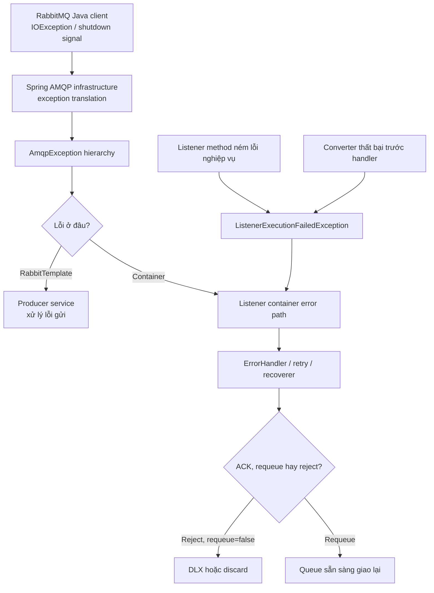
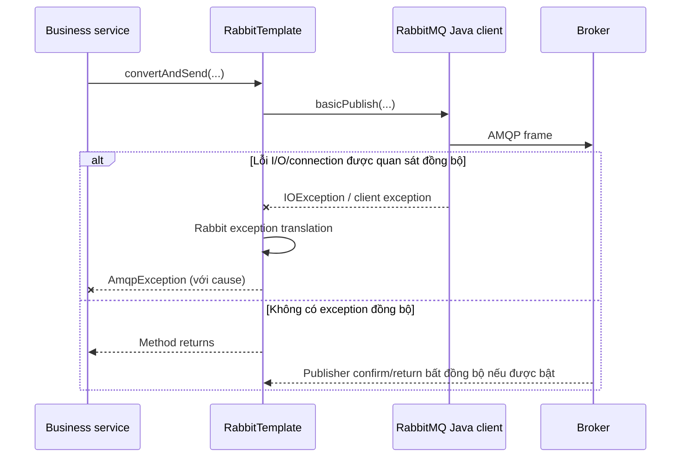
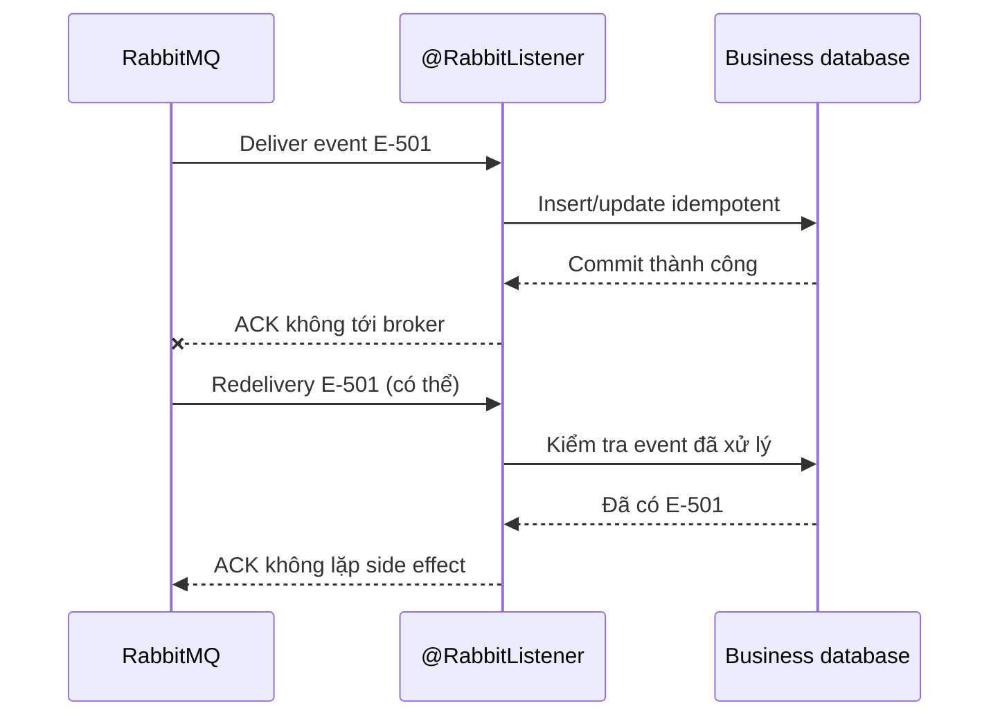

# AmqpException và cơ chế chuyển đổi exception

Khi ứng dụng Spring AMQP giao tiếp với RabbitMQ, cùng một sự cố có thể xuất hiện dưới nhiều dạng: `IOException` của RabbitMQ Java client, `AmqpConnectException` tại `RabbitTemplate`, `ListenerExecutionFailedException` trong listener container, hoặc `MessageConversionException` trước khi phương thức `@RabbitListener` được gọi. Nếu chỉ bắt `Exception` và retry tất cả, hệ thống dễ rơi vào vòng lặp phát lại message, che giấu lỗi cấu hình hoặc đánh dấu nhầm một thao tác chưa thành công là đã hoàn tất.

Bài thuộc chương **Xử lý lỗi** của module **SPRING_AMQP**. Nội dung tập trung vào **`org.springframework.amqp.AmqpException` và cơ chế exception translation** — cách Spring chuyển lỗi cấp thấp của RabbitMQ thành các runtime exception có ngữ nghĩa AMQP, và cách phân biệt bước chuyển đổi này với **error handling** trong listener. Ví dụ liên hệ với `RabbitTemplate`, `@RabbitListener`, exchange, queue, binding, ACK/NACK, retry, dead-letter, giao dịch và giám sát để thiết kế luồng bất đồng bộ đáng tin cậy.

Sau khi học xong, bạn có thể:

- Giải thích vì sao `AmqpException` là unchecked exception và vì sao Spring chuyển lỗi của RabbitMQ Java client vào hệ thống exception thống nhất.
- Nhận biết các lớp như `AmqpConnectException`, `AmqpIOException`, `AmqpAuthenticationException`, `AmqpTimeoutException` và `UncategorizedAmqpException`.
- Đọc chuỗi nguyên nhân `getCause()` và thông tin channel/broker để chẩn đoán thay vì đoán chỉ từ tên exception.
- Phân biệt exception tại **producer**, **converter**, **listener adapter**, **listener method** và **listener container**.
- Sử dụng `AmqpRejectAndDontRequeueException` và `ImmediateRequeueAmqpException` khi muốn điều khiển việc requeue message.
- Hiểu vai trò của `ConditionalRejectingErrorHandler`, `FatalExceptionStrategy`, retry/recoverer và DLX.
- Viết integration test kiểm chứng lỗi mạng, payload hỏng, lỗi nghiệp vụ, ACK/requeue và phục hồi khi broker hoạt động lại.

> **Phiên bản:** Các ví dụ dùng Java 17+, Spring Boot 3.x / Spring AMQP 3.x với RabbitMQ qua AMQP 0-9-1. Lớp và API có thể thay đổi theo phiên bản Spring AMQP; đối chiếu Javadoc đúng phiên bản dự án. Những mẫu mô phỏng mất kết nối, xóa queue hoặc tạo lỗi chỉ chạy trên RabbitMQ **thử nghiệm**, không chạy trên hệ thống production đang có message quan trọng.

## 1. Trước tiên phân biệt ba việc: translation, handling và recovery

Ba khái niệm nghe tương tự nhưng nằm ở các lớp khác nhau:

| Khái niệm | Đầu vào | Kết quả | Ví dụ |
| --- | --- | --- | --- |
| **Exception translation** | Lỗi thư viện RabbitMQ Java client, thường là checked exception hoặc lỗi giao thức. | Một runtime exception trong hệ thống Spring AMQP, giữ thông tin nguyên nhân khi có thể. | `IOException` → một `AmqpException` cụ thể. |
| **Exception handling** | Exception từ listener, converter hoặc container. | Quyết định log, phân loại fatal, reject/requeue, gọi recoverer hoặc ném tiếp. | `ConditionalRejectingErrorHandler` phân loại lỗi chuyển đổi dữ liệu. |
| **Recovery/retry** | Thao tác hoặc message đã thất bại. | Thử lại có giới hạn, chuyển DLQ, sửa cấu hình hoặc báo lỗi nghiệp vụ. | Retry với backoff rồi reject `requeue=false`. |



**Điểm cốt lõi:** Translation **không tự quyết định retry hay DLQ**. Một `AmqpConnectException` làm phương thức publish thất bại không đồng nghĩa broker đã trả NACK. Một `ListenerExecutionFailedException` cũng không đồng nghĩa message chắc chắn sẽ được requeue; container còn xét các signal exception, error handler và acknowledge mode.

## 2. `AmqpException` là gì?

`AmqpException` nằm trong package `org.springframework.amqp` và **kế thừa `RuntimeException`**. Đây là lớp nền để các thành phần Spring AMQP ném lỗi mà không buộc mọi method ở tầng ứng dụng phải khai báo `throws IOException` hoặc `throws TimeoutException` cho từng chi tiết của RabbitMQ client.

```java
import org.springframework.amqp.AmqpException;
import org.springframework.amqp.rabbit.core.RabbitTemplate;

public class OrderEventSender {
    private final RabbitTemplate template;

    public OrderEventSender(RabbitTemplate template) {
        this.template = template;
    }

    public void send(String orderId) {
        try {
            template.convertAndSend(
                    "orders.events.x", "order.created", orderId);
        } catch (AmqpException ex) {
            // Thao tác local publish gặp lỗi tại thời điểm gọi.
            // Cần ghi nhận event chưa xác nhận, không coi là đã gửi.
            throw new IllegalStateException(
                    "Không thể phát sự kiện order.created", ex);
        }
    }
}
```

`AmqpException` là unchecked nên `catch` là **tùy chọn**, không bắt buộc về mặt cú pháp. Khi bắt, cần gắn mục tiêu rõ: ghi log có context, chuyển lỗi sang contract domain, cho phép retry có kiểm soát hoặc trả trạng thái bất đồng bộ. Đừng nuốt exception rồi đánh dấu business event đã publish thành công.

### 2.1. Một số subclass thường gặp

| Class | Ý nghĩa tiêu biểu | Bước tiếp theo |
| --- | --- | --- |
| `AmqpConnectException` | Lỗi kết nối tới broker; có thể bọc `ConnectException`. | Kiểm tra network, host, port, broker availability; retry có backoff nếu hợp lý. |
| `AmqpIOException` | Lỗi I/O từ hoạt động AMQP được bọc lại. | Đọc `cause`, xem connection/channel đã đóng chưa, không giả định luôn retry được. |
| `AmqpAuthenticationException` | Lỗi xác thực khi kết nối broker. | Kiểm tra credentials/TLS/vhost; thường cần sửa cấu hình trước khi retry. |
| `AmqpTimeoutException` | Một thao tác có giới hạn thời gian không hoàn tất đúng hạn. | Trạng thái có thể chưa rõ; không tự kết luận broker chưa nhận message. |
| `AmqpResourceNotAvailableException` | Resource cần thiết không khả dụng trong hoạt động đang thực hiện. | Kiểm tra channel/connection/resource và sức khỏe broker. |
| `AmqpIllegalStateException` | Trạng thái thực thi không hợp lệ cho thao tác AMQP. | Xác minh lifecycle, cấu hình container/template. |
| `AmqpUnsupportedEncodingException` | Mã hóa ký tự không được hỗ trợ trong luồng thao tác. | Sửa content encoding, converter và hợp đồng payload. |
| `UncategorizedAmqpException` | Lỗi không phù hợp một nhánh cụ thể hơn. | Xem cause chain và broker shutdown reason; không phân loại theo class một cách mù quáng. |
| `AmqpRejectAndDontRequeueException` | Signal đặc biệt của listener yêu cầu reject, không requeue. | Phù hợp lỗi không nên retry ngay; dùng DLX nếu cần lưu dữ liệu lỗi. |
| `ImmediateRequeueAmqpException` | Signal đặc biệt của listener yêu cầu requeue. | Chỉ dùng khi retry tức thời không gây vòng lặp hoặc tăng tải vô hạn. |

Bảng này **không phải toàn bộ hierarchy**. Các module như Spring Rabbit có thể bổ sung `AmqpMessageReturnedException`, `AmqpNackReceivedException`, `ListenerExecutionFailedException` hoặc những exception theo chức năng request/reply, publisher recovery và stream.

**Không suy luận một class exception bằng đúng một nguyên nhân vật lý.** Ví dụ một broker channel bị đóng do `PRECONDITION_FAILED` có thể xuất hiện trong log như shutdown signal ở tầng RabbitMQ client, rồi được bọc qua nhiều lớp phía Spring. Cần kiểm tra **causes và reply code** để phân biệt lỗi topology với sự cố mạng.

### 2.2. Exception hierarchy nhằm trừu tượng hóa AMQP

Nhờ dùng `AmqpException`, application service có thể tương tác với `AmqpTemplate` hoặc `RabbitTemplate` theo một cách thống nhất. Nó không cần rải `catch (IOException)`, `catch (ShutdownSignalException)` vào mọi chỗ gửi message.

Lợi ích:

1. Đơn giản hóa API cho tầng nghiệp vụ.
2. Cho phép code bắt nhóm chung `AmqpException` hoặc một subclass khi cần xử lý đặc thù.
3. Giữ exception gốc trong `getCause()` để điều tra.
4. Giúp Spring Retry và container error handling có điểm phân loại ổn định hơn so với lỗi thấp tầng.

**Giới hạn:** Exception translation không làm lỗi trở nên “an toàn” hay “transient”. Nó cũng không hứa hẹn chính xác một subclass cố định cho mọi lỗi trên mọi phiên bản library.

## 3. RabbitMQ Java client exception được Spring chuyển đổi thế nào?

RabbitMQ Java client có thể ném checked exceptions, ví dụ `java.io.IOException` khi thao tác channel, hoặc `java.util.concurrent.TimeoutException` khi mở connection. Nó cũng cung cấp các tín hiệu shutdown/closure khi channel/connection bị broker đóng.

Spring AMQP thường **bắt và chuyển đổi** các ngoại lệ cấp thấp tại các điểm tích hợp, như `RabbitTemplate` và `SimpleMessageListenerContainer`, sang runtime exception thuộc hệ thống `AmqpException`.

Một thành phần hỗ trợ là:

```java
org.springframework.amqp.rabbit.support.RabbitExceptionTranslator
```

với phương thức:

```java
public static RuntimeException convertRabbitAccessException(Throwable ex)
```

Chữ ký trên được nêu để nhận biết API, **không cần gọi thủ công ở từng service** vì Spring thường đã áp dụng translation tại ranh giới với RabbitMQ client. Nó trả một `RuntimeException` phù hợp với trường hợp cụ thể; không bảo đảm mọi `Throwable` tùy ý sẽ luôn được đổi sang một subclass cố định.



### 3.1. Đừng để lẫn “exception đồng bộ” và “confirm bất đồng bộ”

Nếu `convertAndSend(...)` trả về bình thường, điều đó **không** khẳng định broker đã lưu message. Với publisher confirms, kết quả ACK/NACK có thể đến **sau khi** method trả về; nếu publish không định tuyến được mà `mandatory` được bật, broker có thể gửi **returned message**.

Tương tự, một `AmqpTimeoutException` hoặc mất connection trong lúc publish có thể để lại trạng thái **không rõ broker đã nhận hay chưa**. Không mặc nhiên coi timeout là “chắc chắn không gửi được”, rồi retry tạo trùng message.

### 3.2. Đọc `getCause()` và root cause

Ví dụ một helper dùng để ghi log an toàn:

```java
import org.springframework.amqp.AmqpException;
import org.slf4j.Logger;
import org.slf4j.LoggerFactory;

public final class AmqpFailureLogger {
    private static final Logger log =
            LoggerFactory.getLogger(AmqpFailureLogger.class);

    private AmqpFailureLogger() {}

    public static void logFailure(
            String operation, String eventId, AmqpException ex) {
        Throwable root = ex;
        while (root.getCause() != null && root.getCause() != root) {
            root = root.getCause();
        }
        log.error(
                "AMQP failure op={} eventId={} type={} rootType={} detail={}",
                operation, eventId, ex.getClass().getSimpleName(),
                root.getClass().getSimpleName(), root.getMessage(), ex);
    }
}
```

Hãy gắn **event ID, exchange, routing key, vhost** và correlation ID khi có. Tránh ghi nguyên body dữ liệu nhạy cảm, password, access token hoặc URI chứa credentials vào log. Root cause chỉ là thông tin chẩn đoán: nếu có broker reply code (như `404 NOT_FOUND`, `403 ACCESS_REFUSED`, `406 PRECONDITION_FAILED`), ghi nhận code một cách có cấu trúc khi có thể.

### 3.3. Lỗi broker protocol có thể là bất đồng bộ

Một queue bị khai báo khác `durable` hoặc `x-queue-type` có thể khiến broker đóng channel vì `PRECONDITION_FAILED`. Không phải lúc nào lỗi này cũng nổi lên đúng tại dòng Java gọi `RabbitTemplate`; có thể xuất hiện trong log shutdown listener, connection hoặc quá trình declaration.

Để điều tra, đối chiếu:

- Timestamp lỗi và operation đang chạy.
- Tên exchange/queue, virtual host và trạng thái resource đã tồn tại.
- Channel shutdown reason và AMQP reply code.
- Phần cause chain của exception Spring.
- RabbitMQ server logs và metrics.

**Không tự động xóa queue production** chỉ vì declaration thất bại: xóa có thể làm mất backlog và có thể chỉ che giấu một lỗi migration chưa được giải quyết.

## 4. Producer: xử lý exception nhưng vẫn phải theo dõi publisher confirms

Luồng publish có **hai thời điểm thất bại**:

1. **Tại thời điểm gọi:** `RabbitTemplate` gặp lỗi đồng bộ, chẳng hạn không tạo được connection. Ứng dụng có thể nhận một `AmqpException`.
2. **Sau khi gọi:** broker gửi publisher confirm NACK, hoặc thông báo return nếu message không được route. Kết quả này cần được đối chiếu với publish qua `CorrelationData`, không suy ra từ `catch (AmqpException)`.

### 4.1. Cấu hình xác nhận gửi

Với Spring Boot 3.x, ví dụ:

```yaml
spring:
  rabbitmq:
    host: localhost
    port: 5672
    publisher-confirm-type: correlated
    publisher-returns: true
    template:
      mandatory: true
```

- `publisher-confirm-type: correlated` bật confirms có tương quan với lần publish.
- `publisher-returns: true` cho phép nhận returned message.
- `mandatory: true` yêu cầu return khi broker không thể định tuyến message theo điều kiện AMQP tương ứng.

Không phải cứ bật ba property là một publish tự động được retry khi lỗi. Application cần xử lý future/callback, lưu trạng thái và quyết định retry.

### 4.2. Gắn `CorrelationData` cho mỗi publish

```java
import java.util.concurrent.CompletionStage;
import java.util.concurrent.CompletableFuture;

import org.springframework.amqp.AmqpException;
import org.springframework.amqp.core.MessageDeliveryMode;
import org.springframework.amqp.rabbit.connection.CorrelationData;
import org.springframework.amqp.rabbit.core.RabbitTemplate;
import org.springframework.stereotype.Service;

@Service
class ReliablePublisher {
    enum State { CONFIRMED, UNROUTABLE, NACK, UNKNOWN }

    record PublishResult(String eventId, State state, String detail) {}

    private final RabbitTemplate template;

    ReliablePublisher(RabbitTemplate template) {
        this.template = template;
    }

    CompletionStage<PublishResult> publish(
            String eventId, String orderId) {
        CorrelationData data = new CorrelationData(eventId);
        CompletableFuture<PublishResult> result = new CompletableFuture<>();

        try {
            template.convertAndSend(
                    "orders.events.x",
                    "order.created",
                    orderId,
                    message -> {
                        var props = message.getMessageProperties();
                        props.setMessageId(eventId);
                        props.setDeliveryMode(
                                MessageDeliveryMode.PERSISTENT);
                        return message;
                    },
                    data);
        } catch (AmqpException ex) {
            // Không được kết luận broker chắc chắn chưa nhận.
            result.complete(new PublishResult(
                    eventId, State.UNKNOWN,
                    "Local AMQP error: " + ex.getClass().getSimpleName()));
            return result;
        }

        data.getFuture().whenComplete((confirm, failure) -> {
            if (failure != null || confirm == null) {
                result.complete(new PublishResult(
                        eventId, State.UNKNOWN, "Không có confirm rõ ràng"));
            } else if (!confirm.isAck()) {
                result.complete(new PublishResult(
                        eventId, State.NACK, confirm.getReason()));
            } else if (data.getReturned() != null) {
                result.complete(new PublishResult(
                        eventId, State.UNROUTABLE,
                        data.getReturned().getReplyText()));
            } else {
                result.complete(new PublishResult(
                        eventId, State.CONFIRMED,
                        "Broker ACK và không có returned message"));
            }
        });

        return result;
    }
}
```

Ở đây:

- `AmqpException` mô tả lỗi mà ứng dụng bắt được **đồng bộ** từ lần gửi.
- `CorrelationData.getFuture()` trả kết quả **publisher confirm** riêng của lần gửi.
- `getReturned()` giúp phát hiện message **unroutable** ngay cả khi broker gửi confirm ACK.
- `UNKNOWN` thể hiện sự thật: với một số lỗi mạng/timeout, publish có thể đã được broker tiếp nhận dù ứng dụng chưa biết.

Ví dụ tập trung vào phân biệt các kênh lỗi, **chưa** bao gồm deadline cho future, lưu outbox, lifecycle của request hoặc backpressure. Trong production, cần deadline, cập nhật trạng thái bền vững và số lần retry có giới hạn. Không chạy tác vụ database blocking nặng ngay trong callback.

### 4.3. Không dùng exception type làm tiêu chí duy nhất cho retry

| Tình huống | Cách nhìn đúng |
| --- | --- |
| `AmqpConnectException` ngay lúc gửi | Broker có thể đang offline, nên retry có backoff và theo dõi khả dụng; không retry nóng. |
| `AmqpAuthenticationException` | Thường là sai cấu hình/credentials; sửa quyền hoặc cấu hình trước khi retry. |
| `AmqpTimeoutException` | Có thể là kết quả chưa rõ; giữ message ID và chấp nhận retry có thể trùng. |
| Publisher confirm NACK | Phản hồi từ broker cho một publish; không nhất thiết xuất hiện qua `catch (AmqpException)`. |
| Return `NO_ROUTE` | Exchange không route được theo điều kiện mandatory; không phải mặc nhiên confirm NACK. |
| Lỗi chuyển đổi payload ngay trong producer | Kiểm tra schema, converter, content type và dữ liệu; không phải lỗi broker. |

Producer quan trọng nên ghi event vào **transactional outbox** cùng với thay đổi nghiệp vụ. Có trường hợp database commit rồi process chết trước `convertAndSend`, khi đó không có exception nào cho producer bắt, và publisher confirms cũng chưa có cơ hội hoạt động.

## 5. Listener: exception của handler được bọc như thế nào?

Khi method `@RabbitListener` ném exception, framework thường bao bọc lỗi trong `org.springframework.amqp.rabbit.support.ListenerExecutionFailedException` để bổ sung ngữ cảnh của listener và failed message.

```mermaid
flowchart TB
    B[Broker delivery] --> M[AMQP Message]
    M --> CV[MessageConverter + method argument resolution]
    CV -->|Thành công| H[@RabbitListener handler]
    H -->|Ném lỗi business| W[ListenerExecutionFailedException]
    CV -->|Lỗi chuyển đổi trước handler| W
    W --> E[Container ErrorHandler]
    E --> D{Fatal? / retry / container config}
    D -->|Requeue| R[Broker redelivery]
    D -->|Reject requeue=false| DL[DLX hoặc discard]
    D -->|Đã recover / xử lý hợp lệ| ACK[Container có thể ACK]
```

Ví dụ:

```java
import org.springframework.amqp.rabbit.annotation.RabbitListener;
import org.springframework.stereotype.Component;

@Component
class PaymentListener {

    @RabbitListener(queues = "payments.commands.q")
    public void handle(String paymentId) {
        if (paymentId.startsWith("BAD-")) {
            throw new IllegalArgumentException(
                    "Payment ID không hợp lệ");
        }

        // Ở ứng dụng thật: xử lý idempotent và transaction DB.
        System.out.println("Payment: " + paymentId);
    }
}
```

Một lỗi `IllegalArgumentException` từ business method có thể xuất hiện trong container dưới dạng:

```text
ListenerExecutionFailedException: Listener method could not be invoked / failed
  caused by: IllegalArgumentException: Payment ID không hợp lệ
  failedMessage: AMQP Message (metadata và body)
```

Đây là **mô hình minh họa**, không phải nội dung stack trace cố định. Thông điệp lỗi và số lớp wrapper khác nhau theo adapter/converter và Spring version.

### 5.1. Đọc exception chain để phân loại đúng

| Lớp exception | Gợi ý |
| --- | --- |
| `ListenerExecutionFailedException` | Wrapper từ listener infrastructure; có thể chứa `failedMessage`. |
| `org.springframework.amqp.support.converter.MessageConversionException` | Converter của Spring AMQP không chuyển được raw AMQP message. |
| `org.springframework.messaging.converter.MessageConversionException` | Lỗi ở bước chuyển đổi của Spring Messaging khi map argument. |
| `MethodArgumentNotValidException` | Validation của tham số listener thất bại. |
| `MethodArgumentTypeMismatchException` | Kiểu argument không phù hợp method. |
| `IllegalArgumentException` hoặc business exception | Logic handler ném ra; cần quy tắc phân loại theo nghiệp vụ. |

**Cùng tên `MessageConversionException` xuất hiện ở các package khác nhau**. Khi điều tra, phải xem fully qualified class name, không chỉ suffix trong log.

### 5.2. Failed message giúp chẩn đoán nhưng cần bảo mật

`ListenerExecutionFailedException` có khả năng mang theo message thất bại. Thông tin đó hữu ích để truy vết:

- Message ID và correlation ID.
- Exchange/routing key và consumer queue (nếu có).
- Delivery tag và redelivery flag.
- Content type, content encoding, type headers.

Không đưa toàn bộ body chứa thông tin nhạy cảm vào log/metrics mặc định. Hãy dùng event ID, hash, schema version và mã lỗi; lưu payload để phân tích trong DLQ hoặc kho có phân quyền thích hợp khi cần.

### 5.3. Chưa chắc method listener đã được gọi

Spring có thể gặp lỗi trước khi gọi method:

1. Broker giao một message có body/header sai.
2. `MessageConverter` không deserialize được JSON hoặc content encoding không hợp lệ.
3. Listener adapter không tạo được argument Java hợp lệ.
4. Container nhận exception và error handler phân loại nó.

Vì method chưa chạy, `try/catch` **bên trong method** không thể xử lý lỗi này. Đây là lý do cần container error handler và chiến lược poison-message riêng.

## 6. `ConditionalRejectingErrorHandler`: tránh vòng lặp message lỗi vĩnh viễn

Một tình huống nguy hiểm là **poison message**: message có JSON sai schema được giao lại liên tục, dù retry bao nhiêu lần vẫn không deserialize được.

Trong Spring AMQP, default error handler cho listener containers thường là `ConditionalRejectingErrorHandler`. Khi nguyên nhân được phân loại **fatal**, nó phát ra `AmqpRejectAndDontRequeueException` để message bị reject với `requeue=false` (hoặc có cơ chế xử lý tương đương do container áp dụng), thay vì requeue mãi.

Các loại lỗi fatal mặc định trong dòng 3.x thường gồm:

| Loại lỗi | Thời điểm |
| --- | --- |
| Spring AMQP `MessageConversionException` | Đọc/chuyển raw AMQP payload. |
| Spring Messaging `MessageConversionException` | Chuyển sang đối số method. |
| `MethodArgumentNotValidException` | Validation khi ánh xạ vào handler. |
| `MethodArgumentTypeMismatchException` | Argument type không phù hợp handler. |
| `NoSuchMethodException` | Không chọn được method thích hợp. |
| `ClassCastException` | Không ép kiểu đúng trong trường hợp liên quan. |

**Không suy ra mọi `RuntimeException` là fatal mặc định.** Một `IllegalStateException` do dịch vụ thanh toán tạm không khả dụng có thể là lỗi transient, trong khi một `IllegalArgumentException` báo mã nghiệp vụ sai vĩnh viễn cần được phân loại riêng.

### 6.1. Mặc định requeue và ngoại lệ fatal

Ở container dùng `AcknowledgeMode.AUTO`, một listener thất bại thường bị xử lý theo `defaultRequeueRejected`. Tài liệu Spring AMQP mô tả mặc định property này là `true`, tức failed message có thể được requeue. Nhưng `ConditionalRejectingErrorHandler` có thể **ghi đè đường đi** cho những lỗi fatal và dẫn tới reject, không requeue.

| Trường hợp | Hành vi thường gặp khi container dùng AUTO |
| --- | --- |
| Handler chạy thành công | Container ACK. |
| Handler ném lỗi bình thường, không có retry/recoverer đặc biệt | Theo `defaultRequeueRejected`; mặc định thường requeue. |
| Handler ném `AmqpRejectAndDontRequeueException` | Reject với `requeue=false`, bất kể default requeue. |
| Handler ném `ImmediateRequeueAmqpException` | Requeue ngay, bất kể default requeue (trong phạm vi phù hợp). |
| Fatal conversion error được default `ConditionalRejectingErrorHandler` nhận diện | Reject/no requeue để tránh vòng lặp. |
| Handler/recoverer bắt lỗi và **trả về thành công** | Container có thể ACK vì nó thấy lỗi đã được xử lý; cần chủ ý với hành vi này. |

Quyết định cuối còn chịu ảnh hưởng của listener container factory, advice chain, transactions, acknowledge mode, batch/async listener và phiên bản Spring AMQP. **Đừng áp bảng này như contract cứng cho `AcknowledgeMode.MANUAL`.**

### 6.2. Lưu ý `x-death` và các chu kỳ DLX

Một số hệ thống dùng TTL + DLX để đưa message lỗi quay lại queue chính sau một khoảng nghỉ. Với poison message, điều này có thể tạo vòng lặp **main queue → DLQ → main queue** vô hạn.

`ConditionalRejectingErrorHandler` từ Spring AMQP 2.1 trở đi có cơ chế phát hiện một số lỗi fatal kèm header `x-death` để **log và discard** message, nhằm tránh chu kỳ dead-letter vô tận. Thuộc tính `discardFatalsWithXDeath` cho phép thay đổi hành vi này trong các bản hỗ trợ.

**Rủi ro vận hành:** Nếu bạn dự tính mọi message không hợp lệ phải ở lại DLQ để điều tra, phải kiểm thử hành vi discard/fatal với topology retry đang dùng. Không mặc nhiên cho rằng mọi lần reject đều tạo một bản message trong DLQ.

### 6.3. Fatal trong `MANUAL` cũng cần lưu ý

Trong các phiên bản Spring AMQP từ 2.1.9 trở đi, default handler có hành vi reject/no requeue đối với các lỗi fatal ngay cả khi acknowledge mode là `MANUAL`, vì một số lỗi xảy ra **trước khi listener được gọi**, nên code listener không có cơ hội tự ACK/NACK. Có thuộc tính `rejectManual` để điều chỉnh theo bản hỗ trợ.

Vì vậy, khi sử dụng `MANUAL`, **không** giả định mọi quyết định ACK/NACK đều nằm trong code phương thức listener; lỗi conversion vẫn cần được xử lý ở container layer.

## 7. Điều khiển requeue bằng exception chuyên dụng

Spring AMQP cung cấp hai signal exceptions quan trọng cho listener:

| Exception | Ý định của handler | Kết quả kỳ vọng ở tầng container |
| --- | --- | --- |
| `AmqpRejectAndDontRequeueException` | Dữ liệu không nên xử lý lại ngay theo đường hiện tại. | Reject/NACK với `requeue=false`; có thể dead-letter nếu queue cấu hình DLX. |
| `ImmediateRequeueAmqpException` | Muốn broker đưa message lại queue để phát lại. | Requeue ngay, ngay cả khi `defaultRequeueRejected=false`. |

### 7.1. Ví dụ: lỗi hợp đồng dữ liệu và lỗi tạm thời

```java
import org.springframework.amqp.AmqpRejectAndDontRequeueException;
import org.springframework.amqp.ImmediateRequeueAmqpException;
import org.springframework.amqp.rabbit.annotation.RabbitListener;
import org.springframework.stereotype.Component;

@Component
class InvoiceJobListener {

    @RabbitListener(queues = "invoices.commands.q")
    public void process(String invoiceId) {
        if (invoiceId == null || invoiceId.isBlank()) {
            throw new AmqpRejectAndDontRequeueException(
                    "invoiceId rỗng: không thể xử lý");
        }

        if ("TEMP-UNAVAILABLE".equals(invoiceId)) {
            // Chỉ minh họa API, không phải chiến lược retry production.
            throw new ImmediateRequeueAmqpException(
                    "Downstream tạm thời không khả dụng");
        }

        System.out.println("Invoice ID: " + invoiceId);
    }
}
```

Hai signal này làm rõ **quyết định của listener**, khác với `AmqpConnectException` là lỗi hạ tầng do Spring báo khi giao tiếp broker.

**Cảnh báo:** Với message `TEMP-UNAVAILABLE` ở ví dụ, nếu service downstream tiếp tục lỗi và broker giao lại ngay, một message có thể bị xử lý lặp liên tục, tiêu tốn CPU, network và gây quá tải. Trong production nên dùng **retry có backoff và max attempts**, hoặc chuyển vào retry queue có trì hoãn.

### 7.2. Requeue không phải retry có backoff

`ImmediateRequeueAmqpException` khiến broker có thể phát lại message ngay khi có consumer sẵn sàng. Nó **không** áp dụng exponential backoff và **không** giới hạn số lần giao lại theo logic ứng dụng.

Nếu lỗi là `HTTP 503` từ dịch vụ downstream, cân nhắc:

1. Retry trong process một số lần hữu hạn, với backoff và timeout.
2. Nếu vẫn lỗi, dùng delayed retry topology hoặc retry queue đúng chính sách.
3. Có điểm dừng, cảnh báo và DLQ cho trường hợp không phục hồi.
4. Thiết kế consumer idempotent vì mỗi lần thử lại có thể xảy ra side effect trước khi thất bại.

### 7.3. `ImmediateAcknowledgeAmqpException` không phải cách “chữa” mọi lỗi

Spring AMQP còn có `ImmediateAcknowledgeAmqpException` để phát tín hiệu ACK đặc biệt trong những tình huống listener/batch phù hợp. Nhưng dùng nó để bỏ qua lỗi không xác định có thể khiến message bị xem là đã xử lý dù nghiệp vụ thất bại.

Chỉ dùng khi bạn hiểu chính xác semantics của mode/container đang chạy. Nếu message không thể xử lý mà cần điều tra, **reject + DLQ** thường minh bạch hơn ACK để bỏ qua.

## 8. Cấu hình requeue và error handler ở listener container

Có thể cấu hình default requeue bằng Spring Boot:

```yaml
spring:
  rabbitmq:
    listener:
      simple:
        acknowledge-mode: auto
        default-requeue-rejected: false
        prefetch: 10
```

`default-requeue-rejected=false` nghĩa là lỗi không được recover theo đường khác thường sẽ dẫn đến reject **không requeue**, ngay cả khi không được phân loại fatal. Nếu queue không có DLX hoặc DLX không route được, message có thể bị loại bỏ — **đừng bật toàn cục nếu chưa hiểu rủi ro mất dữ liệu**.

### 8.1. Tạo một listener factory có quy tắc riêng

Ví dụ khi service muốn dùng một factory chỉ định cho queue xử lý hóa đơn:

```java
import org.springframework.amqp.rabbit.config.SimpleRabbitListenerContainerFactory;
import org.springframework.amqp.rabbit.connection.ConnectionFactory;
import org.springframework.amqp.rabbit.listener.ConditionalRejectingErrorHandler;
import org.springframework.context.annotation.Bean;
import org.springframework.context.annotation.Configuration;

@Configuration
class InvoiceListenerErrorConfig {

    @Bean
    SimpleRabbitListenerContainerFactory invoiceListenerFactory(
            ConnectionFactory connectionFactory) {
        var factory = new SimpleRabbitListenerContainerFactory();
        factory.setConnectionFactory(connectionFactory);
        factory.setDefaultRequeueRejected(false);
        factory.setErrorHandler(new ConditionalRejectingErrorHandler());
        return factory;
    }
}
```

Listener sử dụng factory này:

```java
@RabbitListener(
        queues = "invoices.commands.q",
        containerFactory = "invoiceListenerFactory")
public void handleInvoice(String invoiceId) {
    // Xử lý invoice và để exception thoát nếu chưa hoàn tất.
}
```

Hai ví dụ `InvoiceJobListener` và `handleInvoice` là **hai phương án khác nhau**; không nên đăng ký cả hai trên cùng queue trong một bài lab nếu cần quan sát một consumer duy nhất. Khi tự tạo container factory, các cấu hình Spring Boot khác như retry, converter, concurrency và observation **không mặc nhiên được kế thừa đầy đủ**. Có thể dùng `SimpleRabbitListenerContainerFactoryConfigurer` của Boot hoặc cấu hình tương đương, sau đó chỉ override phần cần thay đổi.

### 8.2. Bổ sung quy tắc fatal cho lỗi nghiệp vụ

Nếu `BadInvoicePayloadException` là lỗi nghiệp vụ không thể phục hồi khi retry nguyên message, có thể bổ sung nó vào `FatalExceptionStrategy`:

```java
import org.springframework.amqp.rabbit.listener.ConditionalRejectingErrorHandler;

final class BadInvoicePayloadException extends RuntimeException {
    BadInvoicePayloadException(String message) {
        super(message);
    }
}

final class InvoiceFatalStrategy
        extends ConditionalRejectingErrorHandler.DefaultExceptionStrategy {

    @Override
    protected boolean isUserCauseFatal(Throwable cause) {
        return cause instanceof BadInvoicePayloadException
                || super.isUserCauseFatal(cause);
    }
}
```

Thay cấu hình error handler của factory:

```java
factory.setErrorHandler(new ConditionalRejectingErrorHandler(
        new InvoiceFatalStrategy()));
```

Đây là **dòng thay thế** cho `factory.setErrorHandler(new ConditionalRejectingErrorHandler())` trong ví dụ factory ở trên, không phải một cấu hình thứ hai cùng áp dụng cho một factory. Strategy tùy chỉnh vẫn giữ những quy tắc fatal mặc định nhờ gọi `super.isUserCauseFatal(cause)`.

**Cẩn trọng:** Một exception domain được xem là fatal không đồng nghĩa nên discard dữ liệu. Trước khi thay đổi classification, phải xác định DLX và quy trình điều tra/replay. Với queue có `x-death`, kiểm tra hành vi `discardFatalsWithXDeath` để tránh bất ngờ.

### 8.3. `@RabbitListener(errorHandler=...)` khác container `ErrorHandler`

Spring AMQP hỗ trợ error handler ở **nhiều cấp**:

- **Container error handler**: xử lý lỗi trong vòng đời container, gồm conversion trước method, phân loại fatal và signal reject/requeue.
- **`RabbitListenerErrorHandler`** đặt bằng thuộc tính `errorHandler` trên `@RabbitListener`: xử lý exception của annotated listener ở tầng method adapter, có thể trả response hoặc ném exception tiếp.

Ví dụ annotation:

```java
@RabbitListener(
        queues = "invoices.commands.q",
        errorHandler = "invoiceMethodErrorHandler")
public void handle(String invoiceId) {
    // Nếu ném exception, adapter có thể gọi method error handler này.
}
```

Tên `invoiceMethodErrorHandler` trong ví dụ là **tên một bean `RabbitListenerErrorHandler` phải được định nghĩa riêng**; chỉ thêm chuỗi này vào annotation mà không có bean tương ứng sẽ không đủ.

**Không nhầm hai loại handler:** Một lỗi xảy ra **trước khi adapter tạo được message argument** có thể không đến được method handler. Với lỗi converter fatal, container error handler mới là điểm cần quan sát. Khi method-level error handler **trả về bình thường** để “nuốt lỗi”, container có thể xem xử lý đã thành công; điều này ảnh hưởng ACK. Muốn reject/retry, handler cần ném exception phù hợp và thiết kế rõ response/acknowledge semantics.

## 9. Retry hữu hạn và recoverer

Ngoài xử lý trực tiếp của container, Spring AMQP có thể tích hợp **Spring Retry** để thử lại listener operation trước khi đưa ra quyết định cuối.

### 9.1. Stateless và stateful retry

| Chiến lược | Mô hình | Điểm cần nhớ |
| --- | --- | --- |
| **Stateless retry** | Thử lại thao tác trong cùng vòng xử lý delivery theo interceptor. | Thuận tiện cho lỗi ngắn hạn; cần giới hạn attempts/backoff. |
| **Stateful retry** | Giữ retry state qua các lần delivery hoặc transaction rollback theo cơ chế cấu hình. | Cần identity ổn định cho message; phải hiểu transaction/ACK. |
| **Broker-level delayed retry** | Message được dead-letter hoặc chuyển tới retry queue, quay lại sau TTL/delay. | Cần topology retry hợp lệ, theo dõi `x-death`, chống chu kỳ vô hạn. |

Retry stateful thường cần thông tin định danh message ổn định. Nếu message không có `messageId` hoặc ID bị thay đổi giữa các lần giao lại, chiến lược retry có thể không hoạt động như mong đợi; cần kiểm tra retry policy và message key generator đúng phiên bản.

### 9.2. Recovery khi hết số lần thử

Khi đã thử lại tối đa, một **recoverer** có thể quyết định:

- Ghi log rồi coi message đã được xử lý (có nguy cơ **ACK mặc dù nghiệp vụ chưa hoàn tất**).
- Ném `AmqpRejectAndDontRequeueException` để broker reject, không requeue.
- Republish message sang một error exchange/queue riêng, sau đó xem xét xác nhận của lần republish.
- Yêu cầu requeue lại qua `ImmediateRequeueAmqpException` nếu đó thực sự là chính sách.

Ví dụ ý tưởng sử dụng Spring Retry interceptor (API cụ thể cần đối chiếu phiên bản):

```java
import org.springframework.amqp.rabbit.config.RetryInterceptorBuilder;
import org.springframework.amqp.rabbit.retry.RejectAndDontRequeueRecoverer;

var retryInterceptor = RetryInterceptorBuilder.stateless()
        .maxAttempts(3)
        .backOffOptions(500, 2.0, 5000)
        .recoverer(new RejectAndDontRequeueRecoverer())
        .build();

// Gắn vào listener container factory/adviceChain theo cấu hình ứng dụng:
// factory.setAdviceChain(retryInterceptor);
```

Mẫu trên biểu diễn tối đa ba attempts, backoff khởi đầu 500 ms và giới hạn 5 giây, rồi recoverer phát tín hiệu reject/no requeue. Khi dùng với Boot, bảo đảm dependency Spring Retry và factory wiring tương ứng. Không áp dụng cùng lúc nhiều cơ chế retry mà không phân tích tổng số lần thử, vì có thể nhân số attempts ngoài dự kiến.

**Đặc biệt:** Một recoverer chỉ log rồi **trả về bình thường** có thể làm container ACK message. Với dữ liệu quan trọng, phải quyết định rõ lỗi đã xử lý về mặt nghiệp vụ hay chỉ đang được ghi nhận để điều tra.

### 9.3. Phân biệt retry tại publisher và retry tại consumer

| Lỗi | Retry ở đâu? |
| --- | --- |
| Producer không kết nối broker | Publisher retry/outbox dispatcher. |
| Message chưa rõ có được broker chấp nhận hay không | Publisher reconciliation + retry có ID ổn định; consumer idempotency. |
| Consumer gọi database bị timeout | Consumer retry có backoff hoặc retry topology. |
| JSON invalid, không deserialize được | Không retry nóng; reject/DLQ, sửa schema hoặc data. |
| Queue/exchange thiếu, khác thuộc tính | Sửa provisioning/migration thay vì retry listener message liên tục. |

**Không dùng DLX để thay thế publisher confirms.** DLX áp dụng khi message đã vào queue rồi bị dead-letter; một publish bị exchange trả `NO_ROUTE` không tự đi vào DLQ được khai báo trên một queue khác.

## 10. Kết hợp xử lý exception với dead-letter exchange

Một message có thể bị dead-letter khi broker xử lý tình huống như consumer reject/NACK với `requeue=false`, message hết TTL, giới hạn queue hoặc những điều kiện riêng của queue type. **Exception của listener không tự tạo DLX**; broker cần có exchange và binding để định tuyến message lỗi.

```mermaid
flowchart LR
    P[Producer] -->|payment.request| X[payments.commands.x]
    X --> Q[(payments.commands.q)]
    Q --> L[@RabbitListener]
    L -->|Thành công| ACK[Consumer ACK]
    L -->|Lỗi không phục hồi| REJ[reject requeue=false]
    REJ --> DLX[payments.dlx]
    DLX -->|payment.failed| DLQ[(payments.dead.q)]
    DLQ --> OPS[Điều tra / replay có kiểm soát]
```

### 10.1. Khai báo topology ví dụ

```java
import org.springframework.amqp.core.Binding;
import org.springframework.amqp.core.BindingBuilder;
import org.springframework.amqp.core.DirectExchange;
import org.springframework.amqp.core.Queue;
import org.springframework.amqp.core.QueueBuilder;
import org.springframework.beans.factory.annotation.Qualifier;
import org.springframework.context.annotation.Bean;
import org.springframework.context.annotation.Configuration;

@Configuration
class PaymentErrorTopology {
    @Bean
    DirectExchange paymentCommandsExchange() {
        return new DirectExchange("payments.commands.x", true, false);
    }

    @Bean
    DirectExchange paymentDeadLetterExchange() {
        return new DirectExchange("payments.dlx", true, false);
    }

    @Bean
    Queue paymentCommandsQueue() {
        return QueueBuilder.durable("payments.commands.q")
                .withArgument("x-queue-type", "classic")
                .deadLetterExchange("payments.dlx")
                .deadLetterRoutingKey("payment.failed")
                .build();
    }

    @Bean
    Queue paymentDeadQueue() {
        return QueueBuilder.durable("payments.dead.q")
                .withArgument("x-queue-type", "classic")
                .build();
    }

    @Bean
    Binding commandsBinding(
            @Qualifier("paymentCommandsQueue") Queue queue,
            @Qualifier("paymentCommandsExchange") DirectExchange exchange) {
        return BindingBuilder.bind(queue)
                .to(exchange)
                .with("payment.request");
    }

    @Bean
    Binding deadBinding(
            @Qualifier("paymentDeadQueue") Queue queue,
            @Qualifier("paymentDeadLetterExchange") DirectExchange exchange) {
        return BindingBuilder.bind(queue)
                .to(exchange)
                .with("payment.failed");
    }
}
```

Đây là một **topology dành riêng cho lab**. Với queue hiện hữu đã được declare mà chưa có DLX arguments, thêm chúng vào code rồi khởi động lại có thể dẫn đến declaration không tương đương. Trong production, TTL/DLX thường nên do **RabbitMQ policies** quản lý nếu cần thay đổi linh hoạt. Queue type và những thuộc tính cấu trúc cần được lựa chọn từ lúc tạo.

Để minh họa reject/no requeue:

```java
import org.springframework.amqp.AmqpRejectAndDontRequeueException;
import org.springframework.amqp.rabbit.annotation.RabbitListener;
import org.springframework.stereotype.Component;

@Component
class PaymentValidationListener {

    @RabbitListener(queues = "payments.commands.q")
    public void process(String paymentId) {
        if (!paymentId.startsWith("PAY-")) {
            throw new AmqpRejectAndDontRequeueException(
                    "Sai định dạng payment ID");
        }
        // Nghiệp vụ thật cần xử lý idempotent.
    }
}
```

Khi có lỗi không phục hồi, container và broker có thể đưa message sang `payments.dead.q` theo binding đã khai báo. Nếu DLX hoặc binding không tồn tại, message bị reject có thể không đến DLQ nào — **đừng coi DLQ là mặc định được đảm bảo**.

### 10.2. Vì sao dead-letter không có nghĩa dữ liệu đã an toàn?

Dead-letter là **một hành động định tuyến khác**. Có các tình huống:

- DLX không tồn tại hoặc routing key không khớp binding.
- Queue DLQ chưa được declare, bị xóa hoặc đầy.
- Broker có vấn đề về tài nguyên, quyền hoặc lỗi giữa quá trình dead-letter.
- Queue type và chế độ dead-letter có bảo đảm khác nhau; với những workload quan trọng cần đối chiếu semantics của broker.
- Replay từ DLQ về queue chính có thể tạo cycle, nhất là khi dữ liệu sai vĩnh viễn.

Với nghiệp vụ bắt buộc giữ message lỗi, cần kiểm tra DLQ, publish/consumer confirmations nếu ứng dụng republish và quy trình phục hồi. Không đặt toàn bộ tính đúng đắn vào một exception signal.

### 10.3. Đừng tạo vòng lặp dead-letter vô hạn

Một cấu hình thiếu điểm dừng có thể tạo:

```text
main queue --reject--> DLQ
DLQ --TTL expired--> main queue
main queue --conversion fatal--> DLQ
... lặp lại
```

Giới hạn số lần thử và có **parking queue** hoặc luồng điều tra thủ công cho poison messages. Header `x-death` giúp quan sát lịch sử dead-letter do broker cung cấp; không sử dụng header do producer tùy ý gắn làm nguồn sự thật trong mọi phiên bản broker. RabbitMQ và Spring có thể cập nhật semantics của header này theo phiên bản.

### 10.4. `RepublishMessageRecoverer` khác broker dead-letter

Spring AMQP còn có `RepublishMessageRecoverer` để **ứng dụng publish lại** message thất bại sang một exchange/queue xử lý lỗi, thường thêm thông tin exception. Đây là cơ chế **application republish**, không giống broker tự dead-letter khi nhận reject `requeue=false`.

Phân biệt:

| Cách đưa message đến nơi lỗi | Ai thực hiện? | Lưu ý |
| --- | --- | --- |
| Broker DLX | RabbitMQ khi message bị dead-letter. | Phụ thuộc queue arguments/policy và binding đích. |
| `RepublishMessageRecoverer` | Spring application gửi publish mới. | Có thể fail khi publish, cần xem publisher confirms và nội dung headers. |
| `RepublishMessageRecovererWithConfirms` | Spring application republish và kiểm tra confirm theo API hỗ trợ. | Giảm nguy cơ coi republish thành công khi broker chưa xác nhận; vẫn phải kiểm thử return/NACK. |
| Ghi bảng lỗi trong database | Business application. | Có thể dùng để điều tra nhưng không tự thay thế queue/ACK transaction. |

Nếu recoverer republish thất bại, xử lý exception phải bảo toàn khả năng retry/quan sát; không được im lặng ACK message nguồn khi bản lỗi chưa tới đích theo tiêu chí nghiệp vụ.

## 11. ACK, giao dịch và idempotency khi exception xảy ra

**Xử lý lỗi chuẩn không có nghĩa exactly-once.** Nếu listener cập nhật database thành công rồi process chết trước khi broker nhận ACK, RabbitMQ có thể giao lại message.



Trong một handler quan trọng, nên:

1. Có **event/job ID ổn định** trong message.
2. Đặt unique constraint hoặc inbox/deduplication table khi cần chống trùng.
3. Ghi side effect và trạng thái “đã xử lý” trong **cùng database transaction** khi phù hợp.
4. Chỉ báo listener hoàn tất khi nghiệp vụ thật sự đạt điều kiện thành công.
5. Nếu lỗi transient, retry với deadline và backoff; nếu không phục hồi, reject/DLQ với khả năng điều tra.

### 11.1. `@Transactional` không tự làm RabbitMQ và database nguyên tử

Giả sử:

```java
@RabbitListener(queues = "payments.commands.q")
@org.springframework.transaction.annotation.Transactional
public void pay(String paymentId) {
    // Ghi database và có thể gọi service khác...
}
```

`@Transactional` trong ví dụ phụ thuộc transaction manager đang được dùng, thường là database transaction manager. Nó **không tự tạo distributed two-phase commit** giữa DB, RabbitMQ và downstream service. Nếu commit DB thành công nhưng ACK thất lạc, redelivery vẫn có thể xảy ra.

Spring AMQP có channel transactions và transaction synchronization theo cấu hình cụ thể; nhưng không nên giả định tất cả operations đã được rollback nguyên tử xuyên các hệ thống. Với publish đi kèm cập nhật DB, cân nhắc transactional outbox; với consumer, dùng idempotent processing.

### 11.2. AUTO, MANUAL và NONE không có semantics giống nhau

| Acknowledge mode | Ai quyết định ACK? | Rủi ro khi xử lý lỗi |
| --- | --- | --- |
| `AUTO` trong Spring | Listener container ACK sau khi method kết thúc thành công theo chính sách. | Exception phải được phân loại; retry/requeue/DLQ tùy container. |
| `MANUAL` | Listener/code hoặc infrastructure đặc biệt phải ACK/NACK đúng delivery tag. | Quên ACK gây unacked; ACK sai tag có thể đóng channel; fatal conversion error xảy ra trước method vẫn cần handler. |
| `NONE` | Broker auto-ack khi giao message theo semantics AMQP. | Consumer chết sau delivery trước khi xử lý có thể làm mất cơ hội redelivery. |

Nếu không có lý do đặc biệt, **AUTO + cấu hình error handler/retry rõ ràng** thường là điểm khởi đầu dễ vận hành hơn cho nhiều ứng dụng. Nếu cần MANUAL, phải có test cho cả thành công, lỗi conversion, exception nghiệp vụ, retry và consumer shutdown.

## 12. Thiết kế một chiến lược phân loại lỗi

Tên lớp exception là **một tín hiệu**, nhưng quyết định retry nên xét *nguồn lỗi*, *khả năng phục hồi* và *tác động nếu thử lại*.

| Nguồn lỗi | Ví dụ | Có thể phục hồi khi thử lại không? | Hướng xử lý gợi ý |
| --- | --- | --- | --- |
| Kết nối broker | `AmqpConnectException`, socket refused | Có thể, sau khi broker/network phục hồi. | Backoff + circuit breaker, outbox nếu là producer. |
| Xác thực/quyền | `AmqpAuthenticationException`, broker `ACCESS_REFUSED` | Không nếu chưa sửa cấu hình. | Alert, sửa credentials/vhost permissions; không lặp nóng. |
| Topology/protocol | `NOT_FOUND`, `PRECONDITION_FAILED` | Không nếu tên/type vẫn sai. | Provision/migration tài nguyên. |
| Conversion/schema | Spring AMQP/Messaging `MessageConversionException` | Thường không với cùng payload và converter. | Fatal/reject/DLQ, sửa contract và replay có kiểm soát. |
| Validation nghiệp vụ | ID sai định dạng, giá trị bất hợp lệ | Thường không nếu payload không đổi. | Reject/DLQ, lưu lý do, theo dõi nguồn gửi. |
| Database/dependency tạm thời | Timeout, 503, connection pool cạn | Có thể, sau khi tải giảm. | Retry hữu hạn, backoff, idempotency. |
| Resource limit của broker | Memory/disk alarm, queue overflow | Có thể cần giảm tải hoặc tăng capacity. | Backpressure, xử lý NACK/unknown, alert. |
| Không có publisher confirm | Deadline hết, network reset | **Không rõ** broker đã nhận hay chưa. | Giữ trạng thái UNKNOWN, retry idempotent. |
| Listener logic bug | `NullPointerException`, invariant fail | Thường cần sửa code. | Báo lỗi, tránh retry nóng; định nghĩa quy tắc DLQ/replay sau fix. |

**Không khuyến nghị** một cơ chế `catch (Exception ex) { throw new ImmediateRequeueAmqpException(...); }` cho mọi lỗi. Nó biến cả schema lỗi vĩnh viễn và bug code thành vòng lặp redelivery.

### 12.1. Không chuyển mọi `AmqpException` thành `IllegalArgumentException`

Ứng dụng có thể chuyển lỗi hạ tầng thành domain response, nhưng cần **giữ cause chain** và phân biệt loại lỗi. Ví dụ:

```java
public record PublishFailure(
        String eventId,
        String category,
        boolean retryable) {}
```

Một `AmqpAuthenticationException` không giống `AmqpTimeoutException`. Không trả `400 Bad Request` cho client HTTP chỉ vì một lỗi AMQP bùng lên từ service; đó thường là vấn đề hạ tầng. Đồng thời, việc trả HTTP 5xx ngay cũng chưa đủ nếu business event cần được lưu để retry sau.

### 12.2. Không tự hứa một exception subclass tương ứng với mọi lỗi broker

Một dòng log có thể gồm nhiều exception wrappers, và sự cố không được phát hiện đúng thời điểm code gửi. Khi incident xảy ra, ưu tiên các bằng chứng:

- AMQP reply code / shutdown signal;
- broker node, vhost, queue/exchange và trạng thái binding;
- exception class và toàn bộ cause chain;
- publisher confirm/return hoặc consumer ACK/NACK;
- timeline publish/delivery/retry/dead-letter;
- message ID, correlation ID và trạng thái nghiệp vụ.

Ví dụ **`PRECONDITION_FAILED 406`** không được chữa bằng retry thêm 1.000 lần nếu ứng dụng vẫn declare cùng một queue với arguments sai. Trước tiên sửa migration hoặc thống nhất resource ownership.

## 13. Observability: khi exception là triệu chứng của một hệ thống lỗi

Exception giúp xác định vấn đề, nhưng nếu chỉ quan sát stack trace thì khó biết mức ảnh hưởng. Cần kết hợp dữ liệu ở ba lớp: **producer**, **broker** và **consumer**.

| Dữ liệu / chỉ số | Lớp | Câu hỏi |
| --- | --- | --- |
| `publish_attempt_total` | Producer | Bao nhiêu lần ứng dụng cố gửi? |
| `publish_amqp_exception_total` theo class | Producer | Loại lỗi AMQP nào đang tăng? |
| `publisher_confirm_ack/nack` | Producer | Broker đã xác nhận hay từ chối bao nhiêu publish? |
| `publisher_return_total` | Producer | Bao nhiêu message unroutable theo cấu hình? |
| `publish_unknown_total` | Producer | Bao nhiêu attempt không biết broker đã nhận hay chưa? |
| `messages_ready` | Broker | Backlog chưa giao cho consumer có tăng không? |
| `messages_unacknowledged` | Broker | Delivery đang được giữ chưa ACK có tăng không? |
| `consumer_count` | Broker | Có consumer thực sự online không? |
| `message_redeliveries` | Broker/consumer | Có vòng lặp requeue hoặc consumer mất kết nối không? |
| `listener_conversion_failure_total` | Consumer | Poison message và schema lỗi đang xảy ra bao nhiêu? |
| `listener_business_failure_total` | Consumer | Lỗi trong handler có xu hướng tăng hay không? |
| `dead_letter_total` / DLQ depth | Broker/consumer | Message lỗi đang tích lũy ở đâu? |
| `process_latency_p95` | Consumer | Phía downstream có đang chậm tới mức timeout? |

Tên metric trong bảng là **gợi ý hợp đồng metrics**. Spring Boot, Micrometer và RabbitMQ có tên metric thực tế khác nhau tùy plugin và phiên bản. Cần map chúng vào dashboard đang có, không khẳng định các tên trên tự được xuất ra mặc định.

### 13.1. Log phân biệt exception gốc và kết quả xử lý

Một log structured có thể chứa:

```json
{
  "eventId": "evt-501",
  "queue": "payments.commands.q",
  "consumerTag": "payments-worker-1",
  "attempt": 3,
  "exceptionClass": "MessageConversionException",
  "rootCauseClass": "JsonMappingException",
  "classification": "FATAL_PAYLOAD",
  "action": "REJECT_NO_REQUEUE",
  "dlx": "payments.dlx"
}
```

Log này thể hiện **quyết định của ứng dụng**; trường `dlx` chỉ nói mục tiêu cấu hình, **không** phải bằng chứng message đã tới DLQ. Để xác minh dead-letter thành công, xem metrics/queue đích hoặc kiểm chứng broker tương ứng.

Trong production, log thêm trace/correlation ID, vhost, exchange/routing key, listener ID, broker reply code và exception chain khi phù hợp. Không log plaintext của message chứa bí mật hoặc thông tin cá nhân.

### 13.2. Một vài cảnh báo hữu ích

- `MessageConversionException` tăng mạnh sau deploy: có thể producer và consumer chưa thống nhất schema/converter.
- `AmqpConnectException` tăng cùng với `consumer_count` giảm: kiểm tra RabbitMQ node, DNS, TLS/network và health của connection factory.
- `PRECONDITION_FAILED` xuất hiện sau rolling deploy: so sánh queue type, durability và arguments giữa phiên bản mới/cũ.
- `messages_ready` tăng trong khi consumer count = 0: listener có thể không start, queue không có quyền read hoặc app đã offline.
- `messages_unacknowledged` tăng cùng process latency: prefetch/timeout/downstream bottleneck.
- Redelivery tăng nhưng DLQ không có message: có thể container đang requeue, không reject hoặc DLX chưa được route đúng.
- Publisher returns tăng nhưng confirm ACK bình thường: kiểm tra binding, routing key và alternate exchange.

## 14. Integration test: xác minh chuyển đổi exception và kết quả broker

Một unit test trực tiếp gọi method `handle(...)` chỉ thấy exception Java gốc. Nó **không kiểm chứng** conversion của listener adapter, `ListenerExecutionFailedException`, `ConditionalRejectingErrorHandler`, ACK/NACK, DLX hoặc publisher confirms. Nên có integration test với RabbitMQ thật trong một vhost riêng.

### 14.1. Ma trận test

| Test | Kích thích lỗi | Điều cần quan sát |
| --- | --- | --- |
| T1 — Không kết nối được broker | Ngắt broker test trước khi publisher kết nối. | Exception thuộc hierarchy `AmqpException`, cause rõ, retry không nóng. |
| T2 — Sai credentials | Kết nối vào vhost test với credential sai. | Lỗi authentication/connection phù hợp, không được phân loại là bad payload. |
| T3 — Exchange không tồn tại | Publish tới tên exchange sai. | Channel/protocol error, kiểm tra shutdown reason và trạng thái publish. |
| T4 — Queue argument không tương đương | Declare lại cùng tên nhưng đổi `durable` hoặc queue type. | Broker `PRECONDITION_FAILED`, không xóa queue để “sửa” test. |
| T5 — JSON hỏng | Publish raw message có `contentType=application/json` nhưng body sai. | Conversion lỗi trước listener, default fatal handling, DLQ theo cấu hình. |
| T6 — Listener business exception | Handler ném `IllegalStateException`. | `ListenerExecutionFailedException` và hành vi `defaultRequeueRejected`/retry. |
| T7 — Explicit reject | Handler ném `AmqpRejectAndDontRequeueException`. | Không requeue; DLQ nhận nếu topology hợp lệ. |
| T8 — Explicit requeue | Handler ném `ImmediateRequeueAmqpException` trong lab có giới hạn. | Delivery được đưa lại queue; nguy cơ hot loop được quan sát. |
| T9 — Retry hữu hạn | Downstream lỗi trong vài attempts rồi phục hồi. | Retry số lần đã đặt, ACK chỉ sau thành công. |
| T10 — Retry exhaustion | Downstream liên tục lỗi, recoverer reject. | Message bị reject/DLX hoặc kết quả recovery theo config. |
| T11 — Consumer chết trước ACK | Handler commit DB rồi ngắt connection test trước ACK. | Message có thể redeliver; idempotency ngăn side effect trùng. |
| T12 — Publisher return | Publish `mandatory=true` với routing key không có binding. | Returned message và publisher confirm là hai tín hiệu khác nhau. |
| T13 — Restart trong DLX cycle | Message fatal bị chuyển qua retry queue rồi quay lại. | Theo dõi `x-death` và hành vi `discardFatalsWithXDeath`. |
| T14 — MANUAL + lỗi conversion | Gửi payload không thể map vào DTO khi container MANUAL. | Không kẹt unacked vô hạn; kiểm tra `rejectManual` theo phiên bản. |

### 14.2. Ví dụ một test Spring Boot kiểm tra resource

Giả sử cấu hình `PaymentErrorTopology` ở mục 10 đã được load, broker test sẵn sàng:

```java
import static org.junit.jupiter.api.Assertions.assertNotNull;
import org.junit.jupiter.api.Test;
import org.springframework.amqp.core.AmqpAdmin;
import org.springframework.beans.factory.annotation.Autowired;
import org.springframework.boot.test.context.SpringBootTest;

@SpringBootTest
class PaymentTopologyTest {
    @Autowired
    AmqpAdmin amqpAdmin;

    @Test
    void deadLetterQueueIsDeclared() {
        assertNotNull(
                amqpAdmin.getQueueProperties("payments.dead.q"));
    }
}
```

Test này chỉ xác minh **queue đích tồn tại**. Nó chưa chứng minh DLX/binding đúng, hay listener reject/no requeue. Để kiểm chứng end-to-end, publish một message lỗi vào `payments.commands.x` bằng `RabbitTemplate`, chờ consumer xử lý, sau đó quan sát message tới `payments.dead.q` với correlation/message ID đúng.

Khi dùng test listener và test consumer cùng đọc queue, chúng có thể **cạnh tranh nhận message**. Trong integration test, tránh nhiều consumers không cần thiết hoặc dùng queue test riêng để kết quả xác định.

### 14.3. Một ví dụ kiểm tra exception translation ở tầng ứng dụng

Trong unit test, có thể giả lập một `AmqpException` từ dependency `RabbitTemplate` để xác minh service **không nuốt lỗi**:

```java
import static org.junit.jupiter.api.Assertions.assertThrows;
import static org.mockito.ArgumentMatchers.any;
import static org.mockito.Mockito.doThrow;

import org.junit.jupiter.api.Test;
import org.mockito.Mockito;
import org.springframework.amqp.AmqpConnectException;
import org.springframework.amqp.rabbit.core.RabbitTemplate;

class OrderEventSenderTest {
    @Test
    void sendFailureDoesNotLookSuccessful() {
        RabbitTemplate template = Mockito.mock(RabbitTemplate.class);

        doThrow(new AmqpConnectException(
                new java.net.ConnectException("broker unavailable")))
                .when(template)
                .convertAndSend(
                        Mockito.eq("orders.events.x"),
                        Mockito.eq("order.created"),
                        Mockito.eq("O-1"));

        var sender = new OrderEventSender(template);
        assertThrows(
                IllegalStateException.class,
                () -> sender.send("O-1"));
    }
}
```

Đoạn test trên kiểm tra service chuyển và giữ lỗi như thiết kế; **nó không kiểm tra RabbitMQ Java client thực sự ném `ConnectException` và Spring chuyển sang subclass nào**. Để kiểm chứng translation thực tế, cần integration test với broker test và kiểm tra exception chain nhận được.

## 15. Thực hành: xây pipeline xử lý lỗi có thể vận hành

### Bài 1 — Đọc exception hierarchy

Tạo dự án Spring Boot có `spring-boot-starter-amqp`. Viết một service `OrderEventSender` gửi qua `RabbitTemplate`. Khi broker test bị ngắt kết nối, bắt `AmqpException` và log:

- Class exception cấp ngoài;
- Root cause class;
- Operation, exchange, routing key và event ID;
- Hướng xử lý: retry có backoff hay sửa cấu hình.

Không ghi `SENT` chỉ vì method đã được gọi hoặc catch được một exception.

### Bài 2 — Sai queue/exchange declaration

Trong vhost test, tạo `lab.errors.q` với `durable=true`. Thử declare lại cùng tên với `durable=false`. Quan sát `PRECONDITION_FAILED` trong broker/client logs, so sánh với `AmqpIOException` hoặc wrapper Spring nếu được trả về. Giải thích vì sao lỗi này không nên retry vô hạn.

### Bài 3 — Lỗi chuyển đổi trước method listener

Tạo `@RabbitListener` nhận một DTO concrete (ví dụ `OrderCreated`) với Jackson JSON converter. Publish body JSON không hợp lệ. Xác minh method không chạy, nhưng container error handler vẫn ghi nhận lỗi. Quan sát nếu message bị reject `requeue=false` và DLX hợp lệ có nhận được message hay không.

### Bài 4 — Hai signal exception

Trong listener lab, với ID `INVALID` thì ném `AmqpRejectAndDontRequeueException`; với ID `TEMP` thì thử `ImmediateRequeueAmqpException`. Quan sát sự khác nhau giữa reject không requeue và requeue tức thì. **Giới hạn thời gian/attempts thử nghiệm** để tránh chạy hot loop vô hạn.

### Bài 5 — Thêm custom `FatalExceptionStrategy`

Tạo `BadInvoicePayloadException` rồi đăng ký `InvoiceFatalStrategy` theo mục 8.2. Gửi message gây lỗi này và kiểm tra reject/DLQ. Gửi một lỗi transient khác và kiểm tra nó không bị phân loại fatal sai. Mô tả hậu quả nếu mọi exception đều bị đánh dấu fatal.

### Bài 6 — Retry và recoverer

Mô phỏng downstream từ chối hai lần, thành công lần thứ ba; đo số lần xử lý thực tế. Sau đó mô phỏng lỗi liên tục và dùng recoverer reject. Phải ghi rõ: max attempts, backoff, kết quả broker, DLQ và trạng thái nghiệp vụ; không chỉ kiểm tra số lần gọi method.

### Bài 7 — Xử lý trùng sau khi DB commit

Cho consumer xử lý event `E-777`, ghi database, rồi ngắt connection test trước ACK. Cho broker redeliver và kiểm tra việc dùng event ID + unique constraint khiến side effect chỉ thực hiện một lần. Đây là bài minh họa vì sao exception handling và ACK riêng lẻ không tạo exactly-once.

### Bài 8 — Publisher confirm và lỗi bất đồng bộ

Gửi một persistent message vào durable queue, bật publisher confirms và returns. So sánh:

1. Publish vào đúng binding, nhận confirm ACK.
2. Publish với routing key sai, có thể nhận return và vẫn ACK.
3. Broker bị ngắt giữa chừng, kết quả publish `UNKNOWN`.

Giải thích vì sao `catch (AmqpException)` chưa đủ để biết broker đã nhận message.

### Bài 9 — Chống DLX cycle

Trong topology test, tạo retry queue TTL + DLX quay về queue chính. Gửi một payload JSON hỏng vĩnh viễn và quan sát `x-death`, default fatal strategy và cơ chế discard tương ứng. Đề xuất cách đưa message tới parking queue thay vì tạo vòng lặp.

## 16. Câu hỏi ôn tập và quyết định thiết kế

1. Vì sao `AmqpException` kế thừa `RuntimeException`, thay vì buộc mọi method ứng dụng khai báo `throws IOException`?
2. `RabbitExceptionTranslator` làm việc ở tầng nào và có phải nơi quyết định DLQ không?
3. Khác biệt giữa `AmqpConnectException` và `AmqpAuthenticationException` về cách phản ứng?
4. Tại sao một lỗi `PRECONDITION_FAILED` cần sửa topology/migration hơn là retry?
5. `ListenerExecutionFailedException` chứa thông tin gì mà exception business gốc không có?
6. Vì sao `MessageConversionException` có thể xảy ra trước khi `@RabbitListener` chạy?
7. `ConditionalRejectingErrorHandler` xử lý một số lỗi conversion fatal khác lỗi business thường như thế nào?
8. `AmqpRejectAndDontRequeueException` và `ImmediateRequeueAmqpException` khác nhau ở đâu?
9. Nếu queue không có DLX, reject `requeue=false` có đảm bảo message được giữ lại không?
10. Vì sao `defaultRequeueRejected=false` áp dụng toàn cục có thể gây mất message?
11. `@RabbitListener(errorHandler=...)` và container `ErrorHandler` khác nhau như thế nào?
12. Khi Spring Retry recoverer chỉ log rồi return thành công, ACK của container có thể xảy ra không?
13. Vì sao timeout publisher confirm không chứng minh broker chưa nhận message?
14. Tại sao consumer cần idempotency dù đã có retry và DLQ?
15. Trong mode `MANUAL`, vì sao lỗi converter vẫn cần container error handler?
16. Header `x-death` giúp điều tra vấn đề gì và vì sao không nên tạo vòng DLX vô hạn?
17. Điều gì xảy ra nếu producer publish tới sai routing key nhưng broker vẫn confirm ACK?
18. Những dữ liệu nào cần quan sát để phân biệt một hệ thống **không nhận message** với hệ thống **nhận rồi lỗi xử lý**?

## 17. Tài liệu chính thức

- [Spring AMQP — Exception Handling (3.2)](https://docs.spring.io/spring-amqp/reference/3.2/amqp/exception-handling.html): cách chuyển lỗi RabbitMQ client sang `AmqpException` và xử lý fatal conversion errors.
- [Spring AMQP — `AmqpException` Javadoc](https://docs.spring.io/spring-amqp/docs/3.2.x/api/org/springframework/amqp/AmqpException.html): cơ sở hierarchy và các subclass.
- [Spring AMQP — `RabbitExceptionTranslator` Javadoc](https://docs.spring.io/spring-amqp/docs/3.2.x/api/org/springframework/amqp/rabbit/support/RabbitExceptionTranslator.html): API chuyển đổi lỗi từ Rabbit client.
- [Spring AMQP — `ConditionalRejectingErrorHandler` Javadoc](https://docs.spring.io/spring-amqp/docs/3.2.x/api/org/springframework/amqp/rabbit/listener/ConditionalRejectingErrorHandler.html): cơ chế phát tín hiệu reject đối với lỗi fatal.
- [Spring AMQP — Resilience: Recovering from Errors](https://docs.spring.io/spring-amqp/reference/3.2/amqp/resilience-recovering-from-errors-and-broker-failures.html): retry, recoverers, dead-letter và lỗi broker.
- [Spring AMQP — Handling Listener Exceptions](https://docs.spring.io/spring-amqp/reference/3.2/amqp/receiving-messages/async-annotation-driven/error-handling.html): `RabbitListenerErrorHandler` và lỗi method-level.
- [Spring AMQP — Listener Containers](https://docs.spring.io/spring-amqp/reference/3.2/amqp/receiving-messages/async-consumer.html): ACK, requeue, container lifecycle.
- [RabbitMQ — Consumer Acknowledgements and Publisher Confirms](https://www.rabbitmq.com/docs/confirms): xác nhận gửi và xác nhận nhận khác nhau.
- [RabbitMQ — Dead Letter Exchanges](https://www.rabbitmq.com/docs/dlx): điều kiện dead-letter, DLX và routing.
- [RabbitMQ — Reliability Guide](https://www.rabbitmq.com/docs/reliability): mất kết nối, recovery, publisher/consumer failure.

**Ghi nhớ:** `AmqpException` là lớp runtime nền của lỗi AMQP trong Spring; **exception translation** biến lỗi cấp thấp của RabbitMQ client thành ngoại lệ dễ xử lý ở application boundary nhưng **không tự retry, ACK hay dead-letter**. Trong listener, `ListenerExecutionFailedException`, `ConditionalRejectingErrorHandler` và các signal `AmqpRejectAndDontRequeueException`/`ImmediateRequeueAmqpException` giúp định hướng xử lý thất bại. Hãy phân loại lỗi theo khả năng phục hồi, lưu cause chain, dùng retry hữu hạn và DLQ có kiểm chứng; đồng thời duy trì publisher confirms, consumer ACK, idempotency và quan sát hệ thống để tránh mất hoặc xử lý trùng message.
