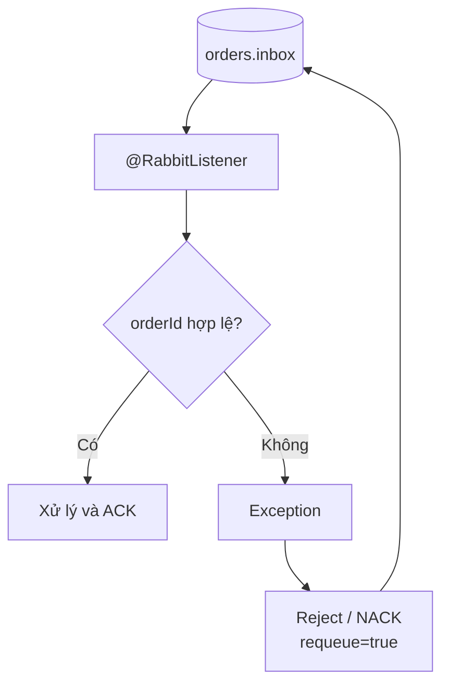
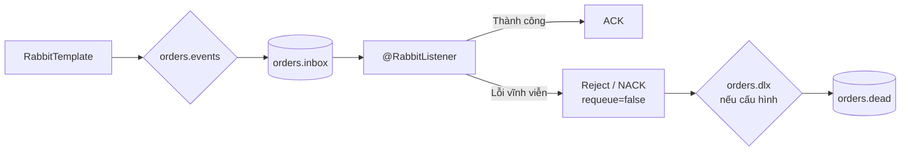
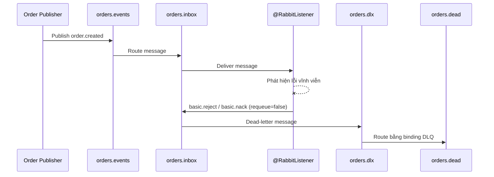
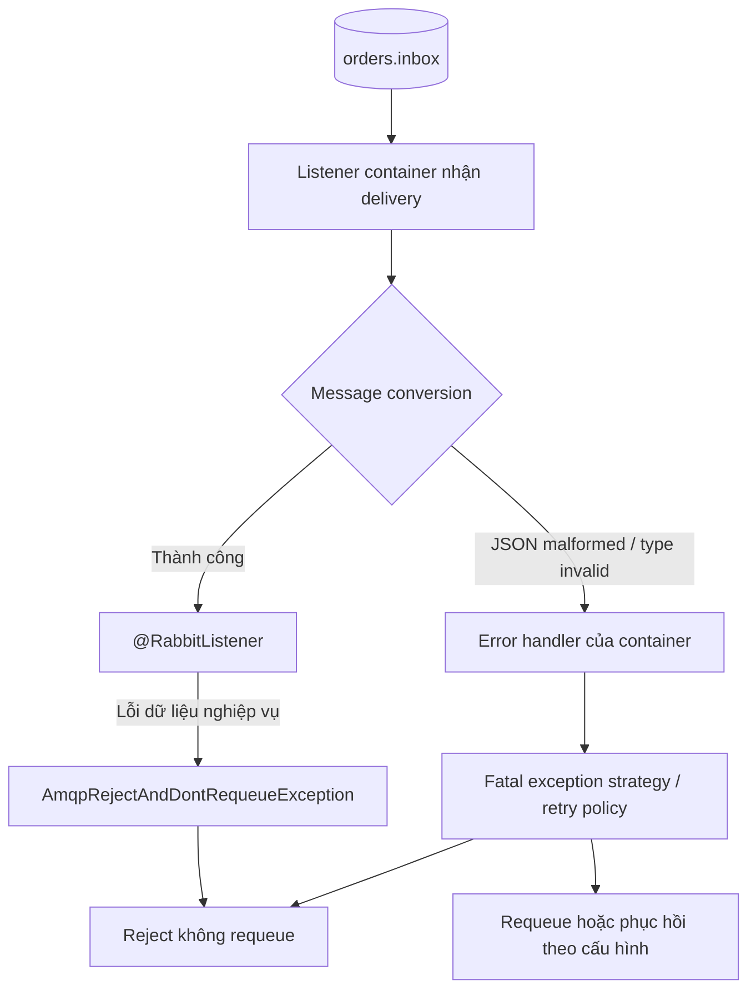
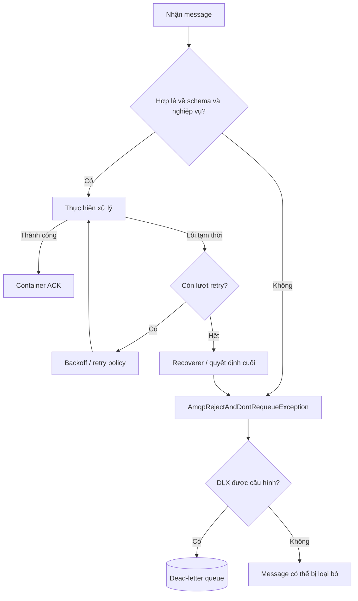

# AmqpRejectAndDontRequeueException để từ chối không xếp lại

## 1. Mục tiêu và bối cảnh

Trong **SPRING_AMQP**, ứng dụng dùng `RabbitTemplate` để gửi sự kiện tới exchange RabbitMQ; exchange dùng routing key và binding để đưa message vào queue. Phía nhận, `@RabbitListener` lấy message từ queue, chuyển đổi dữ liệu và thực hiện nghiệp vụ. Khi listener thất bại, có một quyết định đặc biệt quan trọng: **có yêu cầu RabbitMQ giao lại chính message đó hay không?**

Một số lỗi chỉ mang tính tạm thời, chẳng hạn database bị ngắt kết nối hoặc service phụ trợ trả HTTP 503. Nhưng lỗi như **payload sai định dạng, thiếu trường bắt buộc, phiên bản sự kiện không được hỗ trợ** thường sẽ lặp lại mãi nếu broker chỉ giao lại cùng một message, không có thay đổi nào khác.

Spring AMQP cung cấp exception:

```java
org.springframework.amqp.AmqpRejectAndDontRequeueException
```

Tên exception diễn tả ý định: **từ chối message và không đặt message trở lại queue đang tiêu thụ**. Trong đường xử lý của listener container có acknowledgement phù hợp, exception này có thể dẫn đến RabbitMQ nhận `basic.reject` hoặc `basic.nack` với cờ `requeue=false`.

Bài thuộc chương **Xử lý lỗi**, tập trung vào cách dùng exception này **đúng ngữ nghĩa**, thay vì coi nó là một lệnh “đưa thẳng vào DLQ” hoặc cơ chế retry.

Sau khi học, bạn có thể:

1. Phân biệt **requeue**, **retry**, **reject**, **dead-letter** và **acknowledgement**.
2. Biết khi nào nên ném `AmqpRejectAndDontRequeueException` trong `@RabbitListener`.
3. Hiểu sự khác nhau giữa exception này và `defaultRequeueRejected=false`, `ImmediateRequeueAmqpException`, các lỗi được error handler coi là fatal.
4. Cấu hình **DLX/DLQ** để giữ message bị từ chối và kiểm tra metadata như `x-death`.
5. Viết một ứng dụng Spring Boot mô phỏng message hợp lệ và không hợp lệ, theo dõi trạng thái queue.
6. Nhận ra các giới hạn trong `AcknowledgeMode.NONE`, `MANUAL`, transaction, retry advice và tình huống lỗi xuất hiện trước khi method listener chạy.

> **Thông điệp trọng tâm:** Ném `AmqpRejectAndDontRequeueException` có nghĩa **không muốn broker requeue message này ở bước xử lý lỗi tương ứng**. Nó **không tự tạo DLQ**, không bảo đảm mọi lỗi nghiệp vụ đều được phân loại đúng và không chứng minh message đã được xử lý thành công.

## 2. Vì sao requeue vô hạn có thể làm hại hệ thống?

Giả sử Order Service gửi:

```json
{"orderId":null,"total":100}
```

Consumer `@RabbitListener` yêu cầu `orderId` không được rỗng, nên ném `IllegalArgumentException`. Nếu Spring listener container requeue message sau lỗi và consumer nhận lại ngay, vòng lặp có thể diễn ra:



Hậu quả có thể gồm:

- Log tràn bởi cùng một stack trace.
- CPU, network và channel bị chiếm bởi thông điệp “poison message”.
- Các message hợp lệ phải cạnh tranh tài nguyên với message lỗi.
- Nếu có nhiều consumer, message có thể quay vòng giữa các instance, khiến thống kê lỗi và thứ tự xử lý khó dự đoán.
- Hệ thống tạo cảm giác “đang làm việc” nhưng không đạt tiến bộ nghiệp vụ nào.

**Requeue không sửa đổi body, header hoặc dữ liệu nghiệp vụ.** Nếu lỗi chắc chắn do nội dung message không thể xử lý, giải pháp là **không requeue vào queue hiện tại**, sau đó lưu/quan sát/điều tra bằng một cơ chế phục hồi phù hợp.

## 3. Ngữ nghĩa của reject, NACK và requeue

RabbitMQ có các thao tác consumer acknowledgement:

| Lệnh ở RabbitMQ Java client | Ý nghĩa |
|---|---|
| `channel.basicAck(tag, false)` | Xác nhận một delivery đã xử lý; broker không cần giao lại delivery đó. |
| `channel.basicReject(tag, true)` | Từ chối **một** delivery và yêu cầu requeue. |
| `channel.basicReject(tag, false)` | Từ chối **một** delivery, không requeue. |
| `channel.basicNack(tag, false, true)` | NACK một delivery và yêu cầu requeue. |
| `channel.basicNack(tag, false, false)` | NACK một delivery, không requeue. |

`tag` là **delivery tag** của lần giao, chỉ có giá trị trong phạm vi channel consumer tương ứng. Cờ `multiple` của `basicNack` dùng để chọn một hay nhiều delivery; trong ví dụ trên `multiple=false`.

Khi `requeue=false`:

1. Broker **không xếp lại delivery vào queue gốc theo nhánh requeue thông thường**.
2. Nếu queue có **dead-letter exchange** được cấu hình và message đủ điều kiện dead-letter, broker sẽ tìm cách publish lại message qua DLX.
3. Nếu không có DLX, hoặc dead-letter không được định tuyến tới queue nào, message có thể bị **loại bỏ**.
4. Với những tính năng queue/policy đặc biệt, kết quả có thể còn phụ thuộc cấu hình broker, quyền và loại queue.



**Không requeue không đồng nghĩa đã được lưu an toàn trong DLQ.** Cần cấu hình, kiểm thử và giám sát DLX, binding, queue đích và quyền của broker.

### 3.1. Requeue không giống retry ở tầng ứng dụng

| Thuật ngữ | Hoạt động | Có giữ message trong quá trình xử lý không? |
|---|---|---|
| **Retry trong method/advice** | Ứng dụng gọi lại logic nhiều lần trước khi kết thúc một delivery | Thường vẫn đang trong một lần giao chưa ACK |
| **Broker requeue** | Consumer NACK/reject với `requeue=true` để broker đưa message trở lại diện giao | Delivery cũ kết thúc; lần giao kế tiếp có thể tới consumer khác |
| **Dead-letter** | Broker định tuyến lại message qua DLX khi gặp điều kiện như reject không requeue | Message đi sang luồng định tuyến khác |
| **Republish từ ứng dụng** | Consumer/recoverer phát **một message mới** (thường với metadata mới) | Là một thao tác publish mới, có rủi ro duplicate |

Vì vậy, một lựa chọn “không requeue” **không cấm ứng dụng đã retry trước đó** hoặc một hệ thống DLQ được cấu hình để phát lại về sau. Nó chỉ quyết định bước xử lý **delivery hiện tại** tại queue nguồn.

## 4. `AmqpRejectAndDontRequeueException` hoạt động ra sao?

Trong listener container đang dùng cơ chế ACK của consumer, Spring AMQP xử lý exception từ listener và quyết định phải ACK/NACK/reject message. Khi phát hiện `AmqpRejectAndDontRequeueException` thích hợp trong chuỗi lỗi, container hiểu rằng message **không nên được requeue**.

Một ví dụ tối thiểu:

```java
import org.springframework.amqp.AmqpRejectAndDontRequeueException;
import org.springframework.amqp.rabbit.annotation.RabbitListener;
import org.springframework.stereotype.Component;

@Component
public class InvoiceListener {

    @RabbitListener(queues = "invoices.inbox", ackMode = "AUTO")
    public void receive(String payload) {
        if (payload == null || payload.isBlank()) {
            throw new AmqpRejectAndDontRequeueException(
                    "Invoice payload is empty");
        }

        System.out.println("Process invoice: " + payload);
    }
}
```

Trong trường hợp trên, nếu:

- Listener container sử dụng **`AcknowledgeMode.AUTO`**,
- Method listener nhận được message,
- Exception được ném ra ngoài method và không bị code nuốt,

thì container có thể reject/NACK message với **`requeue=false`**, ngay cả khi thuộc tính mặc định của container là `defaultRequeueRejected=true`.

Đây là **exception điều khiển cách xử lý lỗi**, không phải exception đại diện một sự cố hạ tầng cụ thể. Hãy ném nó khi ứng dụng **đã xác định lỗi không nên thử lại nguyên message trên queue đó**.

### 4.1. Constructor chứa nguyên nhân

Khi cần giữ exception nghiệp vụ gốc để debug:

```java
try {
    validateInvoice(payload);
} catch (InvalidInvoiceException ex) {
    throw new AmqpRejectAndDontRequeueException(
            "Permanent invoice validation error", ex);
}
```

Ví dụ giả định `InvalidInvoiceException` và `validateInvoice(...)` là các thành phần nghiệp vụ đã có trong project. Lưu nguyên nhân giúp log phân biệt **tín hiệu reject** với **lỗi gốc**. Tuy nhiên, không đưa toàn bộ payload nhạy cảm vào exception message.

### 4.2. Không xử lý kiểu “ném cho mọi lỗi”

**Không nên**:

```java
try {
    billingService.charge(orderId);
} catch (Exception ex) {
    throw new AmqpRejectAndDontRequeueException(
            "Any error is permanent", ex);
}
```

Mã này biến **lỗi mạng tạm thời**, **deadlock database**, **timeout** và **lỗi dữ liệu vĩnh viễn** thành cùng một quyết định reject không requeue. Kết quả là thông điệp có thể bị dead-letter quá sớm hoặc bị loại bỏ khi chưa có cơ hội thành công.

Thay vào đó, phân loại:

```java
try {
    OrderEvent event = parseAndValidate(payload);
    orderService.apply(event);
} catch (InvalidOrderEventException ex) {
    throw new AmqpRejectAndDontRequeueException(
            "Invalid order event", ex);
}
// Timeout/database errors không bị catch ở đây;
// chúng được xử lý bởi retry/error policy riêng của container.
```

Hai đoạn là **minh họa trong một method**, giả định kiểu `OrderEvent`, `InvalidOrderEventException`, `parseAndValidate` và `orderService` đã được định nghĩa. Mục tiêu là giữ ranh giới phân loại lỗi rõ ràng, không phải một class Java hoàn chỉnh.

## 5. Cấu hình `defaultRequeueRejected` khác gì exception?

`SimpleRabbitListenerContainerFactory` hoặc listener container có thuộc tính **`defaultRequeueRejected`**. Nó là quyết định **mặc định** khi listener thất bại và không có cơ chế điều khiển requeue cụ thể hơn.

Ví dụ Spring Boot:

```yaml
spring:
  rabbitmq:
    listener:
      simple:
        acknowledge-mode: auto
        default-requeue-rejected: true
```

Khi để `true`, nhiều exception từ listener theo đường mặc định sẽ làm message **được requeue** (trừ các ngoại lệ và chính sách xử lý lỗi đặc biệt). Khi đặt `false`, container có xu hướng **reject không requeue** đối với những lỗi thông thường.

| Cách thiết lập | Phạm vi quyết định | Thích hợp khi |
|---|---|---|
| `defaultRequeueRejected=true` | Default cho nhiều lỗi trên listener container | Muốn nhiều lỗi được thử lại qua broker, nhưng phải kiểm soát poison message |
| `defaultRequeueRejected=false` | Default reject không requeue trên container | Đã có retry bounded/recoverer và DLQ cho lỗi còn lại |
| Ném `AmqpRejectAndDontRequeueException` | Quyết định rõ **trường hợp lỗi cụ thể** | Payload sai hoặc lỗi nghiệp vụ vĩnh viễn |
| Ném `ImmediateRequeueAmqpException` | Yêu cầu requeue trong các đường xử lý lỗi phù hợp | Một trường hợp được xác định cần requeue ngay, không phải chữa lỗi bằng vòng lặp vô hạn |

**Nguyên tắc:** `AmqpRejectAndDontRequeueException` là tín hiệu **cụ thể**, trong khi `defaultRequeueRejected` là **chính sách dự phòng**. Không nên dùng exception như một cách thay thế mọi cấu hình lỗi của container.

### 5.1. Có thể đặt trong Java configuration

```java
import org.springframework.amqp.core.AcknowledgeMode;
import org.springframework.amqp.rabbit.config.SimpleRabbitListenerContainerFactory;
import org.springframework.amqp.rabbit.connection.ConnectionFactory;
import org.springframework.boot.autoconfigure.amqp.SimpleRabbitListenerContainerFactoryConfigurer;
import org.springframework.context.annotation.Bean;
import org.springframework.context.annotation.Configuration;

@Configuration
public class ListenerPolicyConfiguration {

    @Bean
    SimpleRabbitListenerContainerFactory orderListenerFactory(
            ConnectionFactory connectionFactory,
            SimpleRabbitListenerContainerFactoryConfigurer bootConfigurer) {

        SimpleRabbitListenerContainerFactory factory =
                new SimpleRabbitListenerContainerFactory();
        bootConfigurer.configure(factory, connectionFactory);
        factory.setAcknowledgeMode(AcknowledgeMode.AUTO);
        factory.setDefaultRequeueRejected(true);
        factory.setPrefetchCount(10);
        return factory;
    }
}
```

Khi dùng factory này, listener cần trỏ đúng bean:

```java
@RabbitListener(
        queues = "orders.inbox",
        containerFactory = "orderListenerFactory")
public void receive(String payload) {
    // ...
}
```

Đừng chỉ đặt `spring.rabbitmq.listener.simple.*` rồi giả định mọi listener đang dùng một custom factory sẽ tự kế thừa toàn bộ thuộc tính. Dùng `SimpleRabbitListenerContainerFactoryConfigurer` như trên hoặc kiểm tra cơ chế cấu hình factory của ứng dụng.

### 5.2. Lỗi nào có thể bị reject dù không ném exception này?

Spring AMQP thường dùng **`ConditionalRejectingErrorHandler`** trong listener container. Với **`DefaultExceptionStrategy`**, một số lỗi bị xem là **fatal**, ví dụ các trường hợp conversion/type mismatch hoặc không gọi được method handler. Tùy phiên bản và ngữ cảnh, error handler có thể chuyển chúng thành quyết định **không requeue** để tránh vòng lặp với dữ liệu không thể sửa.

Ví dụ:

- JSON malformed hoặc converter không thể biến body thành DTO.
- Tham số listener không phù hợp với payload đã chuyển đổi.
- Lỗi chọn hoặc gọi handler gây thất bại trước khi logic nghiệp vụ bắt đầu.

Không nên đồng nhất “mọi `IllegalArgumentException` đều fatal” hay “mọi exception đều requeue”: **danh sách fatal cụ thể và cách duyệt nguyên nhân phụ thuộc phiên bản/cấu hình**. Một exception nghiệp vụ tự ném từ method thường không nên được phân loại chỉ dựa vào tên class mà chưa xem error handler thực tế.

## 6. Phân biệt lỗi vĩnh viễn và lỗi tạm thời

Trước khi ném `AmqpRejectAndDontRequeueException`, hãy xác định message có khả năng xử lý thành công **nếu nhận lại nguyên vẹn** hay không.

| Tình huống | Loại lỗi thường gặp | Hướng xử lý ưu tiên |
|---|---|---|
| JSON/XML sai cú pháp | Vĩnh viễn với cùng body | Reject không requeue; lưu DLQ hoặc kho lỗi để điều tra |
| Thiếu trường `orderId` bắt buộc | Vĩnh viễn nếu producer không sửa message | Reject không requeue, cảnh báo producer/schema |
| `eventVersion` không được hỗ trợ | Vĩnh viễn theo phiên bản consumer hiện tại | Reject/quarantine và xử lý tương thích schema |
| ID không nằm trong phạm vi hợp lệ | Có thể vĩnh viễn | Validate hợp đồng; reject có kiểm soát |
| Database timeout | Thường tạm thời | Retry có giới hạn, backoff, circuit breaker |
| HTTP 503 từ dịch vụ thanh toán | Thường tạm thời | Retry theo SLA và idempotency |
| Deadlock database | Có thể tạm thời | Bounded retry và quan sát |
| Một khóa nghiệp vụ chưa sẵn sàng do event đến lệch thứ tự | Phụ thuộc nghiệp vụ | Delay/retry có giới hạn hoặc reconciliation, không mặc định reject |
| Rule nghiệp vụ mới không còn chấp nhận event cũ | Phụ thuộc khả năng migration | Quarantine/DLQ, kiểm tra version contract và nghiệp vụ |

**Không dùng catch-all để chuyển mọi lỗi thành reject.** Với một số lỗi “không tìm thấy bản ghi”, message có thể chỉ đến sớm hơn dữ liệu liên quan; quyết định reject ngay có thể khiến sự kiện bị mất khỏi luồng xử lý chính.

### 6.1. Phân loại phải dựa trên tính phục hồi

Một quy tắc thực dụng:

1. **Có thể sửa bằng thử lại mà không thay dữ liệu?** Nếu có, xem retry có giới hạn.
2. **Chắc chắn không sửa được nếu body/header giữ nguyên?** Nếu có, dùng `AmqpRejectAndDontRequeueException` hoặc xử lý lỗi vĩnh viễn tương đương.
3. **Không chắc trạng thái lỗi là gì?** Ghi đủ metadata, dùng retry giới hạn/backoff và có đường cứu hộ để không bỏ mất message.
4. **Đã thực hiện side effect trước khi lỗi?** Xem idempotency và transaction boundary trước khi retry hoặc republish.

## 7. Kết hợp với Dead-Letter Exchange và Dead-Letter Queue

RabbitMQ có thể đưa message bị reject với `requeue=false` sang **dead-letter exchange (DLX)** của queue. DLX định tuyến message đến một hoặc nhiều queue dựa trên routing key và binding.

**DLX là exchange**, **DLQ là queue nhận dead-letter**. Hai khái niệm không đồng nhất: khai báo DLQ mà không có DLX/binding phù hợp thì chưa đủ.



### 7.1. Hai cách cấu hình DLX

**Cách 1 — Policy RabbitMQ:** Dùng policy phía broker để áp dụng DLX cho nhóm queue, thuận tiện khi vận hành cần thay đổi routing mà không redeclare queue với arguments khác.

Ví dụ minh họa CLI trên một broker thử nghiệm:

```bash
rabbitmqctl set_policy DLX-ORDERS '^orders\.inbox$' \
  '{"dead-letter-exchange":"orders.dlx","dead-letter-routing-key":"order.rejected"}' \
  --apply-to queues
```

Tên policy, regular expression, quyền truy cập và hỗ trợ CLI phụ thuộc môi trường RabbitMQ. Lệnh trên giả định exchange `orders.dlx` đã tồn tại, cùng với queue/binding đích. Trong production, chính sách có thể được quản lý bằng infrastructure-as-code thay vì gõ lệnh tay.

**Cách 2 — Queue arguments:** Dùng `QueueBuilder` khi muốn demo hoặc queue do một ứng dụng quản lý rõ ràng:

```java
Queue queue = QueueBuilder.durable("orders.inbox")
        .deadLetterExchange("orders.dlx")
        .deadLetterRoutingKey("order.rejected")
        .build();
```

Cách này tạo các argument tương đương `x-dead-letter-exchange` và `x-dead-letter-routing-key` trong khai báo queue. **Nếu queue đã tồn tại với arguments khác**, redeclare có thể gặp `PRECONDITION_FAILED`. Đừng xóa queue có dữ liệu thật chỉ để làm một thay đổi DLX hoạt động; hãy có kế hoạch migration hoặc dùng policy phù hợp.

### 7.2. Khi không có DLX

Giả sử code ném:

```java
throw new AmqpRejectAndDontRequeueException(
        "Invalid payload");
```

Nếu queue **không có DLX**, broker có thể **loại bỏ message** khi nó bị reject không requeue. Exception này **không lưu message vào database**, **không phát publish mới bằng RabbitTemplate** và **không tự tạo queue lỗi**.

Nếu cần khả năng phục hồi, thiết kế DLQ, kiểm tra quyền và routing, đặt cảnh báo backlog, retention và quy trình xử lý lại message hợp lệ sau khi sửa nguyên nhân.

### 7.3. Metadata trong dead-letter message

RabbitMQ có thể thêm các metadata về dead-lettering:

- `x-death`: thông tin các lần dead-letter, như queue, exchange, reason và số lượng theo cách broker tổ chức/gộp.
- Các header dạng `x-first-death-*` và `x-last-death-*` trong những phiên bản/cấu hình tương ứng.
- Routing key của delivery tới DLQ có thể thay đổi nếu `x-dead-letter-routing-key` được chỉ định.

**Đừng coi `x-death.count` là số lần retry logic trong application**. Retry nội bộ trước khi NACK có thể không làm broker dead-letter lần nào. Ngược lại, một message đi qua nhiều queue/dead-letter có thể có metadata phức tạp hơn một bộ đếm duy nhất.

### 7.4. Một lưu ý về độ tin cậy của dead-lettering

Dead-lettering là thao tác publish lại do broker thực hiện. Bảo đảm an toàn của bước này còn tùy loại queue, cấu hình at-least-once dead-lettering/giới hạn broker và chính sách lưu trữ. Không dùng “message xuất hiện trong DLX” như một bằng chứng mặc định nó đã được lưu an toàn trong một DLQ. Trong hệ thống quan trọng, cần **kiểm thử trên loại queue thực tế** và theo dõi dead-letter backlog/đường định tuyến.

## 8. Ví dụ Spring Boot chạy được: message tốt và message độc

Ta xây ví dụ đơn giản trên Spring Boot:

- Publisher dùng `RabbitTemplate` gửi `String` tới **direct exchange** `demo.reject.events`.
- Queue `demo.reject.orders` nhận routing key `order.created`.
- `@RabbitListener` xử lý message bắt đầu bằng `ORDER:`; message bắt đầu bằng `INVALID:` được xem là sai định dạng nghiệp vụ.
- Listener ném `AmqpRejectAndDontRequeueException` khi không thể xử lý.
- Queue cấu hình DLX `demo.reject.dlx` và DLQ `demo.reject.dead`.

**Không tạo retry loop trong demo**: chỉ gửi message hợp lệ và message sai vĩnh viễn. Đối với lỗi tạm thời, phần sau trình bày cách thiết kế retry giới hạn.

### 8.1. Dependency và broker

Với Gradle Groovy DSL:

```groovy
dependencies {
    implementation 'org.springframework.boot:spring-boot-starter-amqp'
}
```

Với Maven:

```xml
<dependency>
    <groupId>org.springframework.boot</groupId>
    <artifactId>spring-boot-starter-amqp</artifactId>
</dependency>
```

Để Spring Boot BOM/dependency management chọn Spring AMQP, RabbitMQ Java client và các module tương thích. Với một phiên bản Spring Boot/Spring AMQP khác, kiểm tra API annotation và container factory trước khi copy ví dụ.

Nếu chưa có RabbitMQ local và đã cài Docker:

```bash
docker run -d --name rabbitmq-reject-lab \
  -p 5672:5672 -p 15672:15672 \
  rabbitmq:4-management
```

Ứng dụng sử dụng cổng AMQP `5672`; RabbitMQ Management ở `http://localhost:15672`. Với broker đã tồn tại, dùng cấu hình kết nối tương ứng để tránh tranh chấp cổng/container.

`src/main/resources/application.yml`:

```yaml
spring:
  rabbitmq:
    host: localhost
    port: 5672
    username: guest
    password: guest
    virtual-host: /
    listener:
      type: simple
      simple:
        acknowledge-mode: auto
        default-requeue-rejected: true
        prefetch: 5
```

Ta để **`default-requeue-rejected: true` có chủ đích**, nhằm thấy rằng **`AmqpRejectAndDontRequeueException` trong listener vẫn yêu cầu không requeue cho lỗi đã xác định**. Đừng dùng ví dụ này làm chính sách production khi chưa thiết kế retry hữu hạn cho lỗi tạm thời.

Tài khoản `guest/guest` chỉ phù hợp với thử nghiệm local theo chính sách mặc định RabbitMQ; production cần tài khoản riêng, TLS và quản lý secrets.

### 8.2. Khai báo exchange, queue, binding và DLQ

File `RejectTopology.java` trong package `com.example.rejectdemo`:

```java
package com.example.rejectdemo;

import org.springframework.amqp.core.Binding;
import org.springframework.amqp.core.BindingBuilder;
import org.springframework.amqp.core.DirectExchange;
import org.springframework.amqp.core.Queue;
import org.springframework.amqp.core.QueueBuilder;
import org.springframework.beans.factory.annotation.Qualifier;
import org.springframework.context.annotation.Bean;
import org.springframework.context.annotation.Configuration;

@Configuration
public class RejectTopology {

    public static final String INPUT_EXCHANGE = "demo.reject.events";
    public static final String INPUT_QUEUE = "demo.reject.orders";
    public static final String INPUT_KEY = "order.created";

    public static final String DLX = "demo.reject.dlx";
    public static final String DEAD_QUEUE = "demo.reject.dead";
    public static final String DEAD_KEY = "order.rejected";

    @Bean
    DirectExchange inputExchange() {
        return new DirectExchange(INPUT_EXCHANGE, true, false);
    }

    @Bean
    Queue inputQueue() {
        return QueueBuilder.durable(INPUT_QUEUE)
                .deadLetterExchange(DLX)
                .deadLetterRoutingKey(DEAD_KEY)
                .build();
    }

    @Bean
    Binding inputBinding(
            @Qualifier("inputQueue") Queue queue,
            @Qualifier("inputExchange") DirectExchange exchange) {

        return BindingBuilder.bind(queue)
                .to(exchange)
                .with(INPUT_KEY);
    }

    @Bean
    DirectExchange deadLetterExchange() {
        return new DirectExchange(DLX, true, false);
    }

    @Bean
    Queue deadQueue() {
        return QueueBuilder.durable(DEAD_QUEUE).build();
    }

    @Bean
    Binding deadBinding(
            @Qualifier("deadQueue") Queue queue,
            @Qualifier("deadLetterExchange") DirectExchange exchange) {

        return BindingBuilder.bind(queue)
                .to(exchange)
                .with(DEAD_KEY);
    }
}
```

Trong demo, `QueueBuilder.deadLetterExchange(...)`/`deadLetterRoutingKey(...)` cấu hình **DLX cho queue nguồn**, còn `Binding deadBinding(...)` giúp DLX đưa message sang `demo.reject.dead`. Nếu thiếu binding này, message không bảo đảm vào DLQ.

Spring Boot thông thường tạo `RabbitAdmin` để tự khai báo các bean exchange/queue/binding khi connection sẵn sàng, nếu bạn chưa tắt auto-declaration. Broker phải có quyền declare tương ứng. Đối với môi trường sản xuất, có thể chuyển khai báo DLX sang RabbitMQ policy để quản lý dễ hơn.

### 8.3. Listener phân loại lỗi nghiệp vụ

File `OrderEventListener.java`:

```java
package com.example.rejectdemo;

import org.springframework.amqp.AmqpRejectAndDontRequeueException;
import org.springframework.amqp.rabbit.annotation.RabbitListener;
import org.springframework.stereotype.Component;

@Component
public class OrderEventListener {

    @RabbitListener(
            queues = RejectTopology.INPUT_QUEUE,
            ackMode = "AUTO")
    public void handle(String payload) {
        if (payload == null || !payload.startsWith("ORDER:")) {
            throw new AmqpRejectAndDontRequeueException(
                    "Unsupported order event format");
        }

        String orderId = payload.substring("ORDER:".length());
        if (orderId.isBlank()) {
            throw new AmqpRejectAndDontRequeueException(
                    "Missing order ID");
        }

        // Mô phỏng nghiệp vụ thành công.
        System.out.println("PROCESSED orderId=" + orderId);
        // AUTO: container gửi ACK khi method hoàn thành bình thường.
    }
}
```

Với message `ORDER:42`, method trả về bình thường. Container có thể ACK message theo cơ chế `AUTO`. Với message `INVALID:no-id`, method ném `AmqpRejectAndDontRequeueException`, nên dù mặc định `defaultRequeueRejected=true`, message này được hướng tới xử lý **reject không requeue**.

Phần code phân loại payload chỉ phục vụ bài lab. Production nên dùng DTO, schema validation, versioning và exception nghiệp vụ tường minh thay vì quy ước prefix của chuỗi.

### 8.4. Publisher gửi hai message

File `DemoPublisher.java`:

```java
package com.example.rejectdemo;

import org.springframework.amqp.rabbit.core.RabbitTemplate;
import org.springframework.stereotype.Service;

@Service
public class DemoPublisher {

    private final RabbitTemplate rabbitTemplate;

    public DemoPublisher(RabbitTemplate rabbitTemplate) {
        this.rabbitTemplate = rabbitTemplate;
    }

    public void publishSamples() {
        rabbitTemplate.convertAndSend(
                RejectTopology.INPUT_EXCHANGE,
                RejectTopology.INPUT_KEY,
                "ORDER:42");

        rabbitTemplate.convertAndSend(
                RejectTopology.INPUT_EXCHANGE,
                RejectTopology.INPUT_KEY,
                "INVALID:no-id");
    }
}
```

### 8.5. Ứng dụng Spring Boot

File `RejectDemoApplication.java`:

```java
package com.example.rejectdemo;

import org.springframework.amqp.rabbit.annotation.EnableRabbit;
import org.springframework.boot.ApplicationRunner;
import org.springframework.boot.SpringApplication;
import org.springframework.boot.autoconfigure.SpringBootApplication;
import org.springframework.context.annotation.Bean;

@SpringBootApplication
@EnableRabbit
public class RejectDemoApplication {

    public static void main(String[] args) {
        SpringApplication.run(RejectDemoApplication.class, args);
    }

    @Bean
    ApplicationRunner publishOnce(DemoPublisher publisher) {
        return args -> publisher.publishSamples();
    }
}
```

Chạy bằng wrapper trong dự án:

```bash
./mvnw spring-boot:run
# Hoặc:
./gradlew bootRun
```

Kết quả kỳ vọng:

- Log có `PROCESSED orderId=42`.
- Message `ORDER:42` được container ACK và rời khỏi queue nguồn.
- Message `INVALID:no-id` bị reject không requeue.
- Nếu DLX và binding được khai báo đúng, `demo.reject.dead` có một message để quan sát.
- Queue nguồn không liên tục giao lại `INVALID:no-id` trong một vòng lặp.

**Thứ tự log và thời điểm message xuất hiện trên Management UI có thể thay đổi**. Nếu có consumer khác đọc DLQ hoặc queue đã tồn tại từ thử nghiệm trước, số message quan sát có thể không đúng bằng một.

### 8.6. Xem thông tin trên RabbitMQ Management

Mở `http://localhost:15672` nếu bạn đã bật plugin Management và map cổng. Kiểm tra:

1. Exchange `demo.reject.events` có binding tới `demo.reject.orders` bằng key `order.created`.
2. Queue `demo.reject.orders` có các argument dead-letter chỉ tới `demo.reject.dlx` và key `order.rejected`.
3. Exchange `demo.reject.dlx` có binding tới queue `demo.reject.dead` bằng key `order.rejected`.
4. Queue `demo.reject.dead` có message `INVALID:no-id` trong trạng thái `Ready` nếu không có consumer nào khác lấy đi.
5. Message ở DLQ có metadata dead-letter phù hợp, ví dụ `x-death` (nếu broker phiên bản đang sử dụng cung cấp thông tin này).

Việc dùng “Get messages” trong Management UI có thể thay đổi trạng thái queue/ack của message tùy tuỳ chọn; hãy dùng queue lab, không dùng queue production và ghi nhận nếu đã thực hiện thao tác lấy message.

## 9. Điều gì xảy ra trong `NONE`, `AUTO` và `MANUAL`?

Đây là chỗ dễ khiến cùng một exception cho kết quả không như mong đợi.

| Ack mode | Ai chịu trách nhiệm ACK? | Ném `AmqpRejectAndDontRequeueException` trong listener có ý nghĩa gì? |
|---|---|---|
| `AcknowledgeMode.NONE` | RabbitMQ `autoAck=true`, broker không đợi ACK từ consumer | Không có unacked delivery để container reject giống AUTO; **không dựa vào exception để chuyển message tới DLQ** |
| `AcknowledgeMode.AUTO` | Spring container ACK/NACK/reject theo kết quả listener | **Trường hợp điển hình**: exception yêu cầu container từ chối không requeue |
| `AcknowledgeMode.MANUAL` | Ứng dụng quản lý `Channel.basicAck/basicNack/basicReject` | Cần hiểu cấu hình container/error handler; thông thường nên xác định rõ ACK/NACK/reject trong code, không giả định ném exception tự động giải quyết mọi nhánh |

### 9.1. `AUTO` là điểm bắt đầu hợp lý

Trong `AUTO`, listener trả về bình thường thì container quản lý ACK. Nếu muốn phân biệt riêng một loại lỗi “không nên requeue”, ném `AmqpRejectAndDontRequeueException` từ method là cách diễn đạt trực tiếp và dễ đọc.

Ví dụ:

```java
@RabbitListener(queues = "orders.inbox", ackMode = "AUTO")
public void onMessage(String payload) {
    if (isPermanentBadData(payload)) {
        throw new AmqpRejectAndDontRequeueException(
                "Permanent bad input");
    }
    process(payload);
}
```

`isPermanentBadData(...)` và `process(...)` là các hàm nghiệp vụ giả định.

### 9.2. `MANUAL` — chú ý tham số `rejectManual` và quyền sở hữu ACK

Trong chế độ `MANUAL`, code ứng dụng chịu trách nhiệm xác nhận. Spring AMQP có những cơ chế trong error handler và `AmqpRejectAndDontRequeueException` để kiểm soát xử lý khi chưa ACK; một số phiên bản có constructor truyền cờ **`rejectManual`**. Chi tiết mặc định và đường xử lý exception được ném từ handler hoặc từ giai đoạn conversion **phụ thuộc phiên bản Spring AMQP và error handler**.

Vì vậy, khi chọn MANUAL, mẫu dễ kiểm chứng nhất là **gọi reject/NACK tường minh trên đúng channel**:

```java
import com.rabbitmq.client.Channel;
import java.io.IOException;
import org.springframework.amqp.core.Message;
import org.springframework.amqp.rabbit.annotation.RabbitListener;

@RabbitListener(queues = "orders.manual", ackMode = "MANUAL")
public void receive(Message message, Channel channel)
        throws IOException {

    long tag = message.getMessageProperties().getDeliveryTag();

    if (!isValid(message.getBody())) {
        channel.basicReject(tag, false);
        return; // Không ACK thêm lần thứ hai.
    }

    process(message.getBody());
    channel.basicAck(tag, false);
}
```

Đoạn code minh họa này giả định `isValid(...)` và `process(...)` tồn tại; với lỗi được ném bất ngờ từ `process`, cần có error strategy riêng, không coi ví dụ này đã bao phủ đủ mọi lỗi sản xuất.

**Không vừa gọi `basicReject`/`basicAck` rồi tiếp tục ném exception khiến container xử lý lại cùng delivery**, vì có thể gây double acknowledgement hoặc `unknown delivery tag`. Khi thao tác ACK/NACK trên channel tự nó thất bại, trạng thái broker đã ghi nhận hay chưa có thể không xác định.

### 9.3. `NONE` — không có message unacked để reject

`NONE` của Spring tương ứng `autoAck=true` của RabbitMQ, **không phải** “Spring tự ACK khi listener thành công”. Message đã được broker coi là giao mà không chờ xác nhận. Nếu listener ném exception sau khi nhận, cơ chế reject không requeue của delivery đang unacked không còn áp dụng như AUTO/MANUAL.

Đừng chọn `NONE` cho những message quan trọng rồi trông chờ `AmqpRejectAndDontRequeueException` sẽ đưa message vào DLQ khi xử lý lỗi.

## 10. Lỗi conversion xảy ra trước khi method chạy

`AmqpRejectAndDontRequeueException` bạn ném bên trong `@RabbitListener` **chỉ chạy khi listener đã được gọi**. Nhưng nhiều poison messages thất bại **trước** bước này:



Ví dụ consumer nhận `OrderCreatedEvent` và có JSON converter. Khi body là JSON không hợp lệ, converter có thể ném `MessageConversionException` trước khi `handle(OrderCreatedEvent event)` chạy. Lúc đó, code:

```java
@RabbitListener(queues = "orders.inbox")
public void handle(OrderCreatedEvent event) {
    // Không được gọi nếu converter thất bại trước bước invoke.
}
```

không có cơ hội ném `AmqpRejectAndDontRequeueException`.

### 10.1. `ConditionalRejectingErrorHandler`

Spring AMQP cung cấp `ConditionalRejectingErrorHandler` với chiến lược nhận diện exception fatal. Trong cấu hình phổ biến, các lỗi conversion, mapping argument hoặc không thể gọi listener method có thể được coi là **không thể khắc phục chỉ bằng requeue**.

Điều cần làm:

- Kiểm tra **loại exception và cause chain** trong log.
- Biết listener container đang dùng **error handler nào**, không chỉ nhìn code của method.
- Phân biệt lỗi tạo Java payload với lỗi nghiệp vụ sau conversion.
- Định nghĩa hành vi cho message đã đi qua DLQ; tránh DLQ consumer cũng ném exception rồi đẩy lặp lại vô hạn.
- Nếu thay error handler mặc định, viết integration test cho **poison message**.

Một số dòng Spring AMQP có xử lý riêng với các fatal message chứa `x-death` để tránh chu trình dead-letter độc hại; hành vi chi tiết cần kiểm tra phiên bản và chính sách triển khai.

## 11. Khi nào nên kết hợp retry trước khi reject?

Một chiến lược đáng tin cậy thường có hai tầng quyết định:

1. **Retry có giới hạn** khi lỗi có khả năng phục hồi.
2. **Không requeue vào queue nguồn** sau khi đã xác định lỗi vĩnh viễn hoặc hết số lần thử có kiểm soát, rồi chuyển message vào DLQ/quarantine khi phù hợp.



### 11.1. Retry advice không được hiểu là requeue

Khi Spring Retry (nếu được tích hợp) thử lại method nhiều lần **trong cùng lần delivery**, message có thể vẫn ở trạng thái unacked. Sau khi retry kết thúc, error handler/recoverer mới quyết định điều gì xảy ra với delivery.

Với hệ thống có giới hạn retry, `RejectAndDontRequeueRecoverer` của Spring AMQP là một lựa chọn để biểu đạt **sau khi thử lại thất bại, từ chối mà không requeue**. Đừng nhầm nó với `RepublishMessageRecoverer`, vốn **phát một message mới** vào exchange/queue được chỉ định khi phục hồi và có các bảo đảm/điều kiện khác.

Tùy phiên bản, retry interceptor có thể được xây theo kiểu stateless/stateful, dùng retry policy và backoff policy. Thiết kế retry cần kiểm soát side effect, giới hạn số lần và không biến lỗi vĩnh viễn thành một chuỗi request tới database hay API.

### 11.2. Dùng DLQ để điều tra, không nhất thiết để retry tự động

Một DLQ có thể là nơi:

- Giữ message sai schema để đội phát triển sửa producer.
- Giữ message cần đối soát thủ công với dữ liệu nghiệp vụ.
- Lưu message thất bại sau retry để xem nguyên nhân và quyết định tái phát.

**Đừng tự động replay mọi message DLQ về queue chính** mà chưa sửa nguyên nhân và chưa có giới hạn. Replay thiếu kiểm soát có thể tạo vòng **main queue → DLQ → main queue**.

### 11.3. Không ACK khi chưa quyết định kết quả nghiệp vụ

Trong `AUTO`, một lỗi bị code nuốt sẽ khiến method trả về bình thường; container có thể **ACK** message dù nghiệp vụ thất bại:

```java
// Mẫu dễ mất message khi code chỉ log rồi bỏ qua lỗi.
@RabbitListener(queues = "orders.inbox", ackMode = "AUTO")
public void wrong(String payload) {
    try {
        process(payload);
    } catch (Exception ex) {
        log.error("Failed", ex);
        // Không ném tiếp: container có thể ACK.
    }
}
```

Thay bằng logic phân loại:

```java
@RabbitListener(queues = "orders.inbox", ackMode = "AUTO")
public void correct(String payload) {
    try {
        process(payload);
    } catch (InvalidOrderEventException ex) {
        throw new AmqpRejectAndDontRequeueException(
                "Invalid event", ex);
    }
    // Các lỗi transient khác được retry/error strategy xử lý.
}
```

Hai đoạn giả định `process`, `log` và `InvalidOrderEventException` tồn tại, dùng để so sánh ý định xử lý lỗi, không phải hai listener nên cùng chạy trên một queue.

## 12. Khi nào reject không requeue vẫn có rủi ro mất dữ liệu?

Ném exception và cấu hình DLX không bảo đảm **end-to-end exactly-once** hoặc tránh được mọi trường hợp mất message:

| Tình huống | Rủi ro | Thiết kế bổ sung |
|---|---|---|
| Queue không có DLX | Message bị loại bỏ sau reject không requeue | Khai báo DLX/DLQ hoặc lưu lỗi qua cơ chế riêng |
| DLX không có binding khớp | Không có DLQ nhận dead-letter | Kiểm tra topology, quyền, routing key |
| DLQ đầy hoặc cơ chế dead-letter thất bại | Không đảm bảo message được giữ như kỳ vọng | Giám sát DLX/DLQ, chọn queue type/policy phù hợp |
| Consumer xử lý thành công một phần rồi reject | Side effect đã xảy ra, replay có thể lặp | Transaction boundary và idempotency |
| Message lỗi schema vì service chưa được nâng cấp | Reject quá sớm một dữ liệu có thể sẽ hỗ trợ ở bản mới | Versioning, quarantine/replay sau migration |
| Consumer đã ACK trước khi phát hiện lỗi | Exception sau đó không thể hồi sinh delivery đã ACK | Đặt ACK đúng ranh giới hoàn tất |
| Mất kết nối trong lúc xử lý lỗi | Không chắc broker đã nhận ACK/NACK | Redelivery-safe processing và metrics |

Với các sự kiện tài chính/đơn hàng, nên mang **business event ID** ổn định để consumer và quy trình replay không lặp lại side effect. `deliveryTag` không phải ID nghiệp vụ: nó chỉ thuộc một channel consumer.

## 13. Quan sát và chẩn đoán message bị reject

### 13.1. RabbitMQ Management và CLI

Sau khi chạy demo, mở Management `http://localhost:15672`, kiểm tra số lượng `Ready`, `Unacked` của queue nguồn và DLQ.

Nếu môi trường cho phép chạy `rabbitmqctl` trên broker:

```bash
rabbitmqctl list_queues -p / name consumers messages_ready messages_unacknowledged
```

Để xác định một message sai có thật sự được dead-letter không:

1. Kiểm tra **listener log** có nguyên nhân reject.
2. Kiểm tra **input queue** không còn giao lặp cùng message.
3. Kiểm tra **DLX** tồn tại, type phù hợp và có binding tới DLQ.
4. Kiểm tra **DLQ** có message (nếu không có consumer khác lấy).
5. Đọc metadata dead-letter phù hợp như `x-death` và nội dung body ở môi trường test.

Đừng phụ thuộc một mình vào `Ready=0` của input queue: nó có thể do message đã được ACK, bị consumer lấy đi, bị dead-letter hoặc bị loại bỏ.

### 13.2. Log có cấu trúc

Một log sự kiện lỗi có thể chứa:

```text
eventId=order-42
queue=demo.reject.orders
receivedRoutingKey=order.created
errorClass=InvalidOrderEventException
errorCategory=PERMANENT
requeueDecision=false
expectedDeadLetterQueue=demo.reject.dead
```

Chữ **`expectedDeadLetterQueue`** chỉ là **đích kỳ vọng theo topology**, không phải bằng chứng message đã vào DLQ. Cần có quan sát tại broker/queue đích.

Không log toàn bộ payload hoặc token trong headers khi message chứa thông tin nhạy cảm. Với metrics, tránh dùng event ID làm tag có cardinality vô hạn.

### 13.3. Các metric gợi ý

| Metric đề xuất | Mục đích |
|---|---|
| `consumer_invalid_message_total` | Đếm message bị xác định là sai dữ liệu/schema |
| `consumer_reject_no_requeue_total` | Theo dõi quyết định reject không requeue |
| `consumer_transient_failure_total` | Phân biệt lỗi tạm thời |
| `consumer_retry_exhausted_total` | Theo dõi retry đã hết lượt |
| `queue_dead_letter_ready` | Backlog tại DLQ |
| `consumer_processing_duration` | Thời gian xử lý một delivery |
| `consumer_redelivered_total` | Delivery được broker đánh dấu redelivered |

Các tên là **đề xuất về quy ước quan sát**, không phải danh sách metric Spring Boot tự xuất theo đúng tên này. Có thể dùng Micrometer, dashboard RabbitMQ và trace event ID để nối các mốc nhận/phục hồi.

## 14. Các lỗi thường gặp và hướng xử lý

| Triệu chứng | Nguyên nhân có thể | Cách sửa |
|---|---|---|
| Ném `AmqpRejectAndDontRequeueException` nhưng không thấy message ở DLQ | Queue không cấu hình DLX, sai binding/routing key hoặc chưa có queue đích | Kiểm tra topology trên broker, quyền và trạng thái DLQ |
| Message vẫn lặp liên tục | Exception bị catch/nuốt, method trả về bình thường, hoặc một luồng retry/republish khác đang chạy | Kiểm tra exception chain, ack mode, retry interceptor và nguồn publish |
| Mọi lỗi database đều vào DLQ | Catch-all rồi ném ARADRE | Chỉ bắt lỗi vĩnh viễn; retry/backoff với lỗi transient |
| JSON sai cú pháp nhưng đoạn `try/catch` trong handler không chạy | Conversion lỗi trước khi method được gọi | Cấu hình/check error handler fatal strategy |
| Ném exception trong `NONE` nhưng không có dead-letter | Broker đã auto-ack delivery | Chọn `AUTO`/`MANUAL` khi cần ack/reject đáng tin cậy |
| `MANUAL` quên ACK/reject, `Unacked` tăng | Ứng dụng sở hữu ACK nhưng không hoàn tất mọi nhánh | Bổ sung ACK/NACK/reject rõ ràng; test error paths |
| `unknown delivery tag` | ACK/NACK sai channel hoặc hai lần cùng tag | Đảm bảo một owner và một quyết định cho mỗi delivery |
| Đặt `default-requeue-rejected: false` nhưng một exception vẫn yêu cầu requeue | Exception đặc biệt, retry advice hoặc policy khác can thiệp | Kiểm tra `ImmediateRequeueAmqpException` và container error policy |
| DLQ consumer cũng liên tục lỗi | Replay/consumer DLQ không xử lý được payload | Quarantine, giới hạn retry, không tạo DLX cycle |
| Message vào DLQ nhưng không thấy routing key cũ | DLX thay routing key trong lần publish lại | Gắn event ID/original routing key theo hợp đồng ứng dụng |
| Message đã có `x-death` nhưng lại bị loại bỏ ở một lần xử lý sau | Error handler/policy có xử lý riêng với fatal message đã dead-letter | Kiểm tra cấu hình `ConditionalRejectingErrorHandler` và phiên bản Spring AMQP |
| Retry giúp hết lỗi nhưng gây side effect trùng | Message đã thực hiện một phần trước khi retry | Idempotency, transaction boundary, reconcile dữ liệu |
| `channelTransacted` làm hành vi không đúng dự đoán | Giao dịch/channel ảnh hưởng thời điểm ACK/NACK | Kiểm thử cùng transaction mode và rollback policy thực tế |

### 14.1. Checklist trước khi đưa vào production

- [ ] Đã định nghĩa **lỗi vĩnh viễn** và **lỗi tạm thời**, không dùng catch-all để reject.
- [ ] Listener sử dụng ack mode có thể áp dụng quyết định reject (**thường AUTO**, hoặc MANUAL được thiết kế rõ).
- [ ] Queue có DLX/DLQ hợp lệ nếu muốn giữ message, và monitoring DLQ đã có người chịu trách nhiệm.
- [ ] Đã kiểm tra `defaultRequeueRejected`, retry advice, error handler và exception strategy trong cùng listener container.
- [ ] Không tồn tại vòng requeue/dead-letter/replay vô hạn trên queue chính.
- [ ] Có business event ID, idempotency, schema version và đường xử lý dữ liệu sai.
- [ ] Đã thử lỗi conversion **trước listener**, lỗi nghiệp vụ **trong listener** và lỗi hạ tầng tạm thời.
- [ ] Có test xác nhận một lần reject không requeue không biến thành ACK thành công.
- [ ] Có số liệu quan sát DLQ backlog, số reject và thời gian phục hồi.
- [ ] Không dùng message payload/headers nhạy cảm làm log hoặc metric label.

## 15. Bài tập tự kiểm tra

### Câu 1. Exception này có tự tạo DLQ không?

Listener ném:

```java
throw new AmqpRejectAndDontRequeueException(
        "Validation failed");
```

Queue nguồn không có dead-letter exchange. Message có chắc chắn xuất hiện ở một queue lỗi không?

**Đáp án:** Không. Exception yêu cầu **không requeue**, nhưng không tạo DLX/DLQ. Nếu broker không có đường dead-letter phù hợp, message có thể bị loại bỏ.

### Câu 2. Default requeue là true, exception vẫn có tác dụng chứ?

Container đặt `defaultRequeueRejected=true`. Listener `AUTO` ném `AmqpRejectAndDontRequeueException` cho payload sai. Có được requeue message này theo default không?

**Đáp án:** Theo đường xử lý exception thông thường, **không**. Exception cụ thể mang tín hiệu **reject không requeue**, ghi đè ý định requeue mặc định cho lỗi đó.

### Câu 3. Phân biệt lỗi vĩnh viễn và lỗi tạm thời

Message A không có `orderId`; message B hợp lệ nhưng database tạm mất kết nối. Nên ném `AmqpRejectAndDontRequeueException` cho trường hợp nào?

**Đáp án:** Trường hợp A phù hợp hơn vì **giao lại nguyên body cũng không tạo ra orderId**. Trường hợp B thường nên dùng retry có giới hạn/backoff và đường phục hồi nếu hết lần thử.

### Câu 4. Có dùng exception này để sửa lỗi JSON converter không?

Listener có `@RabbitListener public void handle(OrderCreated event)` nhưng converter ném lỗi trước khi gọi method. `try/catch` trong `handle` có chạy không?

**Đáp án:** Không. Lỗi xảy ra trước khi method được gọi; cần cấu hình **listener container error handler/fatal strategy** và DLX phù hợp.

### Câu 5. Có nên dùng cùng exception trong `NONE` để chuyển message lỗi sang DLQ?

**Đáp án:** Không. `NONE` tương ứng RabbitMQ `autoAck=true`, broker không chờ acknowledgement. Để reject/requeue theo kết quả xử lý, dùng `AUTO` hoặc `MANUAL` được thiết kế đúng.

### Câu 6. Vì sao không bắt mọi exception rồi reject?

**Đáp án:** Vì có lỗi **tạm thời** có thể thành công sau một lần thử lại, như HTTP 503, network timeout hoặc database deadlock. Reject ngay làm mất cơ hội phục hồi và có thể đẩy DLQ lên quá nhanh.

### Câu 7. `requeue=false` có đồng nghĩa đã ACK xử lý thành công?

**Đáp án:** Không. ACK báo xử lý hoàn tất theo chính sách consumer, còn reject/NACK `requeue=false` báo **không chấp nhận delivery** và không đưa nó về queue nguồn. Hai kết quả khác nhau; không được gộp chung vào một metric “success”.

### Câu 8. Retry trong ứng dụng đã thử ba lần rồi mới reject. `x-death` có nhất thiết ghi ba lần không?

**Đáp án:** Không. Ba lần retry trong cùng một delivery **không nhất thiết tạo ba lần dead-letter**. `x-death` mô tả lịch sử dead-lettering của broker theo quy tắc riêng.

### Câu 9. Trong `MANUAL`, code đã gọi `basicReject(tag,false)` rồi ném `AmqpRejectAndDontRequeueException`. Có rủi ro gì?

**Đáp án:** Có nguy cơ container/error handler tiếp tục xử lý cùng delivery đã bị reject, dẫn đến **double acknowledgement** hoặc lỗi channel. Cần một owner duy nhất cho quyết định ACK/NACK/reject.

### Câu 10. Tại sao cần test DLX bên cạnh unit test exception?

**Đáp án:** Unit test có thể chứng minh listener ném đúng exception. Nhưng message có vào DLQ hay không còn tùy **topology RabbitMQ, binding key, queue arguments/policy, broker và container configuration**. Cần integration test trên broker tương tự production.

### Bài thực hành mở rộng

1. Chạy demo với `default-requeue-rejected: true`, xác nhận `INVALID:no-id` chỉ được reject không requeue và có mặt tại `demo.reject.dead`.
2. Trong môi trường lab, tạm bỏ DLX khỏi queue test mới; gửi message sai và quan sát việc **không tự có DLQ**.
3. Thêm một trường hợp lỗi database giả lập và cấu hình retry có giới hạn trước khi quyết định reject. Tránh tạo requeue loop liên tục.
4. Gửi payload sai JSON vào listener nhận DTO; xác định exception do **converter** chứ không phải validation trong method.
5. Gắn `eventId` và `schemaVersion` vào application headers, sau đó kiểm chứng metadata được giữ/diễn giải phù hợp ở DLQ.
6. Thiết kế quy trình replay an toàn: chỉ replay sau khi sửa nguyên nhân, kiểm tra idempotency và có giới hạn số lần thử.

## 16. Tài liệu tham khảo

- [Spring AMQP — Exception Handling](https://docs.spring.io/spring-amqp/reference/amqp/exception-handling.html): cơ chế error handler, fatal exceptions và quyết định reject/requeue.
- [Spring AMQP — Listener Container Attributes](https://docs.spring.io/spring-amqp/reference/amqp/containerAttributes.html): `defaultRequeueRejected`, `AcknowledgeMode` và các cấu hình liên quan.
- [Spring AMQP — Asynchronous Consumers](https://docs.spring.io/spring-amqp/reference/amqp/receiving-messages/async-consumer.html): listener container, error handling và nhận bất đồng bộ.
- [RabbitMQ — Consumer Acknowledgements and Publisher Confirms](https://www.rabbitmq.com/docs/confirms): `basic.ack`, `basic.reject`, `basic.nack` và ngữ nghĩa requeue.
- [RabbitMQ — Dead Letter Exchanges](https://www.rabbitmq.com/docs/dlx): DLX, queue policy, routing key và lý do message được dead-letter.
- [RabbitMQ — Negative Acknowledgements](https://www.rabbitmq.com/docs/nack): `basic.nack` và cách RabbitMQ xử lý cờ requeue.

## Ghi nhớ

- **`AmqpRejectAndDontRequeueException`** là tín hiệu dành cho **lỗi không nên nhận lại nguyên message từ queue hiện tại**; trong listener `AUTO`, nó hướng container reject/NACK với `requeue=false`.
- **Exception không tự tạo DLQ**. Chỉ có DLX/binding hợp lệ mới định tuyến dead-letter tới queue khác; nếu thiếu, message có thể bị loại bỏ.
- **`defaultRequeueRejected`** là chính sách mặc định ở container; exception cụ thể giúp ghi đè quyết định đối với lỗi xác định. Error handler và fatal strategy còn tác động đến lỗi xuất hiện trước khi listener chạy.
- **Không áp dụng máy móc cho MANUAL hoặc NONE**: MANUAL cần owner ACK/NACK rõ ràng, còn NONE dùng broker auto-ack nên không có unacked delivery để reject như AUTO.
- **Phân loại lỗi trước khi reject**: lỗi dữ liệu vĩnh viễn thường đi DLQ/quarantine; lỗi hạ tầng tạm thời cần retry có giới hạn/backoff và idempotency.
- Xử lý bất đồng bộ đáng tin cậy cần phối hợp **RabbitTemplate, @RabbitListener, routing, consumer acknowledgements, retry, dead-letter, giao dịch, publisher confirms/returns và quan sát hệ thống**.
