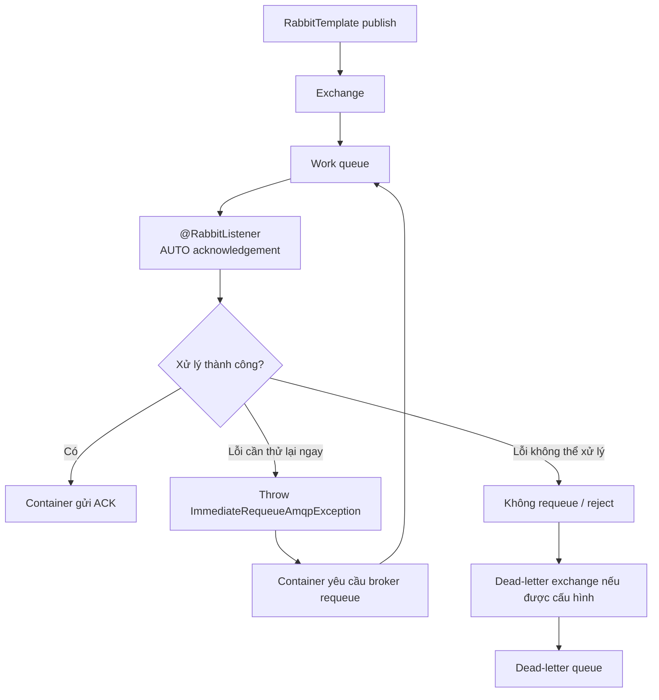
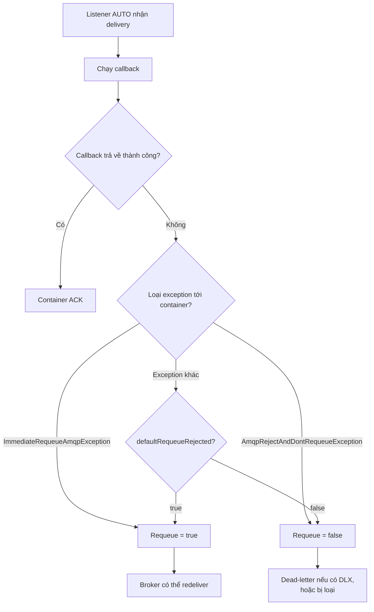
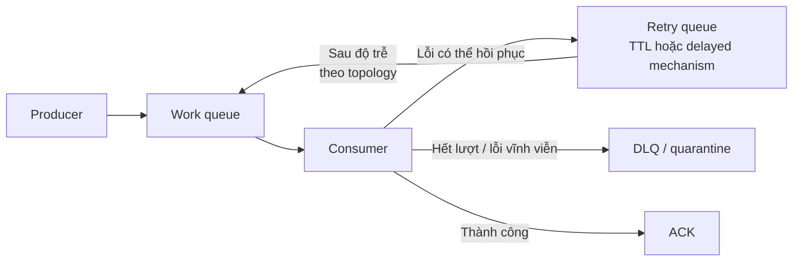
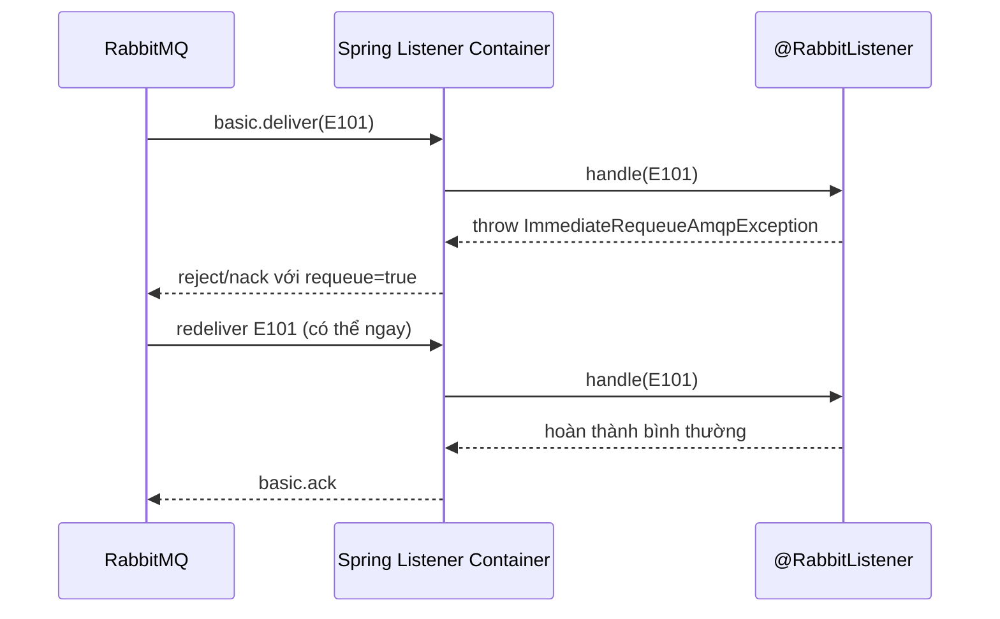
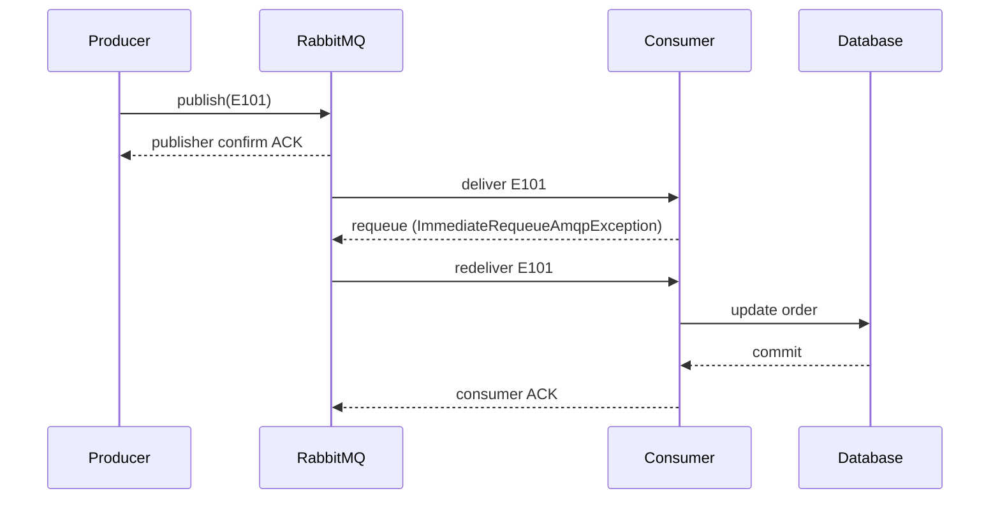

# ImmediateRequeueAmqpException và yêu cầu xếp lại có chủ đích

## 1. Vấn đề: listener lỗi thì có nên giao lại message ngay?

Trong module **SPRING_AMQP**, producer dùng `RabbitTemplate` gửi message tới một exchange; RabbitMQ chọn queue đích dựa trên routing key và binding; consumer dùng `@RabbitListener` để xử lý công việc bất đồng bộ. Khi phương thức consumer ném exception, broker và listener container phải quyết định: **ACK, requeue, retry hay dead-letter**?

Hãy xét một tác vụ xử lý đơn hàng:

1. `Order Service` publish `OrderCreated(eventId=E101)`.
2. Message đi qua exchange và được giữ trong queue `orders.process.q`.
3. `@RabbitListener` nhận delivery nhưng một điều kiện tạm thời chưa sẵn sàng.
4. Consumer muốn **đưa chính delivery đó trở lại queue ngay**, thay vì xác nhận thành công hoặc đưa thẳng tới dead-letter queue (DLQ).

Spring AMQP cung cấp **`ImmediateRequeueAmqpException`** để bày tỏ yêu cầu này với listener container. Điểm đặc biệt: nó có thể **yêu cầu requeue ngay cả khi container được cấu hình mặc định không requeue khi lỗi**.

Tuy nhiên, requeue ngay rất dễ tạo vòng lặp nóng nếu điều kiện lỗi không thay đổi. Vì thế, đây là **cơ chế điều khiển delivery**, không phải giải pháp retry tổng quát.

### Mục tiêu của bài

Sau khi học, bạn có thể:

- Giải thích `ImmediateRequeueAmqpException` dùng khi nào và chỉ có hiệu lực ở ranh giới nào.
- Phân biệt **nack/requeue của broker** với **retry trong cùng một lần xử lý** và **dead-letter**.
- Hiểu vai trò của `defaultRequeueRejected` và `AmqpRejectAndDontRequeueException`.
- Viết `@RabbitListener` ném exception để yêu cầu requeue có chủ đích.
- Cấu hình Spring Boot với RabbitMQ, exchange, queue, binding và DLQ rồi quan sát redelivery.
- Giới hạn việc sử dụng immediate requeue để tránh hot loop, mất tài nguyên hoặc xử lý trùng.
- Chọn retry có backoff, DLQ/quarantine hoặc idempotency khi yêu cầu nghiệp vụ phức tạp hơn.

## 2. Các lựa chọn khi consumer gặp lỗi

Trước khi dùng một exception cụ thể, cần hiểu các kết quả của **một delivery**.

| Quyết định | Ngữ nghĩa | Điều gì có thể xảy ra tiếp? |
| --- | --- | --- |
| **ACK** | Consumer xác nhận delivery đã hoàn tất | Broker loại delivery khỏi công việc đang chờ của queue |
| **NACK/REJECT, requeue=true** | Consumer chưa hoàn tất và yêu cầu broker đưa message vào khả năng giao lại | Message có thể được giao ngay cho cùng hoặc consumer khác |
| **NACK/REJECT, requeue=false** | Consumer từ chối delivery và không muốn đưa lại queue nguồn | Message có thể bị dead-letter nếu DLX hợp lệ, hoặc bị loại |
| **Retry trong listener** | Ứng dụng thử gọi lại logic xử lý mà chưa trả delivery về broker | Vẫn là cùng lần nhận, thường chưa có broker redelivery |
| **Dead-letter/retry queue** | Một delivery được chuyển sang luồng xử lý lỗi hoặc chờ có độ trễ theo topology | Có thể điều tra, trì hoãn rồi phát lại theo chính sách |

**`ImmediateRequeueAmqpException` tương ứng với mong muốn “requeue=true” ở ranh giới listener container/broker**, trong trường hợp ACK mode và error handling hỗ trợ. Nó không yêu cầu Spring ngủ vài giây, không tự tăng một bộ đếm retry nghiệp vụ và không tạo DLQ.



### Vì sao gọi là “có chủ đích”?

Với lỗi thông thường, container có thể áp chính sách **mặc định** để quyết định requeue hay reject. Với `ImmediateRequeueAmqpException`, **logic xử lý chủ động phát tín hiệu**: *“Tôi muốn broker đưa delivery này vào khả năng giao lại ngay”*.

Quyết định này phải xuất phát từ hiểu biết về **khả năng hồi phục của lỗi**, **chi phí retry**, **nguy cơ mất thứ tự** và **độ an toàn khi message được xử lý lặp lại**.

## 3. ImmediateRequeueAmqpException là gì?

### 3.1. Package và cách sử dụng

Class thuộc Spring AMQP:

```java
import org.springframework.amqp.ImmediateRequeueAmqpException;
```

Ví dụ cơ bản:

```java
@RabbitListener(queues = "orders.process.q")
public void onOrder(String orderId) {
    if (dependencyBrieflyUnavailable()) {
        throw new ImmediateRequeueAmqpException(
                "Phụ thuộc chưa sẵn sàng, yêu cầu requeue"
        );
    }

    processOrder(orderId);
}
```

Ở đây, `dependencyBrieflyUnavailable()` và `processOrder(...)` chỉ là hàm minh họa. Exception là một **tín hiệu cho listener container**, không phải một lần gọi trực tiếp tới `Channel.basicNack`.

Trong cấu hình listener container **`AcknowledgeMode.AUTO`** thông thường:

1. Listener nhận delivery.
2. Phương thức xử lý quyết định chưa thể hoàn tất và ném `ImmediateRequeueAmqpException`.
3. Exception đi qua listener adapter/error-handling infrastructure.
4. Container nhận ra yêu cầu **requeue**, ngay cả khi chính sách mặc định là không requeue.
5. Broker có thể giao lại message.

**Lưu ý về phạm vi:** các retry interceptors, custom error handlers, asynchronous listeners, MANUAL/NONE acknowledgement và phiên bản Spring AMQP có thể làm thay đổi đường đi của exception. Điều cần kiểm chứng là **exception cuối cùng có tới được container và delivery có thực sự được xử lý theo requeue hay không**.

### 3.2. Điều mà exception này không làm

`ImmediateRequeueAmqpException` **không** tự:

- Chờ 1, 5 hoặc 30 giây trước khi thử lại.
- Giới hạn số lần message được giao lại.
- Bảo đảm message được chuyển đến một consumer khác.
- Sửa JSON sai schema hoặc phục hồi một database đang lỗi kéo dài.
- Tạo dead-letter exchange hay dead-letter queue.
- Ghi transaction hoặc đánh dấu business event đã xử lý.
- Bảo đảm giữ nguyên thứ tự xử lý so với các message khác.
- Tạo exactly-once delivery hoặc exactly-once side effect.

Nếu một message không thể được xử lý do **dữ liệu sai cấu trúc vĩnh viễn**, immediate requeue thường là quyết định sai: nó khiến cùng lỗi lặp lại mà không có cơ hội tự phục hồi.

## 4. defaultRequeueRejected ảnh hưởng thế nào?

Spring AMQP listener container có thuộc tính `defaultRequeueRejected`, điều khiển hành vi mặc định khi listener ném exception và container phải reject/nack delivery.

Trong Spring Boot, có thể cấu hình cho simple listener container:

```yaml
spring:
  rabbitmq:
    listener:
      simple:
        acknowledge-mode: auto
        default-requeue-rejected: false
```

Đây là cách để lỗi thông thường **không tự bị requeue vô hạn**. Nhưng `ImmediateRequeueAmqpException` là một ngoại lệ có chủ đích đối với chính sách đó.

### Bảng kết quả trong AUTO mode

Giả sử listener container chạy `AUTO`, không có retry interceptor thay đổi exception và không có error handler đặc biệt nuốt lỗi:

| Cấu hình / exception | Quyết định mong đợi tại ranh giới container |
| --- | --- |
| `defaultRequeueRejected=true` + exception thông thường | **Requeue** theo hành vi mặc định |
| `defaultRequeueRejected=false` + exception thông thường | **Reject không requeue** |
| `defaultRequeueRejected=false` + `ImmediateRequeueAmqpException` | **Yêu cầu requeue** vì tín hiệu tường minh |
| `defaultRequeueRejected=true` + `AmqpRejectAndDontRequeueException` | **Không requeue** vì tín hiệu tường minh |
| Listener hoàn thành bình thường | **ACK** |
| Consumer mất connection trước ACK | Delivery chưa ACK có thể được broker giao lại |

Đây là quy tắc nền tảng của xử lý exception tại container, **không phải bảng cam kết cho mọi cấu hình**. Ví dụ retry advice có thể xử lý exception trước khi container thấy nó; ACK mode MANUAL làm trách nhiệm ACK/NACK thuộc về ứng dụng.

### Sơ đồ quyết định



**Không cố tình bọc lẫn hai special exceptions vào nhau.** Nếu exception chain đồng thời chứa nhiều dấu hiệu yêu cầu trái ngược, hành vi phụ thuộc cơ chế tìm nguyên nhân và phiên bản framework. Nên chọn **một quyết định rõ ràng** cho mỗi đường lỗi, sau đó kiểm thử integration với cấu hình thật.

## 5. Phân biệt ImmediateRequeueAmqpException và AmqpRejectAndDontRequeueException

Hai tên dễ gây nhầm vì cùng liên quan việc requeue nhưng ý nghĩa ngược nhau.

```java
import org.springframework.amqp.ImmediateRequeueAmqpException;
import org.springframework.amqp.AmqpRejectAndDontRequeueException;
```

| Tiêu chí | `ImmediateRequeueAmqpException` | `AmqpRejectAndDontRequeueException` |
| --- | --- | --- |
| Mong muốn | **Giao lại ngay** | **Không giao lại queue nguồn** |
| Gợi ý tình huống | Điều kiện tạm thời có thể đổi rất sớm | Payload không hợp lệ hoặc lỗi không thể phục hồi với bản message hiện tại |
| Tác động tới `defaultRequeueRejected` | Thường vượt qua cấu hình mặc định `false` để requeue | Thường vượt qua cấu hình mặc định `true` để không requeue |
| Broker xử lý | Requeue chưa ACK qua NACK/REJECT theo cơ chế container | Reject/NACK không requeue |
| DLQ | Không tự đưa vào DLQ | Có thể dead-letter nếu DLX hợp lệ |
| Độ trễ retry | Không có độ trễ cố định | Không retry queue nguồn |
| Rủi ro chính | **Hot loop**, starvation, tải dồn | Mất message nếu thiếu DLX/đường lưu lỗi |

Ví dụ phân loại:

```java
public void consume(String payload) {
    if (payload.startsWith("invalid:")) {
        throw new AmqpRejectAndDontRequeueException(
                "Payload vi phạm hợp đồng; đưa sang DLQ"
        );
    }

    if (payload.startsWith("transient:")) {
        throw new ImmediateRequeueAmqpException(
                "Phụ thuộc tạm thời chưa sẵn sàng"
        );
    }

    process(payload);
}
```

Đoạn này chỉ mang tính khái niệm. Nếu `transient:` luôn dẫn tới exception thì message **sẽ bị giao lại liên tục**. Muốn hoàn chỉnh, phải đảm bảo điều kiện hồi phục, giới hạn retry hoặc chuyển sang cơ chế trì hoãn khác.

### Tại sao reject không requeue cần DLX?

RabbitMQ chỉ đưa message sang DLQ nếu có cấu hình **dead-letter exchange**, routing/binding và queue đích phù hợp. Nếu không có DLX, message bị reject không requeue **có thể bị loại vĩnh viễn**.

Không mặc định rằng mọi message gặp `AmqpRejectAndDontRequeueException` sẽ xuất hiện ở DLQ. Bạn cần cấu hình và quan sát cả broker topology lẫn consumer error handling.

## 6. Requeue tại broker khác gì retry trong listener?

Một hệ thống đáng tin cậy có thể cần nhiều cấp thử lại. Tuy nhiên, chúng không giống nhau về nơi giữ delivery và thời điểm kiểm soát.

### 6.1. Immediate requeue qua broker

```text
Consumer A nhận E101
    -> kiểm tra phụ thuộc thấy chưa sẵn sàng
    -> throw ImmediateRequeueAmqpException
Listener container
    -> NACK/REJECT requeue=true
RabbitMQ
    -> đặt message về khả năng giao lại
    -> có thể deliver ngay cho A hoặc B
```

Một delivery mới có thể mang cờ `redelivered`. Nhưng cờ này **không phải bộ đếm retry**, không thay thế khóa idempotency và không bảo đảm lần sau một consumer khác nhận.

### 6.2. Retry tại ứng dụng

```text
RabbitMQ deliver E101 (một delivery chưa ACK)
    -> Listener / Retry interceptor
       attempt 1: dependency 503
       chờ backoff
       attempt 2: dependency 503
       chờ backoff
       attempt 3: thành công
    -> Container ACK
```

Ở đây một retry interceptor có thể thử logic nhiều lần **mà không phải trả delivery về queue giữa các lần**. Spring Retry interceptor có thể thiết lập `maxAttempts`, `backOffOptions` và `MessageRecoverer` theo API thích hợp.

**Nếu thêm listener retry advice**, exception `ImmediateRequeueAmqpException` phát sinh từ listener có thể bị retry interceptor bắt/xử lý trước, thay vì ngay lập tức chuyển thành broker requeue. Vì thế, khi kết hợp, cần làm rõ **lớp nào sở hữu retry** và kiểm thử đường đi từ exception đến container.

### 6.3. Retry bằng queue có độ trễ

Một topology có thể tách work queue, retry queue và DLQ:



Đây là sơ đồ **ngữ nghĩa**, không phải tự động có được chỉ bằng `ImmediateRequeueAmqpException`. Đường retry có độ trễ thường cần cơ chế republish/dead-letter/routing, chính sách tuổi message, đếm lần thử, deduplication và giám sát. Khi dùng TTL + DLX, phải cấu hình exchange/binding/queue và tránh dead-letter cycle không kiểm soát.

### Bảng chọn cách thử lại

| Tình huống | Lựa chọn nên đánh giá | Vì sao |
| --- | --- | --- |
| Một resource lock có thể được nhả gần như ngay, nhiều worker và broker đủ khả năng | **Immediate requeue**, rất thận trọng | Có thể tiếp tục mà không đợi trong consumer, nhưng dễ hot loop |
| DB/HTTP tạm thời lỗi trong vài giây hoặc phút | **Retry với backoff** | Giảm spam downstream và bảo vệ tài nguyên |
| API bị rate limit, có `Retry-After` | **Delay có kiểm soát** | Không làm sự cố rate limit nặng hơn |
| JSON sai schema, thiếu trường bắt buộc | **Reject không requeue → DLQ/quarantine** | Retry ngay không sửa được payload |
| Side effect đã commit nhưng consumer chưa ACK | **Idempotency / deduplication** | Redelivery có thể tạo xử lý trùng |
| Việc xử lý cần chờ một sự kiện khác xảy ra | **Workflow/event-driven chờ điều kiện** | Requeue liên tục không phải cơ chế chờ tốt |

## 7. Khi nào immediate requeue là một quyết định có chủ đích?

Một use case phù hợp phải đáp ứng **nhiều điều kiện**:

1. **Lỗi thật sự có tính tạm thời:** có bằng chứng điều kiện có thể đổi rất nhanh.
2. **Thử lại ngay có giá trị:** không phải tình huống chắc chắn thất bại thêm vài phút.
3. **Có kiểm soát tải:** broker, consumer và downstream chịu được số delivery được tăng thêm.
4. **Có giới hạn hoặc lối thoát:** không để message quay vòng vĩnh viễn; có khả năng chuyển sang trì hoãn/DLQ.
5. **Logic idempotent:** cùng message có thể được xử lý nhiều lần.
6. **Có quan sát:** biết được tỷ lệ redelivery, lỗi, CPU, unacked và thời gian tồn message.

Ví dụ: một worker giữ khóa phân tán cực ngắn, consumer khác vừa giải phóng khóa; requeue có thể giúp một worker nhận lại sau đó. Tuy nhiên, **RabbitMQ không cam kết giao lại cho consumer khác**, nên nếu khóa vẫn bị giữ, requeue ngay có thể tạo cơn bão.

### Những trường hợp không nên dùng

- Database đang bảo trì 30 phút.
- API đối tác trả HTTP 429 với thời gian chờ rõ ràng.
- Message chứa JSON không parse được.
- Một lệnh thanh toán thất bại do số dư không đủ.
- Consumer không biết có thể xử lý trùng an toàn hay không.
- Cần bảo đảm trình tự hoàn thành theo khách hàng nhưng requeue có thể thay đổi thứ tự.
- Muốn giữ message lâu dài để kiểm toán mà chưa có DLQ/outbox.

**Một exception có chữ “Immediate” không phải retry strategy cho mọi lỗi.** Nó phù hợp khi cần yêu cầu broker requeue **ngay tại ranh giới xử lý hiện tại**.

## 8. Demo Spring Boot: một lỗi requeue, một lỗi đưa vào DLQ

Mục tiêu lab là quan sát ba message:

- `transient:job-101`: lần đầu listener chủ động ném `ImmediateRequeueAmqpException`, lần sau xử lý thành công.
- `invalid:job-102`: listener ném `AmqpRejectAndDontRequeueException`, message đi DLQ nếu topology hợp lệ.
- `ok:job-103`: listener xử lý thành công và container ACK.

Để minh họa trường hợp transient có thể phục hồi, lab dùng **bộ đếm số lần nhận tạm thời trong bộ nhớ**. Đây **không** phải cách triển khai retry bền vững cho production: process restart sẽ làm bộ đếm mất, và một message có thể tiếp tục requeue sau restart.

### 8.1. Chuẩn bị

Yêu cầu:

- Java 17+.
- Dự án Spring Boot có `spring-boot-starter-amqp`, phiên bản Spring AMQP tương thích.
- RabbitMQ local; ví dụ container có Management UI.
- Maven hoặc Gradle.

Khởi động RabbitMQ nếu chưa có broker ở cổng tương ứng:

```bash
docker run -d --name rabbitmq-requeue-lab \
  -p 5672:5672 -p 15672:15672 rabbitmq:4-management
```

Management UI: `http://localhost:15672`, đăng nhập `guest/guest` trên broker local mặc định. Trong production cần tài khoản và secret riêng, không dùng cấu hình lab này.

Dependency Maven trong dự án Spring Boot:

```xml
<dependency>
    <groupId>org.springframework.boot</groupId>
    <artifactId>spring-boot-starter-amqp</artifactId>
</dependency>
```

Khi chạy ứng dụng trong một Docker container khác, `localhost` của ứng dụng **không trỏ tới container RabbitMQ**. Phải dùng service name/hostname trong Docker network.

### 8.2. Cấu hình listener và publisher

File `src/main/resources/application.yml`:

```yaml
spring:
  application:
    name: immediate-requeue-lab
  rabbitmq:
    host: localhost
    port: 5672
    username: guest
    password: guest
    publisher-confirm-type: correlated
    publisher-returns: true
    template:
      mandatory: true
    listener:
      simple:
        acknowledge-mode: auto
        concurrency: 1
        prefetch: 1
        default-requeue-rejected: false
        retry:
          enabled: false
```

Giải thích lựa chọn:

- `acknowledge-mode: auto`: container quyết định ACK/REJECT khi callback trả về hoặc ném lỗi.
- `default-requeue-rejected: false`: lỗi thông thường không requeue, **làm rõ giá trị của `ImmediateRequeueAmqpException`**.
- `prefetch: 1`: chỉ có tối đa một delivery chưa ACK danh nghĩa trên một consumer, dễ quan sát từng lượt.
- `concurrency: 1`: chạy một consumer để log dễ đọc, **không phải thiết kế tối ưu cho throughput**.
- `retry.enabled: false`: lab không cài retry advice trước container để quan sát trực tiếp exception dẫn tới broker requeue.
- Publisher confirms/returns được bật để phục vụ độ tin cậy phía gửi; ví dụ không triển khai đầy đủ callback, vì trọng tâm là consumer requeue.

**Nếu chỉ cấu hình `default-requeue-rejected=false` mà không tạo DLX/DLQ**, các exception bị reject không requeue có thể làm mất message. Vì vậy topology sau đây khai báo DLX và queue đích.

### 8.3. Khai báo exchange, queue, binding và DLQ

File `RequeueTopology.java`:

```java
package com.example.requeue;

import org.springframework.amqp.core.Binding;
import org.springframework.amqp.core.BindingBuilder;
import org.springframework.amqp.core.DirectExchange;
import org.springframework.amqp.core.Queue;
import org.springframework.amqp.core.QueueBuilder;
import org.springframework.beans.factory.annotation.Qualifier;
import org.springframework.context.annotation.Bean;
import org.springframework.context.annotation.Configuration;

@Configuration
public class RequeueTopology {

    public static final String EXCHANGE = "lab.requeue.events";
    public static final String WORK_QUEUE = "lab.requeue.work.q";
    public static final String ROUTING_KEY = "jobs.process";

    public static final String DLX = "lab.requeue.dlx";
    public static final String DLQ = "lab.requeue.dead.q";
    public static final String DEAD_KEY = "jobs.dead";

    @Bean
    DirectExchange workExchange() {
        return new DirectExchange(EXCHANGE);
    }

    @Bean
    DirectExchange deadLetterExchange() {
        return new DirectExchange(DLX);
    }

    @Bean
    Queue workQueue() {
        return QueueBuilder.durable(WORK_QUEUE)
                .deadLetterExchange(DLX)
                .deadLetterRoutingKey(DEAD_KEY)
                .build();
    }

    @Bean
    Queue deadQueue() {
        return QueueBuilder.durable(DLQ).build();
    }

    @Bean
    Binding workBinding(
            @Qualifier("workQueue") Queue queue,
            @Qualifier("workExchange") DirectExchange exchange) {

        return BindingBuilder.bind(queue)
                .to(exchange)
                .with(ROUTING_KEY);
    }

    @Bean
    Binding deadBinding(
            @Qualifier("deadQueue") Queue queue,
            @Qualifier("deadLetterExchange") DirectExchange exchange) {

        return BindingBuilder.bind(queue)
                .to(exchange)
                .with(DEAD_KEY);
    }
}
```

Một số lưu ý:

- `DirectExchange` sử dụng binding key so khớp chính xác routing key.
- Work queue là durable; queue chứa message chưa được xử lý, không có nghĩa exactly-once.
- DLX phải có binding đến DLQ, nếu không message reject không requeue có thể bị mất khỏi luồng xử lý.
- Trong production, có thể đặt dead-letter topology bằng RabbitMQ **policy** để điều chỉnh vận hành mà không phải redeclare queue.
- Không thay một queue đã tồn tại với `x-dead-letter-exchange` khác rồi kỳ vọng RabbitMQ tự sửa arguments; có thể gặp `PRECONDITION_FAILED`.
- RabbitAdmin trong Spring Boot thông dụng có thể khai báo các bean topology khi mở kết nối RabbitMQ.

### 8.4. @RabbitListener chủ động requeue đúng một lần trong lab

File `RequeueDemoListener.java`:

```java
package com.example.requeue;

import java.nio.charset.StandardCharsets;
import java.util.concurrent.ConcurrentHashMap;
import java.util.concurrent.ConcurrentMap;
import java.util.concurrent.atomic.AtomicInteger;

import org.springframework.amqp.AmqpRejectAndDontRequeueException;
import org.springframework.amqp.ImmediateRequeueAmqpException;
import org.springframework.amqp.core.Message;
import org.springframework.amqp.rabbit.annotation.RabbitListener;
import org.springframework.stereotype.Component;

@Component
public class RequeueDemoListener {

    private final ConcurrentMap<String, AtomicInteger> receiveCounts =
            new ConcurrentHashMap<>();

    @RabbitListener(queues = RequeueTopology.WORK_QUEUE)
    public void handle(Message message) {
        String payload = new String(
                message.getBody(),
                StandardCharsets.UTF_8
        );

        int attempt = receiveCounts
                .computeIfAbsent(payload, key -> new AtomicInteger())
                .incrementAndGet();

        boolean redelivered =
                message.getMessageProperties().isRedelivered();

        System.out.printf(
                "[RECEIVE] payload=%s attempt=%d redelivered=%s%n",
                payload, attempt, redelivered
        );

        if (payload.startsWith("invalid:")) {
            throw new AmqpRejectAndDontRequeueException(
                    "Payload không hợp lệ, không requeue: " + payload
            );
        }

        if (payload.startsWith("transient:") && attempt == 1) {
            throw new ImmediateRequeueAmqpException(
                    "Lỗi tạm thời giả lập: yêu cầu broker requeue ngay"
            );
        }

        System.out.println("[SUCCESS] processed: " + payload);
    }
}
```

Ở đây, có ba nhánh:

1. `invalid:...` → explicit **không requeue** → dự kiến DLQ nhận message nếu reject/dead-letter được broker thực thi.
2. `transient:...` ở **lượt nhận đầu** → explicit **requeue ngay**.
3. `transient:...` ở lượt nhận tiếp theo hoặc `ok:...` → hoàn thành bình thường → container **ACK**.

**Bộ đếm `receiveCounts` chỉ là công cụ minh họa**. Nó gộp mọi message có cùng payload thành một khóa, không lưu trên DB và không được chia sẻ giữa các instance. Không dùng cách này làm retry counter/idempotency trong production. Một cơ chế đáng tin cần dựa vào message ID hoặc business event ID và retry policy bền vững.

Vì callback nhận `org.springframework.amqp.core.Message`, ví dụ tự decode raw body UTF-8. Với JSON DTO thực tế, cần message converter tương thích và validation; lỗi conversion có thể xuất hiện **trước khi method được gọi**.

### 8.5. Producer phát dữ liệu bằng RabbitTemplate

File `RequeueDemoPublisher.java`:

```java
package com.example.requeue;

import org.springframework.amqp.rabbit.core.RabbitTemplate;
import org.springframework.stereotype.Service;

@Service
public class RequeueDemoPublisher {

    private final RabbitTemplate template;

    public RequeueDemoPublisher(RabbitTemplate template) {
        this.template = template;
    }

    public void publishSamples() {
        publish("transient:job-101");
        publish("invalid:job-102");
        publish("ok:job-103");
    }

    public void publish(String payload) {
        template.convertAndSend(
                RequeueTopology.EXCHANGE,
                RequeueTopology.ROUTING_KEY,
                payload
        );

        System.out.println("[PUBLISH] " + payload);
    }
}
```

Producer chỉ biết exchange, routing key và payload. **Nó không quyết định consumer ACK hay requeue**. Việc `convertAndSend` hoàn thành không tự chứng minh broker đã ghi message hoặc listener xử lý xong.

### 8.6. Khởi động ứng dụng

File `RequeueDemoApplication.java`:

```java
package com.example.requeue;

import org.springframework.amqp.rabbit.annotation.EnableRabbit;
import org.springframework.boot.ApplicationRunner;
import org.springframework.boot.SpringApplication;
import org.springframework.boot.autoconfigure.SpringBootApplication;
import org.springframework.context.annotation.Bean;

@SpringBootApplication
@EnableRabbit
public class RequeueDemoApplication {

    public static void main(String[] args) {
        SpringApplication.run(RequeueDemoApplication.class, args);
    }

    @Bean
    ApplicationRunner publishDemo(RequeueDemoPublisher publisher) {
        return args -> publisher.publishSamples();
    }
}
```

Chạy từ thư mục project Maven:

```bash
./mvnw spring-boot:run
```

Trên Windows PowerShell:

```powershell
.\mvnw.cmd spring-boot:run
```

Khi Spring khởi động, các bean `Queue`/`Exchange`/`Binding` được khai báo theo cấu hình admin, listener được đăng ký và runner phát ba message.

**Thứ tự log không hoàn toàn cố định** do publish và consume bất đồng bộ. Trong một lần lab sạch, có thể thấy log tương tự:

```text
[PUBLISH] transient:job-101
[PUBLISH] invalid:job-102
[PUBLISH] ok:job-103

[RECEIVE] payload=transient:job-101 attempt=1 redelivered=false
... ImmediateRequeueAmqpException ...
[RECEIVE] payload=transient:job-101 attempt=2 redelivered=true
[SUCCESS] processed: transient:job-101

[RECEIVE] payload=invalid:job-102 attempt=1 redelivered=false
... AmqpRejectAndDontRequeueException ...

[RECEIVE] payload=ok:job-103 attempt=1 redelivered=false
[SUCCESS] processed: ok:job-103
```

Tùy chính sách requeue, broker và thời điểm các message đã vào queue, thứ tự nhận có thể khác; message requeue có thể được đặt lại gần đầu queue và được giao nhanh. **Không dựa vào thứ tự log trên như một cam kết thứ tự delivery**.

### 8.7. Kết quả kiểm tra

Với broker lab sạch, không có consumer khác và topology hoạt động:

| Message | Hành vi listener | Kết quả mong đợi |
| --- | --- | --- |
| `transient:job-101` | Lần 1 ném `ImmediateRequeueAmqpException`, lần 2 thành công | Có redelivery; sau đó ACK, không tự vào DLQ |
| `invalid:job-102` | Ném `AmqpRejectAndDontRequeueException` | Không requeue; vào DLQ nếu dead-letter thành công |
| `ok:job-103` | Trả về bình thường | Container ACK |
| `lab.requeue.work.q` | Xử lý hết ba message | Ready/Unacked thường về 0 |
| `lab.requeue.dead.q` | Không có consumer đọc DLQ | Dự kiến chứa 1 message lỗi |

Mở `http://localhost:15672` để xem queue, số consumers, deliver/ack/redelivery rates, DLQ. Nếu consumer xử lý nhanh, bạn có thể không nhìn thấy trạng thái Ready trong snapshot; kết hợp log theo payload và metric theo thời gian.

**Mỗi lần khởi động `ApplicationRunner` sẽ publish thêm ba message.** Với bộ đếm lưu trong RAM, kết quả lần chạy thứ hai có thể khác nếu queue cũ còn backlog. Chỉ kết luận số đếm chính xác trong lab cô lập, khi biết dữ liệu ban đầu.

## 9. Điều gì xảy ra bên trong listener container?

### 9.1. AUTO mode: container quyết định requeue

Đường đi minh họa:



Ở chế độ `AUTO`, application ném exception, còn container thực hiện **ACK/NACK ở tầng AMQP**. Đây là khác biệt so với dùng RabbitMQ Java client `Channel` để tự ACK/NACK trực tiếp.

### 9.2. MANUAL mode: không dùng exception để thay lời gọi Channel

Với `AcknowledgeMode.MANUAL`, application thường chịu trách nhiệm ACK/NACK một delivery cụ thể. Nếu muốn requeue có chủ đích, nên dùng `Channel.basicNack(...)` hoặc `basicReject(...)` tương ứng.

Mẫu listener MANUAL minh họa:

```java
@RabbitListener(
    queues = "orders.manual.q",
    ackMode = "MANUAL"
)
public void consume(
        org.springframework.amqp.core.Message message,
        com.rabbitmq.client.Channel channel) throws java.io.IOException {

    long tag = message.getMessageProperties().getDeliveryTag();

    if (shouldRequeue(message)) {
        channel.basicNack(tag, false, true);
        return;
    }

    if (isInvalid(message)) {
        channel.basicReject(tag, false);
        return;
    }

    process(message);
    channel.basicAck(tag, false);
}
```

Đây là snippet minh họa: `shouldRequeue(...)`, `isInvalid(...)` và `process(...)` là logic cần viết.

- `basicNack(tag, false, true)`: yêu cầu broker requeue delivery.
- `basicReject(tag, false)`: reject không requeue.
- `basicAck(tag, false)`: xác nhận delivery thành công.
- Chỉ chọn **một** kết quả cho một delivery.
- ACK/NACK phải chạy trên **đúng channel đã nhận delivery tag**.

**Không áp dụng lời khuyên “ném ImmediateRequeueAmqpException là đủ trong mọi trường hợp” cho MANUAL mode.** Error handler và cấu hình container có thể ảnh hưởng đến delivery còn unacked; cần thiết kế explicit ACK/NACK hoặc kiểm chứng cơ chế framework hỗ trợ.

### 9.3. NONE mode: không có delivery chưa ACK để requeue an toàn

`AcknowledgeMode.NONE` thường dùng cơ chế RabbitMQ auto-ack, nghĩa là broker coi delivery đã giao mà không đợi consumer acknowledgement. Nếu ứng dụng gặp lỗi, không thể dựa vào `ImmediateRequeueAmqpException` để lấy lại một message broker đã coi như hoàn tất.

Với công việc quan trọng, nên dùng **AUTO hoặc MANUAL** kèm cơ chế lỗi, redelivery và idempotency rõ ràng.

## 10. Vì sao requeue ngay có thể tạo hot loop?

Giả sử dependency xuống trong 10 phút, nhưng listener vẫn ném `ImmediateRequeueAmqpException` mỗi lần:

```text
RabbitMQ deliver E101
    ↓
Consumer: dependency unavailable
    ↓
ImmediateRequeueAmqpException
    ↓
Broker requeue E101
    ↓
RabbitMQ deliver E101 lại
    ↓
Consumer: dependency vẫn unavailable
    ↓
... lặp lại không có độ trễ
```

Hậu quả có thể xảy ra:

- CPU và network của ứng dụng/broker tăng mạnh.
- Log bị tràn bởi cùng một exception.
- Message khác bị trì hoãn vì consumer bận lặp lại poison message.
- Thứ tự xử lý bị xáo trộn do redelivery.
- API/database đang lỗi nhận thêm tải thay vì có thời gian hồi phục.
- Quorum queue có thể áp **delivery limit/poison-message handling** làm message bị dead-letter hoặc loại sau nhiều lần giao, tùy version/config.

### 10.1. Không có gì bảo đảm retry lần sau tốt hơn

RabbitMQ có thể giao lại cùng consumer, thậm chí gần như ngay lập tức. Lỗi **không tự trở nên recoverable** chỉ vì message đi qua broker thêm một vòng.

Vì vậy, chỉ dùng immediate requeue khi:

- Điều kiện lỗi có khả năng thay đổi nhanh, **không phải phụ thuộc down dài hạn**.
- Có cách giới hạn vòng lặp hoặc thoát sang cơ chế trì hoãn.
- Có cảnh báo khi redelivery rate tăng.
- Có thiết kế idempotency vì duplicate side effect vẫn có thể xảy ra.

### 10.2. Giới hạn số lần và độ trễ

`ImmediateRequeueAmqpException` không có tham số như `maxAttempts=5` hay `delay=30s`. Nếu muốn giới hạn thử lại, phải đặt logic bên ngoài:

- Spring Retry interceptor với số lượt hữu hạn/backoff và recoverer phù hợp.
- Một retry queue có TTL/đường trả về sau độ trễ.
- Delayed delivery feature phù hợp với hạ tầng nếu được sử dụng.
- Một scheduler/job store hoặc workflow xử lý theo trạng thái nghiệp vụ.

**Không dùng biến `ConcurrentHashMap` của demo làm retry counter production.** Khi consumer restart hoặc nhiều replica cùng chạy, bộ đếm đó không nhất quán. Nếu cần số lượt xử lý đáng tin, dùng chiến lược lưu trạng thái bền vững và quan sát được.

## 11. Điều gì không xảy ra khi message chỉ được requeue?

Một số metadata/cơ chế dễ bị hiểu nhầm:

### 11.1. Requeue không tự tăng x-death

Header như `x-death` chủ yếu ghi nhận lịch sử **dead-lettering**. Nếu delivery chỉ bị NACK với `requeue=true` rồi được giao lại ngay trong cùng queue, **không nên dựa vào `x-death` để đếm những vòng requeue đó**.

Với quorum queue, broker có thể cung cấp metadata như `x-delivery-count` và giới hạn số lần giao; chi tiết phụ thuộc RabbitMQ version và queue type. Không áp dụng vô điều kiện bộ đếm này cho mọi classic queue.

### 11.2. Redelivered flag không phải attempt counter

Có thể đọc:

```java
boolean redelivered =
        message.getMessageProperties().isRedelivered();
```

Cờ này giúp biết delivery đang được broker đánh dấu giao lại. Nó **không cho biết chính xác đã thử bao nhiêu lần** và không phát hiện mọi kiểu duplicate: producer có thể publish lại cùng một sự kiện nghiệp vụ với message ID mới.

### 11.3. Requeue không có nghĩa gửi lại từ publisher

`ImmediateRequeueAmqpException` điều khiển **message đã nằm trong work queue và đang được consumer nhận**. Nó không gọi lại `RabbitTemplate.convertAndSend(...)` và không tự yêu cầu publisher phát một message mới.

Vì vậy cần phân biệt:

| Hành động | Vị trí phát sinh |
| --- | --- |
| Requeue delivery do consumer yêu cầu | Broker và consumer channel |
| Publish lại một sự kiện khi chưa nhận confirm | Producer |
| Republish sang retry exchange/queue | Ứng dụng/recoverer/topology |
| Dead-letter khi reject/expire/delivery-limit | Broker theo chính sách queue |

Tất cả đều có thể dẫn tới **cùng nghiệp vụ được xử lý lại**, nhưng nguyên nhân, thứ tự và metadata khác nhau.

## 12. Quan hệ với publisher confirms và idempotency

Producer có thể đã nhận **publisher confirm ACK** cho message E101 từ trước. Sau đó consumer ném `ImmediateRequeueAmqpException` hàng chục lần.

**Broker không thu hồi publisher confirm** vì listener chưa xử lý được. Publisher confirm chỉ xác minh broker đã xử lý publish theo điều kiện confirm; consumer ACK/requeue là ranh giới khác.



### Khi nào vẫn có duplicate side effect?

Giả sử consumer đã cập nhật DB thành công nhưng lỗi mạng làm ACK không tới broker. Message có thể redeliver rồi chạy lại, dù trước đó đã có confirm của publisher.

Cách phòng vệ:

1. Gắn **eventId/commandId** duy nhất ở producer.
2. Lưu ID đã xử lý và business state trong một transaction DB phù hợp.
3. Sử dụng ràng buộc unique hoặc logic chống tạo side effect trùng.
4. Nếu cùng ID được nhận lại, xác định đã hoàn thành rồi ACK theo quy tắc nghiệp vụ.
5. Cảnh báo khi số redelivery hoặc retry vượt ngưỡng.

Đối với producer vừa ghi DB vừa publish, `@Transactional` trên Java method **không tự biến** DB commit và RabbitMQ publish thành một transaction phân tán nguyên tử. Khi cần bền vững, xem xét **transactional outbox**.

## 13. Error handler và advice chain có thể thay đổi kết quả

### 13.1. ConditionalRejectingErrorHandler

Spring AMQP listener container có error handler, thường dùng các chiến lược xác định **lỗi nghiêm trọng không thể phục hồi**. Một số lỗi chuyển đổi dữ liệu và ánh xạ tham số có thể được coi là fatal: body JSON không thể deserialize thành DTO, thiếu header bắt buộc, kiểu tham số không phù hợp...

Trong các đường xử lý mặc định, loại lỗi đó có thể được chuyển sang **reject không requeue** để tránh poison message quay vòng mãi. Chi tiết thay đổi theo phiên bản và cấu hình.

**Đừng giả định `ImmediateRequeueAmqpException` sẽ luôn được dùng cho mọi exception trước cả business method.** Nếu conversion thất bại trước khi `@RabbitListener` được gọi, code trong method không có cơ hội quyết định ném exception này.

Nếu cần xử lý đặc thù lỗi parse/schema, cấu hình error handler, converter hoặc logic quarantine ở tầng phù hợp.

### 13.2. Retry interceptor nằm giữa listener và container

Khi bật retry ở Spring listener factory, luồng có thể là:

```text
RabbitMQ delivery
    -> Listener container
        -> Retry advice / interceptor
            -> Business listener
        -> MessageRecoverer nếu hết số lượt
    -> Container ACK/REJECT/REQUEUE theo kết quả cuối
```

Nếu business listener ném `ImmediateRequeueAmqpException`, advice có thể:

- Chạy lại business logic ngay trong cùng delivery.
- Áp backoff.
- Ném exception hoặc chuyển cho recoverer sau khi hết lượt.

Do đó, **không nên chỉ đọc tên exception rồi khẳng định broker sẽ redeliver đúng một lần**. Test phải đi qua cấu hình thực tế gồm retry advice, error handler, ack mode và DLX.

### 13.3. MessageRecoverer sau retry

Một số cơ chế `MessageRecoverer` có thể:

- Reject không requeue sau khi vượt số lượt.
- Republish đến exchange/queue xử lý lỗi.
- Yêu cầu requeue nếu đó là chiến lược được chọn.

Các lựa chọn này có hậu quả khác nhau về độ bền và khả năng quan sát. Đặc biệt, **recoverer đã republish message** khác với **broker requeue cùng delivery**. Cần biết khi nào message nguồn được ACK và khi nào publish tới nơi khác được xác nhận.

## 14. Test case quan trọng

### Test A — Exception thường với defaultRequeueRejected=false

1. Giữ `default-requeue-rejected=false`, AUTO acknowledgement, work queue có DLX.
2. Tạo một listener branch ném `IllegalArgumentException`.
3. Gửi message tương ứng.
4. Quan sát message bị reject không requeue và có thể vào DLQ.

**Kết luận:** exception thường không yêu cầu requeue tường minh; container áp chính sách mặc định.

### Test B — ImmediateRequeueAmqpException vượt chính sách mặc định

1. Giữ cấu hình ở trên.
2. Gửi `transient:job-101`.
3. Lần đầu listener ném `ImmediateRequeueAmqpException`.
4. Quan sát broker redelivery, dù `defaultRequeueRejected=false`.
5. Lần hai listener thành công và container ACK.

**Kết luận:** special exception giúp yêu cầu requeue có chủ đích ở AUTO mode.

### Test C — AmqpRejectAndDontRequeueException

1. Gửi `invalid:job-102`.
2. Listener ném `AmqpRejectAndDontRequeueException`.
3. Quan sát DLQ, event ID và nguyên nhân lỗi.
4. Xác minh không có vòng redelivery vô hạn.

**Kết luận:** lỗi vĩnh viễn nên có lối xử lý thay vì requeue mù.

### Test D — Hot loop

Trên queue **lab cô lập**, tạo nhánh luôn ném `ImmediateRequeueAmqpException`. Chạy trong thời gian được kiểm soát và chuẩn bị cách dừng consumer.

Quan sát log, delivery/redelivery rates và CPU. Sau đó **dừng consumer**, sửa logic rồi chạy lại. Không làm fault test này trên queue production.

**Kết luận:** requeue ngay không có cơ chế backoff tự động.

### Test E — Thêm retry advice

Bật Spring listener retry với `maxAttempts` và backoff hữu hạn trong một bản lab riêng. Quan sát số lần **business method** chạy so với số lần broker **redeliver**.

**Kết luận:** retry ở application và requeue ở broker là hai tầng khác nhau; không cộng số lượt đơn giản nếu chưa định nghĩa rõ cách đếm.

### Test F — Hai consumer trên một queue

Cho consumer A và B cùng subscribe `lab.requeue.work.q`. Yêu cầu requeue từ A.

**Không được giả định B chắc chắn nhận message**. Broker có thể giao lại cho A, B hoặc xử lý theo trạng thái consumer/channel hiện tại. Nếu nghiệp vụ cần điều phối ownership nghiêm ngặt, phải thiết kế cơ chế bổ sung.

## 15. Quan sát: cần đếm gì để biết requeue đang làm hại hệ thống?

| Chỉ số | Câu hỏi nó trả lời | Dấu hiệu cần chú ý |
| --- | --- | --- |
| Delivery rate | Broker đang giao bao nhiêu delivery/giây? | Tăng vọt không tương ứng số event mới |
| Redelivery rate | Có message liên tục được giao lại không? | Redelivery lớn kéo dài |
| Ready/Unacked | Backlog đang chờ hay đang được consumer giữ? | Unacked/Ready dao động bất thường |
| Listener error count | Lỗi xuất hiện ở nhánh nào? | Cùng exception lặp nhiều lần |
| DLQ length | Có message bị loại khỏi work queue và dead-letter? | Tăng nhanh, không có người xử lý |
| Processing latency | Business callback mất bao lâu? | Tăng do downstream bị quá tải |
| Broker/client CPU & network | Requeue có tạo hot loop không? | Tăng mạnh dù throughput nghiệp vụ không tăng |
| Unique business event ID completed | Bao nhiêu công việc **khác nhau** đã hoàn tất? | Không tăng dù delivery tăng |
| Quorum delivery count/limit (nếu có) | Message có gần ngưỡng poison-handling không? | Có nguy cơ dead-letter/drop ngoài mong đợi |

Nên log **eventId**, queue, routing key, attempt theo cơ chế phù hợp, redelivered flag, exception type và thời gian xử lý. Tránh log toàn bộ payload nếu chứa thông tin cá nhân hoặc secret.

Ví dụ log mong muốn:

```text
time       eventId  queue                phase       outcome
10:00:01   E101     lab.requeue.work.q   received    first-attempt
10:00:01   E101     lab.requeue.work.q   decision    immediate-requeue
10:00:01   E101     lab.requeue.work.q   redelivered true
10:00:02   E101     lab.requeue.work.q   completed   ack
10:00:03   E102     lab.requeue.work.q   rejected    DLQ
```

Các mốc thời gian chỉ là minh họa. Khi broker requeue message và consumer khác nhận ngay, dashboard có thể không hiển thị một giai đoạn Ready rõ ràng.

## 16. Troubleshooting

| Triệu chứng | Nguyên nhân khả dĩ | Hướng xử lý |
| --- | --- | --- |
| Ném `ImmediateRequeueAmqpException` nhưng message không quay lại | ACK mode NONE/MANUAL không có đường NACK như kỳ vọng; error handler/advice đổi outcome | Kiểm tra listener factory, container logs, ACK mode và exception chain |
| Message quay vòng liên tục, CPU/log tăng mạnh | Requeue ngay không có backoff, lỗi không tự hồi phục | Dừng consumer có kiểm soát; dùng bounded retry/backoff hoặc DLQ |
| `defaultRequeueRejected=false` nhưng vẫn thấy redelivery | Exception tường minh yêu cầu requeue hoặc connection mất trước ACK | Kiểm tra `ImmediateRequeueAmqpException`, redelivered flag và container logs |
| Message lỗi không vào DLQ | Chỉ requeue chứ không dead-letter, hoặc DLX/binding sai | Phân biệt reject không requeue với requeue; kiểm tra topology |
| Thấy `x-death` không tăng dù redelivery nhiều | `x-death` ghi nhận dead-letter, không phải mỗi lần requeue | Dùng redelivery metrics và counter phù hợp queue type |
| Một message sau requeue được consumer khác nhận | Competing consumers | Thiết kế idempotent, không giả định affinity |
| Thứ tự xử lý khác thứ tự publish | Requeue, concurrency, prefetch | Đánh giá yêu cầu ordering và cơ chế phù hợp |
| Bật Spring Retry rồi số lần gọi listener khác số lần broker delivery | Retry interceptor xử lý trong cùng delivery | Phân biệt attempt trong-process với redelivery |
| Quorum queue gửi message sang DLQ dù code luôn requeue | Delivery limit/poison handling theo version/policy | Kiểm tra `x-delivery-count`, queue type và giới hạn thực tế |
| Listener method không chạy, nhưng error handler báo lỗi | Conversion/argument binding thất bại trước khi gọi method | Kiểm tra converter, schema, custom fatal exception strategy |
| Duplicate side effect sau khi callback từng thành công | ACK mất sau DB commit hoặc producer publish duplicate | Idempotency bằng business ID và DB transaction |
| Publisher nhận confirm ACK nhưng listener vẫn lỗi | Publisher confirm và consumer ACK độc lập | Theo dõi DLQ/retry và business completion riêng |

## 17. Checklist trước khi sử dụng trong production

1. **Exception này có thực sự cần thiết?** Nếu muốn chờ vài giây, retry có backoff thường phù hợp hơn.
2. **ACK mode nào?** AUTO là trường hợp chính cho special exception; MANUAL cần logic ACK/NACK riêng.
3. **Có retry advice đang chạy không?** Exception có thể bị interceptor giữ trước khi tới container.
4. **Lỗi có tự hồi phục nhanh không?** Có bằng chứng thay vì chỉ hy vọng không?
5. **Có ngưỡng dừng không?** Requeue nhiều lần sẽ đi đâu, ai nhận cảnh báo?
6. **Có DLQ/quarantine không?** Message không hợp lệ có đường điều tra, không bị drop ngầm?
7. **Idempotency đã bảo vệ side effect chưa?** Consumer restart/redelivery không tạo tác vụ trùng?
8. **Quorum poison-message limit có ảnh hưởng không?** Đừng giả định requeue mãi sẽ giữ message vô hạn.
9. **Monitoring đã phân biệt delivery và business completion chưa?** Delivery tăng không có nghĩa công việc hoàn tất.
10. **Đã test trên broker/phiên bản thực tế chưa?** Kiểm tra cách ack, redelivery, error handler và retry.

## 18. Tổng kết

**`ImmediateRequeueAmqpException` là tín hiệu có chủ đích để Spring AMQP listener container yêu cầu RabbitMQ requeue một delivery chưa hoàn tất**, kể cả khi `defaultRequeueRejected=false` trong chế độ xử lý phù hợp.

```text
Lỗi tạm thời rất ngắn
    -> throw ImmediateRequeueAmqpException
    -> container yêu cầu broker requeue
    -> có thể redeliver ngay
    -> listener xử lý lại, cần idempotency

Lỗi không thể phục hồi bằng cùng payload
    -> reject không requeue
    -> DLX/DLQ nếu topology hợp lệ

Lỗi tạm thời cần thời gian phục hồi
    -> retry với backoff / delayed queue
    -> giới hạn số lần và quan sát
```

Cần phân biệt:

- **Immediate requeue:** trả message về khả năng giao lại ở broker.
- **Retry interceptor:** thử logic xử lý trong cùng delivery theo policy của ứng dụng.
- **Dead-letter:** chuyển message sang luồng lỗi, không phải requeue cùng queue.
- **Publisher confirm:** xác nhận việc broker xử lý publish, **không** xác nhận consumer đã xử lý xong.
- **Consumer ACK:** xác nhận delivery hoàn tất theo logic/container.
- **Business completion:** trạng thái nghiệp vụ phải được ứng dụng kiểm soát bằng transaction, idempotency và theo dõi end-to-end.

Với Spring AMQP, RabbitMQ và `@RabbitListener`, một hệ thống đáng tin cậy không chỉ cần biết **khi nào requeue**, mà còn phải biết **khi nào không nên requeue ngay** để tránh lặp vô hạn, mất tính công bằng, dữ liệu trùng và sự cố lan rộng.

### Tài liệu tham khảo chính thức

- [Spring AMQP — Exception Handling](https://docs.spring.io/spring-amqp/reference/amqp/exception-handling.html)
- [Spring AMQP — Listener Container Attributes](https://docs.spring.io/spring-amqp/reference/amqp/containerAttributes.html)
- [Spring AMQP — Listener Retry](https://docs.spring.io/spring-amqp/reference/amqp/resilience-recovering-from-errors-and-broker-failures.html)
- [Spring AMQP — Annotation-driven Listener Endpoints](https://docs.spring.io/spring-amqp/reference/amqp/receiving-messages/async-annotation-driven.html)
- [RabbitMQ — Consumer Acknowledgements and Publisher Confirms](https://www.rabbitmq.com/docs/confirms)
- [RabbitMQ — Negative Acknowledgements](https://www.rabbitmq.com/docs/nack)
- [RabbitMQ — Dead Letter Exchanges](https://www.rabbitmq.com/docs/dlx)
- [RabbitMQ — Quorum Queues](https://www.rabbitmq.com/docs/quorum-queues)
