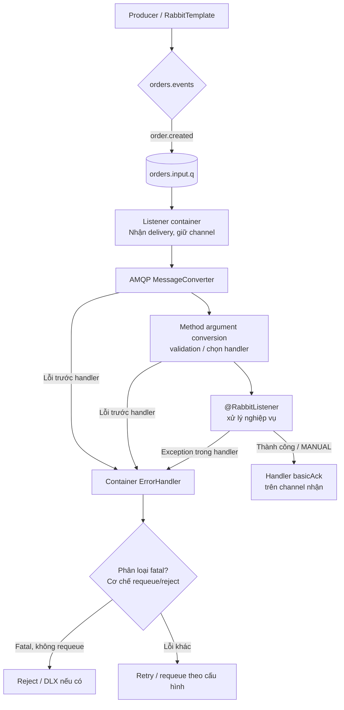
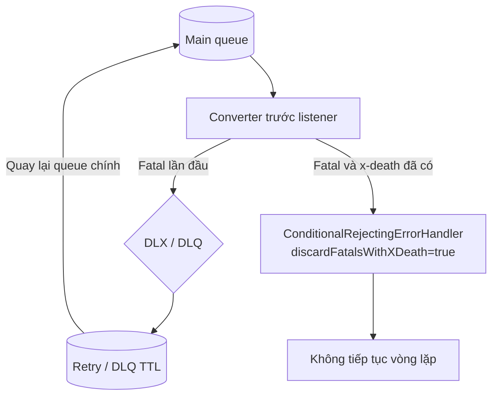
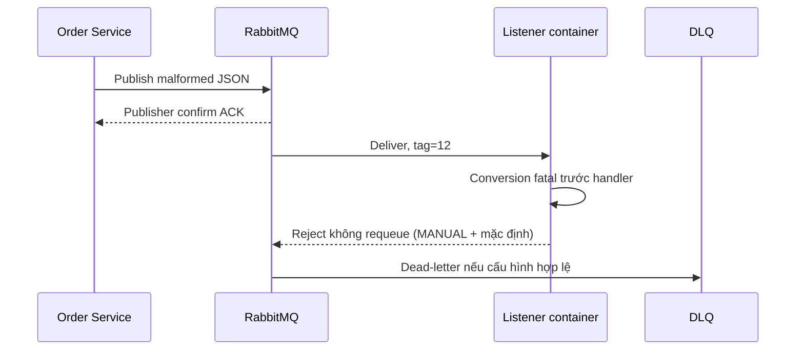

# Lỗi fatal trước khi gọi listener và tác động đến MANUAL ack

Một ứng dụng Spring AMQP dùng `@RabbitListener(ackMode = "MANUAL")` để tự xác nhận message. Thông thường, handler lấy `deliveryTag` từ message và gọi `channel.basicAck(...)` hoặc `channel.basicNack(...)`. Nhưng nếu JSON hỏng, metadata không hợp lệ hoặc framework không chuyển đổi được tham số **trước khi phương thức listener được gọi**, handler sẽ không có cơ hội ACK hay NACK. Message đó sẽ đi đâu?

Spring AMQP có một cơ chế đặc biệt để giải quyết tình huống này: **`ConditionalRejectingErrorHandler`** cùng chiến lược phân loại lỗi **fatal**. Với cấu hình mặc định, một số lỗi không thể phục hồi bằng cách giao lại cùng message được **reject và không requeue**, **ngay cả khi acknowledge mode là MANUAL**.

Đây là chủ đề trung tâm của bài **“Lỗi fatal trước khi gọi listener và tác động đến MANUAL ack”**, thuộc chương **Xử lý lỗi** của module **SPRING_AMQP**. Bài gắn trực tiếp vào luồng RabbitMQ với `RabbitTemplate`, `@RabbitListener`, exchange, queue và binding; sau đó xem xét retry, dead-letter, giao dịch, publisher confirms và quan sát hệ thống bất đồng bộ tin cậy.

Sau khi học, bạn có thể:

1. Phân biệt **lỗi xảy ra trước khi listener được gọi** với **lỗi do chính handler nghiệp vụ ném ra**.
2. Giải thích vì sao trong chế độ `MANUAL` vẫn cần error handler cấp container.
3. Nhận diện nhóm exception mặc định được coi là fatal và vai trò của `FatalExceptionStrategy`.
4. Hiểu `rejectManual`, `discardFatalsWithXDeath` và điều kiện để message đến DLQ.
5. Phân biệt `ErrorHandler` cấp container với `RabbitListenerErrorHandler` gắn vào annotation.
6. Tạo ví dụ Spring Boot phát JSON hợp lệ và JSON sai để quan sát trường hợp handler **không được gọi**.
7. Thiết kế cảnh báo, tránh vòng lặp redelivery, ngăn xử lý trùng và khôi phục message hỏng có kiểm soát.

## 1. Hai nơi phát sinh lỗi trong luồng tiêu thụ

Trong Spring AMQP, RabbitMQ giao các bytes và message properties đến listener container. Container cùng các adapter của Spring phải chuyển dữ liệu sang tham số phương thức Java trước khi logic của bạn chạy.



Ta cần phân biệt:

| Vị trí | Ví dụ | Handler nghiệp vụ có chạy? | Ai có khả năng quyết định ACK/NACK? |
|---|---|---|---|
| Trước chuyển đổi | Body không hợp lệ với converter JSON | **Không** | Container/error handler |
| Chuyển đổi tham số | Không thể map payload sang DTO | **Không** | Container/error handler |
| Validation của method argument | Dữ liệu vi phạm ràng buộc `@Valid` | Thường **chưa** vào method | Container/error handler |
| Chọn method listener | Không tìm được method phù hợp trong adapter | **Không** | Container/error handler |
| Trong method | Timeout database, lỗi business rule | **Có** | Handler MANUAL hoặc cơ chế quản lý lỗi |
| Sau business commit | Kết nối chết trước khi ACK tới broker | Có, có thể đã hoàn thành | Broker có thể redeliver; cần idempotency |

Điểm cần ghi nhớ: **Lỗi fatal là cách Spring phân loại một exception theo chính sách**, không có nghĩa JVM bị lỗi nghiêm trọng hay RabbitMQ chắc chắn đã mất dữ liệu. Đây thường là nhóm lỗi mà **retry cùng payload không sửa được**.

## 2. MANUAL ack hoạt động bình thường như thế nào?

Một listener tự quản lý ACK:

```java
import com.rabbitmq.client.Channel;
import java.io.IOException;
import org.springframework.amqp.core.Message;
import org.springframework.amqp.rabbit.annotation.RabbitListener;

@RabbitListener(queues = "orders.input.q", ackMode = "MANUAL")
public void handle(Message message, Channel channel) throws IOException {
    long tag = message.getMessageProperties().getDeliveryTag();

    processBusinessOperation(message);
    channel.basicAck(tag, false);
}
```

Đoạn này giả định `processBusinessOperation(...)` được định nghĩa trong bean chứa listener.

Trong nhánh thành công:

1. RabbitMQ gửi delivery có tag thuộc một channel xác định.
2. Listener container đưa message và channel cho handler.
3. Handler xử lý nghiệp vụ.
4. Handler gọi `basicAck(tag, false)` trên **đúng channel đã nhận delivery**.

Nếu handler gặp lỗi nghiệp vụ, nó có thể chọn `basicNack(tag, false, true)` hoặc `basicNack(tag, false, false)` theo chính sách retry/dead-letter. **Không được ACK/NACK hai lần một delivery hoặc dùng channel của delivery khác.**

### 2.1. Điểm mù của MANUAL ack

Giả sử handler có tham số kiểu `OrderCreatedEvent`:

```java
@RabbitListener(queues = "orders.input.q", ackMode = "MANUAL")
public void handle(OrderCreatedEvent event, Channel channel,
                   @Header(AmqpHeaders.DELIVERY_TAG) long tag)
        throws IOException {
    processBusinessOperation(event);
    channel.basicAck(tag, false);
}
```

Nếu bytes của message không thể chuyển thành `OrderCreatedEvent`, framework không thể gọi `handle(...)` với một đối tượng hợp lệ. Do đó:

- Handler không chạy; log “entered listener” trong method sẽ không xuất hiện.
- Code `try/catch` **bên trong method** cũng không thể bắt lỗi conversion.
- Không có `channel.basicAck/basicNack` do handler gửi.
- Cần **error handler trước/bao quanh handler** để định đoạt delivery.

Trong các phiên bản Spring AMQP cũ, tình huống này có thể để message ở trạng thái **unacknowledged** khi `MANUAL` vì chính listener không được gọi. Việc mặc định reject fatal trong MANUAL được bổ sung từ **Spring AMQP 2.1.9** nhằm tránh delivery bị giữ lại vô thời hạn chỉ vì lỗi xảy ra trước method.

## 3. ConditionalRejectingErrorHandler: vai trò chính

Trong các listener container Spring AMQP phổ biến, **`ConditionalRejectingErrorHandler`** là `ErrorHandler` mặc định. Nó kiểm tra exception và xác định lỗi có thuộc nhóm **không nên requeue** hay không.

Với lỗi được coi là fatal, handler sử dụng cơ chế `AmqpRejectAndDontRequeueException` để yêu cầu xử lý theo nhánh **reject, không requeue**. RabbitMQ có thể chuyển message tới Dead Letter Exchange (DLX) nếu queue được cấu hình phù hợp, hoặc loại bỏ nếu không có tuyến dead-letter.

### 3.1. Vì sao không chỉ dùng defaultRequeueRejected?

`defaultRequeueRejected=true` thường cho phép requeue khi listener có exception. Nếu áp cùng cách cho JSON hỏng, message sẽ bị đưa trở lại queue rồi lại bị chuyển đổi thất bại:

```text
RabbitMQ deliver malformed JSON
  → converter throws
  → container requeue
  → RabbitMQ redeliver same malformed JSON
  → converter throws again
  → ...
```

Đây là **poison-message loop**: consumer có thể dùng nhiều CPU, broker tốn I/O và message hợp lệ phía sau bị chậm.

`ConditionalRejectingErrorHandler` phân biệt những lỗi mặc định được coi là **fatal**, vì chỉ gửi lại cùng bytes hiếm khi giải quyết được chúng.

**Mặc định requeue cho lỗi handler thông thường** và **reject không requeue cho lỗi fatal** có thể cùng tồn tại. Không nên kết luận rằng bật `defaultRequeueRejected=true` sẽ bắt buộc requeue mọi lỗi không có ngoại lệ.

### 3.2. Nhóm exception fatal mặc định

Theo tài liệu Spring AMQP, chiến lược mặc định phân loại một số nguyên nhân lỗi như sau:

| Nguyên nhân | Tầng thường phát sinh | Vì sao retry nguyên message khó giúp ích? |
|---|---|---|
| `org.springframework.amqp.support.converter.MessageConversionException` | AMQP `MessageConverter` | Body hoặc metadata không thể chuyển thành payload mong đợi |
| `org.springframework.messaging.converter.MessageConversionException` | Spring Messaging conversion | Không thể chuyển kiểu khi ghép vào method argument |
| `org.springframework.messaging.handler.annotation.support.MethodArgumentNotValidException` | Validation tham số listener | Dữ liệu vi phạm constraint trước khi method bắt đầu |
| `org.springframework.messaging.handler.annotation.support.MethodArgumentTypeMismatchException` | Giải quyết tham số | Kiểu nhận được không tương thích kiểu method |
| `NoSuchMethodException` | Method selection/adapter | Không chọn được handler thích hợp |
| `ClassCastException` | Adapter/type handling hoặc đường đi khác | Kiểu không tương thích; cần kiểm tra stack trace |

Trong Spring AMQP, exception gốc thường được bọc trong **`ListenerExecutionFailedException`**; default strategy xét chuỗi nguyên nhân theo cách thư viện định nghĩa. Các lỗi trong bảng **không đồng nghĩa tất cả luôn xảy ra trước handler** ở mọi cấu hình: chẳng hạn `ClassCastException` cũng có thể xuất hiện trong mã nghiệp vụ. Vì vậy phải **xem stack trace và giai đoạn phát sinh** chứ không chỉ đoán từ tên exception.

### 3.3. Lỗi nghiệp vụ không mặc nhiên fatal

Những lỗi như:

- `IllegalStateException` do downstream chưa sẵn sàng.
- Timeout database hoặc HTTP tạm thời.
- Connection pool cạn.
- Deadlock có thể phục hồi.
- Một exception nghiệp vụ tùy biến.

không tự động nằm trong danh sách fatal mặc định chỉ vì chúng là `RuntimeException`. Chúng có thể cần retry có giới hạn hoặc một `FatalExceptionStrategy` riêng nếu thật sự không thể phục hồi.

**Không mở rộng danh sách fatal bừa bãi:** phân loại sai lỗi tạm thời thành fatal có thể đẩy hàng nghìn message hợp lệ sang DLQ khi một database bị chập chờn.

## 4. Tại sao lỗi fatal vẫn bị reject trong MANUAL?

Đây là hành vi dễ gây bất ngờ nhất của bài.

Với `acknowledge-mode=MANUAL`, nhiều người hiểu rằng **chỉ listener được quyền ACK/NACK**. Điều đó đúng ở luồng nhận/handler thông thường, nhưng có **ngoại lệ quan trọng**: nếu conversion hoặc validation thất bại trước khi method được gọi, framework không thể giao delivery cho handler để nó tự xác nhận.

Theo cơ chế mặc định từ Spring AMQP 2.1.9, `ConditionalRejectingErrorHandler` có **`rejectManual=true`**: khi xác định fatal, container có thể **reject không requeue ngay cả trong MANUAL**.

```mermaid
sequenceDiagram
    participant P as Producer
    participant B as RabbitMQ queue
    participant C as Listener container
    participant M as MessageConverter
    participant H as @RabbitListener
    P->>B: Publish invalid JSON
    B->>C: Deliver(tag=7, manual ack)
    C->>M: Convert bytes → DTO
    M-->>C: MessageConversionException
    Note over H: Handler KHÔNG được gọi
    C->>C: ConditionalRejectingErrorHandler<br/>fatal + rejectManual=true
    C-->>B: Reject / NACK, requeue=false
    Note over B: Dead-letter nếu có DLX;<br/>nếu không có thể bị loại bỏ
```

### 4.1. Bảng hành vi theo ACK mode

| Tình huống | `AUTO` | `MANUAL` | `NONE` |
|---|---|---|---|
| Handler thành công | Container ACK | Handler hoặc cơ chế async chịu trách nhiệm ACK | Broker không chờ consumer ACK |
| Lỗi nghiệp vụ thông thường | Theo retry/requeue/error handling | Ứng dụng và cơ chế lỗi phải phối hợp rõ | Không có ACK để broker chờ |
| **Lỗi fatal trước handler** | Default error handler có thể reject không requeue | **Mặc định có thể reject không requeue dù handler không gọi NACK** | Broker đã coi delivery là no-ack; không có cùng cơ chế unacked/reject như MANUAL |
| Handler không chạy | Không thể đặt logic xử lý trong method | **Không thể đặt catch/ACK trong method** | Không thể dựa vào consumer ACK để phục hồi |

Cột MANUAL chính là trọng tâm: **không nhìn thấy log vào method** không có nghĩa message chắc chắn còn chờ ACK để xử lý sau. Error handler vẫn có thể đã reject message và broker đã dead-letter.

### 4.2. Ý nghĩa của rejectManual

`ConditionalRejectingErrorHandler` có API:

```java
ConditionalRejectingErrorHandler handler =
        new ConditionalRejectingErrorHandler();

// Mặc định true trong các phiên bản hiện đại:
handler.setRejectManual(true);
```

Khi `rejectManual=true`:

- Một fatal error trước method có thể được container đưa vào nhánh reject không requeue.
- Listener nghiệp vụ không phải tự ACK/NACK, vì nó chưa được gọi.
- Muốn bảo toàn message lỗi để điều tra, cần **DLX/DLQ hoặc cơ chế quarantine** được cấu hình chính xác.

Khi `rejectManual=false`:

```java
handler.setRejectManual(false);
```

Hành vi reject fatal trong MANUAL bị tắt theo ý nghĩa của property; message có thể bị để ở trạng thái **unacknowledged** thay vì được xử lý dứt điểm. Khi channel/consumer bị đóng, các delivery unacked có thể được giao lại, tạo lặp lỗi.

**Không coi `setRejectManual(false)` là cách cấu hình “để broker retry an toàn”.** Nó không có backoff, không có retry limit và không bảo đảm message được giữ mãi hay tự chuyển DLQ. Thông thường, giữ mặc định `true` và có DLQ giám sát là thiết kế dễ vận hành hơn.

### 4.3. setRejectManual không phải property của từng listener method

`rejectManual` thuộc **container `ErrorHandler`**, không phải một tham số của `RabbitTemplate.convertAndSend(...)` hay cú pháp riêng của `@RabbitListener(ackMode="MANUAL")`.

Nếu muốn thay hành vi, cần cấu hình error handler cho listener container factory hoặc container tương ứng. Với nhiều factory khác nhau, chỉ đổi một factory không tác động tất cả listener.

## 5. discardFatalsWithXDeath: tránh vòng lặp DLQ → queue chính

Một pattern retry trên RabbitMQ dùng DLQ có TTL và binding đưa message về main queue. Khi message có lỗi fatal như JSON sai, mỗi vòng trả lại main queue vẫn thất bại như cũ.

RabbitMQ có thể thêm header **`x-death`** khi message trải qua dead-lettering. Spring AMQP nhận diện header này trong trường hợp fatal.

Từ Spring AMQP 2.1, `ConditionalRejectingErrorHandler` có tùy chọn **`discardFatalsWithXDeath`**, mặc định `true` trong các phiên bản hiện đại. Khi nhận một message đã có `x-death` **và lại gây lỗi fatal**, error handler có thể **log và discard** message đó thay vì tiếp tục vòng dead-letter/retry.



### 5.1. Tác động vận hành quan trọng

Cơ chế này tránh việc poison message chạy vô hạn, **nhưng có nghĩa message có thể bị loại khỏi luồng xử lý mà không tiếp tục xuất hiện trong DLQ như bạn dự kiến**.

Vì vậy:

- Nếu dùng retry queue quay vòng, phải hiểu rõ có `x-death` và quy tắc discard.
- Theo dõi log/counter fatal discard riêng, không chỉ dựa vào số lượng message trong DLQ.
- Với message quan trọng, cân nhắc **parking-lot queue** (queue cách ly để điều tra) và quy trình replay sau khi sửa lỗi.
- Không giả định việc tắt `discardFatalsWithXDeath` sẽ làm hệ thống an toàn hơn; nó có thể khôi phục vòng lặp lặp lại vô hạn.
- Không tự sửa/xóa header `x-death` để né chính sách. Header này là thông tin về lịch sử dead-letter mà broker quản lý.

Ví dụ cấu hình thay đổi hành vi (chỉ minh họa, không phải khuyến nghị mặc định):

```java
ConditionalRejectingErrorHandler handler =
        new ConditionalRejectingErrorHandler();

handler.setDiscardFatalsWithXDeath(false);
```

Nếu bật lại đường retry vòng, phải có giới hạn, backoff, cảnh báo và cơ chế điều tra rõ ràng. Message malformed sẽ không tự trở nên hợp lệ chỉ vì được đưa qua DLQ rồi quay lại.

## 6. Tùy chọn stopListenerOnFatal ở Spring AMQP mới

Từ **Spring AMQP 4.1**, `ConditionalRejectingErrorHandler` còn cung cấp tùy chọn **`stopListenerOnFatal`**. Khi cấu hình cho hành vi này, framework có thể ném `FatalListenerExecutionException` thay vì `AmqpRejectAndDontRequeueException`, khiến listener container dừng tiêu thụ thêm và message được requeue để consumer khác có thể nhận.

Mục đích và đánh đổi khác **reject fatal vào DLQ**:

| Chiến lược | Khi fatal trước listener | Điều cần tính |
|---|---|---|
| Mặc định `rejectManual=true` | Reject không requeue, theo DLX nếu có | Có thể loại bỏ message nếu thiếu DLQ |
| `rejectManual=false` | Không chủ động reject fatal trong MANUAL | Có nguy cơ unacked/stuck, redelivery sau channel đóng |
| `discardFatalsWithXDeath=true` với message có `x-death` | Ngăn lặp bằng discard theo chính sách | Cần giám sát và chủ động bảo vệ message |
| `stopListenerOnFatal=true` (4.1+) | Dừng listener container theo cơ chế fatal; message được requeue cho consumer khác | Có thể làm giảm năng lực tiêu thụ; consumer khác vẫn có thể gặp lỗi tương tự |

**Không bật `stopListenerOnFatal` chỉ để giải quyết payload malformed chung của mọi instance.** Nếu mọi consumer sử dụng cùng converter/schema sai, tất cả đều có thể lỗi. Tùy chọn này phù hợp hơn với một số kịch bản muốn cô lập container đang có cấu hình hoặc mã xử lý không còn an toàn; phải có cảnh báo, khôi phục và cách ly message.

Trong bài lab cơ bản, giữ **mặc định** để quan sát fatal được reject không requeue và chuyển tới DLQ.

## 7. Container ErrorHandler khác RabbitListenerErrorHandler

Spring AMQP có hai hook dễ bị nhầm:

| Thành phần | Cách gắn | Phạm vi |
|---|---|---|
| **`org.springframework.util.ErrorHandler`** của listener container, thường là `ConditionalRejectingErrorHandler` | `SimpleRabbitListenerContainerFactory.setErrorHandler(...)` hoặc container configuration | Xử lý lỗi không được bắt trong pipeline listener, kể cả lỗi trước khi method nghiệp vụ được gọi |
| **`RabbitListenerErrorHandler`** của annotated endpoint | `@RabbitListener(errorHandler = "beanName")` | Xử lý lỗi ở tầng method listener adapter, có thể truy cập message/exception theo hợp đồng của adapter |

**Không coi hai hook là một.** Lỗi conversion rất sớm có thể xảy ra khi chưa có Spring Messaging payload hoặc argument hoàn chỉnh. Error handler cấp annotation không phải cơ chế duy nhất bảo đảm xử lý mọi lỗi trước method; điều cần kiểm tra ở bài này là **container ErrorHandler**.

### 7.1. Khi nào dùng hook nào?

- Muốn phân loại fatal ở cấp container, quyết định reject/requeue trong `MANUAL`: **container ErrorHandler**.
- Muốn biến một exception khi gọi method thành phản hồi hoặc có logic riêng cho endpoint: cân nhắc `RabbitListenerErrorHandler` theo contract.
- Muốn retry transient business exceptions: retry interceptor/recoverer hoặc cơ chế retry broker, không sửa fatal classification mù quáng.
- Muốn lưu message hỏng để điều tra: dùng DLX/DLQ hoặc quarantine; error handler không tự tạo những tài nguyên đó.

### 7.2. Tùy biến FatalExceptionStrategy có kiểm soát

Spring AMQP cho phép truyền một `FatalExceptionStrategy` vào constructor `ConditionalRejectingErrorHandler`. Thông thường có thể kế thừa `ConditionalRejectingErrorHandler.DefaultExceptionStrategy` và ghi đè `isUserCauseFatal(Throwable cause)` để thêm các exception ứng dụng xác định là vĩnh viễn.

Ví dụ minh họa:

```java
import org.springframework.amqp.rabbit.listener.ConditionalRejectingErrorHandler;

public class OrderFatalExceptionStrategy
        extends ConditionalRejectingErrorHandler.DefaultExceptionStrategy {

    @Override
    protected boolean isUserCauseFatal(Throwable cause) {
        return cause instanceof UnsupportedEventVersionException;
    }
}
```

`UnsupportedEventVersionException` là một exception nghiệp vụ **do ứng dụng định nghĩa**; snippet chưa bao gồm lớp này. Khi chọn thêm ngoại lệ, chỉ làm nếu thật sự không thể xử lý message đó bằng retry tại thời điểm hiện tại. Nếu một phiên bản sự kiện có thể được hỗ trợ sau khi nâng cấp consumer, cần quyết định chuyển vào DLQ/quarantine thay vì loại bỏ.

Bên dưới, ta sẽ sử dụng **default strategy** cho ví dụ có thể chạy, không cần custom exception.

## 8. Thực hành Spring Boot: JSON sai bị reject trước khi handler chạy

Bài lab sau tạo một nguồn message, một listener `MANUAL` nhận DTO và một DLQ. Ta sẽ phát hai message:

1. JSON hợp lệ → converter tạo DTO → handler được gọi → handler ACK.
2. JSON hỏng → converter ném fatal → **handler không được gọi** → container error handler reject không requeue → message có thể đến DLQ.

### 8.1. Chuẩn bị RabbitMQ

Trong môi trường lab có Docker:

```bash
docker run -d --rm --name rabbitmq-fatal-lab -p 5672:5672 -p 15672:15672 -e RABBITMQ_DEFAULT_USER=demo -e RABBITMQ_DEFAULT_PASS=demo-local-only rabbitmq:4-management
```

Thông tin kết nối:

- AMQP: `localhost:5672`.
- RabbitMQ Management: `http://localhost:15672`.
- User/password chỉ để thử: `demo` / `demo-local-only`.

Không dùng credentials demo trong production. Với hệ thống thật, quản lý secrets, TLS, phân quyền và chỉ mở cổng cần thiết.

### 8.2. Dependencies theo phiên bản

Với **Spring Boot 4.2.x** và RabbitMQ **AMQP 0-9-1**:

```groovy
dependencies {
    implementation 'org.springframework.boot:spring-boot-starter-rabbitmq'
    implementation 'org.springframework.boot:spring-boot-starter-web'
    implementation 'org.springframework.boot:spring-boot-starter-json'
}
```

Với Spring Boot **3.x hoặc 4.0–4.1**, starter cho RabbitMQ AMQP 0-9-1 thường là `spring-boot-starter-amqp` thay cho starter RabbitMQ phía trên. Các class Jackson converter trong ví dụ dùng **Spring AMQP 4.x + Jackson 3**, nên nếu dùng Boot 3/AMQP 3.x phải đổi sang `Jackson2JsonMessageConverter` và Jackson 2 tương thích.

Chọn **một** bộ dependency phù hợp. Tránh tự ghép Spring AMQP 4 vào Boot 3 chỉ để chạy code ví dụ mà chưa kiểm tra tương thích.

### 8.3. application.yml

```yaml
spring:
  rabbitmq:
    host: localhost
    port: 5672
    username: demo
    password: demo-local-only
    publisher-confirm-type: correlated
    publisher-returns: true
    template:
      mandatory: true
    listener:
      type: simple
      simple:
        concurrency: 1
        max-concurrency: 1
        prefetch: 5
        acknowledge-mode: manual
```

Một consumer và prefetch nhỏ giúp dễ quan sát unacknowledged và DLQ. Các thuộc tính confirms/returns để mở rộng chẩn đoán đường publish; ứng dụng **phải thực sự theo dõi callback hoặc future** mới biết kết quả confirm, không chỉ đặt YAML.

### 8.4. Khai báo exchange, source queue và DLQ

Tạo `FatalLabTopology.java` trong package `com.example.fatal`:

```java
package com.example.fatal;

import org.springframework.amqp.core.Binding;
import org.springframework.amqp.core.BindingBuilder;
import org.springframework.amqp.core.DirectExchange;
import org.springframework.amqp.core.Queue;
import org.springframework.amqp.core.QueueBuilder;
import org.springframework.beans.factory.annotation.Qualifier;
import org.springframework.context.annotation.Bean;
import org.springframework.context.annotation.Configuration;

@Configuration
public class FatalLabTopology {
    public static final String EXCHANGE = "fatal.orders.events";
    public static final String QUEUE = "fatal.orders.input.q";
    public static final String KEY = "order.created";

    public static final String DLX = "fatal.orders.dlx";
    public static final String DLQ = "fatal.orders.quarantine.q";
    public static final String DEAD_KEY = "order.created.invalid";

    @Bean
    DirectExchange ordersExchange() {
        return new DirectExchange(EXCHANGE, true, false);
    }

    @Bean
    DirectExchange deadLetterExchange() {
        return new DirectExchange(DLX, true, false);
    }

    @Bean
    Queue ordersQueue() {
        return QueueBuilder.durable(QUEUE)
                .deadLetterExchange(DLX)
                .deadLetterRoutingKey(DEAD_KEY)
                .build();
    }

    @Bean
    Queue quarantineQueue() {
        return QueueBuilder.durable(DLQ).build();
    }

    @Bean
    Binding ordersBinding(
            @Qualifier("ordersQueue") Queue queue,
            @Qualifier("ordersExchange") DirectExchange exchange) {
        return BindingBuilder.bind(queue).to(exchange).with(KEY);
    }

    @Bean
    Binding quarantineBinding(
            @Qualifier("quarantineQueue") Queue queue,
            @Qualifier("deadLetterExchange") DirectExchange exchange) {
        return BindingBuilder.bind(queue)
                .to(exchange)
                .with(DEAD_KEY);
    }
}
```

**Quan trọng:** DLQ là queue **riêng** và không được áp cùng DLX quay ngược main queue trong bài lab; ta muốn giữ message hỏng cho việc quan sát và điều tra.

### 8.5. DTO đích của listener

Tạo `OrderCreatedEvent.java`:

```java
package com.example.fatal;

public record OrderCreatedEvent(
        String eventId,
        String orderId,
        int schemaVersion
) {}
```

Một record cụ thể giúp converter suy luận target type từ phương thức listener. Production cần schema contract, event ID ổn định và kiểm thử tương thích khi nâng version; ví dụ chỉ nhằm kích hoạt conversion failure rõ ràng.

### 8.6. Khai báo JSON converter và manual listener factory

Tạo `FatalLabListenerConfiguration.java`:

```java
package com.example.fatal;

import org.springframework.amqp.core.AcknowledgeMode;
import org.springframework.amqp.rabbit.config.SimpleRabbitListenerContainerFactory;
import org.springframework.amqp.rabbit.connection.ConnectionFactory;
import org.springframework.amqp.rabbit.listener.ConditionalRejectingErrorHandler;
import org.springframework.amqp.support.converter.JacksonJsonMessageConverter;
import org.springframework.context.annotation.Bean;
import org.springframework.context.annotation.Configuration;

@Configuration
public class FatalLabListenerConfiguration {

    @Bean
    JacksonJsonMessageConverter fatalLabJsonConverter() {
        return new JacksonJsonMessageConverter("com.example.fatal");
    }

    @Bean
    SimpleRabbitListenerContainerFactory manualFatalFactory(
            ConnectionFactory connectionFactory,
            JacksonJsonMessageConverter fatalLabJsonConverter) {

        var factory = new SimpleRabbitListenerContainerFactory();
        factory.setConnectionFactory(connectionFactory);
        factory.setMessageConverter(fatalLabJsonConverter);
        factory.setAcknowledgeMode(AcknowledgeMode.MANUAL);
        factory.setPrefetchCount(5);

        var errorHandler = new ConditionalRejectingErrorHandler();
        // Mặc định rejectManual=true trong Spring AMQP hiện đại.
        // Nêu rõ để bài lab thể hiện mục tiêu.
        errorHandler.setRejectManual(true);
        factory.setErrorHandler(errorHandler);

        return factory;
    }
}
```

**Ý nghĩa:**

- `JacksonJsonMessageConverter` chuyển body JSON thành DTO.
- `SimpleRabbitListenerContainerFactory` tạo container nhận message.
- `AcknowledgeMode.MANUAL` yêu cầu handler xác nhận delivery trong nhánh bình thường.
- `ConditionalRejectingErrorHandler` phân loại lỗi fatal trước handler.
- `setRejectManual(true)` làm rõ rằng fatal có thể bị reject không requeue ngay cả với MANUAL.
- `setPrefetchCount(5)` giới hạn lượng message chưa ACK để dễ thử nghiệm.

Spring AMQP có auto-configuration cho các factory và converter mặc định; ở đây ta tạo factory **có tên rõ ràng** rồi chỉ định trong `@RabbitListener`, để tránh phụ thuộc vào một factory khác đã được tùy chỉnh trong project.

**Không cấu hình `setRejectManual(false)` chỉ để “ngăn mất message” nếu chưa hiểu trạng thái unacked**, và không tạo nhiều error handler với chính sách mâu thuẫn cho cùng container.

### 8.7. Listener MANUAL với log chứng minh có/không được gọi

Tạo `FatalLabListener.java`:

```java
package com.example.fatal;

import com.rabbitmq.client.Channel;
import java.io.IOException;
import org.slf4j.Logger;
import org.slf4j.LoggerFactory;
import org.springframework.amqp.rabbit.annotation.RabbitListener;
import org.springframework.amqp.support.AmqpHeaders;
import org.springframework.messaging.handler.annotation.Header;
import org.springframework.stereotype.Component;

@Component
public class FatalLabListener {
    private static final Logger log =
            LoggerFactory.getLogger(FatalLabListener.class);

    @RabbitListener(
            queues = FatalLabTopology.QUEUE,
            containerFactory = "manualFatalFactory",
            ackMode = "MANUAL")
    public void onEvent(
            OrderCreatedEvent event,
            Channel channel,
            @Header(AmqpHeaders.DELIVERY_TAG) long tag)
            throws IOException {

        log.info("HANDLER_ENTERED eventId={} orderId={} tag={}",
                event.eventId(), event.orderId(), tag);

        // Minh họa nghiệp vụ thành công.
        // Production: chỉ ACK sau transaction có idempotency.
        channel.basicAck(tag, false);
    }
}
```

Đây là dòng log quan sát chính của bài lab: **`HANDLER_ENTERED` chỉ xuất hiện khi Spring đã chuyển đổi body thành DTO thành công**. JSON không hợp lệ khiến converter lỗi trước method, nên bạn không thể thêm `catch` bên trong `onEvent(...)` để chặn lỗi đó.

Đừng tự gọi `channel.close()`: channel thuộc listener container. Delivery tag chỉ hợp lệ trên channel nhận tương ứng.

### 8.8. Publisher tạo hai loại message

Tạo `FatalLabPublisher.java`:

```java
package com.example.fatal;

import java.nio.charset.StandardCharsets;
import org.springframework.amqp.core.Message;
import org.springframework.amqp.core.MessageProperties;
import org.springframework.amqp.rabbit.core.RabbitTemplate;
import org.springframework.stereotype.Service;

@Service
public class FatalLabPublisher {
    private final RabbitTemplate rabbitTemplate;

    public FatalLabPublisher(RabbitTemplate rabbitTemplate) {
        this.rabbitTemplate = rabbitTemplate;
    }

    public void publishValid() {
        MessageProperties props = new MessageProperties();
        props.setContentType(MessageProperties.CONTENT_TYPE_JSON);
        props.setMessageId("valid-001");

        byte[] body = """
                {"eventId":"evt-001","orderId":"order-001","schemaVersion":1}
                """.getBytes(StandardCharsets.UTF_8);

        rabbitTemplate.send(
                FatalLabTopology.EXCHANGE,
                FatalLabTopology.KEY,
                new Message(body, props)
        );
    }

    public void publishMalformed() {
        MessageProperties props = new MessageProperties();
        props.setContentType(MessageProperties.CONTENT_TYPE_JSON);
        props.setMessageId("malformed-001");

        // JSON cố ý bị cắt, không thể deserialize thành OrderCreatedEvent.
        byte[] body = "{\"eventId\":".getBytes(StandardCharsets.UTF_8);

        rabbitTemplate.send(
                FatalLabTopology.EXCHANGE,
                FatalLabTopology.KEY,
                new Message(body, props)
        );
    }
}
```

Ở đây cố ý dùng `RabbitTemplate.send(...)` với raw `Message` thay vì `convertAndSend(...)` để kiểm soát chính xác bytes JSON lỗi trên wire. Với producer bình thường, `convertAndSend(eventDto)` cùng JSON converter thích hợp là lựa chọn tiện dụng hơn; nó cũng cần publisher confirms/returns nếu nghiệp vụ cần xác nhận broker đã nhận.

### 8.9. Endpoint HTTP để chạy hai thử nghiệm

Tạo `FatalLabController.java`:

```java
package com.example.fatal;

import org.springframework.http.ResponseEntity;
import org.springframework.web.bind.annotation.PostMapping;
import org.springframework.web.bind.annotation.RestController;

@RestController
public class FatalLabController {
    private final FatalLabPublisher publisher;

    public FatalLabController(FatalLabPublisher publisher) {
        this.publisher = publisher;
    }

    @PostMapping("/lab/fatal/valid")
    public ResponseEntity<Void> valid() {
        publisher.publishValid();
        return ResponseEntity.accepted().build();
    }

    @PostMapping("/lab/fatal/malformed")
    public ResponseEntity<Void> malformed() {
        publisher.publishMalformed();
        return ResponseEntity.accepted().build();
    }
}
```

Chạy Spring Boot application có `@SpringBootApplication` trong package `com.example.fatal` hoặc package cha phù hợp. Sau đó:

```bash
curl -X POST http://localhost:8080/lab/fatal/valid

curl -X POST http://localhost:8080/lab/fatal/malformed
```

### 8.10. Kết quả quan sát kỳ vọng

Với message hợp lệ, log listener có thể là:

```text
HANDLER_ENTERED eventId=evt-001 orderId=order-001 tag=1
```

Với message malformed, **không xuất hiện dòng `HANDLER_ENTERED` cho message đó**. Thay vào đó, Spring AMQP log một exception conversion theo cơ chế `ConditionalRejectingErrorHandler`. Container trong chế độ MANUAL vẫn có thể reject không requeue và RabbitMQ đưa message đến `fatal.orders.quarantine.q` nhờ DLX/binding đã khai báo.

Kết quả mong đợi:

| Kiểm tra | Message hợp lệ | Message malformed |
|---|---|---|
| Converter tạo `OrderCreatedEvent` | Thành công | Thất bại |
| `onEvent(...)` được gọi | Có | **Không** |
| Code trong listener gọi `basicAck` | Có | **Không** |
| Container error handler phân loại fatal | Không cần | **Có** |
| Message vào DLQ | Không | Có, nếu DLX/binding/broker hoạt động đúng |
| Publisher có thể nhận confirm ACK | Có thể | Có thể, vì publish vào broker khác với deserialize tại consumer |

**HTTP 202 không phải chứng nhận consumer xử lý xong**, và broker publisher confirm ACK cũng không chứng minh body JSON hợp lệ. ACK publisher thuộc producer ↔ broker; manual ACK/fatal reject thuộc broker ↔ consumer.

### 8.11. Kiểm tra trong RabbitMQ Management UI

Mở `http://localhost:15672` và kiểm tra:

- Queue nguồn `fatal.orders.input.q`: message ready/unacknowledged và consumer count.
- DLQ `fatal.orders.quarantine.q`: message lỗi có thể tích lại do không có listener đọc DLQ.
- Message body trong DLQ: JSON không hợp lệ vẫn có thể được lưu ở dạng bytes để điều tra.
- Headers như `x-death`: broker có thể ghi thông tin chết/chuyển thư theo chính sách dead-letter.
- Log ứng dụng: exception conversion và thông điệp phân loại fatal.

Nếu DLQ không có message, đừng kết luận error handler đã ACK an toàn. Hãy kiểm tra queue arguments, exchange/binding, chính xác queue nào được consume và có policy nào làm thay đổi hành vi không.

## 9. Thử nghiệm nâng cao: rejectManual=false và rủi ro unacked

Thay vì giữ mặc định trong factory, có thể thử **trong môi trường lab tách biệt**:

```java
ConditionalRejectingErrorHandler errorHandler =
        new ConditionalRejectingErrorHandler();

errorHandler.setRejectManual(false);
factory.setErrorHandler(errorHandler);
```

Khi message fatal xảy ra trước listener, `MANUAL` không tự có handler method để ACK/NACK; việc tắt auto reject fatal trong error handler có thể khiến delivery bị giữ **unacknowledged**.

Kịch bản quan sát gợi ý:

1. Bật `rejectManual=false` cho **factory của lab**.
2. Restart ứng dụng để factory áp dụng cấu hình.
3. Publish JSON malformed.
4. Quan sát `messages_unacknowledged` trên queue và log lỗi.
5. Dừng listener/connection theo quy trình lab, quan sát redelivery khi container phục hồi.
6. Khôi phục `rejectManual=true` và xác minh luồng reject/DLQ bình thường.

**Không dùng thử nghiệm này trong production.** Với prefetch nhỏ, nhiều message fatal bị giữ unacked có thể khiến consumer không được broker deliver thêm message. Nếu channel đóng, chúng có thể được giao lại và tiếp tục gây lỗi conversion.

### 9.1. Vì sao không tự xử lý trong method với try/catch?

Một phản ví dụ:

```java
@RabbitListener(queues = "fatal.orders.input.q",
                ackMode = "MANUAL")
public void onEvent(OrderCreatedEvent event, Channel channel,
                    @Header(AmqpHeaders.DELIVERY_TAG) long tag) {
    try {
        // Mã này chỉ chạy nếu Spring đã tạo được OrderCreatedEvent.
        process(event);
    } catch (Exception ex) {
        // Không bao giờ bắt được lỗi conversion đã xảy ra
        // trước khi onEvent được gọi.
    }
}
```

Để điều tra conversion, cần log/metrics từ **container error handler** và DLQ; hoặc có một listener thấp hơn xử lý raw `Message` nếu kiến trúc cố tình muốn tự parse, validate, classify và ACK — lúc đó ứng dụng chịu nhiều trách nhiệm hơn.

## 10. Xử lý dead-letter đúng cách

Một message bị reject không requeue sẽ không tự xuất hiện trong DLQ chỉ vì ứng dụng dùng `ConditionalRejectingErrorHandler`.

Điều kiện tối thiểu thường cần:

1. Queue nguồn có dead-letter exchange cấu hình phù hợp.
2. DLX tồn tại.
3. Routing key dead-letter được xác định và binding khớp tới DLQ.
4. Publisher/consumer và broker có quyền/tài nguyên cần thiết theo mô hình.
5. Queue đích sẵn sàng; cần xét bảo đảm dead-letter theo queue type và RabbitMQ version.

### 10.1. Lỗi fatal mà không có DLX

Nếu queue không có DLX hoặc không có route tới DLQ, việc reject không requeue **có thể khiến message bị loại bỏ**. Vì vậy bật cơ chế loại bỏ poison message mà chưa thiết kế nơi điều tra là rủi ro mất dữ liệu.

Đối với dữ liệu nghiệp vụ quan trọng, giữ riêng queue quarantine/parking-lot để các message không parse được không bị đưa vào vòng retry nóng hoặc bị mất không dấu vết.

### 10.2. DLQ không phải bãi chứa vô hạn

Một DLQ cũng cần:

- Dung lượng và TTL phù hợp chính sách lưu giữ/tuân thủ.
- Metric số message, tuổi message và tốc độ dead-letter.
- Khả năng xem thông tin lỗi mà không làm lộ payload nhạy cảm.
- Quy trình phân loại nguyên nhân và sửa dữ liệu/schema.
- Cơ chế replay có giới hạn, idempotency và audit.
- Cảnh báo khi DLQ tăng nhanh hoặc có message chưa xử lý quá lâu.

Không tự động chuyển mọi DLQ message trở lại main queue ngay lập tức. Với fatal conversion, nguyên nhân có thể là schema mismatch; replay trước khi sửa converter chỉ tái tạo lỗi.

### 10.3. Bẫy x-death và retry vòng

Nếu dùng DLQ TTL để chuyển message trở lại main queue:

```text
main queue → fatal reject → DLX → retry queue
retry queue TTL → dead-letter lại → main queue
main queue → conversion fatal lần nữa
```

Khi message có `x-death` và mặc định `discardFatalsWithXDeath=true`, error handler có thể quyết định discard thay vì đẩy vào một vòng lặp tiếp. Hãy theo dõi điều này, và cân nhắc chuyển vào parking lot có chủ đích thay vì retry vòng không giới hạn.

## 11. Các nhóm lỗi cần chiến lược khác nhau

| Nhóm lỗi | Ví dụ | Có nên retry ngay cùng message? | Xử lý gợi ý |
|---|---|---|---|
| **Fatal conversion** | JSON bị cắt, content encoding sai | Thường **không** | Reject không requeue → DLQ/quarantine; sửa producer/schema |
| **Fatal argument validation** | `@Valid` không đạt | Thường không, trừ khi hệ thống/schema sửa được | Quarantine hoặc workflow nghiệp vụ rõ ràng |
| **Consumer code mismatch** | Method selection/type mapping sai | Không trước khi sửa code/config | Cảnh báo; sửa consumer và replay |
| **Lỗi nghiệp vụ vĩnh viễn** | Event không hợp lệ theo quy tắc | Không retry nóng | Business DLQ/reject có chủ đích |
| **Lỗi tạm thời** | Database timeout, HTTP 503 | Có, với **giới hạn** | Retry/backoff, circuit breaker hoặc delayed retry |
| **ACK không tới broker** | DB commit xong nhưng connection mất | Message có thể redeliver | Idempotent consumer, commit trước ACK |
| **Lỗi publish/route** | Exchange/binding sai | Không thuộc consumer fatal | Publisher confirms/returns và sửa topology |

**Không dùng một quy tắc chung “mọi exception đều requeue=true”.** Nó dễ tạo retry loop cho fatal và làm lẫn lộn lỗi dữ liệu với lỗi hạ tầng.

### 11.1. ErrorHandler và RetryInterceptor khác nhau

`ErrorHandler` của listener container phân loại những exception không được xử lý trong pipeline. `RetryInterceptor`/recoverer (khi được cấu hình) có thể thử lại quá trình xử lý của listener theo chính sách riêng.

Tuy nhiên, lỗi conversion rất sớm có thể xuất hiện ở giai đoạn mà một số loại retry interceptor gắn quanh handler không thể khắc phục. Không nên cho rằng thêm ba lượt retry vào handler sẽ làm malformed JSON trở thành DTO hợp lệ.

### 11.2. defaultRequeueRejected=false khác với rejectManual=false

Hai cờ có ý nghĩa gần như đối lập trong những ngữ cảnh khác nhau:

| Cấu hình | Công dụng |
|---|---|
| `defaultRequeueRejected=false` | Khi container reject do exception theo đường mặc định, thường **không requeue** |
| `rejectManual=true` | Cho phép error handler reject fatal **ngay cả khi mode là MANUAL** |
| `rejectManual=false` | Không tự reject fatal bởi error handler trong MANUAL, có thể để delivery **unacked** |
| `discardFatalsWithXDeath=true` | Với fatal và `x-death`, tránh retry vòng bằng discard |
| `stopListenerOnFatal=true` (4.1+) | Chiến lược dừng listener khác với reject vào DLQ |

Nếu đổi `defaultRequeueRejected=false` cho toàn bộ listener, **lỗi transient** cũng có thể bị reject không requeue và rơi vào DLQ. Vì vậy thường nên phân loại cụ thể thay vì bật một cờ rất rộng để “sửa” fatal JSON.

## 12. Producer confirmations và consumer acknowledgements: hai bảo đảm khác nhau

Dù consumer gặp lỗi fatal, producer vẫn có thể nhận publisher confirm ACK cho message đã vào RabbitMQ.



Do đó:

- Publisher confirm ACK **không** có nghĩa listener đã chạy.
- `mandatory=true` và publisher returns giúp phát hiện message không có queue đích nhưng **không xác thực JSON schema**.
- Consumer ACK thành công chứng minh consumer/container đã xác nhận delivery theo cơ chế của mình, **không bảo đảm** mọi tác dụng phụ xuyên hệ thống đã hoàn tất.
- Retry sau mất publisher confirm có thể tạo message trùng dù consumer converter không lỗi.
- Outbox + idempotency giải quyết rủi ro phân tán ở mức khác, ngoài chức năng fatal classification.

## 13. Tính nhất quán nghiệp vụ và khả năng phát lại

Một message có thể được producer ghi vào outbox, publish nhiều lần vì timeout, rồi consumer nhận và xử lý. Nếu consumer đã commit database nhưng ACK thất lạc, RabbitMQ có thể giao lại cùng event.

Vì vậy, **delivery tag không phải khóa nghiệp vụ**. Trong xử lý tin cậy, nên dùng:

```text
eventId = evt-500    // giữ nguyên qua publish retry và redelivery

BEGIN DATABASE TRANSACTION
    INSERT processed_events(event_id) với UNIQUE(event_id)
    nếu trùng: không áp dụng thay đổi nghiệp vụ lần nữa
    nếu mới: cập nhật đơn/tồn kho và ghi processed_events
COMMIT

ACK delivery hiện tại trên đúng channel
```

Khi message hỏng bị đẩy vào DLQ, việc sửa schema/serializer rồi replay có thể làm message xuất hiện trở lại. **Giữ event ID** và cách xử lý idempotent giúp replay không tạo thêm tác dụng phụ nếu trước đó có một phần công việc đã thành công.

### 13.1. Transactional outbox của producer

Producer cần ghi thay đổi nghiệp vụ và bản ghi sự kiện trong cùng database transaction, sau đó publish với `RabbitTemplate` và theo dõi publisher confirms/returns. Khi không nhận confirm, gửi lại với **cùng event ID** (dù publish attempt ID mới).

Outbox giảm nguy cơ commit DB mà không phát event; **không làm `ConditionalRejectingErrorHandler` biết cách sửa message malformed**. Consumer vẫn cần converter/schema đúng, DLQ/quarantine và idempotency.

## 14. Quan sát fatal trước handler

Bài toán giám sát quan trọng ở đây là: **handler không có log** nhưng message vẫn mất khỏi main queue. Nếu chỉ đếm lỗi trong code nghiệp vụ, hệ thống sẽ bỏ sót các trường hợp fatal conversion.

### 14.1. Các tín hiệu cần theo dõi

| Tín hiệu | Ý nghĩa |
|---|---|
| `MessageConversionException`, `MethodArgumentNotValidException` | Lỗi conversion/validation có thể trước handler |
| `ConditionalRejectingErrorHandler` warnings | Error handler đã phân loại lỗi; cần đối chiếu reject/discard |
| Container consumer count / restart | Container có tiếp tục chạy hay gặp lỗi hạ tầng? |
| Main queue `messages_ready` | Message còn chờ xử lý? |
| Main queue `messages_unacknowledged` | Delivery có đang bị giữ, đặc biệt khi `rejectManual=false`? |
| DLQ depth / dead-letter rates | Có bao nhiêu message hỏng được cách ly? |
| `x-death` / discarded-fatal counts | Có retry vòng hoặc message bị discard trước khi quay lại DLQ? |
| Handler-entered metric | Phân biệt lỗi trước và trong handler |
| Message IDs / schemaVersion / contentType | Chẩn đoán producer/schema gây lỗi |
| Publisher confirms và returns | Phân biệt lỗi gửi/routing với lỗi tiêu thụ |
| Redelivery count, retry depth | Có poison-message loop hoặc kết nối chập chờn? |

Không log raw payload chứa dữ liệu nhạy cảm theo mặc định. Khi cần lưu message để điều tra, dùng DLQ/quarantine có phân quyền, TTL/dung lượng và audit phù hợp.

### 14.2. Cây chẩn đoán sự cố

```text
Publisher báo message đã gửi
    |
    +-- Không có consumer / queue ready tăng?
    |      → Kiểm tra queue, vhost, binding, container startup
    |
    +-- Consumer đang chạy nhưng handler không được gọi?
           |
           +-- Container log conversion/argument fatal?
           |      → Kiểm tra JSON body, contentType, schema, type headers
           |      → Kiểm tra ConditionalRejectingErrorHandler
           |
           +-- Main queue giảm, DLQ tăng?
           |      → Fatal reject không requeue theo DLX
           |
           +-- Unacknowledged tăng và không giảm?
           |      → MANUAL ACK bị bỏ sót hoặc rejectManual=false
           |
           +-- Main queue giảm nhưng DLQ không tăng?
                  → Kiểm tra DLX/binding, x-death discard,
                    auto-ack, queue policies và listener khác
```

### 14.3. Tại sao cần log eventId ngay từ trước handler?

Nếu converter không tạo được DTO, bạn có thể **không truy cập được `eventId` dưới dạng field Java**. Do đó producer nên đặt metadata có thể nhận diện như `messageId`, schema version và correlation ID theo hợp đồng an toàn, để error handling/DLQ có thể truy vết mà không cần deserialize hoàn toàn payload.

Tuy nhiên, đừng tin tuyệt đối header từ producer ngoài hệ thống; chúng có thể sai hoặc bị giả mạo. Ghi nhận tên queue, exchange, routing key, content type và mã lỗi cùng trace ID có kiểm soát.

## 15. Những hiểu lầm phổ biến

| Hiểu lầm | Điều đúng |
|---|---|
| “MANUAL nghĩa là **không ai** được reject nếu handler chưa chạy.” | Default container error handler có thể reject fatal trong MANUAL |
| “Lỗi JSON sẽ bị catch trong method listener.” | Conversion có thể lỗi **trước khi method được gọi** |
| “Lỗi trước handler chắc chắn không được ACK/NACK.” | Error handler cấp container có thể reject/nack theo cơ chế |
| “defaultRequeueRejected=true khiến mọi message lỗi đều được requeue.” | Fatal classification có thể yêu cầu reject không requeue |
| “Fatal nghĩa là database hoặc JVM hỏng.” | Fatal là kết quả phân loại exception theo chiến lược |
| “Mọi RuntimeException đều fatal.” | Default strategy chỉ coi một số loại lỗi là fatal |
| “rejectManual=false là bảo đảm không mất message.” | Có thể để message unacked, block consumer và gây redelivery khi channel đóng |
| “Không có DLX thì message fatal vẫn nằm nguyên queue.” | Reject không requeue có thể khiến message bị loại bỏ |
| “DLQ luôn là nơi cuối cùng của mọi fatal.” | `discardFatalsWithXDeath` có thể discard message đã có x-death |
| “Tắt discardFatalsWithXDeath chắc chắn an toàn hơn.” | Có thể hồi sinh vòng lặp fatal DLQ → queue → DLQ |
| “RabbitListenerErrorHandler luôn bắt được mọi lỗi converter.” | Phải hiểu tầng adapter vs container; lỗi trước method cần container ErrorHandler |
| “Publisher confirm ACK nghĩa là JSON hợp lệ.” | Publisher confirm chỉ liên quan broker chấp nhận publish |
| “ACK và commit database là một transaction nguyên tử.” | Hai hệ thống cần idempotency/outbox và chính sách transaction |
| “Chỉ cần tăng concurrency để giải quyết lỗi fatal.” | Tăng worker chỉ làm lỗi conversion xảy ra nhiều hơn |
| “Message trong DLQ có thể replay vô hạn không sao.” | Replay phải kiểm soát schema, retry limit và idempotency |

## 16. Bài tập thực hành

### Bài 1 — Mô tả đường đi khi JSON sai

Một message có body `{"eventId":`, `contentType=application/json` và listener mong `OrderCreatedEvent`. Hãy xác định bước nào có thể lỗi, phương thức listener có được gọi không và vì sao `try/catch` bên trong listener không bắt được lỗi.

### Bài 2 — MANUAL nhưng vẫn có reject

Một listener có `ackMode=MANUAL` và không thấy log `HANDLER_ENTERED`. Main queue giảm 1, DLQ tăng 1. Hãy giải thích vai trò của `ConditionalRejectingErrorHandler`, `rejectManual` và DLX trong kết quả này.

### Bài 3 — So sánh hai cờ

Giải thích sự khác nhau giữa `defaultRequeueRejected=false` và `rejectManual=false`. Cờ nào tác động rộng tới lỗi xử lý và cờ nào liên quan reject fatal trong MANUAL? Vì sao không nên dùng cả hai mà không đo hậu quả?

### Bài 4 — Lỗi fatal và x-death

Một DLQ cấu hình TTL để đưa message quay lại main queue. Message đã có header `x-death`, khi quay lại lại không thể chuyển đổi. Với `discardFatalsWithXDeath=true`, hãy mô tả hậu quả có thể xảy ra và đề xuất cách giữ message quan trọng để điều tra mà không tạo loop.

### Bài 5 — Thiết kế quarantine

Hãy tạo topology gồm main queue, DLX và quarantine queue cho message sai schema. Quarantine không auto-route quay về main. Mô tả retention, cảnh báo, phân quyền, quy trình sửa schema và replay có idempotency.

### Bài 6 — Phân loại fatal tùy biến

Giả sử `UnsupportedEventVersionException` luôn đại diện cho version mà consumer hiện chưa hiểu. Có nên thêm vào `FatalExceptionStrategy` không? Điều gì xảy ra nếu sau một giờ consumer mới đã hỗ trợ version đó? Đề xuất chiến lược quarantine và replay.

### Bài 7 — Chẩn đoán unacknowledged

Trong MANUAL mode với prefetch 5, có năm malformed message, listener không được gọi và `rejectManual=false`. RabbitMQ Management hiển thị `messages_unacknowledged=5`. Vì sao consumer có thể ngừng nhận thêm? Thao tác nào khiến message được giao lại? Cần sửa cấu hình gì?

### Bài 8 — Phân biệt lỗi trước và trong handler

Một message có JSON hợp lệ nhưng handler ném `IllegalStateException` vì database tạm không sẵn sàng. Có mặc định bị phân loại fatal như `MessageConversionException` không? Hãy thiết kế retry giới hạn và backoff, tránh requeue vô hạn.

### Bài 9 — Xác nhận ở hai đầu

Producer nhận publisher confirm ACK cho JSON malformed. Listener không chạy và message vào DLQ. Vì sao không mâu thuẫn? Chỉ ra nơi broker xác nhận publish, nơi container reject consumer delivery, và nơi cần giám sát message chưa xử lý.

### Bài 10 — Khi nào stopListenerOnFatal?

Với Spring AMQP 4.1+, một instance consumer có cấu hình mapping sai nhưng những instance khác còn đúng. So sánh việc dùng `stopListenerOnFatal=true` với reject tất cả message vào DLQ. Điều kiện cảnh báo, restart, workload redistribution và nguy cơ các consumer còn lại cũng lỗi là gì?

### Bài 11 — Tính nhất quán khi replay

Producer gửi lại event sau khi không nhận confirm; DLQ operator sửa schema và replay một message có cùng event ID. Hãy thiết kế bảng `processed_events(event_id UNIQUE)` cùng transaction nghiệp vụ và lý do không dùng delivery tag làm khóa chống trùng.

### Bài 12 — Quan sát production

Sau deploy mới, `handler_invocations` giảm mạnh, `dlq_depth` tăng và log có `MethodArgumentTypeMismatchException`. Hãy đưa ra trình tự điều tra từ schema/type headers, converter, method signature đến rollback; vì sao tăng consumer concurrency không phải cách sửa?

## 17. Tài liệu tham khảo chính thức

- [Spring AMQP — Exception Handling](https://docs.spring.io/spring-amqp/reference/amqp/exception-handling.html): danh sách fatal mặc định, `ConditionalRejectingErrorHandler`, `rejectManual`, `discardFatalsWithXDeath` và `stopListenerOnFatal`.
- [Spring AMQP — Listener Container Configuration](https://docs.spring.io/spring-amqp/reference/amqp/containerAttributes.html): `acknowledgeMode`, `defaultRequeueRejected`, `errorHandler`, prefetch và các thuộc tính container.
- [Spring AMQP — Handling Exceptions in @RabbitListener](https://docs.spring.io/spring-amqp/reference/amqp/receiving-messages/async-annotation-driven/error-handling.html): phân biệt error handler của annotated listener với container-level handling.
- [Spring AMQP — Asynchronous Consumer](https://docs.spring.io/spring-amqp/reference/amqp/receiving-messages/async-consumer.html): cơ chế listener, ACK và vòng đời container.
- [RabbitMQ — Consumer Acknowledgements and Publisher Confirms](https://www.rabbitmq.com/docs/confirms): ACK/NACK, delivery tags và giới hạn bảo đảm trên hai chặng.

Khi triển khai, cần đối chiếu đúng Spring Boot, Spring AMQP và RabbitMQ version thực tế, nhất là các tùy chọn mới ở Spring AMQP 4.1+.

## 18. Tổng kết

- **Lỗi có thể xảy ra trước khi `@RabbitListener` được gọi.** Vì vậy `try/catch` và `basicAck/basicNack` nằm trong method không xử lý được những lỗi conversion/validation xảy ra sớm.
- **`ConditionalRejectingErrorHandler`** là error handler mặc định của nhiều listener container Spring AMQP, phân loại một số exception là **fatal** và yêu cầu reject không requeue.
- **Từ Spring AMQP 2.1.9, fatal trước method mặc định vẫn có thể bị reject trong `MANUAL`** do `rejectManual=true`. Đây không phải vi phạm ACK thủ công; nó giải quyết tình huống handler chưa có cơ hội xác nhận.
- **`rejectManual=false`** có thể để delivery unacked và gây nghẽn prefetch; không phải cơ chế retry an toàn.
- **`discardFatalsWithXDeath=true`** tránh vòng lặp fatal sau dead-letter nhưng có thể discard message đã từng đi qua DLQ. Cần parking lot, cảnh báo và replay có kiểm soát nếu dữ liệu quan trọng.
- **`stopListenerOnFatal` (4.1+)** là một lựa chọn vận hành khác, dùng khi muốn dừng container và để message có cơ hội được consumer khác xử lý; không tự chữa schema sai.
- **DLX/DLQ không tự xuất hiện.** Nếu reject không requeue mà không có tuyến dead-letter, message có thể bị loại bỏ.
- **Publisher confirms, consumer ACK, retry, outbox và idempotency** đều là các lớp bảo đảm độc lập. Kết hợp chúng cùng logging/metrics mới có thể tạo hệ thống bất đồng bộ tin cậy.

Hiểu ranh giới giữa **lỗi trước handler**, **lỗi trong handler** và **trách nhiệm của container ở MANUAL ACK** giúp bạn tránh cả hai tình huống nguy hiểm: message bị giữ unacknowledged vô hạn, hoặc message hỏng bị loại bỏ mà không có quy trình điều tra.
