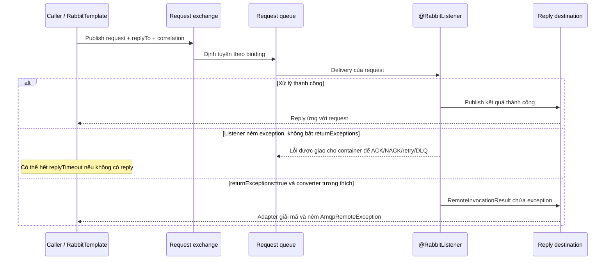
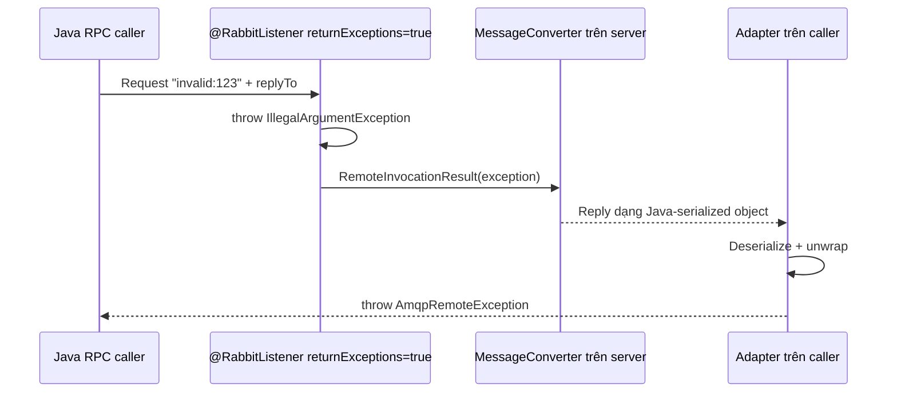
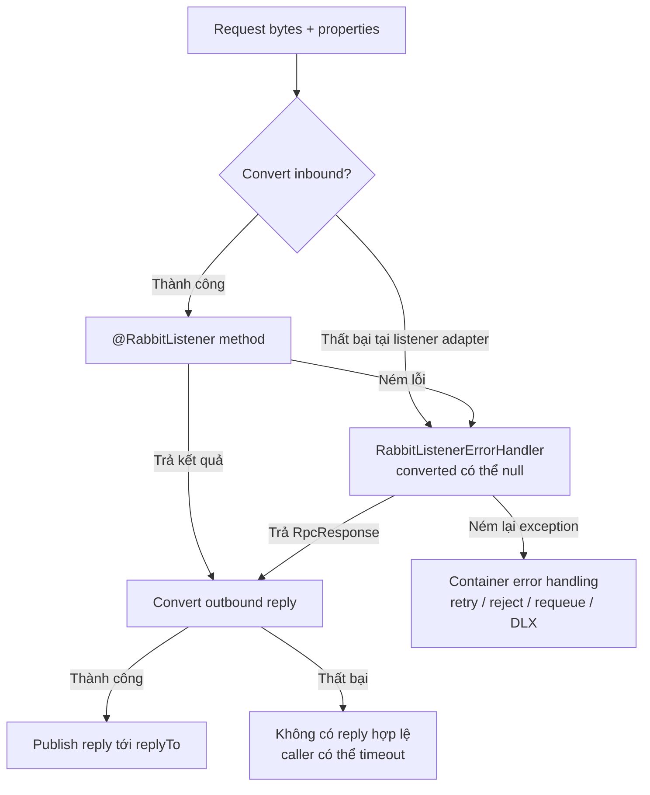
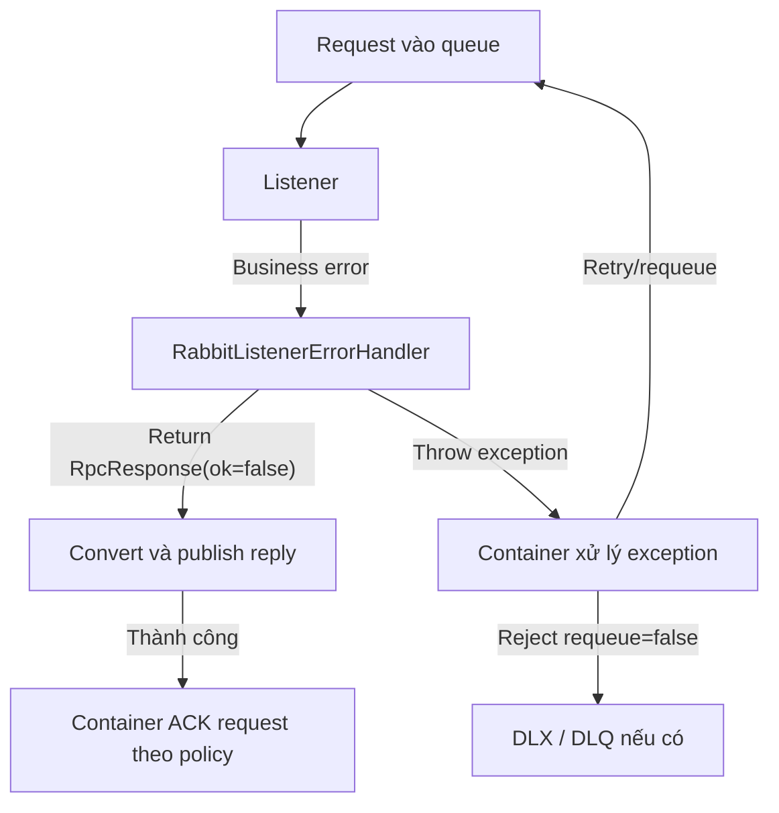

# Phản hồi exception qua request–reply và giới hạn converter

Trong Spring AMQP, một lời gọi `RabbitTemplate.convertSendAndReceive(...)` có thể gửi yêu cầu đến RabbitMQ và chờ phản hồi từ một `@RabbitListener`. Khi listener xử lý thành công, giá trị trả về có thể được chuyển thành reply. **Nhưng khi listener ném exception, Spring không mặc nhiên gửi exception ngược về caller**: mặc định lỗi đi vào cơ chế xử lý của listener container, còn caller có thể chờ đến hết `replyTimeout` mà không nhận được phản hồi.

Spring AMQP cho phép thay đổi hành vi bằng `@RabbitListener(returnExceptions = "true")` và `RabbitListenerErrorHandler`. Tuy nhiên, trả nguyên một `Throwable` qua message kéo theo **giới hạn về converter, Java serialization, kiểu dữ liệu, phiên bản thư viện và bảo mật**. Đối với hệ thống dùng JSON hoặc nhiều ngôn ngữ, trả **error DTO/envelope** có mã lỗi và thông điệp công khai thường phù hợp hơn so với truyền exception Java.

Bài thuộc chương **Xử lý lỗi** của module **SPRING_AMQP**. Chúng ta sẽ dựng exchange, queue và binding, phát request bằng `RabbitTemplate`, nhận qua `@RabbitListener`, thử phản hồi exception, kiểm tra hai loại converter và liên hệ với ACK/NACK, retry, dead-letter, transaction và quan sát hệ thống bất đồng bộ đáng tin cậy.

## 1. Request–reply trên RabbitMQ khác HTTP như thế nào?

Request–reply là mẫu **hai message**: request được publish vào exchange rồi đến queue xử lý; reply là một lần publish khác từ listener đến địa chỉ phản hồi. `RabbitTemplate` giúp quản lý địa chỉ `replyTo` và correlation, nhưng broker **không tự chuyển Java exception thành response**.



Các lớp trách nhiệm độc lập:

| Câu hỏi | Cơ chế | Kết luận |
|---|---|---|
| Broker đã xử lý lần **publish request** chưa? | Publisher confirms | Không chứng minh listener đã xử lý hoặc gửi reply. |
| Request có tới một queue phù hợp không? | Exchange/binding; mandatory/returns | Không chứng minh có consumer sẵn sàng. |
| Listener đã xử lý request thành công chưa? | Logic nghiệp vụ và ACK/NACK | Không tự gửi trạng thái cho caller. |
| Caller có nhận được reply không? | `replyTo`, correlation và `replyTimeout` | Chỉ phản ánh đường request–reply, không bảo đảm end-to-end exactly-once. |
| Caller có nhận được **lỗi nghiệp vụ** không? | `returnExceptions` hoặc error DTO từ `errorHandler` | Phụ thuộc converter, khả năng publish reply và chính sách xử lý lỗi. |

Một RPC timeout **không chứng minh yêu cầu chưa được xử lý**. Có thể listener đã commit DB nhưng reply bị mất, bị converter lỗi hoặc đến quá muộn. Caller muốn retry phải dùng **requestId/eventId ổn định** và thiết kế xử lý idempotent.

## 2. Mặc định: exception ở consumer không tự trở thành response

Xét một handler đơn giản:

```java
@RabbitListener(queues = "rpc.calc.requests.q")
public String calculate(String command) {
    if ("fail".equals(command)) {
        throw new IllegalArgumentException("Invalid calculation");
    }
    return "OK:" + command;
}
```

Nếu caller gửi `"fail"` bằng `convertSendAndReceive(...)`, listener ném exception. **Không có cấu hình xử lý đặc biệt**, lỗi chuyển lên container, thường được bọc thành `ListenerExecutionFailedException`; container quyết định reject/requeue hoặc DLX dựa vào retry/error handler và cấu hình. Nó không tự biến `IllegalArgumentException` thành một reply gửi cho caller.

| Bên quan sát | Có thể thấy |
|---|---|
| Listener | Exception trong ứng dụng, log stack trace và thông tin delivery. |
| Listener container | Lỗi listener; chính sách ACK/NACK, `defaultRequeueRejected`, retry advice và DLQ. |
| Caller `RabbitTemplate` | Có thể nhận `null` khi hết `replyTimeout`; cũng có thể nhận exception phía publish/connection tùy sự cố. |
| RabbitMQ | Request có thể bị requeue và redeliver hoặc dead-letter, tùy cơ chế xử lý. |

**Không coi `null` là “consumer từ chối nghiệp vụ”**. Nó chỉ cho biết template không nhận được reply trong thời gian quy định (trừ những trường hợp ứng dụng chủ động thiết kế null/không reply). Hệ thống phải phân biệt rõ **business error**, **transport error** và **unknown outcome**.

## 3. Ba hướng phản hồi lỗi và tiêu chí lựa chọn

| Cách | Khi listener xảy ra lỗi | Caller nhận được gì? | Phù hợp |
|---|---|---|---|
| **Mặc định: để lỗi cho container** | Exception được xử lý bằng retry, requeue, reject hoặc DLX. | Có thể timeout; không có error reply tự động. | Work queue không cần trả lời; lỗi tạm thời cần retry/DLQ. |
| **`returnExceptions=true`** | Spring bọc exception vào `RemoteInvocationResult` để gửi reply. | Nếu adapter tương thích, nhận `AmqpRemoteException` có nguyên nhân phía server. | Tích hợp Java–Java tin cậy, thử nghiệm hoặc ứng dụng legacy kiểm soát chặt serialization. |
| **`errorHandler` trả error DTO** | Handler chuyển lỗi thành một **giá trị reply hợp đồng**. | Nhận object JSON chứa `ok=false`, `code`, `message`. | RPC giữa dịch vụ, JSON, nhiều ngôn ngữ, yêu cầu contract ổn định. |

**Không đồng nhất “trả lỗi cho caller” với “đưa lỗi vào DLQ”.** Nếu error handler **trả về một đối tượng bình thường**, ngoại lệ có thể được xem như đã xử lý và container ACK request theo cấu hình. Request đó **không tự đi DLQ**. Ngược lại, nếu handler **ném lại lỗi**, container mới áp dụng nhánh retry/requeue/DLQ và caller có thể không có reply.

## 4. Topology chung cho hai ví dụ

Ta dùng một direct exchange và **hai queue tách biệt**: một dành cho mô hình trả exception Java, một dành cho mô hình phản hồi JSON. Việc tách queue giúp kiểm thử hai converter mà không vô tình tạo competing consumers khác giao thức trên cùng queue.

```java
package com.example.rpc;

import org.springframework.amqp.core.Binding;
import org.springframework.amqp.core.BindingBuilder;
import org.springframework.amqp.core.DirectExchange;
import org.springframework.amqp.core.Queue;
import org.springframework.amqp.core.QueueBuilder;
import org.springframework.beans.factory.annotation.Qualifier;
import org.springframework.context.annotation.Bean;
import org.springframework.context.annotation.Configuration;

@Configuration(proxyBeanMethods = false)
public class RpcTopology {
    public static final String EXCHANGE = "rpc.demo.events";
    public static final String JAVA_QUEUE = "rpc.demo.java.q";
    public static final String JSON_QUEUE = "rpc.demo.json.q";
    public static final String JAVA_KEY = "rpc.java";
    public static final String JSON_KEY = "rpc.json";
    public static final String DLX = "rpc.demo.dlx";
    public static final String DLQ = "rpc.demo.failed.q";
    public static final String DLQ_KEY = "rpc.failed";

    @Bean
    DirectExchange rpcExchange() {
        return new DirectExchange(EXCHANGE, true, false);
    }

    @Bean
    Queue javaRpcQueue() {
        return new Queue(JAVA_QUEUE, true);
    }

    @Bean
    Queue jsonRpcQueue() {
        return QueueBuilder.durable(JSON_QUEUE)
                .deadLetterExchange(DLX)
                .deadLetterRoutingKey(DLQ_KEY)
                .build();
    }

    @Bean
    DirectExchange rpcDeadLetterExchange() {
        return new DirectExchange(DLX, true, false);
    }

    @Bean
    Queue rpcDeadLetterQueue() {
        return new Queue(DLQ, true);
    }

    @Bean
    Binding javaRpcBinding(@Qualifier("javaRpcQueue") Queue queue,
                           @Qualifier("rpcExchange") DirectExchange rpcExchange) {
        return BindingBuilder.bind(queue).to(rpcExchange).with(JAVA_KEY);
    }

    @Bean
    Binding jsonRpcBinding(@Qualifier("jsonRpcQueue") Queue queue,
                           @Qualifier("rpcExchange") DirectExchange rpcExchange) {
        return BindingBuilder.bind(queue).to(rpcExchange).with(JSON_KEY);
    }

    @Bean
    Binding rpcDeadLetterBinding(
            @Qualifier("rpcDeadLetterQueue") Queue queue,
            @Qualifier("rpcDeadLetterExchange") DirectExchange exchange) {
        return BindingBuilder.bind(queue).to(exchange).with(DLQ_KEY);
    }
}
```

`RabbitAdmin` có thể khai báo các bean này khi kết nối broker, nếu ứng dụng được cấu hình phù hợp. Queue và exchange **phải tồn tại thật** ở virtual host chính xác; việc tạo bean Java không chứng minh broker đã nhận khai báo. Trường hợp có tài nguyên cùng tên nhưng khác thuộc tính, broker có thể trả `PRECONDITION_FAILED`.

Với **Spring Boot 3.x**, dependency thông dụng là `spring-boot-starter-amqp`; với Boot 4.x dùng starter RabbitMQ AMQP 0-9-1 tương ứng. Các đoạn code trong bài minh họa API Spring AMQP hiện đại; **riêng ví dụ JSON dưới đây nhắm tới Spring AMQP 3.2.x / Spring Boot 3.x** để sử dụng `Jackson2JsonMessageConverter`. Trên dòng Spring AMQP 4.x, đối chiếu tên converter tương ứng (ví dụ `JacksonJsonMessageConverter`) thay vì sao chép nguyên import.

```yaml
# application.yml — môi trường phát triển cục bộ
spring:
  rabbitmq:
    host: localhost
    port: 5672
    username: guest
    password: guest
    virtual-host: /
```

RabbitMQ thường giới hạn tài khoản `guest` chỉ đăng nhập từ loopback. Với production, dùng user riêng có quyền phù hợp, secrets và TLS khi cần.

Queue `rpc.demo.json.q` trong ví dụ có **DLX/DLQ** dành cho lỗi vẫn được chuyển xuống container. Đây là một quyết định bảo vệ message lỗi; **không có nghĩa mọi business error trả về JSON sẽ xuất hiện trong DLQ**. Với error handler đã chuyển lỗi thành reply thành công, request có thể được ACK và không dead-letter. Hai queue sử dụng hai loại consumer khác nhau, nên việc triển khai thực tế cần đảm bảo mỗi queue được xử lý bởi đúng endpoint/converter.

## 5. Cơ chế returnExceptions=true: trả exception Java về caller

Từ Spring AMQP 2.0, `@RabbitListener` có thuộc tính `returnExceptions`. Khi đặt `"true"`, exception phát sinh ở listener có thể được Spring bọc vào `org.springframework.amqp.support.converter.RemoteInvocationResult` để gửi **qua đường reply**. Client dùng `RemoteInvocationAwareMessageConverterAdapter` sẽ giải mã và ném `org.springframework.amqp.AmqpRemoteException`, nối ngữ cảnh stack trace phía server với phía client. 

### 5.1. Listener cố ý ném exception

```java
package com.example.rpc;

import org.springframework.amqp.rabbit.annotation.RabbitListener;
import org.springframework.stereotype.Component;

@Component
public class JavaExceptionRpcListener {

    @RabbitListener(
            queues = RpcTopology.JAVA_QUEUE,
            returnExceptions = "true")
    public String execute(String command) {
        if (command.startsWith("invalid:")) {
            throw new IllegalArgumentException("Invalid command");
        }
        return "OK:" + command;
    }
}
```

Ví dụ dùng `String` để dữ liệu request đơn giản, còn **reply lỗi** là một đối tượng Java có chứa exception. `returnExceptions` trong annotation là **chuỗi** (`"true"`), không phải một annotation property boolean đặt bằng `true` không có dấu nháy.

Khi caller dùng template có converter mặc định, kết quả nhận được có thể là một `RemoteInvocationResult` chưa được unwrap. Để nhận exception như một lỗi Java ở phía client, dùng adapter được Spring cung cấp.

### 5.2. Template của caller nhận và unwrap remote exception

```java
package com.example.rpc;

import org.springframework.amqp.rabbit.connection.ConnectionFactory;
import org.springframework.amqp.rabbit.core.RabbitTemplate;
import org.springframework.amqp.support.converter.RemoteInvocationAwareMessageConverterAdapter;
import org.springframework.context.annotation.Bean;
import org.springframework.context.annotation.Configuration;

@Configuration(proxyBeanMethods = false)
public class JavaRpcClientConfig {

    @Bean("javaRpcTemplate")
    RabbitTemplate javaRpcTemplate(ConnectionFactory connectionFactory) {
        RabbitTemplate template = new RabbitTemplate(connectionFactory);
        template.setMessageConverter(
                new RemoteInvocationAwareMessageConverterAdapter());
        template.setReplyTimeout(5_000); // mili giây
        return template;
    }
}
```

```java
package com.example.rpc;

import org.springframework.amqp.AmqpRemoteException;
import org.springframework.amqp.rabbit.core.RabbitTemplate;
import org.springframework.beans.factory.annotation.Qualifier;
import org.springframework.stereotype.Service;

@Service
public class JavaRpcCaller {
    private final RabbitTemplate javaRpcTemplate;

    public JavaRpcCaller(
            @Qualifier("javaRpcTemplate") RabbitTemplate javaRpcTemplate) {
        this.javaRpcTemplate = javaRpcTemplate;
    }

    public String call(String command) {
        try {
            Object result = javaRpcTemplate.convertSendAndReceive(
                    RpcTopology.EXCHANGE, RpcTopology.JAVA_KEY, command);

            if (result == null) {
                throw new IllegalStateException(
                        "No reply received before reply timeout");
            }
            return (String) result;
        } catch (AmqpRemoteException remote) {
            // Demo: phân biệt exception từ phía server với timeout.
            throw new IllegalStateException(
                    "RPC request failed on server", remote);
        }
    }
}
```

Luồng mong đợi trong **môi trường Java–Java được tin cậy, converter/deserializer được cấu hình tương thích**:

| Request | Listener | Caller |
|---|---|---|
| `"ping"` | Trả `"OK:ping"` | Nhận `String` `"OK:ping"`. |
| `"invalid:123"` | Ném `IllegalArgumentException` | Adapter có thể ném `AmqpRemoteException` chứa exception phía server. |
| Không có reply trước timeout | Listener không chạy, reply mất hoặc chậm | `convertSendAndReceive` có thể trả `null`; khác một remote exception được giải mã thành công. |

**Đừng triển khai nguyên ví dụ Java-serialization này giữa các hệ thống không tin cậy.** Đường reply chứa `RemoteInvocationResult`/`Throwable` cần Java serialization, có ràng buộc chặt về classpath/version và giới hạn deserialization. Chưa cấp phép deserialize các lớp cần thiết có thể khiến **chính bước đọc reply thất bại**, thay vì tạo `AmqpRemoteException`. Đây là lý do bài minh họa cơ chế nhưng khuyến nghị **JSON error DTO** cho sản phẩm thực tế.

### 5.3. Vì sao RemoteInvocationResult không phải reply JSON thông thường?

`RemoteInvocationResult` chứa **giá trị thành công hoặc một `Throwable`**, không phải JSON DTO được định nghĩa công khai. Khi `returnExceptions=true`, Spring cần gửi exception qua message:



Một exception Java thường có class cụ thể, message, cause chain, stack trace và những field nội bộ. JSON converter không tự biết cách biến toàn bộ cấu trúc đó thành một hợp đồng an toàn và portable. Đặc biệt, Spring AMQP Reference nêu rõ cơ chế `returnExceptions` thông thường chỉ hoạt động với `SimpleMessageConverter` dùng Java serialization; `Throwable` thường **không phù hợp để serialize sang JSON**.

### 5.4. Giới hạn Java deserialization và bảo mật

Spring AMQP `SimpleMessageConverter` hỗ trợ `String`, `byte[]` và Java-serialized `Serializable`. Khi đọc message có content type `application/x-java-serialized-object`, converter cần deserialize bytes thành Java object. **Đây là ranh giới bảo mật**: giải mã Java object từ dữ liệu không tin cậy có thể tạo lỗ hổng deserialization gadget.

Theo tài liệu Spring AMQP hiện hành, danh sách class/package được phép deserialize **mặc định rỗng** trong cơ chế bảo vệ converter; cần cấu hình `allowedListPatterns` cụ thể nếu muốn dùng Java-serialized exception cho một môi trường kiểm soát được. **Không bật tùy chọn trust-all chỉ để demo chạy**, nhất là với queue có publisher ngoài hệ thống. Hai phía cũng cần version/classpath tương thích để đọc được các class tham gia serializing exception.

Những rủi ro khác cần cân nhắc:

- Stack trace và message của exception có thể rò tên lớp, đường dẫn nội bộ, câu lệnh SQL, cấu hình hệ thống hoặc dữ liệu riêng tư.
- Caller Java và server Java bị **ghép chặt vào model exception** của nhau; ứng dụng .NET, Python hoặc Node.js không dễ giải mã `RemoteInvocationResult`.
- Thay đổi thư viện, `serialVersionUID` hoặc package exception có thể làm reply không đọc được.
- Một lỗi Java serialization ở **bước gửi reply** có thể khiến caller chỉ quan sát timeout; `returnExceptions=true` không bảo đảm reply luôn được publish.

**Kết luận sử dụng:** dành `returnExceptions=true` cho môi trường nội bộ rất hẹp và chủ động quản lý Java serialization. Với API nghiệp vụ có nhiều client, hãy dùng code lỗi ổn định và error DTO.

## 6. Giới hạn cụ thể của MessageConverter trong request–reply

Thông thường một RPC dùng **ít nhất hai bước conversion**:

1. **Caller → request:** `RabbitTemplate.convertSendAndReceive(...)` dùng converter của template để biến object thành `Message` (body + properties).
2. **Server → listener:** converter của listener container biến AMQP message thành payload phù hợp với tham số của `@RabbitListener`.
3. **Server → reply:** giá trị return hoặc error handler return được converter tạo reply message.
4. **Reply → caller:** converter của `RabbitTemplate` đọc reply và biến thành object Java tương ứng.

Một hệ thống có thể đọc request thành công nhưng **không thể ghi hoặc đọc reply**, vì hai hướng có kiểu dữ liệu khác nhau. Với `returnExceptions=true`, đây là điểm dễ vấp nhất: request `String` hoặc JSON có thể hợp lệ, nhưng reply exception không thể serialize như dữ liệu hợp đồng.

| Converter/điều kiện | Request | Reply thành công | Reply exception Java |
|---|---|---|---|
| `SimpleMessageConverter` với `String` | Thường đơn giản | `String` đơn giản | Cần Java serialization và allowlist/classpath phù hợp. |
| `RemoteInvocationAwareMessageConverterAdapter` (delegate Simple) | Hành vi của delegate | Hành vi của delegate | Có thể unwrap `RemoteInvocationResult` thành `AmqpRemoteException` khi deserialize được. |
| `Jackson2JsonMessageConverter` / `JacksonJsonMessageConverter` | DTO JSON với type mapping | DTO JSON phù hợp | **Không nên** giả định serialize được Java `Throwable`/`RemoteInvocationResult`. |
| Raw `byte[]` / custom converter | Do ứng dụng quyết định | Do ứng dụng quyết định | Cần tự thiết kế format lỗi và cách phát hiện/giải mã. |
| Caller/server khác ngôn ngữ | JSON/Protobuf thường thuận tiện | DTO hợp đồng | Java-serialized exception không portable. |

Ngoài format, converter còn chịu ảnh hưởng của `contentType`, `contentEncoding`, headers nhận diện kiểu, Java type mapper, package được trust và thứ tự bước conversion. **Đặt `contentType=application/json` không khiến một object bất kỳ có thể chuyển JSON thành công**; dữ liệu phải đúng format, schema và điều kiện bảo mật của converter.

## 7. Phương án được khuyến nghị: lỗi là một JSON response có cấu trúc

Trong hợp đồng RPC liên dịch vụ, hãy biểu diễn **kết quả thành công hoặc lỗi nghiệp vụ bằng một DTO**:

```json
{
  "ok": false,
  "code": "INVALID_REQUEST",
  "result": null,
  "message": "Yêu cầu không hợp lệ"
}
```

Ví dụ trên **không truyền exception class, stack trace hay tên method nội bộ**. Caller căn cứ vào `ok` và `code` để quyết định hành vi; `message` là nội dung được phép công khai, có thể bản địa hóa khi hiển thị. Bên phát/nhận phải thống nhất version của contract, phân biệt mã lỗi retryable với lỗi nghiệp vụ vĩnh viễn.

### 7.1. Định nghĩa request và reply DTO

Ví dụ Java 17+ (mỗi `public record` đặt trong một file riêng):

```java
// RpcRequest.java
package com.example.rpc;

public record RpcRequest(String requestId, String operation, int amount) {
}
```

```java
// RpcResponse.java
package com.example.rpc;

public record RpcResponse(
        boolean ok,
        String code,
        String result,
        String message) {

    public static RpcResponse success(String result) {
        return new RpcResponse(true, "OK", result, null);
    }

    public static RpcResponse invalid(String message) {
        return new RpcResponse(false, "INVALID_REQUEST", null, message);
    }
}
```

`requestId` là ID nghiệp vụ dùng để idempotent/deduplicate khi RPC bị gọi lại. Nó **không phải** `deliveryTag` của consumer. Spring `RabbitTemplate` có cơ chế correlation riêng cho reply và có thể ghi thông tin tương quan vào message properties; thiết kế nghiệp vụ không được giả định các ID đó tự đồng nhất.

### 7.2. Cấu hình JSON converter cho cả caller và listener

Ví dụ dưới đây nhắm tới **Spring AMQP 3.2.x**; converter JSON là `Jackson2JsonMessageConverter`:

```java
// JsonRpcConfig.java
package com.example.rpc;

import org.springframework.amqp.rabbit.config.SimpleRabbitListenerContainerFactory;
import org.springframework.amqp.rabbit.connection.ConnectionFactory;
import org.springframework.amqp.rabbit.core.RabbitTemplate;
import org.springframework.amqp.support.converter.Jackson2JsonMessageConverter;
import org.springframework.beans.factory.annotation.Qualifier;
import org.springframework.context.annotation.Bean;
import org.springframework.context.annotation.Configuration;

@Configuration(proxyBeanMethods = false)
public class JsonRpcConfig {

    @Bean("rpcJsonConverter")
    Jackson2JsonMessageConverter rpcJsonConverter() {
        return new Jackson2JsonMessageConverter();
    }

    @Bean("rpcJsonListenerFactory")
    SimpleRabbitListenerContainerFactory rpcJsonListenerFactory(
            ConnectionFactory connectionFactory,
            @Qualifier("rpcJsonConverter") Jackson2JsonMessageConverter converter) {
        SimpleRabbitListenerContainerFactory factory =
                new SimpleRabbitListenerContainerFactory();
        factory.setConnectionFactory(connectionFactory);
        factory.setMessageConverter(converter);
        factory.setPrefetchCount(10);
        // Exception không được errorHandler chuyển thành reply sẽ
        // bị reject không requeue; queue có DLX/DLQ riêng.
        factory.setDefaultRequeueRejected(false);
        return factory;
    }

    @Bean("jsonRpcTemplate")
    RabbitTemplate jsonRpcTemplate(
            ConnectionFactory connectionFactory,
            @Qualifier("rpcJsonConverter") Jackson2JsonMessageConverter converter) {
        RabbitTemplate template = new RabbitTemplate(connectionFactory);
        template.setMessageConverter(converter);
        template.setReplyTimeout(5_000);
        return template;
    }
}
```

Hãy tạo các bean `rpcJsonConverter`, `rpcJsonListenerFactory` và `jsonRpcTemplate` **một lần**, không ghép ví dụ với các cấu hình khác cũng tự định nghĩa bean cùng tên. Do có hai template `javaRpcTemplate` và `jsonRpcTemplate`, service cần dùng `@Qualifier` để chọn đúng converter/protocol.

Trong Spring AMQP 4.x, converter Jackson mới dùng các class khác. Khái niệm vẫn giống nhau, nhưng **phải kiểm tra import, constructor và ObjectMapper/TypeMapper theo phiên bản** trước khi chuyển code. Đặc biệt, không cố cấu hình `RemoteInvocationAwareMessageConverterAdapter` cùng JSON converter rồi kỳ vọng tự chuyển `Throwable` thành JSON DTO.

### 7.3. Listener dùng errorHandler trả về RpcResponse

Handler xử lý request, còn error handler phân loại lỗi:

```java
// JsonRpcListener.java
package com.example.rpc;

import org.springframework.amqp.rabbit.annotation.RabbitListener;
import org.springframework.stereotype.Component;

@Component
public class JsonRpcListener {

    @RabbitListener(
            queues = RpcTopology.JSON_QUEUE,
            containerFactory = "rpcJsonListenerFactory",
            errorHandler = "rpcJsonErrorHandler")
    public RpcResponse handle(RpcRequest request) {
        if (request.requestId() == null || request.requestId().isBlank()) {
            throw new IllegalArgumentException("Missing requestId");
        }
        if (request.amount() < 0) {
            throw new IllegalArgumentException("Negative amount");
        }

        if ("ping".equals(request.operation())) {
            return RpcResponse.success("pong");
        }
        if ("simulate-temporary-failure".equals(request.operation())) {
            throw new IllegalStateException("Temporary backend unavailable");
        }
        throw new IllegalArgumentException("Unsupported operation");
    }
}
```

`errorHandler` là **tên Spring bean**, không phải chuỗi chứa tên class exception. Ở đây **không** đặt `returnExceptions="true"`: các lỗi nghiệp vụ dự kiến sẽ được chuyển thành JSON DTO, không phải Java-serialized `RemoteInvocationResult`.

```java
// JsonRpcErrorHandling.java
package com.example.rpc;

import org.springframework.amqp.rabbit.listener.api.RabbitListenerErrorHandler;
import org.springframework.context.annotation.Bean;
import org.springframework.context.annotation.Configuration;

@Configuration(proxyBeanMethods = false)
public class JsonRpcErrorHandling {

    @Bean("rpcJsonErrorHandler")
    RabbitListenerErrorHandler rpcJsonErrorHandler() {
        // Spring AMQP 3.2.x: handleError(raw, channel, converted, failure).
        return (raw, channel, converted, failure) -> {
            Throwable cause = failure;
            while (cause != null) {
                if (cause instanceof IllegalArgumentException) {
                    return RpcResponse.invalid(
                            "Dữ liệu hoặc phép toán không hợp lệ");
                }
                if (cause instanceof
                        org.springframework.amqp.support.converter.MessageConversionException
                        || cause instanceof
                        org.springframework.messaging.converter.MessageConversionException) {
                    return RpcResponse.invalid(
                            "Không đọc được định dạng yêu cầu");
                }
                cause = cause.getCause();
            }

            // Không biến lỗi hạ tầng tạm thời thành phản hồi nghiệp vụ.
            // Chuyển lỗi về listener container để áp dụng DLX/DLQ/retry.
            throw failure;
        };
    }
}
```

**Tại sao error handler có thể dùng `converted` bằng `null`?** Theo Spring AMQP, từ phiên bản 2.2.18, khi lỗi conversion đến được tầng annotated listener error handler, đối số `org.springframework.messaging.Message<?>` có thể là `null`. Điều này cho phép ứng dụng trả một mã lỗi cho request không chuyển đổi được. Nhưng nếu lỗi xảy ra **sớm hơn** ở tầng giao thức/adapter hoặc reply không thể được publish, không có bảo đảm caller luôn nhận được error DTO.

Không log `raw.getBody()` nguyên vẹn trong error handler: dữ liệu lỗi có thể chứa thông tin nhạy cảm hoặc bytes không hợp lệ. Ví dụ trên nhận hai kiểu lỗi client phổ biến rồi trả thông điệp an toàn. Các lỗi khác ném lại để container xử lý. Tại queue JSON, `setDefaultRequeueRejected(false)` kết hợp với DLX/DLQ đã khai báo trong `RpcTopology`: request lỗi tạm thời đi vào tuyến điều tra thay vì requeue vô hạn. **Đây là một chính sách minh họa; production có thể cần retry có giới hạn/backoff trước khi chuyển DLQ**.

### 7.4. Caller nhận response và kiểm tra code, không bắt remote exception

```java
// JsonRpcCaller.java
package com.example.rpc;

import org.springframework.amqp.rabbit.core.RabbitTemplate;
import org.springframework.beans.factory.annotation.Qualifier;
import org.springframework.stereotype.Service;

@Service
public class JsonRpcCaller {
    private final RabbitTemplate jsonRpcTemplate;

    public JsonRpcCaller(
            @Qualifier("jsonRpcTemplate") RabbitTemplate jsonRpcTemplate) {
        this.jsonRpcTemplate = jsonRpcTemplate;
    }

    public RpcResponse invoke(RpcRequest request) {
        Object reply = jsonRpcTemplate.convertSendAndReceive(
                RpcTopology.EXCHANGE,
                RpcTopology.JSON_KEY,
                request);

        if (reply == null) {
            // Chưa biết server có xử lý hoặc commit nghiệp vụ hay chưa.
            throw new IllegalStateException("RPC reply timed out");
        }
        if (!(reply instanceof RpcResponse response)) {
            throw new IllegalStateException(
                    "Unexpected reply type: " + reply.getClass().getName());
        }
        return response;
    }
}
```

Trong ví dụ hai phía dùng cùng DTO/converter và type mapping tương thích, kết quả kỳ vọng:

| Request | Listener / errorHandler | Caller nhận |
|---|---|---|
| `new RpcRequest("req-01", "ping", 1)` | Trả `RpcResponse.success("pong")`. | `ok=true`, `code="OK"`. |
| `new RpcRequest("req-02", "ping", -1)` | Ném `IllegalArgumentException`; error handler trả DTO lỗi. | `ok=false`, `code="INVALID_REQUEST"`. |
| `new RpcRequest("req-03", "simulate-temporary-failure", 1)` | Ném `IllegalStateException`; error handler ném lại cho container. | Có thể `replyTimeout`; request có thể được reject và đi DLQ. |
| Request JSON không hợp lệ | Converter có thể ném trước method; error handler có thể được gọi với converted=null. | Có thể nhận `INVALID_REQUEST` **nếu** lỗi tới error handler và reply được gửi; không bảo đảm mọi lỗi giao thức có reply. |

Đoạn `instanceof RpcResponse` phụ thuộc JSON converter đọc reply thành DTO có kiểu. Trong hệ thống khác classpath/ngôn ngữ, hãy cấu hình type mapping an toàn hoặc dùng `convertSendAndReceiveAsType(...)` với `SmartMessageConverter` và một `ParameterizedTypeReference<RpcResponse>` khi phù hợp. Nếu converter tạo `Map`, lỗi cast phản ánh vấn đề **type mapping**, không phải listener “không gửi reply”.

**Tách rõ error DTO và DLQ:** với `RpcResponse.invalid(...)` được trả từ error handler, request coi như đã có **reply hợp đồng** và thường được ACK khi container gửi xong reply. Với `IllegalStateException` ném lại, request không có error DTO, container điều phối xử lý lỗi theo policy; listener trong ví dụ gửi đến DLQ để vận hành xử lý sau.

## 8. RabbitListenerErrorHandler không phải ErrorHandler của container

Trong Spring AMQP có **ít nhất hai tầng xử lý lỗi**:

| Tầng | API điển hình | Nhận lỗi nào? | Có thể tạo reply? |
|---|---|---|---|
| **Annotation listener** | `@RabbitListener(errorHandler = "...")` với `RabbitListenerErrorHandler` | Lỗi khi gọi method listener và một số lỗi conversion tại tầng method adapter. | **Có**, bằng cách trả một object cho normal reply pipeline. |
| **Listener container** | `ErrorHandler`, phổ biến là `ConditionalRejectingErrorHandler` | Lỗi được chuyển lên container, gồm exception không được xử lý, lỗi fatal conversion và các lỗi trước khi gọi method. | Không tự có contract trả reply nghiệp vụ. |
| **Publisher / RPC caller** | `RabbitTemplate`, converter nhận reply, `replyTimeout`, publisher returns/confirms | Lỗi publish, thiếu reply, reply sai format hoặc lỗi remote đã được trả đúng. | Là phía tiêu thụ kết quả, không điều khiển việc ACK của server. |

### 8.1. Hai loại converter có thể lỗi ở hai thời điểm



Trong Spring AMQP từ **2.2.18**, một số lỗi conversion được chuyển tới `RabbitListenerErrorHandler` với đối số converted Spring Messaging message **bằng `null`**. Vì vậy, tuyệt đối không viết error handler theo giả định `converted.getHeaders()` luôn dùng được; điều này chỉ gây thêm `NullPointerException` ngay trong đường xử lý lỗi.

Ví dụ lỗi conversion khác với lỗi nghiệp vụ:

| Lỗi | Xảy ra ở đâu? | Handler nghiệp vụ đã chạy chưa? |
|---|---|---|
| Bytes không phải JSON nhưng `contentType=application/json` | JSON converter của listener | **Chưa**; có thể vào annotation error handler với converted=null nếu tầng đó bắt được. |
| DTO JSON thiếu/sai kiểu không thể deserialize | Converter/type mapper | Thường **chưa**. |
| `@Valid` không thỏa nếu có validator đúng | Bước validate/bind method | Method có thể **chưa chạy**; có thể được xử lý bởi adapter/handler. |
| `throw new IllegalArgumentException(...)` trong service | Business method | **Đã chạy**, exception có thể tới annotation error handler. |
| Chuyển `RpcResponse` thành JSON thất bại | Outbound reply converter | Method có thể **đã chạy/commit**, nhưng reply không gửi được. |
| Caller không deserialize được reply | Reply converter của `RabbitTemplate` | Server có thể đã gửi reply thành công; caller vẫn báo lỗi. |

### 8.2. ConditionalRejectingErrorHandler và “poison messages”

`ConditionalRejectingErrorHandler` là container-level error handler phổ biến của Spring AMQP. Với các lỗi được coi là fatal như `MessageConversionException`, `MethodArgumentNotValidException` hoặc lỗi loại dữ liệu không phù hợp, handler có thể **reject không requeue** để tránh một message hỏng liên tục làm nghẽn queue. Danh sách lỗi và lựa chọn mặc định phụ thuộc phiên bản và `FatalExceptionStrategy`.

Điều này quan trọng vì `defaultRequeueRejected=true` không có nghĩa **mọi lỗi** đều bắt buộc requeue: cơ chế fatal exception có thể ghi đè hành vi để tránh vòng lặp poison message. Ngược lại, khi error handler của annotation trả về một error DTO và xử lý xong lỗi, đường xử lý của container có thể không còn nhận exception để áp dụng fatal rejection.

Nếu queue có DLX, một message bị reject không requeue có thể tới DLQ để điều tra. Không mặc định rằng tất cả lỗi JSON sẽ **vừa** tạo reply **vừa** đi DLQ: đó là hai nhánh có semantics khác nhau. Nếu hệ thống muốn **cả thông báo lỗi cho caller và bản ghi audit bền vững**, cần một thiết kế rõ ràng như ghi audit/outbox trong transaction hoặc phát sự kiện lỗi riêng có confirm và idempotency.

### 8.3. Error handler trả về không đồng nghĩa nghiệp vụ đã được commit

Giả sử listener đã gọi API bên ngoài rồi ném `IllegalArgumentException`, error handler quyết định trả `RpcResponse.invalid(...)`. Caller thấy lỗi nghiệp vụ có cấu trúc, nhưng side effect trước exception **có thể đã xảy ra**. Tương tự, khi container đã ACK request sau khi trả reply, điều này không chứng minh giao dịch DB và reply publish là một transaction phân tán atomic.

Vì vậy:

- Validate request **trước** các side effect quan trọng.
- Với operation có thể bị gọi lại, dùng `requestId`/`eventId` ổn định và idempotency store.
- Chỉ trả mã lỗi “không thực hiện” khi biết chắc nghiệp vụ chưa được thực hiện; nếu trạng thái chưa rõ, nên có mã lỗi/status riêng.
- Không dùng `returnExceptions` để che đi transaction rollback hoặc lỗi hạ tầng mà caller cần xử lý theo quy trình khác.

## 9. replyTo, @SendTo và direct reply-to

Khi caller dùng `RabbitTemplate.convertSendAndReceive(...)`, Spring thường tự chuẩn bị `replyTo`/correlation để nhận reply. Listener có return value sẽ gửi phản hồi theo địa chỉ `replyTo` đó. Do vậy, trong hai ví dụ trước **không cần** tự khai báo reply queue hay gắn `@SendTo`.

Nếu một ứng dụng cần địa chỉ reply **mặc định** khi request **không có `replyTo`**, có thể dùng `@SendTo`:

```java
@RabbitListener(queues = "rpc.demo.java.q")
@SendTo("rpc.demo.explicit.replies.q")
public String handle(String input) {
    return "OK:" + input;
}
```

**Đây là ví dụ cú pháp thay thế, không chạy đồng thời với listener Java ở phần 5**. Queue `rpc.demo.explicit.replies.q` phải tồn tại để reply được định tuyến khi dùng default exchange. Trong cơ chế annotation listener, `@SendTo` được dùng **khi request không cung cấp replyToAddress**; nó không ghi đè địa chỉ reply động do `RabbitTemplate` của caller đã đặt.

### 9.1. Direct reply-to không phải queue ứng dụng thông thường

Với RabbitMQ hỗ trợ `amq.rabbitmq.reply-to`, `RabbitTemplate` thường dùng **direct reply-to** thay vì tạo một queue reply cố định cho mỗi RPC. Đây là cơ chế được Spring tự quản lý; không cần tạo bean `Queue("amq.rabbitmq.reply-to")` hoặc gắn thêm `@RabbitListener` trên tên đó trong ứng dụng gọi RPC.

Nếu bạn tự cấu hình **fixed reply queue**, phải thêm listener container cho reply và đảm bảo correlation/instance isolation. Nhiều instance caller cùng dùng một reply queue có thể **cạnh tranh** lấy reply và nhận nhầm reply của nhau nếu cấu hình không đúng. Chỉ chọn fixed reply queue khi có yêu cầu thực tế, không phải để “bật” tính năng trả exception.

### 9.2. Timeout của caller không nằm trong quyền kiểm soát của errorHandler

`RabbitTemplate` mặc định có `replyTimeout` khoảng **5 giây** (có thể điều chỉnh bằng `setReplyTimeout(...)` hoặc cấu hình thích hợp). Nếu reply không đến trước hạn, `convertSendAndReceive(...)` thường trả về `null`. Điều này khác:

- `AmqpRemoteException`: caller đã **nhận và giải mã** reply chứa remote exception.
- `AmqpMessageReturnedException`: request bị broker trả về vì không định tuyến được trong điều kiện `mandatory`/publisher returns phù hợp.
- `MessageConversionException` ở caller: reply đã đến nhưng converter **không đọc được**.
- `AmqpException` từ transport: lỗi kết nối, channel hoặc publish.

Không nên đặt `replyTimeout` cực lớn để che lỗi converter. Hãy quan sát latency, readiness, queue backlog, reply publish failures và caller-side conversion; timeout dài chỉ giữ tài nguyên caller lâu hơn.

### 9.3. Late reply và correlation

Nếu server xử lý lâu hơn timeout, caller có thể đã ngừng chờ khi reply đến. Spring `RabbitTemplate` dùng correlation để ghép reply với request tương ứng, nhưng **late reply không quay ngược thời gian** và không biến request trước đó thành thất bại. Nếu caller retry bằng request ID mới, server có thể xử lý cùng nghiệp vụ hai lần; giữ requestId ổn định hoặc dùng quy trình kiểm tra trạng thái trước khi retry.

Với fixed reply queue, thông tin correlation càng quan trọng; không sao chép một cấu hình reply queue dùng chung cho nhiều instance mà không đọc kỹ hướng dẫn của Spring AMQP. Direct reply-to đơn giản hóa vòng đời reply consumer, **không** cung cấp bảo đảm at-least-once hay durable reply.

## 10. Publisher return là lỗi định tuyến, không phải lỗi trả về từ listener

Trong mẫu request–reply, caller có thể gửi request tới **exchange không có binding phù hợp**. Khi đó listener **chưa hề chạy**; không có exception nghiệp vụ để `returnExceptions` hoặc `RabbitListenerErrorHandler` chuyển thành reply.

Nếu bật publisher returns và `mandatory=true` trên RPC template, Spring có thể ném `AmqpMessageReturnedException` khi request không được định tuyến. Với RabbitTemplate request–reply, tránh đăng ký thêm một `ReturnsCallback` tùy tiện trên cùng template nếu cơ chế nội bộ cần quản lý returns để báo lỗi đồng bộ.

```yaml
# Bổ sung cho application.yml của môi trường test
spring:
  rabbitmq:
    publisher-returns: true
```

Với template tạo thủ công trong ví dụ, có thể gọi:

```java
jsonRpcTemplate.setMandatory(true);
// Chạy sau khi connection factory đã bật publisher returns.
```

Ví dụ phân biệt trong caller:

```java
import org.springframework.amqp.AmqpRemoteException;
import org.springframework.amqp.rabbit.core.RabbitTemplate;
import org.springframework.amqp.core.AmqpMessageReturnedException;

// Ý tưởng phân loại lỗi, dùng template đúng loại RPC:
try {
    Object reply = rpcTemplate.convertSendAndReceive(
            "rpc.demo.events", "rpc.missing.binding", "ping");
    if (reply == null) {
        System.out.println("No reply; outcome unknown");
    }
} catch (AmqpMessageReturnedException unroutable) {
    System.err.println("Request could not be routed");
} catch (AmqpRemoteException remoteFailure) {
    System.err.println("Received a serialized remote exception");
}
```

Đoạn code là **mẫu xử lý tình huống** chứ không phải class chạy độc lập; `rpcTemplate` phải trỏ đến đúng template và cấu hình returns. Cần kiểm tra import của `AmqpMessageReturnedException` theo dòng Spring AMQP đang dùng. Khi exchange không tồn tại, broker có thể đóng channel với `NOT_FOUND` — đây **khác** với trường hợp exchange có tồn tại nhưng request không khớp binding và bị return vì `NO_ROUTE`.

**Publisher confirm ACK không đồng nghĩa listener đã xử lý.** Nó xác nhận lần publish ở phía broker, không xác nhận RPC reply, không thay thế reply timeout và cũng không chuyển exception nghiệp vụ về caller.

## 11. Một bảng quyết định lỗi đầy đủ cho request–reply

Đừng xử lý mọi vấn đề bằng một nhánh `catch (Exception) { retry(); }`. Các tình huống có ý nghĩa khác nhau:

| Tình huống | Caller nên phân loại | Có nên gửi lại ngay? | Lưu ý |
|---|---|---|---|
| `RpcResponse(ok=true)` | Thành công theo contract | Không | Có thể vẫn cần kiểm tra dữ liệu reply. |
| `RpcResponse(ok=false, code=INVALID_REQUEST)` | Lỗi nghiệp vụ **vĩnh viễn** của input | **Không**, trừ khi thay đổi request | Không được gửi lại request giống hệt vô hạn. |
| `RpcResponse(ok=false, code=NOT_FOUND)` | Lỗi nghiệp vụ theo domain | Tùy hợp đồng | Không đồng nhất với RabbitMQ `NOT_FOUND` khi thiếu exchange. |
| `AmqpRemoteException` | Nhận lỗi Java được serialize từ server | Theo loại lỗi sau khi chuẩn hóa | Không đưa exception class/stack trace làm contract công khai. |
| `AmqpMessageReturnedException` | Publish request không định tuyến được | **Không** trước khi sửa topology | Kiểm tra exchange, routing key, binding và virtual host. |
| Reply `null` do timeout | **Trạng thái không rõ** | Chỉ với idempotency/đối soát | Server có thể đã commit nhưng reply bị mất. |
| JSON reply conversion failure | Reply nhận được nhưng **caller không hiểu** | Không retry mù quáng | Cần sửa schema/type mapping/converter. |
| Channel/connection failure | Lỗi transport; kết quả publish có thể chưa xác định | Có kiểm soát | Phân biệt broker đã nhận hay chưa và giữ `requestId`. |
| Server ném lỗi tạm thời và message đi DLQ | Yêu cầu không có reply, cần vận hành xử lý | Phụ thuộc workflow | Đừng để caller retry làm nhân bản công việc đã ở DLQ. |

Một **contract lỗi JSON** có thể thêm các trường như `requestId`, `retryable`, `timestamp` và `details` (danh sách field validation đã được làm sạch). Nhưng nên tránh để mỗi service tự phát sinh tên mã lỗi tùy ý. Định nghĩa enum/string code ổn định, tài liệu versioning, giới hạn retry và quy tắc idempotency.

## 12. Chuyển exception thành response có mặt trái gì?

Việc trả lỗi cho caller giúp ứng dụng biết ngay lỗi input, nhưng thay đổi semantics xử lý queue:



Một vài trường hợp cần cân nhắc:

1. **Lỗi validation**: không nên requeue; trả `INVALID_REQUEST` giúp caller sửa input. Consumer có thể ACK request vì đã có một kết quả xử lý cuối cùng.
2. **Lỗi dịch vụ ngoài tạm thời**: chọn retry có giới hạn hoặc trả `SERVICE_UNAVAILABLE` có cờ retryable theo thiết kế. Nếu trả reply lỗi và ACK, **message không còn ở queue**; trách nhiệm retry chuyển sang caller/workflow.
3. **Lỗi dữ liệu chưa chắc đã commit**: không nên khẳng định “thất bại chắc chắn” nếu side effect có thể đã diễn ra. Cần trạng thái `UNKNOWN` hoặc query trạng thái giao dịch bằng request ID.
4. **Không có replyTo**: error handler có thể trả object, nhưng không có một đường reply phù hợp thì caller không nhận; `@SendTo` chỉ là fallback nếu được cấu hình rõ ràng.
5. **Reply publish thất bại**: lỗi có thể đi vào đường lỗi container; không được mặc định request sẽ luôn được xử lý lại an toàn. Cần xem ACK mode, transaction và cấu hình listener/reply handling.
6. **Kết quả reply cần độ bền cao**: direct reply-to được tối ưu cho RPC nhưng không phải durable business event store. Nếu bên gọi phải khôi phục sau restart, lưu trạng thái công việc riêng và dùng asynchronous event/status API có thể phù hợp hơn.

### 12.1. Chọn xử lý đồng bộ hay bất đồng bộ có chủ đích

RabbitMQ request–reply vẫn là RPC: caller bị phụ thuộc vào thời gian phản hồi và trạng thái của consumer. Nếu một công việc mất vài phút, mô hình tốt hơn có thể là:

```text
Caller  →  publish command(requestId)
       ←  accepted/requestId (nhanh)

Worker  →  xử lý bất đồng bộ
        →  phát event Completed/Failed hoặc cập nhật status store

Caller  →  tra status theo requestId hoặc subscribe completion event
```

Với công việc dài, cách này tránh giữ một thread/connection resource để đợi reply và làm rõ trạng thái sau timeout. Request–reply phù hợp cho thao tác nhanh, time-bound và có hợp đồng lỗi rõ ràng; không bắt buộc mọi tác vụ RabbitMQ phải dùng RPC.

## 13. Những lỗi converter thường gặp khi chuyển sang JSON

| Triệu chứng | Nguyên nhân phổ biến | Cách xử lý |
|---|---|---|
| Caller nhận `byte[]` hoặc `Map` thay vì `RpcResponse` | Converter không được cấu hình đồng nhất, thiếu type headers hoặc mapping reply type. | Dùng JSON converter thống nhất, type mapping rõ và chỉ trust các DTO được phép. |
| Server log `MessageConversionException` trước khi method chạy | Bytes không hợp lệ, content type/encoding sai, type header không đáng tin hoặc DTO không tương thích. | Kiểm tra raw content type an toàn, schema/version và converter ở listener factory. |
| `returnExceptions=true` hoạt động với Simple nhưng không hoạt động với Jackson | `Throwable` / `RemoteInvocationResult` không phải JSON DTO thích hợp. | Dùng `RabbitListenerErrorHandler` trả `RpcResponse` thay vì serialize exception. |
| Caller không giải mã được `RemoteInvocationResult` | Java deserialization bị allowlist chặn, lớp không có trên classpath hoặc phiên bản không tương thích. | Tránh JDK serialization; nếu buộc dùng, chỉ cho phép lớp tin cậy và kiểm thử cả hai phía. |
| Error handler bị `NullPointerException` | Mã xử lý giả định `converted` luôn khác null, kể cả lỗi convert request. | Kiểm tra nullable và dùng raw `MessageProperties` cẩn trọng khi cần correlation. |
| Reply không chứa dữ liệu mong đợi dù listener return hợp lệ | Outbound converter khác inbound converter, có lỗi serialize reply hoặc replyTo sai. | Kiểm tra factory, converter, logs trả lời, correlation và reply destination. |
| `RpcResponse` được gửi nhưng caller vẫn timeout | Reply đến trễ, lỗi correlation, caller mất kết nối hoặc reply converter/queue không hoạt động. | Đo thời gian, kiểm tra direct reply-to/fixed reply queue và logs hai phía. |
| JSON mapping thất bại sau deploy | DTO đổi tên trường, enum/constructor hoặc quy tắc type mapper thay đổi. | Dùng schema evolution, contract tests, versioning và cấu hình deserialize an toàn. |
| Exception object chứa thông tin nội bộ | Truyền `Throwable` trực tiếp hoặc dùng `exception.getMessage()` làm thông điệp công khai. | Trả mã lỗi cố định, nội dung được làm sạch, giữ chi tiết trong log có quyền truy cập. |
| Error reply bị coi là successful business action | Caller chỉ kiểm tra “có reply” mà không kiểm tra `ok/code`. | Caller phải xử lý `RpcResponse.ok` và `code` đúng hợp đồng. |

### 13.1. Một lỗi converter có thể xảy ra **sau** khi DB đã commit

Điều này rất nguy hiểm:

```text
Caller publish request(requestId=req-100)
→ Listener nhận DTO và cập nhật DB
→ DB COMMIT
→ Listener return đối tượng Java phức tạp
→ Reply MessageConverter ném lỗi serialization
→ Caller hết replyTimeout
→ Caller retry request(req-100)
```

Nếu không có idempotency, cùng nghiệp vụ có thể bị thực thi **hai lần**. Dù chọn cách trả exception Java hay JSON DTO, vẫn cần bảo vệ transaction trước redelivery/retry. Một thiết kế tốt cho side effect:

```sql
-- Ví dụ: dùng request_id như khóa idempotency trong transaction DB.
CREATE TABLE rpc_processed_requests (
    request_id VARCHAR(128) PRIMARY KEY,
    operation VARCHAR(80) NOT NULL,
    response_code VARCHAR(64) NOT NULL,
    response_payload TEXT
);
```

Workflow minh họa: trong cùng transaction với thay đổi dữ liệu, ghi request ID + trạng thái/kết quả cuối; khi nhận lại request cùng ID, **trả kết quả cũ** thay vì thực thi side effect một lần nữa. Cần bảo vệ concurrency bằng unique constraint và transaction đúng isolation/locking, không chỉ kiểm tra `containsKey` trong memory.

## 14. Quan sát, bảo mật và tiêu chí vận hành

Một hệ thống RPC dựa trên RabbitMQ cần quan sát cả **đường request**, **đường reply** và **đường xử lý lỗi**:

| Chỉ số/log | Cần trả lời |
|---|---|
| Request publish count, publish confirms và returns | Request có bị broker từ chối hoặc không tìm được queue không? |
| RPC reply latency (P50/P95/P99) | Server xử lý chậm hay reply path có vấn đề? |
| Reply timeout count | Có bao nhiêu request không nhận được reply trong thời hạn? |
| `INVALID_REQUEST` và các business error code | Caller nào liên tục gửi payload sai hợp đồng? |
| Inbound/outbound conversion failures | Lỗi xuất hiện lúc đọc request, serialize response hay deserialize reply? |
| Container reject/requeue và DLQ depth | Exception chưa được xử lý thành reply đang đi đâu? |
| Consumer count, `messages_ready`, `messages_unacknowledged` | Listener có hoạt động và đang backlog không? |
| `requestId`, `correlationId`, trace ID | Có ghép được một request với một reply, retry và các log hai phía không? |

Trong RabbitMQ Management UI, kiểm tra **Connections/Channels**, queue `rpc.demo.json.q` và `rpc.demo.failed.q`. Queue error tăng có thể là dấu hiệu lỗi transport/backend, còn tăng số `RpcResponse(ok=false)` không nhất thiết làm DLQ tăng vì error handler có thể xử lý và ACK request.

Với hệ thống nhiều tenant hoặc nhiều nhà phát hành, **không coi header `originService`/`tenantId` là chứng thực**. Xác thực quyền publish ở broker/vhost và quyền nghiệp vụ trong service; không cho client kiểm soát type mapper để deserialize arbitrary class. Nếu log exception, cần loại bỏ tokens, secrets, SQL connection strings và thông tin cá nhân.

### 14.1. Checklist trước khi bật trả exception Java

- Cả client và server đều là Java với classpath/version tương thích.
- Chỉ có publisher được tin cậy trên queue và connection đã áp dụng kiểm soát truy cập.
- JDK deserialization được giới hạn allowlist cụ thể; không bật trust-all.
- Error message/stack trace không làm lộ dữ liệu nhạy cảm.
- Có test cho reply timeout, lỗi serialize/deserialize, broker disconnect và duplicate request.
- Đã có kế hoạch chuyển sang error DTO nếu cần client khác ngôn ngữ hoặc version độc lập.

Nếu một mục không đạt, **ưu tiên JSON error DTO** và không truyền nguyên `Throwable` qua broker.

## 15. Bài thực hành từng bước

**Bài 1 — chứng minh lỗi listener không tự thành reply.** Dùng queue `rpc.demo.java.q` nhưng tạm **bỏ `returnExceptions="true"`** khỏi listener Java ở phần 5. Gửi `"invalid:123"` bằng `convertSendAndReceive(...)` với timeout ngắn trên broker test. Quan sát exception ở server, trạng thái queue/requeue và reply của caller. Giải thích vì sao caller không tự nhận `IllegalArgumentException`.

**Bài 2 — thử returnExceptions trong môi trường Java được tin cậy.** Bật `returnExceptions="true"` trên listener `JavaExceptionRpcListener`. Dùng `RemoteInvocationAwareMessageConverterAdapter` ở caller. Chỉ trong môi trường test cô lập, cấu hình allowlist deserialize **theo các lớp được phép** và kiểm tra client/server cùng phiên bản thư viện. Gửi request hợp lệ và không hợp lệ; phân biệt `AmqpRemoteException` với `null` do timeout. Không bật trust-all.

**Bài 3 — chuyển từ Java exception sang JSON error DTO.** Dùng các bean `JsonRpcConfig`, `JsonRpcListener` và `JsonRpcErrorHandling` ở phần 7. Gửi `new RpcRequest("req-01","ping",1)` và `new RpcRequest("req-02","ping",-1)`. Kiểm tra reply `RpcResponse` tương ứng, không có Java exception class trong JSON và caller phải đọc `ok/code`.

**Bài 4 — lỗi chuyển đổi request.** Dùng một publisher test phát bytes không phải JSON nhưng đặt `contentType=application/json` vào `rpc.demo.json.q`. Xác minh method `handle(RpcRequest)` không được gọi, xem annotation error handler có nhận converted=null không. Nếu reply không gửi được, phân biệt với lỗi vào container `ConditionalRejectingErrorHandler`; không mặc định mọi lỗi bytes đều trở thành response.

**Bài 5 — lỗi backend đi DLQ thay vì trả INVALID_REQUEST.** Gửi `new RpcRequest("req-03","simulate-temporary-failure",1)`. Error handler phải ném lại exception thay vì giả mạo lỗi validation. Với cấu hình minh họa không requeue và DLX/DLQ, kiểm tra `rpc.demo.failed.q`. Quan sát caller có thể timeout; giải thích đây là một **policy vận hành**, không phải contract lỗi lý tưởng cho mọi RPC.

**Bài 6 — kiểm tra hai hướng converter.** Trong môi trường test, cố tình cấu hình caller dùng Simple converter nhưng server dùng Jackson converter rồi gửi `RpcRequest`. Ghi lại failure xảy ra ở bước serialize request, convert inbound, convert outbound hay deserialize reply. Khôi phục converter phù hợp và chứng minh chương trình hoạt động. Không sửa queue production đang có dữ liệu để thử.

**Bài 7 — định tuyến sai không phải exception của listener.** Bật `publisher-returns` trên connection factory và `mandatory=true` trên template RPC, gửi request với routing key `rpc.not.bound` vào exchange `rpc.demo.events`. Quan sát `AmqpMessageReturnedException` (trong điều kiện trả về đã cấu hình), so với `AmqpRemoteException` và reply `RpcResponse.invalid(...)`. Sửa binding/routing key, không retry cùng lỗi vô hạn.

**Bài 8 — reply timeout sau DB commit.** Mô phỏng server ghi transaction thành công nhưng cố tình để reply đến sau thời gian chờ. Caller thấy timeout rồi gửi lại với **cùng `requestId`**. Dùng unique constraint/transaction để trả kết quả đã lưu, không tác động DB lần hai. Kết luận vì sao timeout không đồng nghĩa thất bại nghiệp vụ.

**Bài 9 — thiếu replyTo và @SendTo.** Gửi message theo cách one-way `convertAndSend` đến queue thử nghiệm, listener có return value nhưng không có `replyTo`. Quan sát behavior/log liên quan reply. Dùng một listener test độc lập có `@SendTo` đến queue reply đã tồn tại và xem sự khác biệt; không đặt hai listener cạnh tranh trên cùng queue.

**Bài 10 — fixed reply queue và correlation.** Trên broker test, cấu hình template có fixed reply queue riêng và listener container reply tương ứng. Thử nhiều request đồng thời, xác minh correlation. Không dùng chung một fixed reply queue cho hai caller instance cạnh tranh. Sau đó trở về direct reply-to để so sánh độ phức tạp triển khai.

## 16. Câu hỏi tự đánh giá

1. **Một `@RabbitListener` ném exception có tự trả exception cho caller không?** Không. Mặc định lỗi chuyển xuống listener container, caller có thể hết `replyTimeout`.
2. **Thuộc tính nào của `@RabbitListener` cho phép trả exception về sender?** `returnExceptions = "true"`.
3. **Spring bọc exception server trong kiểu gì trước khi gửi?** `RemoteInvocationResult`.
4. **Converter/adapter nào giúp caller ném lỗi remote thành exception Java?** `RemoteInvocationAwareMessageConverterAdapter`, với delegate/serialization tương thích.
5. **Caller thường nhận loại exception nào khi unwrap thành công?** `AmqpRemoteException`.
6. **Vì sao không nên dùng `returnExceptions=true` trực tiếp với JSON converter?** `Throwable` và `RemoteInvocationResult` không phải error DTO JSON portable/an toàn; thường cần Java serialization.
7. **Có được bật trust-all Java deserialization chỉ để nhận remote exception không?** Không. Cần allowlist cụ thể trong môi trường tin cậy; ưu tiên error DTO JSON.
8. **`RabbitListenerErrorHandler` có thể trả gì?** Một kết quả bình thường để Spring gửi làm reply, hoặc ném lại exception cho container xử lý.
9. **Khi error handler trả `RpcResponse(ok=false)`, request có tự đi DLQ không?** Không. Nó thường được xem là đã xử lý, container có thể ACK; cần thiết kế audit riêng nếu muốn lưu lỗi.
10. **`converted` trong error handler có luôn khác null không?** Không. Khi lỗi conversion trước method, từ các phiên bản Spring AMQP hỗ trợ, đối số này có thể `null`.
11. **Lỗi JSON xảy ra sau khi listener commit DB có thể gây gì?** Reply không đến/caller lỗi conversion rồi retry, làm nghiệp vụ bị áp dụng hai lần nếu thiếu idempotency.
12. **`@SendTo` có ghi đè `replyTo` do caller tạo không?** Không trong đường thông thường. Nó là địa chỉ phản hồi dự phòng khi request không có replyToAddress.
13. **`convertSendAndReceive(...)` trả null chứng minh request chưa được xử lý không?** Không. Chỉ biết caller không nhận reply trước thời hạn.
14. **Publisher return khác remote exception như thế nào?** Return là lỗi routing khi request chưa đến listener; remote exception là lỗi listener được chuyển qua reply đúng cơ chế.
15. **Vì sao fixed reply queue cần cấu hình cẩn trọng khi có nhiều replica?** Các instance có thể tranh nhau nhận reply; correlation và reply listener phải được cấu hình để không nhận nhầm.
16. **Lỗi DB timeout có nên luôn chuyển thành `INVALID_REQUEST` không?** Không. Cần giữ đúng phân loại transient/permanent, retry/DLQ/status và chính sách idempotency.
17. **Spring AUTO ACK có nghĩa broker no-ack không?** Không. Container thường ACK sau xử lý thành công; khi trả error DTO thì request có thể được ACK vì lỗi đã xử lý.
18. **Điều gì quan trọng hơn tên exception của server khi thiết kế RPC public?** Error code ổn định, contract JSON rõ, thông điệp an toàn, timeout/retry có giới hạn và idempotency.

## 17. Tóm tắt lựa chọn thiết kế

| Mục tiêu | Cách làm nên ưu tiên |
|---|---|
| Trả kết quả nghiệp vụ hợp lệ | Listener return DTO có schema/version rõ ràng. |
| Trả lỗi validation hoặc business rule cho caller | `RabbitListenerErrorHandler` (hoặc logic service có chủ đích) trả **error DTO** chứa `ok/code/message`. |
| Xử lý lỗi tạm thời của backend | Retry có giới hạn, backoff, DLQ/status workflow và theo dõi timeout; không biến thành lỗi input giả. |
| Tích hợp Java legacy có yêu cầu nhận Throwable | Chỉ cân nhắc `returnExceptions=true` và `RemoteInvocationAwareMessageConverterAdapter` trên đường Java–Java được kiểm soát, đã giải quyết deserialization. |
| Giao tiếp đa ngôn ngữ | JSON/Avro/Protobuf và error envelope ổn định, không Java serialization. |
| Khi request không định tuyến | Mandatory/returns, kiểm tra exchange/binding; không chờ `RabbitListenerErrorHandler` chạy. |
| Khi caller timeout sau side effect | Idempotency theo `requestId`, lưu trạng thái/kết quả hoặc transactional outbox/inbox. |
| Công việc xử lý lâu | Command bất đồng bộ + trạng thái/event hoàn tất thay vì đợi reply quá lâu. |

**Ghi nhớ:** Có ba tình huống khác nhau cần phân biệt. **(1)** Listener ném exception mặc định → container xử lý và caller có thể timeout. **(2)** `returnExceptions="true"` → Spring cố gửi `RemoteInvocationResult`; caller chỉ nhận `AmqpRemoteException` khi converter và Java deserialization tương thích. **(3)** `RabbitListenerErrorHandler` trả **error DTO JSON** → caller nhận phản hồi nghiệp vụ có cấu trúc; request thường được coi là đã xử lý, không tự vào DLQ. Cách thứ ba thường phù hợp nhất cho RPC liên dịch vụ, nhưng vẫn phải xử lý rõ converter failures, reply timeout, retry, correlation và idempotency.

### Tài liệu tham khảo

- Spring AMQP — [Handling Exceptions trong @RabbitListener](https://docs.spring.io/spring-amqp/reference/amqp/receiving-messages/async-annotation-driven/error-handling.html).
- Spring AMQP — [Request/Reply Messaging](https://docs.spring.io/spring-amqp/reference/amqp/request-reply.html).
- Spring AMQP — [Reply Management và @SendTo](https://docs.spring.io/spring-amqp/reference/amqp/receiving-messages/async-annotation-driven/reply.html).
- Spring AMQP — [Message Converters và Java Deserialization](https://docs.spring.io/spring-amqp/reference/amqp/message-converters.html).
- Spring AMQP — [Exception Handling ở listener container](https://docs.spring.io/spring-amqp/reference/amqp/exception-handling.html).
- Spring AMQP — [Asynchronous @RabbitListener Return Types](https://docs.spring.io/spring-amqp/reference/amqp/receiving-messages/async-returns.html).
- Spring AMQP Javadoc — [RemoteInvocationAwareMessageConverterAdapter](https://docs.spring.io/spring-amqp/docs/3.2.8/api/org/springframework/amqp/support/converter/RemoteInvocationAwareMessageConverterAdapter.html).
- Spring AMQP Javadoc — [RabbitListenerErrorHandler](https://docs.spring.io/spring-amqp/docs/3.2.5/api/org/springframework/amqp/rabbit/listener/api/RabbitListenerErrorHandler.html).
- RabbitMQ — [Publisher Confirms và Consumer Acknowledgements](https://www.rabbitmq.com/docs/confirms).
