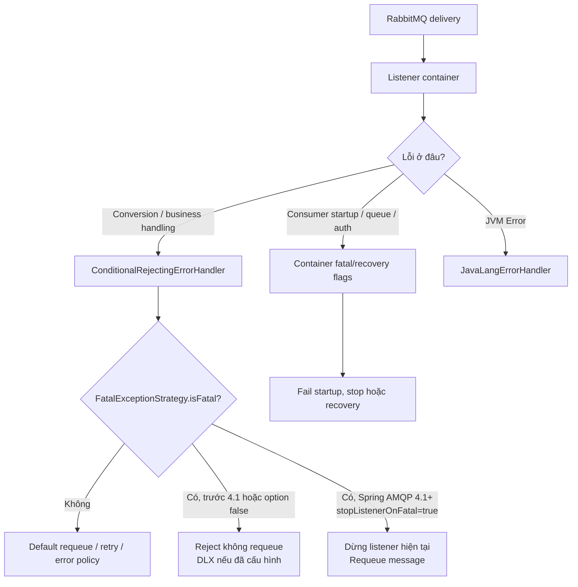
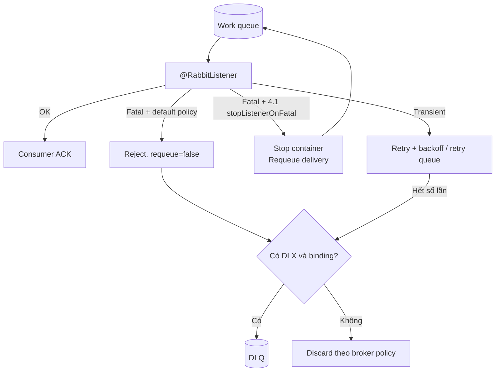

# Chính sách dừng listener khi lỗi fatal theo phiên bản hỗ trợ

Trong **Spring AMQP**, một message có định dạng không thể chuyển đổi có thể khiến consumer thất bại lặp đi lặp lại. Nhưng phải làm gì với lỗi “không thể khắc phục” (*fatal*) đó? Có hệ thống muốn **loại message lỗi ra khỏi luồng chính** để các message khác tiếp tục chạy; có hệ thống lại muốn **dừng listener hiện tại**, giữ message trong queue để điều tra hoặc cho một consumer khác xử lý. Hai lựa chọn có ý nghĩa vận hành rất khác nhau.

Đặc biệt, từ **Spring AMQP 4.1**, `ConditionalRejectingErrorHandler` hỗ trợ tùy chọn **`stopListenerOnFatal`**. Khi bật, lỗi được phân loại fatal có thể dẫn đến **dừng listener container và requeue message**, thay vì đường xử lý thường thấy là **reject không requeue**. Những phiên bản trước đó **không có** setter này; không nên sao chép cấu hình 4.1+ vào dự án dùng Spring AMQP 3.x hoặc 4.0.

Bài học thuộc chương **Xử lý lỗi** của module **SPRING_AMQP**. Ta sẽ phân biệt ba khái niệm “fatal” ở cấp **message**, **consumer** và **startup**, xây dựng ví dụ `RabbitTemplate`–exchange–queue–binding–`@RabbitListener`, so sánh chính sách theo phiên bản, theo dõi trạng thái, và thiết kế retry, dead-letter, acknowledgement, transaction và quan sát để vận hành hệ thống bất đồng bộ đáng tin cậy.

## 1. Ba nghĩa của “fatal” cần tách biệt

Một log có chữ `fatal` **không mặc nhiên** có nghĩa toàn bộ ứng dụng phải dừng. Trong Spring Rabbit, ít nhất ba bối cảnh cần phân biệt:

| Phạm vi | Ví dụ | Bộ phận quyết định | Kết quả có thể xảy ra |
| --- | --- | --- | --- |
| **Fatal khi xử lý message** | JSON lỗi, không chuyển được DTO, validation fail, custom exception được đánh dấu không thể phục hồi | `ConditionalRejectingErrorHandler` + `FatalExceptionStrategy` | Reject không requeue; hoặc **dừng listener khi bật `stopListenerOnFatal` từ 4.1** |
| **Fatal ở cấp consumer** | Không đăng ký được consumer, lỗi khai báo queue hoặc xác thực thuộc loại không thể tiếp tục theo policy | Listener container, các flag fatal/recovery | Consumer/container dừng hoặc ứng dụng fail startup |
| **Fatal ở cấp JVM** | Một `java.lang.Error` nghiêm trọng trên thread container | `javaLangErrorHandler` và chính sách process | Có thể dừng **cả JVM**, khác hoàn toàn với lỗi message |



Trong bài này, từ khóa **“dừng listener khi lỗi fatal”** chủ yếu nhắm đến nhánh mới **`stopListenerOnFatal` của Spring AMQP 4.1+**. Các chính sách fatal còn lại được giải thích để tránh nhầm lẫn khi đọc exception hoặc sự kiện lỗi consumer.

## 2. Chính sách xử lý message fatal trước và từ Spring AMQP 4.1

Spring AMQP thường bao bọc lỗi của method listener vào `ListenerExecutionFailedException`. Theo mặc định, `ConditionalRejectingErrorHandler` phân loại một số lỗi không thể khắc phục bằng retry — đặc biệt lỗi conversion xảy ra **trước khi method `@RabbitListener` được gọi**.

### 2.1. Mặc định truyền thống: reject message, tiếp tục consumer

Từ Spring AMQP **1.3.2**, default error handler là `ConditionalRejectingErrorHandler`. Với lỗi được xác định fatal, handler ném `AmqpRejectAndDontRequeueException`, để container **reject không requeue** theo cơ chế xử lý tương ứng. Nếu queue có DLX và binding hợp lệ, message có thể được dead-letter; nếu không, nó có thể bị loại bỏ.

Điều cần nhớ:

- **Fatal message không đồng nghĩa fatal listener** ở chính sách truyền thống.
- Không cần dừng consumer chỉ vì một message không thể deserialize; các message khác vẫn có thể được xử lý.
- `defaultRequeueRejected=true` **không ghi đè** cách xử lý của `AmqpRejectAndDontRequeueException`.
- Lỗi conversion thường xảy ra trước khi code nghiệp vụ chạy, nên `try/catch` trong method `@RabbitListener` không nhất thiết bắt được.

### 2.2. Tùy chọn mới từ 4.1: stopListenerOnFatal

Theo [Spring AMQP 4.1 – Exception Handling](https://docs.spring.io/spring-amqp/reference/4.1/amqp/exception-handling.html), tùy chọn boolean **`stopListenerOnFatal`** trên `ConditionalRejectingErrorHandler` cho phép handler ném **`FatalListenerExecutionException`** thay vì **`AmqpRejectAndDontRequeueException`**.

Khi được container hỗ trợ và áp dụng đúng:

1. Handler nhận exception từ listener/adapter/converter.
2. `FatalExceptionStrategy` xác định lỗi là fatal.
3. `stopListenerOnFatal=true` chọn nhánh lỗi **fatal cho listener**.
4. Listener container **ngừng tiêu thụ tiếp**.
5. Message gây lỗi được **requeue**, để một consumer khác trên queue có cơ hội nhận.

**Không mặc định đặt `stopListenerOnFatal=true` cho mọi queue.** Nếu các replica sử dụng cùng code và cùng schema không tương thích, message có thể chỉ chuyển qua consumer khác rồi cũng làm consumer đó dừng. Hệ thống cuối cùng có thể **không còn consumer khỏe mạnh**, trong khi backlog tiếp tục tăng. Đây là chính sách bảo vệ/điều phối, không phải bộ lọc poison message tự động.

### 2.3. Bảng tương thích theo phiên bản

| Dòng phiên bản Spring AMQP | Cơ chế liên quan | Kết luận khi thiết kế |
| --- | --- | --- |
| Trước **1.3.2** | Chưa có `ConditionalRejectingErrorHandler` làm default theo cơ chế hiện nay | Cần xử lý error handler theo API của dòng cũ; không dựa vào mặc định mới |
| **1.3.2+** | `ConditionalRejectingErrorHandler`: fatal message → reject không requeue | Cho poison message ra khỏi đường chính, listener có thể tiếp tục |
| **1.6.3+** | Default fatal list thêm `NoSuchMethodException`, `ClassCastException`; hỗ trợ mở rộng `isUserCauseFatal` | Có thể gắn exception nghiệp vụ vào chính sách fatal |
| **2.1+** | `discardFatalsWithXDeath` hạn chế vòng lặp DLQ → TTL → queue chính với fatal message đã mang `x-death` | Cần kiểm tra topology và kỳ vọng DLQ khi message quay lại |
| **2.1.9+** | `rejectManual` mặc định cho phép reject không requeue một số fatal error dù listener ở `MANUAL` | Không mặc định method tự ack/nack được khi conversion fail trước khi gọi |
| **3.x và 4.0** | Các cơ chế reject/fatal strategy nói trên; **chưa hỗ trợ `setStopListenerOnFatal`** | Muốn chủ động pause cần một luồng điều phối lifecycle riêng |
| **4.1+**, gồm **4.2** | Thêm `setStopListenerOnFatal(true)` để dừng listener và requeue khi fatal | Có thể áp dụng policy dừng listener, nhưng phải quan sát các consumer khác và backlog |

Bảng ghi nhận **mốc API của Spring AMQP**, không phải bảng suy đoán từ số phiên bản Spring Boot. Một dự án Spring Boot có thể quản lý một phiên bản Spring AMQP khác theo BOM; **xem dependency thực tế** trước khi sử dụng API. Không nâng riêng `spring-rabbit` mà bỏ qua tính tương thích với Spring Framework, Jackson và RabbitMQ client.

## 3. ConditionalRejectingErrorHandler coi lỗi nào là fatal?

Trong những dòng Spring AMQP được nói đến ở trên, danh sách mặc định gồm các loại lỗi thường gặp:

| Loại lỗi (package rút gọn) | Khi nào xảy ra? | Có thể sửa bằng retry ngay cùng payload? |
| --- | --- | --- |
| `org.springframework.amqp.support.converter.MessageConversionException` | `MessageConverter` không biến được body/properties thành kiểu dữ liệu hợp lệ | Thường **không** nếu payload/schema sai cố định |
| `org.springframework.messaging.converter.MessageConversionException` | Conversion bổ sung cho phương thức `@RabbitListener` thất bại | Thường cần sửa producer/consumer contract |
| `org.springframework.messaging.handler.annotation.support.MethodArgumentNotValidException` | Tham số listener vi phạm validation | Thường cần xử lý message lỗi hoặc nâng contract |
| `MethodArgumentTypeMismatchException` | Kiểu tham số không khớp sau conversion | Cần sửa type mapping/method signature |
| `NoSuchMethodException`, `ClassCastException` | Adapter không tìm được method hoặc cast sai | Thường là lỗi cấu hình/code; trong default list từ 1.6.3 |

**Không phải mọi `RuntimeException`, HTTP timeout hay JDBC exception đều fatal theo danh sách mặc định.** Ví dụ, database tạm ngừng có thể khôi phục; policy phù hợp hơn thường là retry có giới hạn/backoff, không dừng mọi consumer ngay.

### 3.1. Thêm ngoại lệ nghiệp vụ có chủ đích

Từ các bản có `ConditionalRejectingErrorHandler.DefaultExceptionStrategy`, có thể override `isUserCauseFatal(Throwable)` để mở rộng luật phân loại. Ví dụ, khi payload mang schema phiên bản không được hỗ trợ, ứng dụng có thể đánh dấu một exception riêng là fatal thay vì phân loại tất cả `IllegalArgumentException`.

```java
// Đặt trong class riêng của ứng dụng.
public class UnsupportedOrderSchemaException extends RuntimeException {
    public UnsupportedOrderSchemaException(String message) {
        super(message);
    }
}
```

Điểm mở rộng của fatal strategy phải được cấu hình trên **đúng container factory hoặc listener container**. Nếu nhiều `@RabbitListener` dùng nhiều factory, thay error handler của factory A không ảnh hưởng các listener thuộc factory B.

**Cảnh báo:** mở rộng fatal list thành “bất kỳ exception nào” thường làm hệ thống dừng listener khi lỗi tạm thời hoặc reject những message lẽ ra có thể phục hồi. Thiết kế fatal taxonomy theo **lỗi dữ liệu không sửa được**, **lỗi cấu hình** và **lỗi hạ tầng tạm thời**.

## 4. Ví dụ Spring AMQP 4.1+: bật dừng listener trên fatal

Đây là ví dụ trọng tâm của bài. **Chỉ dùng với Spring AMQP 4.1+**, nơi `ConditionalRejectingErrorHandler.setStopListenerOnFatal(boolean)` có sẵn. Ví dụ sử dụng `SimpleRabbitListenerContainerFactory`, `@RabbitListener` và một custom exception để thử nghiệm an toàn trên môi trường local.

### 4.1. Cấu hình dependency và RabbitMQ local

Với Spring Boot parent/BOM tương thích:

```xml
<!-- pom.xml -->
<dependency>
    <groupId>org.springframework.boot</groupId>
    <artifactId>spring-boot-starter-amqp</artifactId>
</dependency>
```

Ví dụ `application-local.yml`:

```yaml
spring:
  rabbitmq:
    host: localhost
    port: 5672
    username: app_local
    password: local-demo-only
    virtual-host: orders_local
```

Các thông tin trên là **giả định broker test đã có user/vhost**, không phải credentials production. Môi trường thật cần secrets, TLS và quyền tối thiểu. Khi app chạy trong container khác, `localhost` thường **không** trỏ tới RabbitMQ ở container broker.

### 4.2. Topology đơn giản để thấy tác động requeue

```java
import org.springframework.amqp.core.Binding;
import org.springframework.amqp.core.BindingBuilder;
import org.springframework.amqp.core.DirectExchange;
import org.springframework.amqp.core.Queue;
import org.springframework.amqp.core.QueueBuilder;
import org.springframework.context.annotation.Bean;
import org.springframework.context.annotation.Configuration;

@Configuration
public class FatalPolicyTopology {
    public static final String EXCHANGE = "orders.fatal.demo";
    public static final String QUEUE = "orders.fatal.queue";
    public static final String ROUTING_KEY = "orders.check";

    @Bean
    DirectExchange fatalDemoExchange() {
        return new DirectExchange(EXCHANGE, true, false);
    }

    @Bean
    Queue fatalDemoQueue() {
        return QueueBuilder.durable(QUEUE).build();
    }

    @Bean
    Binding fatalDemoBinding(Queue fatalDemoQueue,
                             DirectExchange fatalDemoExchange) {
        return BindingBuilder.bind(fatalDemoQueue)
                .to(fatalDemoExchange)
                .with(ROUTING_KEY);
    }
}
```

Ví dụ giữ queue **không có DLX** để dễ quan sát message được requeue sau khi listener bị dừng. Trong production cần chính sách DLX/DLQ hoặc cơ chế quarantine phù hợp; đừng dùng queue nghiệp vụ thật để thử một poison message gây dừng consumer.

### 4.3. Factory với stopListenerOnFatal

```java
import org.springframework.amqp.rabbit.config.SimpleRabbitListenerContainerFactory;
import org.springframework.amqp.rabbit.connection.ConnectionFactory;
import org.springframework.amqp.rabbit.listener.ConditionalRejectingErrorHandler;
import org.springframework.context.annotation.Bean;
import org.springframework.context.annotation.Configuration;

@Configuration
public class FatalStopListenerConfiguration {

    @Bean("stopOnFatalRabbitListenerFactory")
    SimpleRabbitListenerContainerFactory stopOnFatalRabbitListenerFactory(
            ConnectionFactory connectionFactory) {

        ConditionalRejectingErrorHandler.DefaultExceptionStrategy strategy =
                new ConditionalRejectingErrorHandler.DefaultExceptionStrategy() {
                    @Override
                    protected boolean isUserCauseFatal(Throwable cause) {
                        return cause instanceof UnsupportedOrderSchemaException;
                    }
                };

        ConditionalRejectingErrorHandler errorHandler =
                new ConditionalRejectingErrorHandler(strategy);

        // CHỈ Spring AMQP 4.1+.
        errorHandler.setStopListenerOnFatal(true);

        SimpleRabbitListenerContainerFactory factory =
                new SimpleRabbitListenerContainerFactory();
        factory.setConnectionFactory(connectionFactory);
        factory.setErrorHandler(errorHandler);
        factory.setConcurrentConsumers(1);
        factory.setPrefetchCount(1);
        return factory;
    }
}
```

Giải thích:

1. `DefaultExceptionStrategy` vẫn áp dụng các loại lỗi fatal hệ thống; override `isUserCauseFatal` bổ sung riêng `UnsupportedOrderSchemaException`.
2. `setStopListenerOnFatal(true)` chỉ tác động **khi strategy đã phân loại lỗi là fatal**; lỗi khác đi qua đường xử lý thông thường.
3. `setConcurrentConsumers(1)` và `setPrefetchCount(1)` giúp thí nghiệm dễ quan sát; đây không phải cấu hình throughput được khuyến nghị mặc định cho mọi production.
4. Bean factory đặt tên `stopOnFatalRabbitListenerFactory`. Chỉ listener trỏ đến factory này mới nhận policy.
5. Factory tạo thủ công không mặc nhiên thừa hưởng tất cả thuộc tính từ Boot default factory (converter, retry, acknowledgement, observation...). Trong dự án production, nếu muốn dùng Boot-configured settings, cần sử dụng **factory configurer đúng package của phiên bản Boot** rồi áp policy fatal ở bước cuối; ví dụ này tách biệt để không phụ thuộc vào phiên bản package của configurer.

**Đừng chạy đoạn `setStopListenerOnFatal` trên Spring AMQP 3.1/3.2/4.0**: nếu không có API, dự án sẽ không compile. Khi chưa thể nâng phiên bản, xem mục 6 để xây cơ chế pause khác, có giới hạn rõ.

### 4.4. Listener nhận message

```java
import org.slf4j.Logger;
import org.slf4j.LoggerFactory;
import org.springframework.amqp.rabbit.annotation.RabbitListener;
import org.springframework.stereotype.Component;

@Component
public class OrderSchemaGuardListener {
    private static final Logger log =
            LoggerFactory.getLogger(OrderSchemaGuardListener.class);

    @RabbitListener(
        id = "orderSchemaGuard",
        queues = FatalPolicyTopology.QUEUE,
        containerFactory = "stopOnFatalRabbitListenerFactory"
    )
    public void consume(String payload) {
        if (payload.startsWith("schema:v99:")) {
            throw new UnsupportedOrderSchemaException(
                    "Schema version is not supported");
        }

        log.info("Accepted order message, chars={}", payload.length());
        // Thực tế: validate dữ liệu, giao dịch DB và idempotency.
    }
}
```

Trong ví dụ, payload lỗi được đánh dấu rõ ràng để kiểm thử **custom fatal strategy**. Nếu listener nhận `byte[]` hoặc DTO JSON trong hệ thống thật, hãy cấu hình `MessageConverter` phù hợp; lỗi conversion có thể xảy ra **trước khi method `consume` chạy**.

### 4.5. Publisher gửi hai message thử

```java
import org.springframework.amqp.rabbit.core.RabbitTemplate;
import org.springframework.stereotype.Service;

@Service
public class OrderFatalDemoPublisher {
    private final RabbitTemplate template;

    public OrderFatalDemoPublisher(RabbitTemplate template) {
        this.template = template;
    }

    public void publish(String payload) {
        template.convertAndSend(
                FatalPolicyTopology.EXCHANGE,
                FatalPolicyTopology.ROUTING_KEY,
                payload);
    }
}
```

Khi thực hành:

```java
publisher.publish("schema:v1:ORD-1001");
publisher.publish("schema:v99:ORD-1002");
```

Đoạn cuối giả định bean `publisher` đã được inject trong runner hoặc test. Thứ tự publish ở phía client **không thay thế** thứ tự xử lý nếu có nhiều consumer, redelivery hoặc một topology khác; với demo một consumer và prefetch 1, việc quan sát thường dễ dự đoán hơn.

Kỳ vọng sau khi message `schema:v99` được nhận ở **Spring AMQP 4.1+**, với error handler đã đăng ký đúng:

- Exception được đánh dấu fatal.
- Container **dừng tiêu thụ tiếp**.
- Message lỗi được **requeue** ở broker; nếu có consumer khác trên cùng queue, nó có thể nhận message này.
- Trong môi trường chỉ có một consumer, queue có thể còn `Ready` và **không có active consumer** của listener đó.
- **Không mong đợi message tự chui vào DLQ ngay** theo nhánh stop/requeue này.

**Khi một consumer khác cũng không hiểu schema v99**, việc nó tiếp tục xử lý có thể dẫn đến cùng lỗi và dừng thêm một listener. Tính năng này thích hợp khi cần pause để điều tra hoặc khi thật sự có consumer khác có khả năng xử lý; nếu không, hãy cân nhắc reject/DLQ/quarantine.

## 5. Theo dõi listener đã dừng và khôi phục có kiểm soát

`RabbitListenerEndpointRegistry` giúp tìm container của một listener có ID tường minh:

```java
import org.springframework.amqp.rabbit.listener.MessageListenerContainer;
import org.springframework.amqp.rabbit.listener.RabbitListenerEndpointRegistry;
import org.springframework.stereotype.Service;

@Service
public class FatalListenerOperations {
    private final RabbitListenerEndpointRegistry registry;

    public FatalListenerOperations(RabbitListenerEndpointRegistry registry) {
        this.registry = registry;
    }

    public boolean isRunning() {
        MessageListenerContainer container =
                registry.getListenerContainer("orderSchemaGuard");
        return container != null && container.isRunning();
    }

    public void restartAfterFix() {
        MessageListenerContainer container =
                registry.getListenerContainer("orderSchemaGuard");
        if (container == null) {
            throw new IllegalStateException("Listener ID not registered");
        }
        if (!container.isRunning()) {
            // Chỉ gọi sau khi đã sửa nguyên nhân và được phép vận hành.
            container.start();
        }
    }
}
```

Không dùng `restartAfterFix()` như một timer **tự chạy lại liên tục** khi thấy `isRunning=false`: nếu payload vẫn không hợp lệ, listener có thể lặp lại vòng stop/start vô hạn. Trước khi restart, cần xác minh **nguyên nhân đã được sửa**, trạng thái queue, có consumer khác hay không và kế hoạch xử lý/replay message lỗi.

### Event của consumer và trạng thái container

Trong Spring AMQP, `ListenerContainerConsumerFailedEvent` có các thông tin `reason`, `fatal` và `throwable`; nó hữu ích để đối chiếu sự cố consumer với log và RabbitMQ Management. Ví dụ:

```java
import org.slf4j.Logger;
import org.slf4j.LoggerFactory;
import org.springframework.amqp.rabbit.listener.ListenerContainerConsumerFailedEvent;
import org.springframework.context.event.EventListener;
import org.springframework.stereotype.Component;

@Component
public class FatalConsumerEventLogger {
    private static final Logger log =
            LoggerFactory.getLogger(FatalConsumerEventLogger.class);

    @EventListener
    public void onConsumerFailure(ListenerContainerConsumerFailedEvent event) {
        Throwable error = event.getThrowable();
        log.warn("Consumer failure, fatal={}, reason={}, exceptionType={}",
                event.isFatal(),
                event.getReason(),
                error == null ? "none" : error.getClass().getSimpleName());
    }
}
```

**Không coi `event.isFatal()` là chính giá trị trả về từ `FatalExceptionStrategy.isFatal()`.** Một loại là phân loại **lỗi consumer**, loại kia là phân loại **exception khi xử lý message**. Không bảo đảm mọi lỗi method đều phát một `ListenerContainerConsumerFailedEvent`. Đối chiếu `isRunning()`, consumer count trên broker, logs và thử nghiệm thực tế.

Nếu ứng dụng chạy nhiều replica, registry của **một JVM** chỉ biết listener của JVM đó. Dừng `orderSchemaGuard` trên pod A **không dừng** consumer trên pod B; do đó, cần tổng hợp trạng thái toàn hệ thống trước khi kết luận queue không còn consumer.

## 6. Nếu đang dùng Spring AMQP 3.x hoặc 4.0 thì sao?

Ở những bản **chưa có** `setStopListenerOnFatal`, đừng cố giả lập API bằng reflection hoặc gọi `container.stop()` ngay trong `ErrorHandler`/consumer thread. Việc stop đồng bộ từ chính thread listener có thể chặn quá trình shutdown, ảnh hưởng acknowledgements và gây deadlock tùy container.

Các lựa chọn phù hợp hơn:

| Mục tiêu | Phương án trên phiên bản cũ | Hạn chế |
| --- | --- | --- |
| Message sai schema nhưng muốn consumer tiếp tục | Mặc định `ConditionalRejectingErrorHandler` + DLX/DLQ | Message bị reject, không ở lại queue chính |
| Muốn người vận hành pause listener sau một cảnh báo | Phát event/metric nội bộ, **điều phối stop ngoài consumer thread** bằng registry | Phải xác định khi nào ack/requeue/stop; không hoàn toàn tương đương feature 4.1 |
| Muốn retry lỗi tạm thời | Spring Retry advice có max attempts/backoff, hoặc retry queue | Phải thiết kế cách xử lý hết retry |
| Muốn consumer khác có thể xử lý | Định tuyến theo schema/capability, queue phù hợp, hoặc orchestrated handoff | Không thể bảo đảm consumer khác có code tương thích chỉ bằng việc requeue |
| Muốn có chính sách `stopListenerOnFatal` đúng framework | Nâng lên phiên bản **Spring AMQP 4.1+** theo BOM tương thích | Cần kiểm thử migration và runtime prerequisites |

### Ví dụ chính sách reject mặc định ở dòng cũ

```java
import org.springframework.amqp.rabbit.config.SimpleRabbitListenerContainerFactory;
import org.springframework.amqp.rabbit.connection.ConnectionFactory;
import org.springframework.amqp.rabbit.listener.ConditionalRejectingErrorHandler;

// Mảnh mã trong @Bean factory tương ứng, áp dụng với các dòng 3.x:
SimpleRabbitListenerContainerFactory factory =
        new SimpleRabbitListenerContainerFactory();
factory.setConnectionFactory(connectionFactory);
factory.setErrorHandler(new ConditionalRejectingErrorHandler());
// Không có setStopListenerOnFatal() ở đây.
```

`ConditionalRejectingErrorHandler` của bản cũ vẫn phân loại lỗi fatal và **reject không requeue** theo policy. Nếu có DLQ đúng, message lỗi được đưa ra để điều tra trong khi những message khác vẫn tiếp tục. Đây thường là **mặc định hợp lý** khi chỉ có một phiên bản consumer chạy trên toàn hệ thống.

### Vì sao không tự động xử lý bằng một catch trong @RabbitListener?

Lỗi JSON, validation hoặc type conversion có thể xảy ra **trước khi Spring gọi method listener**. Do đó:

```java
@RabbitListener(queues = "orders.fatal.queue")
public void consume(OrderEvent event) {
    try {
        // KHÔNG bắt được mọi lỗi conversion trước lúc vào method này.
    } catch (RuntimeException ex) {
        // ...
    }
}
```

Mảnh mã trên chỉ minh họa hạn chế; `OrderEvent` giả định là DTO của dự án. Nếu cần phân loại fatal ngay ở conversion layer, **error handler/FatalExceptionStrategy** là điểm mở rộng phù hợp hơn.

## 7. Các fatal policy khác có thể làm dừng consumer/container

`stopListenerOnFatal` không phải cơ chế fatal duy nhất của Spring AMQP. Khi debug tình huống “listener tự dừng”, cần xem cả cấu hình container:

| Chính sách / thuộc tính | Bối cảnh | Hành vi tiêu biểu | Lưu ý |
| --- | --- | --- | --- |
| `missingQueuesFatal` | Không có **bất kỳ queue nào** mà container được cấu hình để consume trên broker | Với `true` (mặc định ở SMLC), có thể **fail application startup** hoặc dừng container sau retry khi queue biến mất | Không giống missing một queue trong tập nhiều queue; `false` thường tiếp tục recovery |
| `mismatchedQueuesFatal` | Queue trên broker không tương thích properties/arguments đã khai báo | Khi `true`, **fail startup** hoặc **stop khi phát hiện trong recovery** | Mặc định `false`; phải cấu hình RabbitAdmin thích hợp |
| `possibleAuthenticationFailureFatal` | Java client ném `PossibleAuthenticationFailureException` | Với `true`, có thể fail startup; với `false`, container thử recovery | Mặc định khác giữa SMLC/DMLC; xem bản framework đang dùng |
| `statefulRetryFatalWithNullMessageId` | Dùng **stateful retry** mà message thiếu `messageId` | Mặc định có thể **stop consumer** sau lần thử theo semantics của retry; nếu `false`, reject không requeue | Không xảy ra với mọi `@RabbitListener`; chỉ liên quan stateful retry |
| `javaLangErrorHandler` | Thread container bắt một **`java.lang.Error`**, không phải exception nghiệp vụ thông thường | Dòng hiện hành có default gọi `System.exit(99)` | Đây là **process-level policy**; phải xem phiên bản |
| `stopListenerOnFatal` | `FatalExceptionStrategy` đánh dấu lỗi message fatal | **4.1+**: dừng listener và requeue khi option bật | Không có trên 3.x/4.0; không phải startup flag |

### 7.1. missingQueuesFatal: thiếu queue lúc khởi động

Với `missingQueuesFatal=true` (default ở cấu hình SMLC hiện hành), nếu **không queue nào khả dụng**, việc khởi tạo listener có thể thất bại ở startup. Nếu queue bị xóa trong khi container chạy, consumer thường thử khai báo/khởi động lại theo các mốc retry cấu hình rồi container có thể dừng.

Với `missingQueuesFatal=false`, container có thể tiếp tục bước **recovery** thay vì fail-fast, sử dụng `recoveryInterval` hoặc backoff tương ứng. Điều này hữu ích nếu broker/queue được khởi tạo không đồng bộ trong dev/test, nhưng **có thể che lỗi triển khai topology** trên production nếu không có alert.

### 7.2. mismatchedQueuesFatal: khai báo queue không tương đương

Nếu một queue đã tồn tại với `durable`, `autoDelete`, `x-message-ttl`, type hoặc arguments khác, RabbitMQ có thể trả `406 PRECONDITION_FAILED` khi declare không tương đương. `mismatchedQueuesFatal=true` cho phép container **fail-fast** khi phát hiện sự không tương thích theo cơ chế kiểm tra của Spring/RabbitAdmin. Đừng sửa lỗi này bằng cách reset consumer vô hạn; cần thống nhất topology/policy và lên kế hoạch migration queue.

### 7.3. Authentication failure và stateful retry

`possibleAuthenticationFailureFatal` giúp quyết định có fail startup khi client không xác thực được hay nên thử lại. **Không đặt false trên production chỉ để che username/password sai**; retry mãi với credentials sai gây log noise mà không thể khôi phục.

Với **stateful retry**, một message thiếu `messageId` có thể không tạo được khóa retry ổn định. Dòng Spring AMQP hỗ trợ `statefulRetryFatalWithNullMessageId` mặc định coi đây là lỗi **fatal cho consumer**; nếu đặt `false`, message có thể bị reject không requeue sau bước retry tương ứng, thay vì dừng consumer. Đây là một cơ chế **khác** với `ConditionalRejectingErrorHandler.stopListenerOnFatal`.

### 7.4. Java Error không phải RuntimeException

`javaLangErrorHandler` dành cho các lỗi thuộc `java.lang.Error`. Theo tài liệu container của **Spring AMQP 4.2**, mặc định gọi `System.exit(99)`; những dòng cũ (ví dụ 2.2.x) từng có hành vi mặc định khác. Vì vậy không viết tài liệu vận hành rằng **“fatal error luôn chỉ dừng listener”**: phải xem exception type, JavaLangErrorHandler và version. Không thay no-op handler chỉ để giữ process sống trước tình trạng JVM không còn đáng tin cậy mà chưa đánh giá hậu quả.

## 8. Ma trận quyết định: reject, stop, retry hay fail-fast?

| Sự cố | Lựa chọn nên cân nhắc | Vì sao |
| --- | --- | --- |
| Một message JSON không thể parse, các message còn lại hợp lệ | **Reject không requeue + DLQ** | Giữ throughput và cách ly poison message |
| Producer gửi schema mới, listener hiện tại không hỗ trợ, có consumer khác tương thích | **Stop listener trên fatal (4.1+) + requeue**, kèm điều phối phiên bản | Để consumer tương thích có cơ hội xử lý, không lặp mãi trên bản cũ |
| Mọi consumer đều dùng cùng phiên bản schema không hỗ trợ | **Quarantine/DLQ** hoặc dừng có can thiệp; tránh requeue lan truyền | Requeue có thể làm dừng toàn bộ các replica |
| Broker mất kết nối tạm thời | **Recovery với backoff** | Không phải lỗi message fatal cố định |
| Queue không tồn tại trên production do deploy thiếu topology | **Fail-fast hoặc alert cao** theo `missingQueuesFatal` | Tránh app báo healthy nhưng không có consumer |
| Queue trên broker không tương thích khai báo | **Fail-fast + sửa schema topology** | Retry không sửa được immutable queue arguments |
| Dữ liệu thiếu `messageId` khi stateful retry | Bổ sung event ID đúng hoặc cấu hình policy null ID có chủ đích | Tránh stop ngoài ý muốn hoặc dedup không tin cậy |
| DB timeout/HTTP 503 | **Retry giới hạn/backoff**, sau đó DLQ/quarantine | Có khả năng hồi phục; dừng listener có thể quá mức |
| JVM `OutOfMemoryError` hoặc lỗi nghiêm trọng tương tự | Theo chính sách process/JVM của runtime | Không thể coi là một lỗi payload bình thường |

**Chiến lược tốt không phải “dừng càng nhiều càng an toàn”.** Trong hệ thống message-driven, việc dừng một nhóm consumer có thể khiến queue `Ready` tăng và chạm giới hạn disk/TTL/overflow. Nếu lựa chọn stop-on-fatal, cần chuẩn bị **alert, runbook, khả năng xử lý backlog và kế hoạch phục hồi**.

## 9. Thực hành kiểm chứng stopListenerOnFatal trong môi trường local

### 9.1. Kịch bản A — Message hợp lệ

1. Chạy Spring Boot **có Spring AMQP 4.1+** với `stopOnFatalRabbitListenerFactory`.
2. Xác minh RabbitMQ có exchange `orders.fatal.demo`, queue `orders.fatal.queue`, binding `orders.check` trong đúng virtual host.
3. Publish `schema:v1:ORD-1001`.
4. Quan sát `OrderSchemaGuardListener.consume` chạy và `registry.getListenerContainer("orderSchemaGuard").isRunning()` là `true`.
5. Trong chế độ AUTO ack mặc định, container thường ack khi handler hoàn tất thành công.

### 9.2. Kịch bản B — Fatal schema không hỗ trợ

1. Publish `schema:v99:ORD-1002` khi không có consumer khác cùng queue.
2. Quan sát exception `UnsupportedOrderSchemaException`, error handler phân loại fatal và **listener bị dừng**.
3. Xác minh consumer count của listener trên broker giảm; message có thể nằm ở `Ready` sau khi requeue.
4. **Không gọi start lại ngay** khi chưa sửa consumer hoặc dọn/định tuyến đúng message lỗi.
5. Sau khi sửa schema support hoặc có kế hoạch xử lý message, khởi động lại bằng registry và xác minh backlog.

**Bảo đảm thử đúng tính năng:** Nếu thay vì dừng, message bị reject sang DLQ và consumer vẫn chạy, kiểm tra xem ứng dụng thực sự đang dùng **Spring AMQP 4.1+**, đúng factory, đúng error handler và exception có được strategy đánh dấu fatal hay không.

### 9.3. Kịch bản C — Không bật stopListenerOnFatal

Trong môi trường test riêng, đặt:

```java
// Spring AMQP 4.1+; trả về chính sách thông thường cho fatal message.
errorHandler.setStopListenerOnFatal(false);
```

Chạy lại cùng poison message. Nếu fatal strategy được áp dụng, kết quả thường là **reject không requeue**, listener vẫn có thể tiếp tục với các message khác. **Cần cấu hình DLX/DLQ** nếu không muốn message lỗi bị loại bỏ. So sánh consumer count, `Ready`, `Unacked` và DLQ giữa hai lần thử.

### 9.4. Kịch bản D — Hai consumer, một message fatal

Chạy hai replica/container trên **queue test**, nhưng một consumer tương thích schema v99 và consumer kia không tương thích. Với cơ chế stop-on-fatal bật trên consumer cũ:

1. Message có thể được giao cho consumer cũ và gây fatal.
2. Consumer cũ dừng, message được requeue.
3. Consumer mới có thể nhận và xử lý thành công.

Đây là bài thử tính năng **handoff**, không phải bảo đảm routing theo capability; RabbitMQ không tự biết consumer nào hiểu schema. Nếu cả hai consumer đều không hỗ trợ, cả hai có thể dừng và message vẫn không được xử lý. Kiểm tra `redelivered`, kết quả idempotency, các consumer count và trạng thái cuối cùng.

### 9.5. Kịch bản E — Lỗi không fatal

Trong listener test, ném một lỗi tạm thời riêng, **không** thuộc fatal strategy. Theo cấu hình mặc định, container có thể reject/requeue và broker giao lại nhanh, dẫn đến vòng lặp. Để kiểm thử an toàn, cấu hình retry có giới hạn/backoff, hoặc một điều kiện test dừng rõ ràng. Việc lỗi **không fatal** không có nghĩa được retry vô hạn là an toàn.

## 10. Mối quan hệ với acknowledgement, DLQ và retry



### 10.1. AUTO và MANUAL acknowledgement

- Với `AcknowledgeMode.AUTO`, Spring container thường ack khi method hoàn tất; nếu lỗi, error handler/chính sách container quyết định reject/requeue.
- Với `AcknowledgeMode.MANUAL`, code listener chịu trách nhiệm settle delivery; nhưng **lỗi conversion có thể xảy ra trước method**, nên kể từ **Spring AMQP 2.1.9**, `ConditionalRejectingErrorHandler` có cơ chế mặc định **reject fatal ngay cả ở MANUAL** thông qua option `rejectManual`.
- `stopListenerOnFatal=true` là **một nhánh khác**, làm dừng listener và requeue theo cơ chế 4.1+. Đừng cộng cơ học tất cả policy và kết luận message vừa được reject sang DLQ vừa chắc chắn còn trong queue chính.
- Không tự `basicAck` ở chế độ AUTO hoặc ack lại một delivery đã settle; sai channel/tag có thể gây `406 PRECONDITION_FAILED`.

### 10.2. DLQ không phát sinh chỉ vì có error handler

Để message reject không requeue đi DLQ, phải có **dead-letter exchange** và binding/policy hợp lệ. Quorum queue còn có các giới hạn, cơ chế dead-lettering và delivery limit phụ thuộc phiên bản RabbitMQ. Ngay cả với DLX, vẫn cần quản lý DLQ depth, lưu giữ, phân tích và replay có kiểm soát.

Nếu `stopListenerOnFatal=true` khiến message được requeue, việc **không thấy nó vào DLQ ngay** là hành vi phù hợp với policy stop. Cần xem có consumer khác nhận tiếp, queue type, delivery limit và policy broker trước khi đánh giá điều gì xảy ra với message qua nhiều lần thất bại.

### 10.3. Fatal message và publisher confirms độc lập

`RabbitTemplate.convertAndSend()` có thể hoàn tất publish và broker trả publisher ACK **trước khi** consumer gặp lỗi schema. Lỗi xử lý ở `@RabbitListener` không tạo publisher NACK cho lần gửi trước đó. Producer confirms/returns và consumer ack/reject/requeue là **hai ranh giới khác nhau**.

Nếu consumer xử lý DB xong rồi process chết trước ACK, message có thể bị giao lại dù code không fatal. Sử dụng **eventId ổn định, unique constraint và idempotent handler**. Đối với việc vừa commit DB vừa phát event, cân nhắc **transactional outbox**, vì DB transaction và RabbitMQ consumer ack không tự tạo giao dịch phân tán exactly-once.

## 11. Quan sát và cảnh báo: dừng listener phải nhìn thấy được

Nếu bật stop-on-fatal, một consumer không còn chạy là **hành vi do policy** nhưng vẫn có thể là **sự cố vận hành nghiêm trọng**. Nên theo dõi:

| Tín hiệu | Nơi quan sát | Ý nghĩa |
| --- | --- | --- |
| `getListenerContainer(id).isRunning()` | Spring registry trên **từng instance** | Container có đang ở trạng thái lifecycle running không? |
| Consumer count trên queue | RabbitMQ Management/metrics | Có consumer đang đăng ký thật không, kể cả ở replica khác? |
| `Ready` / `Unacked` | Broker | Message đang chờ xử lý hay đã giao nhưng chưa ack? |
| Consumer failure events / fatal logs | Spring application | Consumer gặp sự cố hay listener dừng theo policy |
| Fatal classification count | Metric custom từ error handler/log | Có bao nhiêu message bị xác định không thể phục hồi? |
| Redelivery rate, `redelivered` | Broker và headers | Message có đang được giao lại cho consumer khác? |
| DLQ depth / dead-letter reason | RabbitMQ | Message đã bị loại khỏi queue chính hay chưa |
| Publish rate vs ack rate | Broker | Producer tiếp tục gửi trong khi consumer bị dừng? |
| Outbox pending/consumer idempotency | Application/DB | Luồng nghiệp vụ còn tiến triển không và có xử lý trùng không? |

Không dùng `isRunning=true` làm bằng chứng consumer đã kết nối khỏe mạnh; container có thể đang **recovery**. Ngược lại, `isRunning=false` có thể do stop có chủ đích hoặc do fatal policy. Phải kết hợp event, logs, trạng thái broker và lịch triển khai.

### Runbook khi listener bị dừng sau fatal

1. Xác định **instance**, listener ID, queue, broker vhost, Spring AMQP version và factory thực tế.
2. Xác minh `stopListenerOnFatal` có bật hay không; đọc loại exception và đường `FatalExceptionStrategy` đã dùng.
3. Kiểm tra queue `Ready`, `Unacked`, active consumer count, DLQ và message headers đã redacted.
4. Xác định các replica khác có đang xử lý hay cũng đã dừng; không restart hàng loạt khi poison message vẫn ở queue.
5. Quyết định **sửa consumer**, **đưa message vào quarantine**, **đổi routing/schema** hay **chuyển xử lý cho phiên bản hỗ trợ**.
6. Khôi phục theo từng listener/instance với kiểm soát; quan sát backlog, redelivery và lỗi mới.
7. Ghi audit nguyên nhân, thời điểm, người thao tác và trạng thái trước/sau; không log payload chứa dữ liệu nhạy cảm.

Không đặt một endpoint `/restart-all-listeners` công khai, không phân quyền. Chức năng stop/start theo ID phải được bảo vệ bằng xác thực/quyền vận hành và chỉ thực thi sau khi xem xét tác động đến message đang chờ.

## 12. Các lỗi thiết kế thường gặp

| Ngộ nhận | Hậu quả | Sửa như thế nào? |
| --- | --- | --- |
| “Fatal luôn dừng listener ở mọi Spring AMQP.” | Sai: mặc định truyền thống reject message, container có thể tiếp tục | Phân biệt 4.1+ `stopListenerOnFatal` với default handler |
| “Có class `FatalListenerExecutionException` từ bản cũ nghĩa là có setter stopListenerOnFatal.” | Code không compile trên 3.x/4.0 | Kiểm tra API **phương thức** theo version |
| “Requeue giúp message chắc chắn tìm consumer khỏe.” | Các consumer còn lại có thể cùng lỗi schema rồi dừng | Kiểm tra capability, version routing và DLQ/quarantine |
| “Fatal `ListenerContainerConsumerFailedEvent` giống fatal strategy.” | Dừng sai listener hoặc phát cảnh báo sai loại | Phân biệt consumer failure vs message error |
| “`defaultRequeueRejected=false` sẽ tự dừng listener.” | Chỉ thay cơ chế xử lý delivery; không phải lệnh stop | Dùng stop-on-fatal 4.1+ hoặc điều phối lifecycle |
| “Một exception trong method luôn là fatal.” | Lỗi DB tạm thời bị phân loại quá mức | Xây taxonomy exception, retry/backoff |
| “Nếu còn message lỗi, restart liên tục sẽ sửa được.” | Vòng lặp stop/start, tăng chi phí và backlog | Sửa schema hoặc cách ly message trước restart |
| “Message đã vào DLQ dù bật stop-on-fatal.” | Không quan sát thấy DLQ vì message requeue | Đối chiếu policy và broker queue state |
| “Chuyển `missingQueuesFatal=false` giúp sửa lỗi thiếu queue.” | Service có thể chạy nhưng không tiêu thụ gì | Khai báo topology đúng, readiness/alerts |
| “`javaLangErrorHandler` chỉ dừng consumer.” | Dòng hiện hành có thể thoát cả process | Xem JavaLangErrorHandler, docs theo version |
| “AUTO ACK chứng minh DB commit exactly-once.” | Redelivery có thể gây tác dụng phụ kép | Transaction phù hợp và idempotency |

## 13. Checklist và câu hỏi tự kiểm tra

Checklist trước khi áp dụng `stopListenerOnFatal` trên một listener:

- [ ] Đã xác minh **Spring AMQP 4.1+** và đúng API `ConditionalRejectingErrorHandler.setStopListenerOnFatal`.
- [ ] Hiểu hành vi mặc định ở dòng 3.x/4.0: fatal message thường bị reject không requeue, không tự dừng listener.
- [ ] Đã phân biệt fatal message, fatal consumer startup và Java `Error` ở cấp JVM.
- [ ] FatalExceptionStrategy phân loại lỗi **có chủ đích**, không coi mọi exception là fatal.
- [ ] Factory `@RabbitListener` đang dùng thực sự được gắn error handler mong muốn.
- [ ] Có test **ACK hợp lệ**, **fatal message**, **nonfatal/transient error** và thử stop/requeue trên broker cách ly.
- [ ] Có cơ chế xử lý khi **mọi replica đều không hỗ trợ** message lỗi, tránh stop hàng loạt.
- [ ] Biết cách quan sát `RabbitListenerEndpointRegistry`, consumer count, `Ready`/`Unacked`, redelivery và DLQ.
- [ ] Có quy trình restart theo ID sau khi sửa lỗi, với phân quyền và audit.
- [ ] Đã đánh giá tác động của queue TTL, length limit, quorum delivery limit và policy DLX.
- [ ] Đã có idempotency, retry/backoff, publisher confirms/returns và transaction boundary phù hợp.

Tự kiểm tra:

1. Trước Spring AMQP 4.1, `ConditionalRejectingErrorHandler` thường làm gì khi message không thể deserialize?
2. `stopListenerOnFatal=true` làm thay đổi exception được phát từ handler như thế nào và message gây lỗi đi đâu?
3. Tại sao `getListenerContainer(id).isRunning()==false` không chứng minh toàn bộ replica đều đã dừng?
4. Một message schema không được hỗ trợ ở **mọi** consumer có thể dẫn đến điều gì khi stop-on-fatal được bật trên tất cả?
5. `missingQueuesFatal`, `mismatchedQueuesFatal` và `statefulRetryFatalWithNullMessageId` khác điểm chính của `stopListenerOnFatal` ở đâu?
6. Vì sao fatal handler không thay publisher confirms, consumer ack hoặc idempotency?
7. Nếu queue có DLX nhưng message vẫn ở queue chính sau fatal, cần kiểm tra policy nào trước?

## 14. Tài liệu chính thức theo phiên bản

- [Spring AMQP 4.1 – Exception Handling](https://docs.spring.io/spring-amqp/reference/4.1/amqp/exception-handling.html): giới thiệu **`stopListenerOnFatal`**, `FatalListenerExecutionException`, phân loại fatal.
- [Spring AMQP 4.2 – Exception Handling](https://docs.spring.io/spring-amqp/reference/amqp/exception-handling.html): tài liệu hiện hành về fatal error handling, `discardFatalsWithXDeath`, `rejectManual` và stop-on-fatal.
- [Spring AMQP 3.1 – Exception Handling](https://docs.spring.io/spring-amqp/reference/3.1/amqp/exception-handling.html): đối chiếu hành vi **trước 4.1**.
- [Spring AMQP – Message Listener Container Configuration](https://docs.spring.io/spring-amqp/reference/amqp/containerAttributes.html): `missingQueuesFatal`, `mismatchedQueuesFatal`, `possibleAuthenticationFailureFatal`, `statefulRetryFatalWithNullMessageId` và `javaLangErrorHandler`.
- [Spring AMQP – Resilience, Recovering from Errors](https://docs.spring.io/spring-amqp/reference/amqp/resilience-recovering-from-errors-and-broker-failures.html): stateful retry và hành vi khi thiếu `messageId`.
- [Spring AMQP – Consumer Events](https://docs.spring.io/spring-amqp/reference/amqp/receiving-messages/consumer-events.html): `ListenerContainerConsumerFailedEvent`, consumer recovery và lifecycle.
- [RabbitMQ – Consumer Acknowledgements and Publisher Confirms](https://www.rabbitmq.com/docs/confirms): tách biệt publisher và consumer acknowledgement.
- [RabbitMQ – Dead Letter Exchanges](https://www.rabbitmq.com/docs/dlx): dead-lettering, queue policies và vận hành DLQ.

**Ghi nhớ:** Trong Spring AMQP, **fatal message** từ lâu được `ConditionalRejectingErrorHandler` xử lý bằng **reject không requeue** để tránh poison message quay lại liên tục. **Từ 4.1**, tùy chọn **`stopListenerOnFatal=true`** chuyển sang **dừng listener và requeue message cho consumer khác**. Đây là một chính sách vận hành có chủ đích, không nên áp dụng mù quáng: kiểm tra phiên bản, cấu hình factory, khả năng xử lý của các consumer khác, backlog, DLQ và quy trình restart. Đồng thời, đừng nhầm nhánh này với các lỗi fatal ở **startup/consumer** hoặc ở **JVM**, và luôn bảo vệ dữ liệu bằng idempotency, retry phù hợp cùng giám sát broker.
