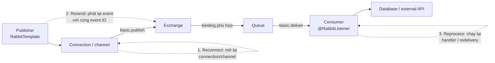
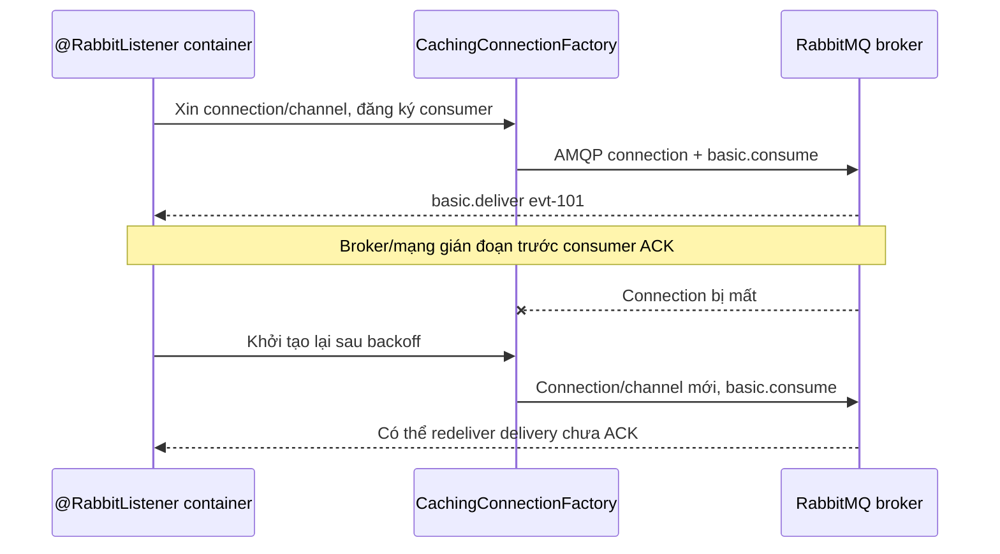
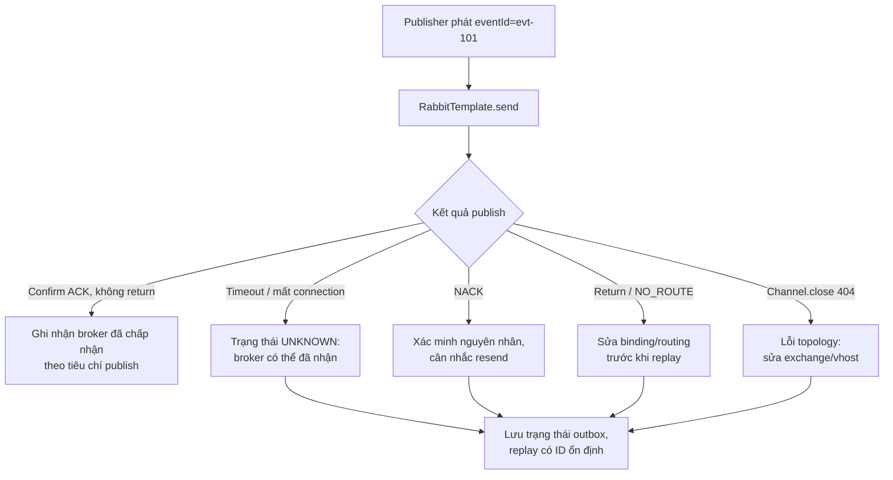
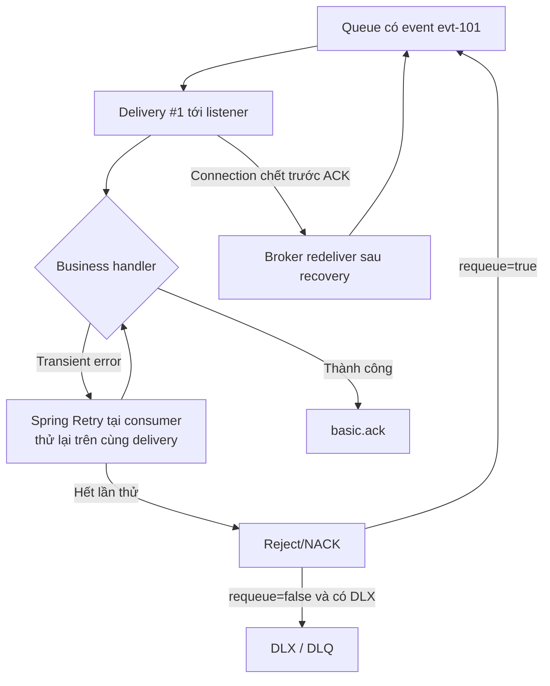
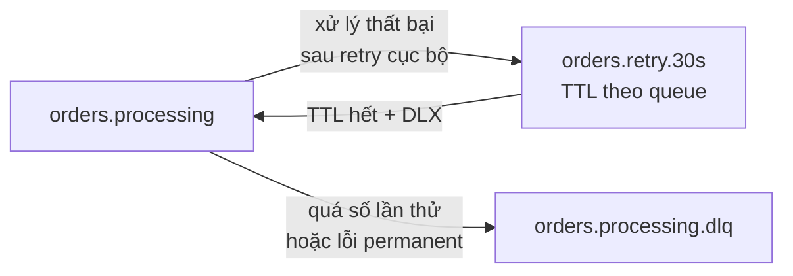

# Phân biệt thử kết nối lại, thử gửi lại và thử xử lý lại thông điệp trong Spring AMQP

Trong ứng dụng dùng **RabbitMQ với Spring AMQP**, từ *retry* có thể chỉ ba hành động khác nhau:

1. **Thử kết nối lại (*reconnect*)**: khôi phục kết nối TCP/AMQP và consumer/channel sau khi broker hoặc mạng gặp sự cố.
2. **Thử gửi lại (*republish/resend*)**: publisher phát lại **một sự kiện** vì lần gửi trước thất bại hoặc chưa biết chắc kết quả.
3. **Thử xử lý lại (*reprocess/reconsume*)**: consumer thực hiện lại nghiệp vụ đối với một message vì lần xử lý trước chưa hoàn tất thành công.

Cả ba cùng có thể xuất hiện trong một sự cố nhưng **không có cùng tác động**. Reconnect tự nó không phát lại một sự kiện chưa được gửi; resending có thể tạo message trùng; reprocessing có thể lặp side effect như ghi hóa đơn, gửi email hoặc cập nhật số dư.

Bài học thuộc chương **Thử lại thông điệp**. Từ `RabbitTemplate`, `@RabbitListener`, exchange–queue–binding cho tới publisher confirms, consumer acknowledgements, dead-letter và giao dịch, bạn sẽ học cách **xác định đúng lớp gặp lỗi**, chọn cơ chế thử lại thích hợp, giới hạn số lần thử và bảo đảm khả năng quan sát.

Sau bài học, bạn có thể:

- Phân biệt reconnect, resend và reprocess bằng **ngữ cảnh lỗi, người thực hiện và điều kiện kết thúc**.
- Hiểu khi nào kết quả publish hoặc xử lý có trạng thái **UNKNOWN**, không thể suy ra thành công/thất bại chỉ từ timeout.
- Thiết lập retry/backoff phía publisher và listener một cách có kiểm soát.
- Phân biệt **local retry**, **broker redelivery** và **republish qua retry queue**.
- Sử dụng event ID ổn định, publisher confirm/return, consumer ACK, idempotency và DLQ trong một kiến trúc xử lý bất đồng bộ tin cậy.

## 1. Ba vòng thử lại nằm ở đâu?



Ba vòng thử lại khác nhau về điều kiện kích hoạt:

| Khía cạnh | Reconnect | Resend / republish | Reprocess / reconsume |
| --- | --- | --- | --- |
| **Ai thực hiện?** | Connection factory, client, listener container | Publisher hoặc outbox worker | Consumer, retry interceptor hoặc broker qua redelivery |
| **Kích hoạt** | Connection/channel mất, broker chưa sẵn sàng | Publish lỗi, NACK, return, timeout/unknown confirm | Handler lỗi, NACK/requeue, retry advice, DLX/retry queue |
| **Đơn vị được thử lại** | **Transport/resource**: kết nối và đăng ký consumer | **Thông điệp phát hành**: một lần publish mới | **Nghiệp vụ xử lý** của một delivery hoặc message |
| **Cần ACK/confirm nào?** | Không xác nhận message chỉ vì đã kết nối lại | Publisher confirm/return cho **từng lần publish** | Consumer ACK/NACK sau xử lý |
| **Rủi ro chính** | Kết nối khôi phục nhưng công việc chưa được phát/ACK | Sự kiện bị publish trùng | Side effect nghiệp vụ lặp lại |
| **Cách bảo vệ** | Recovery/backoff, health, readiness | Outbox, ID ổn định, phân loại lỗi, confirm | Retry hữu hạn, idempotency, DLQ, transaction phù hợp |

**Kết luận:** “RabbitMQ đã tự reconnect” **không đồng nghĩa** message trước đó đã được phát lại; “publisher đã resend” **không đồng nghĩa** consumer được yêu cầu chạy lại bản delivery cũ. Phải theo dõi cả ba trạng thái một cách độc lập.

### 1.1. Không nhầm với ACK và confirm

- **Publisher confirm**: broker thông báo kết quả xử lý một lần publish trên publish channel.
- **Publisher return**: với `mandatory=true`, broker trả message không định tuyến được từ exchange hợp lệ theo điều kiện tương ứng.
- **Consumer ACK/NACK**: consumer/container xác nhận hoặc từ chối một **delivery** trên channel nhận.
- **Kết quả nghiệp vụ**: email đã gửi, DB đã commit, đơn đã được tạo... không được quyết định chỉ bởi ACK hay confirm.

Confirm ACK không chứng minh listener đã chạy; consumer ACK không chứng minh publisher chưa gửi trùng. Tầng nào retry phải quan sát tín hiệu của tầng đó.

## 2. Reconnect: khôi phục đường truyền, không tự hoàn thành message

### 2.1. Khi nào cần reconnect?

Một số nguyên nhân phổ biến:

- Broker chưa sẵn sàng khi ứng dụng khởi động.
- Mất mạng, DNS thay đổi, TCP reset hoặc heartbeat timeout.
- Broker restart, failover hoặc node chứa connection bị dừng.
- TLS handshake, credential hoặc virtual host sai.
- Broker đóng channel vì lỗi giao thức, ví dụ publish vào exchange thiếu (`404 NOT_FOUND`) hoặc declare queue không tương đương (`406 PRECONDITION_FAILED`).

Không phải trường hợp nào cũng có thể phục hồi bằng cách đợi. **Broker tạm mất kết nối** có thể tự khôi phục; **credential sai hoặc exchange thiếu** cần sửa cấu hình hoặc khai báo tài nguyên trước. Nếu cứ reconnect và lặp lại yêu cầu sai, bạn chỉ tạo thêm tải và log.

### 2.2. Vai trò của CachingConnectionFactory và listener container

Spring AMQP thường quản lý connection/channel thông qua `CachingConnectionFactory`. `RabbitTemplate` lấy tài nguyên khi gửi; listener container giữ consumer và tìm cách tái thiết lập sau khi connection mất theo chính sách của container.



Cần phân biệt hai việc ở cuối sơ đồ:

1. Container **đăng ký lại consumer** là *reconnect/recovery*.
2. Broker có thể **giao lại message chưa ACK** là *redelivery/reprocessing*. Đây là kết quả của trạng thái consumer ACK, không phải tác dụng “gửi lại mọi message” của việc mở connection.

Với Spring quản lý các resource này, đừng tự bật nhiều cơ chế recovery chồng lấn của RabbitMQ Java client rồi mặc định chúng sẽ phối hợp an toàn. Hãy kiểm tra phiên bản, chủ sở hữu cơ chế recovery và chính sách của container.

### 2.3. Reconnect không biết trạng thái của lần publish trước

Giả sử publisher gọi `RabbitTemplate.send(...)`; TCP connection mất trước khi app nhận publisher confirm. Sau reconnect, ứng dụng **không thể suy ra**:

- broker chưa nhận message;
- broker đã nhận nhưng chưa ghi xong;
- broker đã nhận/định tuyến thành công nhưng confirm bị mất.

Đây là **unknown outcome**. Nếu ứng dụng phát lại, có thể tạo thêm bản message. Cần lưu event ID và trạng thái publish trong một kho bền (khi nghiệp vụ yêu cầu), không chỉ gọi reconnect rồi kết luận công việc đã hoàn tất.

### 2.4. Cấu hình kết nối cơ sở

Ví dụ Spring Boot:

```yaml
spring:
  rabbitmq:
    host: ${RABBITMQ_HOST:localhost}
    port: ${RABBITMQ_PORT:5672}
    virtual-host: ${RABBITMQ_VHOST:/orders}
    username: ${RABBITMQ_USERNAME}
    password: ${RABBITMQ_PASSWORD}
    connection-timeout: 5s
    requested-heartbeat: 30s
```

Hai timeout ở trên phục vụ **kết nối và phát hiện kết nối mất**, không phải số lần thử gửi message. Tên property và hành vi cụ thể phải được xác nhận theo Spring Boot đang chạy.

Các container còn có chính sách khôi phục consumer hoặc retry khởi tạo khi queue tạm không tồn tại. Chúng **khác** với `spring.rabbitmq.listener.simple.retry.*` là nhóm cấu hình retry **xử lý delivery**.

### 2.5. Reconnect không giải quyết những lỗi nào?

| Lỗi | Vì sao reconnect không đủ? | Cách xử lý |
| --- | --- | --- |
| Sai mật khẩu hoặc thiếu quyền vhost | Mở lại connection vẫn bị từ chối | Sửa secret/permission |
| Publish vào exchange chưa tồn tại | Broker đóng channel với `404` ở lần publish sai | Khai báo exchange hoặc sửa tên/vhost |
| Queue được declare với arguments xung đột | `PRECONDITION_FAILED` tiếp tục xảy ra | Migration hoặc sửa topology |
| JSON hỏng trong queue | Connection không thay đổi body | Kiểm tra converter/contract, cách ly |
| DB consumer timeout | Reconnect RabbitMQ không giúp DB hồi phục | Retry nghiệp vụ có backoff |
| Publisher confirm mất | Khôi phục kết nối không biết chắc publish cũ đã tới | Outbox/truy vết, retry an toàn khi cần |

## 3. Resend: thử gửi lại từ publisher

`RabbitTemplate.convertAndSend(...)` hoặc `send(...)` thực hiện một **lần publish**. Nếu publisher quyết định thử lại cùng sự kiện, nó thực hiện **lần publish mới**. RabbitMQ không tự khử trùng lặp chỉ vì hai message có cùng `messageId`.

### 3.1. Những lý do cần cân nhắc resend

- Không lấy được channel/connection trước khi gửi.
- Broker không truy cập được hoặc có lỗi mạng tạm thời.
- Publisher confirm NACK.
- Publisher confirm timeout hoặc connection shutdown khiến kết quả chưa xác định.
- Message được **publisher return** vì exchange không có binding tới queue, sau khi đã sửa routing.
- Công việc chưa được publish, đang nằm trong outbox do worker chưa chạy.

Không phải tất cả các trường hợp đều nên thử lại ngay. Ví dụ `404 NOT_FOUND` khi gửi vào một exchange thiếu, `ACCESS_REFUSED` hoặc `312 NO_ROUTE` cần sửa topology/permission; phát lại cùng địa chỉ sai chỉ lặp lại lỗi.

### 3.2. Quan sát confirm, return và kết quả UNKNOWN



**Cần chú ý thứ tự tín hiệu:** Message `mandatory` không có route có thể được trả bằng `basic.return` nhưng vẫn có **publisher confirm ACK**, vì broker đã xử lý lần publish. Ngược lại, publish vào exchange không tồn tại thường gây **đóng channel `404`**, không phải một `basic.return` NO_ROUTE thông thường.

Khi publisher chưa nhận confirm do connection mất, retry không thể đảm bảo exactly-once; muốn an toàn cần **chịu được bản trùng**.

### 3.3. Ví dụ publisher ghi event ID ổn định

Ví dụ publisher gửi một event string có `messageId` đồng nhất với ID sự kiện. Dùng `CorrelationData` để theo dõi confirm của riêng lần publish:

```java
import java.nio.charset.StandardCharsets;

import org.springframework.amqp.core.Message;
import org.springframework.amqp.core.MessageBuilder;
import org.springframework.amqp.core.MessageDeliveryMode;
import org.springframework.amqp.core.MessageProperties;
import org.springframework.amqp.rabbit.connection.CorrelationData;
import org.springframework.amqp.rabbit.core.RabbitTemplate;
import org.springframework.stereotype.Service;

@Service
public class OrderPublisher {
    private final RabbitTemplate rabbitTemplate;

    public OrderPublisher(RabbitTemplate rabbitTemplate) {
        this.rabbitTemplate = rabbitTemplate;
    }

    public CorrelationData publish(String eventId, String orderId) {
        Message message = MessageBuilder
                .withBody(orderId.getBytes(StandardCharsets.UTF_8))
                .setMessageId(eventId)
                .setContentType(MessageProperties.CONTENT_TYPE_TEXT_PLAIN)
                .setContentEncoding("UTF-8")
                .setDeliveryMode(MessageDeliveryMode.PERSISTENT)
                .setHeader("eventType", "order.created")
                .build();

        CorrelationData correlation = new CorrelationData(eventId);
        rabbitTemplate.send(
                "orders.events",
                "order.created",
                message,
                correlation);

        // Đã yêu cầu publish, KHÔNG đồng nghĩa đã nhận confirm.
        return correlation;
    }
}
```

Ở đây `messageId` biểu diễn **event logic**, còn mỗi lần resend là một **publish attempt**. Khi ghi metrics nên phân biệt hai ID đó. Nếu cần tách `attemptId` và `eventId`, tạo attempt ID riêng trong log/correlation để truy vết, nhưng **không thay event ID** mỗi lần thử lại.

Ví dụ chỉ mô tả việc gửi; phải cấu hình correlated publisher confirms, returns và mandatory thích hợp rồi có thành phần theo dõi kết quả. Đừng chỉ gọi `publish(...)` và đánh dấu sự kiện đã phát thành công trong database.

### 3.4. Cấu hình publisher confirms/returns

```yaml
spring:
  rabbitmq:
    publisher-confirm-type: correlated
    publisher-returns: true
    template:
      mandatory: true
```

Với cấu hình này, ứng dụng có thể theo dõi kết quả confirm từ `CorrelationData` và returned message khi không có route. Cần **xử lý** tín hiệu chứ không chỉ bật property.

Một ví dụ chờ confirm hữu hạn trong luồng kiểm thử:

```java
import java.util.concurrent.TimeUnit;
import org.springframework.amqp.rabbit.connection.CorrelationData;

CorrelationData attempt = publisher.publish("evt-101", "ORD-101");

CorrelationData.Confirm confirm =
        attempt.getFuture().get(5, TimeUnit.SECONDS);

if (!confirm.isAck()) {
    throw new IllegalStateException(
            "Publish not confirmed: " + confirm.getReason());
}

if (attempt.getReturned() != null) {
    throw new IllegalStateException(
            "Unroutable: " + attempt.getReturned().getReplyText());
}
```

Đây là **đoạn minh họa được chạy trong method test có exception handling phù hợp**, giả định `publisher` đã được khởi tạo và confirms được bật. Trong sản phẩm, tránh chặn một thread cho mỗi event nếu throughput cao; dùng callback/future bất đồng bộ với timeout và trạng thái outbox rõ ràng.

Nếu `get(...)` timeout, **không đánh dấu chắc chắn thất bại**. Lưu trạng thái UNKNOWN; nếu nghiệp vụ yêu cầu tiếp tục, replay có kiểm soát và idempotency.

### 3.5. Template-level retry khác với replay một event bền vững

Spring AMQP/Spring Boot có thể bật **`RabbitTemplate` retry** cho lỗi thao tác gửi tạm thời, ví dụ:

```yaml
spring:
  rabbitmq:
    template:
      retry:
        enabled: true
        max-attempts: 3
        initial-interval: 500ms
        multiplier: 2
        max-interval: 2s
```

Nhóm này điều khiển **thử lại lời gọi template khi gặp lỗi phù hợp**, không thay thế việc chờ **publisher confirm bất đồng bộ** hay lưu một event vào outbox. Một lời gọi template trả về bình thường vẫn có thể bị lỗi publish sau đó ở mức channel/confirm.

**Không bật retry mù quáng** với message có side effect khi kết quả publish không rõ: một lần thử gửi lại có thể nhân đôi sự kiện trên broker. Dùng event ID ổn định và consumer idempotency ngay cả khi đã bật confirms.

### 3.6. Transactional outbox khi event phải chắc chắn được phát

Nếu nghiệp vụ vừa commit database vừa publish event, có khoảng lỗi:

```text
BEGIN DB TRANSACTION
  INSERT orders ...
COMMIT DB
  -> RabbitMQ tạm unavailable
  -> event không được phát
```

**Transactional outbox** thay đổi thành:

```text
BEGIN DB TRANSACTION
  INSERT orders ...
  INSERT outbox(eventId, payload, status=PENDING)
COMMIT DB

Outbox worker:
  -> publish(eventId, payload)
  -> theo dõi publisher confirm/return
  -> đánh dấu SENT khi đạt tiêu chí
  -> nếu ERROR/UNKNOWN: giữ record để đối soát hoặc retry
```

Outbox giải quyết việc **không làm mất ý định phát event sau DB commit**, nhưng không tạo exactly-once tại RabbitMQ. Nếu đã publish rồi mất confirm, worker có thể phát lại cùng event. Consumer cần xử lý **event ID idempotent**.

## 4. Reprocess: thử xử lý lại ở phía consumer

Khi RabbitMQ đã giao một message cho `@RabbitListener`, việc “thử lại” có hai cơ chế chính:

1. **Local retry ở listener:** code xử lý lại **cùng delivery** nhiều lần trong một process, thường qua Spring Retry advice. Trong quá trình này broker có thể vẫn xem delivery là **unacked**.
2. **Broker redelivery hoặc message được phát lại:** consumer NACK/requeue, mất channel trước ACK hoặc message được đưa qua retry topology rồi giao lại. Khi đó có **delivery mới**; có thể bởi consumer khác.



### 4.1. Local retry và broker redelivery không giống nhau

| Nội dung | Local retry (Spring Retry) | Broker redelivery |
| --- | --- | --- |
| Ai chạy? | Listener container/advice trong process | RabbitMQ giao lại một delivery |
| Có chuyển message khỏi queue và publish mới? | Không, chỉ thử lại handler theo retry policy | Có delivery mới từ broker; không nhất thiết publish message mới |
| Trong lúc thử lại | Delivery thường vẫn unacked | Một delivery cũ bị requeue hoặc channel đóng, sau đó broker giao lại |
| Có thể đổi consumer? | Thường vẫn trong cùng đường xử lý cục bộ | Có thể giao tới consumer khác |
| Dấu hiệu | Spring Retry attempt/context | `redelivered` và broker delivery metrics |
| Kiểm soát delay | Backoff của interceptor | Requeue thường không tạo delay hữu hạn; cần retry topology hoặc cách khác |
| Rủi ro | Chiếm thread/prefetch slot, thử nhiều lần | Requeue nóng, message trùng side effect |

**Requeue không tự tạo backoff.** Khi exception lặp lại và `defaultRequeueRejected=true`, message có thể chạy vòng nhiều lần rất nhanh. Hãy dùng retry hữu hạn, DLQ/quarantine hoặc retry queue có delay.

### 4.2. AUTO của Spring, MANUAL và NONE

- **`AcknowledgeMode.AUTO`**: listener thành công thì Spring gửi ACK; khi lỗi, container/error handler quyết định reject/NACK/requeue theo cấu hình.
- **`AcknowledgeMode.MANUAL`**: ứng dụng tự xác nhận trên đúng channel và `deliveryTag`; phải chọn thời điểm sau khi business effect đã an toàn.
- **`AcknowledgeMode.NONE`**: tương ứng broker auto-ack/no-ack; delivery không chờ consumer ACK. **Không** thể kỳ vọng một exception Java sẽ khiến broker tự giao lại theo cơ chế unacked.

**AUTO của Spring không phải RabbitMQ `autoAck=true`.** Để kiểm soát xử lý lại sau consumer crash, cần AUTO/MANUAL và chính sách ACK/retry phù hợp.

### 4.3. Cấu hình retry cục bộ trong Spring Boot

Ví dụ cơ sở cho `SimpleRabbitListenerContainerFactory` khi ứng dụng sử dụng Spring Boot properties tương ứng:

```yaml
spring:
  rabbitmq:
    listener:
      simple:
        acknowledge-mode: auto
        concurrency: 2
        max-concurrency: 4
        prefetch: 10
        default-requeue-rejected: false
        retry:
          enabled: true
          max-attempts: 3
          initial-interval: 1s
          multiplier: 2
          max-interval: 4s
```

Ý nghĩa:

- `max-attempts: 3` thường tính **cả lần xử lý ban đầu**, không phải ba lần cộng thêm.
- `initial-interval`/`multiplier`/`max-interval` xác định backoff.
- Trong khi retry cục bộ, consumer vẫn chiếm tài nguyên và delivery chưa được xác nhận.
- Nếu mọi lần thử đều lỗi, chính sách recoverer/requeue/reject quyết định bước tiếp theo.
- `default-requeue-rejected: false` **không tự tạo DLQ**; queue phải có DLX và binding tương ứng.

**Cảnh báo:** Đây là cấu hình minh họa để hiểu cơ chế. Retry mặc định không nhất thiết phân loại đúng transient/permanent. Khi vận hành thật, nên xây classifier để **không thử lại malformed JSON, schema không tương thích hoặc lỗi domain vĩnh viễn**, và phải xác nhận các property thực sự áp dụng lên listener factory đang dùng.

Nếu `@RabbitListener` chỉ định một factory do bạn tự tạo, properties Boot cho factory mặc định **không chắc đã được áp dụng**; cấu hình retry trên đúng factory đó.

### 4.4. Chọn retry loại lỗi nào?

| Lỗi trong listener | Có thể retry cùng payload? | Vì sao? |
| --- | --- | --- |
| DB connection timeout tạm thời | Có, với backoff giới hạn | Hạ tầng có thể hồi phục |
| HTTP 503 từ service bên ngoài | Có, nếu lời gọi idempotent hoặc được bảo vệ | Phụ thuộc có thể hồi phục |
| DB deadlock transient | Có thể | Thử lại transaction phù hợp có thể thành công |
| JSON sai cấu trúc | Thường không | Byte không tự thay đổi sau một lần chờ |
| `schemaVersion` không hỗ trợ | Không đến khi deploy consumer mới | Contract không tương thích |
| Đơn hàng vi phạm quy tắc vĩnh viễn | Thường không | Nghiệp vụ vẫn từ chối |
| Lỗi code (`NullPointerException` do bug) | Không coi retry là cách sửa chính | Cần sửa phần mềm |
| Event đã xử lý trước đó | Không cần lặp side effect | Nhận biết qua idempotency, sau đó ACK an toàn |

### 4.5. Listener và idempotency

Nếu delivery được redeliver sau khi DB commit nhưng trước ACK, listener có thể chạy nghiệp vụ lần hai. Điều an toàn cần xây:

```text
eventId = evt-101
BEGIN DB TRANSACTION
  Nếu eventId đã có trong processed_events:
      không thực hiện side effect lặp lại
  Ngược lại:
      áp dụng nghiệp vụ
      INSERT processed_events(eventId) với UNIQUE constraint
COMMIT
-> Listener kết thúc thành công
-> Container gửi ACK
```

**Chỉ `SELECT exists` rồi `INSERT` không đủ để chống race** nếu hai delivery cùng event ID xử lý đồng thời. Dùng ràng buộc unique và transaction phù hợp hoặc thao tác atomic/upsert có kiểm soát. Với email hay API ngoài DB, cần khóa idempotency hỗ trợ bởi hệ thống đích hoặc cơ chế outbox riêng.

## 5. Ví dụ Spring AMQP: publish, consume và xử lý lỗi có giới hạn

Ví dụ xây một topic exchange `orders.events`, queue `orders.processing` và dead-letter route. Java dùng Java 17+ và Spring AMQP. Phần repository nghiệp vụ/idempotency là trách nhiệm ứng dụng, không được giả định framework tự tạo.

### 5.1. Khai báo topology

```java
import org.springframework.amqp.core.Binding;
import org.springframework.amqp.core.BindingBuilder;
import org.springframework.amqp.core.Declarables;
import org.springframework.amqp.core.DirectExchange;
import org.springframework.amqp.core.Queue;
import org.springframework.amqp.core.QueueBuilder;
import org.springframework.amqp.core.TopicExchange;
import org.springframework.context.annotation.Bean;
import org.springframework.context.annotation.Configuration;

@Configuration
public class OrdersMessagingTopology {
    public static final String EXCHANGE = "orders.events";
    public static final String ROUTING_KEY = "order.created";
    public static final String QUEUE = "orders.processing";
    public static final String DLX = "orders.dlx";
    public static final String DLQ = "orders.processing.dlq";

    @Bean
    public Declarables ordersResources() {
        TopicExchange exchange =
                new TopicExchange(EXCHANGE, true, false);
        DirectExchange deadLetterExchange =
                new DirectExchange(DLX, true, false);

        Queue processing = QueueBuilder.durable(QUEUE)
                .deadLetterExchange(DLX)
                .deadLetterRoutingKey("order.failed")
                .build();
        Queue deadLetterQueue = QueueBuilder.durable(DLQ).build();

        Binding mainBinding = BindingBuilder.bind(processing)
                .to(exchange).with(ROUTING_KEY);
        Binding deadLetterBinding = BindingBuilder.bind(deadLetterQueue)
                .to(deadLetterExchange).with("order.failed");

        return new Declarables(
                exchange, deadLetterExchange,
                processing, deadLetterQueue,
                mainBinding, deadLetterBinding);
    }
}
```

**Các bean chỉ mô tả topology.** Cần `RabbitAdmin` hoặc quy trình khai báo khác chạy với đúng user/vhost để tạo exchange, queue, binding thật sự. Đặt DLX nhưng không có queue/binding phù hợp có thể khiến message bị reject không requeue mà không nằm ở DLQ bạn mong đợi.

Trong production, ưu tiên cân nhắc chính sách DLX bằng RabbitMQ policy để giảm nhu cầu thay đổi queue arguments cố định; cần đánh giá queue type và bảo đảm dead-letter của broker.

### 5.2. Publisher có ID ổn định

Publisher phần 3 có thể gửi tới topology `OrdersMessagingTopology.EXCHANGE` / `ROUTING_KEY`. Khi phát lại, gọi lại `publish(eventId, orderId)` với **cùng event ID**, không sinh event ID mới cho mỗi lần retry cùng sự kiện.

Nếu muốn minh họa phần nghiệp vụ riêng, một event có thể có schema JSON như sau:

```json
{
  "eventId": "evt-101",
  "orderId": "ORD-101",
  "type": "order.created",
  "schemaVersion": 1
}
```

Trong môi trường thật, producer/consumer cần thống nhất `contentType`, converter và validation. Ví dụ publish string ở phần 3 dùng body là `orderId`; JSON trên là **mẫu hợp đồng khác**, không nên mong listener String tự đọc JSON thành order ID mà không có bước chuyển đổi.

### 5.3. Listener có phân loại lỗi và ID sự kiện

```java
import java.nio.charset.StandardCharsets;

import org.springframework.amqp.AmqpRejectAndDontRequeueException;
import org.springframework.amqp.core.Message;
import org.springframework.amqp.rabbit.annotation.RabbitListener;
import org.springframework.stereotype.Component;

@Component
public class OrdersConsumer {
    private final OrdersDomainService domain;

    public OrdersConsumer(OrdersDomainService domain) {
        this.domain = domain;
    }

    @RabbitListener(queues = OrdersMessagingTopology.QUEUE)
    public void process(Message message) {
        String eventId = message.getMessageProperties().getMessageId();
        String orderId = new String(
                message.getBody(), StandardCharsets.UTF_8);

        if (eventId == null || eventId.isBlank()
                || orderId.isBlank()) {
            throw new AmqpRejectAndDontRequeueException(
                    "Invalid order event contract");
        }

        // Domain service phải áp dụng idempotency bằng transaction
        // và ràng buộc dữ liệu phù hợp, không chỉ kiểm tra in-memory.
        domain.processIdempotently(eventId, orderId);
        // AUTO: Spring container ACK khi listener hoàn tất thành công.
    }
}

// Hợp đồng cần được hiện thực bởi bean service nghiệp vụ.
interface OrdersDomainService {
    void processIdempotently(String eventId, String orderId);
}
```

Trong ứng dụng thật:

- Nếu DB/service tạm thời không hoạt động, domain service ném exception để retry policy xem xét.
- Nếu message đã xử lý theo event ID, domain service bỏ qua side effect và trả về thành công để listener ACK.
- Nếu contract sai vĩnh viễn, ứng dụng từ chối không requeue.
- Dù vậy, **một retry advice generic có thể vẫn thử lại lỗi permanent** trước khi recover; cần classifier/cấu hình phù hợp nếu muốn bỏ qua ngay.
- Code minh họa chỉ chạy được khi bạn có bean triển khai `OrdersDomainService`; không dùng interface giả làm một implementation.

### 5.4. Phân loại bằng một chính sách rõ ràng

Một classifier ở mức nghiệp vụ nên tách:

```text
TransientInfrastructureException
  -> local retry: 3 attempts, 500 ms -> 1 s -> 2 s
  -> nếu vẫn lỗi: retry queue có delay hoặc DLQ + alert

InvalidEventException / unsupported schema
  -> không retry local
  -> reject không requeue
  -> DLQ / quarantine (nếu topology phù hợp)

AlreadyProcessedEvent
  -> không chạy lại side effect
  -> hoàn tất listener, ACK
```

Điều quan trọng không phải class exception nào “đẹp”, mà là **nhóm lỗi có khả năng tự hồi phục không**. Một exception Java có thể bọc nhiều cause; hệ thống nên phân loại từ nguyên nhân thật, có giới hạn và có metrics.

## 6. Retry queue, dead-letter và delayed reprocessing

Local retry có lợi khi lỗi rất ngắn; nhưng nếu đợi nhiều phút để DB khôi phục, giữ một consumer thread và delivery unacked có thể gây tắc nghẽn. Một phương án là chuyển message sang **retry queue có TTL/DLX**, sau đó đưa về queue xử lý.



### 6.1. Đặc điểm quan trọng

- Retry queue là **topology và cơ chế chuyển tiếp message**, không tự có khi bạn bật `spring.rabbitmq.listener.simple.retry.enabled`.
- TTL là thời gian chờ message trong queue; DLX/routing đưa message quay về queue xử lý nếu cấu hình đúng.
- Nên đặt **số lần thử tối đa** và có đường DLQ cuối. Một vòng DLX → retry → DLX không giới hạn có thể làm broker bận liên tục.
- Nếu dùng xếp hàng nhiều mức delay (ví dụ 5s, 30s, 2m), cần xác định chiến lược chọn queue sau mỗi failure.
- TTL per-message có thể gặp hiện tượng **head-of-line blocking** trong các cấu hình queue. Dùng các retry queue tách mức delay hoặc giải pháp trì hoãn được hỗ trợ, kiểm chứng theo queue type/version.
- Header `x-death` được broker bổ sung trong dead-letter flow có ích để quan sát, nhưng không nên dựa duy nhất vào nó như **nguồn sự thật bất biến về attempt count** qua mọi quá trình republish/migration.

### 6.2. Retry queue và ACK phải đi cùng nhau

Khi consumer quyết định **tự publish một bản message sang retry queue** rồi ACK bản cũ, tồn tại cửa sổ mất dữ liệu:

```text
Consume từ orders.processing
  -> Publish sang orders.retry
  -> ACK bản cũ

Nếu publish retry thất bại nhưng vẫn ACK bản cũ:
  -> message có thể mất khỏi cả hai queue.
```

Muốn xây retry bằng cách **republish từ consumer**, hãy theo dõi publisher confirm/return hoặc cơ chế giao nhận đáng tin cậy phù hợp trước khi ACK bản cũ; vẫn tính tới trường hợp kết quả publish chưa xác định có thể tạo bản trùng. Lựa chọn dễ hiểu khác là để broker dead-letter qua DLX/TTL theo topology, song cần biết **các bảo đảm dead-letter khác nhau theo queue type và cấu hình RabbitMQ**.

Đừng trộn `basicNack(requeue=true)` với cơ chế trì hoãn mà tưởng RabbitMQ sẽ tự đợi 30 giây; requeue thường có thể được giao lại rất nhanh.

### 6.3. Dùng DLQ đúng vai trò

Một DLQ giúp:

- cách ly message không thể xử lý ngay;
- giữ payload/metadata để phân tích nguyên nhân;
- cảnh báo tỷ lệ lỗi tăng;
- cho phép quy trình replay có phê duyệt, versioning và idempotency.

DLQ **không tự động chữa** message. Khi phát lại từ DLQ vào main queue, đó thường là **một lần publish mới của message tương đương**, khác về ngữ nghĩa với broker redelivery sau channel disconnect. Phải giữ event ID, trace history và đánh dấu replay.

## 7. Chiến lược retry toàn hệ thống không được nhân số lần thử ngoài ý muốn

Một pipeline có thể áp dụng đồng thời:

- 3 lần thử `RabbitTemplate` vì lỗi gửi.
- 3 lần local retry trong listener.
- 2 lần redelivery từ queue.
- 1 lần replay từ DLQ do vận hành.

Khi những tầng này lồng nhau, **tác dụng nghiệp vụ có thể được thực hiện nhiều lần hơn mong đợi**. Nếu ba publish attempts đều được broker chấp nhận nhưng producer tưởng một số lần thất bại, có thể có nhiều bản event; mỗi bản lại được consumer retry.

Ví dụ lý thuyết: tối đa 3 bản message tới queue × 3 lần local xử lý mỗi bản × 2 lần broker delivery mỗi bản = **18 lần gọi handler** cho cùng event logic trong một chuỗi điều kiện xấu. Đây không phải con số mặc định của Spring, mà là minh họa rằng retry nhiều tầng có thể **nhân số lần side effect**.

### 7.1. Định nghĩa ngân sách retry

Mỗi luồng nên có giới hạn:

| Tầng | Câu hỏi thiết kế | Chỉ số theo dõi |
| --- | --- | --- |
| Reconnect | Sau bao lâu báo unhealthy? Khi nào tạm dừng publish? | Connection/channel failures, recovery duration |
| Publisher resend | Max attempts, backoff, xử lý UNKNOWN thế nào? | Publish attempts, confirm timeout/NACK/return, outbox age |
| Consumer local retry | Lỗi transient nào được thử, bao lâu giữ delivery unacked? | Retry count, handler latency, unacked |
| Broker delayed retry | Mức delay, tổng attempts và TTL/queue topology? | Retry queue depth, x-death/attempt tracking |
| DLQ replay | Ai phê duyệt, sửa dữ liệu hay code trước khi replay? | Replay count, DLQ age, duplicate count |

Giữ SLA tổng: một API cần trả phản hồi trong 300 ms không nên tự chặn 30 giây để retry AMQP. Đối với workflow dài, trả job ID hoặc lưu outbox thay vì giữ request thread chờ broker.

### 7.2. Exponential backoff và jitter

Một công thức backoff thường dùng:

\[
d_n = \min(d_{\max}, d_0 \cdot m^{\,n-1})
\]

Trong đó `d_0` là khoảng chờ ban đầu, `m` là hệ số nhân, `d_max` là trần. Ví dụ `d_0 = 500ms`, `m = 2`, `d_max = 4s`:

| Lần đợi giữa attempts | Delay |
| --- | --- |
| Sau attempt 1 | 500 ms |
| Sau attempt 2 | 1 s |
| Sau attempt 3 | 2 s |
| Sau attempt 4 | 4 s |
| Các lần sau | Tối đa 4 s |

Thêm **jitter** giúp tránh hàng trăm instance đồng loạt retry cùng lúc khi broker/service vừa hồi phục. Spring AMQP/Retry có nhiều cách cấu hình backoff tùy version; phải kiểm chứng chính sách thực tế, không giả định mọi Spring Boot property đều có sẵn jitter.

**Không retry không giới hạn.** Khi hết retry budget, giữ lại công việc hoặc đưa vào DLQ/quarantine với alert và thao tác recovery rõ ràng.

## 8. Kiểm thử ba vòng thử lại một cách tách biệt

Dùng môi trường RabbitMQ/vhost thử nghiệm, ví dụ `/orders`. Không tái hiện bằng cách tắt broker production hoặc xóa queue đang chứa dữ liệu thật.

### 8.1. Bảng kịch bản

| Kịch bản | Tác động thử nghiệm | Kết quả cần quan sát |
| --- | --- | --- |
| **Reconnect sau broker restart** | Restart broker thử nghiệm lúc consumer đang chạy | Connection/channel hồi phục, consumer đăng ký lại; delivery chưa ACK có thể redeliver |
| **Sai mật khẩu** | Đặt credential sai | Không tự khỏi nhờ retry; báo cấu hình |
| **Exchange thiếu** | Publish vào tên exchange không tồn tại | `channel.close(404 NOT_FOUND)`; không nhầm với NO_ROUTE |
| **Publisher timeout confirm** | Gây mất connection khi publish hoặc mô phỏng timeout | Kết quả UNKNOWN; outbox giữ event ID, có thể replay trùng |
| **Publisher return** | Exchange có thật nhưng routing key không khớp binding, `mandatory=true` | Return/NO_ROUTE, có thể kèm confirm ACK |
| **Consumer lỗi transient** | Giả lập DB timeout cho 2 lần đầu | Local retry có backoff rồi xử lý thành công |
| **Consumer lỗi vĩnh viễn** | Body sai schema hoặc event ID thiếu | Không retry nóng; reject/DLQ nếu đã cấu hình |
| **Requeue nóng** | Bật requeue cho handler luôn throw | Delivery lặp nhanh; chứng minh vì sao cần limit/delay |
| **Crash trước ACK** | Đóng consumer sau side effect trước ACK | Redelivery; idempotency tránh tác dụng lặp |
| **Delayed retry** | Chuyển message qua retry queue 30s | Message quay lại sau delay, quá giới hạn thì DLQ |
| **Manual replay DLQ** | Phát lại event sau khi sửa lỗi | Được theo dõi như publish attempt mới; event ID giữ ổn định |

### 8.2. Quan sát RabbitMQ

Với quyền quản trị broker:

```bash
rabbitmqctl list_exchanges -p /orders name type durable
rabbitmqctl list_bindings -p /orders source_name destination_name routing_key

rabbitmqctl list_queues -p /orders \
  name messages_ready messages_unacknowledged consumers

rabbitmqctl list_connections name user vhost state channels
rabbitmqctl list_channels connection number consumer_count messages_unacknowledged
```

Theo dõi Spring application logs và RabbitMQ Management UI để phân biệt:

- **Reconnection**: connection/channel mới, listener đăng ký lại.
- **Resend**: một lần `basic.publish` mới; có thể xuất hiện hai message cùng `messageId`.
- **Local retry**: nhiều lần gọi business handler nhưng không có publish mới và không nhất thiết có broker delivery mới.
- **Redelivery**: delivery mới với cờ `redelivered` khi áp dụng; không dùng cờ này làm bằng chứng tuyệt đối rằng event chưa từng được xử lý.
- **Dead-letter/replay**: message chuyển qua queue khác hoặc được publish mới; ghi lại đường đi, attempt count.

### 8.3. Event ID và correlation ID để truy dấu

Một bộ trường hữu ích trong log/metrics:

```text
eventId       = evt-101              # cùng sự kiện logic
publishAttempt = 2                   # lần gửi thứ hai của publisher
correlationId = evt-101-attempt-2     # ánh xạ confirm lần gửi
queue         = orders.processing
deliveryTag   = 37                   # chỉ có nghĩa trên channel hiện tại
redelivered   = true                 # tín hiệu broker về delivery
handlerAttempt = 3                   # lần local retry trong process
errorCategory = TRANSIENT_DB
```

Đừng gắn một `deliveryTag` vào event ID như định danh toàn hệ thống: tag được tái sử dụng theo vòng đời channel. Ngược lại, một event ID có thể xuất hiện ở **nhiều lần publish** và nhiều delivery; đó là cơ sở cho idempotency.

## 9. Những hiểu nhầm dễ gây mất dữ liệu hoặc lặp side effect

| Khẳng định sai | Vì sao sai? | Cách hiểu đúng |
| --- | --- | --- |
| “Reconnect sẽ tự gửi lại message chưa có confirm.” | Reconnect chỉ khôi phục transport | Publisher/outbox phải chủ động theo dõi và resend |
| “`convertAndSend` không ném exception là đã vào queue.” | Publish/confirm bất đồng bộ; routing có thể fail | Xử lý confirm, return, mandatory và channel shutdown |
| “Confirm timeout nghĩa broker chắc chắn chưa nhận.” | Confirm có thể bị mất sau khi broker đã nhận | Đánh dấu UNKNOWN, replay với ID ổn định |
| “RabbitMQ tự khử trùng lặp theo `messageId`.” | Trường messageId là metadata | Consumer tự triển khai idempotency |
| “Spring AUTO là broker auto-ack.” | Spring AUTO gửi ACK sau xử lý | Broker no-ack tương ứng Spring NONE |
| “Listener retry là một lần publish mới.” | Retry cục bộ gọi lại handler trên delivery hiện tại | Phân biệt local retry và broker redelivery |
| “NACK requeue sẽ đợi vài giây.” | Requeue thường có thể giao lại tức thì | Dùng backoff cục bộ hoặc retry queue có delay |
| “DLX/DLQ tự có khi bật retry.” | Broker cần topology và policy | Khai báo DLX/DLQ/binding rõ ràng |
| “Cứ throw exception là không mất message.” | Error handler có thể reject không requeue; NONE không chờ ACK | Kiểm tra ACK mode, retry, DLX và thực nghiệm |
| “Sau DB commit nhưng trước ACK không có rủi ro.” | Delivery có thể được giao lại | Commit idempotent và event ID ổn định |
| “Retry nhiều tầng luôn tăng độ tin cậy.” | Có thể nhân attempts, kéo dài SLA, quá tải | Đặt retry budget, classifier, metrics |
| “Nhận lại từ DLQ là broker redelivery cùng delivery.” | Thường là publish mới, routing mới | Theo dõi replay riêng, bảo toàn event ID |

## 10. Checklist thiết kế ba vòng thử lại

- [ ] Phân biệt mục tiêu: đang khôi phục **connection**, **publish** hay **business processing**?
- [ ] Nhận diện loại lỗi: transient, permanent, topology/permission hoặc UNKNOWN outcome.
- [ ] Không retry vô hạn lỗi credential, exchange thiếu, schema sai hoặc rule nghiệp vụ vĩnh viễn.
- [ ] Đối chiếu `ConnectionFactory`, listener container recovery và Spring Boot retry properties; tránh cơ chế chồng lấn không rõ.
- [ ] Bật/tiêu thụ publisher confirms và returns khi cần; không đánh dấu SENT chỉ vì `send()` trả về.
- [ ] Với publish UNKNOWN, giữ event ID và bản ghi outbox/trạng thái cần đối soát.
- [ ] Tránh gửi trùng tác dụng nghiệp vụ bằng consumer idempotency/unique constraint hoặc khóa nghiệp vụ.
- [ ] Chọn listener local retry có giới hạn và backoff, chỉ cho lỗi có khả năng hồi phục.
- [ ] Phân biệt local retry, broker requeue/redelivery và republish qua retry queue.
- [ ] Không lạm dụng `basicNack(requeue=true)` cho lỗi vĩnh viễn.
- [ ] Với retry queue, cấu hình TTL/DLX và đường DLQ cuối; có giới hạn attempts.
- [ ] Khi republish từ consumer, không ACK bản gốc trước khi có cơ sở chắc chắn về publish mới.
- [ ] Phân biệt Spring `AcknowledgeMode.AUTO` với broker auto-ack/`NONE`.
- [ ] Đặt tổng retry budget, jitter nếu phù hợp, concurrency và SLA; tránh retry storm.
- [ ] Quan sát event ID, publish attempt, handler attempt, confirm, return, ready/unacked, redelivery và DLQ.
- [ ] Kiểm thử mất connection trước confirm, consumer crash trước ACK, malformed message và DLQ replay.

**Ghi nhớ:** **Reconnect** sửa đường truyền; **resend** phát thêm một lần publish; **reprocess** thực hiện lại logic nghiệp vụ. Ba cơ chế có thể diễn ra nối tiếp nhưng **không bảo đảm nhau**. Xử lý bất đồng bộ đáng tin cậy bằng Spring AMQP đòi hỏi exchange–queue–binding đúng, publisher confirms/returns, consumer ACK/NACK, retry/backoff hữu hạn, dead-letter, event ID ổn định, idempotency và trạng thái bền vững khi kết quả chưa xác định.

### Tài liệu tham khảo

- [Spring AMQP — Resilience: Recovering from Errors and Broker Failures](https://docs.spring.io/spring-amqp/reference/amqp/resilience-recovering-from-errors-and-broker-failures.html)
- [Spring AMQP — Exception Handling](https://docs.spring.io/spring-amqp/reference/amqp/exception-handling.html)
- [Spring AMQP — RabbitTemplate Publisher Confirms and Returns](https://docs.spring.io/spring-amqp/reference/amqp/template.html#publisher-confirms-returns)
- [Spring AMQP — Listener Container Attributes](https://docs.spring.io/spring-amqp/reference/amqp/containerAttributes.html)
- [Spring Boot — RabbitMQ and AMQP](https://docs.spring.io/spring-boot/reference/messaging/amqp.html)
- [RabbitMQ — Consumer Acknowledgements and Publisher Confirms](https://www.rabbitmq.com/docs/confirms)
- [RabbitMQ — Reliability Guide](https://www.rabbitmq.com/docs/reliability)
- [RabbitMQ — Dead Letter Exchanges](https://www.rabbitmq.com/docs/dlx)
- [RabbitMQ — Time-to-Live](https://www.rabbitmq.com/docs/ttl)
- [RabbitMQ — Connections](https://www.rabbitmq.com/docs/connections)

