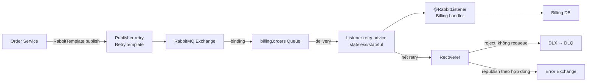
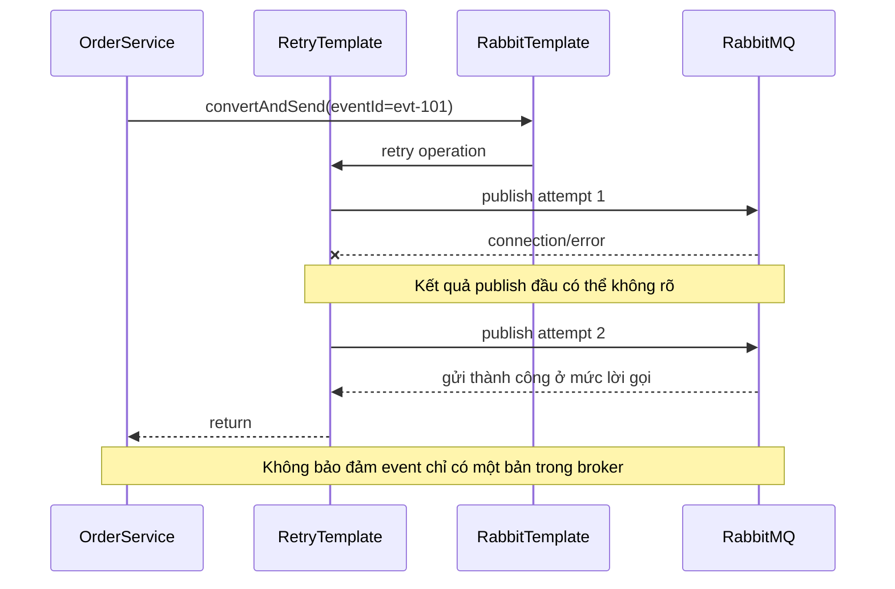
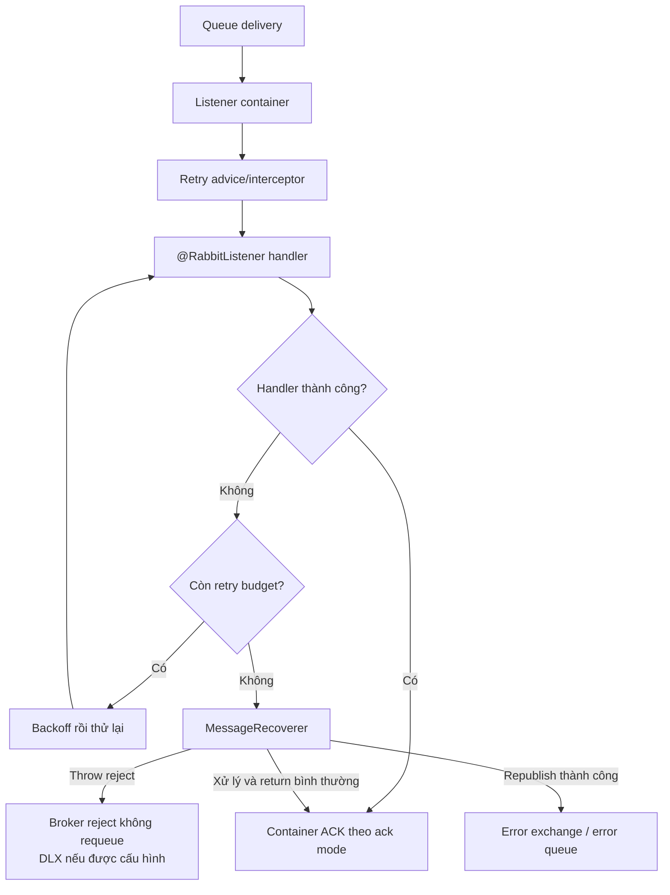
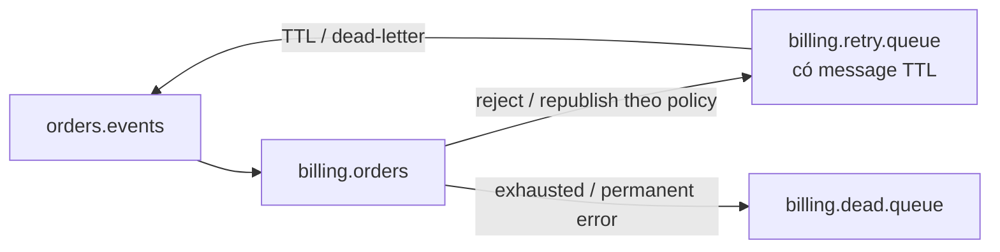
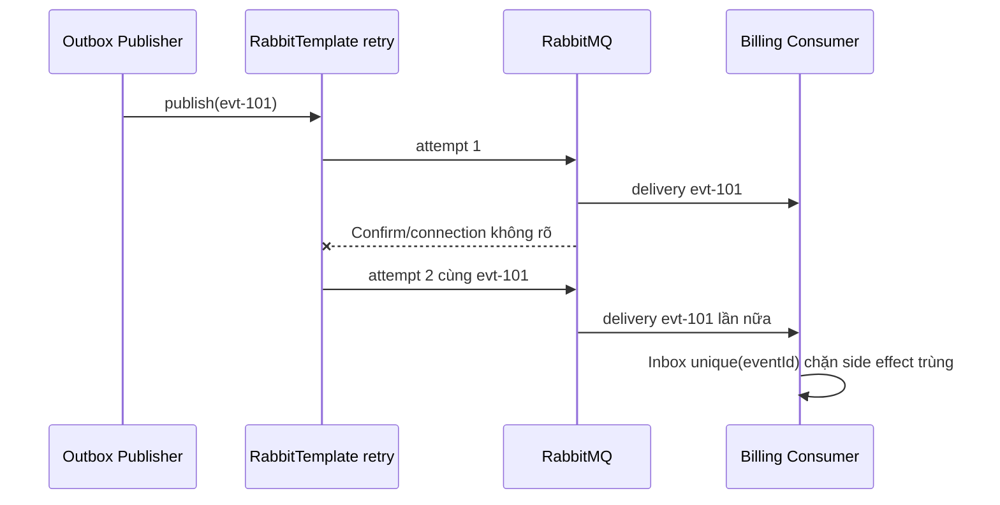

# RetryTemplate và retry interceptor theo dòng phiên bản sử dụng

## 1. Vì sao cần hiểu retry theo phiên bản Spring?

Trong ứng dụng **SPRING_AMQP**, `RabbitTemplate` gửi sự kiện đến RabbitMQ qua exchange, routing key và binding; `@RabbitListener` đọc message từ queue rồi thực hiện nghiệp vụ. Lỗi có thể xảy ra ở cả hai đầu:

- Publisher không kết nối được broker hoặc mất connection giữa lúc publish.
- Consumer đang xử lý message thì database tạm ngừng hoạt động.
- Payload sai schema làm listener báo lỗi **không thể khắc phục bằng cách thử lại**.
- Broker đã giao message, consumer commit database nhưng ACK không tới broker, dẫn đến redelivery.
- Producer publish lại vì không nhận được publisher confirm, tạo thêm message mang cùng event ID.

Spring cung cấp **retry** để thử lại một thao tác thất bại theo policy, backoff và recovery. Tuy nhiên, API retry **đã thay đổi giữa các dòng phiên bản**: Spring AMQP 2.x–3.x dùng thư viện Spring Retry, trong khi Spring AMQP 4.x chuyển sang API retry ở Spring Framework Core. Cùng tên `RetryTemplate` nhưng import, cấu hình và ngữ nghĩa số lần thử của các API liên quan có thể khác nhau.

Bài thuộc chương **Thử lại thông điệp** của module Spring AMQP, tập trung vào:

1. Chọn đúng `RetryTemplate` cho **lời gọi `RabbitTemplate` phía publisher**.
2. Chọn đúng **stateless/stateful retry interceptor** cho `@RabbitListener` phía consumer.
3. Phân biệt cách cấu hình của **Spring Boot 3.x / Spring AMQP 3.x** và **Spring Boot 4.x / Spring AMQP 4.x**.
4. Hiểu cách recoverer quyết định ACK, reject, requeue hay republish sau khi hết retry.
5. Dùng backoff, DLX/DLQ, publisher confirms, event ID và idempotency để retry không làm mất hoặc xử lý trùng message.
6. Thiết kế kiểm thử và quan sát được khi nâng cấp version.

**Quy ước trong bài:** các ví dụ Java gắn nhãn phiên bản **không được trộn trong cùng mã nguồn**. Chọn một dòng version của dự án, đối chiếu dependency management/Javadoc đúng release và dùng các ví dụ tương ứng.

## 2. Ba tầng retry thường bị nhầm lẫn



| Tầng | Xảy ra ở đâu? | Nguyên nhân điển hình | Hành vi cơ bản |
| --- | --- | --- | --- |
| **Publisher retry** | `RabbitTemplate` trước/trong thao tác gửi | Lỗi kết nối/đường truyền, một số `AmqpException` | Thử lại **lời gọi gửi**; có thể tạo duplicate nếu lần trước đến broker |
| **Listener retry** | Advice quanh lời gọi `@RabbitListener` | Handler ném exception do dependency hoặc business logic | Chạy lại handler theo policy; rồi gọi recoverer hoặc để container xử lý lỗi |
| **Broker redelivery / dead-letter retry** | RabbitMQ queue và listener container | NACK/reject có requeue, channel đóng trước ACK, TTL/DLX, quorum delivery limit | Có thể giao lại **delivery** hoặc chuyển tới queue khác; số lượt và delay phụ thuộc policy broker |

Ngoài ra, **connection recovery** là cơ chế kết nối lại broker, không tự động đồng nghĩa với retry nghiệp vụ. `CachingConnectionFactory` và listener containers quản lý một số tình huống reconnect; chúng không ghi nhớ mọi kết quả publish chưa xác định và không đảm bảo business handler idempotent.

### 2.1. Một lỗi có thể đi qua nhiều tầng

Ví dụ Billing Service nhận `evt-101` và gặp timeout database:

1. Advice thử lại handler ba lần trên consumer.
2. Cả ba lần thất bại; recoverer yêu cầu reject không requeue.
3. RabbitMQ dead-letter message sang DLQ nếu DLX hợp lệ.
4. Người vận hành sửa lỗi và redrive message vào queue chính.
5. Consumer lại nhận `evt-101`; nếu lần trước đã commit một phần tác dụng phụ, idempotency phải chặn xử lý trùng.

**Retry nhiều tầng không cộng đơn giản như một phép nhân không giới hạn.** Nếu publisher cũng gửi lại cùng event, số lần handler chạy có thể tăng rất nhanh. Mỗi tầng cần retry budget và metric riêng.

## 3. Bảng tương thích: Spring Retry → Spring Core Retry

Đây là phần quan trọng nhất của chủ đề **“theo dòng phiên bản sử dụng”**.

| Dòng dự án | Runtime retry chủ yếu dùng trong Spring AMQP | `RetryTemplate` import | Cách cấu hình số lần thử | Ghi chú migration |
| --- | --- | --- | --- | --- |
| Spring Boot 2.x / Spring AMQP 2.x | Spring Retry theo version BOM | `org.springframework.retry.support.RetryTemplate` | `maxAttempts` trong chính sách cũ | Dòng legacy; kiểm tra chính xác API vì minor version khác nhau |
| **Spring Boot 3.x / Spring AMQP 3.x** | **Spring Retry** (thường là Spring Retry 2.x) | `org.springframework.retry.support.RetryTemplate` | `maxAttempts` thường là **tổng số lần gọi**, gồm lần đầu | Có `RetryInterceptorBuilder.stateless()/stateful()` dùng `maxAttempts(...)` |
| **Spring Boot 4.x / Spring AMQP 4.x** | **Spring Framework Core Retry** (Spring Framework 7.x) | `org.springframework.core.retry.RetryTemplate` | `maxRetries` thường là **số lần thử lại sau lần đầu** | API cũ của Spring Retry đã được thay thế trong integration Spring AMQP |
| Dự án tự quản version/BOM | Phải xem dependency thực tế | Không suy từ tên class | Dựa vào Javadoc đúng artifact | Không copy import từ ví dụ khác major version |

Thay đổi lớn ở Spring AMQP 4.0: phụ thuộc `org.springframework.retry:spring-retry` dùng cho cơ chế retry tích hợp đã được thay bằng API `org.springframework.core.retry` của Spring Framework; code tạo policy, retry template, advice/customizer cần được rà soát. Đặc biệt, **Spring Boot 4** cung cấp `RabbitTemplateRetrySettingsCustomizer` và `RabbitListenerRetrySettingsCustomizer`; cách customize chung cũ như `RabbitRetryTemplateCustomizer` cần được xem xét khi nâng cấp.

### 3.1. Tránh lỗi “maxAttempts = maxRetries”

Để một thao tác được gọi **tối đa ba lần, tính cả lần đầu**:

| API | Biểu diễn | Tổng lần gọi tối đa |
| --- | --- | --- |
| Spring Retry / Spring AMQP 3.x | `maxAttempts(3)` | 3 = 1 lần đầu + 2 retry |
| Spring Core Retry / Spring AMQP 4.x | `maxRetries(2)` | 3 = 1 lần đầu + 2 retry |
| Spring Boot 3.x cấu hình YAML | `retry.max-attempts: 3` | 3 |
| Spring Boot 4.x cấu hình YAML | `retry.max-retries: 2` | 3 |

**Không đơn giản đổi tên property rồi giữ nguyên giá trị `3`:** trong nhiều chỗ API 4.x, điều đó dẫn đến **bốn lần gọi tổng cộng** thay vì ba lần. Khi nâng cấp, hãy chạy test đếm số invocation và ghi rõ “tổng attempts” thay vì chỉ ghi “retry=3” mơ hồ.

### 3.2. Quy trình nhận diện phiên bản trước khi viết code

Chỉ cần truy từ **hệ build và dependency thực tế của dự án** trong quá trình lập trình/QA (bài này không yêu cầu chạy build):

1. Xác định Spring Boot major/minor và Spring AMQP version do BOM quản lý.
2. Xem API thực tế trên classpath cho `RetryTemplate`, `RetryPolicy`, `RetryInterceptorBuilder`.
3. Xem các property key hợp lệ ở configuration metadata của Spring Boot cùng version.
4. Chọn **một** cơ chế retry cho mỗi listener; đừng bật Boot auto retry và lại lắp advice có cùng chức năng mà không tính số lượt.
5. Kiểm thử số lần invocation, delay, exception và recoverer trước khi nâng cấp production.

Các ví dụ sau tách rạch ròi **“cho 3.x”** và **“cho 4.x”** để không gây lỗi import/compile.

## 4. Cấu hình retry ở Spring Boot: hai YAML khác nhau

### 4.1. Spring Boot 3.x / Spring AMQP 3.x

Cấu hình dưới đây phù hợp với dòng Spring Boot 3.x, dùng `max-attempts` để diễn đạt tổng số lần thử:

```yaml
spring:
  rabbitmq:
    host: ${RABBITMQ_HOST:localhost}
    port: ${RABBITMQ_PORT:5672}
    username: ${RABBITMQ_USERNAME:guest}
    password: ${RABBITMQ_PASSWORD:guest}
    virtual-host: ${RABBITMQ_VHOST:/}
    listener:
      type: simple
      simple:
        acknowledge-mode: auto
        default-requeue-rejected: false
        prefetch: 20
        retry:
          enabled: true
          stateless: true
          max-attempts: 3
          initial-interval: 500ms
          multiplier: 2.0
          max-interval: 5s
    template:
      retry:
        enabled: true
        max-attempts: 3
        initial-interval: 500ms
        multiplier: 2.0
        max-interval: 5s
```

**Hai khối retry phục vụ hai mục tiêu:**

- `listener.simple.retry.*`: retry khi callback consumer lỗi.
- `template.retry.*`: retry lỗi đồng bộ trong thao tác `RabbitTemplate`, thường liên quan kết nối broker.

Có thể bật một trong hai hoặc cả hai nếu yêu cầu rõ; không phải cứ có retry consumer là publisher được retry, và ngược lại.

### 4.2. Spring Boot 4.x / Spring AMQP 4.x

Spring Boot 4.x đổi tên property số lần thử tương ứng sang `max-retries`:

```yaml
spring:
  rabbitmq:
    host: ${RABBITMQ_HOST:localhost}
    port: ${RABBITMQ_PORT:5672}
    username: ${RABBITMQ_USERNAME:guest}
    password: ${RABBITMQ_PASSWORD:guest}
    virtual-host: ${RABBITMQ_VHOST:/}
    listener:
      type: simple
      simple:
        acknowledge-mode: auto
        default-requeue-rejected: false
        prefetch: 20
        retry:
          enabled: true
          stateless: true
          max-retries: 2
          initial-interval: 500ms
          multiplier: 2.0
          max-interval: 5s
    template:
      retry:
        enabled: true
        max-retries: 2
        initial-interval: 500ms
        multiplier: 2.0
        max-interval: 5s
```

Hai cấu hình ở mục 4.1 và 4.2 có **ý định tương đương: một lần chạy đầu và tối đa hai lần retry**. Không đặt `max-attempts` và `max-retries` lẫn nhau trong cùng một profile và mong framework tự suy ra ý nghĩa.

**Tại sao cần nhấn mạnh?** Spring Boot có thể bỏ qua property không nhận dạng tùy cách cấu hình; dịch vụ vẫn khởi động nhưng dùng default retry khác dự kiến. Cần kiểm chứng effective configuration và số lần xử lý thực trong test.

### 4.3. Thêm delay không tạo thành delayed queue

`initial-interval`, `multiplier` và `max-interval` tạo backoff ở **phía client/application** trong chính retry scope. Với listener stateless, một delivery có thể bị giữ trong quá trình retry; một worker đang ngủ giữa hai lần thử vẫn chiếm tài nguyên ứng dụng.

Nếu cần chờ nhiều phút hoặc giờ, hãy cân nhắc **retry queue/DLX**, scheduler hoặc lưu công việc bền vững. Không dùng in-process sleep/backoff quá dài cho hàng nghìn delivery và kỳ vọng container có thể scale vô hạn.

### 4.4. Direct listener container

Ví dụ trên dùng `listener.type: simple`. Với `DirectRabbitListenerContainerFactory`, Spring Boot cung cấp namespace `spring.rabbitmq.listener.direct.retry.*` tương ứng theo dòng phiên bản. Cơ chế container, prefetch và concurrency không giống hoàn toàn loại simple; phải chọn đúng factory mà `@RabbitListener` đang sử dụng.

## 5. RetryTemplate ở publisher: ý nghĩa và giới hạn

`RabbitTemplate.convertAndSend(...)` có thể gặp `AmqpException` khi không thiết lập được channel hoặc connection bị lỗi. `RetryTemplate` giúp thực hiện lại **lời gọi gửi** theo retry policy.



**RetryTemplate không tự thay publisher confirms/returns.** Một lời gọi gửi trả về bình thường có thể chỉ chứng minh client đã đưa lệnh publish qua channel; broker còn có thể xử lý confirm bất đồng bộ hoặc return nếu route không phù hợp. Nếu connection mất sau khi broker nhận message, retry có thể tạo message trùng.

### 5.1. Spring AMQP 3.x: cấu hình RabbitTemplate bằng Spring Retry

Ví dụ **chỉ dùng cho Spring Boot 3.x / Spring AMQP 3.x**, có dependency Spring Retry tương thích trên classpath:

```java
package example.messaging;

import org.springframework.amqp.rabbit.connection.ConnectionFactory;
import org.springframework.amqp.rabbit.core.RabbitTemplate;
import org.springframework.context.annotation.Bean;
import org.springframework.context.annotation.Configuration;

import org.springframework.retry.backoff.ExponentialBackOffPolicy;
import org.springframework.retry.policy.SimpleRetryPolicy;
import org.springframework.retry.support.RetryTemplate;

@Configuration
public class PublisherRetryConfig3 {

    @Bean
    RabbitTemplate rabbitTemplate(ConnectionFactory connectionFactory) {
        RetryTemplate retry = new RetryTemplate();

        // Tổng tối đa 3 lần, gồm cả lần đầu.
        retry.setRetryPolicy(new SimpleRetryPolicy(3));

        ExponentialBackOffPolicy backoff = new ExponentialBackOffPolicy();
        backoff.setInitialInterval(500L);
        backoff.setMultiplier(2.0);
        backoff.setMaxInterval(5_000L);
        retry.setBackOffPolicy(backoff);

        RabbitTemplate template = new RabbitTemplate(connectionFactory);
        template.setRetryTemplate(retry);
        return template;
    }
}
```

Khi tự khai báo bean `RabbitTemplate`, một số thiết lập auto-configuration của Spring Boot (converter, callbacks, observation, publisher confirms...) có thể **không tự được áp dụng** như template do Boot tạo. Trong dự án thật, nên ưu tiên `spring.rabbitmq.template.retry.*` khi đủ dùng, hoặc dùng `RabbitTemplateConfigurer` để kế thừa những cấu hình cần thiết rồi tùy biến có kiểm soát.

Không đăng ký bean cấu hình `PublisherRetryConfig3` đồng thời với một bean cấu hình publisher 4.x. Nếu IDE báo `org.springframework.retry.*` không tồn tại, đừng import nhầm class `org.springframework.core.retry.*` vào ví dụ 3.x.

### 5.2. Spring AMQP 4.x: RabbitTemplate dùng Spring Core Retry

Ví dụ **chỉ dùng cho Spring Boot 4.x / Spring AMQP 4.x**, dựa trên `org.springframework.core.retry` của Spring Framework 7:

```java
package example.messaging;

import java.time.Duration;

import org.springframework.amqp.rabbit.connection.ConnectionFactory;
import org.springframework.amqp.rabbit.core.RabbitTemplate;
import org.springframework.context.annotation.Bean;
import org.springframework.context.annotation.Configuration;

import org.springframework.core.retry.RetryPolicy;
import org.springframework.core.retry.RetryTemplate;

@Configuration
public class PublisherRetryConfig4 {

    @Bean
    RabbitTemplate rabbitTemplate(ConnectionFactory connectionFactory) {
        // 1 lần đầu + tối đa 2 retry => tối đa 3 lần gọi.
        RetryPolicy policy = RetryPolicy.builder()
                .maxRetries(2)
                .delay(Duration.ofMillis(500))
                .multiplier(2.0)
                .maxDelay(Duration.ofSeconds(5))
                .build();

        RabbitTemplate template = new RabbitTemplate(connectionFactory);
        template.setRetryTemplate(new RetryTemplate(policy));
        return template;
    }
}
```

Ở đây `RetryPolicy.builder().maxRetries(2)` diễn đạt **hai lần thử lại sau lần đầu**, khác với `new SimpleRetryPolicy(3)` của Spring Retry đời cũ.

Nếu không cần tùy biến sâu, ưu tiên các property Boot 4.x tương ứng, hoặc `RabbitTemplateRetrySettingsCustomizer` để điều chỉnh cấu hình retry được Boot tích hợp. Không thêm `spring-retry` cũ rồi kỳ vọng Spring AMQP 4 tự dùng những kiểu API cũ.

### 5.3. Vì sao cần outbox ngay cả khi đã có RetryTemplate?

Giả sử publisher gửi event `evt-101`:

1. Broker nhận bản 1, publish confirm bị mất.
2. Client gặp lỗi hoặc timeout theo cơ chế đang dùng.
3. RetryTemplate hoặc dispatcher gửi bản 2.
4. Consumer nhận cả hai bản, mỗi bản có cùng `messageId=evt-101`.

Do đó:

- Event ID phải được tạo **một lần** ở lớp nghiệp vụ, giữ nguyên qua mọi attempt.
- Nếu cần đảm bảo event không mất khi producer crash, lưu event/outbox **cùng transaction với thay đổi nghiệp vụ**.
- Confirm/return và trạng thái outbox cần phân biệt `CONFIRMED`, `UNROUTABLE`, `UNKNOWN`.
- Consumer phải idempotent, thường nhờ unique key theo `(consumerName,eventId)`.

Một retry nội bộ trong `RabbitTemplate` **không tương đương một workflow outbox có thể tiếp tục sau restart**.

## 6. Listener retry interceptor: ý nghĩa của advice chain

Ở consumer, interceptor bọc quanh **một lần gọi listener**. Khi handler ném exception, interceptor quyết định có thử lại theo policy hay không, áp dụng backoff, rồi chuyển cho **recoverer** nếu hết ngân sách.



**Điểm nguy hiểm:** nếu recoverer chỉ log rồi return bình thường, container có thể coi delivery đã xử lý và gửi ACK; message có thể **không đi vào DLQ broker**. Vì vậy, hãy chọn recoverer theo đúng hợp đồng.

### 6.1. Stateless retry

Stateless retry chạy nhiều lần handler **trong cùng lời gọi advice**, không yêu cầu ghi nhớ trạng thái retry qua nhiều lần broker redelivery.

- Đơn giản hơn, hợp với logic thuần hoặc transaction được bắt đầu **bên trong mỗi attempt**.
- Một delivery có thể giữ ở trạng thái unacknowledged trong lúc retry/backoff.
- Nếu handler đã tạo side effect trước khi exception, attempt tiếp theo có thể lặp side effect.
- Không thể coi stateless retry là lưu trữ bền vững các lượt thử qua process restart.
- Khi hết retry, recoverer quyết định reject/republish/ghi log.

### 6.2. Stateful retry

Stateful retry ghi nhớ context theo **danh tính message** để duy trì retry qua các lần invocations/redeliveries, thích hợp khi transaction phía ngoài retry cần rollback và exception phải được trả ra container.

- Cần một **message key** ổn định và đủ duy nhất; thường lấy từ AMQP `messageId`.
- Khi handler fail, exception có thể được propagate để container rollback/reject và tạo một lần delivery mới.
- Một redelivery mới có thể tiếp tục trạng thái retry trước đó trong phạm vi retry context còn tồn tại.
- Nếu process restart hoặc cache context không còn, không được mặc định bộ đếm tiếp tục đúng từ lần trước.
- Stateful retry không thay broker-side delivery count hay một số retry được lưu **bền vững** trong DB.

Với stateful retry, **message thiếu `messageId` là vấn đề thực sự**. Spring AMQP có `statefulRetryFatalWithNullMessageId`; cấu hình liên quan đến hành vi dừng consumer/reject message thiếu ID tùy phiên bản. Không tự bật stateful retry cho một queue đang nhận message từ producer không đặt `messageId` mà chưa test.

### 6.3. Bảng quyết định stateless hay stateful

| Tình huống | Nghiêng về | Vì sao |
| --- | --- | --- |
| Handler chỉ đọc dữ liệu hoặc logic idempotent, transaction mở trong method | **Stateless** | Có thể gọi lại trong một advice invocation |
| Transaction đã bắt đầu **bên ngoài** phạm vi retry và bắt buộc rollback khi lỗi | **Stateful** | Exception cần thoát ra container/transaction boundary |
| Message có event ID ổn định, cần retry state qua redelivery | **Stateful**, nếu policy phù hợp | Có identity để tái dùng retry context |
| Message không có stable ID | **Stateless** hoặc sửa publisher contract | Stateful rất dễ xử lý sai thiếu key |
| Retry delay kéo dài hàng phút | **Broker retry queue / scheduler / durable job** | Không nên giữ consumer thread/channel trong backoff dài |
| External API không có idempotency | Không giải quyết chỉ bằng chọn mode | Retry có thể gọi API nhiều lần, cần thiết kế operation ID/đối soát |

**Lưu ý:** Statefulness của interceptor không đồng nghĩa stateful workflow trong database. Cơ chế retry có thể mất context khi ứng dụng chết; chỉ dùng outbox/inbox hoặc metadata broker phù hợp nếu cần lưu trạng thái qua restart.

## 7. Spring AMQP 3.x: cấu hình retry interceptor bằng Spring Retry

Ví dụ này **chỉ dành cho Spring Boot 3.x / Spring AMQP 3.x**. Nó dùng `RetryOperationsInterceptor` và `RetryInterceptorBuilder` với `maxAttempts(3)`.

### 7.1. Stateless interceptor có RejectAndDontRequeueRecoverer

```java
package example.messaging;

import org.springframework.amqp.core.AcknowledgeMode;
import org.springframework.amqp.rabbit.config.RetryInterceptorBuilder;
import org.springframework.amqp.rabbit.config.SimpleRabbitListenerContainerFactory;
import org.springframework.amqp.rabbit.connection.ConnectionFactory;
import org.springframework.amqp.rabbit.retry.RejectAndDontRequeueRecoverer;
import org.springframework.context.annotation.Bean;
import org.springframework.context.annotation.Configuration;

import org.springframework.retry.interceptor.RetryOperationsInterceptor;

@Configuration
public class BillingRetryConfig3 {

    @Bean
    RetryOperationsInterceptor billingRetryAdvice() {
        return RetryInterceptorBuilder.stateless()
                .maxAttempts(3) // 1 lần đầu + tối đa 2 lần retry
                .backOffOptions(500L, 2.0, 5_000L)
                .recoverer(new RejectAndDontRequeueRecoverer())
                .build();
    }

    @Bean("billingListenerContainerFactory")
    SimpleRabbitListenerContainerFactory billingListenerContainerFactory(
            ConnectionFactory connectionFactory,
            RetryOperationsInterceptor billingRetryAdvice) {

        SimpleRabbitListenerContainerFactory factory =
                new SimpleRabbitListenerContainerFactory();

        factory.setConnectionFactory(connectionFactory);
        factory.setAcknowledgeMode(AcknowledgeMode.AUTO);
        factory.setDefaultRequeueRejected(false);
        factory.setAdviceChain(billingRetryAdvice);
        return factory;
    }
}
```

Listener sử dụng factory này:

```java
package example.messaging;

import org.springframework.amqp.rabbit.annotation.RabbitListener;
import org.springframework.stereotype.Component;

@Component
public class BillingRetryListener {

    @RabbitListener(
            id = "billing-retry-listener",
            queues = "billing.orders",
            containerFactory = "billingListenerContainerFactory")
    public void handle(String orderId) {
        // Được gọi lại khi ném exception theo retry policy.
        // Tác dụng phụ phải idempotent.
        processOrder(orderId);
    }

    private void processOrder(String orderId) {
        // Gọi transactional service thật.
    }
}
```

Cần có queue `billing.orders` và binding tương ứng, chẳng hạn exchange `orders.events` + routing key `orders.created`. `@RabbitListener` chỉ chỉ định queue để đọc; nó không tự chứng minh topology đã được broker tạo.

**Cảnh báo quan trọng:** khi bạn tự xây một listener factory, phải biết những cấu hình mà Spring Boot auto-configurer thường áp dụng (converter, observation, error handler, prefetch, retry, transaction settings). Nếu muốn kế thừa cấu hình Boot, dùng `SimpleRabbitListenerContainerFactoryConfigurer` thích hợp rồi override phần cần thiết. Đừng để một listener vừa nhận Boot retry auto-configured vừa bị bọc thêm retry advice không tính đến số attempts.

### 7.2. Spring AMQP 3.x stateful interceptor

Trong cùng dòng version, ví dụ thay thế:

```java
import org.springframework.amqp.rabbit.config.RetryInterceptorBuilder;
import org.springframework.amqp.rabbit.retry.RejectAndDontRequeueRecoverer;
import org.springframework.retry.interceptor.StatefulRetryOperationsInterceptor;

StatefulRetryOperationsInterceptor advice =
        RetryInterceptorBuilder.stateful()
                .maxAttempts(3)
                .backOffOptions(500L, 2.0, 5_000L)
                .recoverer(new RejectAndDontRequeueRecoverer())
                .build();
```

Đây là **biến thể thay thế stateless advice**, không lắp cả hai vào cùng listener trừ khi có thiết kế phối hợp rất cụ thể. Producer phải đặt `messageId` ổn định, hoặc có `MessageKeyGenerator` phù hợp; test cả message không ID, redelivery và transaction rollback.

## 8. Spring AMQP 4.x: retry interceptor chuyển sang Core Retry

Spring AMQP 4.0 thay đổi cơ chế retry tích hợp sang **Spring Framework Core Retry**. Về mặt ý tưởng, vẫn có stateless/stateful listener interceptor và `MessageRecoverer`, nhưng **không copy nguyên các import `org.springframework.retry.*` hoặc `maxAttempts` từ ví dụ 3.x**.

### 8.1. Stateless interceptor ở Spring AMQP 4.x

Ví dụ một factory chuyên dụng cho Boot 4.x / Spring AMQP 4.x:

```java
package example.messaging;

import org.aopalliance.intercept.MethodInterceptor;

import org.springframework.amqp.core.AcknowledgeMode;
import org.springframework.amqp.rabbit.config.RetryInterceptorBuilder;
import org.springframework.amqp.rabbit.config.SimpleRabbitListenerContainerFactory;
import org.springframework.amqp.rabbit.connection.ConnectionFactory;
import org.springframework.amqp.rabbit.retry.RejectAndDontRequeueRecoverer;
import org.springframework.context.annotation.Bean;
import org.springframework.context.annotation.Configuration;

@Configuration
public class BillingRetryConfig4 {

    @Bean
    MethodInterceptor billingRetryAdvice() {
        return RetryInterceptorBuilder.stateless()
                .maxRetries(2) // 1 lần đầu + tối đa 2 retry
                .backOffOptions(500L, 2.0, 5_000L)
                .recoverer(new RejectAndDontRequeueRecoverer())
                .build();
    }

    @Bean("billingListenerContainerFactory")
    SimpleRabbitListenerContainerFactory billingListenerContainerFactory(
            ConnectionFactory connectionFactory,
            MethodInterceptor billingRetryAdvice) {

        SimpleRabbitListenerContainerFactory factory =
                new SimpleRabbitListenerContainerFactory();
        factory.setConnectionFactory(connectionFactory);
        factory.setAcknowledgeMode(AcknowledgeMode.AUTO);
        factory.setDefaultRequeueRejected(false);
        factory.setAdviceChain(billingRetryAdvice);
        return factory;
    }
}
```

`MethodInterceptor` được dùng làm kiểu chung của advice. Với Spring AMQP 4.x, các implementation/contract cụ thể của retry interceptor dựa trên Core Retry; phần khai báo `@RabbitListener(containerFactory = "billingListenerContainerFactory")` có thể giữ tương tự ví dụ 3.x.

Nếu ứng dụng đang dùng Spring Boot 4 và muốn tránh code Java retry, cấu hình `spring.rabbitmq.listener.simple.retry.max-retries` của mục 4.2 cùng bean `MessageRecoverer` phù hợp thường đơn giản hơn. Trường hợp cần một interceptor tùy chỉnh phức tạp, xem Javadoc đúng release.

### 8.2. Stateful interceptor ở Spring AMQP 4.x

Một ví dụ biểu diễn khác biệt API:

```java
import org.aopalliance.intercept.MethodInterceptor;
import org.springframework.amqp.rabbit.config.RetryInterceptorBuilder;
import org.springframework.amqp.rabbit.retry.RejectAndDontRequeueRecoverer;

MethodInterceptor statefulAdvice = RetryInterceptorBuilder.stateful()
        .maxRetries(2)
        .backOffOptions(500L, 2.0, 5_000L)
        .recoverer(new RejectAndDontRequeueRecoverer())
        .build();
```

Đây là **snippet** để so sánh builder, không phải bean thêm vào factory cùng lúc với stateless advice. Với stateful, cần stable message ID và kiểm thử transaction/requeue; không thể suy ra chỉ vì đổi `maxAttempts` thành `maxRetries` là toàn bộ semantics cũ đã được giữ.

### 8.3. Spring Boot 4 customizer mới

Spring Boot 4 giới thiệu các hook chuyên biệt:

- `RabbitTemplateRetrySettingsCustomizer`: thay đổi retry settings được Boot áp dụng cho publisher/template.
- `RabbitListenerRetrySettingsCustomizer`: thay đổi retry settings cho listener.

Đây là hướng migration khi dự án trước đây dùng `RabbitRetryTemplateCustomizer`. Các interface và tham số callback cần lấy từ **Spring Boot 4 Javadoc của phiên bản đang chạy**; không import class cũ hay giả định hook cũ vẫn được gọi.

**Mục tiêu của migration:** giữ đúng loại exception retry, số lần thử, backoff, nơi recoverer đưa message cuối cùng và metric. Đừng chỉ quan tâm code biên dịch thành công.

## 9. Recoverer quyết định số phận delivery sau khi hết retry

Một trong những lỗi vận hành nguy hiểm nhất là để retry hết rồi **mặc định message đã chuyển vào DLQ**. Sự thật phụ thuộc recoverer và listener container.

| Cách xử lý khi exhausted | Hành vi | Kết quả với delivery |
| --- | --- | --- |
| `RejectAndDontRequeueRecoverer` | Ném exception yêu cầu reject không requeue | Broker có thể dead-letter nếu queue có DLX hợp lệ; nếu không có, message bị loại |
| `RepublishMessageRecoverer` | Publish message sang một exchange/routing key lỗi, thêm metadata exception | Nếu recoverer thành công và return bình thường, delivery gốc có thể được ACK; message lỗi **không đi qua DLX của queue nguồn** theo cách reject |
| `RepublishMessageRecovererWithConfirms` | Như republish recoverer nhưng hỗ trợ kiểm tra publisher confirm/return theo cấu hình | Giảm nguy cơ ACK message gốc khi error publish thất bại; vẫn phải xử lý các tình huống không rõ kết quả |
| Recoverer chỉ log và return | Nuốt lỗi sau retries | Delivery có thể được coi là xử lý thành công/ACK; rủi ro mất message nếu không có cơ chế lưu khác |
| `ImmediateRequeueMessageRecoverer` hoặc `ImmediateRequeueAmqpException` | Yêu cầu requeue | Có thể tái diễn lỗi; cần giới hạn ở tầng khác |
| Custom recoverer | Quyết định bởi code ứng dụng | Phải kiểm thử ACK/reject, publish confirms và crash windows |

### 9.1. RejectAndDontRequeueRecoverer: chọn khi có broker DLX

Ví dụ queue chính có DLX:

```java
import org.springframework.amqp.core.Queue;
import org.springframework.amqp.core.QueueBuilder;

Queue workQueue = QueueBuilder.durable("billing.orders")
        .deadLetterExchange("orders.dead")
        .deadLetterRoutingKey("orders.failed")
        .build();
```

Còn cần khai báo exchange `orders.dead`, queue DLQ và binding `orders.failed` đúng trong broker. Lúc advice hết budget, recoverer yêu cầu reject không requeue; broker sẽ thử dead-letter delivery nếu cấu hình DLX phù hợp.

**DLX không đảm bảo 100% message lỗi được lưu an toàn trong mọi topology và sự cố.** Cần xác nhận DLQ tồn tại, routing đúng, broker policies và theo dõi số lượng/lỗi dead-letter.

### 9.2. RepublishMessageRecoverer: khác dead-letter broker

Ví dụ phiên bản AMQP hỗ trợ recoverer:

```java
import org.springframework.amqp.rabbit.retry.RepublishMessageRecoverer;
import org.springframework.amqp.rabbit.core.RabbitTemplate;

RepublishMessageRecoverer recoverer =
        new RepublishMessageRecoverer(
                rabbitTemplate, "errors.events", "billing.failed");
```

Khi recoverer **republish thành công**, container có thể ACK delivery gốc. Queue lỗi nhận một **lần publish mới** qua exchange `errors.events`, không nhất thiết mang `x-death` giống đường đi DLX của broker.

Thiết kế này phù hợp nếu cần gửi payload đến error exchange có cấu trúc và metadata exception. Nhưng nếu exchange/routing sai hoặc connection mất khi republish, dễ gặp **kết quả không xác định**. Với dữ liệu quan trọng, cân nhắc `RepublishMessageRecovererWithConfirms` hoặc một quy trình lỗi bền vững/outbox.

### 9.3. Không để exception stack trace làm phình headers

Một số đời `RepublishMessageRecoverer` thêm metadata về exception, stack trace và nguồn message; hành vi và mặc định chi tiết đã thay đổi qua các phiên bản (ví dụ Spring AMQP 4.x tránh đính kèm stack trace đầy đủ theo mặc định trong các cấu hình nhất định).

Không truyền token/credentials/PII qua exception headers. Header lớn có thể chạm giới hạn frame hoặc làm tăng memory; nên log exception ở hệ thống quan sát bảo mật, còn DLQ chứa event ID, loại lỗi, timestamp và thông tin đủ cho redrive.

## 10. Stateless, stateful và transaction boundary: chọn đúng chỗ rollback

### 10.1. Stateless retry khi transaction bắt đầu trong handler

Ví dụ:

```java
@Component
class BillingListener {
    private final BillingService billingService;

    BillingListener(BillingService billingService) {
        this.billingService = billingService;
    }

    @RabbitListener(
            queues = "billing.orders",
            containerFactory = "billingListenerContainerFactory")
    void consume(String orderId) {
        billingService.applyOnce(orderId);
    }
}

@Service
class BillingService {
    @Transactional
    public void applyOnce(String orderId) {
        // Transaction DB của mỗi invocation.
        // Cần event ID ổn định và unique constraint ở DB thật.
    }
}
```

`BillingService` là bean riêng nên lời gọi `@Transactional` có thể đi qua proxy. Nếu handler throw và transaction rollback, advice stateless có thể invoke lại handler; lần retry vào một transaction DB mới.

Đây là **mẫu minh họa**: trong production, method nên nhận event ID chứ không chỉ order ID; dedup theo `(consumerName,eventId)` để không xử lý lại message đã commit trước đó.

### 10.2. Stateful retry khi transaction nằm bên ngoài callback

Khi một transaction được mở ở container hoặc trước retry advice, retry ngay lập tức trong cùng một transaction đã bị đánh dấu rollback-only có thể không mang lại ý nghĩa. Stateful advice giúp exception thoát về container, rollback và xử lý lại dựa trên identity ở lần delivery/invocation sau.

Cần kiểm tra:

- Thứ tự advice trong `setAdviceChain(...)`.
- `channelTransacted` và transaction manager thực tế.
- `AcknowledgeMode.AUTO/MANUAL` và `defaultRequeueRejected`.
- Stable `messageId` hoặc `MessageKeyGenerator`.
- Cách ứng dụng xử lý khi thiếu ID, context hết hạn/restart, nhiều pods.
- Ngữ nghĩa final recoverer và DLQ.

Không chỉ sửa `stateless: false` trong YAML rồi mặc định transaction sẽ phối hợp đúng. Đây là thay đổi cần **integration test** với broker và DB.

### 10.3. Stateful retry không thay inbox idempotency

Dù stateful advice nhớ retry count, hai publish khác nhau cùng sự kiện có thể tạo duplicate, hoặc stateful retry state bị mất khi process restart. Để bảo vệ side effect:

```sql
CREATE TABLE processed_events (
    consumer_name VARCHAR(100) NOT NULL,
    event_id VARCHAR(100) NOT NULL,
    processed_at TIMESTAMP WITH TIME ZONE
        NOT NULL DEFAULT CURRENT_TIMESTAMP,
    PRIMARY KEY (consumer_name, event_id)
);
```

Trong cùng transaction DB với business change, insert event ID theo unique constraint. Nếu đã tồn tại, return bình thường để container ACK bản trùng. Không dùng local in-memory `Set<String>` làm bảo đảm chống trùng trên nhiều pods.

## 11. Phân loại exception: lỗi nào được retry?

Mọi retry policy cần trả lời: **lỗi nào có thể hết nếu thử lại?**

| Lỗi | Ví dụ | Thông thường |
| --- | --- | --- |
| Lỗi hạ tầng tạm thời | Broker/DB timeout, HTTP 503 | Retry có giới hạn/backoff |
| Lỗi contention | Optimistic locking conflict | Retry nếu operation idempotent và xung đột có thể được giải quyết |
| Lỗi payload cố định | JSON invalid, thiếu field bắt buộc | **Không retry**; reject/quarantine |
| Contract mismatch | Producer schema v3 nhưng consumer chỉ hỗ trợ v1 | Không retry nóng; cần nâng cấp/migration |
| Lỗi authorization | Credentials/vhost/permission sai | Không retry hàng nghìn lần; báo vận hành |
| Business rule vĩnh viễn | Order đã huỷ, không thể thanh toán | Quyết định nghiệp vụ: ACK có audit hoặc error queue; không retry mù |
| External API timeout sau side effect | Charge có thể đã xảy ra | Dùng idempotency key/provider reconciliation, không gọi lại mù quáng |

### 11.1. Spring AMQP 3.x: chú ý exception bị wrap

Listener exception thường được Spring bọc trong `ListenerExecutionFailedException`. Nếu `RetryPolicy` chỉ so sánh **lớp exception ngoài cùng**, một lỗi parse JSON có thể bị hiểu như lỗi transient; cần kiểm tra cause chain.

Trong Spring Retry, `SimpleRetryPolicy` hoặc classifier có tùy chọn **traverse causes**. Khi xây custom policy, cần dùng khả năng xét nguyên nhân thay vì retry mọi `ListenerExecutionFailedException` giống nhau.

### 11.2. Spring AMQP 4.x: Spring Core Retry có policy khác

Core Retry `RetryPolicy.builder()` của Spring Framework 7 cho phép phân loại bằng `includes(...)`, `excludes(...)` và các điều kiện phù hợp; API này khác với `SimpleRetryPolicy`, `BinaryExceptionClassifier` cũ. Không copy một `Map<Class<? extends Throwable>, Boolean>` từ Spring Retry sang policy 4.x mà không chuyển đổi.

**Chiến lược vận hành:** retry default có thể rộng hơn bạn muốn. Chủ động phân loại exception, đặc biệt với conversion errors, business validation và trạng thái thanh toán không rõ.

## 12. Retry phía broker: TTL/DLX, quorum delivery limit và tracking

In-process retry bằng advice thuận tiện cho delay ngắn. Với retry kéo dài hoặc phải sống qua restart, một số kiến trúc dùng broker queue hoặc durable job.

### 12.1. Retry queue và DLX



Cấu trúc này **không tự an toàn** nếu dùng DLX làm vòng lặp vô hạn: phải có counter/budget, định tuyến đủ điều kiện, giới hạn retention và tránh dead-letter cycle.

Một queue retry có `x-message-ttl` áp dụng cho message đang đợi, nhưng **đây không phải scheduler chính xác**. Với yêu cầu retry sau nhiều phút, cách xử lý hết TTL/đứng đầu queue, vận hành cluster và thứ tự message cần được kiểm chứng.

### 12.2. RabbitMQ quorum queue delivery limit

Quorum queue có thể có `x-delivery-limit` để hạn chế số lượt phát lại phù hợp với cách broker đếm unsuccessful delivery. Đây là **cơ chế cấp broker**, không đồng nghĩa `RetryTemplate.maxAttempts` hoặc `RetryPolicy.maxRetries`.

Với Spring AMQP 4.0.6 trở lên, hành vi xử lý settlement từng delivery đã được điều chỉnh để hỗ trợ đúng hơn việc đếm unsuccessful deliveries của quorum queues trong các trường hợp container kiểm soát ACK/NACK. Với `MANUAL`, các trường hợp expose `Channel` hoặc nhiều delivery batch, người dùng có thể phải quản lý reject riêng. Khi vận hành quorum queue, phải kiểm tra broker version, queue type, delivery limit và hành vi settlement của đúng Spring AMQP patch version.

### 12.3. Retry count và x-death

RabbitMQ có thể ghi `x-death` khi broker dead-letter message. Header này có ngữ nghĩa do broker quản lý, không nên tự giả lập `x-death` để nâng bộ đếm. RabbitMQ 4.x không tin các `x-*` headers do client tự gửi theo cùng cách như broker.

Spring AMQP 3.2 trở đi cung cấp hỗ trợ `retry_count`/`MessageProperties.getRetryCount()` trong các luồng xử lý phù hợp, nhằm giúp theo dõi republish retry khi cần. Nhưng **đừng dùng mỗi `redelivered` hay `x-death` làm khóa idempotency**; chúng không thay event ID ổn định và giao dịch nghiệp vụ.

## 13. Retry và publisher confirms: kết quả không rõ vẫn có thể tạo duplicate

Giả sử producer gửi event `evt-101`:



Để vận hành đúng:

1. **Tạo event ID khi phát sinh event**, không tạo UUID mới ở mỗi retry attempt.
2. Dùng publisher confirms và mandatory returns theo routing contract.
3. Lưu outbox record nếu cần khả năng khôi phục sau process crash.
4. Phân loại `ACK không return`, `ACK có return`, `NACK` và `TIMEOUT/UNKNOWN`.
5. Retry `UNKNOWN` với backoff, giữ event ID.
6. Consumer idempotent để bản trùng không làm tăng số lần xử lý thực.

**Không có một RetryTemplate nào tự tạo exactly-once end-to-end.** Nếu cả publisher và consumer đều retry, cơ hội nhận duplicate càng cao; đây là hành vi bình thường của thiết kế at-least-once.

## 14. Ví dụ end-to-end: topology, publisher, listener và DLQ

### 14.1. Khai báo topology

```java
package example.messaging;

import org.springframework.amqp.core.Binding;
import org.springframework.amqp.core.BindingBuilder;
import org.springframework.amqp.core.Declarables;
import org.springframework.amqp.core.DirectExchange;
import org.springframework.amqp.core.Queue;
import org.springframework.amqp.core.QueueBuilder;
import org.springframework.context.annotation.Bean;
import org.springframework.context.annotation.Configuration;

@Configuration
public class BillingTopology {
    public static final String EXCHANGE = "orders.events";
    public static final String KEY = "orders.created";
    public static final String QUEUE = "billing.orders";
    public static final String DLX = "billing.dead";
    public static final String DLQ = "billing.dead.queue";
    public static final String DEAD_KEY = "orders.failed";

    @Bean
    Declarables billingResources() {
        DirectExchange primary = new DirectExchange(EXCHANGE, true, false);
        DirectExchange dead = new DirectExchange(DLX, true, false);

        Queue work = QueueBuilder.durable(QUEUE)
                .deadLetterExchange(DLX)
                .deadLetterRoutingKey(DEAD_KEY)
                .build();
        Queue failure = QueueBuilder.durable(DLQ).build();

        Binding route = BindingBuilder.bind(work).to(primary).with(KEY);
        Binding deadRoute = BindingBuilder.bind(failure).to(dead).with(DEAD_KEY);
        return new Declarables(primary, dead, work, failure, route, deadRoute);
    }
}
```

`RabbitAdmin` có thể khai báo các resource nếu được cấu hình và có quyền tương ứng. Khi queue đã tồn tại với arguments khác, broker có thể từ chối bằng `PRECONDITION_FAILED`; đừng xóa queue production để chạy lab.

### 14.2. Publisher giữ messageId ổn định

```java
package example.messaging;

import org.springframework.amqp.rabbit.core.RabbitTemplate;
import org.springframework.stereotype.Service;

@Service
public class OrderPublisher {
    private final RabbitTemplate template;

    public OrderPublisher(RabbitTemplate template) {
        this.template = template;
    }

    public void send(String eventId, String orderId) {
        template.convertAndSend(
                BillingTopology.EXCHANGE,
                BillingTopology.KEY,
                orderId,
                message -> {
                    message.getMessageProperties().setMessageId(eventId);
                    message.getMessageProperties()
                            .setType("orders.created");
                    return message;
                });
    }
}
```

Mặc dù ví dụ dùng payload text cho đơn giản, event ID vẫn phải **được sinh bên ngoài** method `send`, thường từ domain event/outbox record. Không generate ID mới khi template retry một logical event.

### 14.3. Consumer báo lỗi transient để advice retry

```java
package example.messaging;

import org.springframework.amqp.core.Message;
import org.springframework.amqp.rabbit.annotation.RabbitListener;
import org.springframework.stereotype.Component;

@Component
public class BillingConsumer {
    private final BillingTransactionalService billingService;

    public BillingConsumer(BillingTransactionalService billingService) {
        this.billingService = billingService;
    }

    @RabbitListener(
            id = "billing-retry-listener",
            queues = BillingTopology.QUEUE,
            containerFactory = "billingListenerContainerFactory")
    public void onOrder(Message message) {
        String eventId = message.getMessageProperties().getMessageId();
        if (eventId == null || eventId.isBlank()) {
            throw new IllegalArgumentException("Missing eventId");
        }

        String orderId = new String(
                message.getBody(), java.nio.charset.StandardCharsets.UTF_8);

        // DB service phải kiểm tra eventId và idempotent.
        billingService.processOnce(eventId, orderId);
    }
}
```

Nếu thiếu event ID, ví dụ ném `IllegalArgumentException`; ở production cần policy **không retry** loại lỗi này, để tránh retry waste. `BillingTransactionalService` là service domain cần được tự triển khai bằng DB transaction/unique key; không phải API có sẵn của Spring AMQP.

### 14.4. Idempotency của BillingTransactionalService

Ví dụ SQL:

```sql
CREATE TABLE processed_events (
    consumer_name VARCHAR(100) NOT NULL,
    event_id VARCHAR(100) NOT NULL,
    processed_at TIMESTAMP WITH TIME ZONE NOT NULL
        DEFAULT CURRENT_TIMESTAMP,
    PRIMARY KEY (consumer_name, event_id)
);

CREATE TABLE billing_requests (
    event_id VARCHAR(100) PRIMARY KEY,
    order_id VARCHAR(100) NOT NULL,
    state VARCHAR(40) NOT NULL
);
```

Ví dụ phần transaction:

```java
package example.messaging;

import org.springframework.jdbc.core.JdbcTemplate;
import org.springframework.stereotype.Service;
import org.springframework.transaction.annotation.Transactional;

@Service
public class BillingTransactionalService {
    private final JdbcTemplate jdbc;

    public BillingTransactionalService(JdbcTemplate jdbc) {
        this.jdbc = jdbc;
    }

    @Transactional
    public void processOnce(String eventId, String orderId) {
        int inserted = jdbc.update(
                "INSERT INTO processed_events(consumer_name, event_id) "
                + "VALUES (?, ?) ON CONFLICT DO NOTHING",
                "billing-orders-created", eventId);

        if (inserted == 0) {
            return; // Đã được một transaction khác xử lý.
        }

        jdbc.update(
                "INSERT INTO billing_requests(event_id, order_id, state) "
                + "VALUES (?, ?, ?)",
                eventId, orderId, "PENDING");
    }
}
```

Ở đây, insert inbox và business record nằm **trong cùng database transaction**; nếu business SQL thất bại, inbox insert cũng rollback. Handler return bình thường thì Spring `AUTO` ACK; nếu commit thất bại, exception được propagate đến interceptor để retry/recover.

**Không chạy đồng thời nhiều lớp cấu hình listener 3.x/4.x từ các mục 7 và 8**: chúng cùng dùng factory name `billingListenerContainerFactory`. Dự án chỉ chọn một phiên bản và một nguồn retry config.

## 15. Kiểm thử retry theo từng dòng phiên bản

### 15.1. Test quan trọng nhất: đếm số lần gọi

Đối với một handler luôn ném exception trong lab:

| Cấu hình | Lần gọi đầu | Số lần retry thêm | Tổng số lần gọi tối đa |
| --- | --- | --- | --- |
| Spring AMQP 3.x advice `maxAttempts(3)` | 1 | 2 | 3 |
| Spring AMQP 4.x advice `maxRetries(2)` | 1 | 2 | 3 |
| Boot 3.x `retry.max-attempts: 3` | 1 | 2 | 3 |
| Boot 4.x `retry.max-retries: 2` | 1 | 2 | 3 |
| Spring AMQP 4.x `maxRetries(3)` | 1 | 3 | 4 |

**Quy tắc đọc test:** chỉ đếm số lần gọi handler trong **một retry sequence được kiểm soát**. Nếu broker requeue sau exhausted, message có thể mở **một retry sequence mới** và tổng số lần chạy vượt bảng. Cần dùng `RejectAndDontRequeueRecoverer`/DLQ hoặc chế độ kiểm thử phù hợp để đóng vòng thử.

### 15.2. Test không cần broker: policy và backoff

Với Spring Retry 3.x:

1. Dùng `RetryTemplate` thật với một callback tăng counter rồi luôn ném exception.
2. Cấu hình `SimpleRetryPolicy(3)` và backoff ngắn cho test.
3. Xác minh callback được gọi đúng ba lần rồi exception/recovery xảy ra.
4. Dùng một callback thành công ở attempt thứ hai, xác minh không có attempt thứ ba.

Với Spring Core Retry 4.x:

1. Dùng `RetryPolicy.withMaxRetries(2)` hoặc builder tương ứng.
2. Tạo `new RetryTemplate(policy)` và gọi `invoke(...)` với lambda tăng counter.
3. Xác minh tối đa ba lần gọi.
4. Đo delay theo tolerance hợp lý, không assert millisecond tuyệt đối vì thread scheduling.

Không dùng cùng test import `org.springframework.retry.*` cho cả Spring Framework 7.x.

### 15.3. Integration test với RabbitMQ thật

Thực hành trên broker local/test:

1. Khai báo exchange `orders.events`, queue `billing.orders`, DLX `billing.dead` và queue `billing.dead.queue`.
2. Chọn **một** phiên bản Spring Boot/Spring AMQP; cấu hình retry theo mục 4 và không lắp advice hai lần.
3. Gửi event `evt-test-001` bằng `RabbitTemplate` với `messageId` cố định.
4. Handler mock lỗi database tạm thời hai lần, lần thứ ba thành công. Ghi nhận số lần gọi và việc container ACK sau thành công.
5. Handler thứ hai luôn ném lỗi. Sau exhausted, kiểm tra recoverer `RejectAndDontRequeueRecoverer` dẫn đến reject không requeue và DLQ (nếu topology đúng).
6. Gửi message sai schema hoặc thiếu event ID; xác nhận classification không retry vô ích khi policy đã được tùy chỉnh phù hợp.
7. Mô phỏng publisher mất connection/confirm trong môi trường test, cho publisher retry cùng event ID; xác minh inbox chặn side effect trùng.
8. Dừng ứng dụng khi đang backoff; khởi động lại và quan sát message redelivery/context reset.
9. Với stateful advice, thử message thiếu ID và kiểm tra hành vi lỗi/consumer theo cấu hình thay vì giả định sẽ retry bình thường.
10. So sánh logs/metrics của Boot 3.x và 4.x sau migration, chú ý cả tên property và tổng attempts.

### 15.4. Lab theo tình huống thực tế

**Lab A — Retry không được bật:** Bỏ `retry.enabled`, giữ `default-requeue-rejected=true` trong môi trường test, cho handler luôn lỗi. Quan sát rủi ro redelivery liên tục, sau đó khắc phục bằng bounded retry và recoverer. Không chạy vòng lặp nóng kéo dài.

**Lab B — Sai routing:** Publish tới exchange có routing key không match queue; bật mandatory returns. Xác minh **listener retry interceptor không chạy** vì message chưa đến queue. Lỗi này thuộc publisher routing/topology, không thể giải quyết bằng retry consumer.

**Lab C — Recoverer log-only:** Trong lab riêng, dùng recoverer chỉ ghi log và return bình thường. Kiểm tra message gốc có thể được ACK dù chưa đi DLQ; đổi sang reject recoverer để quan sát khác biệt.

**Lab D — Stateful + rollback:** Bật stateful advice trên queue có stable message IDs, tạo transaction rollback ở handler, kiểm tra số attempt và trạng thái redelivery. Khởi động lại app giữa chu trình để thấy retry context không mặc định là durable.

**Lab E — Queue retry chậm:** Dùng broker retry queue với TTL và DLX, so sánh tài nguyên client khi backoff dài với in-process interceptor; đánh giá SLA, deadline, duplicate và khả năng dead-letter cycle.

## 16. Các lỗi cấu hình thường gặp khi nâng version

| Triệu chứng | Nguyên nhân phổ biến | Cách xử lý |
| --- | --- | --- |
| `ClassNotFoundException: org.springframework.retry...` trên Boot 4 | Copy import Spring Retry 3.x | Dùng Spring Core Retry API hoặc Boot 4 customizers |
| `ClassNotFoundException: org.springframework.core.retry...` trên Boot 3 | Copy ví dụ Spring Framework 7 | Quay về Spring Retry tương ứng Boot 3 |
| `maxAttempts(...)` không tìm thấy trong builder AMQP 4 | API đổi semantics tên | Xem `maxRetries(...)` của 4.x và đổi **giá trị** đúng tổng attempts |
| Boot 4 vẫn dùng `retry.max-attempts` trong YAML | Property không còn đúng dòng cấu hình | Đổi thành `retry.max-retries` và kiểm tra binding |
| Tổng handler calls tăng sau migration | Giữ nguyên số 3 khi đổi `maxAttempts` → `maxRetries` | Viết test đếm invocation, quy đổi 3 attempts thành 2 retries |
| Message không vào DLQ dù đã exhausted | Default recoverer log/discard hoặc custom recoverer return | Chọn `RejectAndDontRequeueRecoverer`/republish strategy, test ACK/reject |
| Message bị requeue vô hạn | Không có retry budget hoặc exhausted vẫn requeue | Giới hạn attempts, chọn recoverer và chính sách DLX/DLQ |
| Stateful retry dừng consumer khi không có messageId | Identity không được cung cấp theo contract | Producer đặt messageId hoặc cấu hình key generator/behavior null ID |
| Handler lỗi nghiệp vụ cố định nhưng vẫn retry | Policy retry mọi exception, wrapper che nguyên nhân | Phân loại exception và xét cause chain |
| Sau reconnect publisher gửi trùng | Publish attempt trước có thể đã đến broker | Giữ event ID, outbox, publisher confirm/return và idempotent consumer |
| DLQ vẫn trống sau reject | Không có DLX hoặc binding sai/vhost sai | Kiểm tra broker topology và reply/metrics |
| Bật Boot retry và custom advice đồng thời | Hai tầng advice retry trong cùng listener | Chọn một nguồn policy hoặc tính rõ tổng budget |
| Retry ngắn làm DB tắc nghẽn hơn | Quá nhiều consumer cùng retry ngay | Exponential backoff + jitter, concurrency limit và circuit breaker phù hợp |
| Retry dài làm prefetch unacked tăng | Thread xử lý giữ delivery trong backoff | Dùng durable retry queue/delayed job khi cần |
| Sau reboot số attempt “reset” | In-memory retry context không durable | Broker delivery limit, retry_count hoặc DB tracking theo yêu cầu |

## 17. Quan sát retry: cần ghi gì để biết lỗi thật sự?

### 17.1. Publisher

- `eventId` và ID của attempt publish, exchange, routing key.
- Lỗi đồng bộ từ template; số lần retry, delay và exception class.
- Publisher confirms ACK/NACK, returns/unroutable và timeout.
- Outbox status: `PENDING`, `RETRY_WAIT`, `CONFIRMED`, `UNKNOWN`, `ROUTING_ERROR`.
- `oldest_pending_age` và tỷ lệ publish attempt trên một event.

**Đừng chỉ đếm lời gọi `convertAndSend` trả về bình thường.** Đây không phải chỉ số số event đã được consumer xử lý.

### 17.2. Consumer

- Listener ID, queue name, event/message ID.
- Số attempt của **interceptor**, số lần **broker redelivery** và số event trùng được inbox chặn.
- Thời gian một handler attempt; tổng thời gian bao gồm backoff.
- Exception root cause/category: transient, permanent, conversion, authorization.
- Số lần exhausted, loại recoverer được gọi và kết quả reject/republish.
- `messages_ready`, `messages_unacknowledged`, consumer count, retry queue depth và DLQ.
- Transaction commit/rollback và độ trễ ACK.

Với multi-pod, các bộ đếm retry trong memory có thể nằm ở từng instance; việc đồng nhất chúng với số lần thử toàn hệ thống có thể gây chẩn đoán sai.

### 17.3. Alert hữu ích

| Chỉ số | Khi cần cảnh báo |
| --- | --- |
| Retry exhausted tăng đột ngột | Dependency down, deploy hỏng hoặc schema mismatch |
| DLQ depth tăng liên tục | Poison message/consumer bug chưa được xử lý |
| Publisher return tăng | Routing key/binding/vhost sai |
| Unacked giữ cao lâu | Handler/backoff lâu, consumer kẹt hoặc manual ACK thiếu |
| Publisher confirm timeout tăng | Broker/network có vấn đề hoặc resource pressure |
| Inbox duplicates tăng | Producer retry nhiều hoặc consumer redelivery sau ACK loss |
| Oldest outbox event age vượt SLA | Dispatcher không thể hoàn tất publish |
| Message latency end-to-end tăng | Backoff/trễ queue ảnh hưởng nghiệp vụ |

## 18. Checklist chọn retry cho dự án

- [ ] Đã xác định Spring Boot, Spring AMQP và retry API **theo BOM/versions thực tế**.
- [ ] Với Boot 3.x, dùng `org.springframework.retry.*` và `max-attempts`; với Boot 4.x, dùng `org.springframework.core.retry.*` và `max-retries` ở đúng chỗ.
- [ ] Đã quy đổi **tổng attempts**, không chỉ đổi tên property.
- [ ] Phân biệt publisher retry với consumer advice retry, broker redelivery và connection recovery.
- [ ] Có ranh giới giao dịch rõ; chọn stateless/stateful theo khả năng rollback và message identity.
- [ ] Stateful retry có `messageId` ổn định hoặc key generator phù hợp; đã test missing ID.
- [ ] Chỉ retry những exception có thể phục hồi; conversion/business validation không retry nóng.
- [ ] Retry budget hữu hạn, backoff có giới hạn; dùng jitter khi nhiều instance cùng retry.
- [ ] Chọn recoverer tường minh; không để recoverer log-only vô tình nuốt message.
- [ ] DLX/DLQ/error exchange tồn tại, binding chính xác, được giám sát và có quy trình redrive.
- [ ] Không gộp Boot auto retry và custom interceptor mà không tính tổng budget.
- [ ] Có publisher confirms/returns và outbox khi yêu cầu tránh mất ý định gửi.
- [ ] Consumer idempotent theo `eventId`, có unique constraint và transaction phù hợp.
- [ ] External API side effect có idempotency key hoặc cơ chế đối soát.
- [ ] Đã test lỗi thật trên broker, DB rollback, retry exhausted, restart và các nhánh recoverer.
- [ ] Có metrics riêng cho attempt trong process, broker redelivery, DLQ và business outcomes.

## 19. Câu hỏi tự đánh giá

1. Retry của `RabbitTemplate` khác retry interceptor quanh `@RabbitListener` ở chặng nào?
2. Vì sao publisher retry khi mất connection có thể tạo hai message cùng event ID?
3. Spring AMQP 3.x và 4.x dùng `RetryTemplate` từ hai package nào?
4. `maxAttempts(3)` ở Spring Retry 3.x và `maxRetries(3)` ở Spring Core Retry 4.x có cùng tổng số lần gọi không?
5. Muốn **tổng tối đa ba lần chạy**, bạn đặt giá trị nào ở `maxAttempts` cũ và `maxRetries` mới?
6. Property trong `application.yml` đổi ra sao khi nâng từ Spring Boot 3 sang 4?
7. Vì sao một recoverer chỉ log rồi return có thể khiến message không đến DLQ dù retry exhausted?
8. Khi nào nên chọn `RejectAndDontRequeueRecoverer` và khi nào chọn `RepublishMessageRecovererWithConfirms`?
9. Stateless retry giữ delivery như thế nào trong thời gian backoff? Stateful retry cần điều kiện nhận diện gì?
10. Vì sao stateful retry không thay thế được bảng `processed_events` trong DB?
11. Nếu exception bị bọc trong `ListenerExecutionFailedException`, custom retry policy cần quan tâm điểm gì?
12. Bật `listener.retry.enabled=true` có tự retry một publish không route tới queue hay không? Vì sao?
13. Vì sao một queue retry với TTL/DLX vẫn cần giới hạn attempt và dead-letter cycle protection?
14. Trong lúc nâng version, bạn sẽ test điều gì để xác nhận không tăng số lần gọi handler?
15. Sự khác nhau giữa **NACK của publisher**, **NACK của consumer** và **retry exhausted** là gì?
16. Khi RabbitMQ queue là quorum, `x-delivery-limit` có thay thế mọi chiến lược retry client không?

## 20. Tài liệu chính thức để đối chiếu phiên bản

- [Spring AMQP 3.2 — Resilience, retry interceptor, stateful/stateless](https://docs.spring.io/spring-amqp/reference/3.2/amqp/resilience-recovering-from-errors-and-broker-failures.html).
- [Spring AMQP 3.2 — RabbitTemplate và RetryTemplate](https://docs.spring.io/spring-amqp/reference/3.2/amqp/template.html).
- [Spring AMQP 4.0 — Migration từ Spring Retry sang Core Retry](https://docs.spring.io/spring-amqp/reference/4.0/whats-new.html).
- [Spring AMQP 4.0 — Resilience và retry interceptors](https://docs.spring.io/spring-amqp/reference/4.0/amqp/resilience-recovering-from-errors-and-broker-failures.html).
- [Spring AMQP 4.0 — RabbitTemplate retry](https://docs.spring.io/spring-amqp/reference/4.0/amqp/template.html).
- [Spring Framework 7 — Core Retry / RetryPolicy](https://docs.spring.io/spring-framework/reference/core/resilience.html).
- [Spring Boot 3.5 — Common Application Properties](https://docs.spring.io/spring-boot/3.5/appendix/application-properties/).
- [Spring Boot 4.0 — Common Application Properties](https://docs.spring.io/spring-boot/4.0/appendix/application-properties/).
- [Spring Boot 4.0 Migration Guide](https://github.com/spring-projects/spring-boot/wiki/Spring-Boot-4.0-Migration-Guide).

Đây là **tài liệu để kiểm tra chính xác theo dependency version** của dự án. Các chi tiết như `maxRetries`, tên customizer, hỗ trợ retry listener hoặc cách đếm delivery limit có thể được bổ sung/chỉnh theo minor/patch release. Khi triển khai, chọn tài liệu tương ứng với phiên bản đang chạy thay vì trộn ví dụ của nhiều nhánh.

**Ghi nhớ:** **`RetryTemplate` phục vụ retry ở phía gọi thao tác; listener retry interceptor phục vụ retry quanh consumer handler.** Spring AMQP 3.x dựa trên **Spring Retry** với `maxAttempts`, còn Spring AMQP 4.x chuyển sang **Spring Core Retry** với `maxRetries`; cấu hình Spring Boot cũng phải đổi theo. Retry chỉ an toàn khi có **phân loại lỗi, ngân sách hữu hạn, backoff, recoverer đúng và idempotency**. Nó không thay thế publisher confirms, consumer ACK, transactional outbox, DLX/DLQ hoặc kiểm soát tác dụng phụ nghiệp vụ.
