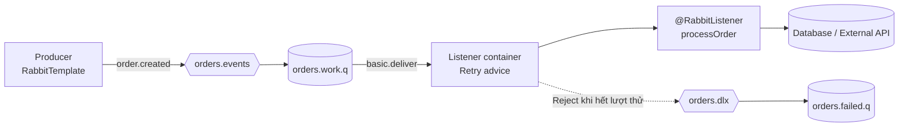
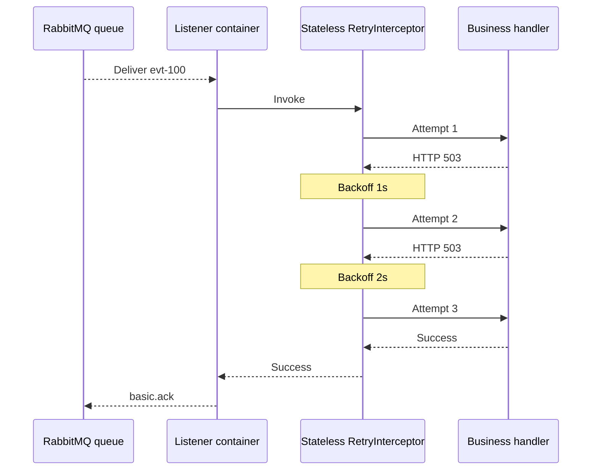
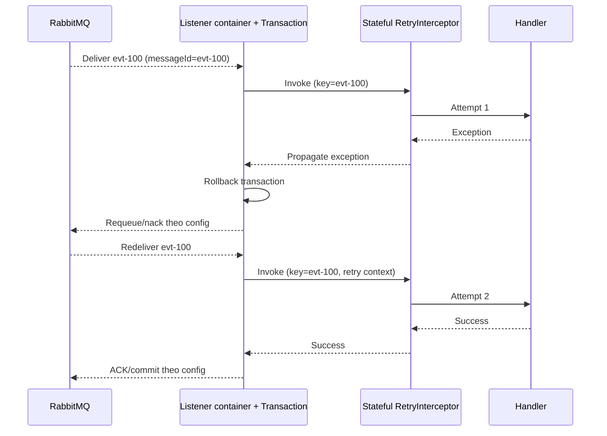
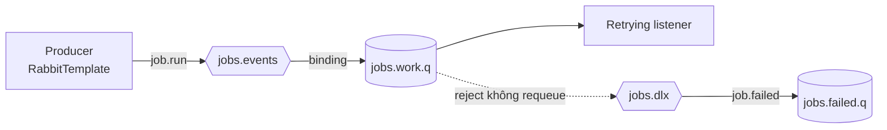

# Stateless retry và stateful retry cho listener

**Chương:** Thử lại thông điệp

Một `@RabbitListener` nhận message `order.created`, gọi database hoặc API thanh toán, nhưng phụ thuộc tạm thời trả lỗi. Nếu bỏ message ngay, sự kiện có thể không được xử lý. Nếu cứ `basicNack(requeue=true)` vô hạn, cùng message có thể quay lại hàng nghìn lần và làm nghẽn queue. Spring AMQP kết hợp **Spring Retry** để kiểm soát số lượt thử, backoff và hành động khi hết cơ hội khôi phục.

Có hai kiểu retry cho message listener:

- **Stateless retry:** thử lại nhiều lần **bên trong cùng một lần nhận delivery/gọi listener**.
- **Stateful retry:** cho lỗi lan ra ngoài để container/giao dịch **rollback và tái giao message**, rồi nhận diện cùng một message để tiếp tục trạng thái retry ở những lần delivery sau.

Đây không phải hai queue type hay hai cách thiết lập routing. Chúng là **hai cách tổ chức trạng thái retry ở tầng listener** trong mô-đun **SPRING_AMQP**: hệ thống dùng `RabbitTemplate`, `@RabbitListener`, exchange, queue, binding, publisher confirms, consumer ACK, dead-letter và giao dịch để xử lý bất đồng bộ đáng tin cậy.

**Sau bài học, bạn có thể:**

1. So sánh thời điểm retry, tác động lên ACK, transaction, thread và broker redelivery của hai kiểu.
2. Cấu hình `RetryInterceptorBuilder.stateless()` và `RetryInterceptorBuilder.stateful()` bằng `SimpleRabbitListenerContainerFactory`.
3. Sử dụng `messageId`/`MessageKeyGenerator` đúng trong stateful retry; phát hiện lỗi thiếu định danh.
4. Phân biệt **Spring Retry attempt**, **broker redelivery**, **publisher retry** và **quorum delivery limit**.
5. Lựa chọn `RejectAndDontRequeueRecoverer`, `RepublishMessageRecoverer` hoặc cách xử lý khác sau khi hết retry mà không làm mất dữ liệu ngoài ý muốn.
6. Kết hợp retry với DLX/DLQ, backoff, transaction, idempotency và observability; kiểm thử trong các tình huống consumer crash.

> **Phiên bản:** Nội dung và API ví dụ chính nhắm đến `spring-rabbit` thuộc Spring AMQP 4.2 cùng Spring Boot 4.1 (RabbitMQ AMQP 0.9.1). Ở Spring AMQP 3.x/Spring Boot 3.x có khác biệt tên cấu hình như `maxAttempts`/`maxRetries` và `max-attempts`/`max-retries`; luôn xem tài liệu **đúng phiên bản dependency thực tế**. Không áp nguyên các ví dụ `@RabbitListener` cho generic AMQP 1.0 client.

## 1. Retry nằm ở đâu trong vòng đời nhận message?

Giả sử:



Ở cấu hình **Spring `AcknowledgeMode.AUTO`** thông thường:

1. RabbitMQ giao một delivery có `deliveryTag` cho consumer.
2. Listener container gọi đường xử lý có retry advice.
3. Advice gọi handler nghiệp vụ.
4. Handler trả về bình thường → container ACK theo điều kiện đã cấu hình.
5. Handler ném exception → advice quyết định thử lại hoặc kết thúc thất bại.
6. Khi hết lượt, `MessageRecoverer` hoặc exception được đưa đến container để quyết định ACK/reject/NACK.
7. Nếu broker nhận reject **không requeue** và queue có DLX/binding phù hợp, message được dead-letter.

**Retry advice không phải cơ chế tạo queue.** Exchange, queue, binding và DLX/DLQ cần tồn tại độc lập. Đồng thời, retry **không thay** publisher confirms, vì producer cần biết message đã được RabbitMQ nhận trước cả khi listener bắt đầu.

### 1.1. Ba khái niệm khác nhau

| Khái niệm | Ai thực hiện? | Có thể có delivery mới từ broker? |
| --- | --- | --- |
| **Lặp lại lời gọi handler trong cùng một delivery** | Spring Retry stateless | **Không cần** delivery mới |
| **Requeue/redelivery sau rollback hoặc NACK** | RabbitMQ + listener container | **Có**; delivery tag và consumer có thể khác |
| **Republish một message mới** | Ứng dụng/`RabbitTemplate`/recoverer | **Có**; đó là **publish mới**, không đồng nghĩa redelivery cũ |

Do đó đừng đo số lượt thử chỉ bằng cờ `redelivered`. Trong stateless retry, cùng một delivery có thể đã gọi method ba lần nhưng `redelivered=false` vẫn đúng vì broker chưa giao lại.

## 2. So sánh trọng tâm: stateless và stateful

| Tiêu chí | **Stateless retry** | **Stateful retry** |
| --- | --- | --- |
| Vị trí các attempt | Nằm trong một lần advice gọi handler | Có thể trải qua **nhiều lần broker delivery** |
| Có giữ `RetryContext` giữa các delivery? | Không cần, trạng thái thuộc một chu kỳ gọi | **Có**, theo key của cùng message |
| Lỗi trước khi hết lượt | Advice có thể catch rồi gọi lại handler | Thường cho exception lan ra để **rollback** transaction/container |
| Broker thấy gì khi chưa hết lượt? | Delivery vẫn outstanding, chưa ACK | Có thể bị rollback/requeue rồi broker giao lại |
| Cần `messageId` / identity ổn định? | Không, không cần ghép các delivery | **Có**; mặc định dựa vào `MessageProperties.messageId` |
| Có bắt buộc transaction không? | Không | Không bắt buộc về API, nhưng **đặc biệt hữu ích** khi transaction ngoài advice cần rollback |
| Hợp khi | Handler không có outer transaction hoặc transaction được bắt đầu **bên trong** mỗi lần retry | Transaction được bắt đầu cao hơn trong call stack, phải rollback trước lượt mới |
| Backoff | Thường đợi ngay trên consumer thread khi retry trong cùng delivery | Kết hợp state giữa các delivery; thời gian broker requeue và backoff cần hiểu theo cấu hình |
| Tác động lên thứ tự message | Giữ delivery trong lúc lặp, có thể block consumer | Requeue có thể đổi thứ tự và consumer nhận |
| Recovery cuối | Recoverer sau khi hết attempt | Recoverer xử lý thông điệp nhận diện qua các lần delivery |
| Độ phức tạp | Đơn giản hơn | Cao hơn: message identity, retry cache, rollback, recovery |
| Sống qua JVM restart? | Không có state liên lần delivery cần lưu | **Không mặc định**; retry context thường ở memory |
| Exactly-once? | **Không** | **Không** |

**Kết luận chọn mode:** bắt đầu từ **ranh giới transaction**, không chọn stateful chỉ vì nghĩ nó lưu kết quả retry “bền vững hơn”.

## 3. Stateless retry: lặp trong một lần gọi listener

### 3.1. Mô phỏng trình tự

Giả sử cấu hình cho phép **1 lần đầu + tối đa 2 lần retry**:



Broker chỉ giao **một delivery**. Cả ba lời gọi handler xảy ra khi delivery còn **unacked**. Nếu lượt thứ ba vẫn lỗi, recoverer hoặc container sẽ quyết định kết thúc.

### 3.2. Vì sao phù hợp khi không có outer transaction?

Spring AMQP documentation gợi ý stateless khi:

- Handler không cần transaction bao quanh toàn bộ retry advice.
- Hoặc **transaction được tạo bên trong retry callback**, vì mỗi lần gọi lại handler có thể tạo một transaction mới.

Ví dụ handler có `@Transactional` trên một **Spring bean proxy được gọi qua proxy đúng cách**: retry advice ở container gọi method mỗi attempt, transaction ở method handler được thiết lập lại theo lần gọi. Điều này có thể phù hợp, nhưng cần xác nhận thứ tự advice, bean proxy và hành vi rollback thật sự bằng integration test.

**Không phù hợp nếu transaction đã được mở bên ngoài retry advice.** Khi attempt đầu tiên ném exception, transaction bên ngoài có thể bị đánh dấu rollback-only, connection/JPA session có thể không còn trạng thái phù hợp, nhưng stateless vẫn cố gọi lại handler trong **cùng transaction**.

### 3.3. Khi nào stateless trở thành “retry storm trong JVM”?

Giả sử mỗi listener gọi API chậm 2 giây và thất bại, retry 3 lần với backoff. Một consumer có thể bị chiếm nhiều giây cho **một message**, khiến:

- `messages_unacknowledged` giữ mức cao.
- Queue `ready` tăng dù consumer count không thay đổi.
- Thread listener và đôi khi transaction/DB connection bị giữ lâu.
- Thời gian xử lý vượt broker consumer acknowledgment timeout hoặc shutdown timeout.
- Nếu `concurrency` lớn, nhiều listener có thể cùng retry và dồn tải vào API đang hỏng.

Stateless **không phải retry có delay trên broker**. Đối với thời gian chờ dài hàng phút hoặc hàng giờ, thường nên **release consumer** và chuyển sang retry queue/delayed workflow, thay vì ngủ lâu trong listener.

## 4. Stateful retry: theo dõi cùng message qua redelivery

### 4.1. Trình tự khi có transaction ở tầng container

Ví dụ một container dùng transaction manager bên ngoài advice. Handler ném exception:



**Điểm khác:** exception cần thoát ra để tầng container/transaction rollback trước khi retry tiếp. Retry context dựa vào message identity cho phép interceptor nhận ra message đã từng thất bại.

Không nên diễn giải hình thành công thức cứng “mỗi attempt phải xảy ra trên một channel hoặc một JVM mới”. RabbitMQ có thể giao lại cho **cùng consumer**, cho một consumer khác hay một instance khác; behavior chính xác còn phụ thuộc retry policy, queue state và topology.

### 4.2. Vì sao cần một định danh message ổn định?

Stateful retry phải ghép:

```text
delivery lần 1: evt-100 -> failed attempt 1
delivery lần 2: evt-100 -> failed attempt 2
delivery lần 3: evt-100 -> success / exhausted
```

Thường Spring AMQP dùng **AMQP message property `messageId`** làm key, nhưng trường này **không bắt buộc trong AMQP 0.9.1**. Producer cần đặt nó một cách có chủ đích, hoặc listener retry phải có một `MessageKeyGenerator` tương đương.

Không được lấy:

- `deliveryTag`: chỉ hợp lệ trên một channel và thay đổi sau redelivery.
- `consumerTag`: định danh đăng ký consumer, không định danh message.
- `redelivered`: cờ boolean, không duy nhất.
- `hashCode()` của mảng `byte[] body`: hash theo danh tính object, có thể thay đổi.
- Một `orderId` được dùng cho **nhiều sự kiện khác nhau** nếu contract có thể có nhiều message hợp lệ cho cùng order.

**Stateful retry identity phải vừa duy nhất cho mỗi message cần theo dõi, vừa ổn định qua redelivery của chính message đó.**

### 4.3. Cờ `redelivered` và `NewMessageIdentifier`

Stateful interceptor có tối ưu `NewMessageIdentifier`; theo mặc định nó có thể dựa vào `redelivered` để nhận biết một delivery có khả năng là message mới. Đó là **tối ưu truy cập retry context**, không phải cơ chế idempotency.

`redelivered=false` không có nghĩa ứng dụng chưa từng gặp **cùng event nghiệp vụ**: producer có thể republish trùng với một AMQP message mới. `redelivered=true` cũng không chứng minh lần trước đã commit DB. Chỉ `eventId`/unique constraint mới giúp ngăn nhân đôi tác dụng phụ.

### 4.4. Stateful không có nghĩa retry state được lưu bền trên broker

Theo cấu hình mặc định, Spring Retry context/cache ở **bộ nhớ tiến trình ứng dụng**. Nếu JVM restart, retry cache có thể mất; nếu RabbitMQ giao lại cho **một pod khác**, pod đó không tự có toàn bộ lịch sử retry của pod cũ.

Hệ quả:

- `maxRetries=2` **không phải bảo đảm durable** rằng một logical event bị xử lý tối đa đúng ba lần qua mọi crash/redeploy/pod.
- Nếu cần ngân sách attempt toàn hệ thống, lưu bộ đếm bền vững trong DB/job state, hoặc dùng khả năng delivery limit của queue type với phiên bản RabbitMQ đã xác minh.
- Ngay cả khi retry state tồn tại đủ lâu trong JVM, duplicate publish vẫn có thể tạo logical event trùng; cần idempotency tách biệt.

Stateful retry giải quyết **phối hợp retry và rollback** trong một luồng giao nhận; nó **không phải** một distributed workflow engine.

## 5. Chuẩn bị exchange, queue, binding và DLQ

Ví dụ dùng direct exchange `jobs.events`. Một message `job.run` được gửi vào `jobs.work.q`. Nếu hết retry mà recoverer yêu cầu reject không requeue, broker có thể chuyển nó qua `jobs.dlx` đến `jobs.failed.q`.



Topology local/test:

```java
import org.springframework.amqp.core.Binding;
import org.springframework.amqp.core.BindingBuilder;
import org.springframework.amqp.core.Declarables;
import org.springframework.amqp.core.DirectExchange;
import org.springframework.amqp.core.Queue;
import org.springframework.amqp.core.QueueBuilder;
import org.springframework.context.annotation.Bean;
import org.springframework.context.annotation.Configuration;
import org.springframework.context.annotation.Profile;

@Configuration(proxyBeanMethods = false)
@Profile("local")
class LocalRetryTopology {

    @Bean
    Declarables retryResources() {
        DirectExchange events =
                new DirectExchange("jobs.events", true, false);
        DirectExchange dlx =
                new DirectExchange("jobs.dlx", true, false);

        Queue work = QueueBuilder.durable("jobs.work.q")
                .deadLetterExchange("jobs.dlx")
                .deadLetterRoutingKey("job.failed")
                .build();

        Queue dead = QueueBuilder.durable("jobs.failed.q").build();

        Binding workBinding = BindingBuilder.bind(work)
                .to(events).with("job.run");
        Binding deadBinding = BindingBuilder.bind(dead)
                .to(dlx).with("job.failed");

        return new Declarables(
                events, dlx, work, dead, workBinding, deadBinding);
    }
}
```

`Declarables` mô tả topology để Spring `RabbitAdmin` có thể khai báo khi ứng dụng được cấp quyền. Production thường quản lý exchange/queue/binding/DLX qua IaC hoặc đội vận hành; không sửa trực tiếp arguments của queue đã tồn tại chỉ bằng redeploy.

**DLX/DLQ phải có thật.** Nếu recoverer ném tín hiệu reject không requeue nhưng queue không có DLX hoặc route phù hợp, message có thể bị **discard**.

## 6. Producer: phải có `messageId` cho stateful retry

`MessageProperties.messageId` không được RabbitMQ tự sinh một cách đáng tin cậy để bảo đảm stateful identity. Producer chủ động đặt giá trị:

```java
import java.util.UUID;
import org.springframework.amqp.rabbit.core.RabbitTemplate;
import org.springframework.stereotype.Service;

@Service
class JobPublisher {

    private final RabbitTemplate template;

    JobPublisher(RabbitTemplate template) {
        this.template = template;
    }

    String publishNewJob(String jobId) {
        String messageId = UUID.randomUUID().toString();

        template.convertAndSend(
                "jobs.events",
                "job.run",
                jobId,
                message -> {
                    message.getMessageProperties()
                            .setMessageId(messageId);
                    return message;
                });

        return messageId;
    }
}
```

Ở đây:

- `jobId` là thông tin nghiệp vụ.
- `messageId` định danh **một AMQP message** để stateful advice nhận diện qua redelivery.
- Khi broker **redeliver cùng message**, `messageId` giữ giá trị cũ.
- Nếu producer tự publish lại một message mới vì timeout, phải quyết định contract: giữ **eventId/idempotency key** cho logical event hay tạo messageId mới cho một publish attempt. Không tùy tiện đồng nhất hai loại định danh.
- `RabbitTemplate.convertAndSend(...)` hoàn tất không có nghĩa broker đã xác nhận publish; cần publisher confirms/returns cho event quan trọng.

Có thể dùng converter với lựa chọn tạo message IDs nếu phù hợp, nhưng hãy kiểm tra **giá trị thực sự ở broker/consumer** và tính duy nhất qua workload.

## 7. Ví dụ stateless retry với `SimpleRabbitListenerContainerFactory`

Ví dụ chính theo **Spring AMQP 4.2**:

```java
import org.springframework.amqp.core.AcknowledgeMode;
import org.springframework.amqp.rabbit.config.RetryInterceptorBuilder;
import org.springframework.amqp.rabbit.config.SimpleRabbitListenerContainerFactory;
import org.springframework.amqp.rabbit.connection.ConnectionFactory;
import org.springframework.amqp.rabbit.retry.RejectAndDontRequeueRecoverer;
import org.springframework.context.annotation.Bean;
import org.springframework.context.annotation.Configuration;
import org.springframework.context.annotation.Profile;

@Configuration(proxyBeanMethods = false)
@Profile("stateless-demo")
class StatelessRetryConfig {

    @Bean("statelessListenerFactory")
    SimpleRabbitListenerContainerFactory statelessListenerFactory(
            ConnectionFactory connectionFactory) {

        var factory = new SimpleRabbitListenerContainerFactory();
        factory.setConnectionFactory(connectionFactory);
        factory.setConcurrentConsumers(2);
        factory.setPrefetchCount(5);
        factory.setAcknowledgeMode(AcknowledgeMode.AUTO);

        factory.setAdviceChain(
                RetryInterceptorBuilder.stateless()
                        .maxRetries(2) // Lần đầu + tối đa 2 retries
                        .backOffOptions(1_000, 2.0, 5_000)
                        .recoverer(new RejectAndDontRequeueRecoverer())
                        .build());

        return factory;
    }
}
```

Trong đó `backOffOptions(initialInterval, multiplier, maxInterval)` nhận thời gian **mili giây**. Với hai lần retry, lý thuyết backoff là khoảng 1 giây rồi 2 giây, chịu ảnh hưởng scheduler, xử lý và version.

Listener:

```java
import org.springframework.amqp.rabbit.annotation.RabbitListener;
import org.springframework.context.annotation.Profile;
import org.springframework.stereotype.Component;

@Component
@Profile("stateless-demo")
class StatelessJobListener {

    private final JobHandler jobHandler;

    StatelessJobListener(JobHandler jobHandler) {
        this.jobHandler = jobHandler;
    }

    @RabbitListener(
            id = "jobs-stateless",
            queues = "jobs.work.q",
            containerFactory = "statelessListenerFactory")
    public void consume(String jobId) {
        jobHandler.execute(jobId);
    }
}
```

Để mã có ý nghĩa, ứng dụng cần interface nghiệp vụ:

```java
public interface JobHandler {
    void execute(String jobId);
}
```

`JobHandler` là interface tự định nghĩa, không thuộc Spring AMQP. Với converter mặc định, payload `String` phù hợp ví dụ; khi nhận JSON DTO phải bổ sung converter và validation tương ứng.

### 7.1. Timeline minh họa

```text
messageId=msg-123, handler gọi API trả 503:

t=0s      attempt #1 -> failure
t≈1s      attempt #2 -> failure
t≈3s      attempt #3 -> success

Spring Retry trả success.
Container AUTO ACK message.
Broker thấy một delivery đã được ACK.
```

Nếu attempt #3 vẫn thất bại, `RejectAndDontRequeueRecoverer` yêu cầu container **reject không requeue**. Queue đã có DLX thì message được định tuyến đến DLQ.

**Không bật đồng thời** listener `stateless-demo` và `stateful-demo` (phần sau) trên cùng `jobs.work.q` nếu đang so sánh hai kiểu; chúng là competing consumers và chia message ngẫu nhiên theo broker.

### 7.2. Tại sao dùng recoverer tường minh?

Nếu không cấu hình recoverer đúng, hành vi khi hết retry có thể không như mong muốn. Một default `MessageRecoverer` ở Spring AMQP có thể chỉ log cảnh báo rồi **tiêu thụ lỗi**; khi exception được “nuốt”, container có thể ACK, và **broker DLX sẽ không nhận message lỗi**.

Vì thế khi muốn sử dụng **broker DLX**, cấu hình rõ:

```java
.recoverer(new RejectAndDontRequeueRecoverer())
```

Sau đó kiểm chứng message thực sự tới `jobs.failed.q`. Không chỉ xem log “retries exhausted” rồi kết luận DLQ đã nhận.

## 8. Ví dụ stateful retry với định danh message

Khi listener cần exception **thoát ra ngoài advice** để transaction container rollback, dùng stateful:

```java
import org.springframework.amqp.core.AcknowledgeMode;
import org.springframework.amqp.rabbit.config.RetryInterceptorBuilder;
import org.springframework.amqp.rabbit.config.SimpleRabbitListenerContainerFactory;
import org.springframework.amqp.rabbit.connection.ConnectionFactory;
import org.springframework.amqp.rabbit.retry.RejectAndDontRequeueRecoverer;
import org.springframework.context.annotation.Bean;
import org.springframework.context.annotation.Configuration;
import org.springframework.context.annotation.Profile;

@Configuration(proxyBeanMethods = false)
@Profile("stateful-demo")
class StatefulRetryConfig {

    @Bean("statefulListenerFactory")
    SimpleRabbitListenerContainerFactory statefulListenerFactory(
            ConnectionFactory connectionFactory) {

        var factory = new SimpleRabbitListenerContainerFactory();
        factory.setConnectionFactory(connectionFactory);
        factory.setConcurrentConsumers(1);
        factory.setPrefetchCount(1);
        factory.setAcknowledgeMode(AcknowledgeMode.AUTO);

        factory.setAdviceChain(
                RetryInterceptorBuilder.stateful()
                        .maxRetries(2) // Cần cùng messageId qua redelivery
                        .backOffOptions(1_000, 2.0, 5_000)
                        .recoverer(new RejectAndDontRequeueRecoverer())
                        .build());

        return factory;
    }
}
```

Listener:

```java
import org.springframework.amqp.rabbit.annotation.RabbitListener;
import org.springframework.context.annotation.Profile;
import org.springframework.stereotype.Component;

@Component
@Profile("stateful-demo")
class StatefulJobListener {

    private final JobHandler jobHandler;

    StatefulJobListener(JobHandler jobHandler) {
        this.jobHandler = jobHandler;
    }

    @RabbitListener(
            id = "jobs-stateful",
            queues = "jobs.work.q",
            containerFactory = "statefulListenerFactory")
    public void consume(String jobId) {
        jobHandler.execute(jobId);
    }
}
```

Tất cả message dùng mode này **phải có messageId duy nhất/ổn định** hoặc key generator tương đương. Nếu lần đầu handler ném exception:

- Advice ghi nhận attempt theo key `messageId`.
- Exception được truyền ra ngoài để container/transaction rollback.
- Tùy policy requeue/rollback, message được broker giao lại.
- Khi cùng `messageId` được giao lại **trên cùng JVM còn giữ retry context**, interceptor có thể biết đây là attempt kế tiếp.
- Khi đã hết lượt, `RejectAndDontRequeueRecoverer` yêu cầu reject không requeue để message vào DLQ nếu route hợp lệ.

Nếu listener chỉ có cấu hình SMLC như trên mà **không có external transaction**, stateful vẫn có thể thực hiện retry, nhưng lý do lựa chọn mode sẽ yếu hơn; nên thiết kế giao dịch ở vị trí cần rollback và kiểm thử rollback thực tế.

### 8.1. Phối hợp với transaction bao ngoài listener

Khi **container** quản lý một transaction manager, transaction có thể bao ngoài retry advice. Đây là kịch bản quan trọng cho stateful.

Một cấu hình **có chủ ý**:

```java
@Bean("statefulTransactionalFactory")
SimpleRabbitListenerContainerFactory statefulTransactionalFactory(
        ConnectionFactory rabbitConnectionFactory,
        org.springframework.transaction.PlatformTransactionManager
                businessTransactionManager) {

    var factory = new SimpleRabbitListenerContainerFactory();
    factory.setConnectionFactory(rabbitConnectionFactory);
    factory.setTransactionManager(businessTransactionManager);
    factory.setChannelTransacted(true);
    factory.setAcknowledgeMode(AcknowledgeMode.AUTO);
    factory.setPrefetchCount(1);

    factory.setAdviceChain(
            RetryInterceptorBuilder.stateful()
                    .maxRetries(2)
                    .recoverer(new RejectAndDontRequeueRecoverer())
                    .build());

    return factory;
}
```

**Chỉ sử dụng cấu hình này sau khi xác định rõ** `businessTransactionManager` là manager nào (ví dụ DB) và cách Spring đồng bộ transaction với AMQP channel trong hệ thống hiện tại. Không mặc định nó tạo **distributed XA transaction nguyên tử** giữa RabbitMQ và database.

Vì transaction ở container **bao quanh lời gọi listener**, lần đầu thất bại cần rollback rồi mới hợp lý thử lại. Stateful advice thực hiện điều đó bằng cách để exception đi qua ranh giới ngoài. Nếu cố dùng stateless trong cùng cách bố trí, một transaction ngoài advice đã bị đánh dấu lỗi có thể không phục hồi được dù gọi lại handler nhiều lần.

### 8.2. Phân biệt với `@Transactional` ở phương thức

Một `@Transactional` nằm ngay **trên handler** có thể khiến **mỗi lần lời gọi handler** mở transaction riêng (tùy AOP/proxy). Vì vậy **không phải cứ thấy `@Transactional` thì bắt buộc dùng stateful**.

Hãy vẽ ranh giới:

```text
A. Container -> Stateless retry -> @Transactional handler
   Mỗi attempt có thể có transaction riêng nếu AOP thiết lập đúng.
   Stateless có thể phù hợp.

B. Container transaction -> Stateful retry -> Handler
   Exception phải ra khỏi retry advice để outer transaction rollback.
   Stateful thường phù hợp hơn.
```

Đây là một quyết định về **vị trí bắt đầu transaction**, không phải nhãn “DB dùng transaction thì dùng stateful” cho mọi trường hợp.

## 9. Khi message **không có `messageId`**

AMQP 0.9.1 không bắt buộc sender gửi `messageId`. Stateful retry mặc định cần key. Theo Spring AMQP reference:

- Một message có `messageId=null` với stateful retry được coi là **fatal cho consumer** theo default, sau một retry; consumer có thể bị **dừng** để tránh hoạt động không xác định.
- Listener container có thuộc tính `statefulRetryFatalWithNullMessageId`, mặc định **`true`**.
- Nếu đặt **`false`**, consumer không bị dừng; message thiếu ID được **reject không requeue sau một retry** và có thể đi DLQ nếu queue đã cấu hình.
- Cần test cụ thể trên cả `SimpleMessageListenerContainer` và `DirectMessageListenerContainer` nếu ứng dụng hỗ trợ cả hai.

**Đừng giải quyết bằng cách dùng body bytes làm key một cách tùy tiện**. Hai message khác nhau có body giống nhau có thể bị gộp vào cùng retry context; nếu dùng identity của mảng byte thì lại không ổn định sau khi deserialize.

### 9.1. `MessageKeyGenerator` tự viết

Khi không thể thay producer nhưng message có `eventId` trong header được kiểm soát, có thể định nghĩa:

```java
import org.springframework.amqp.rabbit.retry.MessageKeyGenerator;

@Bean
MessageKeyGenerator messageKeyGenerator() {
    return message -> {
        Object id = message.getMessageProperties()
                .getHeaders().get("eventId");

        if (id instanceof String eventId && !eventId.isBlank()) {
            return eventId;
        }

        // Không trả về deliveryTag, consumerTag hay identity của byte[].
        return null;
    };
}
```

Rồi gắn vào builder:

```java
RetryInterceptorBuilder.stateful()
        .messageKeyGenerator(messageKeyGenerator())
        .maxRetries(2)
        .recoverer(new RejectAndDontRequeueRecoverer())
        .build();
```

Ví dụ này giả định `eventId` **duy nhất cho từng message cần theo dõi**, không chỉ cho một đơn hàng có nhiều event. Nếu generator trả `null`, hành vi sẽ phụ thuộc Spring AMQP version; theo Javadoc hiện đại, nó có thể bỏ stateful retries cho message đó và reject khi lỗi. Không dùng `null` như cơ chế khắc phục tự động khi contract producer chưa thống nhất.

Với dữ liệu quan trọng, **giải pháp ưu tiên** vẫn là làm producer gửi đúng `messageId` ngay từ đầu, thay vì vá bằng phép hash không đảm bảo uniqueness.

### 9.2. Stateful retry key khác khóa idempotency

| Mục đích | Key ví dụ | Phạm vi |
| --- | --- | --- |
| Stateful retry | AMQP `messageId` hoặc generator key | Nhận diện một message giữa các delivery trong retry cache |
| Idempotency nghiệp vụ | `eventId` được unique trong DB | Ngăn side effect lặp xuyên producer retry, JVM restart và consumer instances |
| Publisher confirms correlation | `CorrelationData(eventId)` | Ghép confirm với lần publish |
| Consumer ACK delivery tag | `deliveryTag` | ACK một delivery **trên channel hiện tại** |
| Tracing | `traceId` | Nối logs/spans, không nhất thiết unique theo message |

Có thể thiết kế để một `eventId` ổn định phục vụ nhiều mục tiêu, nhưng cần phân biệt semantics và kiểm chứng uniqueness; **stateful retry context không phải idempotency database**.

## 10. Spring Boot: dùng YAML khi không cần Java advice tùy biến

Spring Boot hỗ trợ retry của listener trong nhánh `spring.rabbitmq.listener.*.retry`. Với **Spring Boot 4.1**, cấu hình đơn giản:

### 10.1. Stateless qua YAML

```yaml
spring:
  rabbitmq:
    listener:
      type: simple
      simple:
        concurrency: 2
        prefetch: 5
        acknowledge-mode: auto
        retry:
          enabled: true
          stateless: true
          max-retries: 2
          initial-interval: 1s
          multiplier: 2.0
          max-interval: 5s
```

`stateless: true` cũng là mặc định khi cấu hình listener retry được bật trong Boot. `max-retries: 2` nghĩa là tối đa **hai lần thử lại** sau lần đầu theo tính năng Boot 4.1; đặt rõ để tránh đoán.

### 10.2. Stateful qua YAML

```yaml
spring:
  rabbitmq:
    listener:
      type: simple
      simple:
        concurrency: 1
        prefetch: 1
        acknowledge-mode: auto
        retry:
          enabled: true
          stateless: false
          max-retries: 2
          initial-interval: 1s
          multiplier: 2.0
          max-interval: 5s
```

**Cảnh báo:** chuyển `stateless: false` **không tự tạo `messageId`** trên message của producer. Phải có message ID đúng hoặc `MessageKeyGenerator` được cấu hình phù hợp. Đồng thời xác nhận recoverer và transaction boundary theo version Boot.

### 10.3. Cấu hình Boot 3.x khác ở tên property

Trong **Spring Boot 3.5**, metadata cấu hình listener retry còn dùng:

```yaml
spring:
  rabbitmq:
    listener:
      simple:
        retry:
          enabled: true
          stateless: true
          max-attempts: 3
```

`max-attempts` nghĩa là **tổng số attempts** theo Spring Boot 3.x (ví dụ 3 = lần đầu + 2 retries); **không tương đương một-một về số đếm** với tên `max-retries` trong Boot 4.1. Spring AMQP builder các nhánh cũ còn có `maxAttempts(...)`; tài liệu tham chiếu hiện đại dùng `maxRetries(...)`. Đừng copy cấu hình và giữ nguyên số mà chưa xác định semantics của release.

**Quy tắc:** đọc dependency tree + Spring Boot Configuration Metadata của bản thực tế. Property lạ có thể bị bỏ qua; điều nguy hiểm nhất là nghĩ retry đang bật trong khi thực tế service chỉ đang requeue message vô hạn.

### 10.4. Boot auto-configuration hay tự tạo factory?

Nếu bạn tự khai báo một `SimpleRabbitListenerContainerFactory` mới và **không dùng Boot configurer**, các property YAML có thể **không được áp dụng** cho factory đó. Nếu vẫn muốn cấu hình riêng, có thể dùng `SimpleRabbitListenerContainerFactoryConfigurer` của Boot để mang các thiết lập auto-configured vào factory trước khi override.

Để tránh **hai tầng retry chồng nhau**:

- Chọn **YAML/Boot auto-configured retry** *hoặc* **custom `setAdviceChain(...)`** làm nguồn cấu hình chính.
- Nếu cần riêng mỗi queue, tạo hai factory có tên riêng và ghi `containerFactory` trong `@RabbitListener`.
- Đừng để một endpoint vừa có retry advice từ Boot lại vô tình gắn thêm retry interceptor thủ công với attempts khác mà không kiểm tra chuỗi thực thi.

## 11. Hết retries: recoverer quyết định số phận message

**Đây là phần có thể làm mất dữ liệu nếu hiểu sai.** Retry hết lượt **không đồng nghĩa broker tự động đưa vào DLQ**. Cách recoverer kết thúc quyết định container ACK/reject và broker có nhận được dead-letter event hay không.

| Recoverer/cách kết thúc | Kết quả với delivery gốc | Có tự vào broker DLQ? |
| --- | --- | --- |
| `RejectAndDontRequeueRecoverer` | Ném tín hiệu `AmqpRejectAndDontRequeueException`; container reject **không requeue** | **Có thể**, nếu queue có DLX + route hợp lệ |
| Recoverer ghi log rồi trả về bình thường | Exception bị xử lý, container có thể ACK | **Không**, broker coi đã xử lý |
| `RepublishMessageRecoverer` | Ứng dụng **publish bản mới** sang error exchange/routing key; sau thành công delivery gốc được xử lý như đã recover | Không qua broker DLX của queue gốc; message nằm ở đích **republish** |
| Không có recoverer/cấu hình lỗi | Tùy interceptor/container/default policy; có thể reject, requeue hoặc consume | **Không được giả định** |
| `ImmediateRequeueMessageRecoverer` | Yêu cầu requeue message | Không phải lối xử lý cuối bền vững; có thể gây lặp |

**Mấu chốt:** broker DLX xử lý **reject/nack không requeue từ queue gốc**, còn `RepublishMessageRecoverer` là **publish mới** do ứng dụng điều phối.

### 11.1. `RejectAndDontRequeueRecoverer` + DLX

```java
RetryInterceptorBuilder.stateless()
        .maxRetries(2)
        .recoverer(new RejectAndDontRequeueRecoverer())
        .build();
```

Cần queue `jobs.work.q` có DLX `jobs.dlx`, binding `job.failed` tới `jobs.failed.q` và quyền broker đúng. Nếu không có DLX đích, reject không requeue có thể **drop message**.

`defaultRequeueRejected=false` ở listener container cũng hướng một số exception chưa được xử lý sang reject không requeue, nhưng không được coi là thay thế việc **định nghĩa recovery strategy** trong interceptor.

### 11.2. `RepublishMessageRecoverer`

Nếu muốn enrich lỗi và chuyển message tới một exchange riêng do ứng dụng publish:

```java
import org.springframework.amqp.rabbit.core.RabbitTemplate;
import org.springframework.amqp.rabbit.retry.RepublishMessageRecoverer;

@Bean
RepublishMessageRecoverer republishRecoverer(
        RabbitTemplate rabbitTemplate) {
    return new RepublishMessageRecoverer(
            rabbitTemplate, "jobs.error.events", "job.error");
}
```

Kết hợp:

```java
RetryInterceptorBuilder.stateless()
        .maxRetries(2)
        .recoverer(republishRecoverer(rabbitTemplate))
        .build();
```

Phải **provision `jobs.error.events` và binding `job.error`** tới error queue trước khi dùng ví dụ này. Đây là một **phương án thay thế** cho `jobs.dlx` trong bài lab, không bật cả hai rồi giả định cùng nhận một message.

`RepublishMessageRecoverer` có thể thêm metadata lỗi như tên exchange/routing key gốc và exception header. Để không mất message trong khoảng **republish lỗi → ACK message gốc**, cân nhắc `RepublishMessageRecovererWithConfirms`, publisher confirms/returns, hoặc quy trình đối soát phù hợp. Republish và ACK không phải một giao dịch DB+broker atomically hoàn hảo chỉ nhờ recoverer.

### 11.3. Recoverer có thể nuốt exception

Đừng viết:

```java
(message, cause) -> {
    logger.warn("Skipping broken message", cause);
    // Trả về bình thường: message có thể được ACK.
}
```

trừ khi **nghiệp vụ thật sự cho phép loại bỏ** message. Nếu muốn giữ lại để điều tra, phải có hành động có thể kiểm chứng: reject tới DLQ, republish có xác nhận hoặc lưu quarantine/outbox khác.

## 12. Retry policy: không nên thử lại mọi exception

Mặc định Spring Retry có thể retry nhiều loại exception. Nhưng một event JSON hỏng hoặc trường bắt buộc thiếu **không biến thành hợp lệ** sau 2 giây.

| Nhóm lỗi | Ví dụ | Hướng xử lý |
| --- | --- | --- |
| **Transient** | Timeout DB, HTTP 503, rate limit, connection pool cạn tạm thời | Retry với backoff và giới hạn |
| **Permanent** | JSON sai cú pháp, schema không hỗ trợ, chữ ký không hợp lệ | Reject/quarantine/DLQ, cảnh báo producer |
| **Business conflict** | Đơn hàng đã hủy, version cũ | Kiểm tra trạng thái/đối soát; không retry mù |
| **Infrastructure outage** | Broker/network lỗi khi publish reply | Recovery kết nối và event state; không tương đương lỗi handler |
| **Duplicate** | EventId đã được xử lý | Handler idempotent trả success, container ACK, không retry |

Có thể dùng `RetryPolicy`/`SimpleRetryPolicy` hoặc predicate classifier phù hợp phiên bản. Spring AMQP thường bọc exception của handler bằng `ListenerExecutionFailedException`; nếu classifier chỉ nhìn exception ngoài cùng, bạn có thể retry sai loại. Nên bật/trang bị cơ chế **traverse causes** hoặc kiểm tra root cause đúng trong policy.

Với lỗi dữ liệu xuất hiện **trước khi gọi handler** (ví dụ message converter không deserialize được), retry advice và `ConditionalRejectingErrorHandler` có thể vận hành khác lỗi ném từ chính handler. Hãy integration test đường conversion failure, không chỉ giả lập `RuntimeException` trong method.

## 13. Backoff, prefetch và throughput

### 13.1. Exponential backoff không biến consumer thành scheduler

Ví dụ:

```text
Initial interval = 1s
Multiplier       = 2
Max interval     = 8s
Max retries      = 4

Khoảng chờ giữa attempts:
1s, 2s, 4s, 8s
Tổng chờ dự kiến ~15s (chưa tính thời gian xử lý).
```

Với **stateless**, những lần chờ này thường chiếm thread listener trong cùng delivery. Nếu một pod có 10 consumer đều retry khi DB bị hỏng, 10 thread có thể bị giữ tới 15 giây hoặc lâu hơn. Điều này không xóa payload khỏi hàng đợi; nó vẫn liên quan đến delivery outstanding.

Với **stateful**, exception được truyền ra để rollback rồi requeue. Thời gian message được broker giao lại, số consumer, thứ tự và chính sách requeue ảnh hưởng khoảng cách giữa attempts; đừng giả định việc đặt `backOffOptions` đã tạo một **delay broker-side bền vững** trong mọi topology.

Để delay nhiều phút, dùng **retry queues + TTL/DLX** hoặc delayed-message mechanism thích hợp, có budget/max attempts bền vững. Không dùng vô hạn `basicNack(requeue=true)` cho lỗi vĩnh viễn.

### 13.2. Prefetch nhân số delivery đang chờ

Giả sử:

```text
instances = 4
consumers/instance = 5
prefetch = 20

Số delivery outstanding gần đúng tối đa:
4 × 5 × 20 = 400
```

Nếu một dependency bị lỗi, hàng trăm message có thể bị giữ unacked/retry và requeue cùng lúc sau consumer crash. Prefetch lớn giúp throughput ở tải tốt nhưng có thể làm **redelivery storm** và kéo dài thời gian consumer giữ message.

### 13.3. Stateless và stateful đều có chi phí

| Tín hiệu | Stateless | Stateful |
| --- | --- | --- |
| Consumer thread bị chờ trong cùng delivery | Dễ thấy khi backoff dài | Có thể ít giữ trong một chu kỳ nếu rollback/requeue, nhưng còn phụ thuộc policy |
| Broker redeliver rate | Không tăng bởi retry nội bộ | Có thể tăng khi exception gây requeue |
| Thứ tự công việc | Giữ delivery trong lúc retry | Requeue có thể làm message đến sau được xử lý trước |
| Retry context memory | Theo một invocation | Theo nhiều delivery trong JVM |
| Retry count qua service restart | Mất state đang chạy | Cũng không bền mặc định |
| DLQ sau exhaustion | Cần recoverer/reject | Cần recoverer/reject |

**Không chọn stateful để tăng throughput một cách mặc định.** Nó chủ yếu giải quyết yêu cầu transaction rollback và tương quan attempts. Cả hai cần benchmark dưới tải thật và kiểm chứng queue ready/unacked/redelivery.

## 14. RabbitMQ delivery-limit và Spring Retry khác nhau

Một queue RabbitMQ, đặc biệt **quorum queue**, có thể có **delivery-limit** do broker quản lý. Đây là cơ chế **khác** với `RetryInterceptorBuilder.maxRetries(...)` của Spring.

| Cơ chế | Nơi giữ thông tin | Giới hạn cái gì? |
| --- | --- | --- |
| Spring stateless | Trong một lần listener invocation | Số lần gọi handler nội bộ |
| Spring stateful | Retry context/cache của tiến trình, theo message key | Số lần thử giữa các delivery **nếu state còn tồn tại** |
| Quorum `x-delivery-limit` | Broker/queue theo phiên bản RabbitMQ | Failed deliveries của message theo semantics broker |
| Retry queue + TTL/DLX | Broker queue policy và headers/metadata | Vòng retry/độ trễ theo topology do ứng dụng thiết kế |
| DB attempt counter | Persistent application store | Ngân sách retry nghiệp vụ xuyên nhiều pods/restarts |

**Đừng cộng hoặc trừ các số này như một counter duy nhất.** Một stateless delivery có thể gọi handler nhiều lần nhưng broker chỉ thấy một delivery; một stateful attempt có thể tạo broker redelivery; khi republish message mới, delivery limit của message cũ có thể không đi theo.

Từ RabbitMQ 4.0, quorum queue có **delivery limit mặc định 20** trừ khi thay bằng policy/argument phù hợp. Các phiên bản RabbitMQ 4.3+ thay đổi cách đếm một số hành vi requeue (ví dụ `basic.nack`). Nếu kiến trúc dựa vào delivery-limit để kết thúc retry, cần kiểm chứng trên phiên bản broker đang chạy thay vì lấy một sơ đồ chung làm cam kết.

## 15. Consumer ACK, transaction và idempotency

### 15.1. ACK của consumer không phải publisher confirm

Producer dùng `RabbitTemplate` có thể nhận **publisher confirm** để biết broker đã xử lý publish. Consumer container gửi **consumer ACK** khi delivery đã xử lý theo chế độ tương ứng. Hai ACK này **không liên quan về mặt xác nhận nghiệp vụ**.

Retry của listener xảy ra **sau khi message đã đến queue và được giao**. Nó không khắc phục việc producer publish tới sai exchange hoặc routing key. Cần exchange/binding đúng và publisher returns/mandatory để phát hiện NO_ROUTE.

### 15.2. Thời điểm ACK so với DB commit

Hai thứ tự có thể tạo sự cố:

```text
A. Commit DB thành công -> JVM crash trước broker nhận ACK
   => Broker redeliver -> handler có thể xử lý lại.

B. Broker nhận ACK -> JVM crash trước DB commit
   => Message không còn để redeliver -> tác dụng phụ có thể mất.
```

Giải pháp:

- Chỉ ACK sau khi business effect hoàn tất bền vững.
- Có `eventId` và **unique constraint / atomic guard** trong transaction DB.
- Khi external API có idempotency key, truyền ID đó xuyên các attempts.
- Nếu nghiệp vụ tạo message mới sau DB commit, cân nhắc **transactional outbox**.
- Có reconciliation khi kết quả không chắc chắn.

### 15.3. Ví dụ idempotency ở DB

```sql
CREATE TABLE processed_event (
    event_id VARCHAR(128) PRIMARY KEY,
    processed_at TIMESTAMP NOT NULL DEFAULT CURRENT_TIMESTAMP
);
```

Thay vì:

```java
if (!repository.existsById(eventId)) {
    callPaymentApi();
    repository.save(eventId);
}
```

(vốn có race condition), cần atomic insert/unique constraint và phối hợp transaction/side effect theo kiến trúc. Nếu hệ thống gọi **thanh toán**, idempotency key ở API thanh toán là cần thiết ngay cả khi database của bạn đã có unique index.

**Không dùng stateful retry cache để chống xử lý trùng**, vì cache đó không bao trùm mọi JVM, mọi lần publish lại hay mọi phiên broker redelivery.

## 16. Monitoring và runbook retry

Theo dõi ít nhất:

| Chỉ số (tên ví dụ) | Mục đích |
| --- | --- |
| `listener_attempts_total{queue,outcome}` | Số handler attempts; stateless có thể nhiều hơn broker deliveries |
| `retry_exhausted_total{queue,cause}` | Số message đã hết retry budget |
| `retry_backoff_seconds` | Tổng thời gian chờ do retry |
| `listener_processing_latency` | Latency p50/p95/p99 gồm retry nếu đo toàn pipeline |
| `rabbitmq_queue_messages_ready` | Backlog trong queue |
| `rabbitmq_queue_messages_unacked` | Delivery đang chờ ACK |
| `rabbitmq_queue_redeliver_rate` | Broker redelivery, thường tăng với stateful requeue |
| `dlq_message_count` | Số message bị reject sau exhaustion |
| `missing_message_id_total` | Vi phạm contract stateful identity |
| `outbox_pending_count` | Event cần publish chưa được broker xác nhận |
| `idempotency_duplicate_total` | Logical duplicate đã được chặn |

Tên metric trên là **đề xuất**, không khẳng định Spring/RabbitMQ tự phát đúng tất cả tên theo mặc định. Không dùng `messageId`/`eventId` làm nhãn metric vì cardinality rất lớn; đưa vào structured log/tracing thay thế.

### 16.1. Điều tra “message retry mãi”

1. Xác minh message đang bị **stateless internal attempts** hay **broker requeue/redelivery**.
2. Kiểm tra `listener.simple.retry.stateless`/`direct.retry.stateless`, số lần retry, exception class và root cause.
3. Đọc `defaultRequeueRejected`, recoverer và có hay không `AmqpRejectAndDontRequeueException`.
4. Đối chiếu broker `ready`, `unacked`, `redeliver rate`, DLX/bindings và DLQ.
5. Nếu stateful, xác minh từng message có `messageId` ổn định, key generator không trùng, retry context còn trong đúng JVM.
6. Kiểm tra mã handler có nuốt exception rồi trả success hay không.
7. Đo thời gian backoff và lượng consumer bị chiếm; có tăng load lên DB bị lỗi không?
8. Xem queue type/quorum delivery-limit và version RabbitMQ.
9. Với message ở DLQ, điều tra lỗi, sửa producer/schema/handler rồi **replay có giới hạn** và giữ eventId.
10. Tạo cảnh báo khi cùng eventId xuất hiện nhiều lần hoặc DLQ tăng sau rollout.

### 16.2. Trạng thái xử lý hữu ích cho nghiệp vụ

```text
eventId=evt-42
messageId=msg-42
queue=jobs.work.q
retryMode=STATEFUL
attempt=2
errorClass=TransientDependencyException
redelivered=true
outcome=RETRY_SCHEDULED
```

Đây là mẫu structured log, không phải các thuộc tính broker tự động. Nếu log chứa số attempt từ Spring Retry context, phải kiểm tra semantics ở đúng version. Không log payload chứa PII, token hay thông tin thanh toán vào exception headers hoặc DLQ mà không có kiểm soát truy cập.

## 17. Bài thực hành so sánh có kiểm chứng

**Chuẩn bị:** RabbitMQ chạy ở local/test, ứng dụng Spring Boot có `spring-rabbit` và Spring Retry dependency tương thích, topology `jobs.events` → `jobs.work.q` và `jobs.dlx` → `jobs.failed.q`. Kích hoạt `local,stateless-demo` **hoặc** `local,stateful-demo` cho mỗi lần thử, không bật cả hai profile cùng lúc. Dùng một handler giả lập thất bại tạm thời theo `jobId` và ghi số lần gọi.

### Bài A — Stateless retry trong một delivery

1. Bật `stateless-demo`, cấu hình `maxRetries=2`.
2. Với một job `job-a`, để handler fail hai lần rồi success ở lần ba.
3. Quan sát ba lần gọi handler, nhưng broker chỉ có một lần delivery ban đầu.
4. Kiểm tra listener ACK và `jobs.failed.q` rỗng cho job này.
5. Thử fail liên tục cả ba lần, kiểm tra recoverer reject không requeue và message đến DLQ.
6. Đổi `backOffOptions` và đo tổng thời gian listener bị chiếm.

**Kỳ vọng:** internal attempts được điều phối bởi stateless advice; `redelivered` không cần trở thành true.

### Bài B — Stateful retry với messageId

1. Chuyển sang `stateful-demo`, đảm bảo producer đặt `messageId="msg-b"` ổn định.
2. Cho handler fail hai lần rồi success.
3. Quan sát container rollback/requeue theo cấu hình và broker redeliver, đối chiếu các lần gọi handler.
4. Kiểm tra mỗi delivery giữ cùng `messageId` nhưng có `deliveryTag` mới.
5. Cho lỗi tồn tại đến hết budget, kiểm tra DLQ.
6. Restart JVM giữa các lần thử và quan sát vì sao retry history **không được bảo đảm giữ**.

**Kỳ vọng:** stateful cần message identity để liên kết attempts trên JVM, nhưng không phải durable counter.

### Bài C — Thiếu messageId

1. Gửi một message không có `MessageProperties.messageId`.
2. Bật stateful retry mặc định và để handler ném exception.
3. Quan sát consumer có thể dừng theo `statefulRetryFatalWithNullMessageId=true`.
4. Trên một môi trường test riêng, đổi thuộc tính container sang `false`.
5. Lặp lại, kiểm tra message bị reject sau một retry và đi DLQ nếu route đúng.
6. Bổ sung producer contract với message ID và kiểm chứng vấn đề biến mất.

**Kỳ vọng:** không dùng stateful khi nguồn message không đảm bảo identity hợp lệ.

### Bài D — Transaction rollback

1. Cấu hình container có transaction manager ở ngoài retry advice.
2. Handler cập nhật DB rồi ném exception.
3. Test **stateless** và ghi nhận transaction rollback-only/rollback behavior (trên DB test).
4. Test **stateful**, quan sát exception lan ra, transaction rollback, broker requeue và nhận lại.
5. Khi handler thành công, xác minh chỉ commit một lần.
6. Đánh giá transaction boundary thực tế trước khi quyết định mode production.

**Kỳ vọng:** hiểu vì sao Spring docs ưu tiên stateful khi outer transaction cần rollback.

### Bài E — Hai recoverer khác nhau

1. Với `RejectAndDontRequeueRecoverer`, tạo job fail tới exhaustion.
2. Quan sát message đi từ work queue qua **broker DLX** sang DLQ.
3. Chuyển sang `RepublishMessageRecoverer` với **error exchange/queue riêng đã provision**.
4. Kiểm tra message mới được republish, kèm error headers, và delivery gốc đã được xử lý.
5. Làm mô phỏng lỗi publish sang error exchange; cân nhắc `RepublishMessageRecovererWithConfirms`.
6. So sánh rủi ro dữ liệu ở hai nhánh.

**Kỳ vọng:** không nhầm application republish với broker dead-letter.

### Bài F — Boot 3 vs Boot 4 và cấu hình chồng nhau

1. Trên Boot 4.1, dùng `retry.max-retries=2` và `retry.stateless=true`.
2. Kiểm tra có 1 lần xử lý + 2 lần retry theo config.
3. Trên Boot 3.x (nếu có môi trường), dùng `retry.max-attempts=3` cho mục tiêu tương đương.
4. Thử đổi `stateless=false` nhưng cố tình không đặt `messageId` trong môi trường test; quan sát lỗi.
5. Kiểm tra custom listener factory có áp dụng YAML không.
6. Đảm bảo chỉ có một retry advice/chuỗi retry được dùng trên endpoint.

**Kỳ vọng:** không copy nguyên property name và số attempt giữa major versions.

### Bài G — Tải, prefetch và retry storm

1. Bật 4 consumers, prefetch 20, producer phát đều 100 message/s.
2. Giả lập DB/API trả 503 trong vài giây.
3. Đo số active handler, retry attempts, `ready`/`unacked` và DLQ.
4. So sánh stateless vs stateful under load, xem broker redelivery rate và thời gian client giữ message.
5. Tăng backoff, giảm concurrency/prefetch và đánh giá ảnh hưởng.
6. Đưa ra policy giới hạn toàn dịch vụ khi downstream gặp lỗi; tránh retry chồng ở HTTP client và Rabbit listener.

**Kỳ vọng:** retry giúp phục hồi lỗi ngắn, không làm hệ thống phát sinh lỗi dây chuyền.

## 18. Checklist production

Trước khi bật retry listener trên một queue quan trọng:

- **Transaction boundary:** Có outer transaction bao ngoài retry advice không? Nếu có, exception có cần rollback trước mỗi attempt?
- **Mode:** Chọn stateless vì đơn giản hay stateful vì rollback thực tế? Có integration test phù hợp không?
- **Message identity:** Statefully retried messages có `messageId` ổn định/duy nhất hoặc `MessageKeyGenerator` đáng tin cậy?
- **Retry budget:** Đã tính rõ “lần đầu + số retries”, tên property và semantics Spring Boot version?
- **Failure classification:** Có loại trừ parse/schema/business errors không thể khôi phục?
- **Backoff:** Có giới hạn, jitter nếu cần, và không giữ listener thread quá lâu?
- **Recoverer:** Exhausted retry sẽ reject, republish hay nuốt exception? Có test broker DLX/DLQ thật?
- **ACK:** Listener dùng AUTO hay MANUAL? Có nhánh quên ACK hoặc ACK trước DB commit không?
- **Concurrency:** Prefetch × consumers × replicas có làm memory/broker/downstream quá tải khi retry?
- **Durability:** Nếu JVM/pod restart hoặc message chuyển pod, retry budget có còn được theo dõi không? Có yêu cầu lưu attempt count trong DB?
- **Idempotency:** eventId có unique constraint và external idempotency key nếu cần?
- **Deployment:** Queue/exchange/binding/DLX được provision và quản lý migration, rollback?
- **Observability:** Retry attempts, exhaustion, missing IDs, redelivery, DLQ, publisher confirms/returns và business completion được đo riêng?
- **Batch:** Có batch listener không? Nếu là consumer-created batch, đã đánh giá giới hạn recovery từng message?
- **Runbook:** Đã thử broker outage, JVM crash, DLQ replay và poison message trong môi trường disposable?

## 19. Những hiểu nhầm cần tránh

| Nhận định | Cách hiểu đúng |
| --- | --- |
| “Stateful nghĩa retry state tự lưu bền qua mọi pod” | Context thường ở JVM; không mặc định shared/durable |
| “Stateless không dùng được với database” | Dùng được nếu transaction bắt đầu ở **bên trong** mỗi retry callback |
| “Có `@Transactional` thì luôn chọn stateful” | Cần xem transaction **bao ngoài hay bên trong** advice |
| “`maxRetries=2` là tối đa 2 lần gọi handler” | Theo semantics mới là tối đa **2 retries sau lần đầu** |
| “Boot 3 và 4 dùng cùng tên property” | Boot 3.5 có `max-attempts`; Boot 4.1 có `max-retries` |
| “Một message redelivered nghĩa stateless đã retry” | Stateless retry có thể xảy ra trong một delivery không redeliver |
| “Không có messageId vẫn stateful an toàn” | Missing ID có thể fatal consumer hoặc bị reject, cần contract |
| “Dùng deliveryTag làm retry key” | Delivery tag thay khi channel/delivery đổi |
| “Stateful maxRetries thay quorum delivery-limit” | Hai cơ chế khác scope và cách đếm |
| “Retry giúp exactly-once” | Retry có thể tăng duplicate; cần idempotency |
| “Retries exhausted tự động vào DLQ” | Cần recoverer reject không requeue và DLX/binding hợp lệ |
| “RepublishMessageRecoverer là broker DLX” | Là publish mới của ứng dụng |
| “Default recoverer luôn giữ message lỗi” | Một default có thể log rồi ACK/consume |
| “Backoff = broker delay” | Listener retry không tự tạo delayed queue |
| “Tăng consumers là cách chữa poison message” | Có thể tạo retry storm, cần phân loại lỗi và DLQ |
| “ACK consumer là publisher confirm” | Hai xác nhận khác nhau, independent |
| “Đã commit DB thì không có duplicate nữa” | Crash trước consumer ACK vẫn gây redelivery |
| “Thử lại HTTP client và Rabbit listener không ảnh hưởng nhau” | Retry chồng tầng có thể nhân số lần gọi downstream |

## 20. Tổng kết

**Stateless retry** gọi lại handler trong **cùng lần xử lý delivery**. Nó đơn giản, phù hợp phần lớn công việc không có outer transaction hoặc transaction được mở lại trong mỗi attempt. **Stateful retry** nhận diện message qua `messageId`/`MessageKeyGenerator`, cho phép exception **lan ra để rollback** trước khi message được broker giao lại; phù hợp khi ranh giới transaction ở ngoài retry advice.

Cả hai đều cần **retry budget rõ ràng, backoff hợp lý, phân loại lỗi, recoverer và DLQ có kiểm chứng**. Stateful retry **không tự lưu bền lịch sử qua các JVM**; stateless retry **không tự tạo delay broker**. Dù kiểu nào, message có thể được giao trùng khi ACK thất lạc hoặc producer republish, nên **idempotency** là một phần của hợp đồng nghiệp vụ.

Để vận hành Spring AMQP đáng tin cậy, cần giữ riêng các trách nhiệm: `RabbitTemplate` và publisher confirms/returns ở phía phát, exchange/queue/binding ở broker, listener container với ACK/retry/DLQ ở phía nhận, transaction/outbox ở nghiệp vụ và metrics/logs để đối soát end-to-end.

### Tài liệu tham khảo chính thức

- [Spring AMQP — Resilience: Recovering from Errors and Broker Failures](https://docs.spring.io/spring-amqp/reference/amqp/resilience-recovering-from-errors-and-broker-failures.html): stateless/stateful retry, `messageId`, recoverers, transactions và retry qua broker.
- [Spring AMQP — RetryInterceptorBuilder Javadoc](https://docs.spring.io/spring-amqp/docs/4.0.0-M5/api/org/springframework/amqp/rabbit/config/RetryInterceptorBuilder.html): builder API, retry policy, attempts/backoff và recoverer; kiểm tra Javadoc đúng release dùng thực tế.
- [Spring AMQP — StatefulRetryOperationsInterceptorFactoryBean](https://docs.spring.io/spring-amqp/docs/4.0.0-M5/api/org/springframework/amqp/rabbit/config/StatefulRetryOperationsInterceptorFactoryBean.html): exception propagation/rollback và message identity.
- [Spring AMQP — MessageKeyGenerator](https://docs.spring.io/spring-amqp/docs/3.2.5/api/org/springframework/amqp/rabbit/retry/MessageKeyGenerator.html): điều kiện unique và repeatable key giữa các lần delivery.
- [Spring AMQP — Message Listener Container Configuration](https://docs.spring.io/spring-amqp/reference/amqp/containerAttributes.html): `acknowledgeMode`, `defaultRequeueRejected`, `prefetchCount` và `statefulRetryFatalWithNullMessageId`.
- [Spring Boot 4.1 — Common Application Properties](https://docs.spring.io/spring-boot/4.1/appendix/application-properties/index.html): `spring.rabbitmq.listener.simple.retry.stateless` và `max-retries`.
- [Spring Boot 3.5 — Common Application Properties](https://docs.spring.io/spring-boot/3.5/appendix/application-properties/index.html): `max-attempts` của listener retry trong Spring Boot 3.x.
- [Spring Boot — AMQP Messaging](https://docs.spring.io/spring-boot/reference/messaging/amqp.html): auto-configured listener factory, recoverer và customizer.
- [RabbitMQ — Consumer Acknowledgements and Publisher Confirms](https://www.rabbitmq.com/docs/confirms): consumer ACK/NACK, publisher confirm, requeue và redelivery.
- [RabbitMQ — Dead Letter Exchanges](https://www.rabbitmq.com/docs/dlx): broker dead-letter routing khi message bị reject.
- [RabbitMQ — Quorum Queues](https://www.rabbitmq.com/docs/quorum-queues): broker delivery limit và poison message handling.
