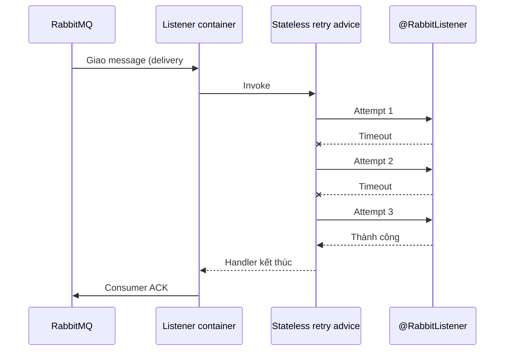
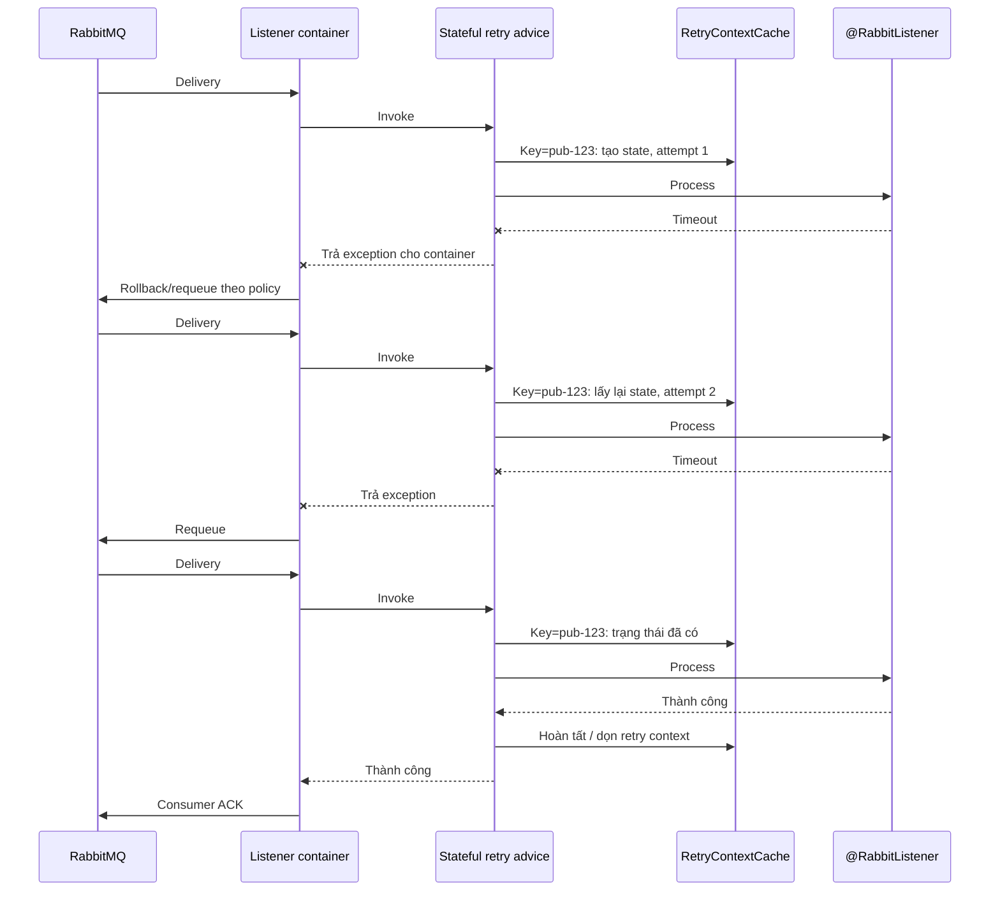
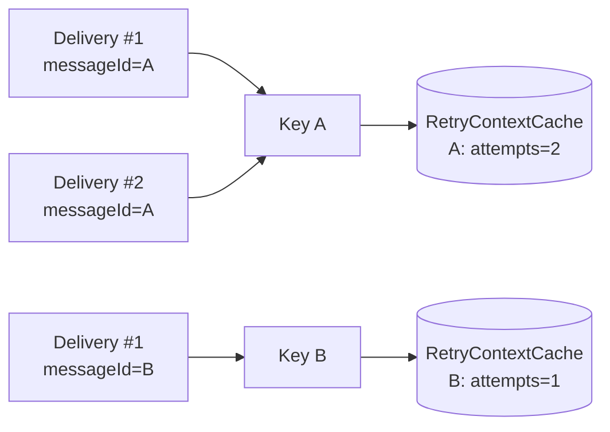

# messageId và khóa nhận diện khi dùng stateful retry

## 1. Mục tiêu và tình huống thực tế

Trong module **SPRING_AMQP**, `RabbitTemplate` gửi message tới exchange RabbitMQ; exchange dựa vào routing key và binding để chuyển message vào queue. `@RabbitListener` nhận message và thực thi công việc bất đồng bộ. Khi có lỗi tạm thời, consumer thường cần **thử lại có giới hạn**. Nhưng nếu mỗi lần lỗi khiến broker **giao lại** message, làm sao Spring biết ba lần giao có phải là **cùng một message cần dùng chung ngân sách retry**?

Câu trả lời là **khóa nhận diện ổn định qua các lần redelivery**. Với **stateful retry** của Spring AMQP, mặc định khóa này lấy từ AMQP `MessageProperties.messageId`. Nếu producer không đặt `messageId`, hoặc đặt trùng cho nhiều message khác nhau, cơ chế theo dõi retry có thể không hoạt động đúng như dự định.

Ví dụ một sự kiện tạo đơn:

```text
Event nghiệp vụ: order.created, eventId=evt-42
Lần publish:     messageId=pub-7b8f
RabbitMQ queue:  orders.inbox

Delivery #1 -> consumer thử xử lý -> timeout DB -> requeue
Delivery #2 -> consumer thử xử lý -> timeout DB -> requeue
Delivery #3 -> consumer thử xử lý -> vẫn lỗi -> recoverer -> DLQ
                    │
                    └── Tất cả phải tra cứu cùng retry key pub-7b8f
```

Sau bài này, bạn có thể:

1. Phân biệt **stateless retry** với **stateful retry**, đặc biệt khi container phải rollback giao dịch và nhận lại cùng message.
2. Giải thích vì sao `messageId` là một AMQP property **không bắt buộc** nhưng rất quan trọng cho stateful retry.
3. Chọn khóa **duy nhất giữa các message cần theo dõi khác nhau** và **không thay đổi qua redelivery của cùng message**.
4. Cấu hình `RetryInterceptorBuilder.stateful()`, `MessageKeyGenerator`, retry attempts và `MessageRecoverer`.
5. Xử lý tình huống `messageId=null`, phân biệt `statefulRetryFatalWithNullMessageId` với fallback key tự tạo.
6. Hiểu giới hạn của retry context cache, trùng message, quorum queue delivery limit, acknowledgement và dead-lettering.
7. Tự chạy ví dụ Spring Boot có publisher gắn `messageId`, listener lỗi tạm thời và poison message đi DLQ sau khi hết retry.

> **Giới hạn phiên bản:** Các đoạn Java dựa trên API phổ biến của **Spring Boot 3.x, Spring AMQP 3.2.x và Spring Retry**. Tùy major version, tên phương thức, dependency hoặc chính sách mặc định có thể thay đổi. Hãy đối chiếu phiên bản dự án trước khi dùng trong production. Bài tập trung vào **message identity trong stateful retry**, không phải tất cả hình thức retry của RabbitMQ.

## 2. Ba lớp định danh dễ bị nhầm

Một message có nhiều trường ID dùng cho các mục đích khác nhau. Không nên lấy bất kỳ trường nào có chữ “ID” rồi dùng làm retry key.

| Định danh | Vị trí thường gặp | Phạm vi, mục đích | Có thích hợp làm stateful retry key? |
|---|---|---|---|
| **`messageId`** | `MessageProperties.getMessageId()` | ID do publisher/converter có thể đặt cho **AMQP message** | **Có**, nếu duy nhất và giữ nguyên khi broker redeliver |
| **Business `eventId`** | Application header hoặc payload | ID ổn định cho **sự kiện nghiệp vụ**, dùng đối soát/idempotency | Có thể, **nếu** phù hợp phạm vi tính retry và không bị tái sử dụng sai |
| **`publishAttemptId`** | Application header do publisher đặt | Phân biệt từng lần ứng dụng publish một event | **Có thể rất phù hợp** khi muốn mỗi lần publish có retry budget riêng |
| **`correlationId`** | `MessageProperties.getCorrelationId()` | Liên kết request, trace, hội thoại hoặc quy trình | **Không mặc định**, vì nhiều message có thể dùng cùng một correlation ID |
| **`CorrelationData.id`** | Đối tượng phía publisher trong RabbitTemplate | Ghép publisher confirm với lần publish | **Không tự xuất hiện trong consumer** hoặc tự biến thành messageId |
| **`deliveryTag`** | `MessageProperties.getDeliveryTag()` ở consumer | Định danh một delivery **trong phạm vi một AMQP channel** | **Không**: thay đổi qua channel/redelivery |
| **`consumerTag`** | Metadata subscription | Xác định consumer đang nhận | **Không**: nhiều message dùng cùng tag |
| **`receivedRoutingKey`** | Delivery metadata | Routing key của lần giao hiện tại | **Không**: nhiều message cùng routing key |
| **`redelivered`** | Delivery metadata | Cờ broker báo message có dấu hiệu đã được giao trước | **Không**: boolean, không định danh message |

**`messageId` là AMQP basic property**, không phải một key bất kỳ trong map `getHeaders()`. Đọc trực tiếp:

```java
import org.springframework.amqp.core.Message;
import org.springframework.amqp.core.MessageProperties;

public void inspect(Message message) {
    MessageProperties properties = message.getMessageProperties();

    String messageId = properties.getMessageId();
    String correlationId = properties.getCorrelationId();
    long deliveryTag = properties.getDeliveryTag();
    Object businessEventId = properties.getHeaders().get("eventId");
}
```

RabbitMQ **không bắt buộc** publisher đặt `messageId` và **không tự bảo đảm nó là UUID duy nhất**. Quy tắc tạo, phạm vi và tính ổn định của ID phải do producer hoặc contract tích hợp quy định.

## 3. Stateless retry và stateful retry khác nhau ở đâu?

### 3.1. Stateless retry: các lần gọi lại trong một invocation

Với **stateless retry**, một retry interceptor thường giữ việc thử lại trong phạm vi **lời gọi handler hiện tại**. Nếu xử lý thất bại, interceptor thử gọi logic tiếp theo theo retry policy trước khi trả về hoặc ném exception cho listener container.



Những lần gọi handler trong sơ đồ đều thuộc **một delivery** đang được container xử lý. Nếu có transaction bên ngoài interceptor cần rollback ngay sau lỗi, cách giữ nhiều attempt trong cùng ngữ cảnh gọi có thể không phù hợp.

### 3.2. Stateful retry: nhớ trạng thái giữa các lần giao lại

Với **stateful retry**, interceptor duy trì **RetryContext** gắn với một **message key**. Khi method thất bại, exception có thể được đẩy ra ngoài để container rollback/NACK/requeue, rồi một lần giao tiếp theo sử dụng **cùng key** để tìm lại trạng thái retry trước đó.



Sơ đồ biểu diễn **nguyên tắc** chứ không phải cam kết chính xác số frame NACK, thời điểm gọi advice hoặc thứ tự trong mọi listener container. Với transaction manager, retry recoverer, các kiểu queue và callback bất đồng bộ, lifecycle có thể khác. Ý chính là **cùng một key nối các lần xử lý**.

### 3.3. Tại sao stateful cần identity nhưng stateless thường không?

Stateless retry có thể giữ bộ đếm attempts cục bộ trong một lời gọi duy nhất. Stateful retry phải trả lời câu hỏi:

> “Delivery vừa đến có phải là thông điệp từng thất bại trước đó, hay là một thông điệp mới cần budget retry riêng?”

Nếu không có identity:

- Đếm lại từ đầu mỗi lần broker giao message, dẫn đến retry vô hạn.
- Hoặc trộn retry state của hai message khác nhau, khiến một message bị kết luận “đã hết lượt” quá sớm.

**Một key đạt yêu cầu có hai tính chất cùng lúc:**

1. **Ổn định (repeatable):** cùng message qua redelivery cho ra **cùng key**.
2. **Phân biệt (unique):** hai message khác nhau cần theo dõi độc lập không vô tình dùng **cùng key** trong phạm vi retry context cache.

## 4. Vì sao `deliveryTag` và `redelivered` không thể làm retry key?

### 4.1. `deliveryTag` chỉ có phạm vi channel

```text
Channel A:
  message pub-123 -> deliveryTag=7

Kết nối đứt, message redeliver qua channel B:
  message pub-123 -> deliveryTag=1

Message mới trên channel C:
  message pub-456 -> deliveryTag=1
```

Nếu retry key bằng `deliveryTag`:

- **Cùng message** có thể nhận key khác sau redelivery.
- **Hai message khác nhau** có thể cùng tag `1` trên các channel khác.

Vì vậy, `deliveryTag` chỉ dùng để ACK/NACK/reject trên **đúng channel consumer**, không dùng để nhận diện message xuyên các lần giao.

### 4.2. `redelivered` là boolean, không phải ID

`redelivered=true` có thể giúp framework **ước lượng đây không phải lần giao đầu tiên**; Spring AMQP có API `NewMessageIdentifier` để tùy biến nhận diện lần giao mới, với hành vi mặc định liên quan `redelivered`.

Nhưng cờ này **không định danh message**:

- Nhiều message có cùng `redelivered=false`.
- Nhiều message có cùng `redelivered=true`.
- Publisher có thể gửi lại cùng business event thành **một publish mới**, ban đầu mang `redelivered=false`.

`NewMessageIdentifier` là một quyết định khác **với** `MessageKeyGenerator`. Đừng nhầm “phát hiện một lần giao mới” với “tạo một key duy nhất cho message”.

### 4.3. Body hash cũng không phải lựa chọn mặc định

Có thể muốn lấy bytes của message làm key:

```java
// Không đủ tin cậy để dùng như mặc định:
Object unsafeKey = message.getBody();
```

`byte[]` trong Java sử dụng **object identity** cho `equals`/`hashCode` nếu không bọc bằng đối tượng so sánh nội dung. Hai delivery deserialize thành hai `byte[]` khác object sẽ có key khác nhau.

Ngay cả hash của **nội dung** cũng có rủi ro: hai message nghiệp vụ khác nhau có body giống hệt có thể cần retry budget độc lập; một số thuật toán hash có thể va chạm, và việc thay metadata/encoding tạo key không ổn định. Chỉ dùng nội dung làm key khi đã có **quy ước duy nhất và ổn định** được kiểm chứng.

## 5. `messageId` là khóa mặc định của stateful retry

Với `RetryInterceptorBuilder.stateful()` của Spring AMQP, **`messageId` là key mặc định** để nhận diện message.

```text
AMQP MessageProperties
  messageId = "pub-7b8f"        <-- default retry key
  correlationId = "checkout-42" <-- tracing/request scope, không mặc định
  headers:
    eventId = "evt-42"          <-- business event ID
    schemaVersion = 1
```

Một message được broker **requeue và redeliver** thường giữ nguyên `messageId`, vì đây là property do publisher đặt trên message. Trong suốt chuỗi redelivery thông thường, cùng key giúp Spring khôi phục attempts đang chờ.

Tuy nhiên, khi ứng dụng **republish một message mới**, các thuộc tính có được giữ hay đổi phụ thuộc code/converter/recoverer. Nếu publisher phát **một publish attempt mới** với messageId mới, bộ đếm stateful retry tương ứng cũng là một chuỗi mới.

### 5.1. Đặt messageId ngay tại publisher

Đây là cách trực tiếp và dễ kiểm soát nhất:

```java
import java.util.UUID;
import org.springframework.amqp.rabbit.core.RabbitTemplate;

public class OrderPublisher {
    private final RabbitTemplate rabbitTemplate;

    public OrderPublisher(RabbitTemplate rabbitTemplate) {
        this.rabbitTemplate = rabbitTemplate;
    }

    public void publish(String orderId, String eventId) {
        String publishMessageId = UUID.randomUUID().toString();

        rabbitTemplate.convertAndSend(
                "orders.events",
                "order.created",
                "ORDER:" + orderId,
                amqpMessage -> {
                    var p = amqpMessage.getMessageProperties();
                    p.setMessageId(publishMessageId);
                    p.setCorrelationId(eventId);
                    p.setHeader("eventId", eventId);
                    return amqpMessage;
                });
    }
}
```

`MessagePostProcessor` ở trên nhận **Spring AMQP `Message` sau conversion**, cho phép đặt `MessageProperties.messageId` trước khi publish. `UUID.randomUUID()` được gọi **một lần cho lần publish** và không được tạo lại trong listener trên mỗi delivery.

**Một lưu ý về gửi lại:** Nếu ứng dụng gọi `publish(...)` thêm lần nữa cho cùng `eventId`, nó tạo một `messageId` mới. Đó là chủ đích ở ví dụ: **mỗi publish attempt có retry budget riêng**, còn `eventId` giữ nguyên để consumer khử trùng lặp nghiệp vụ.

### 5.2. Đừng nhầm `CorrelationData.id` với `messageId`

Khi dùng publisher confirms:

```java
CorrelationData correlation = new CorrelationData("send-attempt-42");
rabbitTemplate.convertAndSend(
        "orders.events", "order.created", "ORDER:42", correlation);
```

`CorrelationData` ở đây phục vụ **liên hệ kết quả publisher confirm với lần publish**. `CorrelationData.getId()` **không tự động biến thành `MessageProperties.messageId`**. Nếu stateful retry ở consumer yêu cầu `messageId`, publisher vẫn phải đặt property đó bằng converter/message post-processor hoặc cách cấu hình tương ứng.

### 5.3. Đặt `createMessageIds` trên converter

Một số `MessageConverter` do Spring AMQP cung cấp có thể tự tạo message IDs khi chuyển object thành AMQP Message. Ví dụ với converter thuộc nhóm hỗ trợ thuộc tính này:

```java
import org.springframework.amqp.support.converter.SimpleMessageConverter;

SimpleMessageConverter converter = new SimpleMessageConverter();
converter.setCreateMessageIds(true);

rabbitTemplate.setMessageConverter(converter);
```

Đây là **phương án cấu hình thay thế** cho việc tự gắn `messageId` ở mỗi `convertAndSend`. Cần xác nhận converter thực tế đang dùng hỗ trợ `setCreateMessageIds` và chỉ áp dụng khi luồng đi qua converter phù hợp. Nếu code dùng `RabbitTemplate.send(...)` với AMQP `Message` đã được dựng sẵn, đừng mặc định converter sẽ tự chạy lại để bổ sung ID.

Với hệ thống nhiều producer, nên thống nhất **ai có trách nhiệm tạo messageId**, định dạng ID và cách xử lý khi message được republish.

## 6. Stateful retry dùng `RetryContextCache` như thế nào?

Spring Retry hỗ trợ lưu `RetryContext` giữa các lời gọi, thường thông qua một **RetryContextCache**. Khóa cache là giá trị mà stateful retry interceptor trích xuất từ message.



Một **key collision** có thể khiến hai message không liên quan cùng đọc/ghi retry state:

```text
Message X: messageId=constant-key, failure count=2
Message Y: messageId=constant-key, first delivery

Nguy cơ: Y bị coi như X đã retry hai lần.
```

Một **key thay đổi theo delivery** thì có thể khiến mỗi lần lỗi bắt đầu state mới:

```text
Message X:
  delivery #1 -> key=UUID-1 -> attempt=1
  delivery #2 -> key=UUID-2 -> attempt=1
  delivery #3 -> key=UUID-3 -> attempt=1
```

Cả hai đều phá mục tiêu giới hạn retry của **cùng một message**.

### 6.1. Cache stateful không phải bộ đếm retry bền vững mặc định

Retry context thường nằm trong **bộ nhớ của tiến trình Java đang xử lý**. Không nên mặc định nó được chia sẻ giữa:

- Hai instance Spring Boot khác nhau.
- Hai JVM chạy ở hai node.
- Một tiến trình trước và sau khi restart.
- Hai interceptor dùng những context cache khác nhau.

Nếu message đang được retry ở instance A rồi broker chuyển sang instance B, **B có thể không có state retry trước đó**. Ngay cả trong một instance, giới hạn và chính sách eviction của cache cũng ảnh hưởng vòng đời state.

Vì vậy:

> **`maxAttempts` trong stateful retry không phải là bộ đếm bền vững toàn cluster hay giới hạn số lần giao lại tuyệt đối từ RabbitMQ.**

Nếu sản phẩm bắt buộc một ngưỡng retry chung qua restart/cluster, cần thêm cơ chế bền vững hoặc broker delivery limit phù hợp (ví dụ quorum queue) và thiết kế rõ vai trò của cache.

### 6.2. Identity của message khác idempotency nghiệp vụ

Stateful retry key trả lời: **“Lần giao này có thuộc cùng chuỗi retry được cache không?”**

Idempotency key trả lời: **“Side effect nghiệp vụ của sự kiện này đã được thực hiện rồi chưa?”**

Hai câu hỏi khác nhau. Ví dụ:

```text
Business event ID  = evt-42  (giữ nguyên khi producer retry publish)
Publish attempt #1 = pub-A   (messageId=pub-A)
Publish attempt #2 = pub-B   (messageId=pub-B)

Consumer nhận cả pub-A và pub-B:
  Stateful retry: hai key pub-A và pub-B, theo dõi độc lập.
  Idempotency DB: cùng evt-42, chỉ được cập nhật nghiệp vụ một lần.
```

**Không dùng stateful RetryContextCache làm bảng deduplication nghiệp vụ.** Cache có thể hết hạn, bị xóa sau thành công hoặc mất khi restart.

## 7. Thiếu `messageId`: vì sao không thể bỏ qua?

AMQP 0-9-1 **không bắt buộc** `messageId`. Nếu producer bên ngoài không đặt trường này, stateful retry mặc định không có key đáng tin cậy.

Trong các dòng Spring AMQP 3.x/3.2.x, listener container có thuộc tính:

```java
setStatefulRetryFatalWithNullMessageId(boolean value)
```

Chính sách được tài liệu Spring AMQP mô tả:

- **Mặc định `true`:** một message thiếu messageId khi dùng stateful retry có thể bị coi là **fatal cho consumer**; container có thể dừng consumer sau đường thử lại đặc biệt. Đây **không phải** retry vô hạn tới `maxAttempts`.
- **Đặt `false`:** thay vì dừng consumer, message không có ID được **reject không requeue** sau xử lý đặc biệt cho missing ID; nếu queue có DLX/binding thì có thể vào DLQ, nếu không có thể bị loại bỏ.

Việc Spring AMQP xử lý missing ID từng có thay đổi giữa các phiên bản; không nên suy diễn hành vi từ tài liệu cũ hơn hoặc chỉ dựa vào tên `maxAttempts`.

### 7.1. Vì sao mặc định có thể dừng consumer?

Stateful retry cần nối những lần giao để giữ retry budget. Nếu thiếu key, framework không thể bảo đảm một lần giao sau là **cùng message** hay một message khác. Việc báo lỗi fatal giúp người vận hành nhận ra hợp đồng dữ liệu đang không đáp ứng điều kiện của stateful retry, thay vì âm thầm lặp lại mãi.

Tuy nhiên, việc dừng consumer có thể ảnh hưởng cả queue. Trong nhiều hệ thống, **không để một producer thiếu messageId làm dừng toàn bộ consumer** là lựa chọn có thể chấp nhận, với điều kiện có DLQ/quarantine và cảnh báo rõ ràng.

### 7.2. Cấu hình không dừng consumer khi thiếu ID

Vì thuộc tính này nằm trên **listener container**, có thể đặt qua container customizer của factory:

```java
SimpleRabbitListenerContainerFactory factory =
        new SimpleRabbitListenerContainerFactory();

factory.setConnectionFactory(connectionFactory);
factory.setContainerCustomizer(container ->
        container.setStatefulRetryFatalWithNullMessageId(false));
```

Đây là một **đoạn cấu hình bên trong bean factory**, giả định `connectionFactory` đã được inject. Khi thêm vào ứng dụng, cần gắn cùng factory với **stateful retry advice** và bảo đảm listener thực sự dùng factory đó.

**Điều quan trọng:** `false` là chính sách ứng phó với message thiếu ID, **không phải biện pháp tạo ra một ID mới**. Nếu muốn nhận stateful retry đầy đủ cho các message không có `messageId` nhưng có một khóa ổn định khác, dùng `MessageKeyGenerator` như phần tiếp theo.

### 7.3. Không sửa bằng cách tạo UUID trong consumer

Đây là cách **sai**:

```java
// SAI: mỗi delivery được tạo một giá trị mới.
MessageKeyGenerator generator = message ->
        UUID.randomUUID().toString();
```

Delivery kế tiếp của cùng message nhận UUID khác; retry context cũ không thể được tìm lại. Nếu cần UUID, hãy **tạo ở phía publisher** và đặt vào `MessageProperties.messageId` trước lần publish đầu tiên.

## 8. Tùy biến `MessageKeyGenerator`

Spring AMQP cung cấp:

```java
org.springframework.amqp.rabbit.retry.MessageKeyGenerator
```

Giao diện chức năng nhận một **Spring AMQP `Message`** và trả về key dùng cho stateful retry. Bạn có thể truyền implementation vào:

```java
RetryInterceptorBuilder.stateful()
        .messageKeyGenerator(customGenerator)
        .build();
```

Khóa cần **repeatable khi redelivery** và **unique giữa các message** trong phạm vi dự kiến. Đừng nhầm với một `MessagePostProcessor` vốn sửa message lúc publish.

### 8.1. Ví dụ: lấy khóa từ header `publishAttemptId`

Trong hệ thống cũ, một số producer không điền `messageId` nhưng vẫn luôn đặt application header `publishAttemptId` duy nhất và ổn định.

```java
import org.springframework.amqp.rabbit.retry.MessageKeyGenerator;

MessageKeyGenerator generator = message -> {
    Object raw = message.getMessageProperties()
            .getHeaders().get("publishAttemptId");

    if (raw instanceof String attemptId && !attemptId.isBlank()) {
        return "orders:" + attemptId;
    }

    // Cần xác định chính sách xử lý thiếu key.
    return null;
};
```

**Giải thích:**

- Prefix `orders:` phân tách namespace của luồng này với những loại message khác **nếu chúng chia sẻ RetryContextCache**.
- `publishAttemptId` phải được tạo **trước publish**, giữ qua redelivery và không được tái sử dụng cho các publish attempt độc lập.
- Nếu trả về `null`, Spring Retry không có key để bảo toàn state. Chi tiết fallback/reject phụ thuộc interceptor/container/version; phải định nghĩa policy missing key và kiểm thử, **không dùng null như một “random key”**.

Đây là **giải pháp chuyển tiếp** khi không kiểm soát producer. Về lâu dài, nên chuẩn hóa `messageId` hoặc một message identity contract ở biên phát tin.

### 8.2. Một generator ưu tiên messageId rồi fallback

```java
import org.springframework.amqp.rabbit.retry.MessageKeyGenerator;

public final class StableOrderMessageKeyGenerator
        implements MessageKeyGenerator {

    @Override
    public Object getKey(org.springframework.amqp.core.Message message) {
        var p = message.getMessageProperties();
        String messageId = p.getMessageId();
        if (messageId != null && !messageId.isBlank()) {
            return "amqp-id:" + messageId;
        }

        Object raw = p.getHeaders().get("publishAttemptId");
        if (raw instanceof String value && !value.isBlank()) {
            return "publish-attempt:" + value;
        }

        // Không được phát minh ID mới trong quá trình consume.
        return null;
    }
}
```

**Cảnh báo về va chạm:** Hai producer có thể tạo cùng `messageId` nếu không có quy ước duy nhất. Khi cần phân chia tenant hay source, thiết kế key dạng `tenant/source/messageId` **chỉ khi các trường tenant/source là đáng tin cậy và ổn định**. Đưa routing key/queue hoặc redelivery flag vào key một cách tùy tiện có thể khiến key thay đổi sau dead-letter/retry.

### 8.3. Không dùng business event ID một cách máy móc

`eventId` có thể là một key tốt khi **mỗi event chỉ được publish một lần dưới dạng một message** và broker redeliver đúng message đó. Nhưng nếu ứng dụng publisher retry bằng cách **publish thêm một message mới** giữ cùng `eventId`, hai message tồn tại đồng thời có thể chia sẻ cùng stateful retry budget.

Khi cần tách biệt:

```text
eventId          = evt-42   // business dedupe
publishAttemptId = send-1   // retry-state identity cho message thứ nhất

eventId          = evt-42
publishAttemptId = send-2   // retry-state identity cho message thứ hai
```

Nhớ rằng **business idempotency** phải vẫn chặn side effect trùng giữa `send-1` và `send-2`.

## 9. `NewMessageIdentifier`: một API khác với `MessageKeyGenerator`

Builder stateful của Spring AMQP còn có:

```java
RetryInterceptorBuilder.stateful()
        .newMessageIdentifier(customNewMessageIdentifier)
        .build();
```

`NewMessageIdentifier` tham gia cách interceptor xác định **một delivery có phải “message mới”** để tối ưu/quản lý state. Mặc định được tài liệu Java API mô tả là sử dụng cờ `redelivered`.

Đây là quyết định **khác** với `MessageKeyGenerator`:

| API | Câu hỏi chính |
|---|---|
| `MessageKeyGenerator` | **Message này là message nào?** Dùng key nào để tra `RetryContextCache`? |
| `NewMessageIdentifier` | **Delivery này có được nhận diện là mới hay đã được giao trước?** |

Một key ổn định vẫn là yêu cầu bắt buộc về mặt thiết kế. `NewMessageIdentifier` không phải cách “thay thế messageId” hay tính được khóa bằng một cờ boolean. Chỉ tùy biến nó khi có hiểu biết rõ về delivery semantics và đã kiểm thử trên queue/broker thực tế.

## 10. Cấu hình stateful retry trong Spring Boot

### 10.1. Dependencies

Để dùng `@RabbitListener` và `RetryInterceptorBuilder.stateful()` với Spring Retry, dự án cần Spring AMQP và Spring Retry. Với Gradle Groovy DSL:

```groovy
dependencies {
    implementation 'org.springframework.boot:spring-boot-starter-amqp'
    implementation 'org.springframework.retry:spring-retry'
}
```

Với Maven:

```xml
<dependencies>
    <dependency>
        <groupId>org.springframework.boot</groupId>
        <artifactId>spring-boot-starter-amqp</artifactId>
    </dependency>
    <dependency>
        <groupId>org.springframework.retry</groupId>
        <artifactId>spring-retry</artifactId>
    </dependency>
</dependencies>
```

Giữ các dependency dưới quản lý phiên bản của Spring Boot parent/BOM; không gắn Spring Retry từ một major không tương thích với Spring Framework/AMQP hiện tại.

### 10.2. Spring Boot `application.yml`

```yaml
spring:
  rabbitmq:
    host: localhost
    port: 5672
    username: guest
    password: guest
    virtual-host: /
    listener:
      type: simple
      simple:
        acknowledge-mode: auto
        concurrency: 1
        prefetch: 1
        default-requeue-rejected: true
```

**Chú ý:** Những thuộc tính trên không tự bật một **stateful retry interceptor**. Ta phải gắn interceptor vào listener factory bằng Java configuration ở mục sau.

Ở đây:

- `AUTO`: container chịu trách nhiệm ACK/NACK theo kết quả listener/advice.
- `prefetch=1` và `concurrency=1`: giúp quan sát lần giao lại và bộ đếm retry dễ hơn trong bài lab.
- `default-requeue-rejected=true`: hỗ trợ đường requeue ở những lần retry chưa kết thúc.
- Sau khi hết attempts, `RejectAndDontRequeueRecoverer` sẽ yêu cầu **không requeue**, khác với nhánh lỗi trung gian.

Không áp dụng giá trị lab này một cách máy móc cho production. Với workload thật, cần benchmark prefetch/concurrency, xây retry backoff phù hợp và đảm bảo idempotency.

### 10.3. Tạo stateful interceptor và listener factory

Ví dụ file `StatefulRetryConfiguration.java`:

```java
package com.example.statefulretry;

import org.springframework.amqp.core.AcknowledgeMode;
import org.springframework.amqp.rabbit.config.RetryInterceptorBuilder;
import org.springframework.amqp.rabbit.config.SimpleRabbitListenerContainerFactory;
import org.springframework.amqp.rabbit.connection.ConnectionFactory;
import org.springframework.amqp.rabbit.retry.RejectAndDontRequeueRecoverer;
import org.springframework.boot.autoconfigure.amqp.SimpleRabbitListenerContainerFactoryConfigurer;
import org.springframework.context.annotation.Bean;
import org.springframework.context.annotation.Configuration;
import org.springframework.retry.interceptor.StatefulRetryOperationsInterceptor;

@Configuration
public class StatefulRetryConfiguration {

    @Bean
    StatefulRetryOperationsInterceptor statefulRetryAdvice() {
        return RetryInterceptorBuilder.stateful()
                .maxAttempts(3)
                .backOffOptions(200, 2.0, 1_000)
                .recoverer(new RejectAndDontRequeueRecoverer())
                .build();
    }

    @Bean
    SimpleRabbitListenerContainerFactory statefulRetryListenerFactory(
            ConnectionFactory connectionFactory,
            SimpleRabbitListenerContainerFactoryConfigurer bootConfigurer,
            StatefulRetryOperationsInterceptor statefulRetryAdvice) {

        SimpleRabbitListenerContainerFactory factory =
                new SimpleRabbitListenerContainerFactory();
        bootConfigurer.configure(factory, connectionFactory);
        factory.setAcknowledgeMode(AcknowledgeMode.AUTO);
        factory.setPrefetchCount(1);
        factory.setConcurrentConsumers(1);
        factory.setDefaultRequeueRejected(true);
        factory.setAdviceChain(statefulRetryAdvice);

        // Lab: thiếu messageId thì reject không requeue,
        // thay vì khiến consumer bị coi là fatal và dừng.
        factory.setContainerCustomizer(container ->
                container.setStatefulRetryFatalWithNullMessageId(false));

        return factory;
    }
}
```

**Những điểm cần đọc kỹ:**

1. `RetryInterceptorBuilder.stateful()` tạo **stateful retry advice**, không phải stateless.
2. `maxAttempts(3)` biểu diễn **tối đa ba lần thực hiện được policy tính là attempts**, thường bao gồm lần đầu. Số lần broker redeliver thực tế có thể chịu ảnh hưởng transaction/container.
3. `backOffOptions(200, 2.0, 1_000)` cấu hình lịch backoff theo API của Spring Retry; nó **không tạo một queue delay trong RabbitMQ**.
4. `RejectAndDontRequeueRecoverer` báo reject không requeue khi retry đã hết và lỗi vẫn tồn tại. Nó khác với recoverer ghi log rồi **tiêu thụ** lỗi.
5. `setAdviceChain(...)` gắn advice vào **listener container factory thực tế**; bean `@RabbitListener` phải trỏ tới đúng factory này.
6. `setStatefulRetryFatalWithNullMessageId(false)` là chính sách ứng phó khi thiếu ID, không tạo ID.

**Tại sao dùng Boot configurer?** `SimpleRabbitListenerContainerFactoryConfigurer` cho phép factory kế thừa những thiết lập phù hợp từ Spring Boot (connection, listener settings, converter... theo cấu hình) trước khi đặt các thuộc tính cần riêng cho bài. Nếu ứng dụng đã có nhiều factory, nên dùng tên bean và `containerFactory` rõ ràng.

### 10.4. Thêm `MessageKeyGenerator` khi không dùng messageId

Với producer không đặt messageId nhưng có header ổn định `publishAttemptId`, thay bean advice bằng:

```java
@Bean
StatefulRetryOperationsInterceptor statefulRetryAdvice() {
    return RetryInterceptorBuilder.stateful()
            .messageKeyGenerator(
                    new StableOrderMessageKeyGenerator())
            .maxAttempts(3)
            .backOffOptions(200, 2.0, 1_000)
            .recoverer(new RejectAndDontRequeueRecoverer())
            .build();
}
```

Đây là **phương án thay thế**, không phải thêm một bean thứ hai cùng tên `statefulRetryAdvice` trong cùng configuration. Nếu fallback key vẫn thiếu, ứng dụng phải có quy tắc xử lý và integration test rõ ràng; đừng biến message thiếu ID thành một lần thử vô hạn.

## 11. Ví dụ Spring Boot hoàn chỉnh: message thành công sau retry và poison message

Ta tạo một topology riêng cho bài lab:

- Queue chính: `demo.stateful.orders`.
- DLX: `demo.stateful.dlx`.
- DLQ: `demo.stateful.dead`.
- Routing: dùng RabbitMQ default exchange `""` khi gửi để tập trung vào retry identity.
- Listener: `AcknowledgeMode.AUTO` với **stateful retry advice** ở mục 10.

Mục tiêu kiểm chứng là **messageId giữ nguyên khi broker redeliver** và **retry budget không trở về 1 sau mỗi delivery** trong cùng runtime.

### 11.1. Topology và DLQ

File `StatefulRetryTopology.java`:

```java
package com.example.statefulretry;

import org.springframework.amqp.core.Binding;
import org.springframework.amqp.core.BindingBuilder;
import org.springframework.amqp.core.DirectExchange;
import org.springframework.amqp.core.Queue;
import org.springframework.amqp.core.QueueBuilder;
import org.springframework.beans.factory.annotation.Qualifier;
import org.springframework.context.annotation.Bean;
import org.springframework.context.annotation.Configuration;

@Configuration
public class StatefulRetryTopology {

    public static final String INPUT_QUEUE = "demo.stateful.orders";
    public static final String DLX = "demo.stateful.dlx";
    public static final String DLQ = "demo.stateful.dead";
    public static final String DEAD_KEY = "order.failed";

    @Bean
    Queue statefulInputQueue() {
        return QueueBuilder.durable(INPUT_QUEUE)
                .deadLetterExchange(DLX)
                .deadLetterRoutingKey(DEAD_KEY)
                .build();
    }

    @Bean
    DirectExchange statefulDlx() {
        return new DirectExchange(DLX, true, false);
    }

    @Bean
    Queue statefulDeadQueue() {
        return QueueBuilder.durable(DLQ).build();
    }

    @Bean
    Binding statefulDeadBinding(
            @Qualifier("statefulDeadQueue") Queue queue,
            @Qualifier("statefulDlx") DirectExchange exchange) {

        return BindingBuilder.bind(queue)
                .to(exchange)
                .with(DEAD_KEY);
    }
}
```

Khi queue chính có `x-dead-letter-exchange` và `x-dead-letter-routing-key` tương ứng, message bị reject/NACK `requeue=false` sau retry exhaustion có thể đi tới DLQ nếu broker có exchange/binding/quyền phù hợp.

**DLX/DLQ không được tạo tự động chỉ do recoverer được cấu hình**. Spring Boot thông thường có `RabbitAdmin` để declare các bean exchange/queue/binding, nếu tính năng auto-declaration đang bật và connection có quyền. Cẩn thận khi redeclare một queue đã tồn tại với arguments khác; có thể gặp `PRECONDITION_FAILED`.

### 11.2. Publisher gắn ID duy nhất cho mỗi publish

File `StatefulOrderPublisher.java`:

```java
package com.example.statefulretry;

import java.util.UUID;
import org.springframework.amqp.rabbit.core.RabbitTemplate;
import org.springframework.stereotype.Service;

@Service
public class StatefulOrderPublisher {

    private final RabbitTemplate rabbitTemplate;

    public StatefulOrderPublisher(RabbitTemplate rabbitTemplate) {
        this.rabbitTemplate = rabbitTemplate;
    }

    public String send(String payload, String eventId) {
        String publishAttemptId = UUID.randomUUID().toString();

        rabbitTemplate.convertAndSend(
                "", StatefulRetryTopology.INPUT_QUEUE, payload,
                message -> {
                    var properties = message.getMessageProperties();
                    properties.setMessageId(publishAttemptId);
                    properties.setHeader("eventId", eventId);
                    properties.setHeader(
                            "publishAttemptId", publishAttemptId);
                    return message;
                });

        return publishAttemptId;
    }
}
```

Phân biệt:

- `messageId = publishAttemptId`: key dùng cho **stateful retry**.
- `headers["eventId"]`: khóa nghiệp vụ để hỗ trợ **idempotency**, giữ nguyên khi gửi lại cùng event.
- `publishAttemptId` trong header: metadata bổ sung cho debug hoặc custom key generator.

Đoạn publisher dùng `RabbitTemplate.convertAndSend(...)` với một `MessagePostProcessor`. Không cần tạo DTO JSON để minh họa retry identity; payload là chuỗi văn bản đơn giản.

### 11.3. Listener minh họa ba tình huống

File `StatefulOrderListener.java`:

```java
package com.example.statefulretry;

import java.nio.charset.StandardCharsets;
import java.util.concurrent.ConcurrentHashMap;
import java.util.concurrent.atomic.AtomicInteger;
import org.springframework.amqp.core.Message;
import org.springframework.amqp.rabbit.annotation.RabbitListener;
import org.springframework.stereotype.Component;

@Component
public class StatefulOrderListener {

    private final ConcurrentHashMap<String, AtomicInteger> seen =
            new ConcurrentHashMap<>();

    @RabbitListener(
            queues = StatefulRetryTopology.INPUT_QUEUE,
            containerFactory = "statefulRetryListenerFactory")
    public void receive(Message message) {

        var properties = message.getMessageProperties();
        String messageId = properties.getMessageId();
        String payload = new String(
                message.getBody(), StandardCharsets.UTF_8);

        // Chỉ dùng bộ đếm này làm dấu quan sát trong lab.
        int attempt = seen.computeIfAbsent(
                messageId, ignored -> new AtomicInteger())
                .incrementAndGet();

        System.out.printf(
                "messageId=%s attemptObserved=%d redelivered=%s payload=%s%n",
                messageId,
                attempt,
                properties.getRedelivered(),
                payload);

        if (payload.startsWith("POISON:")) {
            throw new IllegalArgumentException(
                    "Unsupported permanent payload");
        }

        if (payload.startsWith("TRANSIENT:") && attempt < 3) {
            throw new IllegalStateException(
                    "Simulated temporary dependency failure");
        }

        System.out.println("PROCESSED messageId=" + messageId);
    }
}
```

Ở đây:

1. Method nhận **Spring AMQP `Message`** để thấy rõ `MessageProperties.messageId` và cờ `redelivered`.
2. `ConcurrentHashMap` là **bộ đếm log riêng của bài lab**, **không phải** `RetryContextCache` của Spring Retry.
3. Message `TRANSIENT:...` thất bại hai lần đầu rồi thành công ở lần thứ ba **trong cùng tiến trình**, nếu được requeue và lại vào listener.
4. Message `POISON:...` thất bại cả ba lần; retry advice dùng `RejectAndDontRequeueRecoverer` để không tiếp tục requeue và cho phép DLX xử lý.

**Bảo vệ khi thử thiếu ID:** Với bài thử cố tình publish message không có messageId, code `computeIfAbsent(messageId, ...)` ở đây sẽ không phù hợp vì `ConcurrentHashMap` không nhận null key. Dùng **listener riêng** hoặc kiểm tra `messageId==null` trước khi ghi log nếu bạn muốn kiểm thử missing-ID path. Trong cấu hình stateful retry ở trên, interceptor thường xử lý vấn đề thiếu ID **trước khi gọi đến phần nghiệp vụ tương ứng**.

**Không đưa bộ đếm `seen` vào production** để quyết định idempotency hoặc retry policy: nó không bền vững, không chia sẻ qua các instance và không phản ánh mọi quy tắc cache. Trong production, theo dõi business event ID và trạng thái nghiệp vụ bằng cơ chế bền vững.

### 11.4. Khởi động và gửi dữ liệu thử

File `StatefulRetryApplication.java`:

```java
package com.example.statefulretry;

import org.springframework.amqp.rabbit.annotation.EnableRabbit;
import org.springframework.boot.ApplicationRunner;
import org.springframework.boot.SpringApplication;
import org.springframework.boot.autoconfigure.SpringBootApplication;
import org.springframework.context.annotation.Bean;

@SpringBootApplication
@EnableRabbit
public class StatefulRetryApplication {

    public static void main(String[] args) {
        SpringApplication.run(StatefulRetryApplication.class, args);
    }

    @Bean
    ApplicationRunner sendSamples(StatefulOrderPublisher publisher) {
        return args -> {
            publisher.send("ORDER:101", "evt-101");
            publisher.send("TRANSIENT:102", "evt-102");
            publisher.send("POISON:103", "evt-103");
        };
    }
}
```

Với `application.yml` ở mục 10, bạn có thể khởi động broker RabbitMQ local nếu đã có Docker:

```bash
docker run -d --name rabbitmq-stateful-retry-lab \
  -p 5672:5672 -p 15672:15672 \
  rabbitmq:4-management
```

Sau đó chạy Spring Boot qua wrapper mà project đang dùng:

```bash
./mvnw spring-boot:run
# Hoặc:
./gradlew bootRun
```

Ví dụ log **có thể** giống:

```text
messageId=A attemptObserved=1 redelivered=false payload=ORDER:101
PROCESSED messageId=A

messageId=B attemptObserved=1 redelivered=false payload=TRANSIENT:102
messageId=B attemptObserved=2 redelivered=true  payload=TRANSIENT:102
messageId=B attemptObserved=3 redelivered=true  payload=TRANSIENT:102
PROCESSED messageId=B

messageId=C attemptObserved=1 redelivered=false payload=POISON:103
messageId=C attemptObserved=2 redelivered=true  payload=POISON:103
messageId=C attemptObserved=3 redelivered=true  payload=POISON:103
... RejectAndDontRequeueRecoverer / error handler ...
```

`A`, `B`, `C` ở đây là ký hiệu rút gọn cho UUID thực tế. **Không coi log này là cam kết số lần delivery cố định** trong mọi cấu hình broker/container; nó là kết quả mong đợi của phép thử **một consumer, prefetch 1, stateful retry maxAttempts 3, cùng runtime**.

### 11.5. Quan sát trên RabbitMQ Management

Mở `http://localhost:15672` với tài khoản lab nếu bạn đã chạy RabbitMQ Management. Kiểm tra:

1. Queue `demo.stateful.orders` tồn tại, có consumer và không giữ mãi message `POISON` ở vòng requeue vô hạn.
2. Exchange `demo.stateful.dlx` là direct và có binding key `order.failed` tới `demo.stateful.dead`.
3. Queue `demo.stateful.dead` nhận message `POISON:103` sau khi retry bị exhaust và broker dead-letter thành công.
4. Message trong DLQ có thể chứa metadata `x-death` hoặc các header dead-letter tương ứng với phiên bản RabbitMQ; không dùng chúng như bộ đếm số lần thử Java trong Spring Retry.
5. Message `TRANSIENT:102` có thể thành công sau khi được giao lại, với **cùng messageId** trong logs.

Nếu queue đã có dữ liệu từ lần chạy trước, số message quan sát có thể lớn hơn mong đợi. Dùng tài nguyên lab riêng và dọn theo quy trình an toàn; không xóa queue production chỉ để làm ví dụ.

## 12. RetryContextCache, cache limits và nhiều consumer

### 12.1. Một message đi sang instance khác

Trong một hệ thống có hai pod:

```text
Pod A: nhận messageId=pub-42, failure attempt 1
       cache A lưu retry context cho pub-42

RabbitMQ giao lại messageId=pub-42 cho Pod B

Pod B: cache B không biết attempt 1 của A
       có thể xem đây là ngữ cảnh retry mới
```

Kết quả thực tế phụ thuộc container/transaction/caching và cách ứng dụng chia sẻ retry state. **Đừng mặc định memory cache của một listener được chia sẻ sang pod khác**.

Nếu yêu cầu tổng số delivery retries là một giới hạn cứng cho **toàn cluster**, cân nhắc:

- Một retry ledger bền vững được kiểm soát theo business event ID hoặc publish attempt ID.
- Cơ chế giới hạn redelivery tại broker, nếu loại queue hỗ trợ (ví dụ quorum queue).
- Delayed retry theo queue/policy và quản lý số lần thử rõ ràng.
- Dead-letter/quarantine và giám sát khi vượt giới hạn.

### 12.2. Cần quan tâm evictions

Không nên giữ retry context của message đã hoàn tất vô thời hạn. Mặt khác, nếu cache bị eviction trước khi message redeliver, nó có thể **không tìm được attempts cũ**. Spring Retry cung cấp khả năng cấu hình cache/policy chuyên sâu qua `RetryOperations`/`RetryTemplate` khi cần.

Nếu tùy biến cache:

1. Định nghĩa thời gian sống và giới hạn kích thước tương thích thời gian requeue/delay.
2. Đảm bảo key có `equals`/`hashCode` ổn định.
3. Giám sát cache saturation, memory và tỷ lệ không tìm được retry state.
4. Kiểm thử kịch bản restart, scale-out, queue backlog và kết nối mất giữa chừng.

**Không xem một cache bên ngoài là “exactly-once switch”**: việc giữ retry counter và việc đảm bảo xử lý nghiệp vụ chỉ một lần là hai vấn đề khác nhau.

### 12.3. Nhiều consumer cùng queue có thể tăng số lần thực tế

Với concurrency > 1, message có thể được giao lại cho consumer khác. Nếu cùng một advice/cache trong một process, có thể nối được state theo key; nhưng khi message di chuyển **qua JVM/pod**, cache riêng không tự chia sẻ. Trường hợp một consumer bị dừng hoặc quay lại sau downtime còn làm retry semantics phức tạp hơn.

Trong lab, dùng `concurrency=1` để quan sát. Trong production, phải kiểm thử dưới **tải và topology thật** trước khi tuyên bố “tối đa ba deliveries”.

## 13. Recovery sau khi hết lượt: reject hay republish?

Stateful retry không hoàn thành nếu bạn chỉ định “thử ba lần” mà không biết chuyện gì xảy ra sau lần cuối. Spring AMQP cho phép cấu hình **`MessageRecoverer`**.

| Recovery | Điều gì xảy ra ở mức ứng dụng? | Hệ quả cần hiểu |
|---|---|---|
| `RejectAndDontRequeueRecoverer` | Thể hiện yêu cầu **reject không requeue** sau retry exhausted | Broker có thể dead-letter nếu DLX được cấu hình |
| `RepublishMessageRecoverer` | Publish một **message mới** với metadata lỗi tới exchange/routing key chỉ định | Cần đánh giá publish confirms, returns, lỗi republish và idempotency |
| Recoverer tự viết và **trả về bình thường** | Xem như lỗi đã được recover | Container có thể ACK delivery gốc; **không có broker dead-letter tự động** |
| `ImmediateRequeueMessageRecoverer` | Yêu cầu requeue lại | Có thể tạo vòng lặp nếu lỗi không sửa được |

**Điểm rất dễ nhầm:** Nếu recoverer **nuốt exception và coi recovery hoàn tất**, original delivery thường được ACK bởi container; không thể mong broker tự dead-letter message gốc. Muốn dùng **broker DLX**, recoverer phải tạo ra đường reject không requeue phù hợp.

### 13.1. Tại sao chọn `RejectAndDontRequeueRecoverer` cho lab?

Lab có queue chính với DLX. Sau khi hết ba attempts, recoverer báo **không requeue**. Broker vì thế có cơ hội dead-letter message vào DLQ đã cấu hình. Đây là đường đơn giản để quan sát tính nối state khi retry.

Nếu chọn `RepublishMessageRecoverer` trong hệ thống thật, cần xác định rõ liệu nó **giữ hay đổi `messageId`**, quản lý original event ID và bảo đảm publication mới được xác nhận trước khi message gốc được ACK. Đừng dùng cùng một key bất biến cho mọi retry hops nếu nó gây dùng chung retry state ngoài chủ đích.

### 13.2. Không xử lý poison message bằng retry không giới hạn

Payload sai JSON, thiếu schema bắt buộc hoặc class type không được hỗ trợ thường sẽ **không tự hợp lệ chỉ nhờ broker giao lại**. Cần:

- Bắt lỗi vĩnh viễn bằng exception strategy, reject không requeue hoặc quarantine.
- Chỉ retry có giới hạn với lỗi transient như network timeout.
- Kiểm tra conversion errors có thể xảy ra **trước khi listener method được gọi**; chúng có thể do error handler của container quyết định.
- Giữ event ID và nguyên nhân thất bại để phục hồi sau khi sửa lỗi.

## 14. Stateful retry, transactions và acknowledgement

Stateful retry đặc biệt có ý nghĩa khi có một **transaction boundary ở tầng ngoài retry callback** cần rollback khi listener thất bại.

Ví dụ một consumer cập nhật database, sau đó phát hiện lỗi. Nếu transaction cần rollback ngay, việc thử lại ngay trong **cùng transaction đã lỗi** có thể không an toàn. Stateful retry cho phép lỗi trả ra container/transaction layer để rollback, rồi xử lý lại khi broker redeliver.

Nhưng điều này **không tự đảm bảo transaction nguyên tử giữa database và RabbitMQ**:

```text
DB commit thành công → consumer crash trước ACK → broker redeliver.
DB rollback         → broker requeue           → message được thử lại.
```

Phải dùng **idempotency nghiệp vụ** để không lặp side effect trong kịch bản crash sau DB commit.

### 14.1. Lựa chọn ack mode

| Ack mode | Liên quan stateful retry |
|---|---|
| `NONE` | Không có unacked delivery để broker requeue theo kết quả xử lý; không phù hợp với mô hình stateful retry dựa vào broker redelivery |
| `AUTO` | Container có thể reject/NACK/requeue dựa trên advice/transaction/error policy; là lựa chọn của bài lab |
| `MANUAL` | Ứng dụng giữ quyền ACK/NACK; phải xác định rõ advice, transaction và exception propagation để không ACK trùng hoặc bỏ sót |

Ví dụ bài lab dùng `AUTO`; không gọi `Channel.basicAck(...)` trong listener. Nếu bạn chuyển sang `MANUAL`, cần thiết kế **một owner cho mỗi quyết định ACK/NACK/reject**, không giữ nguyên ví dụ rồi thêm lệnh ACK thủ công một cách tùy tiện.

### 14.2. Điều gì xảy ra khi broker delivery limit cũng hoạt động?

Các quorum queue RabbitMQ có thể sử dụng **delivery limit** và thông tin delivery count. Nếu broker dead-letter một message trước khi Spring stateful retry đạt đủ `maxAttempts`, **broker policy thắng ở tầng queue** vì message không còn được giao lại cho listener như cũ.

Không cộng hoặc trừ số lần thử của Spring Retry với số delivery broker đếm mà không kiểm tra semantics thực tế. Retry trong application, NACK requeue, reconnect, quorum delivery limit và dead-lettering là những cơ chế với **bộ đếm/scope khác nhau**.

## 15. Thiết kế khóa tốt: tiêu chí và phản ví dụ

### 15.1. Checklist thiết kế

Một retry key được lựa chọn tốt nên:

- **Có mặt trước khi lần publish đầu tiên xảy ra**.
- **Ổn định trên mọi redelivery của chính message đó**.
- **Duy nhất** trong tập message có thể cùng tồn tại trong retry context cache.
- **Có kiểu biểu diễn nhất quán** (`String` hoặc value object có `equals/hashCode` ổn định).
- **Không phụ thuộc** consumer/channel/queue tạm thời nếu message có thể di chuyển.
- **Không do dữ liệu không đáng tin cậy toàn quyền quyết định** khi nguy cơ key collision có thể làm từ chối message hợp lệ.
- **Không chứa secrets** hoặc dữ liệu cá nhân trong logs/metrics.
- **Có hành vi rõ ràng khi null/trống**, không âm thầm tạo một ID mới trong consumer.

### 15.2. Bảng phản ví dụ

| Cách sinh key | Vấn đề |
|---|---|
| `UUID.randomUUID()` trong `getKey(...)` | Cùng message có key mới mỗi lần redelivery |
| `message.getMessageProperties().getDeliveryTag()` | Tag thay đổi theo channel/delivery, dễ va chạm |
| `message.getMessageProperties().getReceivedRoutingKey()` | Nhiều message cùng key, có thể đổi khi qua DLX |
| `message.getMessageProperties().getCorrelationId()` | Nhiều message trong cùng request/trace thường chia sẻ correlation ID |
| `message.getMessageProperties().getRedelivered()` | Boolean, không phân biệt message |
| `message.getBody()` trực tiếp | `byte[]` key theo object identity, không ổn định |
| `new String(body)` làm key | Hai message có thể cùng body, encoding có thể khác |
| `"constant"` | Mọi message dùng chung retry budget |
| `messageId` do producer tái sử dụng cho mọi event | Nhiều message va chạm retry state |
| `tenantId + ":" + eventId` không kiểm soát nguồn | Có thể dùng được trong một contract nhưng cần xác thực và tránh hai publish dùng chung key ngoài ý muốn |

## 16. Quan sát và xử lý sự cố

### 16.1. Log theo cả message và event

Một log chẩn đoán có thể có:

```text
messageId=pub-7b8f
eventId=evt-42
receivedRoutingKey=order.created
consumerQueue=demo.stateful.orders
redelivered=true
processingAttemptObserved=2
errorCategory=TRANSIENT
```

Phân biệt `processingAttemptObserved` trong code lab với retry counter nội bộ của Spring. Tránh log body nhạy cảm hoặc sử dụng messageId như một **metric label cardinality cao**.

### 16.2. Các dấu hiệu lỗi thường gặp

| Triệu chứng | Nguyên nhân có thể | Cách chẩn đoán và sửa |
|---|---|---|
| Bật stateful retry rồi consumer dừng vì message | Message thiếu `messageId`, chính sách fatal mặc định | Đọc properties publisher; gắn ID ở nguồn hoặc đặt chính sách missing-ID có DLQ |
| Message chỉ được thử đặc biệt ít lần dù `maxAttempts=3` | Thiếu key ổn định | Kiểm tra `messageId`/custom generator và chính sách missing ID |
| Retry budget luôn quay về attempt đầu | Key đổi theo redelivery hoặc cache mất state | Log key theo message, kiểm tra process restart/cache eviction |
| Hai event khác nhau ảnh hưởng bộ đếm của nhau | Trùng key, ví dụ constant/correlation ID | Bảo đảm key unique cho từng publish attempt cần theo dõi |
| Một event bị xử lý nhiều lần dù retry đã success | Crash trước ACK, duplicate publish | Idempotency dựa vào event ID trong persistent store |
| Message không vào DLQ sau retry exhausted | Recoverer trả về bình thường hoặc DLX/binding sai | Dùng reject recoverer phù hợp, kiểm tra DLX và queue |
| Message vào DLQ trước khi Spring retry hết attempts | Quorum delivery limit, error handler fatal, timeout | Kiểm tra broker policy, converter và container logs |
| Sau restart, retry count bằng 1 | RetryContextCache không bền vững | Thiết kế retry ledger/giới hạn ở broker nếu cần global bound |
| Gửi message mới cùng eventId nhưng budget không độc lập | Dùng eventId làm retry key trong khi có nhiều publish | Dùng publishAttemptId cho retry, eventId cho dedupe |
| Chỉ callback publisher confirm có correlation ID | Chưa đặt AMQP messageId | Bổ sung `MessageProperties.messageId` trước publish |
| Không thấy redelivered=true | Publisher tạo message mới, không phải broker requeue delivery cũ | Phân biệt republish với requeue; xem event ID và messageId |
| Lỗi convert payload trước khi handler được gọi | JSON type mapping/schema không đúng | Xử lý bằng converter/error handler, không chỉ try/catch trong listener |
| Không có hiệu lực khi cấu hình interceptor | Listener dùng container factory khác | Kiểm tra `containerFactory` trong `@RabbitListener` |
| Retry xảy ra mãi dưới nhiều pod | Mỗi pod giữ retry cache riêng | Test scale-out và dùng giới hạn bền vững/broker khi cần |

### 16.3. Số liệu vận hành cần theo dõi

| Metric gợi ý | Mục đích |
|---|---|
| `consumer_retry_attempt_total` | Số lần listener thử xử lý |
| `consumer_retry_exhausted_total` | Số lần hết retry budget |
| `consumer_missing_message_id_total` | Message không có ID dùng cho retry |
| `consumer_retry_key_collision_total` | Key collision được phát hiện qua cơ chế kiểm tra ứng dụng |
| `queue_messages_unacknowledged` | Message được giao nhưng chưa ACK |
| `queue_dead_letter_ready` | Backlog DLQ |
| `consumer_processing_duration` | Độ trễ xử lý một delivery |

Đây là **tên metric đề xuất**, không phải lời khẳng định Spring AMQP tự xuất đúng các tên trên. Có thể tích hợp Micrometer và RabbitMQ Management; cần giới hạn cardinality khi gắn nhãn metric.

## 17. Bài tập tự kiểm tra

### Câu 1. Vì sao stateful retry cần một message key?

**Đáp án:** Vì các lần lỗi có thể kết thúc một delivery, sau đó broker giao lại **một delivery khác** của cùng message. Interceptor cần key để tìm lại retry context và tiếp tục bộ đếm, thay vì coi mọi delivery đều mới.

### Câu 2. `messageId` có được RabbitMQ tự sinh bắt buộc không?

**Đáp án:** Không. Đây là AMQP property tùy chọn, thường do publisher hoặc converter đặt. Nếu thiếu, stateful retry mặc định có thể gặp chính sách fatal/missing-ID của container.

### Câu 3. Có thể lấy `deliveryTag` làm stateful retry key không?

**Đáp án:** Không. Delivery tag có phạm vi channel và có thể thay đổi giữa các lần giao, trong khi retry key phải ổn định qua redelivery.

### Câu 4. Hai message khác nhau cùng `correlationId` có nên dùng correlationId làm key không?

**Đáp án:** Thường không. Correlation ID thường được chia sẻ giữa nhiều message của một quy trình, nên có nguy cơ **trộn retry context**. Chỉ dùng khi contract chứng minh nó duy nhất ở mức message.

### Câu 5. `maxAttempts(3)` có bảo đảm cả cluster chỉ giao message ba lần dù restart?

**Đáp án:** Không. RetryContextCache mặc định không phải bộ đếm bền vững toàn cluster. Message có thể chuyển giữa pod hoặc mất state sau restart. Cần broker delivery limit hoặc retry ledger bền vững nếu yêu cầu global bound.

### Câu 6. Nếu `statefulRetryFatalWithNullMessageId=false`, Spring tự gắn ID cho message không?

**Đáp án:** Không. Thiết lập này thay đổi chính sách xử lý **message thiếu ID**, thường để consumer tiếp tục và message được reject không requeue, chứ không tạo một key ổn định cho stateful retry.

### Câu 7. `MessageKeyGenerator` trả UUID mới trên mỗi lần gọi thì sao?

**Đáp án:** Cùng message nhận key khác trên mỗi redelivery, nên retry context không nối được. UUID phải được tạo **trước publish** và gửi cùng message.

### Câu 8. Một event `evt-42` được publish hai lần với messageId khác nhau. Cần key nào để tránh tính tiền hai lần?

**Đáp án:** Dùng **business event ID `evt-42`** trong cơ chế idempotency bền vững. Hai messageId dùng cho retry budget của hai publish attempt nhưng không đủ để chống side effect nghiệp vụ trùng.

### Câu 9. Vì sao recoverer trả về bình thường có thể làm message không vào DLQ?

**Đáp án:** Khi recoverer đã “tiêu thụ” lỗi, container có thể ACK delivery gốc. Broker chỉ dead-letter qua đường reject/NACK không requeue hoặc điều kiện broker tương ứng, không phải vì một recoverer đã log lỗi.

### Câu 10. Lỗi JSON converter trước listener method có được giải quyết bằng try/catch bên trong `@RabbitListener` không?

**Đáp án:** Không. Method có thể chưa được invoke. Cần cấu hình converter, container error handler, fatal exception strategy, retry/recovery tương ứng và DLQ.

### Bài thực hành

1. Chạy lab ở mục 11 với ba message. Ghi `messageId` và `redelivered` qua các lần nhận; xác nhận một publish giữ nguyên ID.
2. Đổi code publisher **chỉ trong môi trường lab** để không đặt `messageId`; quan sát chính sách `statefulRetryFatalWithNullMessageId=false` và DLQ.
3. Thử dùng `MessageKeyGenerator` đọc header `publishAttemptId` thay vì mặc định messageId; xác nhận message nhận cùng key qua redelivery.
4. Cố tình gán cùng messageId cho hai message khác nhau trong **test riêng** và quan sát vì sao key collision nguy hiểm.
5. Khởi động lại consumer giữa các lần delivery; quan sát state retry có thể bị mất nếu cache không bền vững.
6. Tăng hai consumer/pod trong môi trường test, kiểm chứng giả định “maxAttempts toàn cluster” và thiết kế một retry ledger nếu nghiệp vụ cần giới hạn cứng.
7. Tạo hai publish attempt cùng eventId; triển khai idempotency để chứng minh một sự kiện chỉ tạo một side effect.

## 18. Tài liệu tham khảo

- [Spring AMQP 3.2 — Resilience: Recovering from Errors and Broker Failures](https://docs.spring.io/spring-amqp/reference/3.2/amqp/resilience-recovering-from-errors-and-broker-failures.html): stateful/stateless retry, yêu cầu message ID, `MessageKeyGenerator` và chính sách missing ID.
- [Spring AMQP 3.2 API — RetryInterceptorBuilder.StatefulRetryInterceptorBuilder](https://docs.spring.io/spring-amqp/docs/3.2.9/api/org/springframework/amqp/rabbit/config/RetryInterceptorBuilder.StatefulRetryInterceptorBuilder.html): `messageKeyGenerator(...)` và `newMessageIdentifier(...)`.
- [Spring AMQP 3.2 API — MessageKeyGenerator](https://docs.spring.io/spring-amqp/docs/3.2.5/api/org/springframework/amqp/rabbit/retry/MessageKeyGenerator.html): tính duy nhất và ổn định của key qua redelivery.
- [Spring AMQP — AbstractMessageListenerContainer API](https://docs.spring.io/spring-amqp/docs/3.2.5/api/org/springframework/amqp/rabbit/listener/AbstractMessageListenerContainer.html): `setStatefulRetryFatalWithNullMessageId(...)`.
- [Spring AMQP — Container Factory API](https://docs.spring.io/spring-amqp/docs/3.2.5/api/org/springframework/amqp/rabbit/config/AbstractRabbitListenerContainerFactory.html): `setContainerCustomizer(...)` và cấu hình listener factory.
- [RabbitMQ — Consumer Acknowledgements and Publisher Confirms](https://www.rabbitmq.com/docs/confirms): delivery tags, ACK/NACK và redelivery.
- [RabbitMQ — Dead Letter Exchanges](https://www.rabbitmq.com/docs/dlx): DLX, dead-letter routing và policy.

## Ghi nhớ

- **Stateful retry phải nhận ra cùng một message qua nhiều delivery**. Mặc định Spring AMQP dùng **`MessageProperties.messageId`** làm khóa.
- **Khóa phải ổn định qua redelivery và duy nhất giữa các message**. Không dùng deliveryTag, consumerTag, redelivered flag, routing key hoặc UUID tạo trong consumer.
- `messageId` là trường tùy chọn của AMQP; **publisher/converter cần tạo nó trước khi publish** nếu consumer dựa vào stateful retry mặc định.
- `MessageKeyGenerator` cho phép dùng một key khác khi có **hợp đồng định danh đủ tin cậy**; `NewMessageIdentifier` có mục đích khác và không thay thế việc tạo khóa.
- **Thiếu messageId có thể khiến consumer bị coi là fatal** theo mặc định của Spring AMQP; `statefulRetryFatalWithNullMessageId=false` đổi cách xử lý missing ID nhưng không tự tạo ID.
- **Retry key không đồng nghĩa business idempotency key**. Nhiều publish attempt có thể mang messageId khác nhưng cùng eventId; consumer vẫn cần idempotency bền vững.
- **RetryContextCache không mặc định bền vững/toàn cluster**. Nếu cần giới hạn retry chắc chắn qua restart/scale-out, kết hợp broker policy, retry ledger, DLX/DLQ và giám sát.
- Xử lý bất đồng bộ đáng tin cậy đòi hỏi phối hợp **RabbitTemplate, @RabbitListener, exchange/queue/binding, consumer acknowledgements, retry, dead-letter, giao dịch và quan sát hệ thống** — không chỉ một ID hay một interceptor.
