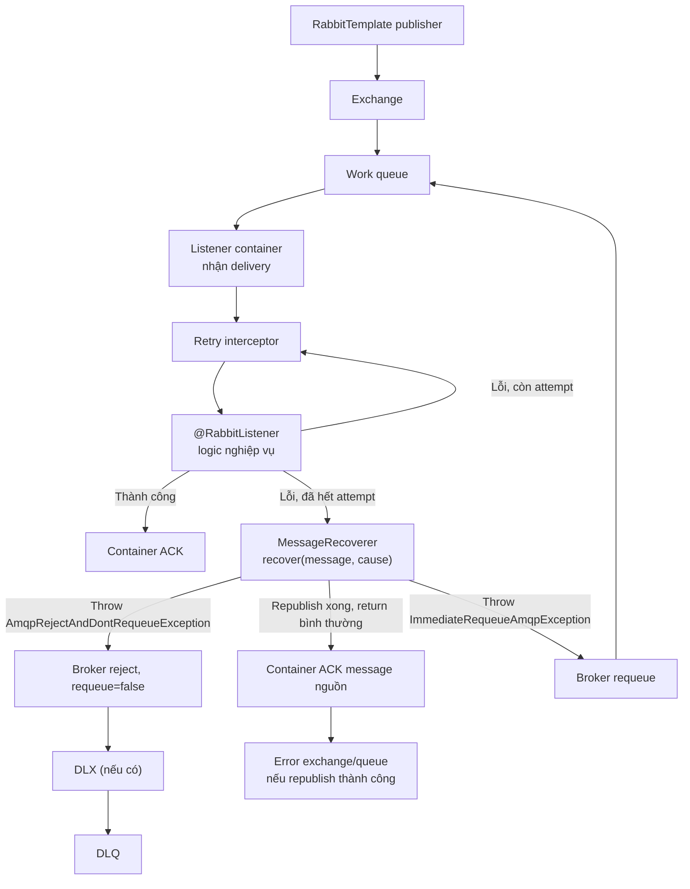
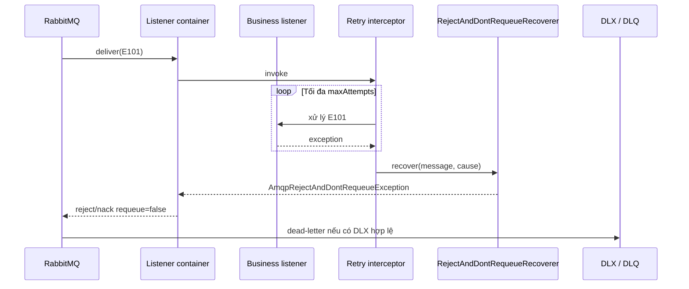
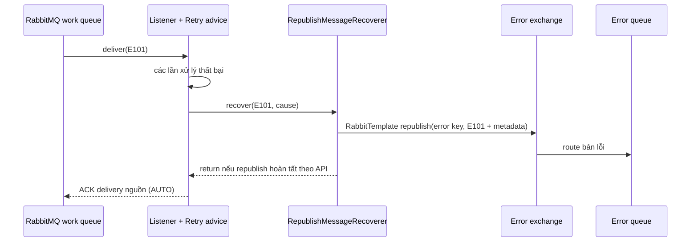
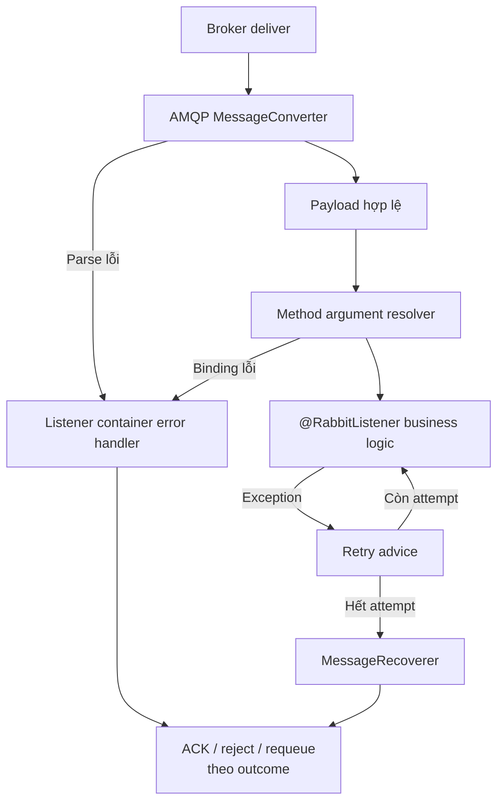

# MessageRecoverer sau khi hết số lần thử

## 1. Tình huống: thử lại ba lần vẫn thất bại thì làm gì?

Trong module **SPRING_AMQP**, ứng dụng gửi sự kiện bằng `RabbitTemplate` đến RabbitMQ exchange, broker dùng routing key và binding để chuyển chúng vào queue, còn `@RabbitListener` xử lý bất đồng bộ. Khi consumer gặp lỗi, hệ thống thường cấu hình **retry** để thử lại một số lần trước khi quyết định kết thúc.

Giả sử một listener nhận lệnh gửi hóa đơn:

```java
@RabbitListener(queues = "invoices.send.q")
public void sendInvoice(String invoiceId) {
    invoiceService.send(invoiceId);
}
```

Do dịch vụ email lỗi, listener ném exception ba lần liên tiếp. Nếu không có quy tắc kết thúc, message có thể bị requeue liên tục, chặn queue, spam email provider và làm khó việc theo dõi. Ngược lại, nếu tùy tiện nuốt lỗi thì container có thể **ACK message chưa được xử lý**.

Spring AMQP cung cấp interface **`MessageRecoverer`** cho **bước xử lý sau khi RetryInterceptor quyết định đã hết số lần thử**. Recoverer giúp trả lời một câu hỏi nghiệp vụ cụ thể:

> “Không thể hoàn thành xử lý sau các lần thử đã cho: message phải đi đâu, và delivery nguồn sẽ được xử lý thế nào?”

Đây là bài trong chương **Thử lại thông điệp**, tập trung vào điểm cuối của retry chứ không chỉ cấu hình số lần thử.

### Mục tiêu học tập

Sau bài này, bạn có thể:

1. Phân biệt **retry một delivery** với **broker requeue/redelivery**.
2. Giải thích chính xác thời điểm `MessageRecoverer.recover(message, cause)` được gọi.
3. So sánh `RejectAndDontRequeueRecoverer`, `RepublishMessageRecoverer` và `ImmediateRequeueMessageRecoverer`.
4. Dự đoán hành vi **ACK/reject/DLQ** sau khi recoverer chạy.
5. Cấu hình retry advice cùng `MessageRecoverer` trên `SimpleRabbitListenerContainerFactory`.
6. Viết demo Spring Boot với `RabbitTemplate`, `@RabbitListener`, exchange, queue, binding và DLQ.
7. Nhận diện rủi ro mất message khi custom recoverer chỉ log rồi trả về, hoặc republish không có bảo đảm phù hợp.
8. Thiết kế backoff, idempotency, giám sát và replay message lỗi.

## 2. MessageRecoverer nằm ở đâu trong đường xử lý?

Sơ đồ tổng quát:



Các bước quan trọng:

1. Broker giao **một delivery** cho listener container.
2. Retry advice gọi business listener.
3. Nếu listener thất bại, interceptor quyết định có thử lại hay không.
4. Khi **hết số lần thử**, interceptor gọi recoverer được cấu hình.
5. Tùy recoverer **trả về bình thường** hay **ném một exception đặc biệt**, container quyết định ACK/reject/requeue theo ACK mode và cơ chế xử lý lỗi hiện hành.

**Không phải mọi lỗi `@RabbitListener` đều tự động gọi recoverer.** Bạn phải có retry interceptor/advice hoặc cấu hình retry tương đương sử dụng recoverer. Ngoài ra, lỗi conversion/argument binding trước business method có thể được xử lý bằng cơ chế error handler khác; cần kiểm chứng thứ tự advice và error handler theo phiên bản.

## 3. Retry trong cùng delivery khác requeue tại broker

### 3.1. Retry nội bộ listener

Với **stateless retry interceptor**, thông thường nhiều lần thử diễn ra trong **cùng lần nhận message từ broker**. Message vẫn ở trạng thái Unacked trong lúc interceptor thử lại business logic.

```text
RabbitMQ
   |
   | basic.deliver(E101)
   v
Listener container
   |
   +-- attempt 1: xử lý lỗi
   |      chờ backoff
   +-- attempt 2: xử lý lỗi
   |      chờ backoff
   +-- attempt 3: xử lý lỗi
   |
   +-- MessageRecoverer xử lý khi đã hết attempt
   |
   +-- ACK / REJECT / REQUEUE tùy kết quả recoverer
```

Nếu `maxAttempts=3`, **thường tính cả lần gọi đầu tiên**:

- Lần 1: lần xử lý ban đầu.
- Lần 2: retry thứ nhất.
- Lần 3: retry thứ hai.
- Sau lỗi lần 3: gọi recoverer.

Đừng hiểu `maxAttempts=3` thành “một lần đầu cộng ba retry” (tổng bốn).

### 3.2. Broker requeue/redelivery

Khi container yêu cầu `basicNack(..., requeue=true)` hoặc consumer/channel mất trước ACK, broker có thể đưa message vào khả năng **giao lại một lần khác**.

```text
Deliver E101 -> consumer xử lý lỗi
   -> NACK requeue=true
Broker đưa E101 trở lại queue
   -> deliver E101 lần nữa (cùng hoặc consumer khác)
```

Khi đó `redelivered` có thể được đánh dấu, nhưng đây là một delivery mới, không đơn thuần là gọi lại method trong cùng delivery.

### Bảng so sánh

| Tiêu chí | Stateless retry | Broker requeue |
| --- | --- | --- |
| Ai quyết định lần thử tiếp theo? | Retry interceptor của ứng dụng | Broker sau tín hiệu NACK/reject phù hợp |
| Có delivery mới giữa các attempt? | Thông thường không | Có |
| Backoff | Có thể cấu hình theo retry policy | Requeue trực tiếp không tự có backoff |
| Consumer khác có thể nhận attempt tiếp theo? | Không, khi vẫn cùng một lần xử lý | Có thể |
| `redelivered` phản ánh mỗi attempt? | Không | Có thể báo đã được giao lại |
| Khi hết số lần thử | Chuyển qua `MessageRecoverer` | Phải tự có giới hạn/cơ chế khác |
| Rủi ro | Giữ consumer/channel bận khi backoff dài | Vòng lặp nóng, thay đổi thứ tự xử lý |

**Stateful retry** là một lựa chọn khác: giữ trạng thái retry qua những lần delivery/transaction phù hợp, thường cần nhận diện message bằng ID ổn định. Trạng thái, rollback, requeue và yêu cầu message ID có những quy tắc riêng; không coi stateless và stateful là hoán đổi mà không kiểm thử.

## 4. MessageRecoverer là hợp đồng gì?

Interface được sử dụng trong Spring AMQP:

```java
import org.springframework.amqp.rabbit.retry.MessageRecoverer;
```

Hợp đồng cốt lõi:

```java
void recover(
    org.springframework.amqp.core.Message message,
    Throwable cause
);
```

Ý nghĩa hai tham số:

- **`message`:** AMQP message đã thất bại sau quy trình retry, gồm `byte[] body` và `MessageProperties`.
- **`cause`:** nguyên nhân lỗi mà retry infrastructure chuyển đến recoverer. Có thể chứa nhiều lớp exception wrapper; khi điều tra nên xem root cause.

`MessageRecoverer` **không đồng nghĩa tự gửi ACK hoặc NACK bằng RabbitMQ Channel**. Nó làm việc với AMQP `Message` và `Throwable`. Quyết định cuối cùng tại broker phụ thuộc **việc recoverer trả về bình thường hoặc ném exception**, sau đó là hành vi listener container/ACK mode.

### Quy tắc cực kỳ quan trọng

Trong pipeline **stateless retry + listener container AUTO** thông thường:

- **Recoverer trả về bình thường:** retry interceptor coi message đã được recover; callback kết thúc như xử lý thành công; container có thể **ACK delivery nguồn**.
- **Recoverer ném `AmqpRejectAndDontRequeueException`:** container thường **reject/nack không requeue**, message có thể được dead-letter.
- **Recoverer ném `ImmediateRequeueAmqpException`:** container thường **yêu cầu broker requeue**.
- **Recoverer ném lỗi khác:** xử lý theo error handler, `defaultRequeueRejected` và các chính sách liên quan.

Vì vậy, **đừng viết recoverer chỉ log lỗi rồi return** khi nghiệp vụ vẫn yêu cầu bảo toàn message. Trong AUTO mode, hành động đó có thể đồng nghĩa message nguồn được ACK và không còn nằm trong work queue.

## 5. Ba MessageRecoverer có sẵn cần biết

Spring AMQP cung cấp những recoverer thường dùng sau:

| Recoverer | Hành vi sau hết retry | Kết quả delivery nguồn trong AUTO mode | Lựa chọn phù hợp |
| --- | --- | --- | --- |
| `RejectAndDontRequeueRecoverer` | Ném `AmqpRejectAndDontRequeueException` | Broker reject không requeue; có thể dead-letter | Muốn broker đưa message lỗi sang DLX/DLQ |
| `RepublishMessageRecoverer` | Dùng `AmqpTemplate` republish message lỗi sang exchange/routing key chỉ định | Khi republish/recoverer thành công và return, container ACK message nguồn | Muốn gửi message lỗi sang luồng quarantine/error chuyên biệt với metadata lỗi |
| `ImmediateRequeueMessageRecoverer` | Ném `ImmediateRequeueAmqpException` | Broker requeue, có thể giao lại ngay | Chỉ khi có lý do đặc biệt để broker thử lại ngay sau khi retry cạn |

Các class thường thuộc package:

```java
import org.springframework.amqp.rabbit.retry.RejectAndDontRequeueRecoverer;
import org.springframework.amqp.rabbit.retry.RepublishMessageRecoverer;
import org.springframework.amqp.rabbit.retry.ImmediateRequeueMessageRecoverer;
```

**Không gắn cả ba recoverer cho cùng một retry advice.** Chọn một chiến lược kết thúc chính, hoặc tự triển khai `MessageRecoverer` để phân loại lỗi có kiểm soát.

## 6. RejectAndDontRequeueRecoverer: để broker dead-letter

### 6.1. Cơ chế



Trong kiểu này, application không phải tự gửi một bản sao message lỗi để DLQ lưu lại. **Broker** thực hiện dead-lettering khi nhận reject không requeue và work queue đã cấu hình DLX.

### 6.2. Cấu hình qua RetryInterceptorBuilder

```java
@Bean
RetryOperationsInterceptor retryAdvice() {
    return RetryInterceptorBuilder.stateless()
            .maxAttempts(3)
            .backOffOptions(500, 2.0, 2_000)
            .recoverer(new RejectAndDontRequeueRecoverer())
            .build();
}
```

Ý nghĩa:

- `maxAttempts(3)`: tối đa ba lần gọi logic xử lý gồm lần đầu.
- `backOffOptions(500, 2.0, 2_000)`: chờ khoảng 500 ms trước retry kế tiếp, tăng theo hệ số 2, trần khoảng 2 giây.
- `recoverer(...)`: khi vẫn lỗi sau các attempt, yêu cầu **reject không requeue**.

Không nên xem các con số này là SLA. Thời gian thực tế còn có độ trễ listener, scheduling, broker và việc retry có thật sự được kích hoạt hay không.

### 6.3. Điều kiện để message vào DLQ

Muốn broker dead-letter sau khi reject, phải có:

1. Work queue tồn tại.
2. Dead-letter exchange được khai báo.
3. Work queue có dead-letter configuration hoặc policy tương ứng.
4. DLX route được tới DLQ qua routing key/binding.
5. Quyền truy cập và tài nguyên broker đáp ứng điều kiện dead-lettering.

**Nếu không có DLX phù hợp, reject không requeue có thể làm message biến mất khỏi work queue mà không còn nơi để điều tra.** Đây là lỗi cấu hình rất nghiêm trọng.

### 6.4. Khi nào chọn?

Phù hợp khi muốn:

- Bảo toàn message thất bại trong một **DLQ vận hành** theo cơ chế broker.
- Ghi nhận `x-death` và lý do dead-letter theo broker.
- Cho phép hệ thống điều tra/replay sau khi sửa bug hoặc phụ thuộc ngoài.
- Giảm coupling của application với logic republish message lỗi.

Nhưng DLQ không phải kho lưu vô hạn. Phải đặt retention, giới hạn dung lượng, quyền truy cập, alert và quy trình xử lý lại phù hợp.

## 7. RepublishMessageRecoverer: xuất message lỗi sang exchange khác

### 7.1. Cơ chế

`RepublishMessageRecoverer` sử dụng `AmqpTemplate` để **publish một message lỗi** tới exchange được chỉ định, thường thêm thông tin về exception và nguồn message vào headers.



**Điểm then chốt:** đây là **application-level republish**, không phải broker dead-lettering:

- Nó có thể thêm các headers về exception, exchange/routing key gốc.
- Delivery nguồn thường được ACK sau khi recoverer trả về bình thường.
- Nếu error exchange không route được hoặc broker chưa xác nhận publish, có nguy cơ mất dữ liệu nếu recoverer coi thao tác là thành công rồi ACK nguồn.
- Một republish thường **không tự tạo `x-death` của broker** vì message không đi qua cơ chế dead-letter của queue. Không dùng `x-death` làm bằng chứng cho tất cả recovery bằng republish.

### 7.2. Ví dụ

```java
MessageRecoverer recoverer =
        new RepublishMessageRecoverer(
                rabbitTemplate,
                "orders.error.exchange",
                "orders.error"
        );
```

Trong trường hợp này:

- `rabbitTemplate` cần kết nối broker và có converter/thuộc tính phù hợp với message.
- `orders.error.exchange` cần tồn tại trước khi recoverer republish.
- Routing key `orders.error` phải có binding đến error queue.
- Nếu dựa vào republish để bảo toàn dữ liệu quan trọng, phải đánh giá **publisher confirms/returns** hoặc recoverer có hỗ trợ confirms theo phiên bản Spring AMQP.

### 7.3. Rủi ro “republish rồi ACK”

Giả sử:

```text
T1 Work queue giao E101
T2 Listener thất bại hết retry
T3 Recoverer gửi E101 tới error exchange
T4 Application nghĩ thao tác gửi thành công
T5 Container ACK E101 ở queue nguồn
T6 Phát hiện error exchange không route tới queue nào
```

Nếu không có publisher return hoặc xác nhận đúng và không có outbox, E101 có thể đã mất khỏi queue nguồn **mà không có bản lưu ở error queue**.

**Lời gọi `RabbitTemplate.send/convertAndSend` không ném exception không chứng minh message đã vào error queue.** Khi cần bảo đảm, đánh giá `RepublishMessageRecovererWithConfirms` theo API phiên bản đang dùng hoặc một cơ chế publish/reconcile có bảo đảm phù hợp.

### 7.4. Ưu điểm và chi phí

| Ưu điểm | Điều phải kiểm soát |
| --- | --- |
| Tách error exchange/queue khỏi DLX của work queue | Cần topology và permission riêng |
| Có thể gắn exception stacktrace, original routing metadata | Tránh lộ dữ liệu nhạy cảm và header quá lớn |
| Phù hợp quarantine/diagnostic processing | Cần đảm bảo error publish thực sự được route/confirm |
| Có thể chọn routing key lỗi theo nghiệp vụ | Tránh tạo vòng lặp republish về chính work queue |
| Có thể thêm logic custom khi xử lý lỗi | Recovery có thể tạo duplicate khi connection/ACK không chắc chắn |

## 8. ImmediateRequeueMessageRecoverer: vì sao phải rất thận trọng?

### 8.1. Hành vi

`ImmediateRequeueMessageRecoverer` là recoverer chủ động **ném `ImmediateRequeueAmqpException`** sau khi retry advice hết số lần thử. Khi container nhận exception này trong đường xử lý hỗ trợ, broker được yêu cầu requeue message.

```java
@Bean
RetryOperationsInterceptor retryAdviceWithBrokerRequeue() {
    return RetryInterceptorBuilder.stateless()
            .maxAttempts(3)
            .backOffOptions(500, 2.0, 2_000)
            .recoverer(new ImmediateRequeueMessageRecoverer())
            .build();
}
```

Điều đó có thể dẫn đến:

```text
Delivery 1:
    application attempt 1, 2, 3 đều lỗi
    -> recoverer yêu cầu requeue

Delivery 2:
    application attempt 1, 2, 3 đều lỗi
    -> recoverer lại yêu cầu requeue

Delivery 3:
    ...
```

**`maxAttempts=3` chỉ giới hạn số lần gọi trong một chu kỳ retry, không tự giới hạn tổng số chu kỳ broker requeue.** Đây là điểm rất dễ gây hiểu nhầm.

### 8.2. Vòng lặp nóng và poison message

Nếu lỗi không tự thay đổi (JSON hỏng, validation sai, code bug), broker có thể liên tục giao lại. Hậu quả:

- CPU/network/log tăng cao.
- Cùng message chiếm thời gian xử lý của consumer.
- Thứ tự xử lý bị thay đổi.
- Broker/consumer có thể nhận nhiều delivery nhưng không có tiến độ nghiệp vụ.
- Với quorum queue, các cơ chế delivery limit/poison-message handling có thể giới hạn việc giao lại tùy phiên bản và policy.

Nếu lỗi cần thời gian để phục hồi, **retry có backoff dài hơn, delayed queue, scheduler hoặc workflow chờ điều kiện** thường phù hợp hơn immediate requeue vô hạn.

### 8.3. Khi nào mới cân nhắc?

Chỉ nên đánh giá nếu:

- Lỗi gần như chắc chắn tạm thời và có khả năng được giải quyết ngay.
- Broker và consumer chịu được tải tăng do redelivery.
- Có giới hạn vận hành hoặc đường thoát sang delayed retry/DLQ.
- Đã kiểm thử hành vi với cùng một và nhiều competing consumers.
- Side effect idempotent.

Không nên lấy `ImmediateRequeueMessageRecoverer` làm lựa chọn mặc định chỉ để “không mất message”. Sử dụng sai có thể gây **sự cố kéo dài hơn cả lỗi gốc**.

## 9. Bảng quyết định sau khi retry cạn

| Nhu cầu nghiệp vụ | Recoverer/cơ chế nên đánh giá | Điều xảy ra với message nguồn |
| --- | --- | --- |
| Giữ message lỗi để điều tra bằng broker DLQ | `RejectAndDontRequeueRecoverer` + DLX | Reject không requeue; broker dead-letter nếu cấu hình đúng |
| Phân loại lỗi rồi publish sang error exchange riêng | `RepublishMessageRecoverer` và cơ chế confirms/returns phù hợp | Sau republish thành công, recoverer return; nguồn được ACK trong AUTO |
| Ngay lập tức giao lại cho broker điều phối consumer | `ImmediateRequeueMessageRecoverer` | NACK/reject requeue=true theo đường xử lý phù hợp |
| Có thể xử lý bằng một fallback nghiệp vụ an toàn | Custom `MessageRecoverer` có kiểm soát | Nếu return bình thường, nguồn được coi đã recover; cần xác định rõ đã lưu kết quả ở đâu |
| Lỗi cần chờ phút/giờ | Delayed retry queue hoặc scheduler/outbox | Không cố giữ consumer chờ hoặc requeue nóng |
| Lỗi vĩnh viễn, yêu cầu audit | DLQ/quarantine có retention và cảnh báo | Phải có lưu trữ lỗi bền vững trước khi bỏ nguồn |
| Cần kết quả xử lý chính xác một lần về mặt side effect | Idempotency/transaction DB | Recoverer không tự tạo exactly-once |

## 10. Demo Spring Boot: retry ba lần rồi vào DLQ

Ta xây một ví dụ **chạy được về mặt cấu trúc** với:

- Direct exchange `lab.retry.events`.
- Work queue `lab.retry.work.q`.
- DLX `lab.retry.dlx` và DLQ `lab.retry.dead.q`.
- Listener `@RabbitListener` có ba kiểu payload: thành công, lỗi tạm thời một lần, lỗi vĩnh viễn.
- Retry advice stateless: tối đa **3 attempts**, có backoff.
- `RejectAndDontRequeueRecoverer` khi hết lượt.
- Producer `RabbitTemplate` phát message thử nghiệm.

Để dễ thấy sự khác nhau giữa retry tại application và redelivery tại broker, demo dùng **một consumer, prefetch 1**, và đánh log attempt trong bộ nhớ. Đây chỉ là công cụ học tập, không phải một retry counter bền vững.

### 10.1. Chuẩn bị RabbitMQ

Yêu cầu:

- Java 17+.
- Spring Boot tương thích với Spring AMQP và Spring Retry.
- Maven hoặc Maven Wrapper.
- RabbitMQ local.

Chạy broker nếu chưa có broker chiếm hai cổng:

```bash
docker run -d --name rabbitmq-recoverer-lab \
  -p 5672:5672 -p 15672:15672 rabbitmq:4-management
```

Management UI: `http://localhost:15672`; môi trường local mặc định có thể sử dụng `guest/guest`. Không dùng tài khoản `guest` làm cơ chế xác thực production.

### 10.2. Dependencies Maven

Trong `pom.xml` của Spring Boot:

```xml
<dependencies>
    <dependency>
        <groupId>org.springframework.boot</groupId>
        <artifactId>spring-boot-starter-amqp</artifactId>
    </dependency>

    <dependency>
        <groupId>org.springframework.retry</groupId>
        <artifactId>spring-retry</artifactId>
    </dependency>
</dependencies>
```

Lưu ý: một số bộ starter có thể kéo Spring Retry theo dependency graph, nhưng hãy **kiểm tra hoặc khai báo rõ `spring-retry`** khi sử dụng retry interceptor trực tiếp. Phiên bản dependency nên được Spring Boot BOM quản lý nhất quán.

Ví dụ dùng **Spring AMQP API có `RetryInterceptorBuilder`, `SimpleRabbitListenerContainerFactory` và `RejectAndDontRequeueRecoverer`**. Khi dùng một phiên bản Spring AMQP khác, kiểm tra API/import và retry integration của phiên bản đó.

### 10.3. application.yml

```yaml
spring:
  application:
    name: message-recoverer-lab
  rabbitmq:
    host: localhost
    port: 5672
    username: guest
    password: guest
    publisher-confirm-type: correlated
    publisher-returns: true
    template:
      mandatory: true
    listener:
      type: simple
      simple:
        retry:
          enabled: false

lab:
  seed: true
```

Ở đây `spring.rabbitmq.listener.simple.retry.enabled=false` vì ta sẽ **tự gắn retry advice** vào listener factory. Nếu đồng thời bật retry tự động qua properties và tự thêm interceptor mà không hiểu cách cấu hình được ghép, bạn có thể có **hai tầng retry chồng nhau** và số lần gọi listener không còn đúng 3 như mong đợi.

Các thuộc tính publisher confirms/returns hỗ trợ bài toán tin cậy phía producer. Ví dụ sẽ không cài đủ callback gửi thành công; trong production cần thực sự xử lý confirm/return, không coi `convertAndSend` trả về là bằng chứng broker đã route message.

### 10.4. Cấu trúc source

```text
src/main/java/com/example/recoverer/
  RecovererLabApplication.java
  RetryTopology.java
  RetryListenerConfig.java
  DemoOrderListener.java
  DemoPublisher.java
```

Các class dưới đây dùng chung package `com.example.recoverer`.

### 10.5. Khai báo topology và DLQ

Tạo `RetryTopology.java`:

```java
package com.example.recoverer;

import org.springframework.amqp.core.Binding;
import org.springframework.amqp.core.BindingBuilder;
import org.springframework.amqp.core.DirectExchange;
import org.springframework.amqp.core.Queue;
import org.springframework.amqp.core.QueueBuilder;
import org.springframework.beans.factory.annotation.Qualifier;
import org.springframework.context.annotation.Bean;
import org.springframework.context.annotation.Configuration;

@Configuration
public class RetryTopology {

    public static final String EXCHANGE = "lab.retry.events";
    public static final String WORK_QUEUE = "lab.retry.work.q";
    public static final String WORK_KEY = "orders.process";

    public static final String DLX = "lab.retry.dlx";
    public static final String DLQ = "lab.retry.dead.q";
    public static final String DEAD_KEY = "orders.dead";

    @Bean
    DirectExchange workExchange() {
        return new DirectExchange(EXCHANGE);
    }

    @Bean
    DirectExchange deadExchange() {
        return new DirectExchange(DLX);
    }

    @Bean
    Queue workQueue() {
        return QueueBuilder.durable(WORK_QUEUE)
                .deadLetterExchange(DLX)
                .deadLetterRoutingKey(DEAD_KEY)
                .build();
    }

    @Bean
    Queue deadQueue() {
        return QueueBuilder.durable(DLQ).build();
    }

    @Bean
    Binding workBinding(
            @Qualifier("workQueue") Queue queue,
            @Qualifier("workExchange") DirectExchange exchange) {

        return BindingBuilder.bind(queue)
                .to(exchange)
                .with(WORK_KEY);
    }

    @Bean
    Binding deadBinding(
            @Qualifier("deadQueue") Queue queue,
            @Qualifier("deadExchange") DirectExchange exchange) {

        return BindingBuilder.bind(queue)
                .to(exchange)
                .with(DEAD_KEY);
    }
}
```

Work queue có DLX và routing key cho dead-letter. Khi recoverer ném exception yêu cầu reject không requeue, RabbitMQ có thể chuyển message sang `lab.retry.dead.q`.

**DLX không phải DLQ**: `lab.retry.dlx` là exchange, còn `lab.retry.dead.q` mới lưu message. Thiếu binding hay queue đích sẽ làm đường xử lý lỗi không hoạt động như kỳ vọng.

Trong production, cân nhắc dùng **RabbitMQ policy** để thay đổi DLX/TTL mà không redeclare queue; việc hardcode dead-letter arguments trong `QueueBuilder` ở đây chỉ để lab tự chứa.

### 10.6. Cấu hình retry advice và recoverer

Tạo `RetryListenerConfig.java`:

```java
package com.example.recoverer;

import org.springframework.amqp.core.AcknowledgeMode;
import org.springframework.amqp.rabbit.config.RetryInterceptorBuilder;
import org.springframework.amqp.rabbit.config.SimpleRabbitListenerContainerFactory;
import org.springframework.amqp.rabbit.connection.ConnectionFactory;
import org.springframework.amqp.rabbit.retry.RejectAndDontRequeueRecoverer;
import org.springframework.context.annotation.Bean;
import org.springframework.context.annotation.Configuration;
import org.springframework.retry.interceptor.RetryOperationsInterceptor;

@Configuration
public class RetryListenerConfig {

    @Bean
    RetryOperationsInterceptor retryAdvice() {
        return RetryInterceptorBuilder.stateless()
                .maxAttempts(3)
                .backOffOptions(500, 2.0, 2_000)
                .recoverer(new RejectAndDontRequeueRecoverer())
                .build();
    }

    @Bean("rabbitListenerContainerFactory")
    SimpleRabbitListenerContainerFactory rabbitListenerContainerFactory(
            ConnectionFactory connectionFactory,
            RetryOperationsInterceptor retryAdvice) {

        SimpleRabbitListenerContainerFactory factory =
                new SimpleRabbitListenerContainerFactory();

        factory.setConnectionFactory(connectionFactory);
        factory.setAcknowledgeMode(AcknowledgeMode.AUTO);
        factory.setConcurrentConsumers(1);
        factory.setPrefetchCount(1);
        factory.setDefaultRequeueRejected(false);
        factory.setAdviceChain(retryAdvice);

        return factory;
    }
}
```

Giải thích:

1. `RetryInterceptorBuilder.stateless()` tạo retry advice không giữ retry state qua các delivery.
2. `maxAttempts(3)` gọi business logic nhiều nhất **3 lần trong một delivery** theo điều kiện retry.
3. `backOffOptions(500, 2.0, 2_000)` giới hạn tốc độ thử lại.
4. `recoverer(new RejectAndDontRequeueRecoverer())` là **điểm kết thúc** khi vẫn lỗi.
5. Factory được đặt tên `rabbitListenerContainerFactory` để `@RabbitListener` dùng mặc định.
6. `AUTO` cho phép container quyết định ACK/reject dựa trên kết quả callback/advice.
7. `defaultRequeueRejected(false)` làm rõ chính sách không requeue cho lỗi khác; recoverer vẫn cung cấp quyết định explicit.

Trong dự án dùng Spring Boot auto-configuration phức tạp, có thể sử dụng `SimpleRabbitListenerContainerFactoryConfigurer` để kế thừa các thuộc tính Boot khi tạo factory tùy chỉnh. Đoạn code trên cố ý đặt các thuộc tính cần thiết trực tiếp để dễ kiểm chứng; không có nghĩa mọi property `spring.rabbitmq.listener.simple.*` sẽ tự áp vào factory tùy chỉnh này.

**Không thêm một retry advice khác vào cùng factory** nếu chưa xác định rõ thứ tự và số lần thử; nếu không, kết quả maxAttempts có thể bị nhân lên.

### 10.7. Listener tạo ba kết quả khác nhau

Tạo `DemoOrderListener.java`:

```java
package com.example.recoverer;

import java.nio.charset.StandardCharsets;
import java.util.concurrent.ConcurrentHashMap;
import java.util.concurrent.ConcurrentMap;
import java.util.concurrent.atomic.AtomicInteger;

import org.springframework.amqp.core.Message;
import org.springframework.amqp.rabbit.annotation.RabbitListener;
import org.springframework.stereotype.Component;

@Component
public class DemoOrderListener {

    private final ConcurrentMap<String, AtomicInteger> attempts =
            new ConcurrentHashMap<>();

    @RabbitListener(queues = RetryTopology.WORK_QUEUE)
    public void onOrder(Message message) {
        String jobId = new String(
                message.getBody(),
                StandardCharsets.UTF_8
        );

        int attempt = attempts
                .computeIfAbsent(jobId, ignored -> new AtomicInteger())
                .incrementAndGet();

        boolean redelivered =
                message.getMessageProperties().isRedelivered();

        System.out.printf(
                "[LISTENER] job=%s attempt=%d redelivered=%s%n",
                jobId, attempt, redelivered
        );

        if (jobId.startsWith("invalid:")) {
            throw new IllegalArgumentException(
                    "Payload không hợp lệ: " + jobId
            );
        }

        if (jobId.startsWith("transient:") && attempt == 1) {
            throw new IllegalStateException(
                    "Giả lập lỗi phụ thuộc ở lần đầu"
            );
        }

        System.out.println("[LISTENER] completed: " + jobId);
    }
}
```

Cách xử lý này làm rõ các trường hợp:

| Payload | Lần 1 | Lần 2 | Lần 3 | Recoverer? |
| --- | --- | --- | --- | --- |
| `ok:job-100` | Thành công | Không gọi | Không gọi | Không |
| `transient:job-101` | Lỗi tạm thời | Thành công | Không gọi | Không |
| `invalid:job-102` | Lỗi | Lỗi | Lỗi | **Có** |

`attempts` là bộ đếm **trong RAM để minh họa**. Nó không bền vững qua restart, và dùng payload làm key không phân biệt hai message khác nhau có cùng body. Với production, phải có **event ID** và chính sách state/deduplication phù hợp.

Với **stateless retry**, một listener có thể thấy `attempt=1,2,3` nhưng `redelivered=false` trong cả ba lần vì chúng thuộc **cùng delivery broker**. Đây là bằng chứng để phân biệt retry interceptor với broker requeue.

### 10.8. Publisher phát ba message

Tạo `DemoPublisher.java`:

```java
package com.example.recoverer;

import org.springframework.amqp.rabbit.core.RabbitTemplate;
import org.springframework.stereotype.Service;

@Service
public class DemoPublisher {

    private final RabbitTemplate template;

    public DemoPublisher(RabbitTemplate template) {
        this.template = template;
    }

    public void sendSamples() {
        send("ok:job-100");
        send("transient:job-101");
        send("invalid:job-102");
    }

    private void send(String payload) {
        template.convertAndSend(
                RetryTopology.EXCHANGE,
                RetryTopology.WORK_KEY,
                payload
        );

        System.out.println("[PUBLISH] " + payload);
    }
}
```

Ở producer, `RabbitTemplate` chỉ publish theo exchange và routing key. **Producer không trực tiếp biết recoverer đã được gọi hoặc consumer đã hoàn tất**. Muốn biết quá trình xử lý nghiệp vụ, ứng dụng cần thêm event kết quả/trạng thái DB hoặc workflow.

### 10.9. Lớp khởi động

Tạo `RecovererLabApplication.java`:

```java
package com.example.recoverer;

import org.springframework.boot.ApplicationRunner;
import org.springframework.boot.SpringApplication;
import org.springframework.boot.autoconfigure.SpringBootApplication;
import org.springframework.context.annotation.Bean;

@SpringBootApplication
public class RecovererLabApplication {

    public static void main(String[] args) {
        SpringApplication.run(RecovererLabApplication.class, args);
    }

    @Bean
    ApplicationRunner publishOnStart(DemoPublisher publisher) {
        return args -> publisher.sendSamples();
    }
}
```

Chạy từ thư mục dự án:

```bash
./mvnw spring-boot:run
```

Trên Windows PowerShell:

```powershell
.\mvnw.cmd spring-boot:run
```

Khi khởi động, `ApplicationRunner` publish ba message. Listener xử lý chúng theo retry advice. Log mô phỏng:

```text
[PUBLISH] ok:job-100
[PUBLISH] transient:job-101
[PUBLISH] invalid:job-102

[LISTENER] job=ok:job-100 attempt=1 redelivered=false
[LISTENER] completed: ok:job-100

[LISTENER] job=transient:job-101 attempt=1 redelivered=false
... IllegalStateException ...
[LISTENER] job=transient:job-101 attempt=2 redelivered=false
[LISTENER] completed: transient:job-101

[LISTENER] job=invalid:job-102 attempt=1 redelivered=false
... IllegalArgumentException ...
[LISTENER] job=invalid:job-102 attempt=2 redelivered=false
... IllegalArgumentException ...
[LISTENER] job=invalid:job-102 attempt=3 redelivered=false
... RejectAndDontRequeueRecoverer -> reject không requeue ...
```

**Thứ tự log có thể khác** do producer/consumer bất đồng bộ và broker scheduling. Quan sát thực tế phải theo message ID/queue, không dựa vào một thứ tự tuyệt đối của console output.

### 10.10. Kiểm tra kết quả trên RabbitMQ Management UI

Mở `http://localhost:15672`, xem hai queue:

| Queue | Kết quả mong đợi với lab sạch |
| --- | --- |
| `lab.retry.work.q` | Ba message đã được xử lý thành công hoặc reject; Ready/Unacked về 0 sau khi hoàn tất |
| `lab.retry.dead.q` | Có **một** message `invalid:job-102` nếu DLX route thành công và không ai đang tiêu thụ DLQ |

Chỉ nhìn `Ready=0` chưa đủ chứng minh listener đã xử lý thành công; message có thể bị dead-letter hoặc bị loại. Hãy kiểm tra **listener logs, DLQ, delivery/ACK/reject rates và ID nghiệp vụ**.

**Mỗi lần restart ứng dụng, runner sẽ publish thêm ba message.** Vì thế nếu chạy lại trên cùng broker mà không reset dữ liệu, DLQ sẽ có nhiều message lỗi. Chỉ purge queue trong môi trường thử nghiệm không chứa dữ liệu quan trọng.

## 11. Thay RejectAndDontRequeueRecoverer bằng RepublishMessageRecoverer

Sau khi hiểu demo dùng DLX, bạn có thể thử **một bản thay thế**, không bật đồng thời hai recoverer trên một advice.

### 11.1. Tái sử dụng DLX làm error exchange

Topology demo đã có:

```text
lab.retry.dlx --(orders.dead)--> lab.retry.dead.q
```

`RepublishMessageRecoverer` cũng có thể **publish trực tiếp vào exchange này** với routing key `orders.dead`. Khi đó message lỗi đi từ application qua một publish mới, **không phải broker dead-letter**.

Thay `retryAdvice()` bằng cấu hình minh họa:

```java
@Bean
RetryOperationsInterceptor retryAdvice(RabbitTemplate rabbitTemplate) {
    return RetryInterceptorBuilder.stateless()
            .maxAttempts(3)
            .backOffOptions(500, 2.0, 2_000)
            .recoverer(new RepublishMessageRecoverer(
                    rabbitTemplate,
                    RetryTopology.DLX,
                    RetryTopology.DEAD_KEY
            ))
            .build();
}
```

Trong file `RetryListenerConfig.java`, cần thay bean `retryAdvice()` ban đầu chứ **không tạo một bean trùng tên**. Thêm các imports tương ứng:

```java
import org.springframework.amqp.rabbit.core.RabbitTemplate;
import org.springframework.amqp.rabbit.retry.RepublishMessageRecoverer;
```

Khác biệt về kết quả:

- Message được **republish** tới DLX bằng RabbitTemplate.
- Recoverer thường thêm metadata về exception và đường đi gốc.
- Nếu recoverer trả về bình thường, container AUTO thường **ACK delivery nguồn**.
- Error queue vẫn có thể nhận message, nhưng các header như `x-death` không nhất thiết giống đường broker dead-letter.

### 11.2. Đọc metadata lỗi

`RepublishMessageRecoverer` có thể bổ sung các header như:

- `x-exception-message`: tóm tắt exception.
- `x-exception-stacktrace`: stack trace, có thể rất dài.
- `x-original-exchange`: exchange nguồn.
- `x-original-routingKey`: routing key nguồn.

Các tên/header và giới hạn kích thước cần kiểm tra theo phiên bản Spring AMQP. Đừng log nguyên stack trace/payload chứa dữ liệu nhạy cảm ra hệ thống không được bảo vệ.

### 11.3. Khi nào cần confirms?

Nếu error queue là nơi lưu **duy nhất** cho các message thất bại, cần đảm bảo việc republish **thật sự được broker chấp nhận và route** trước khi coi recoverer đã bảo toàn dữ liệu.

Các lựa chọn tùy phiên bản/cơ chế:

- `RepublishMessageRecovererWithConfirms` khi có API phù hợp.
- Publisher confirms/returns và xử lý lỗi riêng cho error publisher.
- Một kho quarantine/outbox có transaction phù hợp để đảm bảo khả năng truy hồi.
- Kiểm tra topology error exchange/binding/queue bằng integration test.

**Không diễn giải “republish API trả về” như một transaction nguyên tử giữa ACK message nguồn và publish message lỗi.** Có thể xảy ra failure window hoặc duplicate; consumer của error queue cũng phải idempotent.

## 12. Viết custom MessageRecoverer: dễ hơn bạn nghĩ, nhưng có bẫy lớn

### 12.1. Một recoverer chỉ log rồi return

Đây là một phản ví dụ:

```java
MessageRecoverer dangerous = (message, cause) -> {
    System.err.println("Retry exhausted: " + cause.getMessage());
    // Không ném exception; không lưu ở đâu.
};
```

Ở pipeline AUTO + stateless retry, interceptor coi recovery đã hoàn thành; container có thể **ACK message nguồn**. Nghĩa là job bị thất bại nhưng cũng không ở queue/DLQ nào. Đây là **mất dữ liệu nghiệp vụ** nếu log không phải kết quả cuối hợp lệ.

Chỉ dùng kiểu **return bình thường** khi bạn **thực sự đã hoàn tất recovery** theo hợp đồng nghiệp vụ: ví dụ lưu message vào quarantine bền vững và đã kiểm tra thành công, hoặc biến lỗi thành một kết quả kết thúc có thể chấp nhận.

### 12.2. Recoverer reject có ghi nhận lý do

Ví dụ custom recoverer chọn reject không requeue sau khi ghi log có cấu trúc:

```java
@Bean
MessageRecoverer auditedRejectRecoverer() {
    return (message, cause) -> {
        String messageId =
                message.getMessageProperties().getMessageId();

        System.err.printf(
                "[RETRY EXHAUSTED] messageId=%s type=%s%n",
                messageId,
                cause.getClass().getSimpleName()
        );

        throw new AmqpRejectAndDontRequeueException(
                "Retry exhausted; reject for DLQ",
                cause
        );
    };
}
```

Cần import:

```java
import org.springframework.amqp.AmqpRejectAndDontRequeueException;
import org.springframework.amqp.rabbit.retry.MessageRecoverer;
```

Sau đó truyền bean vào `RetryInterceptorBuilder...recoverer(auditedRejectRecoverer)`. Nếu bạn muốn thay recoverer trong demo, cần bảo đảm chỉ có **một recovery strategy đang được gắn vào retry advice**.

**Đừng lưu toàn bộ payload hay stack trace nhạy cảm** vào log chỉ để điều tra. Dùng message ID, routing key, retry count, exception type và trace ID theo quy định bảo mật dữ liệu.

### 12.3. Custom recoverer chuyển hướng theo loại lỗi

Trong hệ thống thật, có thể phân loại:

```text
IOException / HTTP 503:
    -> sau retry cạn, chuyển sang delayed retry/quarantine

ValidationException / JSON schema invalid:
    -> reject không requeue, broker DLX

Business rule already completed:
    -> xác nhận đã xử lý idempotent, kết thúc hợp lệ

Unknown exception:
    -> quarantine, alert, đừng nuốt âm thầm
```

Lưu ý: dùng class exception chính xác và root cause phù hợp; nhiều framework tạo wrapper như `ListenerExecutionFailedException`. Không viết quy tắc chỉ kiểm tra chuỗi `cause.getMessage()` rồi suy loại lỗi.

Khi republish từ custom recoverer, cần kiểm tra việc publish sang queue đích và failure window trước khi return để nguồn được ACK. Nếu chuyển hướng thất bại, recoverer nên cho lỗi được nhận diện thay vì giả vờ đã phục hồi.

## 13. Stateful retry và MessageRecoverer: trường hợp nâng cao

Với **stateless retry**, những attempt thường diễn ra liên tiếp trong cùng delivery; vì vậy mã demo đếm ba lời gọi method mà không cần broker redelivery.

**Stateful retry** có thể được dùng với giao dịch và các trường hợp muốn duy trì retry state giữa những lần xử lý phù hợp. Tính chất cần lưu ý:

- Spring Retry cần **nhận diện message** để duy trì trạng thái thử lại; `messageId` là metadata quan trọng.
- Nếu message không có ID, cách xử lý có thể có trường hợp fatal/reject tùy phiên bản và cấu hình.
- Việc requeue/rollback giữa các attempt làm semantics khác với stateless retry.
- `MessageRecoverer` vẫn là cơ chế kết thúc của retry advice khi hết lượt trong các luồng hỗ trợ, nhưng **khi nào nó chạy và broker ACK thế nào** phụ thuộc retry state và transaction boundary.

Ví dụ ý tưởng:

```java
RetryOperationsInterceptor advice =
        RetryInterceptorBuilder.stateful()
                .maxAttempts(3)
                .recoverer(new RejectAndDontRequeueRecoverer())
                .build();
```

Đây là **snippet minh họa riêng**, không thay trực tiếp vào demo stateless mà không đánh giá metadata, transaction và phiên bản Spring AMQP.

**Đừng tự chọn stateful chỉ vì cần “retry bền vững”.** Cần thiết kế rõ cách xác định message, các kịch bản restart và việc có hay không lưu retry state qua toàn bộ vòng đời ứng dụng.

## 14. MessageRecoverer và các lớp lỗi khác nhau

Một lỗi có thể xuất hiện ở nhiều điểm:



Sơ đồ là mô hình khái niệm: tùy vị trí advice trong listener adapter/container, một số lỗi conversion có thể được RetryInterceptor quan sát, một số bị error handler xử lý trước.

Không thể kết luận “mọi exception đều đi qua `MessageRecoverer`” chỉ vì factory có retry advice.

### Lỗi nào thường không nên retry nhiều lần?

| Loại lỗi | Có thể tự hồi phục khi retry y nguyên? | Gợi ý |
| --- | --- | --- |
| Broker/channel connection lỗi | Có thể | Recovery/reconnect ở infrastructure, không đồng nhất với business retry |
| DB connection timeout | Có thể | Backoff, số lượt hữu hạn, circuit breaker |
| HTTP 503/429 | Có thể | Backoff hoặc delay theo tín hiệu phía ngoài |
| JSON sai cú pháp | Gần như không | DLQ/quarantine, sửa producer/schema |
| Thiếu field bắt buộc | Gần như không | Validation và contract testing |
| Không có quyền truy cập một resource | Tùy nguyên nhân | Phân loại security/config trước khi retry |
| Vi phạm quy tắc nghiệp vụ vĩnh viễn | Không | Kết quả từ chối nghiệp vụ, không gây vòng retry |
| Duplicate đã xử lý thành công trước đó | Không cần thử lại side effect | Idempotency, ACK có chủ đích |

## 15. Độ tin cậy khi source ACK và error publish không nguyên tử

### 15.1. Điều gì có thể xảy ra?

Trong pipeline có republish:

```text
1. Consumer nhận E101 từ work queue
2. Retry hết lượt
3. Recoverer gửi E101 sang error exchange
4. Error queue nhận E101
5. Container ACK delivery nguồn
```

Những cửa sổ thất bại:

- **Sau bước 3 nhưng trước 4:** error publish có thể không route, nếu không xử lý returns sẽ tưởng thành công.
- **Sau bước 4 nhưng trước 5:** consumer crash; broker có thể redeliver E101 ở work queue và recoverer republish lần nữa → **duplicate ở error queue**.
- **Sau bước 5:** nguồn đã ACK, nếu error queue mất dữ liệu vì cấu hình thiếu độ bền, source không còn để phục hồi.
- **Confirm timeout:** kết quả publish chưa chắc chắn; retry phải chịu khả năng message đã tồn tại ở đích.

Vì thế một chiến lược recoverer không tạo ra giao nhận **exactly-once** từ nguồn tới error queue.

### 15.2. Idempotency cho cả work queue và DLQ

Đặt ID nghiệp vụ duy nhất, ví dụ `eventId=E101`:

- Consumer work queue ghi nhận xử lý theo E101.
- Nếu retry/republish tạo duplicate, error consumer không tạo nhiều ticket giống nhau.
- Khi replay DLQ, mã xử lý xác minh business state trước khi tạo side effect.
- Dữ liệu “đã xử lý” nên có ràng buộc unique/transaction phù hợp, không chỉ là cache RAM.

### 15.3. Outbox giải quyết phần nào?

**Transactional outbox** hữu ích khi publisher tạo dữ liệu DB và event cần phát. Nó giúp duy trì bản ghi event cần publish trong cùng DB transaction với thay đổi nghiệp vụ.

Tuy nhiên outbox **không tự thay thế** recoverer sau lỗi consumer. Đối với các tác vụ cần bảo đảm lưu lỗi, có thể thiết kế một **quarantine store** hoặc outbox riêng ở phía consumer theo yêu cầu. Dù dùng gì, phải định nghĩa rõ lúc nào ACK nguồn và lúc nào recovery được coi là bền vững.

## 16. Giám sát retry và recoverer

Một dashboard tốt cần phân biệt **lần giao message** với **lần thử business logic** và **recovery outcome**.

| Chỉ số/log | Câu hỏi cần trả lời | Dấu hiệu bất thường |
| --- | --- | --- |
| Message delivery count | Broker giao bao nhiêu delivery? | Tăng mạnh mà business không tiến triển |
| Listener attempt count | Business method được gọi bao nhiêu lần? | Tăng theo retry, khác delivery |
| Retry exhaustion count | Bao nhiêu message dùng hết số lượt? | Tăng sau khi deploy schema mới |
| Recoverer outcome | Reject/republish/requeue/return bình thường? | Recoverer nuốt lỗi hoặc requeue liên tục |
| DLQ queue depth | Bao nhiêu message chờ điều tra? | Tăng mà không có runbook xử lý |
| Error exchange confirm/return | Publish vào error queue có thành công không? | Unroutable hoặc confirm timeout |
| Unacked count | Có nhiều message đang retry/backoff trong listener không? | Prefetch bị chiếm, throughput giảm |
| Business completed unique IDs | Có bao nhiêu công việc **khác nhau** hoàn tất? | Không tăng dù retry count tăng |
| Processing latency | Retry làm kéo dài xử lý một delivery bao lâu? | p99 vượt SLA |
| Log exception category | Lỗi tạm thời hay không thể phục hồi? | Toàn bộ lỗi bị phân loại sai |

### Logging tối thiểu nên có

```text
timestamp | eventId | queue              | phase        | attempt | outcome
10:00:01  | E101    | lab.retry.work.q   | listener     | 1       | failure
10:00:02  | E101    | lab.retry.work.q   | listener     | 2       | success
10:00:05  | E102    | lab.retry.work.q   | listener     | 1       | failure
10:00:06  | E102    | lab.retry.work.q   | listener     | 2       | failure
10:00:07  | E102    | lab.retry.work.q   | listener     | 3       | failure
10:00:07  | E102    | lab.retry.work.q   | recoverer    | -       | reject-no-requeue
```

Đây chỉ là log minh họa. Với payload thực tế, tránh ghi token/PII, dữ liệu thanh toán và toàn bộ stack trace vào những hệ thống không được kiểm soát quyền.

### Cảnh báo cần có

- Retry exhaustion tăng đột biến theo minute.
- DLQ backlog vượt ngưỡng.
- Error exchange unroutable hoặc NACK.
- Recovery rate cao nhưng business success rate thấp.
- Consumer Unacked tăng kéo dài do backoff/slow downstream.
- Quorum queue đạt delivery limit bất thường.

## 17. Thực hành mở rộng

### Bài tập A — maxAttempts tính như thế nào?

Đặt `maxAttempts=4`; listener luôn ném exception.

**Kỳ vọng:** listener được gọi tối đa bốn lần trong một chu kỳ retry (lần đầu cộng ba lần retry), sau đó recoverer được gọi theo cấu hình. Không khẳng định có bốn broker redelivery nếu đang dùng stateless retry.

### Bài tập B — Recoverer chỉ log

Thay recoverer bằng lambda log rồi return trong một **lab riêng**. Quan sát queue nguồn không còn message sau khi retry cạn.

**Câu hỏi:** vì sao đó có thể là mất dữ liệu nghiệp vụ? Vì pipeline coi message đã được recovery thành công, container AUTO có thể ACK, trong khi không có nơi bền vững giữ message lỗi.

### Bài tập C — Republish thiếu binding

Dùng `RepublishMessageRecoverer` gửi đến một exchange hợp lệ nhưng routing key không khớp queue đích.

**Câu hỏi:** nếu không xử lý publisher returns/confirm phù hợp, điều gì có thể xảy ra với message nguồn? Recoverer có thể return và container ACK dù bản lỗi không vào queue mong muốn.

### Bài tập D — Immediate requeue sau khi retry cạn

Đổi recoverer sang `ImmediateRequeueMessageRecoverer` với listener luôn lỗi. Theo dõi delivery và CPU trong lab cô lập, rồi dừng consumer.

**Câu hỏi:** vì sao `maxAttempts=3` không ngăn việc cùng message bị xử lý hàng trăm lần? Vì sau mỗi chu kỳ retry, recoverer lại yêu cầu broker requeue và tạo chu kỳ mới.

### Bài tập E — Retry success ở attempt thứ hai

Gửi `transient:job-101`. Quan sát listener có hai attempt, còn broker không nhất thiết ghi redelivery.

**Câu hỏi:** vì sao lần thử thứ hai không nhất thiết có `redelivered=true`? Vì RetryInterceptor gọi lại method trong cùng delivery.

### Bài tập F — DLQ replay và idempotency

Sau khi sửa lỗi `invalid:job-102`, replay message từ DLQ vào work queue trong môi trường thử nghiệm. Dùng event ID ổn định và unique constraint để đảm bảo business side effect không bị lặp.

**Câu hỏi:** nếu message từng ghi DB thành công nhưng ACK bị mất trước khi vào DLQ, replay có thể gây gì? Duplicate side effect nếu consumer thiếu idempotency.

## 18. Troubleshooting

| Triệu chứng | Nguyên nhân khả dĩ | Cách xử lý |
| --- | --- | --- |
| `MessageRecoverer` không được gọi | Không có retry advice, lỗi trước advice hoặc retry chưa hết lượt | Kiểm tra listener factory, interceptor chain và error handler |
| Đặt `maxAttempts=3` nhưng listener chạy nhiều hơn | Retry chồng lớp hoặc broker requeue nhiều chu kỳ | Phân biệt method attempt với broker delivery, kiểm tra config |
| Exception hết retry nhưng queue giữ message lặp mãi | Recoverer yêu cầu requeue, hoặc `defaultRequeueRejected` làm requeue | Dùng bounded retry, reject/DLQ phù hợp |
| Lỗi được log nhưng message biến mất | Custom recoverer return bình thường và container ACK | Chỉ return khi recovery đã hoàn tất an toàn |
| RejectAndDontRequeueRecoverer chạy nhưng DLQ trống | DLX chưa khai báo, sai routing/binding, thiếu permission hoặc dead-letter thất bại | Kiểm tra work queue policy và toàn bộ topology |
| Republish được gọi nhưng error queue trống | Routing sai, exchange thiếu, không quan sát return | Kiểm tra confirms/returns, mandatory và error bindings |
| DLQ có nhiều bản của cùng event | Crash/connection loss giữa republish và ACK nguồn | Xử lý idempotent theo event ID |
| `x-death` không có sau RepublishMessageRecoverer | Republish application không phải broker dead-letter | Xem exception/original headers thay vì đòi x-death |
| Redelivered=false trong hai attempt đầu | Stateless retry gọi lại logic trong cùng delivery | Theo dõi attempt và broker delivery riêng |
| Stateful retry không nhận ra message | Message ID thiếu/không ổn định hoặc key strategy sai | Thiết kế ID ổn định, kiểm tra stateful configuration |
| Producer đã nhận confirm ACK nhưng consumer vẫn lỗi | Publisher confirm không nói consumer đã hoàn tất | Theo dõi retry, recoverer, DLQ và trạng thái nghiệp vụ |
| CPU tăng khi dùng ImmediateRequeueMessageRecoverer | Requeue tạo chu kỳ broker delivery liên tục | Dừng có kiểm soát, backoff/delayed queue, giới hạn và alert |
| Retry giữ Unacked lâu | Backoff trong consumer, prefetch/concurrency không phù hợp | Đo throughput/latency, điều chỉnh backoff và kiến trúc retry |
| Application restart làm bộ đếm attempt đổi | Demo đếm trong RAM | Dùng event ID và retry state bền vững khi cần |

## 19. Checklist trước khi dùng MessageRecoverer ở production

1. **Retry chạy ở tầng nào?** Stateless retry, stateful retry hay broker requeue? Có chồng hai tầng vô tình không?
2. **`maxAttempts` đã tính đúng?** Có bao gồm lần đầu; tổng số lần theo broker redelivery là bao nhiêu?
3. **Backoff đủ an toàn chưa?** Có giảm tải cho DB/API đang lỗi, hay chỉ làm queue bị nghẽn?
4. **Recoverer kết thúc bằng gì?** Throw reject, throw requeue hay return sau republish? Đã chứng minh hậu quả ACK chưa?
5. **DLQ đã tồn tại thật chưa?** DLX, routing key, binding, queue và quyền truy cập đã kiểm thử end-to-end?
6. **Nếu dùng RepublishMessageRecoverer, error publish được xác minh chưa?** Có publisher confirms/returns hoặc cơ chế bảo toàn tương đương?
7. **Có phòng duplicate không?** Redelivery và republish/ACK failure có được bảo vệ bằng event ID/transaction?
8. **Lỗi vĩnh viễn được phân loại chưa?** JSON sai schema không nên retry vô hạn.
9. **Quorum delivery limit có ảnh hưởng không?** Kiểm tra broker version, queue type và poison-message policy.
10. **Ai xử lý DLQ?** Có ownership, retention, cảnh báo, dashboard và quy trình replay?
11. **Có log/metrics theo event ID không?** Tách listener attempt, broker delivery và recoverer invocation.
12. **Đã chạy integration test với broker thực tế chưa?** Đặc biệt các trường hợp exchange không route, consumer crash và confirm timeout.

## 20. Tổng kết

`MessageRecoverer` là **điểm quyết định cuối cùng của retry advice** khi listener vẫn không xử lý được message sau số lần thử cho phép.

```text
RabbitTemplate
    -> RabbitMQ Exchange -> Queue
    -> Listener container (AUTO)
    -> Retry interceptor
        attempt 1
        attempt 2
        attempt 3
    -> MessageRecoverer

       RejectAndDontRequeueRecoverer
           -> reject không requeue -> DLX/DLQ nếu được cấu hình

       RepublishMessageRecoverer
           -> publish tới error exchange
           -> return bình thường -> ACK nguồn trong AUTO
           -> cần đảm bảo publish lỗi thật sự an toàn

       ImmediateRequeueMessageRecoverer
           -> requeue tại broker
           -> có thể tạo chu kỳ retry mới và hot loop
```

Ba điều phải ghi nhớ:

- **Hết số lần retry không có nghĩa message tự đi DLQ.** Kết quả phụ thuộc recoverer và topology.
- **Recoverer return bình thường có thể làm message nguồn được ACK.** Phải chắc rằng recovery đã hoàn tất trước khi return.
- **Retry, requeue, dead-letter và republish không tạo exactly-once end-to-end.** Cần idempotency, publisher confirms/returns, acknowledgement đúng thời điểm, transaction/outbox và observability.

Với **Spring AMQP**, `RabbitTemplate` đảm nhiệm xuất message, `@RabbitListener` xử lý nghiệp vụ, còn retry advice và `MessageRecoverer` xác định điều gì xảy ra **sau những lần thất bại**. Chọn recovery strategy theo SLA và khả năng phục hồi của lỗi, thay vì mặc định retry mọi thứ mãi mãi.

### Tài liệu tham khảo chính thức

- [Spring AMQP Reference — Message Listener Retry](https://docs.spring.io/spring-amqp/reference/amqp/resilience-recovering-from-errors-and-broker-failures.html)
- [Spring AMQP Reference — Exception Handling](https://docs.spring.io/spring-amqp/reference/amqp/exception-handling.html)
- [Spring AMQP Reference — Listener Container Configuration](https://docs.spring.io/spring-amqp/reference/amqp/containerAttributes.html)
- [Spring AMQP Reference — Republish Message Recoverer](https://docs.spring.io/spring-amqp/reference/amqp/resilience-recovering-from-errors-and-broker-failures.html)
- [Spring AMQP API — MessageRecoverer](https://docs.spring.io/spring-amqp/api/org/springframework/amqp/rabbit/retry/MessageRecoverer.html)
- [Spring AMQP API — RejectAndDontRequeueRecoverer](https://docs.spring.io/spring-amqp/api/org/springframework/amqp/rabbit/retry/RejectAndDontRequeueRecoverer.html)
- [RabbitMQ — Consumer Acknowledgements and Publisher Confirms](https://www.rabbitmq.com/docs/confirms)
- [RabbitMQ — Dead Letter Exchanges](https://www.rabbitmq.com/docs/dlx)
- [RabbitMQ — Quorum Queues](https://www.rabbitmq.com/docs/quorum-queues)
