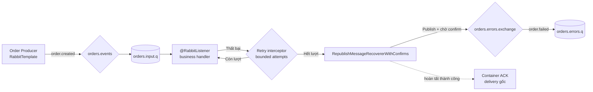
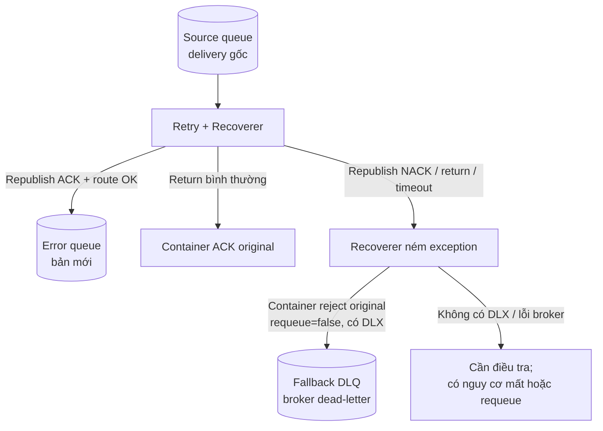
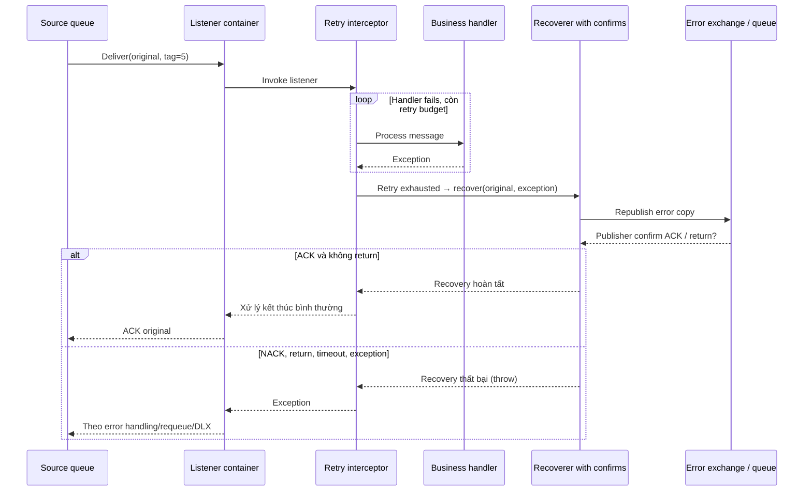
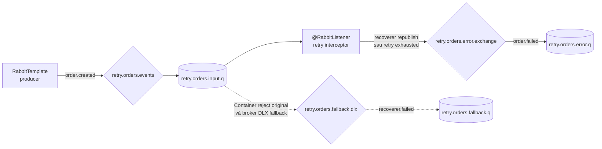

# RepublishMessageRecovererWithConfirms và độ tin cậy khi chuyển lỗi

Một listener Spring AMQP đọc sự kiện `order.created`, gọi dịch vụ nghiệp vụ và gặp lỗi liên tiếp. Sau số lần retry cho phép, ứng dụng muốn đưa message vào một **error queue** để điều tra hoặc xử lý sau. Thao tác tưởng đơn giản:

```java
rabbitTemplate.send("orders.error.exchange", "order.failed", failedMessage);
```

lại có một rủi ro: lời gọi publish trả về **không chứng minh broker đã nhận và định tuyến message lỗi thành công**. Nếu consumer ACK bản gốc ngay lúc đó, trong khi bản sao gửi tới error queue chưa tới nơi, message có thể bị mất khỏi cả hai luồng.

Spring AMQP cung cấp **`RepublishMessageRecovererWithConfirms`** để giảm rủi ro này: sau khi chính sách retry cạn, recoverer **republish** message lỗi và **đợi publisher confirmation** trước khi hoàn tất. Với `ConfirmType.CORRELATED`, nó còn kiểm tra publisher return để phát hiện message **không route được**. Tuy nhiên, **republish và ACK message gốc vẫn không phải một transaction nguyên tử**; phải thiết kế cả nhánh thành công, thất bại và kết quả không chắc chắn.

Bài thuộc chương **Thử lại thông điệp** của module **SPRING_AMQP**: học cách xây dựng xử lý bất đồng bộ tin cậy bằng `RabbitTemplate`, `@RabbitListener`, exchange, queue, binding, publisher confirms/returns, consumer ACK, retry, dead-letter, transaction và giám sát. Chủ đề xuyên suốt là **độ tin cậy khi chuyển message lỗi sau khi retry hết lượt**.

Sau bài học, bạn có thể:

1. Phân biệt broker dead-lettering với việc ứng dụng chủ động republish message lỗi.
2. Giải thích vai trò của `MessageRecoverer`, stateless retry interceptor và `RepublishMessageRecovererWithConfirms`.
3. Phân biệt xác nhận `SIMPLE`, `CORRELATED`, publisher ACK/NACK, publisher return và timeout.
4. Dự đoán điều gì xảy ra với **delivery ban đầu** khi republish có hoặc không có confirm.
5. Tạo Spring Boot demo chuyển message thất bại sang error queue có publisher confirms và một queue fallback.
6. Nhận biết các **cửa sổ lỗi** có thể gây mất message hoặc message trùng.
7. Thiết kế observability, idempotency, outbox, retry giới hạn và quy trình replay có kiểm soát.

## 1. Ba giai đoạn: xử lý, thử lại, phục hồi

Một luồng tiêu thụ thường có các giai đoạn:

1. **Receive:** RabbitMQ giao message qua queue/consumer đến listener container.
2. **Retry:** handler ném exception, interceptor thử lại theo chính sách, có thể chờ backoff.
3. **Recovery:** sau khi retry exhausted, recoverer chọn hành động cuối — reject để broker dead-letter, log/discard, requeue, hoặc republish sang luồng lỗi.



Đường đứt diễn tả hành vi **khi recoverer hoàn thành bình thường và listener container dùng acknowledge mode phù hợp**. Nó không có nghĩa broker tự chuyển bản gốc sang DLQ: trong trường hợp này **ứng dụng tạo một lần publish mới**.

### 1.1. Tại sao không chỉ gọi RepublishMessageRecoverer?

Spring AMQP có `RepublishMessageRecoverer` từ lâu để chuyển message lỗi sang một exchange chỉ định, thường kèm metadata mô tả exception. Nó giúp giữ message lỗi cho việc phân tích.

Nhưng bản thông thường không bắt buộc phải đợi kết quả publisher confirm trước khi recoverer return. Khi recoverer return bình thường, listener container có thể xử lý delivery gốc như thành công và ACK. Nếu bản publish lỗi chưa được broker xác nhận, đây là một khoảng hở về độ tin cậy.

**`RepublishMessageRecovererWithConfirms`** là lớp kế thừa bổ sung chặng **đợi confirms/returns** trước khi coi recovery hoàn tất. Nó được Spring AMQP giới thiệu từ **2.3.3**; các API trong bài dùng cú pháp hiện hành của Spring AMQP 4.x.

### 1.2. Các chiến lược cuối retry khác nhau

| Recoverer/cách làm | Hành động sau khi retry cạn | Đặc điểm |
|---|---|---|
| Default recoverer của cấu hình retry thông thường | Có thể log và tiêu thụ lỗi theo cách mặc định | Không mặc định là “đưa message vào DLQ” |
| `RejectAndDontRequeueRecoverer` | Yêu cầu reject, không requeue | Broker có thể dead-letter **message gốc** khi queue có DLX |
| `ImmediateRequeueMessageRecoverer` | Yêu cầu requeue ngay | Có thể dẫn đến redelivery nóng nếu lỗi không biến mất |
| `RepublishMessageRecoverer` | Chủ động phát message lỗi tới exchange/routing key | Không buộc chờ broker confirm cho bản republish |
| **`RepublishMessageRecovererWithConfirms`** | Republish **và chờ publisher confirm**; với `CORRELATED` có thể phát hiện return | Giảm nguy cơ ACK bản gốc quá sớm nhưng không loại bỏ mọi cửa sổ lỗi |

Không lựa chọn nào tự biến thao tác tiêu thụ, publish và ghi database thành **exactly-once transaction**.

## 2. Republish khác broker dead-letter ra sao?

Hai cơ chế có thể đưa message đến các queue chứa lỗi, nhưng nguồn tạo hành động khác nhau.

| Khía cạnh | **Broker DLX / dead-letter** | **Application republish recoverer** |
|---|---|---|
| Ai định tuyến message lỗi? | RabbitMQ sau điều kiện dead-letter | Code Spring AMQP dùng `RabbitTemplate` |
| Điều kiện kích hoạt | Reject/NACK không requeue, TTL, overflow, delivery limit phù hợp | Retry interceptor gọi recoverer sau khi hết lượt |
| Có lần publish riêng từ ứng dụng? | Không theo cơ chế client republish | **Có** |
| Thông tin exception Java | Broker không tự biết stack trace Java | Recoverer có thể thêm header về exception |
| Xác nhận đường chuyển | Theo cơ chế dead-letter và queue type/broker config | Có thể đợi publisher confirms/returns bằng recoverer with confirms |
| Trạng thái message gốc | Bị loại khỏi source queue theo điều kiện broker | Container xử lý ACK/NACK sau kết quả recoverer |
| Nguy cơ khi lỗi | DLX thiếu binding, đích không sẵn sàng; bảo đảm theo queue type | Republish thất bại, confirm timeout, ACK gốc chưa gửi hoặc mất |

**Điểm rất quan trọng:** khi `RepublishMessageRecovererWithConfirms` republish **thành công** và recoverer return bình thường, container AUTO thường ACK **message gốc**. RabbitMQ **không tiếp tục dead-letter message gốc** chỉ vì source queue có khai báo DLX.

Một DLX trên source queue vẫn có thể hữu ích làm **tuyến fallback** khi recoverer **ném exception** và container reject original không requeue, nhưng đây là một nhánh khác, không phải cùng hành động republish.



Sơ đồ giả định listener container ở **AUTO** và cấu hình xử lý exception khi recoverer thất bại đã được lựa chọn như ví dụ bên dưới. Với MANUAL, transaction hoặc policies khác, kết quả phải được kiểm tra theo hợp đồng của cấu hình đó.

## 3. Publisher confirms và returns: hai câu hỏi khác nhau

Đối với bản republish lỗi, cần trả lời đồng thời:

1. **Broker có xác nhận lần publish?** → Publisher confirm ACK/NACK.
2. **Message có queue đích hay bị trả về?** → Publisher return khi `mandatory=true` và returns được bật.

Một exchange tồn tại nhưng **không có binding phù hợp** có thể phát publisher confirm **ACK** vì broker đã xử lý publish, đồng thời trả message về với `replyText=NO_ROUTE`. Nếu chỉ kiểm tra ACK, message có thể **không nằm trong error queue**.

### 3.1. Các kết quả quan trọng

| Lần publish sang error exchange | Confirm | Return | Recovery cần hiểu |
|---|---|---|---|
| Exchange có binding đúng, broker chấp nhận | ACK | Không | Có căn cứ coi republish đã được broker xác nhận theo semantics của queue/exchange |
| Exchange tồn tại, key không khớp, mandatory bật | Có thể ACK | **Có, thường NO_ROUTE** | **Không** được coi là chuyển thành công vào error queue |
| Broker NACK lần publish | **NACK** | Có thể không | Recoverer cần báo thất bại |
| Không nhận được confirm trong deadline | **Không chắc chắn** | Có thể chưa có | Có thể broker đã nhận; không được suy rằng chắc chắn chưa publish |
| Exchange không tồn tại | Lỗi channel/negative outcome tùy thời điểm | Không phải trường hợp NO_ROUTE điển hình | Lỗi cấu hình/topology cần điều tra |
| Confirm ACK nhưng error consumer sau đó lỗi | ACK | Không | Publisher confirm không bảo đảm handler error queue đã xử lý xong |

### 3.2. CORRELATED và SIMPLE

`RepublishMessageRecovererWithConfirms` hỗ trợ cả hai kiểu confirm:

| ConfirmType | Cách kiểm tra của recoverer | Mạnh ở đâu? | Giới hạn |
|---|---|---|---|
| **`CORRELATED`** | Gắn thông tin tương quan với lần republish, đợi confirm; phát hiện return nếu bật đúng cấu hình | Biết ACK/NACK và có thể biết message không route được | Không bảo đảm consumer xử lý; timeout còn mơ hồ |
| **`SIMPLE`** | Gọi `waitForConfirmsOrDie()` trên channel | Chờ channel confirm theo cơ chế đơn giản | Không thay thế đầy đủ khả năng ghép publisher return của `CORRELATED` |
| Không dùng confirms | Không đợi broker xác nhận | Cấu hình đơn giản | Dễ coi recovery thành công quá sớm |

Với mục tiêu **chuyển lỗi tới một queue xác định**, `CORRELATED` cộng `mandatory=true` và publisher returns thường là lựa chọn đáng cân nhắc vì phát hiện được đường **unroutable**.

### 3.3. Các exception đáng nhận diện

Theo Spring AMQP:

- `AmqpNackReceivedException`: broker gửi negative acknowledgement cho lần republish trong chế độ correlated.
- `AmqpMessageReturnedException`: message được broker trả về vì không định tuyến được theo điều kiện publisher return.
- Timeout confirm hoặc lỗi connection/channel: recoverer không có kết luận thành công và có thể ném exception tương ứng.

Không nên bắt mọi exception rồi log và **return bình thường**, vì container có thể xem message ban đầu đã được recovery thành công và ACK nó.

### 3.4. setConfirmTimeout làm gì?

Recoverer có:

```java
recoverer.setConfirmTimeout(10_000L);
```

Đơn vị là **mili giây**, mặc định API là **10 giây**. Deadline này giới hạn thời gian recoverer đợi kết quả xác nhận, **không** là TTL của message, không giới hạn thời gian handler nghiệp vụ và không bảo đảm broker hoàn toàn không nhận publish nếu hết hạn.

Nếu hết hạn ở 10 giây, kết luận đúng là **“không có xác nhận chắc chắn trong 10 giây”**, chứ không phải “error message chắc chắn chưa tới broker”.

## 4. Thứ tự thực hiện và vị trí ACK message gốc

Xét một consumer `AUTO` có retry interceptor:



**Đây là độ tin cậy bổ sung thật sự của lớp `WithConfirms`:** thay vì “đã gọi publish”, nó chờ broker có phản hồi phù hợp trước khi nhường cho container hoàn thành delivery gốc.

Tuy nhiên, hai bước sau vẫn tách biệt:

1. Broker xác nhận publish **bản lỗi**.
2. Consumer/container ACK **delivery gốc**.

Nếu process chết **giữa hai bước**, bản lỗi có thể đã vào error queue, nhưng message gốc chưa ACK và sẽ được broker giao lại sau reconnect. Kết quả có thể là **hai bản lỗi của cùng một event**.

### 4.1. Bảo đảm thực tế

Có thể kỳ vọng:

- Giảm rủi ro **ACK original trước khi biết lỗi republish**.
- Phát hiện NACK, return hoặc timeout và cho container có cơ hội xử lý delivery gốc theo chính sách.
- Giữ metadata lỗi và nguồn gốc message trong bản republish.
- Cho phép quan sát chuyển lỗi bằng publisher confirms/returns.

**Không thể kỳ vọng:**

- Một transaction nguyên tử giữa source queue và error queue chỉ từ confirms.
- Exactly-once transfer hoặc exactly-once business processing.
- Broker confirm thay thế consumer ACK của error worker.
- Mọi loại mất mạng/timeout cho biết chắc broker đã hay chưa nhận message.
- Một error queue không bền vững tự trở thành bền vững chỉ vì publisher ACK.

### 4.2. Bảng cửa sổ lỗi

| Thời điểm xảy ra sự cố | Hậu quả có thể xảy ra | Cách giảm rủi ro |
|---|---|---|
| Trước khi republish | Original còn unacked hoặc được xử lý lỗi theo container | Requeue/recovery fallback có kiểm soát |
| Trong lúc publish, chưa có confirm | Không biết bản lỗi đã được broker nhận hay chưa | Timeout + exception, giữ ID ổn định, idempotency |
| Broker NACK | Republish chưa được xác nhận thành công | Không coi recovery là completed |
| Broker return NO_ROUTE | Không có queue đích theo điều kiện return | Mandatory/returns, sửa binding và cảnh báo |
| Error queue có message nhưng original chưa ACK | Có thể **hai bản** sau redelivery original | Dedupe theo event ID/recovery key |
| Original đã ACK, error queue sau đó bị mất do cấu hình/durability | Dữ liệu lỗi không được bảo vệ như kỳ vọng | Durable queue, persistent message, publisher confirms, HA policies |
| Container bỏ qua exception recoverer | Original có thể bị ACK/loại bỏ theo đường sai | Không nuốt exception; test trạng thái thất bại |
| DLX fallback cũng sai routing | Message gốc có thể mất dấu | Tách biệt fallback, test topology và alert |

## 5. Chọn stateless retry hay stateful retry?

Spring AMQP cung cấp retry interceptor, recoverer được gọi khi retry policy exhausted.

**Stateless retry** thử lại trong cùng lời gọi xử lý của listener, thuận tiện khi xử lý độc lập và **không có transaction ngoài cùng phải rollback trên mỗi lần retry**.

**Stateful retry** giữ trạng thái retry xuyên qua delivery và thích hợp hơn trong một số tình huống transaction bao ngoài, nhưng cần cơ chế nhận diện message ổn định (thường `messageId`). Nếu thiếu message ID hoặc mapping sai, chính sách stateful có thể xử lý tình huống khác kỳ vọng.

| Tiêu chí | Stateless retry | Stateful retry |
|---|---|---|
| Tính đơn giản | Dễ xây cho lab, mỗi lần delivery xử lý trong một scope | Cần message identity và lifecycle retry state |
| Transaction ngoài handler | Không nên dùng nếu transaction bao ngoài buộc rollback mỗi lần | Thường thích hợp hơn |
| Backoff | Có thể cấu hình | Có thể cấu hình |
| Recoverer khi cạn | Có | Có |
| Chống xử lý trùng sau reconnect | **Không** | **Không tự thay thế idempotency** |
| Cửa sổ republish rồi mất ACK | Vẫn có | Vẫn có |

Trong bài lab, ta chọn **stateless retry** để tập trung vào publisher confirms của recoverer. Khi chuyển vào production có database transaction, hãy đánh giá stateful retry, idempotency và transaction boundaries thay vì copy cấu hình nguyên xi.

### 5.1. maxRetries khác maxAttempts giữa thế hệ API

Trong Spring AMQP 4.2 dùng Spring Framework 7 retry abstractions, builder có:

```java
RetryInterceptorBuilder.stateless()
        .maxRetries(2)
        .backOffOptions(500, 2.0, 2_000)
        .recoverer(recoverer)
        .build();
```

`maxRetries(2)` đặt tối đa hai lượt retry **sau lần xử lý đầu**, nghĩa là tối đa khoảng **ba lần gọi handler** khi tất cả đều thất bại. Các tài liệu/phiên bản Spring AMQP cũ có API `maxAttempts(3)` — số này tính cả lần gọi đầu. **Chọn đúng API theo version đang biên dịch**, không thay tên cơ học.

Backoff `500, 2.0, 2000` có nghĩa thời gian nghỉ ban đầu khoảng 500 ms, nhân 2 qua các lần và không vượt 2.000 ms. Đó là local retry, có thể giữ thread consumer trong thời gian đợi; nếu một dependency hỏng hàng phút, cần cân nhắc circuit breaker hoặc retry queue/broker theo lịch.

## 6. Ví dụ Spring Boot: republish sang error queue với CORRELATED confirms

Bài lab minh họa toàn bộ chuỗi:

- Producer dùng `RabbitTemplate` gửi message chuỗi tới direct exchange.
- Main queue cung cấp delivery cho `@RabbitListener`.
- Listener cố ý ném lỗi với event ID bắt đầu `fail-`.
- Retry interceptor thử lại có giới hạn.
- `RepublishMessageRecovererWithConfirms` chuyển lỗi tới error exchange và **đợi confirm**.
- Error queue giữ message để người học quan sát.
- Main queue có một **broker DLX fallback riêng** để quan sát nhánh recoverer không thể republish.

### 6.1. Chuẩn bị RabbitMQ

Với Docker trên máy thực hành:

```bash
docker run -d --rm --name rabbitmq-republish-lab -p 5672:5672 -p 15672:15672 -e RABBITMQ_DEFAULT_USER=demo -e RABBITMQ_DEFAULT_PASS=demo-local-only rabbitmq:4-management
```

Cổng và đăng nhập:

- RabbitMQ AMQP: `localhost:5672`.
- Management UI: `http://localhost:15672`.
- Lab username/password: `demo` / `demo-local-only`.

Đây là cấu hình demo một node, không phải mô hình HA. Không dùng credentials demo hoặc mở cổng quản trị rộng trong production.

### 6.2. Chọn dependencies phù hợp

Với **Spring Boot 4.2.x + Spring AMQP 4.2.x + RabbitMQ AMQP 0-9-1**, sử dụng:

```groovy
dependencies {
    implementation 'org.springframework.boot:spring-boot-starter-rabbitmq'
    implementation 'org.springframework.boot:spring-boot-starter-web'
}
```

Với **Spring Boot 3.x hoặc 4.0–4.1**, starter RabbitMQ AMQP 0-9-1 thường có tên `spring-boot-starter-amqp`. Trong Boot 4.2, tên đó dành cho tích hợp AMQP 1.0; muốn dùng `RabbitTemplate` của RabbitMQ AMQP 0-9-1 thì chọn `spring-boot-starter-rabbitmq`.

**Lưu ý phiên bản retry:** Spring AMQP 4.x mới dùng các retry abstractions của Spring Framework 7 cho một số interceptor; ví dụ dưới đây dùng `org.springframework.amqp.rabbit.config.StatelessRetryOperationsInterceptor` của Spring AMQP 4.2. Với Spring AMQP 3.x, kiểu interceptor và builder/dependency liên quan Spring Retry có thể khác. Đừng trộn import của hai thế hệ.

### 6.3. application.yml

```yaml
spring:
  rabbitmq:
    host: localhost
    port: 5672
    username: demo
    password: demo-local-only

    publisher-confirm-type: correlated
    publisher-returns: true
    template:
      mandatory: true

    listener:
      type: simple
      simple:
        concurrency: 1
        max-concurrency: 1
        prefetch: 5
        acknowledge-mode: auto
```

Ba cấu hình cần đi cùng nhau trong bài lab:

- `publisher-confirm-type: correlated`: connection factory bật correlated publisher confirmations.
- `publisher-returns: true`: nhận các message bị broker trả về theo cơ chế return.
- `template.mandatory: true`: yêu cầu return khi exchange tồn tại nhưng không có route phù hợp; thiếu nó có thể tạo **ACK nhưng message không đến error queue** mà recoverer không phát hiện.

**Chú ý:** nếu tự tạo `RabbitTemplate` thay thế bean tự cấu hình của Boot, phải chắc rằng template **thực tế được recoverer dùng** cũng có mandatory=true và connection factory hỗ trợ correlated confirms/returns. Chỉ thay property trên một template khác không đủ.

### 6.4. Khai báo topology: ba đường đi rõ ràng

Tạo file `RetryRoutes.java` trong package được Spring Boot quét:

```java
import org.springframework.amqp.core.Binding;
import org.springframework.amqp.core.BindingBuilder;
import org.springframework.amqp.core.DirectExchange;
import org.springframework.amqp.core.Queue;
import org.springframework.amqp.core.QueueBuilder;
import org.springframework.beans.factory.annotation.Qualifier;
import org.springframework.context.annotation.Bean;
import org.springframework.context.annotation.Configuration;

@Configuration
public class RetryRoutes {

    public static final String MAIN_EXCHANGE = "retry.orders.events";
    public static final String MAIN_QUEUE = "retry.orders.input.q";
    public static final String MAIN_KEY = "order.created";

    public static final String ERROR_EXCHANGE = "retry.orders.error.exchange";
    public static final String ERROR_QUEUE = "retry.orders.error.q";
    public static final String ERROR_KEY = "order.failed";

    // Dành cho trường hợp application republish không hoàn tất.
    public static final String FALLBACK_DLX = "retry.orders.fallback.dlx";
    public static final String FALLBACK_QUEUE = "retry.orders.fallback.q";
    public static final String FALLBACK_KEY = "recoverer.failed";

    @Bean
    DirectExchange mainExchange() {
        return new DirectExchange(MAIN_EXCHANGE, true, false);
    }

    @Bean
    DirectExchange errorExchange() {
        return new DirectExchange(ERROR_EXCHANGE, true, false);
    }

    @Bean
    DirectExchange fallbackExchange() {
        return new DirectExchange(FALLBACK_DLX, true, false);
    }

    @Bean
    Queue mainQueue() {
        return QueueBuilder.durable(MAIN_QUEUE)
                .deadLetterExchange(FALLBACK_DLX)
                .deadLetterRoutingKey(FALLBACK_KEY)
                .build();
    }

    @Bean
    Queue errorQueue() {
        return QueueBuilder.durable(ERROR_QUEUE).build();
    }

    @Bean
    Queue fallbackQueue() {
        return QueueBuilder.durable(FALLBACK_QUEUE).build();
    }

    @Bean
    Binding mainBinding(
            @Qualifier("mainQueue") Queue queue,
            @Qualifier("mainExchange") DirectExchange exchange) {
        return BindingBuilder.bind(queue)
                .to(exchange).with(MAIN_KEY);
    }

    @Bean
    Binding errorBinding(
            @Qualifier("errorQueue") Queue queue,
            @Qualifier("errorExchange") DirectExchange exchange) {
        return BindingBuilder.bind(queue)
                .to(exchange).with(ERROR_KEY);
    }

    @Bean
    Binding fallbackBinding(
            @Qualifier("fallbackQueue") Queue queue,
            @Qualifier("fallbackExchange") DirectExchange exchange) {
        return BindingBuilder.bind(queue)
                .to(exchange).with(FALLBACK_KEY);
    }
}
```

Sơ đồ topology:



**Phân biệt error queue và fallback queue:** error queue nhận bản republish có metadata exception của ứng dụng; fallback queue chỉ có thể nhận original qua broker DLX nếu container xử lý thất bại bằng reject không requeue, và broker/route còn hoạt động. Khi thành công, original được ACK và **không** dead-letter tới fallback.

Trong production, để điều chỉnh DLX mà không phải redeclare queue với x-arguments khác nhau, cân nhắc policy RabbitMQ khi thuộc tính hỗ trợ policy.

### 6.5. Cấu hình recoverer và retry interceptor

Tạo file `ErrorRecoveryConfiguration.java`:

```java
import org.springframework.amqp.core.AcknowledgeMode;
import org.springframework.amqp.rabbit.config.RetryInterceptorBuilder;
import org.springframework.amqp.rabbit.config.SimpleRabbitListenerContainerFactory;
import org.springframework.amqp.rabbit.config.StatelessRetryOperationsInterceptor;
import org.springframework.amqp.rabbit.connection.CachingConnectionFactory;
import org.springframework.amqp.rabbit.connection.ConnectionFactory;
import org.springframework.amqp.rabbit.core.RabbitTemplate;
import org.springframework.amqp.rabbit.retry.RepublishMessageRecovererWithConfirms;
import org.springframework.context.annotation.Bean;
import org.springframework.context.annotation.Configuration;

@Configuration
public class ErrorRecoveryConfiguration {

    @Bean
    RepublishMessageRecovererWithConfirms errorRecoverer(
            RabbitTemplate rabbitTemplate) {

        var recoverer = new RepublishMessageRecovererWithConfirms(
                rabbitTemplate,
                RetryRoutes.ERROR_EXCHANGE,
                RetryRoutes.ERROR_KEY,
                CachingConnectionFactory.ConfirmType.CORRELATED);

        // Chỉ giới hạn thời gian chờ kết quả confirm.
        recoverer.setConfirmTimeout(10_000L);
        return recoverer;
    }

    @Bean
    StatelessRetryOperationsInterceptor retryAdvice(
            RepublishMessageRecovererWithConfirms errorRecoverer) {

        return RetryInterceptorBuilder.stateless()
                .maxRetries(2)
                .backOffOptions(500, 2.0, 2_000)
                .recoverer(errorRecoverer)
                .build();
    }

    @Bean
    SimpleRabbitListenerContainerFactory retryListenerFactory(
            ConnectionFactory connectionFactory,
            StatelessRetryOperationsInterceptor retryAdvice) {

        var factory = new SimpleRabbitListenerContainerFactory();
        factory.setConnectionFactory(connectionFactory);
        factory.setAcknowledgeMode(AcknowledgeMode.AUTO);
        factory.setPrefetchCount(5);
        factory.setConcurrentConsumers(1);

        factory.setAdviceChain(retryAdvice);

        // Chỉ demo: recoverer thất bại -> exception đi ra container;
        // reject original, broker có thể dùng fallback DLX.
        factory.setDefaultRequeueRejected(false);
        return factory;
    }
}
```

**Giải thích bốn điểm quyết định:**

1. `RepublishMessageRecovererWithConfirms` dùng chính `RabbitTemplate` đã cấu hình correlated confirms và returns.
2. `maxRetries(2)` giới hạn retry của handler; khi vẫn thất bại, `recoverer(...)` được gọi. Không viết vòng `while(true)` retry riêng.
3. `setAdviceChain(retryAdvice)` đưa interceptor vào **listener container factory**. Đừng chỉ tạo bean interceptor rồi mong rằng mọi listener đều tự dùng nó.
4. `setDefaultRequeueRejected(false)` được chọn để minh họa **fallback broker DLX khi recoverer ném exception**. Nó ảnh hưởng cả các exception khác thoát lên container; production phải phân loại lỗi và thiết kế rõ ràng, không copy cờ này vô điều kiện.

**Quan trọng về ACK mode:** ví dụ dùng `AUTO`. Khi recoverer return bình thường, container ACK original. Nếu thay bằng `MANUAL`, bạn phải xây dựng và kiểm thử cơ chế ACK riêng; không có bảo đảm rằng recoverer tự ACK mọi delivery của handler MANUAL.

### 6.6. Listener cố ý thất bại với event ID dạng fail-*

Tạo file `RetryOrderListener.java`:

```java
import org.springframework.amqp.rabbit.annotation.RabbitListener;
import org.springframework.stereotype.Component;

@Component
public class RetryOrderListener {

    @RabbitListener(
            id = "retryOrdersListener",
            queues = RetryRoutes.MAIN_QUEUE,
            containerFactory = "retryListenerFactory")
    public void handle(String eventId) {

        System.out.println("HANDLER_ATTEMPT eventId=" + eventId);

        if (eventId.startsWith("fail-")) {
            throw new IllegalStateException(
                    "Simulated downstream failure: " + eventId);
        }

        System.out.println("HANDLER_SUCCESS eventId=" + eventId);
    }
}
```

Trong bài lab, một event `fail-100` sẽ thất bại đủ số lần và đi vào recoverer. Một event `evt-101` xử lý thành công, không cần recoverer.

Trong code thật, listener cần gọi service có transaction/idempotency và phân loại lỗi transient vs permanent. `IllegalStateException` luôn ném lại ở đây chỉ để mô phỏng một poison message có thể quan sát.

### 6.7. Producer và HTTP endpoint

Tạo `RetryDemoPublisher.java`:

```java
import org.springframework.amqp.rabbit.core.RabbitTemplate;
import org.springframework.stereotype.Service;

@Service
public class RetryDemoPublisher {
    private final RabbitTemplate rabbitTemplate;

    public RetryDemoPublisher(RabbitTemplate rabbitTemplate) {
        this.rabbitTemplate = rabbitTemplate;
    }

    public void send(String eventId) {
        rabbitTemplate.convertAndSend(
                RetryRoutes.MAIN_EXCHANGE,
                RetryRoutes.MAIN_KEY,
                eventId);
    }
}
```

Tạo `RetryDemoController.java`:

```java
import org.springframework.http.ResponseEntity;
import org.springframework.web.bind.annotation.PathVariable;
import org.springframework.web.bind.annotation.PostMapping;
import org.springframework.web.bind.annotation.RestController;

@RestController
public class RetryDemoController {
    private final RetryDemoPublisher publisher;

    public RetryDemoController(RetryDemoPublisher publisher) {
        this.publisher = publisher;
    }

    @PostMapping("/lab/retry/{eventId}")
    public ResponseEntity<Void> publish(
            @PathVariable String eventId) {
        publisher.send(eventId);
        return ResponseEntity.accepted().build();
    }
}
```

Đặt các lớp trong cùng package được `@SpringBootApplication` quét rồi khởi động broker và Spring Boot application.

### 6.8. Gửi hai message để so sánh

```bash
curl -X POST http://localhost:8080/lab/retry/evt-101

curl -X POST http://localhost:8080/lab/retry/fail-100
```

Kỳ vọng:

| Event | Handler | Retry | Kết quả cuối nếu broker/topology bình thường |
|---|---|---|---|
| `evt-101` | Thành công | Không cần retry | Container ACK original; không có error copy |
| `fail-100` | Luôn ném exception | Thử lại có giới hạn | Recoverer republish tới `retry.orders.error.q`, chờ correlated confirm và sau đó container ACK original |
| Error exchange tồn tại, binding thiếu | Handler thất bại như trên | Hết retry | Publisher return; recoverer throw; nhánh container failure/fallback có thể được kích hoạt |
| Broker không thể xác nhận republish | Handler thất bại như trên | Hết retry | Timeout/NACK/connection exception; không coi recovery là hoàn tất |

HTTP 202 trong demo **chỉ nói endpoint đã gọi API gửi** và chưa theo dõi publisher confirm của lần gửi ban đầu. Nó không chứng minh listener đã retry xong hoặc error queue đã có message.

### 6.9. Quan sát trong Management UI

Truy cập `http://localhost:15672`, kiểm tra:

- `retry.orders.input.q`: ready/unacknowledged sau khi xử lý.
- `retry.orders.error.q`: body của event lỗi và message properties/headers do recoverer gắn thêm.
- `retry.orders.fallback.q`: trong nhánh chính thường trống.
- Exchange/bindings: confirm ACK chỉ có ý nghĩa đặt trong context topology chính xác.
- App logs: số `HANDLER_ATTEMPT`, exception, tình trạng recoverer và lỗi confirm/return nếu có.

Đừng cố dùng số dòng log làm định danh delivery. Retry trong cùng lời gọi và redelivery sau reconnect là hai cơ chế khác nhau; chúng có thể tạo nhiều log cho cùng event ID.

## 7. Metadata exception của bản republish

`RepublishMessageRecoverer` và lớp `WithConfirms` có thể gắn thêm headers mô tả lỗi và nơi phát message ban đầu. Những header thường đáng quan sát gồm:

| Thông tin | Mục đích |
|---|---|
| Header mô tả exception message | Biết vì sao handler thất bại |
| Header loại exception / stack trace khi được cấu hình | Hỗ trợ điều tra lỗi Java mà không cần chạy lại |
| `x-original-exchange` | Truy nguồn exchange mà message đã đến |
| Header original routing key | Biết routing key trước khi republish |
| Message ID / business `eventId` | Nhận diện cùng sự kiện xuyên các attempt |
| Custom headers/schema version | Phân loại để quyết định sửa, replay hay quarantine |

Tài liệu Spring AMQP 4.2 có lưu ý: **stack trace không còn được bật kèm theo mặc định** do kích thước và thông tin nhạy cảm. Nếu thực sự cần, có thể bật tính năng `includeStackTrace(true)` trên recoverer **khi API phiên bản hỗ trợ**; phải đánh giá giới hạn frame size và chính sách bảo mật.

Trong các phiên bản khác nhau, **tên và nội dung header có thể thay đổi**; tránh viết consumer error queue phụ thuộc mù quáng vào một chuỗi tên header thay vì dùng hằng/API tương ứng với Spring AMQP đang dùng.

### 7.1. Metadata exception không nên chứa secret

Stack trace, SQL, URL hoặc payload có thể chứa PII/token. Khi đưa exception vào header:

- Hạn chế log full stack trace trong mỗi message.
- Không đặt raw access token, password hay connection URL vào exception message.
- Giới hạn frame/header size theo broker/client.
- Cấu hình queue retention, truy cập và audit cho khu vực error/quarantine.
- Giữ event ID và code lỗi ngắn gọn để phân tích nhanh.

**Header không thay thế business event ID.** Để replay một event, cần biết bản gốc thuộc nghiệp vụ nào và đã được áp dụng thành công trước đó hay chưa.

### 7.2. Persistence và message bị republish

Khi consumer nhận message, broker chuyển delivery mode sang received delivery mode trong message properties của Spring. Recoverer có cơ chế cấu hình delivery mode cho bản republish nếu chưa có; giá trị mặc định thông thường của `MessageProperties` là **PERSISTENT**.

Tuy nhiên:

- PERSISTENT message không tự làm một **non-durable queue** trở nên durable.
- Durable queue cũng không đủ nếu message được gửi với non-persistent delivery mode.
- Confirms tăng khả năng biết broker đã xử lý publish theo semantics của đích; không thay thế backup, HA, disk và chính sách lưu trữ.
- Khi dùng quorum queue, cần xét quorum availability và dead-letter semantics riêng.

Với dữ liệu lỗi quan trọng, dùng error queue bền vững và chính sách retention/replication phù hợp.

## 8. Kiểm thử đường lỗi mà không đánh đồng các tình huống

Mục tiêu là **kiểm tra đúng từng tín hiệu**, không chỉ kiểm tra “có message trong queue hay không”.

### 8.1. Happy-path của recovery

1. Main exchange/queue có binding đúng.
2. Error exchange/queue có binding chính xác với `order.failed`.
3. Gửi `fail-200`.
4. Handler lỗi, interceptor thử lại theo budget.
5. Recoverer republish, chờ confirm.
6. Error queue có message, original đã được container ACK.

Đây là bài kiểm tra cần trước khi triển khai. Quan sát đủ source queue, error queue, header lỗi và log confirms nếu có.

### 8.2. Test NO_ROUTE: xóa binding của error queue

**Chỉ trong broker lab tách biệt**, bỏ binding từ `retry.orders.error.exchange` đến `retry.orders.error.q`, nhưng **giữ exchange tồn tại**. Sau đó gửi `fail-201`.

Theo correlated returns/mandatory, message error republish có thể bị broker trả lại với `NO_ROUTE` dù publisher confirm ACK. Recoverer phát hiện return và ném `AmqpMessageReturnedException`; đây là **failure** của recovery, không phải thành công.

Nếu listener container đã cấu hình reject không requeue và source queue có fallback DLX, original **có thể** được broker chuyển tới `retry.orders.fallback.q`. Luôn kiểm tra thực tế: mất broker/channel hoặc fallback binding sai vẫn có thể khiến kết quả khác.

### 8.3. Test publisher NACK

Publisher NACK khó tái tạo quyết định chỉ bằng việc chỉnh routing key; `NO_ROUTE` thông thường là publisher return **kèm ACK**, không phải NACK. Dùng môi trường test có cơ chế kiểm soát broker/proxy hoặc mô phỏng recoverer khi cần xác minh đường `AmqpNackReceivedException`.

Tuyệt đối không suy luận “binding sai sẽ tạo NACK” rồi viết logic retry chỉ bắt NACK.

### 8.4. Test confirm timeout / kết quả UNKNOWN

Trong lab/staging, mô phỏng mất mạng hoặc broker chậm ngay sau khi recoverer bắt đầu gửi; quan sát timeout theo `setConfirmTimeout(...)` và nhánh container xử lý exception.

Đừng cho rằng timeout nghĩa là **chưa có bản republish**: broker có thể đã nhận message, chỉ là confirm chưa tới consumer process. Khi reconnect, original có thể redeliver và phát thêm bản lỗi.

### 8.5. Test crash sau confirm nhưng trước original ACK

Đây là cửa sổ mất tính nguyên tử quan trọng. Có thể mô phỏng trong test tích hợp bằng cách điều khiển thời điểm dừng consumer/container sau khi recovery đã được broker xác nhận nhưng trước khi ACK original được broker ghi nhận.

Kỳ vọng có thể là:

- Error queue đã có bản `fail-202`.
- Original chưa ACK nên được giao lại sau reconnect.
- Nó tiếp tục thất bại, recoverer republish thêm bản `fail-202`.
- Error queue chứa hai bản cho cùng event ID.

**Thử nghiệm này chứng minh nhu cầu idempotency**, không phải lỗi của confirms.

## 9. Vì sao recoverer trả về bình thường là tín hiệu mạnh?

Trong listener container AUTO, cơ chế xử lý thường dựa vào việc listener/retry advice có kết thúc bình thường hay ném exception.

- Recoverer **return bình thường**: retry interceptor coi recovery đã xử lý, container có thể ACK original.
- Recoverer **ném exception**: lỗi đi lên container, áp dụng retry/error handling/requeue/reject của delivery gốc theo cấu hình.
- Lỗi trước khi handler được gọi (conversion/argument resolution) có thể được xử lý bởi container error handler theo nhánh khác; không giả định mọi lỗi đều vào retry advice.

**Đừng biến recoverer thành đoạn mã “best effort” bắt hết exception rồi return**:

```java
// Phản ví dụ: có thể làm container ACK original dù publish lỗi.
try {
    rabbitTemplate.send(ERROR_EXCHANGE, ERROR_KEY, message);
} catch (Exception publishError) {
    log.error("Failed to republish", publishError);
    // Nuốt lỗi -> phía container có thể xem là recovered.
}
```

Nếu xây recoverer tùy biến, phải quy định rõ điều kiện return/throw và lựa chọn kết quả của original. Lớp `RepublishMessageRecovererWithConfirms` cung cấp hành vi chờ xác nhận để tránh tự viết nhầm bước quan trọng này.

### 9.1. ACK original còn phụ thuộc container mode

| Container mode | Sau recoverer return bình thường |
|---|---|
| `AUTO` | Container thường ACK original theo cơ chế thành công |
| `MANUAL` | Handler hoặc cơ chế được hỗ trợ phải đảm bảo ACK/NACK; không copy mô hình AUTO mà kỳ vọng recoverer tự xác nhận |
| `NONE` | Broker không chờ ACK của consumer; không dùng để bảo đảm giữ original khi republish lỗi |

Vì vậy, với recoverer cần **bảo vệ đường chuyển lỗi**, ví dụ mặc định dùng `AUTO` để tận dụng trình tự “recoverer confirm → container ACK original”. Với `MANUAL`, phải thiết kế thêm và kiểm chứng rất kỹ quyền sở hữu channel/delivery tag, rủi ro double ACK và tình huống handler không được gọi.

### 9.2. NACK/requeue sau recoverer lỗi là quyết định nghiệp vụ

Nếu republish thất bại, có nhiều cách để giữ original:

1. **Requeue** original, sau đó thử lại sau khi hạ tầng khôi phục. Cần backoff/giới hạn để tránh hot redelivery.
2. **Reject không requeue + broker DLX fallback**. Hữu ích khi fallback topology chắc chắn khác tuyến lỗi republish và broker vẫn có thể xử lý dead-letter.
3. **Stop/pause listener** và xử lý vận hành, để original không bị tiếp tục xử lý mù quáng; phải xét unacked và shutdown behavior.
4. **Ghi trạng thái vào hệ thống bền vững** trước khi ACK theo kiến trúc riêng (outbox/inbox), rồi chuyển lỗi ở một worker khác.

Ví dụ dùng nhánh 2 để quan sát, **không cam kết đây là lựa chọn phù hợp mọi production**. Nếu recoverer thất bại vì cả broker unavailable, fallback DLX trên broker đó cũng có thể không hoạt động đúng kỳ vọng ngay lúc ấy.

## 10. Kiểm soát trùng và idempotency khi chuyển lỗi

Giả sử original có `eventId=evt-300`. Sau retry exhausted:

```text
Delivery 1:
  republish(evt-300) -> broker ACK
  process crash trước khi ACK original

Delivery 2 (redelivery original):
  republish(evt-300) -> broker ACK
  container ACK original thành công

Error queue có thể chứa:
  error-copy-1 của evt-300
  error-copy-2 của evt-300
```

**Điều không được làm:** dùng `deliveryTag` hay số thứ tự callback confirm làm khóa để nhận diện bản lỗi trùng. Delivery tag đổi theo channel/redelivery, còn publisher confirm correlation thuộc từng publish attempt.

### 10.1. Hai loại ID

| ID | Ý nghĩa | Khi chuyển lỗi/retry |
|---|---|---|
| `eventId` | Danh tính nghiệp vụ của một event | **Giữ ổn định** |
| `publishAttemptId` | Danh tính một lần publish/recover | Có thể tạo mới mỗi lần |
| `messageId` | AMQP property do producer đặt theo hợp đồng | Nên ổn định hoặc được mapping rõ |
| `deliveryTag` | ID delivery trên channel consumer | Không dùng để dedupe xuyên redelivery |
| `CorrelationData.id` | Liên hệ publisher confirm với attempt | Không đồng nhất với eventId nếu có retry |

Trong error queue, có thể bổ sung `eventId`, error category và logical recovery ID để operator biết hai bản lỗi thuộc cùng sự kiện. Khi phát lại, dùng một hệ thống **idempotent consumer** để không tạo tác dụng phụ lặp.

### 10.2. Một mẫu xử lý chống trùng

```sql
CREATE TABLE processed_events (
    event_id VARCHAR(128) PRIMARY KEY,
    processed_at TIMESTAMP NOT NULL
);
```

Trong handler business:

```text
BEGIN DB TRANSACTION
  INSERT processed_events(event_id) với unique constraint

  nếu đã xử lý:
      bỏ qua tác dụng phụ trùng
  nếu mới:
      áp dụng nghiệp vụ + cập nhật trạng thái
COMMIT

Handler trả về bình thường -> container ACK
```

Dùng transaction cho dấu đã xử lý và thay đổi nghiệp vụ; không dựa vào một `HashSet` trong RAM. Đối với error queue/quarantine, consumer/worker xử lý replay cũng cần trạng thái duy nhất hoặc chính sách duplicate rõ ràng.

### 10.3. Transactional outbox hỗ trợ gì?

Nếu Order Service cần ghi đơn và phát event:

- Ghi bản ghi nghiệp vụ + outbox event trong **một database transaction**.
- Một worker publish từ outbox, theo dõi confirms/returns và retry khi kết quả không chắc chắn.
- Consumer xử lý event idempotent.
- Khi consumer không thể xử lý sau bounded retries, recoverer chuyển message sang error queue với confirms.

Outbox giúp tránh **DB commit nhưng event chưa được phát**. Recoverer with confirms giúp tránh **ACK original khi chưa có kết quả chuyển lỗi**. Hai cơ chế giải quyết **hai cửa sổ lỗi khác nhau** và không cộng lại thành exactly-once tự động.

## 11. Transaction, confirm và độ bền dữ liệu

### 11.1. Publisher confirm không phải transaction

Publisher confirm là tín hiệu broker trả về về **một lần publish**, không phải transaction hai pha giữa:

- Message đang unacked ở source queue.
- Message mới được publish sang error queue.
- Database của handler.
- External API hoặc email service.

Ngay cả khi cả source và error queue nằm trên cùng broker, việc chuyển bằng client publish rồi ACK original vẫn là **hai hành động logic**. Nếu muốn một ranh giới commit khác, phải đánh giá RabbitMQ channel transactions và semantics Spring AMQP tương ứng; không mặc định bản republish có cùng transaction với consumer chỉ vì cùng `ConnectionFactory`.

### 11.2. Durable không có nghĩa “không bao giờ mất”

Độ tin cậy còn phụ thuộc:

- Queue có durable hay không.
- Delivery mode persistent/non-persistent của message.
- Queue type (classic/quorum) và bảo đảm ghi/replication của broker.
- Khả năng route đúng queue với returns/mandatory.
- Broker cluster/network partition và recovery.
- TTL, max-length, overflow hoặc operator policy có thể loại bỏ message sau khi publish.

Một `publisher confirm ACK` là điều kiện quan trọng nhưng **không đồng nghĩa error event được giữ vô hạn hoặc đã được xử lý**. Đặt retention, monitoring và khả năng replay phù hợp với yêu cầu nghiệp vụ.

### 11.3. Quorum queue và dead-letter strategy

Với quorum queue, các tính năng như delivery limit, dead-letter strategy và quorum availability có cơ chế riêng. Không suy từ một bài lab classic/durable queue rằng mọi queue type đều có độ bền giống nhau.

Nếu dùng **broker dead-letter** thay republish, cần kiểm tra điều kiện và bảo đảm dead-letter của queue type cụ thể. Nếu dùng **recoverer with confirms**, vẫn phải hiểu xác nhận của broker với message mới và rủi ro tách ACK original như trên.

## 12. Quan sát và cảnh báo trong production

Một đường chuyển lỗi đáng tin cậy phải cho phép trả lời:

- Message có thất bại nghiệp vụ không?
- Retry được thực hiện bao nhiêu lần, mỗi lần vì sao lỗi?
- Recoverer có thực sự được gọi không?
- Republish có được broker ACK?
- Có publisher return `NO_ROUTE` không?
- Original đã được ACK, requeue hay dead-letter fallback?
- Error queue có bản lỗi và có worker điều tra không?
- Có nhiều bản lỗi của cùng một event không?

### 12.1. Metrics nên có

| Chỉ số | Cách diễn giải |
|---|---|
| `listener_failures_total` | Số handler attempt thất bại |
| `retry_exhausted_total` | Số event/delivery cạn retry budget |
| `recovery_republish_attempts_total` | Có bao nhiêu lần recoverer cố publish error copy |
| `recovery_confirm_acks_total` | Bao nhiêu lần broker ACK error republish |
| `recovery_confirm_nacks_total` | Broker NACK |
| `recovery_returns_total` | Message bị trả lại, đặc biệt NO_ROUTE |
| `recovery_confirm_timeouts_total` | Lần republish chưa có kết quả chắc chắn trong deadline |
| `error_queue_depth` | Số message lỗi chờ điều tra |
| `fallback_queue_depth` | Số original được broker chuyển fallback |
| `redelivery_rate` | Delivery gốc có xuất hiện lại sau crash/ACK loss không? |
| `oldest_error_message_age` | Có message lỗi bị bỏ quên quá lâu không? |
| `duplicate_event_ids_total` | Có bản lỗi hoặc tác dụng phụ trùng không? |

Tên metric trong bảng là **gợi ý để instrument**, không phải tất cả đều được Spring AMQP tự tạo sẵn. Có thể dùng Micrometer, Spring Boot Actuator, RabbitMQ Management/Prometheus và structured logs tùy hệ thống.

### 12.2. Structured log hữu ích

Một log recovery nên có:

```json
{
  "eventId": "evt-300",
  "queue": "retry.orders.input.q",
  "errorExchange": "retry.orders.error.exchange",
  "errorRoutingKey": "order.failed",
  "retryOutcome": "EXHAUSTED",
  "republishOutcome": "CONFIRMED",
  "failureClass": "IllegalStateException"
}
```

Đây là schema log **minh họa**, không phải format mặc định của Spring AMQP.

Không log toàn bộ JSON nhạy cảm hoặc stack trace vô hạn. Tùy nhu cầu, gắn `traceId`/`correlationId` và mã lỗi đã chuẩn hóa. Khi cần điều tra payload, sử dụng queue/quarantine với quyền truy cập và retention phù hợp.

### 12.3. Cây chẩn đoán

```text
Message lỗi sau retry exhausted
|
+-- Recoverer có được gọi?
|     |
|     +-- Không → kiểm tra containerFactory, adviceChain, lỗi conversion
|     |
|     +-- Có
|          |
|          +-- Confirm ACK và không return?
|          |       → kiểm tra error queue, message persistence, consumer khác
|          |
|          +-- Return NO_ROUTE?
|          |       → kiểm tra exchange, binding, mandatory, vhost
|          |
|          +-- Confirm NACK?
|          |       → kiểm tra broker/connection/channel, log cause
|          |
|          +-- Confirm timeout?
|                  → trạng thái không chắc chắn; kiểm tra error queue
|                    và khả năng duplicate sau original redelivery
|
+-- Original đã ACK hay fallback?
      → theo dõi source queue, messages_unacknowledged,
        DLX fallback, consumer recovery và queue policies
```

### 12.4. Tránh “khắc phục” bằng retry nóng

Nếu error exchange sai binding, việc requeue original ngay trong vòng kín chỉ lặp lại lỗi nhiều lần. Cách xử lý an toàn hơn có thể là:

- Dừng/pause listener để sửa topology.
- Dùng broker fallback DLQ hoặc parking-lot queue đã kiểm thử.
- Giới hạn số lần thử, có backoff/jitter.
- Cảnh báo operator khi publisher return/timeout tăng.
- Đảm bảo replay được duyệt và có idempotency.

## 13. Các hiểu lầm thường gặp

| Hiểu lầm | Giải thích đúng |
|---|---|
| “Recoverer gọi `RabbitTemplate.send` xong là message đã vào error queue.” | Phải xét confirm và khả năng return |
| “Publisher ACK chắc chắn có một queue đã nhận message.” | Exchange có thể ACK nhưng return NO_ROUTE khi không có binding |
| “`SIMPLE` và `CORRELATED` giống nhau mọi mặt.” | CORRELATED cho phép ghép kết quả và phát hiện return trong recoverer |
| “Confirm timeout nghĩa broker chưa nhận bản lỗi.” | Kết quả không chắc chắn, có thể broker đã nhận |
| “Bật `WithConfirms` bảo đảm exactly-once transfer.” | Republish và ACK original không nguyên tử, có thể duplicate |
| “Recoverer republish xong thì broker DLX cũng nhận bản gốc.” | Với AUTO/recoverer return bình thường, container ACK original, không broker DLX |
| “Có source DLX là đủ nếu error exchange sai.” | Fallback phụ thuộc container reject đúng và topology DLX còn hoạt động |
| “Mọi lỗi trước listener đều chạy qua retry interceptor.” | Lỗi conversion sớm có thể do container error handler xử lý |
| “Tăng maxRetries vô hạn giúp không mất message.” | Gây hot retry, giữ thread và che sự cố topology |
| “`MANUAL` sẽ tự ACK sau recoverer thành công.” | MANUAL cần thiết kế trách nhiệm ACK riêng |
| “Confirmed republish có nghĩa error worker đã xử lý.” | Confirm chỉ là chặng publish từ ứng dụng tới broker |
| “Error queue durable bảo đảm không có message bị mất.” | Cần xét persistence, queue policies, replication, TTL và overflow |
| “Có hai bản error message chứng tỏ broker gửi nhầm.” | Original có thể redeliver nếu republish ACK rồi process mất original ACK |
| “Delivery tag dùng làm dedupe key.” | Tag chỉ có phạm vi channel, cần event ID ổn định |
| “Republish là broker dead-letter.” | Một bên là client publish, một bên là điều kiện và hành động của broker |

## 14. Bài tập thực hành

### Bài 1 — Vẽ đường chuyển lỗi

Từ `RabbitTemplate.convertAndSend(...)` đến `@RabbitListener`, vẽ đường message khi handler thất bại rồi `RepublishMessageRecovererWithConfirms` được gọi. Đánh dấu hai mốc: **broker confirm error republish** và **consumer ACK original**.

### Bài 2 — ACK nhưng không có queue đích

Error exchange tồn tại nhưng binding `order.failed` bị xóa. Recoverer nhận publisher confirm ACK và publisher return `NO_ROUTE`. Có được coi là recovery thành công không? Lý do `CORRELATED + mandatory + publisher-returns` quan trọng là gì?

### Bài 3 — Timeout không chắc chắn

Recoverer gửi error copy, đợi 10 giây rồi timeout. Một phút sau, operator tìm thấy bản lỗi trong error queue và original đã redeliver. Điều đó có mâu thuẫn không? Thiết kế cách dedupe các bản lỗi của cùng event ID.

### Bài 4 — Cửa sổ sau confirm

Message `evt-700` được republish và nhận broker ACK, nhưng consumer chết trước khi ACK original. Hãy mô tả chuỗi redelivery và số error copy tối đa có thể xuất hiện nếu sự cố lặp lại nhiều lần. Vì sao không thể giải quyết chỉ bằng publisher confirms?

### Bài 5 — Phân biệt recovery paths

Với topology ở mục 6, khi nào error queue nhận message? Khi nào fallback DLQ có thể nhận original? Vì sao error queue không nhất thiết có `x-death` dù source queue được cấu hình DLX fallback?

### Bài 6 — SIMPLE hay CORRELATED?

Viết bảng so sánh cách `WithConfirms` xử lý hai mode khi broker NACK, ACK và khi message return. Vì sao SIMPLE `waitForConfirmsOrDie()` không cung cấp cùng sự phân biệt NO_ROUTE như CORRELATED trong mô hình này?

### Bài 7 — Chọn retry budget

Handler gọi một downstream API đang trả HTTP 503 trong 15 phút. Có nên đặt `maxRetries=1000` và backoff ngắn không? Đề xuất giới hạn retry, backoff, circuit breaker, fallback DLQ và cách khôi phục có kiểm soát.

### Bài 8 — Xử lý exception sai

Một custom recoverer bắt `AmqpMessageReturnedException` rồi chỉ log và return. Điều gì có thể xảy ra với original trong container AUTO? Viết lại nguyên tắc return/throw để không coi republish lỗi là hoàn tất.

### Bài 9 — Test end-to-end

Thiết kế test tích hợp gồm: một event thành công, một event lỗi được republish xác nhận, một event lỗi nhưng error binding bị xóa, một lần confirm timeout và một lần consumer mất kết nối sau confirm. Với mỗi test, xác minh source/error/fallback queue, trạng thái ACK và bản trùng.

### Bài 10 — Thiết kế production

Xây hệ thống xử lý đơn hàng với transactional outbox ở producer, publisher confirms/returns, quorum queue khi phù hợp, listener retry giới hạn, `RepublishMessageRecovererWithConfirms`, error/quarantine queue, idempotency và metrics. Chỉ rõ chặng nào được bảo đảm bởi từng cơ chế.

### Bài 11 — Phân biệt metadata

Một event được gửi hai lần và lỗi hai lần. Giải thích khác biệt giữa `eventId`, `messageId`, `CorrelationData.id`, delivery tag, `x-original-exchange` và exception headers. Đâu là ID dùng để chống tác dụng phụ trùng?

### Bài 12 — Quy trình replay

Error queue có 300 message từ phiên bản schema cũ. Hãy lập quy trình điều tra, sửa converter hoặc schema, kiểm tra tương thích, replay theo batch có rate limit, đối chiếu idempotency và đo kết quả sau replay. Vì sao không thể đơn giản republish toàn bộ về queue chính không kiểm soát?

## 15. Tài liệu đối chiếu

Những API và semantics trong bài dựa trên tài liệu Spring AMQP/RabbitMQ chính thức. Khi áp dụng, đối chiếu version chính xác của dependency đang chạy:

- [Spring AMQP 4.2 — Resilience: Recovering from Errors and Broker Failures](https://docs.spring.io/spring-amqp/reference/amqp/resilience-recovering-from-errors-and-broker-failures.html): recoverer, retries, confirms/returns và việc ACK original.
- [Spring AMQP — RepublishMessageRecovererWithConfirms API](https://docs.spring.io/spring-amqp/docs/current/api/org/springframework/amqp/rabbit/retry/RepublishMessageRecovererWithConfirms.html): constructors, `ConfirmType`, `setConfirmTimeout`.
- [Spring AMQP — RepublishMessageRecoverer API](https://docs.spring.io/spring-amqp/docs/current/api/org/springframework/amqp/rabbit/retry/RepublishMessageRecoverer.html): exception headers, routing key và delivery mode.
- [Spring AMQP — RetryInterceptorBuilder API](https://docs.spring.io/spring-amqp/docs/current/api/org/springframework/amqp/rabbit/config/RetryInterceptorBuilder.html): `stateless`, `maxRetries`, `backOffOptions` và `recoverer`.
- [Spring AMQP — Publisher Confirms and Returns](https://docs.spring.io/spring-amqp/reference/amqp/template.html): correlated confirms, mandatory và publisher returns.
- [Spring AMQP — Listener Container Configuration](https://docs.spring.io/spring-amqp/reference/amqp/containerAttributes.html): ACK mode, `defaultRequeueRejected`, advice chain và lifecycle.
- [RabbitMQ — Publisher Confirms and Consumer Acknowledgements](https://www.rabbitmq.com/docs/confirms): phạm vi bảo đảm của hai cơ chế xác nhận.
- [RabbitMQ — Dead Letter Exchanges](https://www.rabbitmq.com/docs/dlx): broker DLX, routing và các điều kiện dead-letter.

## 16. Ghi nhớ cốt lõi

- **`RepublishMessageRecovererWithConfirms`** chuyển message lỗi **sau khi retry cạn** và **đợi publisher confirm** trước khi hoàn tất recovery; khác với recoverer chỉ gọi publish.
- **`CORRELATED` + `publisher-returns=true` + `mandatory=true`** giúp phát hiện cả **broker NACK** lẫn message bị **return do NO_ROUTE**. ACK broker không tự chứng minh có queue đích.
- **Nếu recoverer hoàn tất bình thường trong container AUTO, original thường được ACK** và không broker-dead-letter chỉ vì source queue có DLX.
- **Nếu recoverer ném exception**, container cần chính sách xử lý original: requeue giới hạn, reject/DLX fallback hoặc dừng để điều tra. Không nuốt exception để “cho hệ thống chạy tiếp”.
- **Confirm timeout không có nghĩa publish chắc chắn thất bại.** Có thể broker đã nhận error copy nhưng kết quả bị mất trên đường truyền.
- **Republish và ACK original không nguyên tử**; crash giữa hai mốc có thể tạo bản error copy trùng. Dedupe bằng **event ID nghiệp vụ ổn định**, không bằng delivery tag.
- **Lưu message lỗi đáng tin cậy** còn phụ thuộc durable queue, persistent message, topology đúng, broker availability, retention và observability.
- **Độ tin cậy end-to-end** cần kết hợp publisher confirms/returns, bounded retry, DLQ, idempotency, outbox, database transaction và một quy trình replay an toàn.

Khi nắm rõ lúc nào recoverer được phép **return thành công**, lúc nào phải **báo lỗi** và ACK original xảy ra sau đó như thế nào, bạn sẽ thiết kế được luồng xử lý lỗi có thể quan sát, phục hồi và hạn chế mất message mà không đưa ra lời hứa exactly-once vượt quá bảo đảm thực tế của RabbitMQ.
