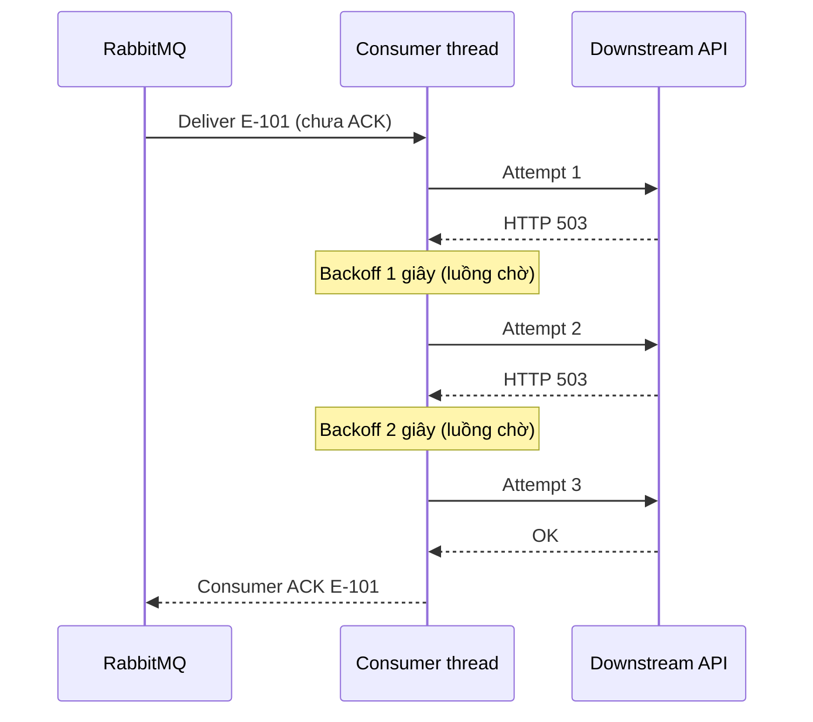
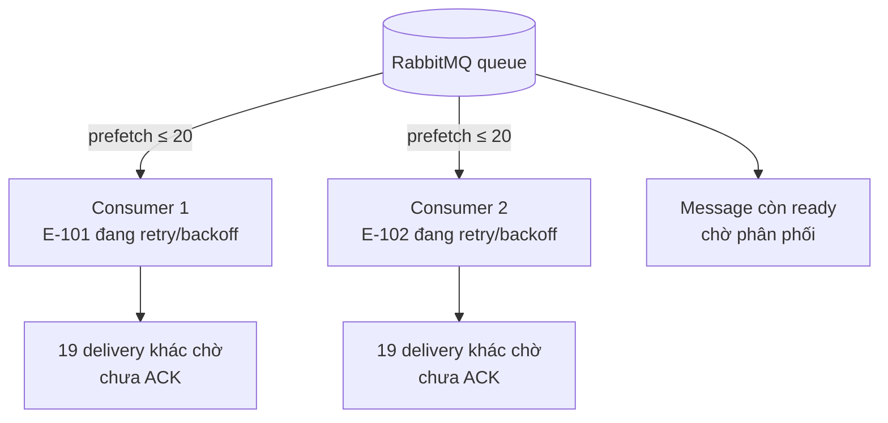
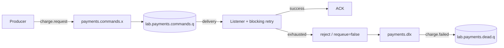
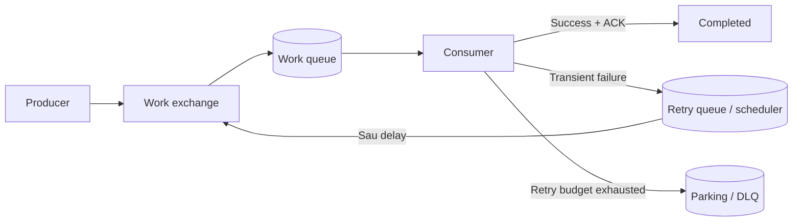
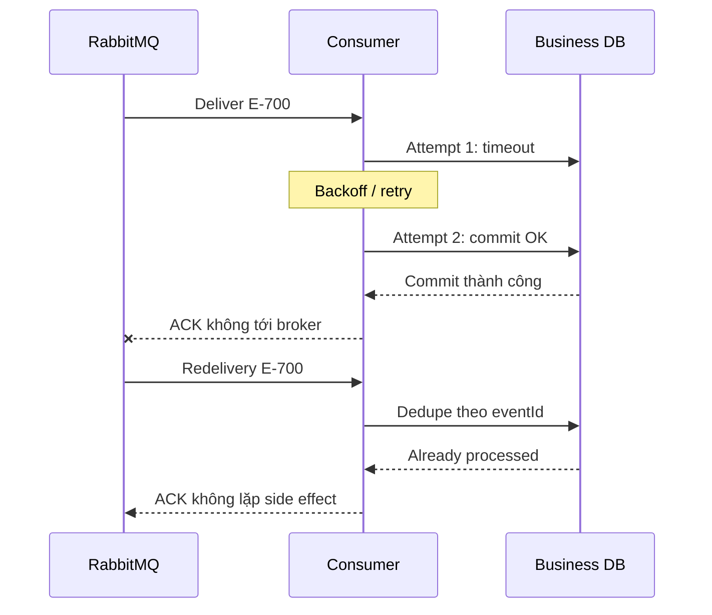

# Ảnh hưởng của retry chặn luồng đến consumer và prefetch

Trong một hệ thống xử lý đơn hàng, một consumer nhận công việc từ RabbitMQ rồi gọi API tính phí. API tạm trả HTTP 503. Nếu Spring AMQP thực hiện **retry ngay trong listener, kèm thời gian chờ giữa các lần thử**, consumer có thể giữ một message trong nhiều giây dù thao tác nghiệp vụ thực tế chỉ mất vài chục mili giây. Trong khoảng đó, các message đã được broker phân phối theo **prefetch** có thể vẫn ở trạng thái **unacknowledged**, trong khi message mới bị chậm hoặc phải chờ consumer khác.

Đây là bài **“Ảnh hưởng của retry chặn luồng đến consumer và prefetch”** thuộc chương **Thử lại thông điệp** của module **SPRING_AMQP**. Bài đi sâu vào cách kết hợp `RabbitTemplate`, `@RabbitListener`, exchange, queue, binding, consumer acknowledgements, Spring Retry, dead-letter, giao dịch và observability để xây dựng xử lý bất đồng bộ tin cậy **mà không vô tình dùng hết năng lực tiêu thụ khi downstream gặp lỗi**.

Sau bài học, bạn có thể:

- Giải thích **blocking retry** giữ luồng thực thi listener như thế nào và vì sao nó không giống **broker redelivery**.
- Phân biệt `prefetchCount`, số consumer, số message đang chạy handler, số message `messages_unacknowledged` và backlog `messages_ready`.
- Ước lượng tác động của `maxAttempts`, backoff và concurrency tới độ trễ, throughput và số message đã được cấp cho consumer.
- So sánh `SimpleMessageListenerContainer` (SMLC) với `DirectMessageListenerContainer` (DMLC) khi handler có thời gian chờ dài.
- Cấu hình retry có giới hạn bằng Spring Boot hoặc `RetryInterceptorBuilder` và xử lý khi đã hết attempts.
- Quyết định khi nào giữ retry ngắn trong process, khi nào chuyển sang **delayed/broker-level retry** để giải phóng consumer.
- Viết kiểm thử và dashboard phát hiện consumer starvation, unacked tăng, poison-message loop và nguy cơ xử lý trùng.

> **Phạm vi:** Các ví dụ hướng tới Java 17+, Spring Boot 3.x, Spring AMQP 3.x, Spring Retry và RabbitMQ qua AMQP 0-9-1. Hành vi cụ thể còn phụ thuộc phiên bản, queue type, acknowledge mode, listener factory và cấu hình broker. Những thao tác cố ý tạo lỗi chỉ chạy trên broker/vhost thực hành; không làm gián đoạn queue production có dữ liệu thật.

## 1. Luồng bình thường: broker giao message, container xử lý và ACK

Một kiến trúc đơn giản:

```mermaid
flowchart LR
    P[Producer<br/>RabbitTemplate] -->|charge.request| X[Direct exchange<br/>payments.commands.x]
    X -->|binding charge.request| Q[(payments.commands.q)]
    Q -->|basic.deliver| LC[Spring AMQP<br/>listener container]
    LC -->|invoke| H[@RabbitListener<br/>Charge handler]
    H -->|HTTP/DB| DS[Downstream]
    LC -.ACK khi xử lý thành công.-> Q
```

Với `AcknowledgeMode.AUTO` của Spring:

1. RabbitMQ giao message tới một consumer đã đăng ký với queue.
2. Listener container nhận delivery, chuyển payload và gọi handler.
3. Handler xử lý thành công; container gửi **consumer ACK** cho broker.
4. Broker có thể loại bỏ delivery đã được ACK khỏi hàng đợi theo semantics queue.

Nếu handler thất bại, container hoặc advice chain có thể áp dụng retry, requeue, reject hoặc recoverer. **`AUTO` của Spring không phải `autoAck=true` của RabbitMQ**: khi xử lý chưa hoàn thành, message thường vẫn chưa được ACK.

### 1.1. Bốn khái niệm thường bị lẫn

| Khái niệm | Ví dụ | Nó đo/giới hạn gì? |
| --- | --- | --- |
| **Consumer concurrency** | Hai SMLC consumers hoặc hai DMLC consumers per queue | Có bao nhiêu luồng/consumer có thể xử lý delivery song song. |
| **Prefetch / QoS** | `prefetchCount=20` | Broker có thể giao trước tối đa bao nhiêu delivery chưa ACK cho mỗi consumer trong mô hình thông dụng. |
| **Handler đang chạy** | Một consumer đang gọi API | Công việc thực sự được xử lý tại một thời điểm. |
| **Unacked deliveries** | Broker hiển thị `messages_unacknowledged=40` | Các delivery đã giao nhưng broker chưa ghi nhận ACK; bao gồm message đang xử lý và message đã prefetch đang chờ phía consumer. |

**Prefetch 20 không biến một consumer thành 20 luồng xử lý.** Với listener đồng bộ thông thường, một consumer chỉ thực hiện một lời gọi handler tại một thời điểm; những delivery còn lại có thể đang chờ ở client/container.

### 1.2. RabbitMQ xử lý `basic.qos` như thế nào?

Trên RabbitMQ AMQP 0-9-1, giới hạn prefetch thông thường được áp **theo consumer**, thay vì hiểu đơn giản như một hạn mức tổng cho toàn bộ ứng dụng. Spring container cấu hình `prefetchCount`/`basic.qos`; việc đặt `globalQos=true` hoặc dùng nhiều consumer trên cùng channel có thể thay phạm vi của giới hạn và có chi phí khác.

Một ước lượng dễ dùng khi có **một queue, prefetch P và C consumers độc lập**:

\[
\text{delivery chưa ACK tối đa (xấp xỉ)} \le C \times P
\]

Đây là trần giao nhận trong trạng thái bình thường, **không phải số message luôn nằm trong RAM**, cũng không phải throughput. Tổng thực tế phụ thuộc queue type, consumer/channel setup, ACK mode, global QoS và điều kiện broker.

## 2. Blocking retry là gì?

**Blocking retry** (thử lại chặn luồng) là khi logic retry giữ nguyên invocation/luồng xử lý listener, rồi thử lại công việc sau một khoảng chờ. Ví dụ Spring Retry `RetryOperationsInterceptor` với `ExponentialBackOffPolicy` thường chờ bằng cơ chế ngủ/chặn luồng giữa các attempts.



Trong ví dụ trên:

- **Chỉ có một delivery AMQP** từ broker cho `E-101` trong suốt ba lần gọi API.
- **Chỉ có một lần ACK** sau khi xử lý thành công.
- Broker vẫn coi message là **unacked** trong thời gian consumer chờ backoff.
- Message khác đã prefetch có thể phải chờ consumer quay lại xử lý.

`maxAttempts=3` trong cách cấu hình Spring Retry thông dụng **bao gồm lần thử đầu tiên**, không phải “ba retries cộng thêm một attempt”. Nếu tất cả thất bại, interceptor chuyển qua recoverer hoặc ném lỗi để container quyết định ACK/requeue/reject.

### 2.1. Blocking retry không phải requeue/redelivery

| Tiêu chí | In-process blocking retry | Broker requeue/redelivery | Delayed retry qua queue hoặc scheduler |
| --- | --- | --- | --- |
| Ai quyết định attempt kế tiếp? | Spring Retry/interceptor trong consumer JVM. | Broker giao lại message sau reject/requeue hoặc consumer disconnect. | Ứng dụng hoặc topology retry định tuyến message tới nơi chờ rồi quay lại. |
| Consumer thread có phải chờ backoff? | **Có**, nếu dùng blocking backoff. | Thường không giữ thread cũ cho một khoảng delay có chủ đích. | Không cần giữ listener thread trong thời gian trì hoãn. |
| Message đang được xử lý được ACK giữa attempts? | Thường **chưa**. | Delivery cũ được kết thúc/requeued, rồi xuất hiện delivery khác. | Delivery nguồn phải được xác nhận theo chính sách sau khi đã chuyển message an toàn. |
| Giá trị `redelivered` của RabbitMQ tự tăng mỗi in-process attempt? | **Không**; không có broker redelivery giữa attempts. | Có thể được broker đánh dấu redelivered ở lần giao lại. | Phụ thuộc cách republish/dead-letter; có thể là message/delivery mới. |
| Cần giữ retry count ở đâu? | Retry context của Spring trong lúc thực thi. | Ứng dụng/broker metadata theo topology và cơ chế retry. | Header/attempt metadata và nguồn trạng thái bền vững. |
| Rủi ro chính | Starvation, latency, unacked/prefetch accumulation. | Hot requeue loop, fairness và duplicate delivery. | Phức tạp topology, độ tin cậy của chuyển tiếp, dead-letter cycle. |

**Cần phân biệt:** `@Retryable` đặt trên một service nội bộ cũng có thể chặn thread; retry không nhất thiết phải nằm trong Rabbit listener advice chain. Nếu đặt **cả `@Retryable` và listener retry interceptor**, tổng số lần gọi downstream có thể bị nhân lên ngoài dự kiến.

## 3. Khi retry chặn, prefetch bị ảnh hưởng như thế nào?

Xét một queue với:

- `concurrency = 2`: hai consumers.
- `prefetch = 20`: mỗi consumer có thể giữ tối đa khoảng 20 delivery chưa ACK.
- Một message gặp lỗi downstream và chờ retry trong vài giây.

Broker có thể đã giao gần **40 message chưa ACK** cho hai consumers. Nếu cả hai đang chờ retry, những message đã prefetch **chưa được xử lý** có thể vẫn bị giữ trong phía consumer; các message khác tiếp tục nằm ở `ready` trên broker. Hệ thống trông như có consumer online nhưng tốc độ hoàn tất công việc giảm mạnh.



Đây là **hình minh họa trạng thái có thể xảy ra**, không phải khẳng định broker luôn gửi đầy `C × P`. Với queue ít message hoặc consumer xử lý/ACK nhanh, số unacked có thể thấp hơn.

### 3.1. Blocking retry giữ slot xử lý, không chỉ giữ message

Khi consumer thread chờ 5 giây để retry:

1. Nó không dùng 5 giây đó để hoàn tất message khác theo mô hình listener đồng bộ.
2. Message đang retry vẫn được tính trong số delivery chưa ACK.
3. Những message prefetch chưa được xử lý cũng có thể giữ **credit** của consumer.
4. Broker chưa thể giao thêm nếu consumer đạt hạn mức QoS.
5. Tăng `prefetch` không làm thread đang chờ tự động xử lý được nhiều message hơn.

Một hệ quả dễ nhầm: `messages_ready` có thể **thấp** vì broker đã giao một phần backlog vào `unacked`, nhưng ứng dụng vẫn chưa hoàn tất nghiệp vụ. Chỉ xem `ready` rồi kết luận “queue đã gần trống” là sai.

### 3.2. Prefetch nhỏ hơn có giải quyết starvation?

Giảm prefetch, ví dụ từ 20 xuống 1, giúp mỗi consumer giữ ít delivery chưa xử lý hơn. Điều này cải thiện **fairness**, hạn chế message bị “đặt chỗ” ở một consumer đang retry và giảm bộ nhớ phía client.

Nhưng nếu **cả hai** consumer đang bị blocking retry, giảm prefetch xuống 1 **không làm chúng trở lại xử lý ngay**. Để khắc phục nguyên nhân, cần giảm thời gian backoff trong listener, tăng số consumer có kiểm soát, chuyển retry dài sang cơ chế không chặn, hoặc xử lý sự cố downstream.

### 3.3. Prefetch không phải số luồng

Hai cấu hình này không tương đương:

| Cấu hình | Số consumer đồng thời | Trần delivery chưa ACK xấp xỉ | Khả năng xử lý song song |
| --- | ---: | ---: | --- |
| `C=1, P=50` | 1 | 50 | Thường chỉ **một** lời gọi handler synchronous tại một thời điểm. |
| `C=5, P=10` | 5 | 50 | Có thể **năm** handler synchronous cùng chạy. |
| `C=10, P=1` | 10 | 10 | Có thể **mười** handler cùng chạy, ít delivery giữ trước. |

Cùng một giới hạn delivery chưa ACK không có nghĩa cùng throughput. Mỗi consumer/channel có chi phí connection, threads, memory và downstream load; tăng concurrency không phải vô hạn.

## 4. Tính chi phí backoff và ảnh hưởng throughput

Giả sử một message lỗi hai lần rồi thành công ở lần thứ ba:

- Thời gian gọi downstream cho mỗi attempt: **40 ms**.
- Backoff trước attempt 2: **1.000 ms**.
- Backoff trước attempt 3: **2.000 ms**.

Tổng thời gian message chiếm một lượt xử lý của consumer xấp xỉ:

\[
T_{\text{consumer}} =
T_{\text{attempts}} + T_{\text{backoff}}
= (3\times 40) + 1000 + 2000 = 3120\text{ ms}
\]

Nếu message thành công ngay ở lần đầu, thời gian xử lý chỉ khoảng **40 ms**. Retry đã làm thời gian consumer bị chiếm tăng từ 40 ms lên 3.120 ms — **78 lần** cho một message trong ví dụ.

Với `C=2` consumers, trong trường hợp liên tục xử lý loại message như vậy và không có giới hạn khác, thông lượng lý thuyết do thời gian xử lý chi phối:

\[
\text{throughput upper bound} \approx
\frac{C}{T_{\text{consumer}}}
= \frac{2}{3.12}\approx 0.64\ \text{message/s}
\]

Trong khi nếu mọi message hoàn tất trong 40 ms, cùng hai consumers có giới hạn lý thuyết theo thời gian handler khoảng:

\[
\frac{2}{0.04}=50\ \text{message/s}
\]

**Đây là phép ước lượng, không phải benchmark đo thật.** Thực tế còn có network, serialization, broker, database, threading, publisher rate, batching, timeout và phân bố message lỗi. Nhưng nó minh họa vì sao một khoảng chờ retry ngắn đối với mỗi message có thể gây nghẽn lớn khi lỗi xảy ra hàng loạt.

### 4.1. Tổng thời gian tối đa theo `maxAttempts`

Với `maxAttempts = N`, thời gian chờ tối đa do retry policy thêm vào là tổng các khoảng chờ giữa attempts:

\[
T_{\text{backoff}} = \sum_{i=1}^{N-1} d_i
\]

Nếu `maxAttempts=4` và các lần backoff là 1 s, 2 s, 4 s, consumer có thể chờ **7 giây**, chưa tính thời gian gọi downstream. Nếu mỗi attempt còn có HTTP timeout 10 giây, một message có thể giữ consumer gần **47 giây** trước khi recovery.

**Cần giới hạn cả hai:** timeout của lời gọi downstream **và** tổng số attempts/backoff. Chỉ đặt `maxAttempts` nhưng không đặt timeout cho HTTP/DB sẽ không bảo đảm một message kết thúc trong thời gian hữu hạn như mong đợi.

## 5. SMLC và DMLC khi listener bị chặn bởi retry

Spring AMQP thường dùng hai listener container chính cho AMQP 0-9-1:

- **`SimpleMessageListenerContainer` (SMLC):** dùng consumer cùng cấu trúc hàng đợi nội bộ/task executor để tách việc đọc delivery từ Rabbit client khỏi việc gọi listener.
- **`DirectMessageListenerContainer` (DMLC):** gọi listener trên các thread của RabbitMQ client dispatch theo cơ chế direct, với `consumersPerQueue` để điều chỉnh số consumer cho từng queue.

Khi handler đang **retry chặn luồng**, sự khác biệt về nơi gọi handler và quản trị thread đáng chú ý.

| Vấn đề | SMLC | DMLC |
| --- | --- | --- |
| Luồng bị blocking retry chiếm | Luồng consumer/task executor của SMLC đang thực thi listener. | Luồng dispatch listener của RabbitMQ client được DMLC sử dụng. |
| Cách tăng concurrency | `concurrentConsumers`, `maxConcurrentConsumers`. | `consumersPerQueue`. |
| Prefetch | `prefetchCount` cho consumer, theo cơ chế QoS. | `prefetchCount` cho từng consumer, theo cơ chế QoS. |
| Các queue khác | Cùng pool/consumer cấu hình có thể chịu tác động khi mọi worker bị chặn. | Các consumer theo queue độc lập hơn, nhưng vẫn chia tài nguyên executor/client nếu chung factory. |
| Có nên sleep lâu trong handler? | Không, vì giữ worker và delivery chưa ACK. | Càng cần thận trọng với thời gian chặn trên client dispatch thread. |
| Khi cần retry trì hoãn hàng phút | Nên cân nhắc delayed retry/queue riêng. | Cũng nên tránh block thread lâu; việc tăng consumers per queue không giải quyết tận gốc. |

**Không kết luận “DMLC luôn không ảnh hưởng queue khác”**: các consumer vẫn có thể chia RabbitMQ client executor, connection/channel resources, network và downstream. Nếu nhiều handlers của DMLC cùng sleep, tài nguyên dispatch có thể bị chiếm và làm tăng độ trễ xử lý ở những consumer khác.

### 5.1. Lưu ý về heartbeat và RabbitMQ client

Một lời gọi retry chặn lâu **không tự động có nghĩa** RabbitMQ heartbeat chắc chắn dừng, vì I/O/heartbeat có thể do các thành phần/thư viện khác quản lý. Tuy nhiên, chặn quá nhiều client dispatch threads hoặc cạn executor có thể ảnh hưởng responsiveness, tốc độ xử lý delivery, cancel và recovery.

Chọn timeout/backoff dựa trên hành vi đo được của client/container và theo dõi connection health. Không sử dụng công thức “sleep hơn heartbeat interval là broker chắc chắn đóng connection” như quy tắc tổng quát.

### 5.2. Chọn concurrency không chỉ để che giấu downstream lỗi

Tăng từ hai lên mười consumers khi downstream trả 503 có thể làm tăng **mười lần** lượng lời gọi retry hoặc số kết nối HTTP tới downstream, khiến dịch vụ lỗi càng khó phục hồi. Trước khi scale:

1. Xác định tỷ lệ lỗi và thời gian backoff.
2. Đặt timeout, circuit breaker hoặc rate limiter phía downstream.
3. Xem số thread/connection của mỗi consumer.
4. Giới hạn retry để không vượt ngân sách tài nguyên.
5. Nếu lỗi kéo dài, chuyển message sang nơi retry có delay thay vì giữ tất cả consumers ngủ.

### 5.3. SMLC tự tăng consumer có cứu được throughput?

SMLC có thể tăng số consumer trong khoảng `concurrentConsumers` đến `maxConcurrentConsumers` dựa trên điều kiện hoạt động và ngưỡng đã cấu hình. Nhưng auto-scaling không phải giải pháp chắc chắn cho blocking retry: consumer đang ngủ có thể không thỏa điều kiện “active” theo cách bạn suy đoán, và cuối cùng vẫn bị giới hạn bởi max concurrency cùng capacity của downstream.

Nếu lỗi xảy ra đồng loạt, **thêm consumers có thể chỉ tạo thêm những threads đang sleep** và tăng số message `unacked`.

## 6. Cấu hình blocking retry qua Spring Boot

Một cách bắt đầu là dùng các properties Spring Boot cho listener kiểu simple. Ví dụ chỉ dành cho bài lab:

```yaml
spring:
  rabbitmq:
    host: localhost
    port: 5672
    listener:
      type: simple
      simple:
        acknowledge-mode: auto
        concurrency: 2
        max-concurrency: 2
        prefetch: 5
        default-requeue-rejected: false
        retry:
          enabled: true
          stateless: true
          max-attempts: 4
          initial-interval: 1s
          multiplier: 2
          max-interval: 4s
```

Giải thích cấu hình:

| Thuộc tính | Giá trị | Tác động |
| --- | --- | --- |
| `type: simple` | Simple container | Dùng cấu hình `listener.simple` cho các listener được auto-configure tương ứng. |
| `concurrency: 2`, `max-concurrency: 2` | Hai consumers | Giữ ổn định để quan sát hai threads trong lab. |
| `prefetch: 5` | Năm delivery/consumer | Hai consumers có thể giữ khoảng mười message chưa ACK khi backlog đủ lớn. |
| `acknowledge-mode: auto` | Container ACK | ACK sau khi listener xử lý thành công/recover theo chính sách. |
| `retry.enabled: true` | Bật Spring Retry | Thực hiện retry trong listener advice khi điều kiện được đáp ứng. |
| `retry.stateless: true` | Stateless | Retry thực hiện ngay trong lần xử lý delivery ở JVM, thường giữ thread trong các khoảng backoff. |
| `retry.max-attempts: 4` | Bốn lần xử lý tối đa | **Một attempt đầu + tối đa ba lần thử lại**. |
| `retry.initial-interval: 1s`, `multiplier: 2`, `max-interval: 4s` | Backoff 1s → 2s → 4s | Có thể giữ thread ngủ tổng cộng 7s nếu đều thất bại. |
| `default-requeue-rejected: false` | Không requeue mặc định sau thất bại cuối | Khi retry đã hết và container reject, message có thể dead-letter nếu broker có DLX. |

**Cảnh báo về recoverer:** Cấu hình retry của Spring Boot có quy tắc recovery tùy phiên bản/property. Đừng chỉ dựa vào bảng trên rồi kết luận message chắc chắn bị reject/đi vào DLQ. Hãy xác minh **recoverer thực tế**, điều kiện return/ném exception và `defaultRequeueRejected` của container đang dùng.

Spring Retry phải có trên classpath theo dependency management của dự án. Với custom listener factory, Boot properties trên **không tự áp dụng mọi cài đặt**, trừ khi factory được cấu hình qua Boot configurer/tương đương.

### 6.1. Một listener kiểm chứng thời gian retry

```java
import java.time.Instant;
import java.util.concurrent.ConcurrentHashMap;
import java.util.concurrent.atomic.AtomicInteger;
import org.springframework.amqp.rabbit.annotation.RabbitListener;
import org.springframework.stereotype.Component;

@Component
class PaymentRetryDemoListener {
    private final ConcurrentHashMap<String, AtomicInteger> attempts =
            new ConcurrentHashMap<>();

    @RabbitListener(queues = "lab.payments.commands.q")
    public void handle(String jobId) {
        int n = attempts
                .computeIfAbsent(jobId, ignored -> new AtomicInteger())
                .incrementAndGet();

        System.out.printf(
                "time=%s jobId=%s attempt=%d thread=%s%n",
                Instant.now(), jobId, n,
                Thread.currentThread().getName());

        if (jobId.startsWith("FAIL-")) {
            throw new IllegalStateException("Demo: downstream unavailable");
        }
        System.out.println("Processed: " + jobId);
    }
}
```

Đoạn mã dùng map in-memory để **quan sát số lần method được gọi**, không phải bộ đếm retry bền vững; nó có thể tăng qua **nhiều broker deliveries**, không chỉ một lần Spring Retry. Khi ứng dụng restart, map mất dữ liệu; không dùng map này để quyết định idempotency production.

Nếu dùng đúng một listener và bật retry theo config, `FAIL-001` có thể làm log xuất hiện nhiều lần với các timestamp cách nhau theo backoff, **nhưng broker chưa nhất thiết giao lại message giữa các attempts**. Kiểm tra redelivery flag/consumer metrics để phân biệt attempts của Spring Retry với broker redeliveries.

### 6.2. Không vô tình xếp hai tầng retry

Ví dụ một service gọi:

```java
@org.springframework.retry.annotation.Retryable(maxAttempts = 3)
public void charge(String paymentId) {
    // HTTP request tới downstream.
}
```

Nếu listener còn được gắn interceptor retry `maxAttempts=4`, trong trường hợp lỗi kéo dài **một delivery có thể dẫn tới tới 12 lần gọi charge-level attempt** (4 vòng listener × 3 lần service) tùy proxy và retry policy.

Điều đó chưa tính retry tự động từ HTTP client, database driver hoặc broker redelivery. Cần quản lý **tổng ngân sách retry** cho request nghiệp vụ, không chỉ số lần thử ở từng lớp riêng.

## 7. Cấu hình thủ công: retry interceptor và recoverer tường minh

Khi cần điều khiển rõ cách kết thúc sau khi hết attempts, có thể tạo một listener container factory riêng và gắn `RetryOperationsInterceptor` với `RejectAndDontRequeueRecoverer`.

### 7.1. Mẫu cấu hình Java

```java
import org.springframework.amqp.rabbit.config.RetryInterceptorBuilder;
import org.springframework.amqp.rabbit.config.SimpleRabbitListenerContainerFactory;
import org.springframework.amqp.rabbit.connection.ConnectionFactory;
import org.springframework.amqp.rabbit.retry.RejectAndDontRequeueRecoverer;
import org.springframework.boot.autoconfigure.amqp.SimpleRabbitListenerContainerFactoryConfigurer;
import org.springframework.context.annotation.Bean;
import org.springframework.context.annotation.Configuration;

@Configuration
class RetryListenerFactoryConfig {

    @Bean
    SimpleRabbitListenerContainerFactory retryingListenerFactory(
            ConnectionFactory connectionFactory,
            SimpleRabbitListenerContainerFactoryConfigurer bootConfigurer) {

        var factory = new SimpleRabbitListenerContainerFactory();

        // Kế thừa converter, observation, cấu hình cơ bản của Boot
        // tùy phiên bản và các properties hiện có.
        bootConfigurer.configure(factory, connectionFactory);

        var interceptor = RetryInterceptorBuilder.stateless()
                .maxAttempts(4)
                .backOffOptions(1000, 2.0, 4000)
                .recoverer(new RejectAndDontRequeueRecoverer())
                .build();

        factory.setConcurrentConsumers(2);
        factory.setMaxConcurrentConsumers(2);
        factory.setPrefetchCount(5);
        factory.setDefaultRequeueRejected(false);
        factory.setAdviceChain(interceptor);
        return factory;
    }
}
```

Sau đó listener khai báo rõ `containerFactory`:

```java
@RabbitListener(
        queues = "lab.payments.commands.q",
        containerFactory = "retryingListenerFactory")
public void handlePayment(String paymentId) {
    // Không cần viết vòng for + Thread.sleep trong method.
    // Ném exception khi nghiệp vụ thất bại để interceptor xử lý.
}
```

**Hai đoạn này là cấu hình thay thế cho Boot-only retry ở mục 6**, không được bật đồng thời hai interceptor retry rồi vô tình tăng tổng attempts. Khi dùng `SimpleRabbitListenerContainerFactoryConfigurer`, nếu Boot đã thêm retry advice từ properties, bạn cần kiểm soát/loại trừ việc xếp hai lớp advice; trong lab đơn giản, **tắt `spring.rabbitmq.listener.simple.retry.enabled` khi chọn factory riêng** rồi để interceptor này là nguồn cấu hình retry duy nhất.

### 7.2. Điều gì xảy ra khi đã hết bốn attempts?

Trong ví dụ:

1. Method listener được gọi tối đa bốn lần cho một lần giao message theo stateless retry.
2. Giữa các attempts thất bại, backoff khiến thread chờ.
3. `RejectAndDontRequeueRecoverer` phát tín hiệu reject/no requeue khi đã exhausted.
4. Container kết thúc delivery theo quy tắc ACK/NACK; với reject `requeue=false`, broker có thể dead-letter message nếu queue có DLX và routing hợp lệ.

**Không có DLX** thì reject/no requeue có thể khiến message bị discard. **Có DLX nhưng không có binding đích** cũng chưa bảo đảm message vào DLQ. Nếu message quan trọng, phải kiểm tra end-to-end đến queue lỗi hoặc nơi lưu trạng thái sự kiện.

### 7.3. Đừng dùng recoverer “log rồi return” mà không có chủ đích

Một recoverer bắt exception, ghi log và trả về như thể đã recover thành công có thể khiến container **ACK message nguồn**. Khi đó poison message có thể biến mất khỏi queue mà nghiệp vụ chưa hoàn thành.

Nếu mục tiêu là giữ message lỗi để điều tra, chọn cơ chế rõ: broker DLX, application republish có xác nhận gửi, hoặc ghi nhận trạng thái lỗi trong kho bền vững. Không để thành công hay thất bại phụ thuộc vào việc một callback đã log được vài dòng.

## 8. Topology đầy đủ cho bài thử retry chặn luồng và DLQ

Một topology lab gồm direct exchange, work queue và dead-letter queue:



### 8.1. Khai báo Spring AMQP topology

```java
import org.springframework.amqp.core.Binding;
import org.springframework.amqp.core.BindingBuilder;
import org.springframework.amqp.core.DirectExchange;
import org.springframework.amqp.core.Queue;
import org.springframework.amqp.core.QueueBuilder;
import org.springframework.beans.factory.annotation.Qualifier;
import org.springframework.context.annotation.Bean;
import org.springframework.context.annotation.Configuration;

@Configuration
class PaymentLabTopology {
    @Bean
    DirectExchange paymentsCommandsExchange() {
        return new DirectExchange("payments.commands.x", true, false);
    }

    @Bean
    DirectExchange paymentsDeadLetterExchange() {
        return new DirectExchange("payments.dlx", true, false);
    }

    @Bean
    Queue labPaymentsQueue() {
        return QueueBuilder.durable("lab.payments.commands.q")
                .withArgument("x-queue-type", "classic")
                .deadLetterExchange("payments.dlx")
                .deadLetterRoutingKey("charge.failed")
                .build();
    }

    @Bean
    Queue labPaymentsDeadQueue() {
        return QueueBuilder.durable("lab.payments.dead.q")
                .withArgument("x-queue-type", "classic")
                .build();
    }

    @Bean
    Binding paymentsCommandsBinding(
            @Qualifier("labPaymentsQueue") Queue queue,
            @Qualifier("paymentsCommandsExchange") DirectExchange exchange) {
        return BindingBuilder.bind(queue).to(exchange)
                .with("charge.request");
    }

    @Bean
    Binding paymentsDeadBinding(
            @Qualifier("labPaymentsDeadQueue") Queue queue,
            @Qualifier("paymentsDeadLetterExchange") DirectExchange exchange) {
        return BindingBuilder.bind(queue).to(exchange)
                .with("charge.failed");
    }
}
```

Các bean trên mô tả topology; `RabbitAdmin` hoặc quy trình provisioning phải tạo tài nguyên thành công trên broker. **Queue chính là classic** để thực hành cụ thể với prefetch và delivery mode. Khi cần quorum queue, replication, overflow, delivery limit hoặc dead-letter semantics có thể khác; không sửa `x-queue-type` trên queue đang tồn tại mà mong dữ liệu tự chuyển.

Đây là ví dụ lab dùng `x-dead-letter-exchange` trực tiếp. Trong production, những thông số cần đổi thường xuyên như DLX/TTL nên cân nhắc **RabbitMQ policy** để tránh xung đột redeclaration. Không áp dụng DLX trên queue đang có dữ liệu nếu chưa kiểm tra tương thích arguments và quyền broker.

### 8.2. Publisher gửi một message persistent

```java
import org.springframework.amqp.core.MessageDeliveryMode;
import org.springframework.amqp.rabbit.core.RabbitTemplate;
import org.springframework.stereotype.Service;

@Service
class PaymentJobPublisher {
    private final RabbitTemplate template;

    PaymentJobPublisher(RabbitTemplate template) {
        this.template = template;
    }

    void publish(String jobId) {
        template.convertAndSend(
                "payments.commands.x",
                "charge.request",
                jobId,
                message -> {
                    message.getMessageProperties()
                            .setMessageId(jobId);
                    message.getMessageProperties().setDeliveryMode(
                            MessageDeliveryMode.PERSISTENT);
                    return message;
                });
    }
}
```

`RabbitTemplate.convertAndSend` trả về không exception **chưa phải publisher confirm**. Với dữ liệu quan trọng cần correlated publisher confirms, mandatory/returns và outbox nếu phải khôi phục khi producer chết trước publish. Những bảo đảm này **khác** với số attempts của consumer.

### 8.3. Sửa listener để gắn factory riêng

Khi dùng factory ở mục 7, listener lab ở mục 6.1 phải được đổi thành:

```java
@RabbitListener(
        queues = "lab.payments.commands.q",
        containerFactory = "retryingListenerFactory")
public void handlePaymentJob(String jobId) {
    if (jobId.startsWith("FAIL-")) {
        throw new IllegalStateException("Transient failure (demo)");
    }
    System.out.println("Handled: " + jobId);
}
```

**Không đăng ký đồng thời hai ví dụ listener ở mục 6.1 và 8.3 cho cùng queue** nếu muốn đo chính xác thời gian retry của một consumer: chúng sẽ cạnh tranh deliveries. Mục 6.1 là mẫu quan sát attempts, mục 8.3 là mẫu minh họa factory wiring.

## 9. Khi nào cần chuyển từ blocking retry sang retry có trì hoãn ngoài consumer?

Blocking retry có ưu điểm **đơn giản** và rất hữu ích khi một lỗi thường biến mất trong vài mili giây hoặc vài trăm mili giây. Nhưng nếu downstream có thể không hoạt động trong **hàng phút**, giữ hàng trăm listener threads ngủ không phải cách dùng tài nguyên hiệu quả.

Một kiến trúc thay thế là:

1. Consumer nhận message ở work queue.
2. Khi xử lý lỗi tạm thời, ứng dụng quyết định **lần thử tiếp theo và thời điểm được thử lại**.
3. Message được chuyển một cách đáng tin cậy sang **retry queue/scheduler** có delay.
4. Consumer **kết thúc delivery hiện tại** (ACK hoặc reject/no-requeue tùy cơ chế chuyển message) và được giải phóng để xử lý message khác.
5. Đến thời điểm được phép, message quay lại work queue hoặc được publish tới nơi xử lý phù hợp.



**Điểm khác biệt chính:** Người dùng không muốn xử lý lại message ngay; nhưng **consumer không cần ngủ để đếm thời gian**. Số message chưa ACK trên work queue và số luồng đang chờ có thể giảm rõ rệt, trong khi message chờ thử lại được quan sát ở nơi riêng.

### 9.1. So sánh hai mô hình

| Tiêu chí | Blocking retry trong Spring Retry | Retry ngoài consumer |
| --- | --- | --- |
| Độ phức tạp triển khai | Thường thấp: interceptor + backoff + recoverer. | Cao hơn: retry queue/delay scheduler, metadata, routing và recovery. |
| Giữ thread trong thời gian delay | **Có**. | **Không cần**, sau khi chuyển message an toàn. |
| Giữ delivery nguồn ở `unacked` trong delay | Thường **có**. | Thường **không**, sau khi kết thúc delivery nguồn an toàn. |
| Delay 100 ms | Có thể hợp lý. | Có thể tốn thêm broker hops không cần thiết. |
| Delay 5 phút | Không phù hợp cho nhiều consumers đồng thời. | Phù hợp hơn nếu topology/reliability đáp ứng yêu cầu. |
| Khả năng quan sát attempts | Retry context hoặc custom metrics ở consumer. | Metadata/queue riêng, dễ quan sát tồn đọng nhưng phức tạp hơn. |
| Nguy cơ mất message khi chuyển retry | Không chuyển sang queue khác giữa attempts. | Cần giải bài toán chuyển tiếp an toàn trước khi ACK nguồn. |
| Nguy cơ retry vô hạn | Nếu attempts không giới hạn hoặc có nhiều tầng retry. | Nếu không có retry budget/parking queue và DLX cycle. |

### 9.2. Retry queue với TTL và DLX

Một topology phổ biến trên RabbitMQ có thể dùng:

- `payments.work.q` để tiêu thụ công việc.
- `payments.retry.10s.q` giữ message với TTL 10 giây.
- DLX của retry queue định tuyến message hết TTL trở lại `payments.work.x`/work queue.
- `payments.parking.q` giữ message đã vượt ngân sách retries để điều tra.

Ví dụ fragment Spring AMQP chỉ mô tả **queue retry**:

```java
import org.springframework.amqp.core.Queue;
import org.springframework.amqp.core.QueueBuilder;
import org.springframework.context.annotation.Bean;

@Bean
Queue paymentRetryTenSecondsQueue() {
    return QueueBuilder.durable("payments.retry.10s.q")
            .ttl(10_000)
            .deadLetterExchange("payments.work.x")
            .deadLetterRoutingKey("charge.request")
            .build();
}
```

Đây **không phải topology đầy đủ**: phải khai báo exchange `payments.work.x`, binding từ exchange đó tới work queue, đường publish/dead-letter đưa message vào retry queue và parking queue, cùng các quyền tương ứng. Nếu muốn thay TTL linh hoạt, hãy dùng RabbitMQ policy ở nơi hỗ trợ thay vì hard-code queue arguments.

**Cẩn trọng về TTL:** Khi dùng per-message TTL khác nhau trong một queue, message hết hạn không nhất thiết được dọn ngay nếu nó đứng sau một message có TTL dài hơn; độ trễ thực tế có thể lớn hơn mong đợi. Dùng các retry queues theo từng delay cố định, scheduler hoặc cơ chế delay được hỗ trợ và kiểm thử là những lựa chọn tùy nghiệp vụ.

### 9.3. Chuyển message sang retry queue và ACK nguồn có khoảng trống lỗi

Một mẫu dễ gây mất dữ liệu:

```java
// KHÔNG dùng như một giao dịch an toàn mặc định:
template.convertAndSend("payments.retry.x", "delay.10s", message);
channel.basicAck(deliveryTag, false);
```

Nếu lần publish sang retry queue chưa được broker xác nhận nhưng consumer ACK message gốc, message có thể bị mất. Nếu broker đã nhận message retry nhưng consumer chết trước ACK nguồn, **hai bản** có thể được xử lý sau đó.

Do đó hệ thống cần:

- Publisher confirms/returns cho publish lại (nếu ứng dụng thực hiện republish).
- Với Spring AMQP, có thể dùng `CorrelationData` mới cho từng lần republish để ghép publisher confirm với event ID/attempt ID; không đồng nhất việc `RabbitTemplate` trả về với broker ACK.
- Không ACK nguồn trước khi tiêu chí chuyển tiếp an toàn được đáp ứng; nếu thất bại thì giữ hoặc cho redelivery tùy policy.
- Message ID ổn định và **consumer idempotency** để chịu được duplicate.
- Retry budget/parking queue và quan sát DLQ.
- Không giả định transaction RabbitMQ và database tự động là một distributed transaction nguyên tử.

**Broker dead-letter** từ work queue tới retry queue có semantics khác **application republish**. Đối với queue type và broker version cụ thể, cần kiểm tra bảo đảm dead-lettering, đặc biệt khi hệ thống yêu cầu độ tin cậy cao. Với quorum queue, có cơ chế dead-lettering an toàn hơn khi cấu hình phù hợp, nhưng không được suy ra mọi mode đều bảo đảm delivery như nhau.

### 9.4. Vì sao phải có parking queue hoặc điểm dừng?

Một cấu hình `work queue → retry queue → work queue` không giới hạn có thể tạo vòng lặp bất tận cho một message sai schema. Lỗi **không thể phục hồi** (JSON hỏng, field bắt buộc bị thiếu, version không tương thích) cần được **reject/park/alert** chứ không nên đưa lại queue sau mỗi 10 giây mãi mãi.

Giữ `retryCount` trong metadata đáng tin cậy do ứng dụng quản lý hoặc tận dụng header do broker quản lý như `x-death` với các giới hạn thực tế của từng topology. Cần phân biệt:

- Spring Retry `attempt` trong **một delivery**;
- RabbitMQ broker **redelivery** sau requeue;
- Số lần **dead-letter** qua các queues;
- Số lần application **republish** sang retry exchange.

Các bộ đếm này không tự bằng nhau và không nên cộng/đọc tùy tiện để quyết định đã vượt ngân sách retry.

## 10. Tính throughput trung bình khi chỉ một phần message lỗi

Không phải mọi message đều lỗi; điều nguy hiểm là một **tỷ lệ lỗi nhỏ** vẫn có thể chiếm phần lớn tổng thời gian consumer.

Giả sử:

- 80% message thành công ngay, mất **50 ms**;
- 20% message cần nhiều attempts/backoff, chiếm **3,12 s**;
- Có **hai** consumer và mỗi consumer thực thi handler đồng bộ.

Thời gian chiếm consumer trung bình:

\[
E[T] = 0.8 \times 0.05 + 0.2 \times 3.12
= 0.664\text{ giây}
\]

Giới hạn throughput lý thuyết theo thời gian xử lý:

\[
\text{throughput} \lesssim \frac{2}{0.664}
\approx 3.01\text{ message/s}
\]

Nếu **100%** message đều thành công trong 50 ms, cùng hai consumers có giới hạn lý thuyết:

\[
\frac{2}{0.05} = 40\text{ message/s}
\]

Như vậy, chỉ 20% message bị blocking retry đã có thể khiến công suất tính theo thời gian handler giảm hơn **mười lần** trong mô hình này. Đó là lý do nên đo **failure rate × blocking time** bên cạnh số lượng consumers.

### 10.1. Đặt ngân sách retry theo SLA

Nếu một tác vụ có SLA phải hoàn thành hoặc được đưa vào trạng thái điều tra trong **10 giây**, cần tính:

\[
T_{\text{total}} =
\sum T_{\text{downstream-attempt}}
+ \sum T_{\text{backoff}}
+ T_{\text{serialization/DB/overhead}}
\]

Ví dụ:

| Tham số | Phương án A | Phương án B |
| --- | ---: | ---: |
| Max attempts | 4 | 3 |
| Timeout mỗi attempt | 4 s | 1 s |
| Tổng backoff | 7 s | 1,5 s |
| Thời gian tối đa gần đúng | 23 s + overhead | 4,5 s + overhead |
| Khả năng đáp ứng SLA 10 s | Không | Có thể, cần đo thực tế |

Một cấu hình backoff nhìn có vẻ “chỉ vài giây” vẫn có thể vượt SLA khi downstream call chậm. Nếu SLA cho phép một tác vụ kéo dài nhiều phút nhưng consumer không được ngủ trong thời gian đó, hãy chuyển chờ sang broker/scheduler hoặc dùng cơ chế bất đồng bộ có trạng thái rõ ràng.

### 10.2. Lỗi có thể không độc lập

Mô hình trung bình dùng xác suất cố định chỉ là phép ước lượng. Trong thực tế, lỗi downstream thường **tương quan theo thời gian**: khi database sập, phần lớn message cùng thất bại. Khi đó tỷ lệ lỗi có thể đột ngột tiến tới 100%, khiến **mọi consumer** bị blocking retry.

Cần mô phỏng cả **failure storm**, không chỉ kiểm thử một message lỗi giữa một nghìn message tốt.

## 11. Thiết kế isolation cho workloads có tốc độ lỗi khác nhau

Không phải queue nào cũng nên dùng chung một listener factory hoặc retry policy.

Ví dụ hệ thống có:

- `payments.capture.q`: tác vụ thanh toán quan trọng, downstream có thể timeout 5 giây;
- `notifications.email.q`: email có thể chờ vài phút mà không ảnh hưởng UI;
- `analytics.events.q`: chỉ cần xử lý best-effort, có thể bỏ message hết TTL.

Nếu ba queue được một listener duy nhất tiêu thụ bằng một retry policy blocking chung, các message thanh toán lỗi có thể chiếm threads và làm chậm analytics/email, hoặc ngược lại.

### 11.1. Tách listener/factory theo mức ưu tiên

| Loại workload | Gợi ý retry | Tài nguyên |
| --- | --- | --- |
| Thanh toán | Retry rất ngắn cho lỗi transient, sau đó chuyển retry trì hoãn/điều tra; idempotent theo transaction ID. | Container riêng, prefetch thấp, giám sát chặt. |
| Gửi email | Delay/retry queue với khoảng chờ dài, tránh giữ thread nhiều phút. | Container riêng, có rate limit theo nhà cung cấp. |
| Analytics | Retry ít lần hoặc bỏ nếu dữ liệu tái tạo được, tùy hợp đồng nghiệp vụ. | Container khác, quota và TTL phù hợp. |
| Poison messages | Không retry blocking cùng payload lỗi vĩnh viễn. | Reject/DLQ, schema validation và alert. |

**Không có giá trị prefetch tối ưu cho tất cả queues.** Với công việc mất hàng giây và cần fairness, thử `prefetch=1` hoặc một giá trị nhỏ. Với công việc cực ngắn, broker/network latency cao và ACK nhanh, prefetch lớn hơn có thể cải thiện throughput. Luôn đo độ trễ, unacked, memory và fairness trên workload thật.

### 11.2. Phân biệt FIFO và consumer fairness

Nếu một message ở đầu queue bị retry blocking 10 giây, một consumer có thể giữ nó lâu. Với nhiều consumers và prefetch lớn, các consumer đã “giữ chỗ” những message đến sau. Việc hoàn tất message có thể **không còn theo đúng thứ tự publish**, nhất là khi concurrency > 1 hoặc retry.

Nếu nghiệp vụ yêu cầu thứ tự xử lý nghiêm ngặt theo một aggregate:

1. Xác định khóa ordering, ví dụ `accountId`.
2. Đánh giá cơ chế partitioning/one-active-consumer/consumer serialization và các giới hạn queue type.
3. Cân nhắc tác động của retry delay lên message kế tiếp cùng aggregate.
4. Không chỉ đặt `prefetch=1` rồi tuyên bố có global exactly-once ordered processing.

### 11.3. Circuit breaker không thay thế retry policy

Nếu downstream liên tục lỗi, circuit breaker có thể chuyển sang trạng thái OPEN và **từ chối nhanh** yêu cầu mới. Điều này giảm thời gian chờ của một attempt và bảo vệ downstream; nhưng với listener container:

- Exception từ circuit breaker vẫn cần được phân loại.
- Retry interceptor có thể thử lại cùng exception nhiều lần nếu không được cấu hình loại trừ.
- Không nên biến OPEN thành message bị ACK mất mà chưa có kế hoạch phục hồi.
- Có thể chuyển job vào retry queue sau một lần phát hiện OPEN, thay vì giữ các consumer sleeping.

Điều phối backoff, circuit breaker, timeout, concurrency và retry budget phải là một **chính sách tổng thể**.

## 12. ACK/NACK, transaction và idempotency dưới blocking retry

### 12.1. Với `AUTO`, khi nào message được ACK?

Trong mẫu Spring Retry stateless đặt trên listener container với `AcknowledgeMode.AUTO`:

| Thời điểm | Tình trạng theo mô hình thường gặp |
| --- | --- |
| Broker giao message | Delivery xuất hiện ở `unacked`. |
| Attempt 1 thất bại | Spring Retry giữ lời gọi, chưa hoàn tất delivery. |
| Backoff giữa attempts | Delivery vẫn có thể ở `unacked`, consumer thread đang chờ. |
| Attempt cuối thành công | Interceptor return bình thường; container ACK theo chính sách. |
| Hết attempts, recoverer reject/no requeue | Container reject hoặc NACK `requeue=false`, broker có thể DLX. |
| Hết attempts, recoverer **return bình thường** | Container có thể xem message đã được xử lý và ACK; cần chủ ý. |

Với `AcknowledgeMode.MANUAL`, người viết listener quản lý ACK/NACK theo delivery tag và channel, trừ một số tình huống infrastructure đặc biệt. Không áp bảng AUTO để giả định framework luôn ACK thay code trong MANUAL.

### 12.2. Consumer chết giữa backoff

Giả sử:

1. Broker giao `E-700`, listener gọi downstream.
2. Downstream trả 503; Spring Retry đang sleep 2 giây.
3. Process Java chết hoặc connection đóng.
4. Broker thấy delivery chưa được ACK; sau khi phát hiện consumer/channel không còn, nó có thể giao lại message.

Khi được giao lại, một **retry context mới** có thể bắt đầu từ attempt đầu tiên. Nếu cần giới hạn số attempts xuyên **nhiều deliveries/restarts**, đừng chỉ dựa vào bộ đếm của stateless retry; cần metadata/trạng thái bền vững hoặc một cơ chế stateful/broker-level được thiết kế phù hợp.

### 12.3. Side effect thành công rồi ACK mất

Một message được retry nhiều lần, cuối cùng database commit thành công. Nếu process chết **trước khi ACK tới broker**, cùng message có thể được giao lại. Không có gì trong blocking retry đảm bảo exactly-once.



Consumer đáng tin cậy cần **event/job ID ổn định**, unique constraint hoặc inbox/deduplication table, và transaction phù hợp. `messageId` trong AMQP giúp tương quan nhưng broker không tự loại message trùng chỉ vì `messageId` giống nhau.

### 12.4. Giao dịch RabbitMQ và database

Spring AMQP có thể sử dụng transaction cho AMQP channel và có thể phối hợp với Spring transaction management theo cấu hình. Tuy nhiên, một `@Transactional` của database **không tự tạo distributed transaction nguyên tử** với RabbitMQ. Nếu commit DB thành công nhưng ACK mất, message vẫn có thể redeliver; nếu publish retry message thành công nhưng ACK nguồn mất, có thể có hai bản.

Với producer gửi event sau khi cập nhật DB, xem xét **transactional outbox**. Với consumer, triển khai idempotency và xác nhận ACK đúng thời điểm. Blocking retry là cách quyết định **khi nào thử lại**, không phải cơ chế giải quyết nhất quán end-to-end.

## 13. Quan sát: nhận biết consumer đang bị blocking retry

Trong production, đừng chỉ giám sát `messages_ready` hoặc “ứng dụng đang sống”. Một listener container có thể có consumer count bình thường nhưng đang tiêu tốn phần lớn thời gian trong `Thread.sleep`/backoff, không tạo ra business progress.

### 13.1. Những metrics cần đặt cạnh nhau

| Metric / thông tin | Nguồn | Cách đọc khi có blocking retry |
| --- | --- | --- |
| `messages_ready` | RabbitMQ queue metrics | Message còn chờ broker phân phối; tăng nếu throughput ACK thấp hơn publish rate. |
| `messages_unacknowledged` | RabbitMQ | Message đã cấp cho consumers nhưng chưa ACK; có thể giữ cao khi consumer đang sleep. |
| `consumer_count` | RabbitMQ | Cho biết số consumer đăng ký, **không chứng minh họ đang xử lý hiệu quả**. |
| Publish rate | RabbitMQ/producer | Nếu giữ nguyên nhưng ACK throughput giảm, backlog sẽ tăng. |
| ACK/delivery rate | RabbitMQ | ACK giảm là dấu hiệu xử lý không hoàn tất; kết hợp business metrics. |
| Redelivery rate | RabbitMQ | Thường **không tăng cho các in-process attempts**; tăng khi broker giao lại. |
| Listener attempt count | Metrics ứng dụng/Spring Retry | Đếm **lần gọi handler**, không đồng nhất broker deliveries. |
| Retry backoff time | Metrics ứng dụng | Phần thời gian consumer nằm chờ giữa attempts. |
| Handler processing latency | Timer ứng dụng | Có thể tăng mạnh nếu đo toàn bộ retry interceptor và backoff. |
| Downstream error rate / timeout | HTTP client/DB metrics | Nguyên nhân trực tiếp gây retry storm. |
| Active/busy listener threads | Thread pool/observability | Tỷ lệ luồng đang xử lý hoặc chờ retry so với tổng consumers. |
| DLQ/parking depth | Broker | Số công việc đã hết retry budget hoặc bị reject. |

**Chú ý:** “attempt count” trong Spring Retry không nhất thiết xuất hiện thành metric tự động. Có thể tự ghi event `RetryListener`, trace/span hay counter trong advice/handler. Tên metric trong bảng là gợi ý, không phải đảm bảo RabbitMQ hoặc Micrometer xuất đúng tên đó.

### 13.2. So sánh `ready` và `unacked` theo thời gian

| Quan sát | Một số diễn giải có thể |
| --- | --- |
| `ready` tăng, `unacked` giữ gần `C×P`, ACK rate thấp | Consumers đã lấy đầy prefetch và đang chậm hoặc retry/backoff. |
| `ready` thấp, `unacked` cao, business completed rate thấp | Message đã được giao trước nhưng chưa xử lý xong; nguy cơ bị “kẹt” ngoài queue ready. |
| `ready` tăng, `consumer_count=0` | Listener chết/chưa start, sai queue/vhost hoặc consumer registration lỗi. |
| `ready` thấp, `unacked` thấp, ACK rate thấp | Có thể không có message, routing sai, producer chậm hoặc message bị trả/định tuyến nơi khác. |
| `redelivery` tăng, lỗi giữ nguyên | Có thể broker requeue loop hoặc consumer connection bị ngắt; chưa chắc là stateless retry nội bộ. |
| `DLQ` tăng nhanh | Có nhiều message vượt retry budget hoặc bị đánh dấu fatal; kiểm tra producer schema/downstream. |

**Không kết luận chỉ từ một metric.** Một queue ready thấp và unacked cao có thể bình thường nếu handler xử lý một công việc dài, có trạng thái tiến triển tốt. Phải nhìn thêm phân bố latency, số việc hoàn tất và tỷ lệ lỗi downstream.

### 13.3. Thread dump khi nghi ngờ retry đang giữ consumer

Nếu consumer count bình thường nhưng throughput gần bằng 0:

1. Kiểm tra ứng dụng có bao nhiêu listener threads/dispatch threads.
2. Thu thập thread dump trong môi trường được phép.
3. Xem call stack có `RetryTemplate`, backoff/sleeper, HTTP/DB timeout hoặc lock contention không.
4. Đối chiếu thời gian sleep/backoff với config `maxAttempts`/`initialInterval`/`multiplier`.
5. Đối chiếu queue `ready`/`unacked` cùng thời điểm.

Thread dump có thể chỉ ra nhiều thread đang chờ, nhưng **không nên tự suy đoán tất cả chờ là lỗi**. Một vài worker chờ không gây starvation nếu hệ thống vẫn đạt SLA và có capacity.

### 13.4. Metrics có nhãn tránh cardinality lớn

Có thể gắn label `listenerId`, `queueType`, `exceptionCategory`, `outcome` để quan sát. Tránh gắn `messageId`, `jobId`, `tenantId` tùy ý làm metric tags khi số giá trị quá lớn; dùng logs/traces theo ID để điều tra một sự kiện riêng.

Ví dụ một log tập trung vào retry:

```json
{
  "eventId": "evt-901",
  "queue": "lab.payments.commands.q",
  "listenerId": "paymentRetryListener",
  "attempt": 3,
  "maxAttempts": 4,
  "lastFailure": "HTTP_503",
  "plannedBackoffMs": 4000,
  "threadName": "orders-listener-2",
  "outcome": "RETRY_SCHEDULED_IN_PROCESS"
}
```

Log ví dụ này không tự xuất hiện từ Spring AMQP; cần instrument listener/advice/retry policy theo phiên bản dự án. Không log toàn bộ body, credentials hoặc token downstream.

## 14. Các hiện tượng và nguyên nhân thường gặp

| Hiện tượng | Nguyên nhân có thể | Hướng kiểm tra/khắc phục |
| --- | --- | --- |
| Broker báo consumers online nhưng message không được xử lý | Tất cả consumer threads đang chờ blocking retry hoặc downstream timeout. | Đo thread dump, retry attempts, latency, downstream health; giảm backoff trong consumer. |
| `messages_unacknowledged` cao, `messages_ready` thấp | Prefetch giữ nhiều deliveries ở consumer. | So sánh `C×P`, giảm prefetch để tăng fairness, đo ACK throughput. |
| Tăng prefetch nhưng throughput không tăng | Handler bị retry/blocking hoặc downstream chậm. | Tăng prefetch không tạo thêm threads; điều chỉnh concurrency/retry architecture. |
| Tăng concurrency mà downstream còn chậm hơn | Retry storm làm tăng tải lên dịch vụ đang lỗi. | Rate limit/circuit breaker, giảm in-flight; chuyển delayed retry. |
| Một message lỗi làm queue gần như đứng yên | C ít, P lớn, listener chờ lâu; có thể chỉ một consumer. | Retry ngắn hơn, tăng consumer có giới hạn hoặc retry queue riêng. |
| Redelivery rate vẫn bằng 0 dù handler gọi nhiều lần | Retry nội bộ không tạo broker redelivery. | Instrument Spring Retry attempts, không dựa riêng vào `redelivered`. |
| Message biến mất sau khi hết attempts | Recoverer ACK/log-return, hoặc reject/no-requeue không có DLX. | Kiểm tra recoverer, DLX, dead-letter routing và end-to-end test. |
| Message lỗi quay lại vô hạn | Broker requeue loop hoặc DLX retry cycle không có giới hạn. | Max attempts, delayed retry budget, parking queue, `x-death`/state. |
| Retry nhiều hơn số lần đã cấu hình | Retry được lồng ở HTTP client, service `@Retryable` và listener interceptor. | Kiểm kê các tầng retry; giới hạn tổng ngân sách attempts. |
| Sau restart, message đã xử lý được giao lại | ACK chưa đến broker hoặc stateful counter không bền vững. | Idempotent consumer, event ID, transaction và retry state rõ ràng. |
| DMLC có latency cao khi một số handler sleep | Client dispatch executor bị nhiều consumer chiếm. | Theo dõi executor, chia factory/connection khi phù hợp, chuyển delayed retry. |
| Queue backlog không giảm sau khi giảm prefetch | Nguyên nhân là blocking time/downstream, không phải prefetch đơn thuần. | Đo `E[T]`, xử lý lỗi hạ tầng và bổ sung capacity hợp lý. |
| Queue overflow/reject publish trong failure storm | ACK rate giảm, message ready/unacked tích lũy, giới hạn queue đạt ngưỡng. | Backpressure producer, publisher confirms/NACK, SLA/retention và cảnh báo. |
| Ngắt consumer lúc đang retry gây redelivery bất ngờ | Message chưa ACK khi channel/connection đóng. | Xem broker metrics, idempotency và kế hoạch drain/shutdown. |
| Retry queue có nhiều message quá hạn | TTL/expiry ở đầu queue, routing DLX hoặc consumer retry sai. | Xem TTL semantics, DLX binding, queue type, delay topology. |

### 14.1. Đừng dùng `defaultRequeueRejected=true` như retry có delay

Sau khi Spring Retry đã hết attempts, nếu container **requeue ngay** message thất bại, broker có thể giao lại chính message đó và bắt đầu **một chu kỳ Spring Retry mới**. Như vậy một giới hạn bốn attempts trong cùng delivery không ngăn được vô số attempts xuyên nhiều redeliveries.

Với lỗi vĩnh viễn, cách này có thể gây hot loop:

```text
deliver → Spring Retry 4 lần → requeue
        → deliver → Spring Retry 4 lần → requeue
        → ...
```

Nên xác định rõ khi exhausted: **reject + DLQ**, **requeue có giới hạn**, hoặc **chuyển tới retry trì hoãn**. Một thông số duy nhất `maxAttempts` không giải quyết toàn bộ vòng đời của message.

### 14.2. Lỗi converter khác lỗi downstream

Nếu JSON sai và không map được vào DTO listener, lỗi có thể xảy ra **trước khi method được gọi**. Spring AMQP có `ConditionalRejectingErrorHandler` có thể phân loại một số conversion failures là fatal và reject/no-requeue. Tùy nơi advice interceptor áp dụng, lỗi conversion không nhất thiết đi qua đúng số lần retry như exception do business method ném.

Với poison message, không nên dùng blocking retry lặp lại mà không thay schema/payload. Cần log an toàn, DLQ, validation và quy trình sửa/replay sau khi đã hiểu lỗi.

### 14.3. Spring Retry `@Recover` và message recoverer không phải một khái niệm

`@Recover` là khái niệm trong retry theo annotation của Spring Retry với proxy/method. `MessageRecoverer` của Spring AMQP được sử dụng bởi retry interceptor cho AMQP message, ví dụ `RejectAndDontRequeueRecoverer` hoặc `RepublishMessageRecoverer`.

Chúng khác phạm vi và cách xử lý message. **Đừng thêm `@Recover` vào listener rồi giả định broker sẽ dead-letter đúng cấu hình** khi retry interceptor AMQP hết attempts; phải xác minh advice/recoverer thực tế.

## 15. Lập ma trận kiểm thử trước khi thay đổi retry/prefetch

Các kiểm thử dưới đây cần một RabbitMQ test riêng, không chỉ mock method listener. Unit test có thể kiểm tra exception của handler, nhưng không thể chứng minh trạng thái `unacked`, broker redelivery hay DLX routing.

| Test | Cấu hình/kích thích | Kết quả cần kiểm chứng |
| --- | --- | --- |
| **T1 — Happy path** | `C=2, P=5`, tất cả message xử lý nhanh | ACK rate hợp lý; ready/unacked giảm về 0. |
| **T2 — Một message lỗi rồi thành công** | Downstream trả 503 hai lần, OK lần ba | Handler được gọi ba lần; consumer bị giữ trong backoff; một delivery có thể chỉ ACK cuối. |
| **T3 — Hai consumers cùng retry** | Hai message đầu cùng lỗi, nhiều message tốt theo sau | ACK throughput giảm, unacked có thể gần `C×P`, message tốt bị chậm. |
| **T4 — Prefetch 1 so với 20** | Cùng C và cùng lỗi/backoff | So sánh unacked, fairness, throughput; prefetch 1 không chữa sleep. |
| **T5 — Concurrency 1 so với 4** | Cùng workload | Tính thêm số threads, concurrent downstream calls và tổng throughput, không chỉ latency một message. |
| **T6 — Retry exhaustion + DLX** | Lỗi tồn tại quá max attempts | Recoverer reject/no-requeue; DLQ nhận message nếu routing đúng. |
| **T7 — Retry exhaustion không có DLX** | Cùng lỗi, không cấu hình DLX | Xác minh nguy cơ message bị discard sau reject; không dùng trên dữ liệu quan trọng. |
| **T8 — Requeue sau hết Spring Retry** | `defaultRequeueRejected=true`, không recoverer thích hợp | Nhiều broker deliveries làm vượt tổng retry budget; kiểm tra hot loop. |
| **T9 — DMLC so với SMLC** | Các bộ queue test độc lập, cùng workload | Đo thread usage, consumer responsiveness, throughput, unacked và tác động queue khác. |
| **T10 — Consumer shutdown trong backoff** | Ngắt process/connection test khi message chưa ACK | Broker redeliver; idempotency vẫn giữ side effect đúng. |
| **T11 — HTTP timeout dài** | Timeout mỗi attempt 10 s và backoff như trước | Tổng thời gian chiếm consumer có thể lớn hơn chỉ tổng backoff. |
| **T12 — Lồng nhiều tầng retry** | Service `@Retryable` + listener retry | Đếm calls thực tế tới downstream và chứng minh nguy cơ attempts bị nhân. |
| **T13 — Retry queue 10s** | Chuyển message an toàn sang delayed retry | Consumer được giải phóng; message quay lại sau delay; retry count có giới hạn. |
| **T14 — Poison message** | JSON sai schema | Không ngủ/retry nóng vô hạn; fatal handling/DLQ đúng. |
| **T15 — Broker confirm của republish** | Đứt mạng đúng lúc chuyển retry | Không ACK gốc thiếu căn cứ; retry và idempotency xử lý kết quả chưa rõ. |
| **T16 — Restart trong backlog** | Broker/consumer restart với nhiều unacked | Queue/ACK/consumer recovery theo semantics thực; không mất/trùng side effect nghiệp vụ. |

### 15.1. Dữ liệu đo nên ghi cho mỗi lần chạy

Tạo một bảng kết quả:

| Tham số / kết quả | Giá trị |
| --- | --- |
| Container | SMLC hoặc DMLC |
| Consumer count | C |
| Prefetch per consumer | P |
| Max attempts / backoff | N và các khoảng chờ |
| Downstream timeout | Milliseconds |
| Failure rate | % trên toàn bộ workload |
| Messages published / confirmed | Số lượng có tương quan ID |
| Message ready/unacked theo thời gian | Time series |
| ACK throughput | Message/s |
| p95 end-to-end processing latency | Milliseconds |
| DLQ/parking messages | Số lượng |
| Broker redeliveries / Spring Retry attempts | **Hai bộ đếm riêng** |
| Active listener threads/channels | Theo thời gian |

Đừng so sánh hai bộ cấu hình nếu **thời gian chờ ngoài hệ thống, kích thước payload, số messages, queue type, giới hạn prefetch hoặc consumer count** vô tình khác nhau. Trong bài lab, dùng các queue độc lập hoặc chạy lần lượt để tránh consumer cạnh tranh.

## 16. Stateful retry và async listener có loại bỏ blocking không?

Hai cách tiếp cận khác thường được nhắc đến khi blocking retry gây vấn đề là **stateful retry** và **asynchronous listener processing**. Cần hiểu giới hạn của chúng trước khi áp dụng.

### 16.1. Stateful retry khác stateless như thế nào?

Trong Spring Retry:

- **Stateless retry** thường thực hiện nhiều attempts trong một lần gọi listener advice, với `RetryContext` trong phạm vi lần gọi đó. Backoff có thể chặn thread; message thường vẫn chưa ACK.
- **Stateful retry** duy trì retry state gắn với một message qua những lần thực thi/delivery liên quan. Nó thường phù hợp với xử lý có transaction/rollback vì retry state không biến mất sau lần ném exception đầu tiên.

| Khía cạnh | Stateless | Stateful |
| --- | --- | --- |
| Retry state | Chủ yếu trong một lần thực thi interceptor. | Được liên hệ qua nhiều lần xử lý cùng message bằng message identity. |
| Message ID | Hữu ích cho observability/idempotency. | **Đặc biệt quan trọng** để nhận diện message và khôi phục retry state. |
| Transaction rollback | Đơn giản với xử lý không cần state xuyên deliveries. | Thường được dùng khi rollback/redelivery là một phần thiết kế. |
| Có tự động biến thành delayed retry? | **Không**. | **Không**. |
| Có chắc không giữ listener thread khi chờ? | Không; backoff có thể chặn. | **Không thể khẳng định chung**; phụ thuộc interceptor, policy và cách exception/transaction được xử lý. |
| Có tự bảo đảm đúng số lần thử qua mọi restart? | Không. | Không mặc định; retry state/cache cũng có giới hạn và vòng đời riêng. |

**Stateful retry không phải “nút bật non-blocking retry”.** Nó giải quyết cách quản lý retry state khi exception được ném/rollback, không thay thế thiết kế delay queue/scheduler khi muốn **hẹn xử lý sau nhiều phút mà giải phóng hoàn toàn consumer**.

Một vấn đề đáng chú ý: nếu message thiếu `messageId` và retry key generator không được cấu hình phù hợp, stateful interceptor có thể không nhận diện được cùng message qua các deliveries. Với Spring AMQP, hành vi xử lý message không có ID và reject/no requeue phụ thuộc phiên bản và cấu hình; phải test rõ.

### 16.2. Listener async return type có tự giải phóng broker credit không?

Một số phiên bản Spring AMQP hỗ trợ listener trả kết quả bất đồng bộ như `CompletableFuture`. Khi đó thread gọi listener có thể return sớm, nhưng **message thường vẫn chưa được ACK** cho đến khi completion/recovery được xử lý theo mode và framework tương ứng.

Điều này có thể giải phóng **thread thực thi** nhưng không nhất thiết giải phóng **prefetch credit/unacked delivery**. Nếu tạo một số lượng vô hạn futures/tác vụ async, bạn có thể chuyển nghẽn từ listener threads sang executor/memory/connection pool.

Khi dùng asynchronous listener:

1. Đọc đúng yêu cầu acknowledge mode của bản Spring AMQP.
2. Giới hạn số tác vụ async in-flight.
3. Xử lý completion success/failure và manual/automatic ACK theo API đã hỗ trợ.
4. Đảm bảo không ACK trước khi side effect đạt điều kiện thành công.
5. Test consumer shutdown, timeout, future thất bại và redelivery.

**Async handler không tự biến một blocking HTTP client thành non-blocking**, và cũng không thay thế broker-level delayed retry.

### 16.3. Chọn mô hình nào?

| Tình huống | Gợi ý |
| --- | --- |
| Lỗi hiếm, biến mất sau 50–200 ms; vài attempts | Blocking retry ngắn có thể đơn giản và đủ tốt. |
| Lỗi tạm thời thường kéo dài 10–30 s, queue tải vừa | Đo tác động C/P/SLA; cân nhắc chuyển sang retry queue. |
| Downstream có thể offline hàng phút | Delayed retry/scheduler; không giữ nhiều listener threads ngủ. |
| Cần rollback DB và retry state qua broker redeliveries | Đánh giá stateful retry cùng transaction/idempotency. |
| Handler bất đồng bộ, nhiều I/O requests | Async listener có kiểm soát in-flight và ACK, kèm timeout/retry policy riêng. |
| Payload sai schema hoặc lỗi vĩnh viễn | Không retry blocking; reject/DLQ, sửa hợp đồng và replay sau xử lý. |

## 17. Thực hành theo từng bước

Các bài dùng **RabbitMQ vhost test** và các queue `lab.payments.*` đã được khai báo; không tạo lỗi hàng loạt trên queue của người dùng thật. Để đo chính xác, chỉ chạy một phiên bản listener/container trên work queue tại một thời điểm.

### Bài 1 — Quan sát ba attempts không tạo ba broker deliveries

1. Tạo listener từ mục 6.1, cấu hình max attempts = 3 và backoff 1s, 2s.
2. Gửi `FAIL-001` vào `lab.payments.commands.q`.
3. Theo dõi log timestamp/thread và số lần method được gọi.
4. Dùng broker metrics quan sát một delivery có thể giữ `unacked` xuyên các attempts.
5. Sau khi hết attempts, ghi nhận recoverer đã làm gì: reject, requeue hay xử lý khác.

Giải thích bằng một đoạn văn: **Spring Retry attempts không đồng nghĩa với RabbitMQ redeliveries**.

### Bài 2 — Tăng prefetch từ 1 lên 20

1. Giữ `concurrency=1` và dùng queue test có 100 messages, trong đó message đầu tiên gặp lỗi kéo dài.
2. Chạy lần lượt `prefetch=1` và `prefetch=20` với cùng payload, retry, timeout và downstream stub.
3. Đo `ready`, `unacked` và thời điểm một message tốt phía sau bắt đầu được xử lý.
4. Nêu vì sao `prefetch=20` không cho một consumer khả năng xử lý 20 messages song song.

Đừng chỉ nhìn tổng `ready` giảm để kết luận throughput cao hơn; phải đo **ACK rate** và thời gian hoàn tất.

### Bài 3 — Hai consumers cùng sleep

1. Cấu hình `concurrency=2`, `prefetch=5`.
2. Publish hai message lỗi để chiếm cả hai consumers, sau đó publish 20 messages hợp lệ.
3. Quan sát độ trễ xử lý các message hợp lệ và `unacked`.
4. Giảm backoff trong consumer hoặc chuyển hai jobs lỗi sang delayed retry; so sánh độ trễ các jobs còn lại.

Nêu **nguyên nhân**: không phải queue thiếu consumers ở mức đăng ký, mà các consumer đang bận chờ retry.

### Bài 4 — So sánh SMLC và DMLC

1. Tạo hai bộ queue giống nhau nhưng **khác tên** hoặc chạy SMLC và DMLC lần lượt.
2. Với SMLC, giữ `concurrentConsumers=2` và `prefetch=5`.
3. Với DMLC, dùng `consumersPerQueue=2` và cùng prefetch.
4. Chạy workload có 20% message cần retry và đo threads, ACK rate, p95 end-to-end latency, số unacked và tác động tới queue khác.

Không mặc định DMLC luôn nhanh hơn; ghi lại giới hạn client executor và kết quả đo thật.

### Bài 5 — Hết retry budget và đi DLQ

1. Dùng topology mục 8 với `payments.dlx` và `lab.payments.dead.q`.
2. Cấu hình `RetryInterceptorBuilder.stateless()` max attempts 4, `RejectAndDontRequeueRecoverer`.
3. Publish `FAIL-002`.
4. Xác minh listener thực hiện tối đa bốn attempts cho delivery đang xét, sau đó broker reject/no requeue.
5. Đọc message ở DLQ, so sánh ID/body/header với nguồn.

**Nếu message không vào DLQ**, kiểm tra exchange/binding, permissions, dead-letter configuration và recoverer, không chỉ xem exception log.

### Bài 6 — Requeue loop sau khi hết Spring Retry

Trong lab, cho một lỗi vĩnh viễn bị requeue sau khi max attempts. Quan sát một message có thể đi qua **nhiều chu kỳ** Spring Retry. Ghi riêng:

- Tổng method attempts;
- Broker redelivery count hoặc redelivered flag;
- Tổng thời gian loop;
- Số business side effects thực tế.

Dừng thí nghiệm nhanh để tránh hot loop. Sửa bằng reject/no requeue + DLQ hoặc retry queue với điểm dừng rõ ràng.

### Bài 7 — HTTP timeout dài hơn backoff

Sử dụng downstream stub trả lời chậm hơn timeout:

1. Đặt timeout HTTP 5 giây.
2. Đặt max attempts 3, backoff 1 và 2 giây.
3. Dự đoán tổng thời gian consumer bị chiếm ở failure path: gần **18 giây** cộng overhead.
4. Đo kết quả và giải thích vì sao chỉ nhìn tổng backoff = 3 giây là không đủ.
5. Thay timeout/attempt policy để đáp ứng SLA của business.

### Bài 8 — Non-blocking delayed retry

Tạo một retry queue trì hoãn 10 giây và một work queue riêng. Khi xảy ra lỗi transient, chuyển job vào retry theo cơ chế có xác nhận thích hợp, rồi kết thúc delivery nguồn. Chỉ sau khoảng delay message mới quay lại work queue.

So sánh:

| Chỉ số | Blocking 10 giây | Delayed retry 10 giây |
| --- | --- | --- |
| Listener thread trong thời gian chờ | Bận/chờ | Có thể làm việc khác |
| Work queue `unacked` của message đang chờ | Thường giữ nguyên | Có thể được giải phóng sau chuyển tiếp an toàn |
| Message đang đợi nằm ở đâu | Retry context và broker delivery chưa ACK | Retry queue/scheduler |
| Độ phức tạp và lỗi chuyển tiếp | Ít hơn | Cần confirms/DLX/recovery |

Đừng ACK message nguồn trước khi bản retry đã được bảo đảm theo yêu cầu nghiệp vụ; kiểm tra trường hợp publish retry thành công nhưng ACK nguồn mất.

### Bài 9 — Consumer idempotent sau retry và redelivery

Cho consumer xử lý `evt-777`, database commit thành công rồi process chết trước ACK. Khi broker giao lại, consumer kiểm tra event ID đã có trong bảng dedupe và không thực hiện side effect lần hai.

**Mục tiêu:** chứng minh retry/backoff/prefetch không thể thay thế idempotency và thiết kế transaction thích hợp.

### Bài 10 — Dashboard cho failure storm

Giả lập 80–100% message gặp downstream 503 trong một khoảng ngắn với broker test. Theo dõi:

- `messages_ready`, `messages_unacknowledged`;
- số consumers và threads đang chờ;
- ACK throughput, p95 latency, tỉ lệ lỗi downstream;
- Spring Retry attempts so với broker redeliveries;
- DLQ depth, số message trong retry queue.

Đề xuất ít nhất hai alerts: consumer count bình thường nhưng ACK rate rất thấp và unacked cao; DLQ tăng mạnh cùng lỗi conversion hoặc downstream.

## 18. Checklist quyết định và câu hỏi ôn tập

### Checklist trước khi dùng blocking retry ở production

1. **Phân loại lỗi:** Chỉ retry những lỗi thật sự có cơ hội phục hồi; không lặp JSON hỏng hoặc sai hợp đồng.
2. **Ngân sách attempts:** Có `maxAttempts` hữu hạn, biết liệu con số có bao gồm attempt đầu tiên.
3. **Timeout tổng:** Cộng thời gian downstream timeout, các khoảng backoff và overhead; so với SLA.
4. **Chọn container:** Hiểu SMLC vs DMLC, threads thực thi handler và mức ảnh hưởng tới queue khác.
5. **Prefetch/concurrency:** Thử `prefetch=1` hoặc giá trị nhỏ khi xử lý lâu; tăng concurrency có kiểm soát theo capacity.
6. **ACK rõ ràng:** Biết listener/recoverer nào ACK, reject/no requeue hay requeue; không nuốt exception vô tình.
7. **Kết thúc retry:** Có DLX/parking queue hoặc trạng thái lỗi nghiệp vụ; kiểm tra message thực sự tới nơi cần đến.
8. **Không loop:** Tránh requeue ngay vô hạn và DLX cycle không có retry budget.
9. **Idempotency:** Đảm bảo xử lý trùng an toàn qua disconnect, retry, DB commit và restart.
10. **Nguồn bền vững:** Producer confirmations/outbox khi cần bảo vệ message trước khi tới broker.
11. **Observability:** Đo ready, unacked, ACK throughput, downstream errors, retry attempts, redelivery và DLQ riêng.
12. **Kiểm thử failure storm:** Mô phỏng lỗi đồng loạt, không chỉ một message lỗi lẻ tẻ.
13. **Phương án thoát:** Có kế hoạch chuyển sang delayed retry khi blocking time tăng theo SLA hoặc lỗi kéo dài.

### Câu hỏi tự kiểm tra

1. Vì sao `prefetch=20` không cho phép một consumer đồng bộ thực thi 20 handler song song?
2. Khi Spring Retry stateless thử ba lần trong một listener invocation, broker có nhất thiết thấy ba deliveries không?
3. Với `C=3` và `P=10` cho một queue, trần unacked xấp xỉ là bao nhiêu trong cấu hình QoS thông thường?
4. Vì sao tăng prefetch có thể làm `messages_ready` giảm nhưng throughput nghiệp vụ không tăng?
5. Một message mất 30 ms khi thành công nhưng phải backoff 1s+2s+4s khi thất bại sẽ chiếm consumer bao lâu nếu retry hết bốn attempts?
6. SMLC và DMLC khác nhau thế nào về threads thực thi listener và concurrency?
7. Vì sao tăng concurrency khi downstream đang trả HTTP 503 có thể làm hệ thống tệ hơn?
8. `maxAttempts=4` là bốn lần retry sau lần đầu hay bốn attempts tổng?
9. Vì sao `defaultRequeueRejected=true` có thể tạo vô hạn attempts dù Spring Retry có max attempts?
10. `RejectAndDontRequeueRecoverer` ảnh hưởng thế nào đến ACK/NACK và DLQ nếu retry hết?
11. Nếu recoverer chỉ log rồi return thành công, message nguồn có thể được ACK không?
12. Vì sao chờ retry 10 phút trong consumer kém hiệu quả hơn đưa message sang retry queue?
13. Sau khi republish message vào retry queue, ACK nguồn trước confirm có thể gây lỗi gì?
14. Retry ngoài consumer có tự động cung cấp exactly-once processing không?
15. Nếu consumer chết khi đang sleep, điều gì có thể xảy ra với delivery chưa ACK?
16. Stateful retry có đồng nghĩa luôn non-blocking hay bền vững qua mọi restart không?
17. Broker redelivery count và Spring Retry attempt count khác nhau thế nào?
18. Làm sao xác định queue bị nghẽn vì blocking retry chứ không phải do không có consumer?
19. Vì sao một listener dùng chung cho payment và analytics có thể tạo head-of-line blocking?
20. Khi nào nên chọn `prefetch=1` thay vì giá trị 20, và khi nào ngược lại?

## 19. Tài liệu tham khảo

- [Spring AMQP — Resilience: Recovering from Errors and Broker Failures](https://docs.spring.io/spring-amqp/reference/amqp/resilience-recovering-from-errors-and-broker-failures.html): Spring Retry, advice chain, retry recoverers và lỗi kết nối.
- [Spring AMQP — Message Listener Container Configuration](https://docs.spring.io/spring-amqp/reference/amqp/containerAttributes.html): prefetch, concurrency, acknowledgements và các container attributes.
- [Spring AMQP — Asynchronous Consumer](https://docs.spring.io/spring-amqp/reference/amqp/receiving-messages/async-consumer.html): `SimpleMessageListenerContainer` và `DirectMessageListenerContainer`.
- [Spring AMQP — Annotation-driven Listener Endpoints](https://docs.spring.io/spring-amqp/reference/amqp/receiving-messages/async-annotation-driven.html): `@RabbitListener` và lựa chọn listener container factory.
- [Spring AMQP — Exception Handling](https://docs.spring.io/spring-amqp/reference/amqp/exception-handling.html): fatal message conversion và `ConditionalRejectingErrorHandler`.
- [Spring Boot — AMQP Messaging](https://docs.spring.io/spring-boot/reference/messaging/amqp.html): cấu hình RabbitMQ listener retry/acknowledge và template.
- [Spring Retry — Reference](https://docs.spring.io/spring-retry/docs/current/reference/html/): retry policies, backoff, stateful/stateless retry.
- [RabbitMQ — Consumer Prefetch](https://www.rabbitmq.com/docs/consumer-prefetch): `basic.qos`, giới hạn unacked và semantics theo consumer.
- [RabbitMQ — Consumer Acknowledgements and Publisher Confirms](https://www.rabbitmq.com/docs/confirms): consumer ACK/NACK, requeue, publisher confirms.
- [RabbitMQ — Consumers](https://www.rabbitmq.com/docs/consumers): consumer concurrency, throughput và prefetch considerations.
- [RabbitMQ — Dead Letter Exchanges](https://www.rabbitmq.com/docs/dlx): dead-letter routing, điều kiện reject/TTL và các giới hạn.
- [RabbitMQ — Time-to-Live and Expiration](https://www.rabbitmq.com/docs/ttl): TTL của retry queue và lưu ý expiration.
- [RabbitMQ — Quorum Queues](https://www.rabbitmq.com/docs/quorum-queues): delivery limit, dead-lettering và queue replication.

**Ghi nhớ:** Blocking retry trong listener giữ **luồng xử lý** và thường giữ **delivery chưa ACK** trong suốt các attempts và backoff. Prefetch quy định broker có thể giao trước bao nhiêu message cho consumer, **không tăng số handler chạy song song**; prefetch lớn có thể khiến nhiều message nằm trong `unacked` trong khi mọi consumers đang ngủ. Hãy giới hạn attempts + timeout + backoff, chọn concurrency/prefetch dựa trên đo đạc, phân loại lỗi vĩnh viễn để DLQ và chuyển các khoảng trì hoãn dài sang retry queue/scheduler khi cần. Dù chọn cách nào, ACK rõ ràng, idempotency, publisher confirms và quan sát ready/unacked/throughput vẫn là các lớp bảo vệ độc lập để tránh mất hoặc xử lý trùng message.
