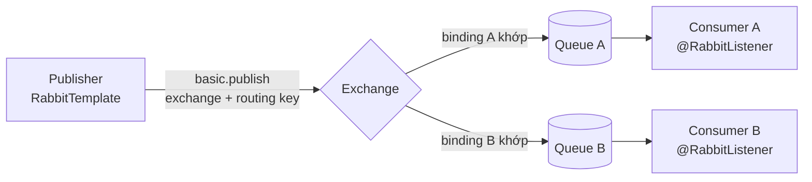
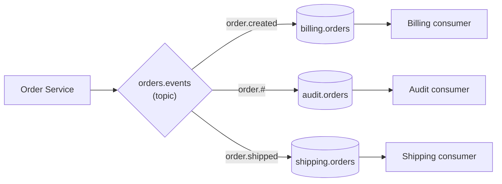

# Exchange, queue, binding và routing key trong AMQP 0.9.1

## Mục tiêu bài học

Khi tích hợp RabbitMQ bằng **Spring AMQP**, một ứng dụng thường dùng `RabbitTemplate` để phát thông điệp và `@RabbitListener` để xử lý bất đồng bộ. Muốn định tuyến đúng, cần hiểu bốn thành phần của **mô hình AMQP 0.9.1**: **exchange**, **queue**, **binding** và **routing key**. Đây là nền tảng để xây dựng luồng sự kiện, tách các dịch vụ và bổ sung cơ chế xác nhận, retry, dead-letter, quan sát hệ thống ở những bước tiếp theo.

Sau bài học, bạn có thể:

- Giải thích thông điệp đi từ publisher đến consumer qua exchange và queue như thế nào.
- Phân biệt routing key trên thông điệp với binding key trong cấu hình định tuyến.
- Chọn đúng `direct`, `topic`, `fanout` hoặc `headers` exchange theo yêu cầu nghiệp vụ.
- Khai báo topology gồm exchange, queue, binding bằng Spring AMQP và kiểm chứng đường đi của thông điệp.
- Nhận diện các trường hợp thông điệp không đến queue và hiểu giới hạn của từng cơ chế đảm bảo giao nhận.

> **Phạm vi:** Bài học dùng AMQP **0.9.1** và cách RabbitMQ triển khai giao thức này. Không nhầm các khái niệm và API dưới đây với AMQP 1.0, vốn có mô hình khác.

## 1. Thông điệp đi qua những đâu?

Trong AMQP 0.9.1, publisher **gửi thông điệp đến exchange**, không trực tiếp đẩy vào một queue bất kỳ. Exchange quyết định những queue nào sẽ nhận thông điệp dựa trên loại exchange, routing key và các binding. Consumer nhận thông điệp từ queue.



Một lệnh phát có thể dẫn đến các kết quả khác nhau:

- **Không queue nào khớp:** thông điệp không được đặt vào queue nào; điều gì xảy ra tiếp phụ thuộc `mandatory`, alternate exchange hoặc cấu hình liên quan.
- **Một queue khớp:** thông điệp được chuyển tới queue đó để chờ consumer.
- **Nhiều queue khớp:** mỗi queue được định tuyến sẽ nhận một bản sao riêng; các consumer của những queue khác nhau có thể xử lý cùng một sự kiện.

Nếu một queue có nhiều binding đều khớp với cùng thông điệp, RabbitMQ vẫn chỉ đưa **một bản sao vào queue đó**. Ngược lại, nếu nhiều consumer cùng đọc **một queue**, chúng thường chia nhau các thông điệp theo mô hình *competing consumers*: mỗi lần giao nhận của một thông điệp chỉ hướng đến một consumer tại một thời điểm, với khả năng giao lại nếu xử lý thất bại.

## 2. Bốn thành phần cốt lõi

| Thành phần | Ai tạo hoặc sử dụng? | Vai trò |
|---|---|---|
| **Exchange** | Khai báo bởi ứng dụng hoặc quản trị viên; publisher chọn khi gửi | Nhận thông điệp và áp dụng quy tắc định tuyến đến các queue. Exchange thông thường không phải nơi lưu trữ thông điệp chờ xử lý. |
| **Queue** | Khai báo bởi ứng dụng hoặc quản trị viên; consumer đăng ký đọc | Giữ thông điệp đã được định tuyến cho đến khi được giao nhận/xử lý theo chính sách của broker. |
| **Binding** | Khai báo để nối exchange với queue | Quy tắc xác định queue có được nhận thông điệp từ exchange hay không. Một queue có thể có nhiều binding, kể cả từ nhiều exchange. |
| **Routing key** | Publisher đặt trên mỗi lần `basic.publish` | Chuỗi được exchange dùng khi định tuyến (cách sử dụng tùy loại exchange). |

### Exchange: nơi quyết định đường đi

Exchange có **tên** và **loại** (chẳng hạn `direct` hoặc `topic`). Ứng dụng gửi thông điệp với tên exchange và routing key; broker xử lý thông điệp theo các binding của exchange đó.

Ví dụ, publisher gọi:

```java
rabbitTemplate.convertAndSend(
    "orders.events",   // tên exchange
    "order.created",   // routing key của lần gửi
    "orderId=42"       // nội dung thông điệp
);
```

Đoạn code **không chỉ định queue đích**. Việc queue nào nhận `orderId=42` phụ thuộc vào các binding trên exchange `orders.events`.

### Queue: nơi consumer đọc thông điệp

Queue có tên và các thuộc tính cấu hình, ví dụ:

- **Durable:** định nghĩa queue tồn tại sau khi broker khởi động lại. Điều này **không tự động bảo đảm** mọi thông điệp trong queue còn nguyên sau sự cố; cần xét thêm tính persistent, cơ chế lưu trữ và publisher confirms.
- **Exclusive:** queue gắn với một kết nối; thường dùng cho nhu cầu tạm thời và sẽ bị xóa khi kết nối sở hữu đóng.
- **Auto-delete:** queue có thể bị xóa sau khi consumer cuối cùng hủy đăng ký, nếu queue đã từng có consumer.
- **Arguments:** thông số bổ sung như dead-letter exchange, TTL hoặc loại queue, tùy khả năng RabbitMQ.

Hai consumer cùng lắng nghe `billing.orders` **không đồng nghĩa mỗi consumer đều nhận mọi thông điệp**. Nếu muốn hai nghiệp vụ độc lập đều nhận sự kiện, hãy dùng **hai queue khác nhau**, mỗi queue có binding phù hợp.

### Binding: quy tắc nối exchange và queue

Binding là mối liên kết có hướng từ exchange đến queue. Với `direct` hoặc `topic` exchange, binding thường mang một **binding key**:

```text
orders.events (topic)
  ├── binding key: order.created ──> billing.orders
  ├── binding key: order.#       ──> audit.orders
  └── binding key: order.shipped ──> shipping.orders
```

**Binding key** là điều kiện được cấu hình trên đường nối; **routing key** là giá trị publisher gửi kèm thông điệp. Chúng không phải cùng một trường dữ liệu. Với `topic` exchange, binding key có thể chứa ký tự đại diện; routing key của thông điệp thường là các từ cụ thể.

### Routing key: nhãn định tuyến của lần phát

Ví dụ `order.created`, `order.shipped`, `payment.failed`. Routing key:

- Do **publisher** chọn tại thời điểm phát, không phải do `@RabbitListener` đặt.
- Phân biệt chữ hoa/chữ thường: `order.created` khác `Order.Created`.
- Không phải là tên queue, trừ trường hợp đặc biệt dùng **default exchange**.
- Có thể bị bỏ qua bởi một số loại exchange, ví dụ `fanout`.

## 3. Các loại exchange và cách khớp binding

| Loại exchange | Nguyên tắc định tuyến | Tình huống phù hợp |
|---|---|---|
| **Direct** | Routing key phải **bằng chính xác** binding key. | Phân luồng theo mã tác vụ hoặc loại sự kiện cố định. |
| **Topic** | Routing key được so với mẫu binding key có `*` và `#`. | Phát sự kiện theo nhóm, tên miền nghiệp vụ và phân cấp chủ đề. |
| **Fanout** | Gửi đến **mọi queue có binding** với exchange; bỏ qua routing key. | Phát thông báo cho nhiều hệ thống độc lập. |
| **Headers** | So khớp các header của thông điệp với tham số binding như `x-match=all` hoặc `x-match=any`; routing key không quyết định. | Quy tắc dựa trên metadata thay vì một chuỗi định tuyến. |

### Direct exchange

Giả sử exchange `payments.direct` có hai binding:

```text
payments.direct ── "payment.succeeded" ──> receipts.queue
                └─ "payment.failed"    ──> alerts.queue
```

Thông điệp có routing key `payment.failed` đến `alerts.queue`, không đến `receipts.queue`. `payment.*` **không có tác dụng như wildcard** trong direct exchange; đây chỉ là một chuỗi thông thường. Nếu hai queue có binding key `payment.failed`, cả hai queue đều nhận một bản sao.

### Topic exchange

Topic exchange phân tách routing key theo dấu chấm (`.`). Binding key có hai ký tự đại diện:

- `*`: khớp **chính xác một từ** giữa các dấu chấm.
- `#`: khớp **không hoặc nhiều từ**.

Ví dụ:

| Binding key | Routing key | Khớp? | Giải thích |
|---|---|---|---|
| `order.*` | `order.created` | Có | `*` nhận một từ `created`. |
| `order.*` | `order.created.eu` | Không | Có hai từ sau `order`. |
| `order.#` | `order.created.eu` | Có | `#` nhận nhiều từ. |
| `*.failed` | `payment.failed` | Có | Phù hợp mọi tên miền có hậu tố `failed` với hai từ. |
| `*.failed` | `payment.card.failed` | Không | Có ba từ, vượt mẫu hai từ. |
| `order.created` | `order.shipped` | Không | Không khớp chính xác. |

Nên đặt quy ước tên nhất quán như `<domain>.<action>` hoặc `<domain>.<entity>.<action>`. Ví dụ, nhóm chọn `order.created` thì phải thống nhất với các binding; `orders.created` là routing key khác.

### Fanout và headers exchange

`fanout` phù hợp khi tất cả queue được nối đều cần nhận thông báo, chẳng hạn cập nhật cấu hình cache ở các dịch vụ riêng. Việc phát kèm routing key `cache.invalidated` không làm fanout chọn lọc theo khóa này.

`headers` phù hợp với quy tắc như `format=pdf` **và** `region=apac`. Binding có thể yêu cầu `x-match=all` (mọi điều kiện cùng đúng) hoặc `x-match=any` (ít nhất một điều kiện đúng). Header exchange ít phổ biến hơn topic exchange trong thiết kế sự kiện nghiệp vụ; chỉ chọn nó khi cần lọc theo nhiều thuộc tính header thực sự.

### Default exchange: trường hợp dễ gây hiểu nhầm

RabbitMQ có **default exchange**, là một direct exchange được định danh bằng chuỗi rỗng `""`. Khi khai báo queue, RabbitMQ tự động tạo binding từ default exchange đến queue với binding key **bằng tên queue**.

```java
// Gửi vào queue "billing.orders" thông qua default exchange.
rabbitTemplate.convertAndSend("", "billing.orders", "orderId=42");
```

Lệnh này trông giống gửi trực tiếp vào queue nhưng thực tế vẫn đi qua exchange. Nếu phát tới exchange `orders.events` thì routing key `billing.orders` **không mặc nhiên** chuyển vào queue cùng tên; phải có binding thích hợp.

## 4. Phân tích một topology đặt hàng

Một hệ thống đặt hàng muốn:

1. Bộ phận thanh toán nhận sự kiện **đơn hàng được tạo**.
2. Dịch vụ kiểm toán nhận **mọi sự kiện liên quan đến đơn hàng**.
3. Bộ phận giao hàng nhận sự kiện **đơn hàng đã được gửi đi**.

Ta chọn topic exchange `orders.events` với topology:



Với các binding trên, kết quả dự kiến:

| Routing key được publish | `billing.orders` | `audit.orders` | `shipping.orders` |
|---|:---:|:---:|:---:|
| `order.created` | Nhận | Nhận | — |
| `order.shipped` | — | Nhận | Nhận |
| `order.cancelled` | — | Nhận | — |
| `inventory.updated` | — | — | — |

Ở dòng `order.created`, **một lần publish** tạo ra hai bản sao được định tuyến tới **hai queue**. Consumer thanh toán xử lý bản sao của mình mà không cản trở consumer kiểm toán. Trong khi đó, nếu thanh toán mở rộng lên ba instance cùng đọc `billing.orders`, ba instance đó chia tải của **cùng một queue**, không phải ba bản sao của sự kiện.

## 5. Khai báo exchange, queue và binding bằng Spring AMQP

Ví dụ sau sử dụng Spring Boot với dependency `spring-boot-starter-amqp` và broker RabbitMQ đang chạy ở `localhost:5672`. Các đoạn mã thuộc cùng một ứng dụng Spring Boot; mỗi lớp đặt trong file Java riêng tương ứng.

**Dependency Gradle** (thêm vào phần `dependencies` của ứng dụng):

```groovy
implementation 'org.springframework.boot:spring-boot-starter-amqp'
```

**Cấu hình kết nối** (ví dụ `application.yml` cho môi trường cục bộ):

```yaml
spring:
  rabbitmq:
    host: localhost
    port: 5672
    username: guest
    password: guest
```

Thông tin đăng nhập `guest/guest` thường chỉ phù hợp để thử nghiệm trên máy cục bộ; cần tài khoản và cấu hình phù hợp khi triển khai thực tế.

### Bước 1: Khai báo topology

```java
import org.springframework.amqp.core.Binding;
import org.springframework.amqp.core.BindingBuilder;
import org.springframework.amqp.core.Queue;
import org.springframework.amqp.core.QueueBuilder;
import org.springframework.amqp.core.TopicExchange;
import org.springframework.beans.factory.annotation.Qualifier;
import org.springframework.context.annotation.Bean;
import org.springframework.context.annotation.Configuration;

@Configuration
public class OrderMessagingConfig {
    public static final String EXCHANGE = "orders.events";
    public static final String BILLING_QUEUE = "billing.orders";
    public static final String AUDIT_QUEUE = "audit.orders";
    public static final String SHIPPING_QUEUE = "shipping.orders";

    @Bean
    TopicExchange ordersExchange() {
        return new TopicExchange(EXCHANGE, true, false);
    }

    @Bean
    Queue billingQueue() {
        return QueueBuilder.durable(BILLING_QUEUE).build();
    }

    @Bean
    Queue auditQueue() {
        return QueueBuilder.durable(AUDIT_QUEUE).build();
    }

    @Bean
    Queue shippingQueue() {
        return QueueBuilder.durable(SHIPPING_QUEUE).build();
    }

    @Bean
    Binding billingBinding(@Qualifier("billingQueue") Queue billingQueue,
                           TopicExchange ordersExchange) {
        return BindingBuilder.bind(billingQueue)
                .to(ordersExchange).with("order.created");
    }

    @Bean
    Binding auditBinding(@Qualifier("auditQueue") Queue auditQueue,
                         TopicExchange ordersExchange) {
        return BindingBuilder.bind(auditQueue)
                .to(ordersExchange).with("order.#");
    }

    @Bean
    Binding shippingBinding(@Qualifier("shippingQueue") Queue shippingQueue,
                            TopicExchange ordersExchange) {
        return BindingBuilder.bind(shippingQueue)
                .to(ordersExchange).with("order.shipped");
    }
}
```

Spring AMQP cung cấp các bean `Exchange`, `Queue` và `Binding`. Trong ứng dụng Spring Boot cấu hình thông thường, `RabbitAdmin` tự khai báo các bean này trên broker khi kết nối được thiết lập. Tham số `true` trong `TopicExchange(EXCHANGE, true, false)` nghĩa là exchange durable; `false` nghĩa là không auto-delete.

Vì cùng có ba bean kiểu `Queue`, ví dụ dùng `@Qualifier` để chỉ định rõ queue được inject vào mỗi binding. Khi đổi tên phương thức `@Bean`, hãy cập nhật tên trong `@Qualifier` tương ứng.

### Bước 2: Publisher gửi sự kiện

```java
import org.springframework.amqp.rabbit.core.RabbitTemplate;
import org.springframework.stereotype.Service;

@Service
public class OrderEventPublisher {
    private final RabbitTemplate rabbitTemplate;

    public OrderEventPublisher(RabbitTemplate rabbitTemplate) {
        this.rabbitTemplate = rabbitTemplate;
    }

    public void orderCreated(String orderId) {
        rabbitTemplate.convertAndSend(
                OrderMessagingConfig.EXCHANGE,
                "order.created",
                "orderId=" + orderId);
    }

    public void orderShipped(String orderId) {
        rabbitTemplate.convertAndSend(
                OrderMessagingConfig.EXCHANGE,
                "order.shipped",
                "orderId=" + orderId);
    }
}
```

Ở đây payload là `String` để tập trung vào định tuyến; khi dùng object/JSON trong ứng dụng thực tế, cần cấu hình message converter và hợp đồng dữ liệu giữa publisher với consumer.

### Bước 3: Consumer nhận từ queue

```java
import org.springframework.amqp.rabbit.annotation.RabbitListener;
import org.springframework.stereotype.Component;

@Component
public class OrderConsumers {
    @RabbitListener(queues = OrderMessagingConfig.BILLING_QUEUE)
    public void handleBilling(String payload) {
        System.out.println("Billing: " + payload);
    }

    @RabbitListener(queues = OrderMessagingConfig.AUDIT_QUEUE)
    public void handleAudit(String payload) {
        System.out.println("Audit: " + payload);
    }

    @RabbitListener(queues = OrderMessagingConfig.SHIPPING_QUEUE)
    public void handleShipping(String payload) {
        System.out.println("Shipping: " + payload);
    }
}
```

Nếu gọi `orderCreated("42")`, console dự kiến xuất hiện **Billing** và **Audit** (thứ tự không được bảo đảm). Nếu gọi `orderShipped("42")`, console dự kiến xuất hiện **Audit** và **Shipping**. Không có điều gì trong `@RabbitListener` khiến nó nhận thông điệp ngoài queue được chỉ định.

### Bước 4: Quan sát trên RabbitMQ

Có thể chạy một broker thử nghiệm bằng Docker:

```bash
docker run -d --name rabbitmq-amqp \
  -p 5672:5672 -p 15672:15672 \
  rabbitmq:4-management
```

Truy cập giao diện quản trị tại `http://localhost:15672` để xem:

1. **Exchanges:** `orders.events` tồn tại, có type `topic`.
2. **Queues and Streams:** ba queue `billing.orders`, `audit.orders`, `shipping.orders` tồn tại.
3. **Bindings:** từng queue được nối với exchange bằng đúng `order.created`, `order.#` và `order.shipped`.
4. **Publish message:** gửi từ exchange `orders.events` với routing key `order.created` để quan sát số lượng thông điệp vào queue hoặc log consumer. Nếu consumer đang hoạt động, thông điệp có thể được xử lý ngay nên số lượng `Ready` nhanh chóng về 0.

Ở RabbitMQ, khai báo lại exchange/queue cùng tên với thuộc tính không tương thích có thể gây lỗi `PRECONDITION_FAILED`. Ví dụ, đừng đổi một queue đang tồn tại từ durable thành non-durable chỉ bằng cách sửa Java; cần thiết kế thay đổi topology có kiểm soát.

## 6. Các lỗi tư duy thường gặp và liên hệ đến độ tin cậy

| Tình huống | Hiểu đúng và cách kiểm tra |
|---|---|
| Đã publish nhưng consumer không nhận | Xác minh **tên exchange**, **loại exchange**, **routing key**, **binding**, **tên queue** và consumer có đang đọc queue đó không. |
| Dùng `order.*` nhưng muốn nhận `order.created.eu` | `*` chỉ khớp một từ; cân nhắc `order.#` nếu thực sự muốn bắt cả các nhánh con. |
| Tạo hai `@RabbitListener` trên cùng queue để phát một sự kiện tới cả hai dịch vụ | Các listener cạnh tranh nhận thông điệp của **một queue**. Muốn hai dịch vụ đều nhận, khai báo hai queue riêng với hai binding. |
| Gửi đến exchange tồn tại nhưng không có binding khớp | Broker có thể chấp nhận lần publish dù không định tuyến được vào queue nào. Dùng cơ chế phát hiện unroutable như `mandatory`/returned message hoặc thiết kế alternate exchange phù hợp. |
| Nghĩ durable queue nghĩa là đã bảo đảm xử lý thành công | Durable bảo vệ định nghĩa queue. Độ tin cậy còn liên quan đến persistent message, publisher confirms, consumer acknowledgements, retry/DLX và xử lý trùng lặp. |
| Nhầm publisher confirm với consumer acknowledgement | **Publisher confirm** phản hồi phía broker về việc publish; **consumer acknowledgement** phản hồi việc giao nhận/xử lý ở phía consumer. Hai việc độc lập. |

Về đường đi thông điệp, nên tách rõ **ba câu hỏi**:

1. **Có định tuyến vào queue không?** Xem exchange, binding và routing key; cân nhắc `mandatory` cùng publisher returns khi cần phát hiện thông điệp không có tuyến.
2. **Broker đã chấp nhận/lưu thông điệp theo cơ chế nào?** Xem publisher confirms, durable topology, chế độ persistent và loại queue; không suy ra độ bền dữ liệu chỉ từ lời gọi `convertAndSend` thành công.
3. **Consumer đã xử lý thành công chưa?** Xem cơ chế acknowledgement của listener container, retry/requeue, dead-letter và tính idempotent của nghiệp vụ.

Mặc định nhiều cấu hình listener Spring AMQP sử dụng chế độ xác nhận của **container** (`AcknowledgeMode.AUTO`): framework gửi acknowledgement sau khi phương thức listener hoàn thành thành công. Đây **khác** với AMQP `autoAck`/`noAck`, nơi broker coi thông điệp đã được xác nhận ngay khi giao. Nếu listener ném exception, cách reject/requeue/retry thực tế phụ thuộc cấu hình container và chính sách xử lý lỗi; không giả định message luôn tự chuyển sang dead-letter queue.

## 7. Bài thực hành tự kiểm tra

Giả sử một topic exchange tên `notifications.events` có các binding:

```text
notifications.events
  ├─ "user.created"  ──> welcome.email
  ├─ "user.#"        ──> audit.user
  └─ "*.failed"      ──> alerts.failure
```

Hãy dự đoán queue đích của các routing key sau trước khi xem đáp án:

| Routing key | Queue nhận thông điệp |
|---|---|
| `user.created` | `welcome.email`, `audit.user` |
| `user.deleted` | `audit.user` |
| `payment.failed` | `alerts.failure` |
| `user.login.failed` | `audit.user`; **không** khớp `*.failed` vì có ba từ |
| `inventory.updated` | Không queue nào khớp |

Thử thêm một binding `user.*` vào queue `alerts.failure`. Lúc này `user.created` sẽ được định tuyến đến cả ba queue, còn `user.login.failed` vẫn không khớp binding mới vì có ba từ. Nếu cần tất cả sự kiện `user` đi vào một queue, dùng `user.#` thay vì `user.*`.

## Ghi nhớ

- **Publisher → exchange → (binding) → queue → consumer** là luồng cốt lõi của AMQP 0.9.1.
- **Routing key** đi cùng lần publish; **binding key** là điều kiện đã đăng ký trên exchange/queue.
- **Direct** khớp chính xác; **topic** hỗ trợ `*`/`#`; **fanout** phát đến mọi queue đã bind; **headers** xét metadata.
- **Mỗi queue có bản sao riêng khi được định tuyến**; nhiều consumer trong cùng queue thì chia việc.
- Định tuyến đúng mới là bước đầu. Để xử lý bất đồng bộ đáng tin cậy bằng Spring AMQP, tiếp tục kiểm soát publisher confirms, consumer acknowledgements, retry, dead-letter và khả năng quan sát.
