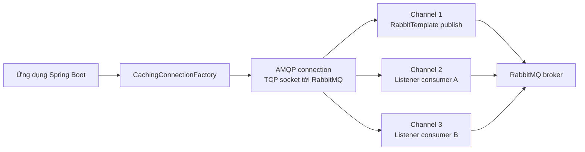
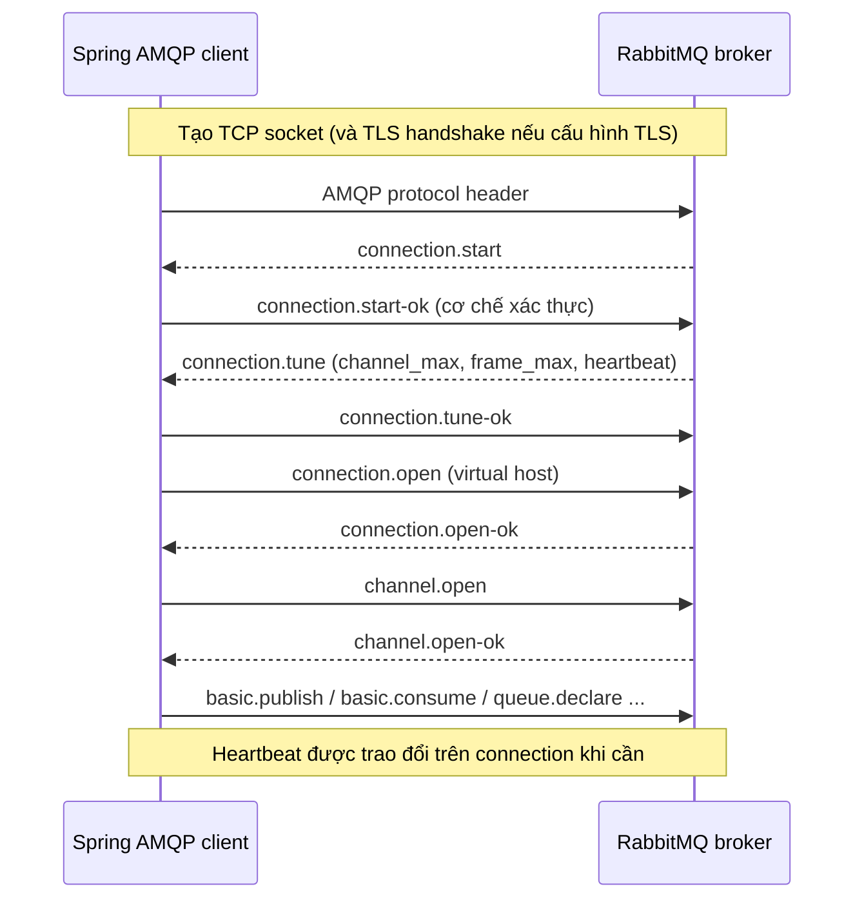
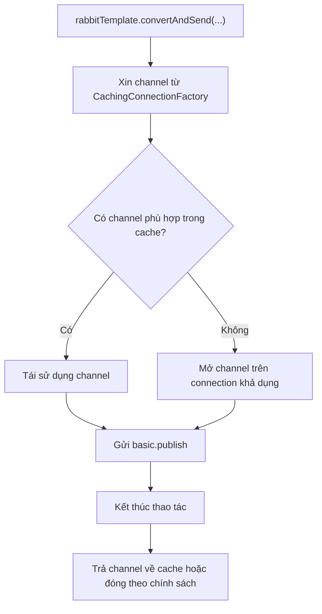
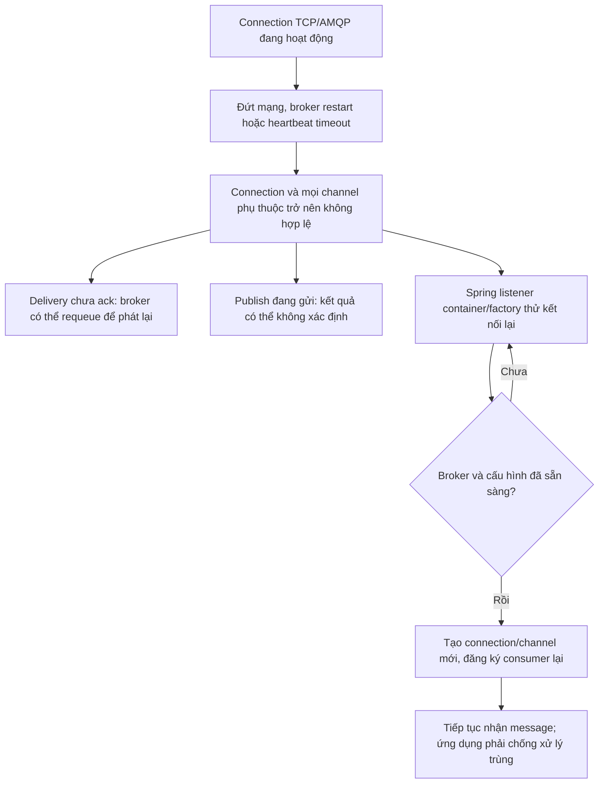

# Connection, channel và vòng đời kết nối đến broker

## 1. Mục tiêu bài học

Trong hệ thống dùng **RabbitMQ** và **Spring AMQP**, ứng dụng không gửi message trực tiếp đến một queue qua một kết nối TCP mới cho mỗi lần gửi. Ứng dụng thiết lập **connection** đến broker, mở một hoặc nhiều **channel** trên connection đó rồi sử dụng channel để khai báo tài nguyên, publish, consume và xác nhận message. Hiểu đúng hai cấp tài nguyên này giúp cấu hình ứng dụng hợp lý, giải thích lỗi mất kết nối và tránh xử lý trùng khi broker hoặc mạng gặp sự cố.

Sau bài này, bạn có thể:

- Phân biệt TCP connection, AMQP connection, channel và consumer; giải thích vì sao channel nhẹ hơn connection.
- Mô tả quá trình mở, sử dụng, đóng và tái tạo connection/channel trong giao thức AMQP 0-9-1.
- Hiểu vai trò của `ConnectionFactory`, `CachingConnectionFactory`, `RabbitTemplate` và `@RabbitListener` trong Spring AMQP.
- Cấu hình connection, heartbeat, cache channel và concurrency ở mức cơ bản trong Spring Boot.
- Phân tích tác động của mất kết nối đến publish, consumer, message chưa được ack và cơ chế khôi phục.
- Phân biệt sự cố mạng với lỗi giao thức chỉ làm đóng một channel; biết những chỉ số cần theo dõi.

> Phạm vi: bài tập trung vào **mô hình AMQP và vòng đời kết nối**. Các cơ chế publisher confirm, retry, dead-letter và transaction được nhắc đến ở mức cần thiết để hiểu hành vi của connection/channel; mỗi cơ chế còn cần được học riêng khi xây dựng xử lý bất đồng bộ đáng tin cậy.

## 2. Connection, channel và consumer khác nhau thế nào?

Giả sử hệ thống đặt hàng có API gửi sự kiện `orders.created`, còn dịch vụ thanh toán nhận sự kiện này qua queue. Quan hệ tài nguyên thường có dạng:



| Thành phần | Bản chất | Vai trò | Phạm vi khi xảy ra lỗi |
| --- | --- | --- | --- |
| **TCP connection** | Kết nối mạng giữa client và broker | Vận chuyển byte hai chiều; có thể dùng TLS | Mất TCP khiến các AMQP channel trên đó không còn dùng được |
| **AMQP connection** | Phiên giao thức chạy trên TCP, đã xác thực và mở virtual host | Quản lý trạng thái kết nối, heartbeat và các channel | Lỗi connection thường ảnh hưởng toàn bộ channel của phiên đó |
| **AMQP channel** | Phiên logic được ghép kênh trên một AMQP connection | Thực hiện `basic.publish`, `basic.consume`, `basic.ack`, khai báo exchange/queue/binding... | Nhiều lỗi giao thức chỉ đóng channel liên quan |
| **Consumer** | Đăng ký nhận message trên channel, có `consumer tag` | Broker đẩy các delivery đến ứng dụng | Consumer có thể bị hủy và đăng ký lại; không đồng nhất với connection |

**Một connection có thể chứa nhiều channel.** Mỗi frame AMQP mang mã channel để broker và client phân luồng các thao tác qua cùng socket TCP. Việc mở channel thường rẻ hơn bắt tay TCP/TLS, xác thực và khởi tạo một connection mới. Ngược lại, quá nhiều channel vẫn tiêu tốn bộ nhớ, tài nguyên broker và chi phí lập lịch; vì vậy cần tái sử dụng hợp lý.

Một channel mang những trạng thái riêng, ví dụ delivery tag, chế độ publisher confirm hoặc transaction và thông tin consumer. **Delivery tag có ý nghĩa trong phạm vi channel**: một lần `basic.ack` phải được gửi trên chính channel đã nhận delivery đó. Lấy tag của channel A để ack trên channel B là sai giao thức và có thể khiến broker đóng channel.

### Những nhầm lẫn phổ biến

- **Channel không phải thread.** Một thread có thể mượn channel khi publish, nhưng không nên để nhiều thread đồng thời thao tác trên cùng một `com.rabbitmq.client.Channel`. Spring AMQP quản lý việc cấp phát và sử dụng channel phù hợp qua các abstraction của nó.
- **Channel không phải queue.** Một channel có thể thao tác với nhiều exchange/queue; một queue có thể có nhiều consumer sử dụng các channel khác nhau.
- **Connection còn sống không có nghĩa mọi channel đều còn sống.** Lỗi khai báo queue với thuộc tính không khớp có thể làm channel đóng, trong khi TCP connection vẫn hoạt động.
- **Không cần mở connection mới cho từng message.** `RabbitTemplate` sử dụng tài nguyên do `ConnectionFactory` quản lý và có thể tái sử dụng connection/channel.

## 3. Quá trình thiết lập connection và channel

AMQP 0-9-1 có các bước bắt tay rõ ràng. Trình tự ở mức khái niệm:



Các bước chính:

1. **Tạo đường truyền:** client phân giải địa chỉ broker, kết nối TCP đến cổng AMQP (thường `5672`) hoặc AMQPS (thường `5671`). Với TLS, hai phía còn thực hiện xác minh chứng chỉ và trao đổi khóa.
2. **Thương lượng giao thức và xác thực:** client/broker trao đổi `connection.start`, `start-ok` và thống nhất các giới hạn qua `connection.tune`/`tune-ok` (ví dụ `channel_max`, `frame_max`, heartbeat). Thông số thực tế là kết quả thương lượng, không nhất thiết bằng nguyên giá trị client đề xuất.
3. **Mở virtual host:** `connection.open` chọn vhost; broker kiểm tra quyền và xác nhận qua `connection.open-ok`. Vhost là không gian logic chứa exchange, queue, binding và quyền truy cập tương ứng.
4. **Mở channel:** client gửi `channel.open` và đợi `channel.open-ok`. Từ đây channel có thể khai báo topology, publish hoặc đăng ký consumer.
5. **Trao đổi message:** dữ liệu đi qua các frame AMQP trên connection. Việc publish, consume hay ack là thao tác **trên channel**, trong khi heartbeat là cơ chế phát hiện liên lạc bị gián đoạn **ở cấp connection**.

**Connection có thể được tạo theo nhu cầu.** Việc Spring Boot khởi tạo bean `ConnectionFactory` không nhất thiết ngay lập tức mở socket. Tác vụ đầu tiên cần broker, chẳng hạn một listener khởi động hoặc lời gọi gửi message, có thể kích hoạt kết nối thực tế.

### Heartbeat hoạt động thế nào?

Heartbeat AMQP giúp phát hiện một connection không còn phản hồi khi TCP chưa báo lỗi rõ ràng, chẳng hạn sự cố mạng một chiều. Hai đầu thương lượng khoảng heartbeat; khi đường truyền không có hoạt động giao thức khác, chúng trao đổi heartbeat frame. Nếu broker/client không nhận được hoạt động trong thời gian phù hợp, một bên có thể coi connection đã mất.

Heartbeat **không** xác nhận message đã được ghi vào queue, không thay thế publisher confirm và cũng không đảm bảo thao tác xử lý nghiệp vụ đã thành công. Chọn khoảng heartbeat quá ngắn trong môi trường có độ trễ, ngắt quãng hoặc tải cao có thể dẫn đến ngắt kết nối giả; quá dài lại khiến phát hiện sự cố chậm hơn.

## 4. Spring AMQP quản lý connection/channel ra sao?

Spring AMQP có abstraction `org.springframework.amqp.rabbit.connection.ConnectionFactory`. Với ứng dụng Spring Boot dùng `spring-boot-starter-amqp`, cấu hình tự động thường cung cấp `CachingConnectionFactory` cùng `RabbitTemplate` và cơ sở hạ tầng cho `@RabbitListener`. Không nên nhầm `ConnectionFactory` của Spring với `com.rabbitmq.client.ConnectionFactory` ở RabbitMQ Java client: hai lớp ở hai tầng API khác nhau.

| Thành phần Spring | Nhiệm vụ chính |
| --- | --- |
| `CachingConnectionFactory` | Quản lý việc tạo và tái sử dụng connection/channel; theo dõi, tái tạo tài nguyên khi cần |
| `RabbitTemplate` | API publish, RPC và các tác vụ AMQP; lấy channel từ connection factory cho từng hoạt động |
| `RabbitAdmin` / `AmqpAdmin` | Khai báo exchange, queue, binding từ các bean khi có kết nối phù hợp và chức năng tự khai báo được bật |
| Listener container | Duy trì consumer, channel nhận message và chu kỳ phục hồi/đăng ký lại consumer |
| `@RabbitListener` | Định nghĩa phương thức xử lý message; việc giữ connection và channel do container đảm nhận |

### Cache channel và giới hạn tài nguyên

Với `CachingConnectionFactory` ở chế độ `CacheMode.CHANNEL` (thông dụng và là mặc định), ứng dụng thường tái sử dụng một connection chung và **nhiều channel**. Khi một tác vụ publish kết thúc, Spring có thể trả channel về cache thay vì đóng channel vật lý. Listener container cũng dùng channel theo vòng đời consumer, thay vì mở/đóng channel cho mỗi lần nhận.

Điểm cần hiểu về `channelCacheSize`:

- Đó là số lượng **channel nhàn rỗi có thể giữ lại** trong cache theo connection trong cấu hình mặc định.
- Khi `channelCheckoutTimeout = 0` (mặc định), đây **không phải giới hạn cứng** về tổng số channel đang sử dụng đồng thời; tải cao có thể mở nhiều channel hơn kích thước cache.
- Khi cấu hình `channelCheckoutTimeout > 0`, kích thước cache đồng thời đóng vai trò giới hạn số channel được cấp phát; tác vụ phải đợi channel còn trống và có thể bị timeout.
- Vì vậy, tăng `channelCacheSize` đơn thuần không sửa được mọi vấn đề về connection/channel và cần cân nhắc cùng concurrency, số instance, giới hạn broker, áp lực tải.

`CacheMode.CONNECTION` cho phép cache nhiều connection, hữu ích trong những trường hợp đặc biệt, nhưng làm tăng lượng TCP connection và có hành vi khai báo tự động khác cần cấu hình cẩn thận. Phần lớn ứng dụng chỉ cần chế độ `CHANNEL` và điều chỉnh kích thước cache theo tải đo được.

### RabbitTemplate: mượn channel, gửi, trả tài nguyên

Ví dụ logic khi thực thi:



Sơ đồ mô tả chu trình thông thường ở mức khái niệm; khi dùng publisher confirm, transaction hoặc callback, thời điểm hoàn tất thao tác và trả channel có thêm điều kiện. Không nên tự lưu một `Channel` lấy từ client rồi chia sẻ giữa các thread để “tối ưu”. Dùng `RabbitTemplate` vì nó đã phối hợp việc truy cập tài nguyên.

### @RabbitListener: channel sống cùng consumer

Listener container khởi tạo một hoặc nhiều consumer theo cấu hình. Mỗi consumer cần channel để đăng ký `basic.consume`, nhận delivery và xác nhận. Channel phục vụ consumer thường tồn tại qua nhiều message, cho đến khi consumer dừng, bị hủy hoặc gặp sự cố. Khi container được tăng concurrency, số consumer/channel có thể tăng tương ứng; điều đó **không mặc nhiên** đồng nghĩa cần một TCP connection mới cho mỗi consumer.

Spring AMQP có nhiều kiểu container, phổ biến là `SimpleRabbitListenerContainerFactory` (SMLC) và `DirectRabbitListenerContainerFactory` (DMLC). Cách tổ chức thread/concurrency và quản lý consumer khác nhau, nên phải đọc đúng kiểu container đang dùng khi phân tích số connection/channel.

## 5. Ví dụ Spring Boot: từ kết nối đến publish và consume

Giả sử một ứng dụng cần phát sự kiện đặt hàng lên topic exchange và nhận sự kiện ở queue xử lý.

### 5.1. Cấu hình kết nối

Với dependency `spring-boot-starter-amqp` và broker RabbitMQ đang chạy, cấu hình minh họa trong `application.yml`:

```yaml
spring:
  rabbitmq:
    host: ${RABBITMQ_HOST:localhost}
    port: ${RABBITMQ_PORT:5672}
    username: ${RABBITMQ_USERNAME:guest}
    password: ${RABBITMQ_PASSWORD:guest}
    virtual-host: ${RABBITMQ_VHOST:/}
    connection-timeout: 5s
    requested-heartbeat: 30s
    cache:
      channel:
        size: 32
    listener:
      simple:
        concurrency: 2
        max-concurrency: 6
        prefetch: 20
        acknowledge-mode: auto
```

Ý nghĩa:

- `host`, `port`, `username`, `password` và `virtual-host` xác định nơi kết nối và danh tính truy cập. Tài khoản `guest` thường bị RabbitMQ hạn chế đăng nhập từ máy từ xa; nên dùng tài khoản/vhost riêng cho môi trường triển khai.
- `connection-timeout` kiểm soát thời gian chờ tạo TCP connection, **không** phải thời gian chờ publish được broker xác nhận.
- `requested-heartbeat` là giá trị client đề xuất khi thương lượng AMQP heartbeat.
- `cache.channel.size` cho phép giữ tối đa 32 channel nhàn rỗi trong mỗi cache tương ứng; theo mặc định đây không phải ngưỡng cứng về channel đang hoạt động.
- `listener.simple.concurrency` và `max-concurrency` tác động đến số consumer của Simple listener container; `prefetch` hạn chế lượng delivery chưa được xác nhận để tránh dồn quá nhiều việc vào consumer.
- `acknowledge-mode: auto` nghĩa là **container Spring** tự ack sau khi xử lý thành công, hoặc áp dụng cách xử lý lỗi theo cấu hình. Nó **không** phải chế độ `autoAck=true` (RabbitMQ `noAck`) vốn coi message đã được xác nhận ngay khi giao.

Trong sản xuất, truyền thông tin đăng nhập qua biến môi trường hoặc hệ thống quản lý bí mật; cấu hình TLS và chính sách mạng theo môi trường.

### 5.2. Khai báo topology

```java
import org.springframework.amqp.core.Binding;
import org.springframework.amqp.core.BindingBuilder;
import org.springframework.amqp.core.Queue;
import org.springframework.amqp.core.QueueBuilder;
import org.springframework.amqp.core.TopicExchange;
import org.springframework.context.annotation.Bean;
import org.springframework.context.annotation.Configuration;

@Configuration
public class OrderMessagingConfig {
    public static final String EXCHANGE = "orders.events";
    public static final String QUEUE = "billing.requests";
    public static final String ROUTING_KEY = "orders.created";

    @Bean
    public TopicExchange orderExchange() {
        return new TopicExchange(EXCHANGE, true, false);
    }

    @Bean
    public Queue billingQueue() {
        return QueueBuilder.durable(QUEUE).build();
    }

    @Bean
    public Binding billingBinding(
            Queue billingQueue, TopicExchange orderExchange) {
        return BindingBuilder.bind(billingQueue)
                .to(orderExchange)
                .with(ROUTING_KEY);
    }
}
```

Với `RabbitAdmin` tự khai báo được Spring Boot cấu hình và ứng dụng có đủ quyền, những bean exchange/queue/binding này có thể được khai báo lên broker khi thiết lập connection. Việc mở connection và khai báo tài nguyên là hai hoạt động khác nhau; nếu broker đã có queue cùng tên nhưng thuộc tính khác, khai báo có thể thất bại và **đóng channel**.

### 5.3. Publish và consume

```java
import org.springframework.amqp.rabbit.core.RabbitTemplate;
import org.springframework.stereotype.Service;

@Service
public class OrderEventPublisher {
    private final RabbitTemplate rabbitTemplate;

    public OrderEventPublisher(RabbitTemplate rabbitTemplate) {
        this.rabbitTemplate = rabbitTemplate;
    }

    public void publishCreated(String orderId) {
        rabbitTemplate.convertAndSend(
                OrderMessagingConfig.EXCHANGE,
                OrderMessagingConfig.ROUTING_KEY,
                orderId);
    }
}
```

```java
import org.springframework.amqp.rabbit.annotation.RabbitListener;
import org.springframework.stereotype.Component;

@Component
public class BillingConsumer {
    @RabbitListener(queues = OrderMessagingConfig.QUEUE)
    public void onOrderCreated(String orderId) {
        // Thay bằng logic nghiệp vụ idempotent, ví dụ tạo yêu cầu thanh toán.
        System.out.println("Received order: " + orderId);
    }
}
```

Ở đây:

1. Khi `publishCreated` chạy, `RabbitTemplate` dùng connection/channel do Spring quản lý để publish message đến exchange. Exchange định tuyến theo routing key và binding.
2. Khi `BillingConsumer` được khởi động, listener container cần một connection đến broker, mở channel rồi đăng ký consumer với queue.
3. Broker gửi delivery đến channel của consumer; container gọi phương thức `onOrderCreated`.
4. Với `AUTO` acknowledge mode, khi phương thức xử lý thành công, container gửi ack qua đúng channel đã nhận delivery.

**Điều cần nhớ:** lời gọi `convertAndSend` trả về bình thường không tự chứng minh message đã tồn tại bền vững trong queue. Nếu cần phát hiện broker đã xử lý publish, hãy thiết kế publisher confirm; nếu cần biết message không tìm được queue đích, hãy kết hợp mandatory publish/publisher returns. Hai tín hiệu có ý nghĩa khác nhau.

## 6. Vòng đời từ lúc ứng dụng khởi động đến lúc dừng

### 6.1. Khởi động

1. Spring tạo cấu hình connection factory, template và listener container.
2. Khi có thành phần cần giao tiếp broker, connection factory tạo hoặc lấy connection hiện có.
3. Client bắt tay, xác thực, mở vhost; `RabbitAdmin` có thể khai báo topology nếu được bật và đã cấu hình.
4. Listener container mở channel, đặt QoS/prefetch nếu có, đăng ký consumer và bắt đầu nhận message.
5. Publisher lấy channel khi có lệnh gửi. Nếu chưa có channel rảnh, factory mở thêm theo chính sách.

Thời điểm broker không khả dụng khi startup có thể khiến listener container thử khởi động lại theo cơ chế recovery, hoặc ứng dụng có thể thất bại ngay ở các thao tác bắt buộc tùy cấu hình và thành phần đang chạy. Không nên giả định rằng mọi lỗi kết nối khi startup đều bị ẩn đi hoặc tự được retry vô hạn.

### 6.2. Hoạt động bình thường

Connection duy trì TCP socket, thương lượng heartbeat và mang các frame của nhiều channel. Publisher sử dụng channel ngắn hạn theo thao tác; consumer giữ channel trong thời gian đăng ký nhận. Broker có thể chủ động gửi sự kiện connection blocked/unblocked khi gặp tài nguyên bị thiếu, ví dụ báo động bộ nhớ hoặc dung lượng đĩa. Trạng thái blocked có thể làm publish bị chặn/chậm; nó khác với việc mất connection vật lý.

### 6.3. Dừng ứng dụng có kiểm soát

Khi `ApplicationContext` đóng, Spring dừng listener container, hủy consumer/dọn tài nguyên theo chính sách, đóng channel và connection do factory quản lý. Graceful shutdown có thể dành thời gian cho tác vụ listener đang chạy kết thúc, nhưng thời gian và kết quả còn phụ thuộc cấu hình shutdown, broker và tiến trình. Nếu tiến trình bị kill đột ngột, broker phát hiện TCP connection mất và thu hồi các channel/consumer liên quan.

### 6.4. Khi connection đứt đột ngột



Spring AMQP chủ động quản lý khôi phục kết nối và listener. Không nên tự bật cơ chế automatic recovery của RabbitMQ Java client bên dưới một `CachingConnectionFactory` để mong có “hai lớp” tự chữa lỗi: các cơ chế phục hồi trùng nhau có thể gây khó kiểm soát trạng thái. Đối với `RabbitTemplate`, **một publish đang thất bại không mặc nhiên được phát lại an toàn** chỉ vì kết nối sau đó đã hồi phục; việc retry thao tác phải có chính sách riêng.

Đặc biệt, khi connection mất giữa lúc xử lý:

- Message **chưa ack** trên channel đã mất có thể được broker đưa lại vào queue và giao cho consumer khác hoặc chính consumer đó sau khi reconnect.
- Logic nghiệp vụ có thể đã commit vào database nhưng ack chưa tới broker. Lần giao lại tạo **duplicate delivery**; cần idempotency key/unique constraint hoặc cơ chế xử lý trùng phù hợp.
- Publisher có thể không biết message đã tới broker hay chưa nếu socket mất ở thời điểm nhạy cảm. Retry publish mù quáng có thể tạo message trùng; không retry thì có thể mất sự kiện. Publisher confirms, outbox và định danh message giúp xây chiến lược tin cậy.
- Delivery tag chỉ hợp lệ trên channel cũ; khi reconnect, không được dùng delivery tag cũ để ack ở channel mới.

Phân biệt **khôi phục connection** với **khôi phục trạng thái nghiệp vụ**: connection mới giúp gửi/nhận tiếp, nhưng không chứng minh tác vụ đã hoàn tất chính xác một lần.

## 7. Lỗi channel và lỗi connection: nhận biết để xử lý đúng

| Tình huống | Tác động thường gặp | Nên kiểm tra hoặc xử lý |
| --- | --- | --- |
| Broker restart, TCP reset, mất mạng, timeout heartbeat | Connection đóng; tất cả channel trên connection đó mất hiệu lực | Tình trạng broker/mạng, heartbeat, log reconnect; đánh giá lại kết quả publish và message chưa ack |
| Sai username/password, không có quyền vào vhost | Không mở được AMQP connection | Credentials, vhost, permission; sửa cấu hình trước khi retry |
| Khai báo queue đã tồn tại nhưng khác `durable`/arguments | Broker trả `PRECONDITION_FAILED` (thường mã `406`) và đóng channel thực hiện | Đồng nhất cấu hình topology; không tạo vòng retry vô tận nếu bất đồng cấu hình chưa được giải quyết |
| Consume một queue không tồn tại bằng thao tác yêu cầu queue tồn tại | Broker có thể trả `NOT_FOUND` (thường mã `404`) và đóng channel | Kiểm tra tên queue, vhost, thứ tự tạo và quyền |
| Ack delivery tag không hợp lệ hoặc ack hai lần | Lỗi giao thức trên channel, có thể là `PRECONDITION_FAILED` | Ack đúng channel, đúng tag và đúng một lần; kiểm tra cách xử lý async |
| Broker báo `connection.blocked` vì memory/disk alarm | Connection có thể vẫn tồn tại nhưng publisher bị hạn chế | Quan sát tài nguyên broker; tránh kết luận nhầm là lỗi xác thực hoặc lỗi TCP |
| Quá nhiều connection/channel hoặc hết tài nguyên | Broker/client tăng áp lực bộ nhớ, scheduler và FD; thao tác có thể thất bại | Số instance, listener concurrency, cache size, chính sách mở channel/connection |

Một channel bị đóng do lỗi giao thức **không thể tiếp tục sử dụng như channel cũ**. Factory/container có thể mở channel khác, nhưng lỗi gốc như queue khai báo sai vẫn sẽ lặp lại cho đến khi sửa cấu hình. Tự động reconnect không giải quyết được sai quyền hoặc bất đồng topology.

## 8. Quan sát và chẩn đoán thực tế

Trong **RabbitMQ Management UI** (nếu bật plugin quản trị), các mục *Connections*, *Channels* và *Queues* giúp đối chiếu số kết nối vật lý, channel và consumer. Với hệ thống nhiều instance, nên quan sát theo từng application/pod, không chỉ tổng số toàn cụm.

Một quy trình chẩn đoán ngắn:

1. **Xác định cấp độ lỗi:** log nói `connection closed`/`connection refused`/`authentication failed` hay `channel shutdown`/`PRECONDITION_FAILED`? Điều này quyết định kiểm tra mạng/broker hay khai báo/topology.
2. **Đo số lượng tài nguyên:** theo dõi connections, channels, consumers, connections bị blocked, unacked messages. So sánh với số instance và cấu hình concurrency để phát hiện channel/connection tăng bất thường.
3. **Kiểm tra chiều nhận:** message tồn queue nhiều nhưng consumer = 0 gợi ý listener chưa đăng ký; consumer > 0 nhưng unacked tăng gợi ý tốc độ xử lý hoặc ack có vấn đề.
4. **Kiểm tra chiều gửi:** đánh giá publisher confirm, returned message và lỗi kết nối. Số lần gọi `convertAndSend` thành công ở code không phải thước đo đủ cho số message đã đến đúng queue.
5. **Đối chiếu thời điểm:** log Spring, log RabbitMQ, sự kiện restart, alarms, latency, mạng, triển khai phiên bản mới và thay đổi topology.

Ví dụ thao tác trên máy có quyền quản trị RabbitMQ:

```bash
# Các connection đang mở và số channel của mỗi connection
rabbitmqctl list_connections name state channels

# Các channel và số consumer / message chưa ack tương ứng
rabbitmqctl list_channels name connection consumer_count messages_unacknowledged

# Số consumer, ready, unacked theo queue
rabbitmqctl list_queues name consumers messages_ready messages_unacknowledged
```

Tên cột khả dụng phụ thuộc phiên bản RabbitMQ và quyền sử dụng CLI; `rabbitmqctl help list_connections`, `help list_channels` và `help list_queues` giúp xác minh trên môi trường cụ thể.

Khi có Spring Boot Actuator và cấu hình health phù hợp, chỉ số/health RabbitMQ có thể giúp kiểm tra khả năng kết nối ở cấp ứng dụng. Tuy nhiên một health check “UP” không xác nhận rằng mọi binding đúng, mọi message đến đúng queue hoặc không có consumer xử lý trùng. Nên theo dõi thêm metric nghiệp vụ, độ trễ, số message chưa ack và kết quả publisher confirm.

### Tình huống thực hành: 5 instance, mỗi instance 4 consumer

Giả sử ứng dụng có 5 instance Spring Boot, mỗi instance chạy 4 consumer của một listener và dùng `CachingConnectionFactory` theo chế độ `CHANNEL` với một connection dùng chung trong instance.

- Có thể có **xấp xỉ 5 TCP connection** cho nhóm hoạt động này (mỗi instance một connection), chứ không bắt buộc 20 connection.
- Có ít nhất **20 channel/consumer tương ứng** phục vụ 20 consumer, chưa kể channel tạm của publisher, quản trị topology hoặc các listener khác.
- Nếu đặt `cache.channel.size: 10`, không có nghĩa tổng consumer trên toàn hệ thống chỉ được 10. Cache channel và listener concurrency là hai đại lượng khác nhau.
- Khi một instance bị mất connection, nhóm consumer của instance đó sẽ bị gián đoạn rồi khôi phục theo chính sách, trong khi những instance khác có thể tiếp tục nhận message.

Các con số này mang tính mô hình: số connection/channel thực tế còn tùy loại container, connection factory, publisher connection riêng, health checks và cấu hình ứng dụng.

## 9. Thực hành kiểm chứng vòng đời kết nối

Có thể dùng ứng dụng ví dụ ở mục 5 và RabbitMQ Management UI để tự kiểm chứng:

1. **Quan sát startup:** chạy broker trước, mở UI, khởi động Spring Boot và ghi lại số connection, channel và consumer. Nhận diện connection của ứng dụng theo client properties hoặc tên nếu đã cấu hình.
2. **Publish nhiều lần:** gọi `publishCreated` với nhiều `orderId`; quan sát số connection có giữ ổn định không, số channel có tăng rồi ổn định nhờ cache không.
3. **Tăng listener concurrency:** đổi `concurrency`/`max-concurrency`, khởi động lại và so sánh số consumer và channel. Giải thích vì sao số connection không nhất thiết tăng cùng tỷ lệ.
4. **Ngắt broker tạm thời:** dừng RabbitMQ trong môi trường phát triển, quan sát log connection/consumer recovery rồi khởi động lại broker. Gửi message lại sau khi hồi phục; không giả định message gửi trong lúc ngắt đã được broker nhận.
5. **Tạo lỗi khai báo có chủ đích ở môi trường thử nghiệm:** tạo queue với cùng tên nhưng khác thuộc tính so với bean `Queue`, quan sát lỗi `PRECONDITION_FAILED`. Khôi phục topology đúng sau thử nghiệm và phân biệt với lỗi TCP.
6. **Thử trường hợp xử lý xong nhưng chưa ack:** tạo một lần mất kết nối trong lúc listener đang xử lý dài; quan sát delivery có thể đến lại. Sử dụng khóa nghiệp vụ duy nhất để chứng minh việc chống xử lý trùng.

Không thực hiện các thử nghiệm ngắt broker, thay đổi topology hoặc ép lỗi channel trên broker dùng chung của môi trường production.

## 10. Checklist thiết kế

| Câu hỏi cần trả lời | Nguyên tắc áp dụng |
| --- | --- |
| Một publish có tạo TCP connection mới không? | Thông thường không; `RabbitTemplate` dùng connection/channel được quản lý và cache |
| Cache size nhỏ có giới hạn concurrency không? | Mặc định chỉ giới hạn channel nhàn rỗi; giới hạn số channel được cấp phát khi đặt `channelCheckoutTimeout` dương |
| Tăng listener concurrency ảnh hưởng gì? | Thường tăng số consumer/channel; phải cân đối CPU, prefetch, năng lực downstream và giới hạn broker |
| Mất connection thì message đang xử lý ra sao? | Delivery chưa ack có thể được giao lại; xử lý nghiệp vụ phải idempotent |
| Reconnect có đảm bảo publish thành công không? | Không; cần cơ chế xác nhận và chiến lược retry/outbox phù hợp |
| Channel error có phải lỗi mạng không? | Không nhất thiết; các lỗi protocol/topology thường chỉ đóng channel |
| Heartbeat giúp điều gì? | Phát hiện connection mất liên lạc; không xác nhận publish/consume thành công |
| Nên quan sát gì? | Connections, channels, consumers, unacked, broker alarms, recovery và kết quả publish |

## 11. Tự kiểm tra kiến thức

1. Một TCP connection đang có 8 channel. Nếu một channel nhận lỗi `PRECONDITION_FAILED` khi khai báo queue, chuyện gì thường xảy ra với 7 channel còn lại? Vì sao?
2. Đặt `cache.channel.size: 5` trong Spring AMQP có luôn giới hạn tối đa 5 channel hoạt động đồng thời không? Điều kiện nào thay đổi hành vi?
3. Vì sao số `@RabbitListener` consumer tăng không nhất thiết đồng nghĩa số TCP connection tăng cùng tỷ lệ?
4. Sau khi listener đã ghi thành công dữ liệu vào database nhưng connection mất trước khi ack, điều gì có thể xảy ra khi ứng dụng reconnect? Thiết kế nào hạn chế tác hại?
5. Vì sao heartbeat không thể thay thế publisher confirm?

**Ghi nhớ:** connection là đường truyền/phiên AMQP đến broker; channel là phiên logic để thực thi các lệnh AMQP; consumer sử dụng channel để nhận delivery. Spring AMQP giúp quản lý và tái tạo những tài nguyên này, còn tính đúng đắn của nghiệp vụ khi kết nối đứt vẫn đòi hỏi ack, idempotency và chiến lược publish đáng tin cậy.
