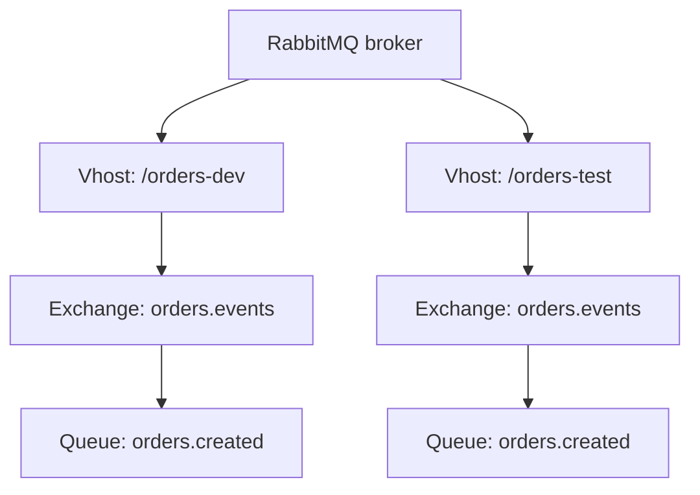

# Virtual host và phạm vi cô lập tài nguyên trong RabbitMQ

Khi tích hợp RabbitMQ bằng Spring AMQP, ứng dụng thường khai báo **exchange**, **queue** và **binding**, rồi dùng `RabbitTemplate` gửi message và `@RabbitListener` nhận message. Tuy nhiên, các tài nguyên đó không nằm trong một không gian tên chung cho toàn bộ broker: chúng luôn thuộc về một **virtual host** (viết tắt là **vhost**). Hiểu đúng vhost giúp tránh việc ứng dụng ở môi trường này vô tình sử dụng queue của môi trường khác, đồng thời thiết kế quyền truy cập phù hợp.

Sau bài này, bạn có thể giải thích vhost cô lập những gì, cấu hình Spring Boot kết nối đến đúng vhost, cấp quyền truy cập và kiểm chứng rằng hai vhost không tự trao đổi message với nhau.

## 1. Virtual host là gì?

**Virtual host là một không gian tên và phạm vi phân quyền logic bên trong RabbitMQ broker.** Mỗi connection AMQP kết nối vào **một vhost cụ thể**. Các channel tạo từ connection đó, cùng các thao tác khai báo, publish, bind và consume, hoạt động trong phạm vi vhost đã chọn.

RabbitMQ thường có vhost mặc định tên `/`. Ta có thể tạo thêm các vhost như `/orders-dev`, `/orders-test` hoặc `/payments` để tách tài nguyên theo môi trường, ứng dụng hoặc nhóm sử dụng.

Ví dụ, hai vhost đều có thể sở hữu exchange `orders.events` và queue `orders.created`. Dù trùng tên, đây là **hai bộ tài nguyên độc lập**. Message gửi vào exchange `orders.events` thuộc `/orders-dev` sẽ không tự xuất hiện trong queue `orders.created` thuộc `/orders-test`.



Đường nối trong sơ đồ là quan hệ sở hữu/định tuyến **bên trong từng vhost**; không có binding trực tiếp nối hai vhost.

### Vhost khác gì với user và broker?

| Khái niệm | Chức năng | Phạm vi |
| --- | --- | --- |
| **Broker/cluster** | Chạy RabbitMQ, tiếp nhận kết nối và cung cấp hạ tầng xử lý message | Hạ tầng RabbitMQ đang dùng |
| **Virtual host** | Chứa các tài nguyên AMQP và giới hạn phạm vi truy cập | Một không gian tên trong broker/cluster |
| **User** | Danh tính để xác thực khi kết nối | Được quản lý ở cấp RabbitMQ, có thể được cấp quyền trên nhiều vhost |
| **Permission** | Quy định user được cấu hình, ghi, đọc tài nguyên nào | Cấp **theo từng vhost** và mẫu tên tài nguyên |

Một user có thể được cấp quyền trên nhiều vhost; việc tạo user **không** mặc nhiên cho phép truy cập tất cả vhost. Ngược lại, có một vhost mới cũng không tự tạo user mới.

## 2. Những gì được cô lập và những gì vẫn dùng chung?

| Thành phần | Ảnh hưởng của ranh giới vhost |
| --- | --- |
| **Exchange** | Cùng một tên exchange có thể được khai báo riêng trong nhiều vhost; publish đến exchange chỉ định tuyến bên trong vhost của connection. |
| **Queue** | Cùng một tên queue có thể tồn tại ở nhiều vhost, với message và consumer riêng. |
| **Binding / routing key** | Binding nối exchange với queue (hoặc exchange khác) trong cùng vhost. Routing key chỉ được đối chiếu với các binding ở vhost đó. |
| **Default exchange** | Exchange mặc định (`""`) hoạt động riêng trong từng vhost, không phải đường tắt gửi message xuyên vhost. |
| **Dead-letter exchange (DLX)** | Queue sử dụng DLX trong vhost của nó; một tên DLX giống nhau ở vhost khác không làm message tự chuyển sang đó. |
| **Policy và quyền truy cập** | Policy, các quyền `configure`/`write`/`read` được áp dụng theo phạm vi vhost. |
| **CPU, RAM, đĩa, mạng của broker** | Các vhost trên cùng broker/cluster **vẫn chia sẻ tài nguyên hạ tầng**; vhost không cung cấp cô lập hiệu năng tuyệt đối. |

Điều này tạo ra hai dạng cô lập cần phân biệt:

- **Cô lập tài nguyên AMQP:** cùng tên exchange/queue không xung đột giữa các vhost; không định tuyến trực tiếp xuyên ranh giới vhost.
- **Cô lập quyền truy cập:** chỉ user được cấp quyền trên vhost mới được kết nối và thực hiện các thao tác phù hợp với quyền của mình.

**Vhost không tương đương broker riêng, máy chủ riêng hoặc giới hạn tài nguyên riêng.** Một ứng dụng tạo backlog quá lớn có thể gây áp lực bộ nhớ, đĩa hoặc lưu lượng lên broker, từ đó ảnh hưởng ứng dụng ở vhost khác. Nếu cần mức cô lập vận hành cao giữa môi trường production và thử nghiệm, hãy cân nhắc broker/cluster riêng, cùng các cơ chế giám sát và giới hạn tài nguyên phù hợp.

## 3. Đường đi của message bị ràng buộc bởi vhost như thế nào?

Giả sử service đặt hàng sử dụng `/orders-dev`:

1. Spring AMQP mở connection đến RabbitMQ với `virtual-host=/orders-dev`.
2. `RabbitTemplate` publish payload tới exchange `orders.events`, routing key `order.created`.
3. RabbitMQ tìm binding khớp **trong `/orders-dev`** và chuyển message vào queue `orders.created` của vhost đó.
4. `@RabbitListener` đang consume queue `orders.created` trên connection tới `/orders-dev` nhận message.

Nếu ứng dụng consumer chuyển sang `/orders-test`, listener sẽ chỉ nhìn thấy queue `orders.created` của `/orders-test` (nếu queue đã tồn tại và user đủ quyền). Dù exchange, queue và routing key giữ nguyên tên, message ở `/orders-dev` vẫn ở `/orders-dev`.

Vì connection có đúng một vhost, việc sử dụng nhiều vhost trong **một ứng dụng Spring** thường đòi hỏi cấu hình **nhiều connection factory** và các template/listener container tương ứng. Chỉ thay tên queue hoặc routing key không thể tạo định tuyến xuyên vhost. Nếu nghiệp vụ thực sự cần truyền message giữa vhost, phải có thành phần chuyển tiếp được cấu hình chủ động, chẳng hạn một service dùng hai connection hoặc cơ chế Shovel/Federation phù hợp.

## 4. Tạo vhost và cấp quyền trên RabbitMQ

Ví dụ dưới đây minh họa các lệnh `rabbitmqctl` trên máy có quyền quản trị broker. Cú pháp có thể được chạy trong terminal hoặc môi trường quản trị RabbitMQ phù hợp:

```bash
# Hai không gian tên độc lập cho mục đích học và kiểm thử
rabbitmqctl add_vhost /orders-dev
rabbitmqctl add_vhost /orders-test

# Tạo user dùng cho ứng dụng (thay mật khẩu ví dụ bằng bí mật mạnh)
rabbitmqctl add_user orders_app 'replace-with-a-strong-password'

# Chỉ cấp quyền truy cập các tài nguyên bắt đầu bằng "orders."
# trong /orders-dev; chưa cấp quyền cho /orders-test.
rabbitmqctl set_permissions -p /orders-dev orders_app '^orders\..*$' '^orders\..*$' '^orders\..*$'

# Kiểm tra phạm vi và quyền đã cấu hình
rabbitmqctl list_vhosts
rabbitmqctl list_permissions -p /orders-dev
rabbitmqctl list_permissions -p /orders-test
```

Lệnh `set_permissions` nhận lần lượt ba biểu thức chính quy:

| Quyền | Ý nghĩa thường gặp | Ví dụ thao tác |
| --- | --- | --- |
| `configure` | Tạo, xóa hoặc thay đổi định nghĩa tài nguyên được phép | Declare queue/exchange phù hợp |
| `write` | Gửi message tới exchange được phép và tham gia một số thao tác binding | Publish tới `orders.events` |
| `read` | Nhận message từ queue được phép và tham gia một số thao tác binding | Consume từ `orders.created` |

Trong ví dụ, cả ba mẫu `^orders\..*$` đều chỉ khớp với tên bắt đầu bằng `orders.`. Các quyền này **chỉ có hiệu lực trên `/orders-dev`** vì lệnh có `-p /orders-dev`; user chưa thể kết nối tới `/orders-test`. Với hệ thống thực tế, hãy cấp các mẫu quyền hẹp theo vai trò: một publisher thường không cần quyền `configure` hay `read` nếu hạ tầng đã khai báo tài nguyên cho nó. Khi đặt mật khẩu, ưu tiên cơ chế quản lý bí mật thay vì lưu mật khẩu thực vào mã nguồn hoặc lịch sử shell.

> **Lưu ý:** Một số tên exchange đặc biệt do RabbitMQ tự tạo có tên bắt đầu bằng `amq.` hoặc tên rỗng `""`; mẫu quyền trong ví dụ cố ý giới hạn vào các tài nguyên ứng dụng `orders.*`. Nếu ứng dụng cần sử dụng tài nguyên khác, phải xem lại quyền cho đúng nhu cầu.

## 5. Chọn vhost trong Spring Boot và Spring AMQP

Với dependency `spring-boot-starter-amqp`, Spring Boot có thể tạo `ConnectionFactory`, `RabbitTemplate` và các thành phần listener dựa trên cấu hình `spring.rabbitmq.*`. Một cấu hình cho môi trường phát triển:

```yaml
# application.yml
spring:
  rabbitmq:
    host: ${RABBITMQ_HOST:localhost}
    port: ${RABBITMQ_PORT:5672}
    username: ${RABBITMQ_USERNAME}
    password: ${RABBITMQ_PASSWORD}
    virtual-host: /orders-dev
```

Thiết lập biến môi trường `RABBITMQ_USERNAME=orders_app` và `RABBITMQ_PASSWORD` tương ứng bằng cơ chế cấu hình an toàn của môi trường chạy. **Thuộc tính quyết định phạm vi AMQP ở đây là `spring.rabbitmq.virtual-host`.** Nếu không cấu hình vhost, connection thường dùng vhost mặc định `/`, nhưng ứng dụng thực tế nên khai báo tường minh để tránh kết nối nhầm.

Tiếp theo, khai báo các tài nguyên thuộc ứng dụng bằng Spring AMQP:

```java
import org.springframework.amqp.core.Binding;
import org.springframework.amqp.core.BindingBuilder;
import org.springframework.amqp.core.Queue;
import org.springframework.amqp.core.QueueBuilder;
import org.springframework.amqp.core.TopicExchange;
import org.springframework.context.annotation.Bean;
import org.springframework.context.annotation.Configuration;

@Configuration
public class OrderMessagingConfig {

    @Bean
    public TopicExchange ordersExchange() {
        return new TopicExchange("orders.events", true, false);
    }

    @Bean
    public Queue ordersCreatedQueue() {
        return QueueBuilder.durable("orders.created").build();
    }

    @Bean
    public Binding ordersCreatedBinding(Queue ordersCreatedQueue,
                                        TopicExchange ordersExchange) {
        return BindingBuilder.bind(ordersCreatedQueue)
                .to(ordersExchange)
                .with("order.created");
    }
}
```

Với cấu hình tự động thông thường của Spring Boot, `RabbitAdmin` có thể khai báo các bean exchange/queue/binding trên broker qua connection ứng dụng, nghĩa là các khai báo trên nằm trong `/orders-dev`. Nếu đổi vhost sang `/orders-test` và cấp đủ quyền, Spring sẽ khai báo một bộ tài nguyên riêng tại vhost mới. Những bean Java trên **không** chứa tên vhost: vhost được xác định ở connection factory.

Publisher và consumer có thể đơn giản như sau:

```java
import org.springframework.amqp.rabbit.core.RabbitTemplate;
import org.springframework.stereotype.Service;

@Service
public class OrderPublisher {
    private final RabbitTemplate rabbitTemplate;

    public OrderPublisher(RabbitTemplate rabbitTemplate) {
        this.rabbitTemplate = rabbitTemplate;
    }

    public void publishCreated(String orderId) {
        rabbitTemplate.convertAndSend("orders.events", "order.created", orderId);
    }
}
```

```java
import org.springframework.amqp.rabbit.annotation.RabbitListener;
import org.springframework.stereotype.Component;

@Component
public class OrderConsumer {

    @RabbitListener(queues = "orders.created")
    public void onOrderCreated(String orderId) {
        System.out.println("Received order: " + orderId);
    }
}
```

Trong ví dụ này, payload là `String` để tập trung vào phạm vi vhost. Việc cần xác nhận giao nhận, retry hoặc dead-letter message là những khía cạnh khác của xử lý bất đồng bộ đáng tin cậy; chúng vẫn phải được cấu hình và quan sát **trong đúng vhost** của luồng message.

## 6. Thực hành kiểm chứng tính cô lập

Sau khi chạy ứng dụng kết nối với `/orders-dev`, thực hiện kiểm tra theo trình tự:

1. Kiểm tra exchange và queue đã được tạo tại `/orders-dev`:

   ```bash
   rabbitmqctl list_exchanges -p /orders-dev name type
   rabbitmqctl list_queues -p /orders-dev name messages consumers
   ```

2. Gọi `OrderPublisher.publishCreated("ORD-1001")` từ luồng ứng dụng (chẳng hạn controller hoặc một bài test tích hợp) và quan sát `OrderConsumer` nhận được `ORD-1001` khi listener đang hoạt động.
3. Kiểm tra `/orders-test` bằng `rabbitmqctl list_queues -p /orders-test name messages consumers`. Queue `orders.created` tại `/orders-dev` **không tự xuất hiện** ở `/orders-test`.
4. Thử chạy một bản ứng dụng khác với `virtual-host: /orders-test` và `orders_app` sẽ bị từ chối kết nối do user chưa có quyền vào vhost đó. Nếu muốn kiểm chứng bộ tài nguyên độc lập, cần dùng một user có quyền tại `/orders-test` hoặc cấp quyền có chủ đích trước khi chạy bản thứ hai.
5. Khi cả hai bản ứng dụng đã hoạt động ở hai vhost khác nhau, gửi message ở một bên rồi quan sát: listener bên kia không nhận message đó, dù tên exchange, queue và routing key giống nhau.

### Sự cố thường gặp

| Triệu chứng | Khả năng cần kiểm tra | Hướng xử lý |
| --- | --- | --- |
| Connection bị từ chối khi chọn vhost | Vhost chưa tồn tại hoặc user chưa có quyền truy cập vhost | Xác minh tên `virtual-host`, `list_vhosts` và `list_permissions -p ...` |
| Báo `ACCESS_REFUSED` khi declare, publish hoặc consume | Regex `configure`, `write` hoặc `read` không bao phủ tài nguyên/thao tác | Kiểm tra tên exchange/queue và cấp quyền tối thiểu cần thiết |
| Listener không tìm thấy queue (`NOT_FOUND`) | Queue chưa được khai báo ở **vhost hiện tại**, dù có thể đang tồn tại ở vhost khác | Kiểm tra queue theo `-p`; khai báo đúng vhost hoặc sửa cấu hình kết nối |
| Message xuất hiện ở môi trường khác dự kiến | Hai ứng dụng thực ra đang dùng **cùng một vhost**, hoặc có bridge được cấu hình | Kiểm tra vhost của từng connection, connection factory và thành phần chuyển tiếp |
| Một vhost quá tải gây tác động lên vhost khác | Chia sẻ tài nguyên broker/cluster | Theo dõi dung lượng queue, RAM, đĩa, thông lượng; tách hạ tầng khi cần |

Trong RabbitMQ Management UI, hãy luôn kiểm tra bộ lọc **Virtual host** khi xem Exchanges, Queues, Bindings và Connections. Việc một queue không hiện trên giao diện đôi khi chỉ do đang lọc sai vhost.

## 7. Nguyên tắc thiết kế khi dùng nhiều vhost

- Chọn vhost dựa trên **ranh giới quản trị và phân quyền rõ ràng**, ví dụ theo môi trường hoặc nhóm ứng dụng. Không cần tạo một vhost cho từng queue hay từng routing key.
- Đặt `spring.rabbitmq.virtual-host` tường minh theo cấu hình môi trường; quản lý username/password bằng secret hoặc biến môi trường.
- Cấp quyền theo từng vhost và giới hạn `configure`/`write`/`read` theo trách nhiệm của publisher, consumer và quy trình triển khai.
- Xác định exchange, queue, binding và DLX **trong cùng vhost** với luồng nghiệp vụ; khi cần liên thông vhost, thiết kế cơ chế chuyển tiếp chủ động.
- Giám sát vhost song song với tài nguyên **toàn broker**: vhost hỗ trợ cô lập logic, không bảo đảm cô lập CPU, bộ nhớ và đĩa.

**Ghi nhớ:** Khi một message không tới đúng consumer, trước khi tìm lỗi ở routing key hay `@RabbitListener`, hãy kiểm tra publisher và consumer có đang kết nối tới **cùng virtual host** hay không. Đó là điều kiện nền tảng để exchange, queue và binding có thể phối hợp trong RabbitMQ.
