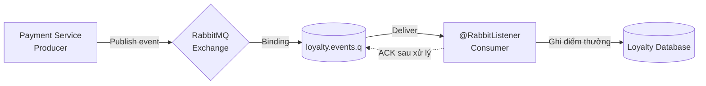
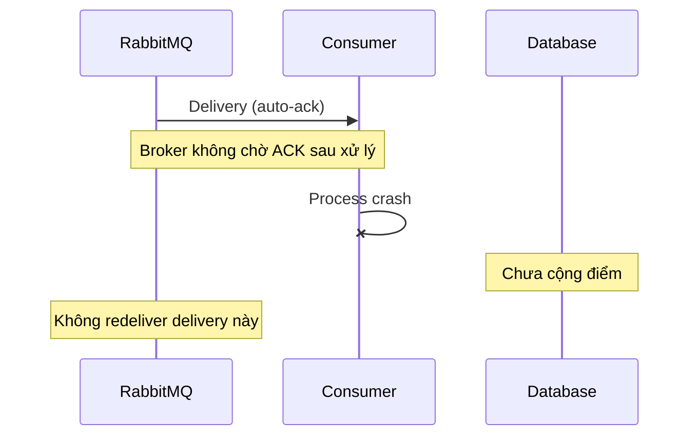
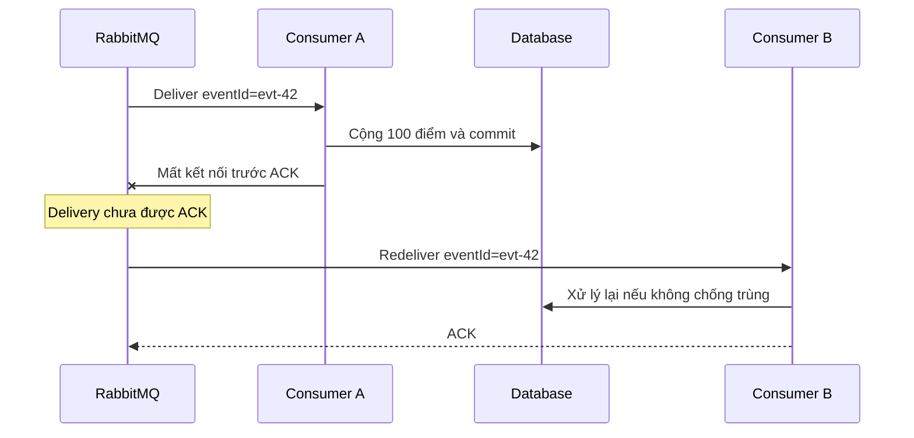
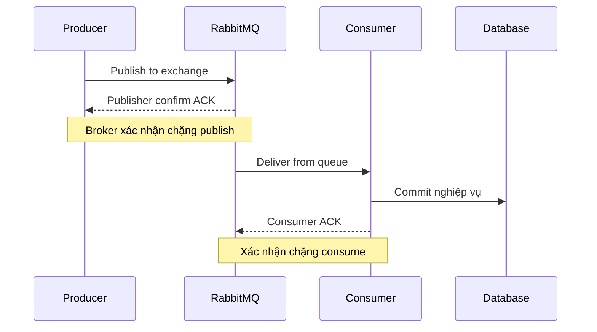
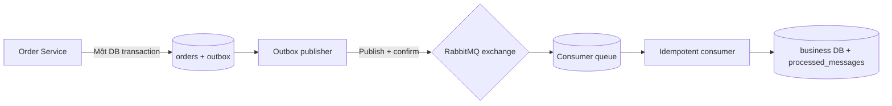
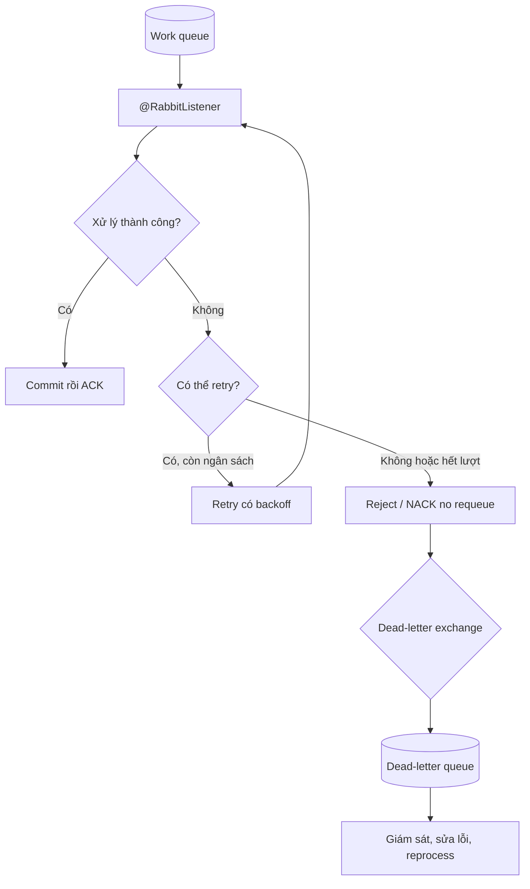

# Ý nghĩa giao nhận at-most-once, at-least-once và giới hạn exactly-once

Trong hệ thống xử lý bất đồng bộ, câu hỏi “message đã được gửi chưa?” khác với “consumer đã nhận chưa?” và “nghiệp vụ đã được thực hiện đúng một lần chưa?”. Một giao dịch có thể đã ghi thành công vào database nhưng consumer chết trước khi xác nhận message; cũng có thể broker đã xác nhận việc publish nhưng chưa có consumer nào xử lý. Phân biệt những điểm này là nền tảng để thiết kế luồng RabbitMQ đáng tin cậy.

Bài thuộc chương **Mô hình AMQP** của module **SPRING_AMQP**, tập trung vào ý nghĩa và giới hạn của ba mức bảo đảm giao nhận khi tích hợp RabbitMQ với Spring AMQP qua `RabbitTemplate`, `@RabbitListener`, exchange, queue và binding. Những cơ chế như publisher confirm, consumer acknowledgement, retry, dead-letter, giao dịch và quan sát hệ thống sẽ được liên hệ trực tiếp với các mức bảo đảm này.

Sau bài học, bạn có thể:

- Phân biệt **at-most-once**, **at-least-once** và **exactly-once** theo số lần một thông điệp có thể được giao hoặc được xử lý.
- Chỉ ra lúc nào message có thể mất, lúc nào có thể bị giao lại và vì sao ACK không đồng nghĩa với giao dịch nghiệp vụ đã được bảo đảm trên toàn hệ thống.
- Giải thích cách chọn `acknowledge-mode`, publisher confirm và retry trong Spring AMQP.
- Xây xử lý **idempotent** bằng định danh sự kiện và transaction database để hạn chế tác dụng phụ do message trùng.
- Nhận diện giới hạn của lời hứa “exactly-once” và cách áp dụng outbox, inbox, DLQ, metric vào hệ thống thực.

## 1. Xác định rõ “một lần” ở ranh giới nào

Giả sử một ứng dụng nhận sự kiện `payment.captured` để cộng 100 điểm thưởng cho khách hàng. Hệ thống gồm producer, RabbitMQ và consumer:



Hành trình này có nhiều sự kiện **không phải là một**:

1. **Producer tạo sự kiện:** một hành động nghiệp vụ phát sinh `eventId`.
2. **Producer publish:** ứng dụng gửi message đến exchange.
3. **Broker nhận và định tuyến:** RabbitMQ xử lý publish, tìm queue theo exchange, routing key và binding.
4. **Broker giao (deliver):** một consumer nhận được một delivery từ queue.
5. **Consumer thực hiện nghiệp vụ:** ví dụ, cộng điểm và commit database.
6. **Consumer ACK:** broker được báo có thể loại bỏ delivery đã được xác nhận khỏi trạng thái chờ xử lý.

Một thông điệp có thể chỉ được **publish một lần** nhưng được **deliver nhiều lần**. Ngược lại, một producer có thể publish trùng **cùng một sự kiện nghiệp vụ** vì retry sau timeout. Nhiều delivery cũng không nhất thiết tạo nhiều thay đổi nghiệp vụ nếu consumer chống trùng đúng cách.

Do đó, khi nói một hệ thống đạt “at-least-once”, phải xác định phạm vi: từ producer đến broker, từ queue đến consumer, hay từ sự kiện đến trạng thái cuối cùng của database. Các nhãn này không tự động mô tả mọi chặng trong toàn bộ quy trình.

### 1.1. Phân biệt bốn khái niệm quan trọng

| Khái niệm | Ý nghĩa | Dấu hiệu thường thấy |
|---|---|---|
| **Publish** | Producer gửi message đến exchange | `RabbitTemplate.convertAndSend(...)` được gọi |
| **Broker confirm** | Broker xác nhận kết quả publish theo cơ chế publisher confirms | Producer nhận confirm ACK/NACK |
| **Consumer ACK** | Consumer báo với broker rằng delivery đã hoàn tất | `basicAck` hoặc ACK do listener container gửi |
| **Business effect** | Trạng thái nghiệp vụ thực sự thay đổi | Transaction ghi database commit, email được gửi, tiền được chuyển |

**Không suy diễn:** publisher confirm không chứng minh consumer đã xử lý; consumer ACK không chứng minh database hoặc API bên ngoài đã cam kết tác động đúng một lần, trừ khi ứng dụng thiết kế và phối hợp các ranh giới đó.

## 2. Ba mức bảo đảm giao nhận khác nhau thế nào?

Ở một ranh giới giao nhận được xác định rõ, có thể diễn đạt:

| Mức bảo đảm | Số lần giao có thể quan sát cho một message | Đánh đổi điển hình |
|---|---|---|
| **At-most-once** | 0 hoặc 1 | Có thể mất message; tránh broker giao lại delivery đã coi là xong |
| **At-least-once** | 1 hoặc nhiều lần khi điều kiện bảo đảm được duy trì | Giảm nguy cơ bỏ sót nhưng phải xử lý trùng |
| **Exactly-once** | Chính xác 1 lần theo *phạm vi được cam kết* | Cần cơ chế đặc thù; khó đạt cho toàn bộ tác động phân tán |

Các con số trên là **mô hình ngữ nghĩa**, không phải lời hứa rằng hệ thống sẽ hoàn tất công việc trong mọi sự cố. At-least-once còn phụ thuộc message đã vào hàng đợi phù hợp, không bị xóa hoặc hết hạn, broker và consumer hồi phục, chính sách retry/redelivery tiếp tục cho phép xử lý. Exactly-once ở một thành phần không suy ra exactly-once trên nhiều database, broker và dịch vụ bên ngoài.

### 2.1. At-most-once: không giao lại, chấp nhận mất

Với at-most-once, một khi broker coi delivery đã hoàn tất, nó không cố gửi lại delivery đó nếu consumer lỗi. Ví dụ: consumer dùng broker **automatic acknowledgement** (auto-ack), broker coi message được xác nhận khi gửi tới consumer theo chế độ này; nếu process chết ngay sau khi nhận nhưng trước khi cộng điểm, message có thể mất.



**Khi nào cân nhắc?** Dữ liệu chỉ mang tính gợi ý, telemetry có thể mất mẫu, thông báo không quan trọng, luồng ưu tiên thông lượng và không cần retry ở tầng broker. Nếu một lần mất message dẫn tới thất thoát tiền hoặc lệch tồn kho, đây thường không phải lựa chọn phù hợp.

**Giới hạn:** at-most-once ở chặng broker → consumer không bảo vệ trước việc *producer publish cùng một sự kiện hai lần*, nhiều source phát cùng một sự kiện, hoặc ứng dụng tự thực hiện thao tác nhiều lần.

### 2.2. At-least-once: giao lại khi chưa xác nhận

Consumer nhận message trong chế độ **manual acknowledgement** hoặc chế độ **container-managed acknowledgement** tương ứng của Spring AMQP. Broker giữ message trong trạng thái chưa xác nhận (unacknowledged) đến khi nhận ACK. Nếu channel hoặc connection đóng trước ACK, message chưa ACK có thể được giao lại cho consumer khác hoặc khi consumer kết nối lại.



Thông điệp không bị bỏ qua chỉ vì một consumer chết, nhưng **có thể bị xử lý hai lần**. Trong ví dụ, khách hàng có nguy cơ được cộng 200 điểm thay vì 100.

At-least-once thường hợp với thanh toán, đơn hàng, cập nhật tồn kho và tác vụ tích hợp quan trọng **khi đi kèm idempotency**. “At-least-once” không có nghĩa là thao tác nghiệp vụ mặc nhiên đúng: redelivery chỉ tạo cơ hội thử lại, còn thành công cuối cùng phụ thuộc mã xử lý, dữ liệu và chính sách lỗi.

### 2.3. Exactly-once: phải nói rõ điều được bảo đảm

Với exactly-once, mỗi sự kiện được áp dụng **đúng một lần tại một ranh giới có thể kiểm chứng**. Có ít nhất ba cách diễn giải dễ nhầm:

- **Exactly-once delivery:** broker chỉ giao đúng một lần. RabbitMQ với manual ACK/redelivery không đưa ra bảo đảm này khi gặp sự cố.
- **Exactly-once processing attempt:** consumer chỉ chạy hàm handler đúng một lần. Khi có crash sau khi handler chạy nhưng trước ACK, broker không thể biết handler đã hoàn tất; hàm có thể chạy lại.
- **Exactly-once business effect:** database hoặc tài nguyên đích chỉ phản ánh tác động của một sự kiện đúng một lần, dù handler có chạy lại. Đây thường là **mục tiêu thiết kế thực tế** thông qua idempotency và transaction.

Vì vậy, câu “RabbitMQ/Spring AMQP bảo đảm exactly-once” là thiếu căn cứ nếu không chỉ rõ phạm vi và cơ chế duy trì. Nền tảng có thể hỗ trợ đạt **tác động nghiệp vụ tương đương một lần** trong phạm vi được kiểm soát; không tự đảm bảo mọi API, email hay transaction bên ngoài cũng được thực thi một lần tuyệt đối.

## 3. Vì sao ACK tạo ra khoảng hở giữa delivery và nghiệp vụ?

Xét tiến trình consumer cần (a) commit database và (b) ACK broker. Hai hành động thuộc hai hệ thống độc lập, không tự tạo thành một thao tác nguyên tử.

### 3.1. ACK trước khi commit: nguy cơ mất tác động

```text
Nhận message → ACK broker → ghi database → commit
                         ↳ crash ngay tại đây
```

Broker đã bỏ message khỏi danh sách chờ; database chưa cập nhật. Sau khi consumer khởi động lại, message này **không còn được redeliver từ queue đó** để hoàn tất tác vụ.

### 3.2. Commit trước khi ACK: nguy cơ xử lý trùng

```text
Nhận message → ghi database → commit → ACK broker
                                       ↳ crash ngay trước ACK
```

Database đã cộng điểm; broker vẫn có thể coi delivery chưa được xác nhận và giao lại. Đây là lý do **ACK sau commit** tốt hơn cho mục tiêu chống mất tác động, nhưng **chưa đủ** để đạt exactly-once business effect.

### 3.3. Hai bước không thể đồng thời bằng một lời gọi thông thường

Ngay cả khi xử lý nhanh và thông thường không có lỗi, process, mạng hoặc broker có thể gặp sự cố ở bất kỳ điểm nào. Chỉ thay đổi thứ tự ACK và commit sẽ chuyển rủi ro từ “có thể mất” sang “có thể trùng”. Để chịu được redelivery, cần làm cho **lần xử lý tiếp theo có thể nhận ra sự kiện đã được áp dụng**.

Một nguyên tắc quan trọng:

> Chấp nhận rằng delivery có thể lặp; bảo vệ tính đúng đắn của tác động nghiệp vụ ở nơi lưu trạng thái.

## 4. Consumer acknowledgements trong RabbitMQ và Spring AMQP

RabbitMQ dùng ACK/NACK ở tầng giao tiếp consumer với broker:

| Thao tác | Ý nghĩa với delivery hiện tại | Lưu ý |
|---|---|---|
| `basicAck(deliveryTag, false)` | Xác nhận xử lý delivery | Sau ACK, broker không redeliver delivery đó |
| `basicNack(deliveryTag, false, true)` | Từ chối, yêu cầu requeue | Có thể được giao lại, có nguy cơ vòng lặp nóng |
| `basicNack(deliveryTag, false, false)` | Từ chối, không requeue | Có thể dead-letter nếu DLX phù hợp; nếu không có thể bị loại |
| `basicReject(deliveryTag, false)` | Từ chối một delivery, không requeue | Tương tự NACK với `requeue=false` cho một delivery |
| Broker auto-ack | Broker không chờ consumer gửi ACK sau xử lý | Giảm overhead; rủi ro mất message khi consumer ngừng |

`deliveryTag` chỉ có ý nghĩa trong **channel** giao message. ACK/NACK sai channel hoặc sai tag có thể làm channel bị đóng. Khi ACK theo từng delivery, truyền `multiple=false`; chỉ dùng chế độ ACK hàng loạt khi đã hiểu rõ các delivery chưa xác nhận cùng channel.

### 4.1. Ba acknowledge mode trong Spring AMQP

Các listener container của Spring AMQP hỗ trợ các lựa chọn có tên:

| Spring `AcknowledgeMode` | Cách hoạt động | Liên hệ delivery semantics |
|---|---|---|
| `NONE` | Dùng broker auto-ack; container không ACK từng message sau khi handler hoàn thành | Tương ứng cách tiếp cận at-most-once ở chặng delivery |
| `AUTO` | Container ACK sau khi listener xử lý thành công; tự quyết định reject/NACK khi lỗi theo cấu hình và error handler | Phù hợp nền tảng xử lý at-least-once khi retry/redelivery được thiết kế |
| `MANUAL` | Chính mã ứng dụng chịu trách nhiệm ACK/NACK trên channel | Cho phép điều khiển thời điểm xác nhận nhưng cũng dễ ACK sai |

**Cảnh báo tên gọi:** `AUTO` của **Spring listener container** không phải **broker auto-ack**. Trong cấu hình Spring phổ biến, `AUTO` vẫn có ACK sau khi xử lý thành công. Chính chế độ `NONE` mới dùng broker auto-ack.

Một cấu hình Spring Boot với container kiểu `simple`:

```yaml
spring:
  rabbitmq:
    listener:
      simple:
        acknowledge-mode: auto
        prefetch: 10
        default-requeue-rejected: false
```

Cấu hình này chọn container-managed ACK, giới hạn số delivery chưa ACK mà mỗi consumer có thể nắm giữ theo prefetch, đồng thời mặc định không requeue message bị reject trong các trường hợp phù hợp. **Nếu chưa cấu hình DLX, reject không requeue có thể làm mất message khỏi luồng xử lý.** Cách Spring xử lý lỗi còn tùy exception, retry interceptor và error handler; không nên kết luận chỉ từ một thuộc tính YAML.

### 4.2. Ví dụ listener với chế độ AUTO

```java
@Component
public class LoyaltyEventListener {
    private final LoyaltyService loyaltyService;

    public LoyaltyEventListener(LoyaltyService loyaltyService) {
        this.loyaltyService = loyaltyService;
    }

    @RabbitListener(queues = "loyalty.events.q")
    public void onPaymentCaptured(String eventJson) {
        loyaltyService.applyEvent(eventJson);
        // Khi phương thức trở về thành công, container AUTO có thể ACK.
        // Nếu ném lỗi, cơ chế retry/reject phụ thuộc cấu hình container.
    }
}
```

Nếu `loyaltyService.applyEvent(...)` thực hiện transaction database và chỉ trở về **sau commit thành công**, container ACK sau lời gọi là trật tự hợp lý. Nhưng có thể crash sau commit trước ACK, nên listener vẫn phải an toàn khi nhận lại cùng sự kiện.

### 4.3. Ví dụ minh họa MANUAL ACK

```java
import com.rabbitmq.client.Channel;
import java.io.IOException;
import org.springframework.amqp.core.AmqpHeaders;
import org.springframework.amqp.rabbit.annotation.RabbitListener;
import org.springframework.messaging.handler.annotation.Header;
import org.springframework.stereotype.Component;

@Component
public class ManualAckListener {
    private final OrderProcessingService processingService;

    public ManualAckListener(OrderProcessingService processingService) {
        this.processingService = processingService;
    }

    @RabbitListener(queues = "orders.processing.q", ackMode = "MANUAL")
    public void receive(String orderId, Channel channel,
                        @Header(AmqpHeaders.DELIVERY_TAG) long tag)
            throws IOException {
        try {
            processingService.processAndCommit(orderId);
            channel.basicAck(tag, false);
        } catch (RecoverableOrderException ex) {
            channel.basicNack(tag, false, true);
        } catch (InvalidOrderMessageException ex) {
            channel.basicNack(tag, false, false);
        }
    }
}
```

Đây là mã **minh họa cơ chế**, giả định `processAndCommit` chỉ trả về sau khi transaction đã commit và hai exception nghiệp vụ được ứng dụng định nghĩa. Với lỗi hệ thống không thuộc hai nhánh trên, channel/connection và container cần được xử lý có chủ đích để tránh delivery treo hoặc ACK sai. Requeue ngay khi gặp lỗi tạm thời có thể gây vòng lặp; production nên dùng retry có giới hạn, backoff và dead-letter thích hợp. Khi không cần tự điều khiển ACK, `AUTO` thường đơn giản và ít lỗi hơn.

### 4.4. `redelivered` không phải khóa chống trùng

Thông tin `redelivered=true` trên một delivery cho biết broker đã từng giao message đó trước đó, **không chứng minh lần trước đã xử lý nghiệp vụ thành công**. Ngược lại, một event được producer publish hai lần có thể đi vào queue thành hai message, đều xuất hiện như delivery mới. Vì vậy không dùng cờ `redelivered` làm khóa idempotency; hãy dùng **định danh sự kiện ổn định** do producer quản lý.

## 5. Đừng nhầm publisher confirm với consumer ACK

RabbitMQ có hai hệ xác nhận độc lập:



- **Publisher confirm** nhằm giúp producer biết broker đã xác nhận publish theo bảo đảm của broker. Confirm ACK không đồng nghĩa “consumer đã đọc” hoặc “message chắc chắn đã được định tuyến đến một queue phù hợp”.
- **Publisher return** (khi bật `mandatory`) thông báo message không route được vào queue nào. Trường hợp không route được vẫn có thể có **publisher confirm ACK**; cần theo dõi cả return lẫn confirm.
- **Consumer ACK** báo broker rằng delivery đã hoàn tất; nó không gửi chứng nhận ngược về producer rằng toàn bộ nghiệp vụ downstream đã thành công.

Ví dụ cấu hình cơ bản ở Spring Boot để bật đường nhận confirm và return:

```yaml
spring:
  rabbitmq:
    publisher-confirm-type: correlated
    publisher-returns: true
    template:
      mandatory: true
```

Đây mới là **cấu hình bật khả năng quan sát kết quả publish**; producer còn phải xử lý callback hoặc chờ kết quả với timeout, phân biệt confirm ACK/NACK và returned message, quyết định khi nào retry, và dùng cùng `eventId` nếu thử gửi lại. Timeout khiến producer **không biết chắc** broker đã nhận hay chưa, nên retry có thể tạo hai bản sao.

### 5.1. Những điều cần ghép lại khi nói at-least-once end-to-end

Muốn tránh bỏ sót sự kiện quan trọng, cần một chuỗi cơ chế phối hợp:

1. **Nguồn sự kiện đáng tin cậy:** producer không đánh mất sự kiện giữa transaction database và publish; transactional outbox là một giải pháp phổ biến.
2. **Publish có xác nhận:** theo dõi publisher confirms, returns, timeout và áp dụng chiến lược retry rõ ràng.
3. **Topology đúng:** exchange, binding và queue phù hợp; tránh message unroutable.
4. **Dữ liệu ở broker đủ bền:** queue và message có cơ chế persistence thích hợp, loại queue và replication đáp ứng mức rủi ro; giám sát điều kiện đĩa/memory.
5. **ACK sau xử lý:** consumer ACK khi nghiệp vụ đã commit; khi lỗi thì retry/reject theo chính sách.
6. **Chống trùng:** producer giữ định danh sự kiện qua các lần retry và consumer dùng idempotency cho từng loại tác động.
7. **Xử lý thất bại không hồi phục:** dùng DLQ, cảnh báo, điều tra và quy trình reprocess có kiểm soát.

Những điều kiện này giúp thiết kế hệ thống có khả năng xử lý lại mà không làm sai dữ liệu; **không có nghĩa thời gian khôi phục là vô hạn hoặc không cần giám sát**.

## 6. Bảng tình huống lỗi: message mất hay trùng?

| Điểm xảy ra lỗi | Broker/producer thường nhìn thấy | Hậu quả có thể xảy ra | Biện pháp |
|---|---|---|---|
| Producer timeout khi publish | Không chắc broker đã nhận | Gửi lại có thể tạo message trùng | Confirm + eventId ổn định, idempotent consumer |
| Publish thành công nhưng không có binding | Message không vào queue đích | Bỏ sót sự kiện | Mandatory return, khai báo topology, cảnh báo |
| Consumer chết trước database commit, chưa ACK | Delivery chưa ACK | Message có thể được giao lại | ACK sau xử lý, transaction rollback an toàn |
| Consumer commit rồi chết trước ACK | Broker chưa nhận ACK | **Tác động đã xảy ra nhưng message được giao lại** | Dedupe trong cùng transaction nghiệp vụ |
| Consumer ACK trước database commit rồi chết | Broker đã coi là hoàn tất | **Mất tác động nghiệp vụ** | Không ACK trước commit |
| Consumer nhận payload sai schema liên tục | NACK/retry lặp | Queue bị nghẽn, tạo vòng lặp | Retry giới hạn, reject và DLQ |
| TTL, giới hạn delivery hoặc queue policy làm loại message | Không còn xử lý ở queue ban đầu | “At-least-once” không còn nghĩa là sẽ xử lý thành công ở consumer chính | DLQ, alert, chính sách reprocess |
| Service ngoài đã thực hiện tác động, phản hồi bị mất | Consumer tưởng thất bại | Gửi lại request gây tác động lặp | Idempotency key phía service ngoài hoặc quy trình đối soát |

Bảng cho thấy **lỗi không chỉ xảy ra trước khi xử lý**. Trường hợp khó nhất thường là “xử lý thành công nhưng mất ACK hoặc mất phản hồi”, bởi bên gọi không biết kết quả có thật sự thành công hay không.

## 7. Đạt tác động nghiệp vụ tương đương một lần bằng idempotency

**Idempotency** có nghĩa là áp dụng cùng một thao tác với cùng định danh nhiều lần vẫn cho một kết quả nghiệp vụ tương đương như áp dụng một lần.

Với sự kiện `payment.captured`:

- **Không idempotent:** mỗi lần nhận `evt-42` đều cộng 100 điểm.
- **Idempotent:** lần đầu cộng 100 điểm và ghi `evt-42` đã xử lý; những lần sau nhận `evt-42` chỉ xác nhận đã được áp dụng.

### 7.1. Dùng bảng inbox hoặc processed_messages

Giả sử consumer xử lý dữ liệu trên PostgreSQL. Tạo bảng ghi dấu theo **consumer + eventId**, bởi cùng một event có thể được nhiều consumer độc lập xử lý theo những nghiệp vụ khác nhau:

```sql
CREATE TABLE processed_messages (
    consumer_name TEXT NOT NULL,
    event_id TEXT NOT NULL,
    PRIMARY KEY (consumer_name, event_id)
);

CREATE TABLE loyalty_accounts (
    customer_id BIGINT PRIMARY KEY,
    points BIGINT NOT NULL DEFAULT 0
);
```

Ví dụ event được producer sinh **một lần** và giữ nguyên `eventId` ở mọi lần publish lại:

```json
{
  "eventId": "evt-42",
  "eventType": "payment.captured",
  "customerId": 1001,
  "points": 100
}
```

Để đơn giản và rõ ràng về cơ chế, ví dụ Spring AMQP tiếp theo nhận payload dạng **JSON string**; bên phát dùng `RabbitTemplate.convertAndSend(exchange, routingKey, jsonString)`. Khi dùng POJO converter, hai phía phải cấu hình message converter và schema JSON phù hợp.

### 7.2. Spring: ghi dấu và cập nhật nghiệp vụ trong cùng transaction

Đoạn mã sau minh họa Spring Boot, Spring AMQP, Jackson (có trong ứng dụng web Spring Boot thông dụng), JDBC và PostgreSQL. Giả định `JdbcTemplate` và `ObjectMapper` đã được cấu hình, queue `loyalty.events.q` đã tồn tại và có binding phù hợp.

```java
public record LoyaltyPointsEvent(
        String eventId,
        String eventType,
        long customerId,
        long points
) {}
```

Listener giải mã message và gọi **service riêng** để bảo đảm `@Transactional` đi qua Spring proxy:

```java
import com.fasterxml.jackson.databind.ObjectMapper;
import org.springframework.amqp.rabbit.annotation.RabbitListener;
import org.springframework.stereotype.Component;

@Component
public class LoyaltyPointsListener {
    private final ObjectMapper objectMapper;
    private final LoyaltyPointsService service;

    public LoyaltyPointsListener(ObjectMapper objectMapper,
                                 LoyaltyPointsService service) {
        this.objectMapper = objectMapper;
        this.service = service;
    }

    @RabbitListener(queues = "loyalty.events.q")
    public void receive(String json) throws Exception {
        LoyaltyPointsEvent event =
                objectMapper.readValue(json, LoyaltyPointsEvent.class);
        service.applyOnce(event);
    }
}
```

Service dùng `INSERT ... ON CONFLICT DO NOTHING` (cú pháp PostgreSQL). Chỉ khi chèn thành công dấu xử lý mới cập nhật điểm; cả hai thay đổi nằm trong **một transaction database**:

```java
import org.springframework.jdbc.core.JdbcTemplate;
import org.springframework.stereotype.Service;
import org.springframework.transaction.annotation.Transactional;

@Service
public class LoyaltyPointsService {
    private final JdbcTemplate jdbc;

    public LoyaltyPointsService(JdbcTemplate jdbc) {
        this.jdbc = jdbc;
    }

    @Transactional
    public void applyOnce(LoyaltyPointsEvent event) {
        if (event.eventId() == null || event.eventId().isBlank()
                || event.points() <= 0
                || !"payment.captured".equals(event.eventType())) {
            throw new IllegalArgumentException("Invalid event");
        }

        int inserted = jdbc.update("""
            INSERT INTO processed_messages(consumer_name, event_id)
            VALUES (?, ?)
            ON CONFLICT DO NOTHING
            """, "loyalty", event.eventId());

        if (inserted == 0) {
            return; // Sự kiện này đã được áp dụng bởi consumer loyalty.
        }

        int updated = jdbc.update("""
            UPDATE loyalty_accounts
            SET points = points + ?
            WHERE customer_id = ?
            """, event.points(), event.customerId());

        if (updated != 1) {
            throw new IllegalStateException("Loyalty account not found");
        }
    }
}
```

**Vì sao cách này chịu được redelivery?**

1. Lần đầu, transaction chèn khóa `(loyalty, evt-42)` rồi cộng 100 điểm, sau đó commit.
2. Nếu consumer crash **sau commit nhưng trước ACK**, RabbitMQ giao lại `evt-42`.
3. Lần tiếp theo, ràng buộc PRIMARY KEY khiến `INSERT ... ON CONFLICT DO NOTHING` không tạo dòng mới. Consumer bỏ qua phép cộng, return thành công, rồi container có thể ACK.
4. Nếu lần đầu lỗi **trước commit**, transaction rollback **cả bản ghi processed_messages và phép cộng**. Lần giao lại vẫn có thể thực hiện nghiệp vụ từ đầu.

Ràng buộc duy nhất của database cũng giúp kiểm soát trường hợp **nhiều consumer xử lý cùng event đồng thời**. Khóa và tính nguyên tử của transaction mạnh hơn một câu lệnh “SELECT xem có tồn tại chưa” rồi mới INSERT theo hai bước không được đồng bộ.

**Điều kiện bắt buộc:** trong ví dụ, thao tác ghi dấu và cộng điểm phải dùng **cùng database và cùng transaction thực sự**. Không gọi một API chuyển tiền, gửi email hoặc publish một message bên ngoài ở giữa rồi mặc định các tác động đó cũng sẽ rollback cùng database. Trong hệ thống thật cần thêm validation, ràng buộc nghiệp vụ, chính sách thứ tự sự kiện và xử lý dữ liệu trễ.

### 7.3. Giới hạn của cách chống trùng theo khóa

Một số sai lầm thường gặp:

- Tạo `eventId` mới mỗi lần retry publish, khiến consumer coi mỗi bản sao là sự kiện khác nhau.
- Dùng `deliveryTag` của RabbitMQ làm khóa chống trùng. Tag chỉ gắn với delivery trên channel, không phải định danh sự kiện.
- Lưu dấu “đã xử lý” ngoài transaction nghiệp vụ: crash giữa hai lần ghi sẽ khiến dấu và tác động lệch nhau.
- Dedupe toàn hệ thống theo `eventId` duy nhất trong khi nhiều consumer phải xử lý **cùng** event: mỗi consumer cần namespace riêng hoặc bảng riêng.
- Xóa dữ liệu dedupe quá sớm: bản sao đến muộn sau thời hạn giữ dấu có thể bị xử lý lại.
- Coi `eventId` là đủ để giải quyết *out-of-order events*: idempotency tránh lặp, còn thứ tự và trạng thái nghiệp vụ cần cơ chế kiểm tra riêng.

## 8. Transactional outbox: tránh bỏ sót sự kiện ngay từ producer

Dedupe phía consumer giải quyết một nửa bài toán: nếu producer cập nhật database nhưng chưa publish sự kiện, consumer **không có gì để nhận**.

Ví dụ `Order Service` phải lưu đơn hàng và phát `order.created`:

```text
BEGIN database transaction
  INSERT INTO orders ...
COMMIT

publish(order.created)  ← ứng dụng chết trước dòng này
```

Một giải pháp quen thuộc là **transactional outbox**:



Producer ghi đơn hàng và bản ghi outbox trong **cùng transaction DB**. Một worker khác phát các outbox chưa gửi và chỉ đánh dấu hoàn tất theo quy tắc xác nhận đã chọn. Nếu worker chết sau khi publish nhưng trước khi đánh dấu, cùng outbox event có thể được publish lại. Đó là hành vi chấp nhận được **khi consumer idempotent**.

Cặp **outbox ở producer + inbox/dedupe ở consumer** xử lý hai khoảng hở phổ biến:

- Không bỏ quên sự kiện đã được ghi trong transaction nguồn.
- Không cộng dồn tác động nghiệp vụ khi một sự kiện được publish hoặc deliver nhiều lần.

Cặp này **không phải transaction phân tán nguyên tử trên mọi hệ thống**. Nó đạt bảo đảm thực dụng trong những phạm vi đã thiết kế, với điều kiện outbox worker, cơ sở dữ liệu, broker và chính sách vận hành hoạt động theo dự kiến.

## 9. Vì sao transaction RabbitMQ không tự tạo exactly-once?

RabbitMQ hỗ trợ các thao tác transaction ở cấp **AMQP channel** trong những cấu hình phù hợp; Spring AMQP cũng có cơ chế transaction cho thao tác messaging. Tuy vậy:

- Transaction của broker quản lý các thao tác trong phạm vi broker/channel; transaction JDBC quản lý thao tác trong database.
- ACK và commit database không tự nằm trong một **giao dịch nguyên tử chung** chỉ vì đều được gọi trong một phương thức `@Transactional`.
- Spring có thể phối hợp hai tài nguyên theo thứ tự, nhưng nếu hệ thống lỗi giữa hai bước commit, vẫn tồn tại cửa sổ mất đồng bộ.
- Publisher confirms và channel transaction là các cơ chế khác nhau; không nên bật lẫn lộn với giả định cả hai cộng lại sẽ thành exactly-once.

Giải pháp thực tế thường là **at-least-once delivery + idempotent business operation** trong một transaction database, bổ sung outbox nếu cần bảo đảm phát sự kiện. Với tác động ở nhiều hệ thống ngoài (gửi email, chuyển tiền, API đối tác), phải xác định riêng idempotency key của API đích, trạng thái đối soát và chiến lược khôi phục.

### 9.1. Ví dụ API ngoài: khó đạt exactly-once đến cùng

Consumer gọi cổng thanh toán với `idempotencyKey=charge-123`. Cổng thanh toán xử lý thành công, nhưng mạng mất trước khi trả response. Consumer không thể tự suy ra giao dịch đã thất bại chỉ vì timeout. Gửi lại request **với cùng idempotency key** có thể giúp cổng thanh toán trả lại kết quả cũ thay vì trừ tiền lần nữa, **nếu** cổng thanh toán hỗ trợ và giữ dữ liệu idempotency đủ lâu.

Nếu hệ thống ngoài không có idempotency hoặc API tra cứu trạng thái, một lần retry mù có thể gây tác động lặp. Lúc đó cần reconciliation, trạng thái `PENDING/UNKNOWN`, can thiệp thủ công hoặc cơ chế bù trừ; không thể dựa duy nhất vào RabbitMQ ACK.

## 10. Retry, requeue, DLQ liên quan thế nào đến các mức bảo đảm?

At-least-once cần cơ hội gửi lại, nhưng **retry vô hạn** không phải một thiết kế tin cậy:

- **Retry trong consumer:** thử lại cùng tác vụ với số lần và backoff xác định. Spring Retry interceptor có thể hỗ trợ một số chiến lược tùy cấu hình.
- **Broker requeue:** NACK với `requeue=true` có thể đưa delivery lại queue; requeue ngay khi một lỗi cố định còn tồn tại sẽ tạo vòng lặp nóng.
- **Dead-letter:** NACK/reject với `requeue=false` hoặc các điều kiện broker khác có thể chuyển message sang dead-letter exchange nếu topology và chính sách cho phép.
- **DLQ và reprocess:** queue lưu thông điệp chưa thể xử lý giúp điều tra và phát lại có kiểm soát. Chỉ chuyển vào DLQ **chưa phải** đã hoàn tất nghiệp vụ.



Ở RabbitMQ, thiết lập DLX/DLQ, TTL, giới hạn số lượt giao, quorum queue, chính sách retry và kết quả thực tế tùy phiên bản cùng loại queue. Cần kiểm tra rõ message sẽ **được giữ, giao lại, dead-letter hay bị loại bỏ** ở từng nhánh. Nếu muốn “ít nhất một lần xử lý thành công”, DLQ phải có chủ sở hữu, cảnh báo và quy trình xử lý tiếp theo.

### 10.1. Phân loại lỗi trước khi retry

| Loại lỗi | Ví dụ | Chiến lược gợi ý |
|---|---|---|
| Tạm thời | Database ngắt kết nối ngắn, API rate limit | Retry có giới hạn và backoff |
| Dữ liệu không hợp lệ | JSON sai schema, thiếu trường bắt buộc | Reject, DLQ và điều tra |
| Nghiệp vụ không hợp lệ | Order không tồn tại, chuyển trạng thái sai | Kiểm tra ordering và điều kiện; sửa data hoặc DLQ |
| Kết quả không xác định | Timeout sau khi gọi thanh toán | Tra trạng thái, retry với idempotency key, reconciliation |
| Xử lý trùng | EventId đã có trong inbox | Trả về thành công và ACK, không tạo tác động lần hai |

## 11. Quan sát delivery semantics trong vận hành

Số lần handler được gọi **không phải** là số lần nghiệp vụ đã được áp dụng thành công. Nên theo dõi song song:

| Metric / log | Giúp trả lời |
|---|---|
| Publisher confirm ACK/NACK, returned message, timeout | Sự kiện đã tới broker và được route đúng chưa? |
| Messages ready / unacknowledged | Backlog hay consumer đang giữ delivery quá lâu? |
| Deliver/redeliver/reject/NACK rate | Hệ thống có đang retry bất thường? |
| Idempotency duplicate count theo consumer | Có bao nhiêu event bị nhận lại hoặc publish trùng? |
| Business commit success/failure | Tác động nghiệp vụ thực sự thành công bao nhiêu lần? |
| DLQ depth và tuổi message | Có lỗi không tự hồi phục bị bỏ quên? |
| eventId, traceId, businessId | Có thể truy một sự kiện qua producer, broker và consumer không? |

Cần phân biệt hai số liệu:

- `delivery_count`: số lượt giao/nhận message.
- `applied_business_events`: số sự kiện độc nhất đã làm thay đổi dữ liệu thành công.

Ví dụ, broker có thể giao `evt-42` ba lần; consumer có ba lượt gọi handler nhưng chỉ **một** lần cập nhật điểm vì idempotency. Điều này có thể là hành vi đúng của thiết kế at-least-once.

## 12. Tự kiểm tra qua các kịch bản

**Kịch bản A — at-most-once:** broker giao một message bằng auto-ack, consumer chết sau khi nhận nhưng trước khi ghi DB. Hỏi: message có được tự giao lại không và nghiệp vụ có thể bị thiếu không?

*Đáp án mong đợi:* broker đã coi delivery hoàn tất theo cơ chế auto-ack, nên không tự giao lại delivery đó; thao tác nghiệp vụ có thể bị thiếu.

**Kịch bản B — at-least-once:** consumer commit đơn hàng thành công rồi mất connection trước ACK. Hỏi: lần giao tiếp theo có thể xảy ra không và cần bảo vệ ở đâu?

*Đáp án mong đợi:* có thể redeliver; logic cập nhật nghiệp vụ cần idempotency, tốt nhất ghi dấu sự kiện cùng transaction với trạng thái nghiệp vụ.

**Kịch bản C — confirm:** producer nhận publisher confirm ACK nhưng không có queue nào bind với exchange cho routing key vừa gửi. Hỏi: consumer có chắc sẽ nhận message không?

*Đáp án mong đợi:* không. Confirm ACK và tình trạng message unroutable là hai câu hỏi khác nhau; cần quan sát return khi bật mandatory và kiểm tra topology.

**Kịch bản D — timeout:** producer không nhận phản hồi confirm đúng hạn, quyết định publish lại. Hỏi: có thể đạt at-least-once mà vẫn phát sinh hai bản sao không?

*Đáp án mong đợi:* có. Trạng thái publish đầu tiên không chắc chắn; nếu cả hai lần đều được broker tiếp nhận, consumer cần nhận ra cùng `eventId`.

**Kịch bản E — exactly-once effect:** hai consumer đồng thời nhận cùng `evt-42` và cùng cố cộng điểm. Hỏi: một lệnh `SELECT` kiểm tra `eventId` trước khi `UPDATE` có đủ an toàn không?

*Đáp án mong đợi:* không nếu không có khóa và transaction thích hợp. Dùng ràng buộc duy nhất cho khóa xử lý và cập nhật nghiệp vụ trong cùng transaction.

**Kịch bản F — external API:** API chuyển tiền đã thực hiện lệnh nhưng phản hồi timeout. Hỏi: ACK, NACK hoặc `@Transactional` của Spring có chứng minh chưa chuyển tiền không?

*Đáp án mong đợi:* không. Phải kiểm tra trạng thái phía API và dùng idempotency key hoặc đối soát theo khả năng của dịch vụ bên ngoài.

## 13. Checklist thiết kế theo mức bảo đảm cần đạt

| Nhu cầu | Cơ chế ưu tiên | Rủi ro phải chấp nhận hoặc xử lý |
|---|---|---|
| Telemetry mất một vài message không sao | Broker auto-ack / at-most-once ở chặng consumer | Message bị mất nếu consumer chết trước xử lý |
| Công việc quan trọng, được phép thử lại | Consumer ACK sau commit, retry/backoff, durability và publisher confirm phù hợp | Duplicate delivery và lỗi kéo dài |
| Chuyển trạng thái chỉ một lần trong một DB | At-least-once + eventId + bảng processed_messages + transaction | Cần giữ đủ lịch sử dedupe, xử lý thứ tự |
| Phát sự kiện từ transaction nguồn tin cậy | Transactional outbox + publish confirm + idempotent consumer | Publish có thể lặp, cần worker và giám sát |
| Tác động qua API ngoài | Idempotency key ở hệ thống đích + query/reconciliation | Không thể tự chứng minh exactly-once chỉ bằng broker |
| Lỗi vĩnh viễn phải truy vết được | Retry giới hạn, DLX/DLQ, alert và reprocess | DLQ có thể tích tụ nếu không ai xử lý |

**Ghi nhớ:** Trong Spring AMQP, cấu hình acknowledgement quyết định **thời điểm broker có thể coi delivery hoàn tất**; nó không một mình quyết định tính đúng đắn của hệ thống. At-most-once chấp nhận mất để tránh broker giao lại; at-least-once chấp nhận khả năng giao lại để tăng cơ hội xử lý; còn exactly-once cho **tác động nghiệp vụ** phải được tạo bằng giao dịch, định danh ổn định và thao tác idempotent trong phạm vi mà ứng dụng thực sự kiểm soát.
