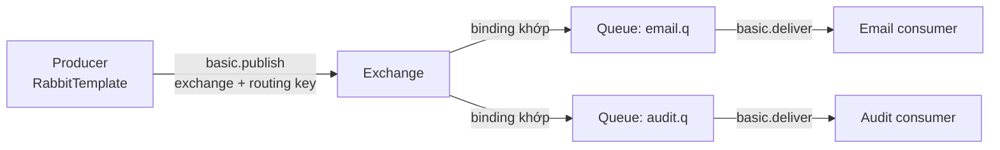
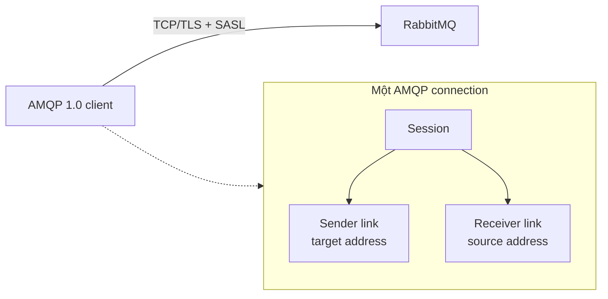
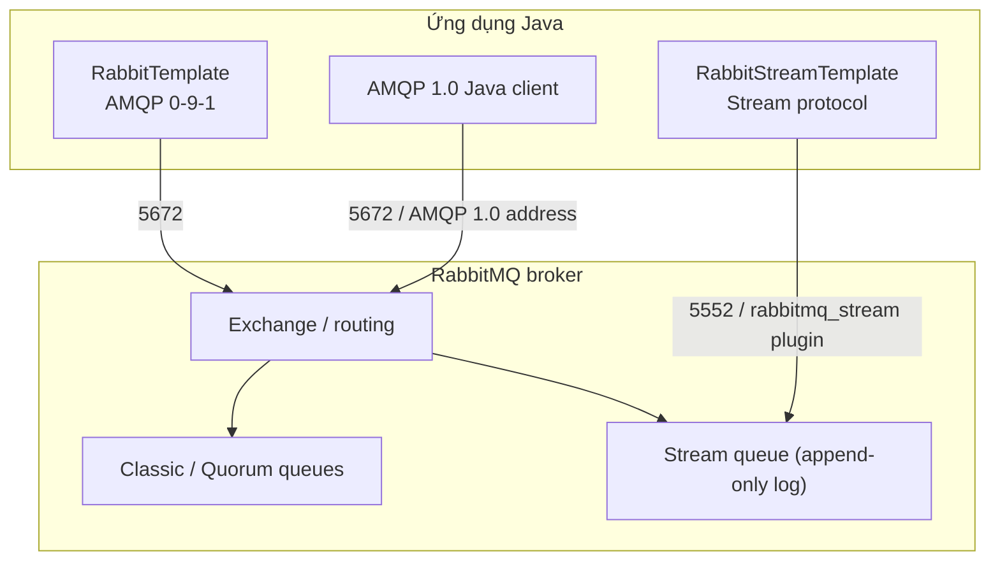

# Phân biệt AMQP 0.9.1, AMQP 1.0 và RabbitMQ Stream protocol

## 1. Bối cảnh: cùng một RabbitMQ, ba cách trao đổi message

Trong chương **Mô hình AMQP** của lộ trình **Spring AMQP**, điều quan trọng là phân biệt **giao thức dùng để client kết nối với broker** và **cấu trúc dữ liệu broker dùng để lưu message**. RabbitMQ hỗ trợ nhiều giao thức; ứng dụng Java cần chọn client library tương ứng trước khi triển khai định tuyến, xác nhận giao nhận, retry, dead-letter, transaction hay monitoring.

Ba lựa chọn thường gặp là:

- **AMQP 0-9-1 (còn viết 0.9.1):** giao thức có mô hình exchange, queue và binding quen thuộc; đây là giao thức mà `RabbitTemplate` và listener container thông thường của Spring AMQP sử dụng.
- **AMQP 1.0:** một giao thức nhắn tin mới hơn, chuẩn hóa bởi OASIS/ISO, có mô hình connection, session, link, transfer và settlement. Nó **không tương thích ở tầng wire** với AMQP 0-9-1. RabbitMQ hỗ trợ AMQP 1.0 như giao thức lõi từ RabbitMQ 4.0.
- **RabbitMQ Stream protocol:** giao thức nhị phân riêng do RabbitMQ cung cấp để publish và đọc **RabbitMQ streams** với hiệu năng cao, offset, replay và những chức năng riêng của stream.

Cả ba có thể hoạt động trên **cùng một cụm RabbitMQ**, nhưng **cùng broker không đồng nghĩa cùng giao thức, client API hoặc mô hình xử lý**.

> **Quy tắc nền tảng:** AMQP 0-9-1/AMQP 1.0/Stream protocol là các *protocol*; classic queue, quorum queue và stream là các *loại nơi lưu trữ message*. Không lấy hai danh sách này làm một.

## 2. Bảng so sánh nhanh

| Tiêu chí | AMQP 0-9-1 | AMQP 1.0 | RabbitMQ Stream protocol |
| --- | --- | --- | --- |
| Bản chất | Giao thức nhắn tin với exchange, queue, binding trong mô hình giao thức | Giao thức nhắn tin dựa trên connection/session/link và địa chỉ nguồn/đích | Giao thức RabbitMQ tối ưu cho stream log |
| Chuẩn/phạm vi | AMQP 0-9-1 cùng các extension của RabbitMQ | Chuẩn OASIS, ISO/IEC 19464; dùng được với các broker hỗ trợ AMQP 1.0 | Giao thức gắn với hệ sinh thái RabbitMQ Streams |
| Mô hình gửi | Publish tới exchange + routing key | Gửi qua sender link tới target address; RabbitMQ tự ánh xạ địa chỉ vào topology broker | Producer ghi vào stream hoặc super stream |
| Mô hình nhận | Consume từ queue; consumer ack/nack | Receiver link lấy delivery; receiver settlement/disposition | Consumer đọc log theo offset; có thể phát lại dữ liệu còn retention |
| Điều khiển luồng | Channel, prefetch/QoS và các cơ chế flow control phía broker | Link credit và flow control theo link | Credit/batching và cơ chế xử lý offset của stream client |
| Lưu dữ liệu | Thường dùng classic/quorum queue; RabbitMQ cũng cho phép truy cập stream queue | RabbitMQ hỗ trợ truy cập các loại queue/stream, tùy tính năng và địa chỉ | Stream và super stream; không dùng để đọc trực tiếp classic/quorum queue |
| Cổng TCP mặc định | `5672` (TLS thường `5671`) | `5672` (TLS thường `5671`) | `5552` (TLS thường `5551`) |
| Java client điển hình | RabbitMQ Java client; Spring AMQP `RabbitTemplate` | RabbitMQ AMQP 1.0 Java client hoặc AMQP 1.0 client tương thích | RabbitMQ Stream Java client; Spring `RabbitStreamTemplate` |
| Sử dụng phù hợp | Ứng dụng Spring dùng exchange/queue/ack, nghiệp vụ công việc bất đồng bộ | Ứng dụng mới muốn AMQP 1.0, flow control và khả năng tương tác chuẩn | Event log lớn, throughput cao, nhiều nhóm đọc độc lập, replay |
| Yêu cầu RabbitMQ | Được hỗ trợ từ lâu | Hỗ trợ native từ RabbitMQ 4.0 | Tính năng stream nằm trong broker; **stream protocol** được cung cấp bằng `rabbitmq_stream` plugin |

**Về tên phiên bản:** trong tài liệu của RabbitMQ, “AMQP 0.9.1” và “AMQP 0-9-1” chỉ cùng một giao thức; cách viết `0-9-1` phổ biến trong tên tài liệu chính thức. AMQP 1.0 **không** đơn thuần là “AMQP 0.9.1 cộng thêm tính năng”: chúng khác cấu trúc frame, mô hình kết nối và tập API client.

**Về khuyến nghị phiên bản:** tài liệu RabbitMQ 4.x hiện khuyến nghị AMQP 1.0 khi xây ứng dụng mới có client/tính năng phù hợp; AMQP 0-9-1 vẫn được hỗ trợ và tiếp tục cần thiết trong hệ sinh thái Spring AMQP truyền thống. Chọn theo khả năng client, yêu cầu tính năng và kiến trúc hiện có thay vì chỉ nhìn số phiên bản.

## 3. AMQP 0-9-1: exchange, queue, binding, routing key

### 3.1. Mô hình định tuyến

AMQP 0-9-1 mô tả mô hình mà Spring AMQP thường dùng:



1. Producer publish message đến **exchange** kèm routing key.
2. Exchange sử dụng kiểu định tuyến và **binding** để chọn một hoặc nhiều queue đích.
3. Broker lưu message trong queue theo thuộc tính queue/message và phát delivery đến consumer.
4. Consumer xử lý delivery, rồi xác nhận bằng `basic.ack` hoặc từ chối bằng `basic.reject`/`basic.nack` tùy chiến lược.

Direct, topic, fanout và headers là những kiểu exchange phổ biến. **Default exchange** là trường hợp đặc biệt giúp publish theo tên queue (routing key bằng tên queue); điều đó không làm mất vai trò exchange trong giao thức.

### 3.2. Connection và channel

Client AMQP 0-9-1 mở một **connection** tới broker, sau đó dùng nhiều **channel** logic trên connection. Các thao tác khai báo topology, publish, consume và xác nhận delivery được thực hiện trên channel.

Những khái niệm quan trọng với độ tin cậy:

- **Consumer acknowledgement:** cho biết một delivery đã được consumer xác nhận; nếu consumer mất kết nối trước khi ack, broker có thể giao lại message chưa được xác nhận.
- **Publisher confirm:** extension do RabbitMQ cung cấp để publisher biết broker đã xác nhận publish; cơ chế này khác hoàn toàn consumer ack.
- **Publisher return:** cùng cờ `mandatory`, giúp phát hiện message không được route tới queue nào.
- **Requeue và dead-letter:** broker hỗ trợ từ chối message và chuyển message vào dead-letter exchange theo cấu hình; retry cần được kiểm soát để tránh vòng lặp.
- **Transaction ở channel:** AMQP 0-9-1 có `tx.select`/`tx.commit`/`tx.rollback`, nhưng chi phí và giới hạn khác với các transaction cơ sở dữ liệu. Không mặc định xem đây là transaction phân tán liên kết RabbitMQ và DB.

Ví dụ Spring AMQP gửi sự kiện đơn hàng:

```java
@Service
public class OrderPublisher {
    private final RabbitTemplate rabbitTemplate;

    public OrderPublisher(RabbitTemplate rabbitTemplate) {
        this.rabbitTemplate = rabbitTemplate;
    }

    public void publish(String orderId) {
        rabbitTemplate.convertAndSend(
            "orders.exchange",  // exchange
            "orders.created",   // routing key
            orderId             // payload
        );
    }
}
```

Để ví dụ hoạt động, broker phải có exchange `orders.exchange` và ít nhất một queue binding tương ứng, hoặc ứng dụng cần khai báo topology bằng `Queue`/`Exchange`/`Binding` và `RabbitAdmin`. Lệnh `convertAndSend` không đồng nghĩa message đã xử lý xong ở consumer.

Một consumer điển hình:

```java
@RabbitListener(queues = "orders.email.q")
public void handleOrder(String orderId) {
    sendEmail(orderId);
}
```

Đây là `@RabbitListener` với listener container dùng **AMQP 0-9-1**, không phải AMQP 1.0. Trong acknowledge mode `AUTO` của Spring listener container, framework ack khi listener xử lý thành công; lỗi xử lý dẫn đến hành vi tùy container/retry/requeue/error handler.

### 3.3. Khi nào nên dùng?

AMQP 0-9-1 phù hợp khi ứng dụng đã sử dụng Spring AMQP, `RabbitTemplate`, queue truyền thống, exchange routing, dead-letter exchange và các cấu hình xác nhận thông dụng. Khả năng kết nối từ Spring Boot thường đơn giản nhờ `spring-boot-starter-amqp`.

## 4. AMQP 1.0: session, link, credit, settlement

### 4.1. Một giao thức khác về cấu trúc và ngữ nghĩa

AMQP 1.0 hướng tới mô hình truyền message giữa các bên bằng **links**. Một connection chứa session; session chứa các link gửi hoặc nhận.



Các thuật ngữ cốt lõi:

| Thành phần | Vai trò |
| --- | --- |
| **Connection** | Kết nối và trao đổi frame giữa client và broker. |
| **Session** | Ngữ cảnh logic bên trong connection, giúp ghép kênh truyền. |
| **Sender/receiver link** | Kênh một chiều theo vai trò để chuyển message tới target hoặc nhận từ source. |
| **Source/target address** | Địa chỉ mà client sử dụng; cách ánh xạ sang queue/exchange phụ thuộc broker. |
| **Link credit** | Quyền gửi delivery theo lượng mà phía receiver cấp; hỗ trợ backpressure. |
| **Disposition/settlement** | Cơ chế phản hồi kết quả và giải quyết trạng thái delivery. |

Khác AMQP 0-9-1, **chuẩn AMQP 1.0 không bắt buộc broker phải có exchange và binding**. Tuy nhiên, **RabbitMQ vẫn có exchange/queue/binding bên trong broker**, nên AMQP 1.0 client kết nối RabbitMQ vẫn có thể dùng các đối tượng này qua **quy tắc địa chỉ RabbitMQ**. Không nên áp dụng nguyên văn địa chỉ AMQP 1.0 của broker khác cho RabbitMQ.

Ví dụ về ý nghĩa, không phải cú pháp API cụ thể:

```text
AMQP 0-9-1:
  publish(exchange="orders.exchange", routingKey="orders.created")

AMQP 1.0:
  sender link -> target address
  send(message)
  broker RabbitMQ phân giải target address -> exchange/routing
```

Địa chỉ AMQP 1.0 của RabbitMQ có định dạng riêng và từng thay đổi giữa RabbitMQ 3.x và 4.x. Khi triển khai cần dùng **định dạng address v2** được tài liệu RabbitMQ hiện hành khuyến nghị, thay vì tự ghép một URI từ tên exchange.

### 4.2. RabbitMQ hỗ trợ AMQP 1.0 như thế nào?

Từ RabbitMQ **4.0**, AMQP 1.0 được hỗ trợ **native**, không cần kích hoạt một plugin AMQP 1.0 riêng. Theo cấu hình mặc định, RabbitMQ có thể chấp nhận cả AMQP 0-9-1 và AMQP 1.0 trên cổng `5672`; client gửi protocol header để broker nhận diện giao thức. Đây là **cùng cổng TCP, khác giao thức wire**.

RabbitMQ yêu cầu **SASL** cho kết nối AMQP 1.0. Ngoài username/password, cách xác thực phụ thuộc cấu hình RabbitMQ và loại client.

Hai khái niệm đặc biệt hữu ích cho xử lý đáng tin cậy:

- **Link credit:** consumer có thể kiểm soát lượng delivery nhận; rất hữu ích để chủ động giới hạn tải theo link.
- **Settlement/outcome:** bên nhận và bên gửi có thể thương lượng kết quả delivery theo các trạng thái tương ứng; không nên gọi tất cả các phản hồi này bằng API `basic.ack` của AMQP 0-9-1.

**Cảnh báo về transaction:** chuẩn AMQP 1.0 và mức hỗ trợ cụ thể của RabbitMQ không phải cùng một việc. Tài liệu RabbitMQ 4.x ghi nhận việc hỗ trợ transaction AMQP 1.0 còn có giới hạn/không được hỗ trợ, trong khi AMQP 0-9-1 có transaction channel ở mức giới hạn. Phải kiểm tra phiên bản broker và khả năng client nếu transaction là yêu cầu bắt buộc.

### 4.3. Chọn Java client nào?

`RabbitTemplate` của Spring AMQP sử dụng RabbitMQ Java client giao tiếp **AMQP 0-9-1**. Đổi broker lên RabbitMQ 4.x **không tự biến** lệnh `RabbitTemplate.convertAndSend(...)` thành AMQP 1.0.

Muốn dùng AMQP 1.0 trong Java, hãy chọn client hỗ trợ giao thức đó, chẳng hạn **RabbitMQ AMQP 1.0 Java client**, rồi triển khai mô hình sender/receiver link, địa chỉ, flow control và settlement theo tài liệu API của client. Có thể dùng Spring để quản lý các bean của client AMQP 1.0, nhưng đừng đồng nhất những bean đó với `RabbitTemplate`/listener container AMQP 0-9-1.

AMQP 1.0 hữu ích khi ứng dụng mới cần điều khiển luồng chi tiết, hoặc muốn dùng giao thức chuẩn trên nhiều hệ thống messaging, đồng thời chấp nhận sự khác biệt client API và các tính năng mà RabbitMQ hỗ trợ.

## 5. RabbitMQ Stream protocol: đọc log bằng offset

### 5.1. Stream khác queue công việc thông thường ở đâu?

**RabbitMQ stream** là dạng log ghi nối tiếp (*append-only log*), bền vững và có thể nhân bản. Producer thêm message vào log; consumer đọc từ vị trí (**offset**) đã chọn. Việc một consumer đọc/hoàn thành xử lý **không xóa ngay message** khỏi log. Dữ liệu được giữ theo chính sách retention như tuổi hoặc dung lượng, cho phép nhiều consumer đọc riêng và đọc lại trong phạm vi dữ liệu còn tồn tại.

So sánh đơn giản:

```text
Queue công việc thông thường
  [m1][m2][m3] -> Consumer -> ack -> message được xóa khỏi queue

RabbitMQ Stream
  offset:   0    1    2    3
  log:     [m1] [m2] [m3] [m4] ...
             ^             ^
        Consumer A      Consumer B
  Hai consumer tự chọn vị trí đọc, không làm mất dữ liệu của nhau.
  Dữ liệu cũ được dọn theo retention, không phụ thuộc việc A/B đã đọc xong.
```

Điều này giải quyết những nhu cầu như:

- **Replay** sau khi sửa code consumer hoặc cần xây lại báo cáo.
- **Nhiều nhóm consumer** cùng đọc một event log mà không phải nhân bản queue cho mỗi nhóm.
- **Throughput và backlog lớn** cần lưu trữ theo log.
- **Super stream** phân vùng dữ liệu để mở rộng; thứ tự được duy trì trong từng partition, không mặc định là một thứ tự toàn cục.

### 5.2. Protocol và loại queue không phải một

RabbitMQ có **stream queue type** (ví dụ khai báo `x-queue-type=stream`) trong broker. Còn **RabbitMQ Stream protocol** là **giao thức kết nối riêng** cho stream, thường qua plugin `rabbitmq_stream`, cổng TCP `5552`.

Có thể truy cập dữ liệu stream trong RabbitMQ bằng:

1. **AMQP 0-9-1**, với các điều kiện/giới hạn khi dùng stream như một loại queue.
2. **AMQP 1.0**, theo các khả năng và quy tắc địa chỉ mà RabbitMQ hỗ trợ.
3. **RabbitMQ Stream protocol**, thường là lựa chọn phù hợp nhất để tận dụng offset tracking, hiệu năng và tính năng đặc thù của stream.

Vì vậy **“sử dụng stream queue” không chứng minh “client đang dùng Stream protocol”**. Ngược lại, mở kết nối tới cổng `5552` với RabbitMQ Stream client mới là kết nối bằng Stream protocol.



Sơ đồ mô tả những luồng phổ biến, không biểu diễn mọi đường đi có thể; đặc biệt việc gửi/nhận AMQP 1.0 phụ thuộc address và việc chuyển đổi message qua các protocol có những giới hạn.

### 5.3. Offset, retention và xác nhận

Ba cơ chế không nên nhầm:

| Cơ chế | Ý nghĩa thực tế |
| --- | --- |
| **Offset** | Vị trí trong log nơi consumer bắt đầu hoặc tiếp tục đọc. Có thể bắt đầu từ đầu, cuối, một offset hoặc mốc thời gian theo tính năng client. |
| **Offset tracking** | Lưu tiến độ consumer để biết vị trí tiếp tục khi kết nối lại; cần xác định lúc nào lưu sau xử lý nghiệp vụ. |
| **Retention** | Cắt bỏ dữ liệu cũ theo thời gian/dung lượng; message từng đọc vẫn tồn tại cho đến khi hết retention. |

Với stream, các cách xử lý lỗi dựa trên **dead-letter exchange, TTL hay priority của classic queue** không thể được áp dụng máy móc: stream queue có tập tính năng khác, và RabbitMQ không hỗ trợ dead-letter exchange cho stream theo kiểu queue truyền thống. Nếu một bản ghi hỏng, consumer phải có chiến lược skip/quarantine, ghi sự kiện lỗi riêng, lưu offset phù hợp hoặc xây luồng xử lý bù.

Stream protocol còn hỗ trợ tính năng **deduplication phía publisher** khi dùng producer name cùng publishing ID tăng dần. Đây là cơ chế hữu ích khi phải gửi lại sau mất kết nối, nhưng nó không tự bảo đảm mọi side effect của consumer (gửi email, ghi DB, gọi API) chỉ được thực hiện một lần.

### 5.4. Spring AMQP có API riêng cho RabbitMQ Streams

Trong Spring AMQP, module `spring-rabbit-stream` cung cấp các API như:

- `RabbitStreamTemplate` để publish bằng RabbitMQ Stream client.
- `StreamListenerContainer` và `StreamRabbitListenerContainerFactory` để nhận stream.
- `StreamAdmin` hoặc cơ chế khai báo topology phù hợp để tạo stream.

Ví dụ khái niệm về bean (giả sử đã thêm `spring-rabbit-stream`, đã cấu hình/khởi tạo `Environment` của stream client, stream `orders.events.stream` đã tồn tại và Stream plugin được bật):

```java
@Configuration
public class OrderStreamConfig {

    @Bean
    RabbitStreamTemplate orderStreamTemplate(
            com.rabbitmq.stream.Environment streamEnvironment) {
        return new RabbitStreamTemplate(
            streamEnvironment, "orders.events.stream");
    }

    @Bean
    RabbitListenerContainerFactory<StreamListenerContainer>
    orderStreamListenerFactory(
            com.rabbitmq.stream.Environment streamEnvironment) {
        StreamRabbitListenerContainerFactory factory =
            new StreamRabbitListenerContainerFactory(streamEnvironment);
        return factory;
    }
}
```

Publisher và listener:

```java
@Service
class OrderStreamPublisher {
    private final RabbitStreamTemplate template;

    OrderStreamPublisher(RabbitStreamTemplate template) {
        this.template = template;
    }

    public CompletableFuture<Boolean> publish(String orderId) {
        return template.convertAndSend(orderId);
    }
}

@Component
class OrderStreamListener {
    @RabbitListener(
        queues = "orders.events.stream",
        containerFactory = "orderStreamListenerFactory"
    )
    void onEvent(String orderId) {
        System.out.println("Processed from stream: " + orderId);
    }
}
```

**Lưu ý triển khai:** đoạn code rút gọn để thể hiện **sự khác nhau của API**, chưa bao gồm imports, khởi tạo `Environment`, khai báo stream và cấu hình offset. Với stream listener, cần cấu hình consumer customizer và chiến lược offset/tiến độ đọc phù hợp; phương thức có `@RabbitListener` nhưng dùng **stream listener factory** nên không vận hành như listener queue thông thường.

Ví dụ tạo stream queue qua Spring AMQP:

```java
@Bean
Queue orderEventsStream() {
    return QueueBuilder.durable("orders.events.stream")
            .stream()
            .build();
}
```

Bean trên chỉ **mô tả** stream queue. Muốn khai báo thành công, cần có `RabbitAdmin` được kích hoạt khi kết nối AMQP hoặc dùng `StreamAdmin`/công cụ quản trị. Nếu ứng dụng **chỉ** dùng Stream protocol, không nên giả định `RabbitAdmin` tự chạy mà không có kết nối AMQP.

## 6. Các giao thức tương tác với nhau đến mức nào?

RabbitMQ có thể cho phép một ứng dụng **publish bằng giao thức này** và ứng dụng khác **consume bằng giao thức khác**, trong phạm vi hỗ trợ của từng queue type. Tuy nhiên, broker phải **chuyển đổi biểu diễn message** giữa các định dạng khi cần.

Ví dụ:

```text
Service A
  RabbitTemplate --(AMQP 0-9-1)--> RabbitMQ exchange
                                      |
                                      v
                               stream queue
                                      |
Service B                             |
  RabbitMQ Stream client <------------+
  (đọc theo offset)
```

Đây là hai client giao tiếp bằng **hai protocol khác nhau** nhưng cùng nhìn vào dữ liệu được broker chuyển đổi/lưu trữ. Điều này hữu ích khi chuyển dần từ queue sang event log, song phải thử nghiệm kỹ message body, content type, header phức tạp, kiểu dữ liệu và metadata. Không phải mọi thuộc tính message đều bảo toàn giống hệt khi chuyển giao thức.

Các ranh giới kỹ thuật thường cần nhớ:

- **Cùng TCP port không bằng cùng protocol:** AMQP 0-9-1 và AMQP 1.0 có thể cùng ở `5672` nhờ đàm phán phiên bản, nhưng client library vẫn khác.
- **Cùng loại queue không bằng cùng protocol:** stream queue có thể được truy cập từ AMQP client trong giới hạn hỗ trợ, dù Stream protocol mới có đầy đủ ưu thế native stream.
- **Cùng message body không bảo đảm cùng message properties:** cần xác định cách mã hóa, header, routing metadata và yêu cầu schema.
- **Consumer ack khác lưu offset:** ack dùng trong delivery queue, còn lưu offset trong stream phản ánh vị trí đọc. Mỗi cơ chế có thời điểm xác nhận và các lỗi cần xử lý riêng.
- **Không có giao thức nào tự bảo đảm “exactly once” cho toàn bộ ứng dụng:** cần idempotency, kiểm soát phát lại, xử lý transaction DB/outbox hoặc các cơ chế phù hợp.

## 7. Chọn giao thức theo bài toán thực tế

Giả sử hệ thống bán hàng phát sự kiện `OrderCreated` và có ba hướng xử lý.

| Bài toán | Lựa chọn khả thi | Lý do chính |
| --- | --- | --- |
| Gửi email bất đồng bộ, mỗi đơn cần được xử lý bởi một worker trong nhóm | AMQP 0-9-1 + quorum/classic queue + Spring AMQP | Exchange routing, ack, retry và DLQ quen thuộc; phù hợp work queue |
| Xây ứng dụng Java mới dùng RabbitMQ 4.x, cần quản lý credit theo link và chuẩn AMQP 1.0 | AMQP 1.0 client | Mô hình sender/receiver link, settlement, flow control hiện đại |
| Thu thập event đơn hàng lâu dài, nhiều nhóm đọc độc lập, có nhu cầu replay | RabbitMQ stream + Stream protocol | Append-only log, retention, offset, throughput và khả năng đọc lại |
| Giữ producer Spring AMQP hiện có, nhưng downstream cần phát lại event | AMQP 0-9-1 publish vào stream queue; consumer native Stream protocol | Có thể triển khai chuyển tiếp theo từng bước; bắt buộc kiểm thử chuyển đổi metadata |
| Cần fan-out cho một số ít dịch vụ nhận event độc lập | Topic/fanout exchange và các queue riêng qua AMQP 0-9-1 | Topology đơn giản, không nhất thiết cần stream |
| Cần phân vùng event throughput cao với thứ tự trong từng phân vùng | Stream protocol + super stream | Phân vùng giúp chia tải, đổi lại phải thiết kế routing và ordering |

Không nên chọn stream chỉ vì “nghe có vẻ nhanh hơn”. Cần xác định có cần **replay**, **retention**, **nhiều độc giả độc lập** và **backlog lớn** hay không. Ngược lại, không cần viết lại mọi ứng dụng Spring AMQP hiện tại chỉ vì RabbitMQ 4.x bổ sung AMQP 1.0: việc thay client protocol có thể ảnh hưởng topology, API xác nhận, error handling và vận hành.

## 8. Bài thực hành phân biệt ba cách kết nối

Một bài lab ngắn có thể dùng cùng một RabbitMQ 4.x và ba ứng dụng/đoạn chương trình Java, nhưng thực hiện **các thử nghiệm tách biệt**.

### Phần A — AMQP 0-9-1: định tuyến qua exchange

1. Khai báo direct exchange `orders.exchange`, queue `orders.email.q` và binding key `orders.created`.
2. Dùng `RabbitTemplate.convertAndSend("orders.exchange", "orders.created", "order-101")`.
3. Dùng `@RabbitListener(queues = "orders.email.q")` và theo dõi nhận message.
4. Cố tình đổi routing key sai: kiểm tra message không có binding, bật publisher returns/mandatory nếu cần phát hiện.
5. Cho listener phát sinh exception; quan sát hành vi requeue/ack và cấu hình retry/DLQ của queue.

**Điều cần nhận ra:** publisher nói chuyện với exchange, consumer nói chuyện với queue; `RabbitTemplate` vận hành qua AMQP 0-9-1.

### Phần B — AMQP 1.0: nhìn vào link và settlement

1. Dùng RabbitMQ AMQP 1.0 Java client tương thích với phiên bản RabbitMQ.
2. Thiết lập kết nối AMQP 1.0 tới `5672` với SASL.
3. Cấu hình sender link target address và receiver link source address theo **RabbitMQ AMQP 1.0 address v2**.
4. Publish/receive message và quan sát kết quả settlement; thử điều chỉnh link credit.
5. Đối chiếu mã thao tác với ứng dụng `RabbitTemplate` ở phần A.

**Điều cần nhận ra:** không có `basic.publish`/`basic.ack` trong API AMQP 1.0; cần làm việc theo ngữ nghĩa link, transfer, outcome và settlement. Việc không thấy từ “exchange” trong lớp API không có nghĩa RabbitMQ bỏ exchange ở phía broker.

### Phần C — Stream protocol: đọc lại sự kiện

1. Bật `rabbitmq_stream` plugin nếu chưa bật; cho phép cổng `5552` từ ứng dụng.
2. Khai báo stream queue `orders.events.stream` và chính sách retention có kiểm soát.
3. Dùng Stream Java client hoặc `RabbitStreamTemplate` publish ba event `order-101`, `order-102`, `order-103`.
4. Tạo consumer bắt đầu từ đầu log; ghi nhận các offset và nội dung đã đọc.
5. Dừng consumer, tạo consumer khác bắt đầu từ đầu log để đọc lại các event vẫn còn retention.
6. Thử chiến lược lưu offset, khởi động lại và xác minh vị trí resume; giả lập xử lý lỗi để kiểm tra idempotency.

**Điều cần nhận ra:** đọc một event từ stream không xóa event khỏi log; tiến độ xử lý được quản lý bằng offset/consumer state, còn dữ liệu cũ được dọn bằng retention.

Trong quá trình lab, có thể quan sát connection, consumer, queue/stream metrics và publish/confirm bằng RabbitMQ Management UI (khi đã bật plugin quản trị), đồng thời theo dõi log ở ứng dụng Spring.

## 9. Các câu hỏi dễ nhầm

**AMQP 1.0 có “mặc định nhanh hơn” AMQP 0-9-1 không?** Không thể kết luận từ tên phiên bản. Throughput/latency phụ thuộc queue type, workload, client, credit/prefetch, batching, kích thước message và cấu hình broker. Cần benchmark trong điều kiện ứng dụng thật.

**Đổi `spring.rabbitmq.port` sang `5552` là dùng được Stream protocol?** Không. `RabbitTemplate` vẫn dùng AMQP 0-9-1, nên chỉ đổi cổng sẽ dẫn tới không tương thích giao thức. Cần client/plugin và API Stream protocol.

**Khai báo `QueueBuilder.stream()` có biến `@RabbitListener` thường thành stream consumer native không?** Không. Điều đó khai báo **loại queue**; để dùng **Stream protocol**, hãy sử dụng `StreamListenerContainer`/`StreamRabbitListenerContainerFactory`.

**Stream có dead-letter exchange và TTL giống classic queue không?** Không. Stream sử dụng **retention**, không hỗ trợ những cơ chế này theo cùng ngữ nghĩa của classic queue. Thiết kế retry và poison-message handling cần cách riêng.

**RabbitMQ 4.x có phải cài plugin AMQP 1.0?** Không, từ RabbitMQ 4.0 giao thức AMQP 1.0 là thành phần native. Ngược lại, truy cập bằng **RabbitMQ Stream protocol** cần stream plugin.

**Spring AMQP có hỗ trợ AMQP 1.0 qua `RabbitTemplate` không?** `RabbitTemplate` tiêu chuẩn dùng AMQP 0-9-1. Để dùng AMQP 1.0 cần client hỗ trợ giao thức đó; Spring AMQP có module riêng để hỗ trợ RabbitMQ Stream client, là một giao thức thứ ba.

## 10. Ghi nhớ khi tiếp tục học Spring AMQP

Khi gặp một API hoặc một thuộc tính trong tài liệu, hãy xác định nó nằm ở đâu:

- **`RabbitTemplate`, `@RabbitListener` thông thường, `Exchange`, `Binding`, `basic.ack`, `publisher confirms`:** ngữ cảnh AMQP 0-9-1 và các extension mà RabbitMQ hỗ trợ.
- **`sender/receiver link`, `link credit`, `source/target address`, `disposition/settlement`:** ngữ cảnh AMQP 1.0.
- **`RabbitStreamTemplate`, `StreamListenerContainer`, `offset`, `retention`, `producer deduplication`, `super stream`:** ngữ cảnh RabbitMQ Streams, đặc biệt khi dùng Stream protocol.

Bất kể chọn cách nào, bài toán vận hành vẫn cần giải: khi nào coi publish thành công, khi nào đánh dấu xử lý hoàn tất, xử lý message hỏng thế nào, làm sao chống lặp side effect, và quan sát sự cố ra sao. Giao thức quyết định **cách client nói chuyện với broker**; thiết kế nghiệp vụ quyết định **mức độ tin cậy của cả hệ thống**.

### Tài liệu chính thức

- [RabbitMQ — Supported Protocols](https://www.rabbitmq.com/docs/protocols)
- [RabbitMQ — AMQP 1.0, version negotiation, address và feature comparison](https://www.rabbitmq.com/docs/amqp)
- [RabbitMQ — AMQP 0-9-1 specification](https://www.rabbitmq.com/amqp-0-9-1-protocol)
- [RabbitMQ — Streams and Super Streams](https://www.rabbitmq.com/docs/streams)
- [RabbitMQ — Networking and Protocol Ports](https://www.rabbitmq.com/docs/networking)
- [Spring AMQP — Using the RabbitMQ Stream Plugin](https://docs.spring.io/spring-amqp/reference/stream.html)
