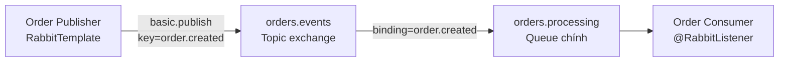
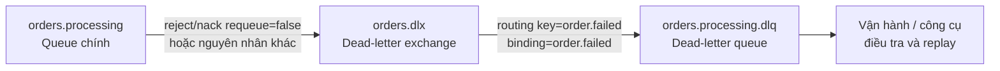
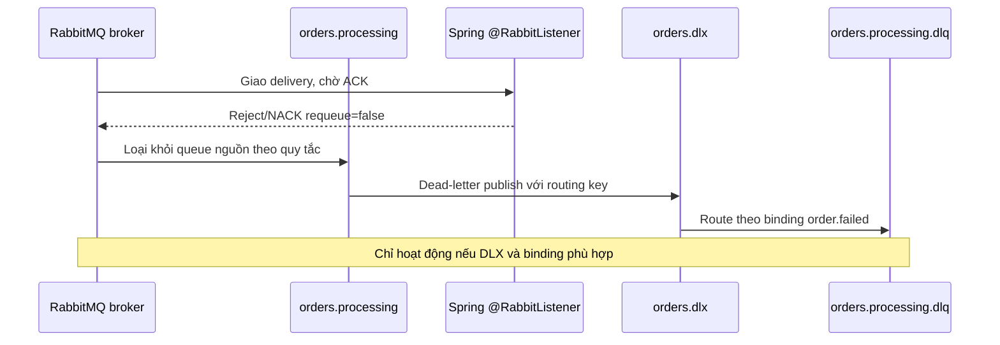
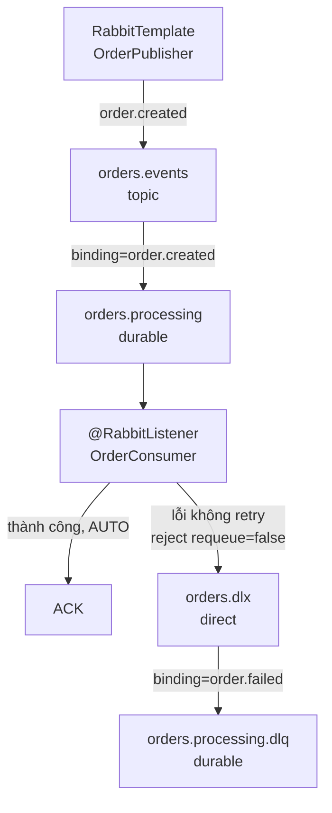
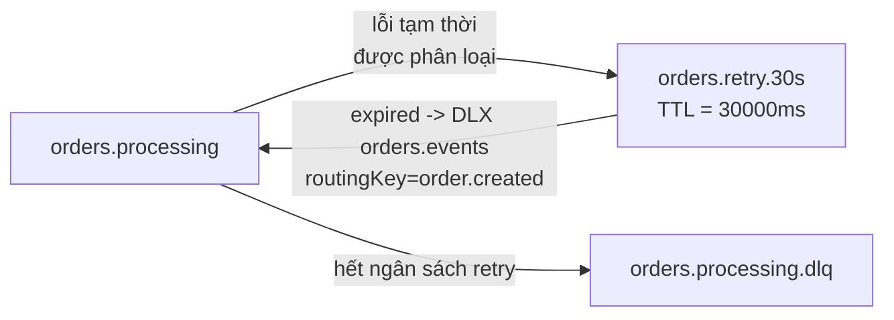

# Dead-letter exchange, dead-letter queue và routing key trong Spring AMQP

Một dịch vụ nhận sự kiện `order.created` từ RabbitMQ có thể gặp message sai dữ liệu, hệ thống đích bị lỗi, message hết hạn hoặc queue vượt giới hạn. Nếu chỉ gọi `@RabbitListener` rồi bắt mọi exception bằng `try/catch`, ứng dụng có thể **mất message, xử lý lặp vô hạn hoặc không biết dữ liệu lỗi đang ở đâu**.

RabbitMQ cung cấp cơ chế **dead-lettering**: chuyển một message ra khỏi queue nguồn đến **dead-letter exchange (DLX)** khi có nguyên nhân phù hợp. Từ DLX, broker dùng **routing key và các binding** để định tuyến message đến một hoặc nhiều queue đích. Queue thường được dành cho việc lưu/điều tra message lỗi được gọi là **dead-letter queue (DLQ)**.

Trong chương **Dead-letter và trì hoãn**, bài học này tập trung vào ba khái niệm và mối liên hệ của chúng, kết hợp Spring AMQP (`RabbitTemplate`, `@RabbitListener`, exchange–queue–binding), ACK/NACK, retry, TTL, giao dịch nghiệp vụ và quan sát hệ thống để thiết kế xử lý bất đồng bộ đáng tin cậy.

Sau bài học, bạn có thể:

- Phân biệt **DLX là exchange**, **DLQ là queue** và **dead-letter routing key là khóa định tuyến**; không coi chúng là cùng một tài nguyên.
- Liệt kê các trường hợp RabbitMQ dead-letter một message và những trường hợp **không** tự dead-letter.
- Cấu hình `x-dead-letter-exchange`, `x-dead-letter-routing-key` bằng `QueueBuilder` hoặc RabbitMQ policy.
- Viết một ví dụ Spring AMQP hoàn chỉnh với queue chính, DLX, DLQ, binding, publisher và listener.
- Kiểm tra message ở DLQ, đọc metadata `x-death`, phân biệt cách ly lỗi với retry trì hoãn và nhận biết giới hạn bảo đảm dữ liệu khi dead-letter.

## 1. Hiểu đúng DLX, DLQ và routing key

Một luồng sự kiện bình thường:



Khi consumer không thể xử lý message và broker quyết định dead-letter:



Ba vai trò hoàn toàn khác nhau:

| Thành phần | Bản chất RabbitMQ | Làm nhiệm vụ gì? | Ví dụ |
| --- | --- | --- | --- |
| **DLX** | Exchange thông thường: direct, topic, fanout, headers... | Nhận message được broker dead-letter từ queue nguồn và thực hiện **routing lại** | `orders.dlx`, kiểu `direct` |
| **DLQ** | Queue bình thường, được dùng làm nơi chứa lỗi | Giữ message để xử lý sau, cảnh báo hoặc điều tra | `orders.processing.dlq` |
| **Dead-letter routing key** | Routing key gắn với lần republish từ queue nguồn tới DLX | Được DLX xét cùng binding để chọn queue đích | `order.failed` |
| **Binding** | Quan hệ exchange → queue | Quy định DLX route được message đến DLQ nào | `orders.dlx --order.failed--> orders.processing.dlq` |
| **Nguồn dead-letter** | Queue chính | Đặt tham chiếu đến DLX và có thể đặt routing key ghi đè | `orders.processing` |

**Không có loại exchange đặc biệt tên “dead-letter exchange”.** Một direct/topic exchange trở thành DLX vì một queue khác khai báo dùng nó làm đích cho dead-letter. Tương tự, DLQ không phải queue có giao thức riêng; đó là vai trò trong thiết kế.

### 1.1. Có cần đặt tên theo quy ước DLX/DLQ không?

RabbitMQ không đòi tên chứa `dlx` hay `dlq`. Tuy nhiên, đặt tên rõ ràng giúp vận hành, ví dụ:

```text
orders.events                # exchange nghiệp vụ
orders.processing            # queue tiêu thụ sự kiện
orders.dlx                   # dead-letter exchange
orders.processing.dlq        # queue cách ly của orders.processing
order.created                # routing key nghiệp vụ
order.failed                 # routing key dead-letter
```

Tên và quy tắc định tuyến phải nhất quán trong **cùng virtual host**. Một exchange `orders.dlx` ở vhost `/` không được dùng trực tiếp bởi queue ở vhost `/orders`.

## 2. RabbitMQ dead-letter một message trong trường hợp nào?

Dead-lettering là hành động **broker lấy một message ra khỏi queue và republish tới DLX** theo cấu hình queue. Nó không phải hành động tùy ý của `RabbitTemplate` ở phía publisher.

Những nguyên nhân điển hình:

| Nguyên nhân | Điều kiện | Ghi chú |
| --- | --- | --- |
| **Consumer reject** | `basic.reject(deliveryTag, requeue=false)` | Message bị từ chối và không đưa lại queue gốc |
| **Consumer NACK** | `basic.nack(deliveryTag, multiple, requeue=false)` | Có thể áp dụng cho một hoặc nhiều delivery theo `multiple` |
| **Message TTL hết hạn** | Message hết TTL của queue hoặc TTL riêng | Broker dead-letter khi xử lý expiration theo cơ chế queue |
| **Queue vượt giới hạn độ dài** | Giới hạn length/bytes và policy overflow dẫn đến loại message | Hành vi cụ thể phụ thuộc cấu hình overflow và queue type |
| **Quorum queue vượt delivery limit** | Số lần giao thất bại vượt giới hạn của quorum queue | Phụ thuộc cấu hình/phiên bản RabbitMQ và cách tính delivery |
 
Không phải tất cả các cơ chế từ chối publish vì quá tải đều tạo dead-letter; chẳng hạn chính sách overflow **reject-publish** có ngữ nghĩa khác với **drop-head**. Cần đối chiếu loại queue và policy thực tế.

### 2.1. Những tình huống không tự dead-letter

- Consumer gửi `basic.ack`: broker coi delivery đã hoàn tất, **không** đưa nó vào DLX.
- Consumer gửi `basic.nack(..., requeue=true)`: message được yêu cầu trở lại queue, **không** đi DLX theo lý do NACK đó.
- Publisher gửi tới exchange không tồn tại: broker có thể trả `404 NOT_FOUND` và đóng channel, **không có queue nguồn để dead-letter**.
- Publisher gửi vào exchange hợp lệ nhưng không có binding: có thể xảy ra `basic.return` nếu `mandatory=true`, **không phải** dead-letter từ queue.
- Listener có exception nhưng container đang retry cục bộ: chưa chắc broker đã nhận reject/NACK; message có thể vẫn unacked.
- Message lỗi được application catch rồi **trả về bình thường** ở listener AUTO: container có thể ACK, khiến message **không vào DLQ**.

**Điểm cốt lõi:** Exception Java chỉ là tín hiệu cho Spring. Để broker dead-letter do consumer lỗi, cuối cùng phải có một quyết định **reject/NACK không requeue**, queue nguồn có DLX hợp lệ và DLX có tuyến thích hợp.

### 2.2. Minh họa quá trình reject



Mô hình trên mô tả hành vi logic. **Consumer không trực tiếp gọi `RabbitTemplate.send(...)` đến DLQ**; broker thực hiện việc đưa message qua DLX. Việc ứng dụng tự republish một message sang queue khác là một mô hình khác, có cửa sổ lỗi và chiến lược xác nhận riêng.

## 3. Routing key nào được dùng khi dead-letter?

Đây là phần dễ bị cấu hình sai nhất.

### 3.1. Có x-dead-letter-routing-key: sử dụng khóa ghi đè

Queue nguồn có thể mang các thuộc tính:

```text
x-dead-letter-exchange    = orders.dlx
x-dead-letter-routing-key = order.failed
```

Khi dead-letter, broker republish đến `orders.dlx` với routing key `order.failed` (bỏ qua routing key ban đầu cho bước định tuyến dead-letter tương ứng).

Nếu `orders.dlx` là **direct exchange**, muốn vào DLQ thì cần binding:

```text
orders.dlx (direct)
  -- binding order.failed -->
orders.processing.dlq
```

Ví dụ:

```text
Publish gốc:
  exchange = orders.events
  routingKey = order.created
  -> orders.processing

Dead-letter:
  exchange = orders.dlx
  routingKey = order.failed         # ghi đè bởi queue source
  -> orders.processing.dlq
```

Việc đặt `x-dead-letter-routing-key` trên **queue nguồn** không tự tạo binding ở DLX. Bạn phải khai báo hoặc provision binding này riêng.

### 3.2. Không có x-dead-letter-routing-key: giữ khóa định tuyến gốc

Nếu queue chỉ có:

```text
x-dead-letter-exchange = orders.dlx
# Không đặt x-dead-letter-routing-key
```

RabbitMQ sử dụng **routing key gốc** của message khi republish tới DLX; tùy trường hợp message có nhiều routing key (ví dụ qua header CC), broker có thể dùng các routing key gốc có liên quan.

Giả sử message ban đầu dùng `order.created`, thì để một **direct DLX** route được nó, bạn phải bind DLQ bằng `order.created`, không phải `order.failed`:

```text
orders.dlx (direct)
  -- binding order.created -->
orders.processing.dlq
```

### 3.3. Định tuyến qua direct, topic và fanout

| Kiểu DLX | Cách dùng routing key | Phù hợp |
| --- | --- | --- |
| **Direct** | Binding key phải bằng routing key publish tới DLX | Một đường lỗi cụ thể; minh họa dễ hiểu |
| **Topic** | Dùng mẫu `*` hoặc `#` khớp routing key | Nhiều event type, nhiều nhóm lỗi/queue |
| **Fanout** | Bỏ qua routing key; phát đến các queue bind | Phân phối nhiều nơi, cần cẩn thận bản sao message |
| **Headers** | Định tuyến theo các binding arguments của headers exchange | Chỉ khi có hợp đồng routing theo header rõ ràng |

Nếu DLX không route được tới bất cứ queue nào, message **không tự sinh ra trong DLQ**. Exchange `fanout` có thể định tuyến tới nhiều queue; một message dead-letter không nhất thiết chỉ có một đích.

### 3.4. Hai trường routing key không thay thế nhau

| Khóa | Đặt ở đâu? | Tác dụng |
| --- | --- | --- |
| Routing key nghiệp vụ | Tham số `RabbitTemplate.send(exchange, routingKey, message)` | Định tuyến từ exchange gốc đến queue nguồn |
| `x-dead-letter-routing-key` | **Queue nguồn** (argument hoặc policy) | Chọn routing key khi broker dead-letter tới DLX |
| Binding key của DLQ | Binding giữa **DLX và DLQ** | Quyết định message dead-letter có đến DLQ hay không |
| Received routing key | Metadata delivery ở listener | Quan sát route khi nhận; không tự sửa topology |

Không thể đặt một header thông thường tên `x-dead-letter-routing-key` trên message và mong broker thay đổi DLX của queue. Đây là cấu hình **queue**, không phải application header tự do.

## 4. Cấu hình DLX bằng queue arguments hoặc RabbitMQ policy

RabbitMQ hỗ trợ cấu hình dead-letter exchange và dead-letter routing key tại queue qua **optional arguments** (x-arguments) hoặc **policy**.

### 4.1. Queue arguments

Các tên AMQP chuẩn trong ví dụ:

```text
x-dead-letter-exchange
x-dead-letter-routing-key
```

Đặt từ lúc declare queue. Khi một queue đã tồn tại với cấu hình khác, redeclare cùng tên với arguments không tương đương có thể dẫn tới `PRECONDITION_FAILED` và đóng channel.

Trong Spring AMQP, `QueueBuilder` có các method hỗ trợ:

```java
Queue processingQueue = QueueBuilder.durable("orders.processing")
        .deadLetterExchange("orders.dlx")
        .deadLetterRoutingKey("order.failed")
        .build();
```

Đây là cách phù hợp để minh họa hoặc khi topology thuộc quản lý của ứng dụng. Nhưng với production có nhu cầu thay đổi chính sách DLX theo thời gian, hard-code x-arguments khiến việc thay đổi tốn công migration hơn.

### 4.2. Policy: linh hoạt khi vận hành

RabbitMQ khuyến nghị dùng policy cho DLX nếu có thể, bởi policy thường có thể cập nhật mà không cần redeclare queue hoặc sửa source code.

Ví dụ **trong POSIX shell** (chỉ dùng khi broker có vhost `/orders` và user có quyền admin):

```bash
rabbitmqctl set_policy -p /orders \
  --apply-to queues \
  orders-processing-dlx '^orders\.processing$' \
  '{"dead-letter-exchange":"orders.dlx","dead-letter-routing-key":"order.failed"}'
```

Ý nghĩa:

- `orders-processing-dlx` là **tên policy**.
- `^orders\.processing$` là regex chọn queue `orders.processing`.
- `dead-letter-exchange` và `dead-letter-routing-key` trong JSON policy định nghĩa DLX/routing key.
- `--apply-to queues` giới hạn phạm vi policy vào queue.

Trước khi dùng policy này, phải **không đặt hard-coded x-dead-letter-* arguments** trái với chủ đích trên queue tương ứng: với các thông số x-arguments và user policy cùng được đặt, **x-arguments của client có ưu tiên cao hơn policy**. Không thể giả định thay policy là sẽ ghi đè cấu hình queue đã hard-code.

Ngoài ra, policy chỉ thiết lập đích, **không tự tạo `orders.dlx` hoặc queue/binding DLQ**; các tài nguyên đó vẫn cần được provision.

### 4.3. Lựa chọn nào phù hợp?

| Bối cảnh | Gợi ý |
| --- | --- |
| Bài học / ứng dụng nhỏ khai báo topology toàn phần | Dùng `QueueBuilder` để nhìn thấy rõ quan hệ |
| Hệ thống lớn vận hành nhiều service | Dùng RabbitMQ policy khi DLX cần thay đổi linh hoạt |
| Queue đã có dữ liệu, cần đổi arguments cứng | Lập kế hoạch migration; không xóa queue tùy tiện |
| Nhiều queue cùng nhóm lỗi | Policy chọn theo regex, kiểm tra phạm vi thật |
| Đang có cả policy và x-arguments | Kiểm tra thứ tự ưu tiên, tránh cấu hình trùng/xung đột |

## 5. Ví dụ Spring AMQP end-to-end: đưa lỗi vào DLQ

Ví dụ gồm **topic exchange nghiệp vụ**, **queue nguồn**, **direct DLX**, **DLQ** và hai binding.

### 5.1. Sơ đồ topology cụ thể



Các tên sẽ được dùng nhất quán trong code:

```text
Business exchange : orders.events
Business key      : order.created
Main queue        : orders.processing

Dead-letter exchange  : orders.dlx
Dead-letter key       : order.failed
Dead-letter queue     : orders.processing.dlq
```

### 5.2. Khai báo exchange, queue và bindings

```java
import org.springframework.amqp.core.Binding;
import org.springframework.amqp.core.BindingBuilder;
import org.springframework.amqp.core.DirectExchange;
import org.springframework.amqp.core.ExchangeBuilder;
import org.springframework.amqp.core.Queue;
import org.springframework.amqp.core.QueueBuilder;
import org.springframework.amqp.core.TopicExchange;
import org.springframework.beans.factory.annotation.Qualifier;
import org.springframework.context.annotation.Bean;
import org.springframework.context.annotation.Configuration;

@Configuration
public class OrderDlqTopology {

    public static final String EXCHANGE = "orders.events";
    public static final String ROUTING_KEY = "order.created";
    public static final String MAIN_QUEUE = "orders.processing";
    public static final String DLX = "orders.dlx";
    public static final String DEAD_LETTER_KEY = "order.failed";
    public static final String DLQ = "orders.processing.dlq";

    @Bean
    public TopicExchange ordersExchange() {
        return ExchangeBuilder.topicExchange(EXCHANGE)
                .durable(true).build();
    }

    @Bean
    public DirectExchange ordersDeadLetterExchange() {
        return ExchangeBuilder.directExchange(DLX)
                .durable(true).build();
    }

    @Bean
    public Queue ordersProcessingQueue() {
        return QueueBuilder.durable(MAIN_QUEUE)
                .deadLetterExchange(DLX)
                .deadLetterRoutingKey(DEAD_LETTER_KEY)
                .build();
    }

    @Bean
    public Queue ordersDeadLetterQueue() {
        return QueueBuilder.durable(DLQ).build();
    }

    @Bean
    public Binding ordersBinding(
            @Qualifier("ordersProcessingQueue") Queue queue,
            @Qualifier("ordersExchange") TopicExchange exchange) {
        return BindingBuilder.bind(queue)
                .to(exchange)
                .with(ROUTING_KEY);
    }

    @Bean
    public Binding ordersDeadLetterBinding(
            @Qualifier("ordersDeadLetterQueue") Queue queue,
            @Qualifier("ordersDeadLetterExchange") DirectExchange exchange) {
        return BindingBuilder.bind(queue)
                .to(exchange)
                .with(DEAD_LETTER_KEY);
    }
}
```

Điểm cần đọc kỹ:

1. `ordersProcessingQueue()` là **queue nguồn**; hai method `deadLetter...` đặt **tham số trên queue nguồn**.
2. `ordersDeadLetterExchange()` chỉ tạo exchange; nó không tự biết route vào queue nào.
3. `ordersDeadLetterQueue()` tạo queue bình thường dành cho lỗi.
4. `ordersDeadLetterBinding()` nối DLX với DLQ theo key `order.failed`.
5. Các bean `@Bean` chỉ mô tả topology phía Java; chúng được khai báo ở RabbitMQ khi `RabbitAdmin` hoặc hệ thống provisioning thích hợp chạy trên **đúng virtual host** và có quyền.

**Không triển khai đồng thời policy ở phần 4.2 cùng queue arguments cứng ở ví dụ này nếu chưa hiểu cơ chế ưu tiên.** Coi đây là hai cách cấu hình thay thế.

### 5.3. Cấu hình Spring Boot RabbitMQ

```yaml
# application.yml
spring:
  rabbitmq:
    host: ${RABBITMQ_HOST:localhost}
    port: ${RABBITMQ_PORT:5672}
    virtual-host: ${RABBITMQ_VHOST:/orders}
    username: ${RABBITMQ_USERNAME}
    password: ${RABBITMQ_PASSWORD}
    publisher-confirm-type: correlated
    publisher-returns: true
    template:
      mandatory: true
    listener:
      simple:
        acknowledge-mode: auto
        prefetch: 10
        default-requeue-rejected: false
```

Vhost `/orders` phải được tạo trước và user phải có quyền phù hợp. Trong production, quản lý credentials bằng secret/env, không viết mật khẩu thật vào repository.

### 5.4. Publisher gửi message bình thường

```java
import java.nio.charset.StandardCharsets;

import org.springframework.amqp.core.Message;
import org.springframework.amqp.core.MessageBuilder;
import org.springframework.amqp.core.MessageDeliveryMode;
import org.springframework.amqp.core.MessageProperties;
import org.springframework.amqp.rabbit.core.RabbitTemplate;
import org.springframework.stereotype.Service;

@Service
public class OrderPublisher {

    private final RabbitTemplate rabbitTemplate;

    public OrderPublisher(RabbitTemplate rabbitTemplate) {
        this.rabbitTemplate = rabbitTemplate;
    }

    public void publishCreated(String eventId, String orderId) {
        Message message = MessageBuilder
                .withBody(orderId.getBytes(StandardCharsets.UTF_8))
                .setMessageId(eventId)
                .setType("order.created")
                .setContentType(MessageProperties.CONTENT_TYPE_TEXT_PLAIN)
                .setContentEncoding("UTF-8")
                .setDeliveryMode(MessageDeliveryMode.PERSISTENT)
                .build();

        rabbitTemplate.send(
                OrderDlqTopology.EXCHANGE,
                OrderDlqTopology.ROUTING_KEY,
                message);
    }
}
```

Publisher chỉ định **routing key nghiệp vụ** `order.created`. Nó **không gửi vào DLX** và không đặt dead-letter key lên message. Khi consumer reject message từ queue nguồn, RabbitMQ mới dùng `order.failed` theo cấu hình queue.

`RabbitTemplate.send(...)` hoàn tất mà không ném exception **không chứng minh** publisher đã nhận confirm hoặc consumer đã xử lý. Với nghiệp vụ quan trọng, xử lý publisher confirms/returns riêng; DLX không thay thế các tín hiệu phía gửi.

### 5.5. @RabbitListener báo lỗi để container reject

Ví dụ listener tiếp nhận `Message` và mô phỏng quy tắc đơn hàng hợp lệ phải bắt đầu bằng `ORD-`.

```java
import java.nio.charset.StandardCharsets;

import org.springframework.amqp.AmqpRejectAndDontRequeueException;
import org.springframework.amqp.core.Message;
import org.springframework.amqp.rabbit.annotation.RabbitListener;
import org.springframework.stereotype.Component;

@Component
public class OrderConsumer {

    @RabbitListener(queues = OrderDlqTopology.MAIN_QUEUE)
    public void onMessage(Message message) {
        String orderId = new String(
                message.getBody(), StandardCharsets.UTF_8);
        String eventId = message.getMessageProperties().getMessageId();

        if (eventId == null || eventId.isBlank()
                || orderId.isBlank()
                || !orderId.startsWith("ORD-")) {
            throw new AmqpRejectAndDontRequeueException(
                    "Invalid order event; reject without requeue");
        }

        // Thực tế: kiểm tra eventId đã xử lý chưa,
        // áp dụng nghiệp vụ và commit trước khi hoàn tất listener.
        System.out.printf(
                "Processed eventId=%s orderId=%s%n",
                eventId, orderId);
    }
}
```

Giả định listener container sử dụng `AcknowledgeMode.AUTO` của Spring:

- Khi handler kết thúc bình thường, container gửi consumer ACK → không đi DLQ.
- Khi handler ném `AmqpRejectAndDontRequeueException`, container hướng đến reject không requeue → RabbitMQ dead-letter nếu queue có DLX/binding phù hợp.
- Khi listener trả về bình thường sau khi **nuốt exception**, container có thể ACK dù nghiệp vụ thật đã thất bại.
- Khi error handler, advice/retry hoặc mode ACK được cấu hình khác, hành vi cần kiểm chứng theo listener factory thực tế.

Trong ví dụ đã chọn `default-requeue-rejected: false`, các lỗi cuối cùng khác cũng có thể bị reject không requeue. Đây là lựa chọn phù hợp cho thử nghiệm nhưng **không thay cho thiết kế retry với lỗi tạm thời** ở production.

### 5.6. Nhận từ DLQ để điều tra, không tự replay vô hạn

Có thể tạo một listener riêng trên DLQ để đọc metadata và ghi nhận tình trạng; nhưng nếu không muốn làm mất thông điệp phục vụ điều tra, **không đăng ký một `@RabbitListener` ở DLQ với AUTO rồi chỉ log và trả về**. Nó sẽ ACK và lấy message khỏi DLQ.

Trong môi trường thử nghiệm, có thể dùng Management UI hoặc công cụ quản trị để xem message đang chờ. Trong production, nên có quy trình quarantine, retention và replay do vận hành kiểm soát.

Để đọc `x-death` trong một message dead-letter, đoạn mã xử lý metadata có thể là:

```java
import org.springframework.amqp.core.Message;
import org.springframework.amqp.core.MessageProperties;

public final class DeadLetterMetadata {

    public static void inspect(Message message) {
        MessageProperties props = message.getMessageProperties();

        System.out.println("messageId=" + props.getMessageId());
        System.out.println("receivedExchange=" + props.getReceivedExchange());
        System.out.println("receivedKey=" + props.getReceivedRoutingKey());
        System.out.println("x-death=" + props.getHeaders().get("x-death"));
    }
}
```

Đoạn trên **không tự khai báo listener** và không ACK message. Nó chỉ minh họa các trường cần quan sát. Khi dùng `@RabbitListener` trên DLQ, hãy xác định rõ **khi nào ACK** và message lỗi được lưu lại ở đâu.

## 6. x-death và các dấu vết dead-letter

RabbitMQ có thể bổ sung những header mô tả lịch sử dead-letter khi chuyển một message từ queue nguồn. Header thường được chú ý nhất là **`x-death`**.

### 6.1. Dữ liệu nào có thể xuất hiện?

Theo ngữ nghĩa broker và phiên bản, các mục `x-death` có thể gồm:

| Trường | Ý nghĩa |
| --- | --- |
| `queue` | Tên queue mà tại đó message bị dead-letter |
| `reason` | Nguyên nhân như `rejected`, `expired`, `maxlen`, `delivery_limit` |
| `count` | Số lần dead-letter được gom theo nhóm queue và reason tương ứng |
| `exchange` | Exchange liên quan khi message được đưa vào queue trước lần dead-letter |
| `routing-keys` | Những routing key liên quan đến message |
| `time` / lịch sử thời điểm | Metadata thời gian phụ thuộc phiên bản/định dạng |

Các trường như `x-first-death-exchange`, `x-first-death-queue`, `x-first-death-reason` hoặc thông tin lần dead-letter gần nhất có thể hỗ trợ truy vết ở các phiên bản tương ứng.

Ví dụ cấu trúc **minh họa**, không phải output bắt buộc của mọi RabbitMQ version:

```text
headers:
  x-first-death-queue: orders.processing
  x-first-death-reason: rejected
  x-death:
    - queue: orders.processing
      reason: rejected
      count: 1
      exchange: orders.events
      routing-keys:
        - order.created
```

`x-death` có thể được **gom/cập nhật** thay vì thêm một mục riêng cho từng lần message đi qua vòng retry. Khi một chương trình **tự tạo message mới và republish**, lịch sử này không nhất thiết phản ánh đầy đủ các lần thử nghiệp vụ.

### 6.2. Những điều không nên suy ra từ x-death

- Không dùng `x-death.count` làm **nguồn sự thật duy nhất** cho retry budget nếu pipeline có republish, migration hoặc nhiều queue.
- Không mặc định header do client gửi có thể được tin tuyệt đối; metadata ứng dụng và broker cần được đánh giá đúng ranh giới.
- Không coi `reason=expired` là bằng chứng listener đã chạy và thất bại: message có thể hết hạn **trước khi từng được consume**.
- Không dùng `receivedRoutingKey` để thay thế **routing key gốc** mà không xem có override ở DLX hay không.
- Không coi một message nằm trong DLQ là “đã sửa lỗi”; nó mới chỉ được **di chuyển để quản lý**.

Một cách tổ chức quan sát tốt là kết hợp **event ID ổn định**, queue nguồn, reason, thời điểm, routing key, số lần retry tại ứng dụng và trạng thái xử lý nghiệp vụ.

## 7. Dead-letter khác retry trì hoãn thế nào?

**DLQ** thường dành cho message cần điều tra hoặc phát lại thủ công. **Retry queue** thường dành cho message dự kiến **quay lại xử lý sau một khoảng chờ**. Cả hai có thể dùng DLX, nhưng mục đích và vòng đời khác nhau.

| Thuộc tính | DLQ để cách ly lỗi | Retry queue để trì hoãn |
| --- | --- | --- |
| Mục đích | Giữ message lỗi để điều tra/khắc phục | Giữ message tạm thời trước lần xử lý tiếp |
| Có tự quay về queue nguồn? | Không, trừ khi thiết kế flow replay | Có thể, nhờ TTL + DLX và binding |
| Hết TTL có ý nghĩa gì? | Có thể là chính sách retention hoặc xóa/đẩy tiếp | Trigger dead-letter về exchange xử lý |
| Đối tượng quan sát chính | Error count, reason, age, backlog | Delay, attempt, throughput, vòng lặp |
| Rủi ro | DLQ tăng không kiểm soát; bị đọc và ACK nhầm | Lặp vô hạn, retry storm, head-of-line blocking |

### 7.1. Ví dụ trì hoãn bằng queue TTL và DLX

Một cách xây **retry sau 30 giây** là đặt một queue `orders.retry.30s` có TTL, dùng `orders.events` làm DLX để đưa message quay lại queue nguồn sau khi hết hạn.



Ví dụ queue retry:

```java
import org.springframework.amqp.core.Queue;
import org.springframework.amqp.core.QueueBuilder;

// Chỉ là tài nguyên retry trong một cấu hình đầy đủ,
// không thay thế queue/DLX/DLQ ở phần 5.
Queue delayedRetryQueue = QueueBuilder.durable("orders.retry.30s")
        .ttl(30_000)
        .deadLetterExchange("orders.events")
        .deadLetterRoutingKey("order.created")
        .build();
```

**Điểm quan trọng:** Chỉ tạo queue này **chưa đủ**. Bạn vẫn cần một tuyến đưa message lỗi tạm thời từ consumer/queue chính **vào queue retry** và một cơ chế xác định **attempt count**. Nếu queue chính luôn dead-letter thẳng tới `orders.dlx` và DLQ cuối như phần 5, message sẽ **không tự nhảy sang `orders.retry.30s`**. Retry topology phải là một thiết kế nhất quán từ đầu.

Các cách chọn retry thường gồm phân loại lỗi tại consumer, sử dụng retry exchange/queues theo mức delay hoặc lưu một job trạng thái bền để scheduled worker phát lại. Mỗi cách có ranh giới confirm/ACK khác nhau.

### 7.2. TTL không phải đồng hồ hẹn giờ chính xác cho từng message

RabbitMQ có thể chỉ phát hiện hoặc loại bỏ một message hết hạn theo cơ chế xử lý queue/đầu hàng đợi. Với một số kiểu thiết kế nhiều TTL khác nhau trên cùng queue, message TTL ngắn có thể bị **chặn sau message TTL dài**, khiến dead-letter trễ hơn kỳ vọng.

Vì vậy:

- Không dùng TTL + DLX như cam kết *chính xác đến mili giây*.
- Nếu cần delay ổn định theo cấp độ, cân nhắc các retry queue riêng cho từng bucket thời gian.
- Nếu yêu cầu scheduler chính xác hoặc khối lượng hẹn giờ lớn, đánh giá giải pháp chuyên dụng.
- Với retry, luôn có **giới hạn attempts**, tránh vòng từ DLX quay về queue chính mãi mãi.

### 7.3. Không nhầm dead-letter với publisher retry

Publisher retry là một **lần gửi mới** sau lỗi publish/confirm. Dead-letter là broker **chuyển message đã nằm trong queue** sang exchange khác. Broker redelivery do consumer NACK requeue hoặc mất ACK là một hành vi khác nữa.

```text
Publisher resend      -> thêm basic.publish từ producer
Consumer local retry  -> gọi lại handler (thường cùng delivery)
Consumer requeue      -> broker giao lại message trên queue
Dead-letter           -> broker republish từ queue nguồn tới DLX
DLQ manual replay     -> thao tác publish mới theo workflow vận hành
```

Phân biệt các luồng giúp bạn đặt event ID và retry counter đúng, tránh nhân số lần side effect ngoài dự kiến.

## 8. Những rủi ro về độ tin cậy khi dead-letter

### 8.1. DLX không tồn tại hoặc không có route

Một queue nguồn có thể khai báo tên DLX, nhưng nếu exchange đó **không tồn tại tại thời điểm broker dead-letter**, RabbitMQ không thể định tuyến message đến DLX như mong đợi. Tương tự, DLX tồn tại nhưng binding không khớp có thể khiến message không đến queue nào.

Vì vậy, cần:

1. Khai báo DLX và DLQ trước khi bắt đầu xử lý message cần bảo vệ.
2. Kiểm tra binding từ DLX đến DLQ.
3. Đặt quyền read/write/configure theo yêu cầu; khi khai báo queue có DLX, quyền trên queue nguồn và DLX có thể được RabbitMQ kiểm tra.
4. Kiểm tra tình huống broker restart/failover, exchange auto-delete hoặc thay đổi policy.
5. Theo dõi tổng message dead-letter và queue depth, không chỉ nhìn queue chính trống.

**Queue chính trống không chứng minh mọi message đã xử lý thành công.** Chúng có thể đã ACK, dead-letter, hết TTL hoặc bị loại do cấu hình sai.

### 8.2. Dead-letter mặc định không phải transaction end-to-end

Ở nhiều cấu hình RabbitMQ, việc dead-letter từ queue nguồn tới DLX **không có bảo đảm xác nhận publish nội bộ tương đương publisher confirms end-to-end**. Sự cố lúc chuyển message có thể dẫn đến mất message tùy loại queue và chiến lược dead-letter.

Với **quorum queue**, RabbitMQ có cơ chế **at-least-once dead-lettering** trong những phiên bản/cấu hình hỗ trợ; phải thiết lập điều kiện phù hợp như chiến lược dead-letter, overflow và đặc tính queue đích theo tài liệu broker. Không giả định chỉ đổi queue từ classic sang quorum là tất cả dead-letter đều được xác nhận an toàn.

Các đánh đổi cần hiểu:

- Dead-letter tin cậy hơn có thể đòi tài nguyên/metadata nội bộ và giữ message nguồn tới khi được xác nhận.
- Nếu DLX/đích chưa sẵn sàng, message tồn lại có thể khiến queue nguồn tăng backlog.
- Không có một thiết lập đơn lẻ nào biến publish, DLX, consumer side effect và DB thành **transaction nguyên tử**.

Với nghiệp vụ quan trọng, kết hợp **publisher confirms**, **consumer ACK**, **idempotency** và cơ chế lưu trạng thái bền phù hợp; theo dõi cả DLQ và queue nguồn.

### 8.3. Chu trình dead-letter và retry nóng

Cấu hình sai có thể tạo chu trình:

```text
orders.processing -> orders.retry -> orders.processing -> ...
```

Nếu luôn lỗi, message quay vòng liên tục; latency tăng, tài nguyên broker và downstream bị tiêu hao. RabbitMQ có một số cơ chế phát hiện vòng dead-letter trong các điều kiện nhất định, nhưng không thể thay cho **retry budget và đường DLQ cuối** do ứng dụng thiết kế.

Không giả định broker tự giới hạn mỗi message đúng N lần trên mọi queue type. Nếu có quorum delivery limit, hãy hiểu đó là cơ chế khác với attempt count của retry topology.

### 8.4. Replay từ DLQ có thể tạo bản trùng

Một công cụ vận hành đọc DLQ và publish lại vào `orders.events`:

- Publisher confirm có thể bị mất sau khi broker đã nhận.
- Message gốc trong DLQ có thể bị ACK quá sớm.
- Event có thể đã tạo side effect nghiệp vụ trước khi lần trước gặp lỗi.
- Một bản sao có thể đã được phát lại ở quá trình khác.

Do đó cần **event ID ổn định**, lịch sử replay, giới hạn attempts và consumer idempotency. Nếu code tự republish từ DLQ, nên có cơ sở xác nhận bản mới đã được broker chấp nhận/route trước khi xóa hoặc ACK bản cũ; kể cả vậy vẫn tồn tại cửa sổ tạo trùng khi kết quả không chắc chắn.

## 9. Thực hành kiểm chứng end-to-end

Dùng RabbitMQ trong vhost thử nghiệm `/orders` và topology ở phần 5. Không cố ý làm mất message hoặc xóa queue trên môi trường production.

### 9.1. Kiểm tra topology

Trên host RabbitMQ có quyền quản trị:

```bash
rabbitmqctl list_exchanges -p /orders name type durable
rabbitmqctl list_queues -p /orders name durable messages_ready messages_unacknowledged consumers
rabbitmqctl list_bindings -p /orders source_name destination_name routing_key
```

Kỳ vọng:

- Có exchange `orders.events` kiểu topic và `orders.dlx` kiểu direct.
- Có queue `orders.processing` và `orders.processing.dlq`.
- Exchange `orders.events` có binding `order.created` tới `orders.processing`.
- Exchange `orders.dlx` có binding `order.failed` tới `orders.processing.dlq`.
- Queue `orders.processing` có dead-letter arguments phù hợp; kiểm tra trong Management UI hoặc API chính thức khi cần.

### 9.2. Bộ test theo từng hành vi

| Thử nghiệm | Thao tác | Kỳ vọng |
| --- | --- | --- |
| **Message hợp lệ** | Gửi event ID mới, order ID `ORD-1001` | Listener xử lý và ACK; DLQ không tăng |
| **Payload sai contract** | Gửi event ID mới, order ID `INVALID` | Listener ném reject không requeue; broker chuyển tới DLX/DLQ |
| **Không có event ID** | Gửi message bỏ `messageId` | Listener từ chối; nếu queue hợp lệ, DLQ nhận |
| **Thay binding DLQ** | Trong môi trường test, đổi binding `order.failed` thành key khác | Message không route được từ direct DLX tới DLQ mong muốn |
| **Bỏ x-dead-letter-routing-key** | Dùng queue test mới, chỉ khai báo DLX | DLX nhận routing key gốc; binding phải khớp key đó |
| **NACK requeue=true** | Một listener MANUAL trong bài thử phát NACK và requeue | Message được giao lại, không đi DLX chỉ vì NACK này |
| **TTL hết hạn** | Đưa message vào queue có TTL, tạm ngưng consumer | Message có thể dead-letter với reason `expired` |
| **Không có DLX** | Queue thử nghiệm không cấu hình dead-letter | Message reject không requeue không có tuyến DLQ tự động |
| **Replay DLQ** | Đọc và publish lại sau khi sửa lỗi nguồn | Có publish attempt mới; giữ event ID và chống xử lý trùng |

Những thử nghiệm thay đổi arguments trên queue đã tồn tại nên tạo **queue thử nghiệm riêng**. Không redeclare queue production với arguments khác để ép RabbitMQ tự sửa cấu hình.

### 9.3. Đọc x-death và metrics

Một message thực sự dead-letter có thể mang header `x-death`. Khi cần quan sát payload, dùng Management UI với quy trình an toàn, tránh thao tác `get messages` ở chế độ ACK rồi vô tình làm mất message cần điều tra.

Theo dõi:

| Chỉ số | Vì sao hữu ích |
| --- | --- |
| `messages_ready` của queue chính | Số message đang chờ xử lý |
| `messages_unacknowledged` | Delivery đã giao nhưng chưa ACK |
| DLQ depth và tuổi message lâu nhất | Phát hiện lỗi tích tụ, chưa được xử lý |
| Consumer reject/NACK/redelivery | Phân biệt lỗi consumer và vòng retry |
| Dead-letter rate / reasons | Xác định nguồn lỗi và khả năng DLX sai |
| Publisher confirm ACK/NACK, returns | Kiểm tra publish gốc, tách khỏi dead-letter |
| Event ID, queue, routing key, `x-death` | Truy vết một sự kiện qua nhiều queue |

Chỉ số có thể bị ảnh hưởng bởi queue type và phiên bản broker; không mặc định mọi nhãn metrics có cùng tên trong mọi exporter.

## 10. Sự cố phổ biến và cách chẩn đoán

| Triệu chứng | Nguyên nhân khả dĩ | Hướng kiểm tra |
| --- | --- | --- |
| Listener ném exception nhưng DLQ không có message | Container vẫn retry/requeue, đã ACK, hoặc không có DLX | ACK mode, error handler, `defaultRequeueRejected` và queue arguments |
| Message không vào DLQ dù có DLX | Binding key không khớp dead-letter routing key | Kiểm tra `x-dead-letter-routing-key` và `list_bindings` |
| Message vào queue khác dự kiến | DLX topic/fanout có nhiều binding hoặc không override routing key | Xem loại exchange, key và các binding |
| Queue chính trống, message lỗi cũng không ở DLQ | DLX thiếu, route sai hoặc message bị reject không DLX | Topology, quyền, broker logs, retention |
| DLQ có message liên tục với reason `expired` | TTL queue/message quá ngắn hoặc backlog lớn | Xem TTL, consumer throughput, thời điểm expire |
| DLQ chứa nhiều reason `rejected` | Listener lỗi hợp đồng hoặc nghiệp vụ; reject không requeue | Event ID, exception, schema và retry policy |
| DLQ không giảm dù đã có người xem | Không có consumer ACK trên DLQ; UI chỉ đang inspect | Kiểm tra chế độ get/ACK, workflow điều tra |
| Message quay lại main queue vô hạn | Retry DLX/TTL cycle không có giới hạn | Sơ đồ topology, retry count, DLQ cuối |
| Queue declare lỗi `PRECONDITION_FAILED` | X-arguments khác cấu hình của queue hiện hữu | So sánh queue properties, lập kế hoạch migration |
| Thay policy nhưng dead-letter vẫn route cũ | X-arguments cứng có ưu tiên hơn policy | Kiểm tra nguồn cấu hình, policy priority |
| Replay gây xử lý trùng | Event ID không ổn định hoặc consumer không idempotent | Outbox/replay log, unique constraint, business keys |
| DLX có trên broker nhưng queue vẫn báo lỗi | Sai vhost hoặc quyền configure/read/write | So sánh vhost của connection và quyền RabbitMQ |

## 11. Checklist thiết kế DLX/DLQ/routing key

- [ ] Định danh đúng ba tài nguyên: **queue nguồn**, **DLX** và **DLQ**, cùng routing key/binding.
- [ ] Chọn tên exchange và key nhất quán với hợp đồng message; không nhầm routing key nghiệp vụ và dead-letter key.
- [ ] Quyết định có đặt `x-dead-letter-routing-key` hay dùng routing key gốc; khai báo binding DLQ cho đúng.
- [ ] Chọn direct/topic/fanout DLX phù hợp và kiểm tra những queue nào thực sự sẽ nhận message.
- [ ] Chọn **queue arguments hoặc policy**; hiểu ưu tiên của x-arguments và kế hoạch cập nhật.
- [ ] Bảo đảm DLX/DLQ/binding tồn tại trong đúng vhost, có quyền và được provision trước khi cần dead-letter.
- [ ] Kiểm tra listener AUTO/MANUAL, retry/error handler và khi nào có reject/NACK `requeue=false`.
- [ ] Tránh coi `throw Exception` hoặc `defaultRequeueRejected=false` là tự động tạo DLQ.
- [ ] Thiết kế DLQ cho lỗi vĩnh viễn; retry queue cho lỗi tạm thời với **delay và số lần thử hữu hạn**.
- [ ] Hiểu TTL, queue limits, quorum delivery limit và các lý do dead-letter tương ứng.
- [ ] Nếu dùng dead-lettering cho dữ liệu quan trọng, đánh giá bảo đảm chuyển tiếp theo queue type và chiến lược RabbitMQ.
- [ ] Theo dõi `x-death`, event ID, DLQ depth, tỷ lệ reject, expiration và backlog.
- [ ] Có quy trình điều tra/replay bảo đảm không ACK/xóa message DLQ quá sớm.
- [ ] Với replay, sử dụng publisher confirms/returns, event ID ổn định và consumer idempotency.
- [ ] Kiểm thử routing key ghi đè, routing key gốc, TTL, NACK và missing DLX ở môi trường tách biệt.

**Ghi nhớ:** **DLX** là exchange nhận message bị dead-letter từ queue nguồn; **DLQ** là queue nhận message từ DLX thông qua **binding**; **dead-letter routing key** quyết định đường route khi broker republish. Một cấu hình DLX chưa đầy đủ binding không tự bảo đảm message sẽ xuất hiện ở DLQ. Muốn xử lý bất đồng bộ đáng tin cậy trong Spring AMQP, cần kết hợp topology chính xác, ACK/NACK, phân loại retry, TTL/dead-letter, publisher confirms, idempotency và quan sát từ publisher tới consumer.

### Tài liệu tham khảo

- [RabbitMQ — Dead Letter Exchanges](https://www.rabbitmq.com/docs/dlx)
- [RabbitMQ — Time-to-Live](https://www.rabbitmq.com/docs/ttl)
- [RabbitMQ — Consumer Acknowledgements and Publisher Confirms](https://www.rabbitmq.com/docs/confirms)
- [RabbitMQ — Queues](https://www.rabbitmq.com/docs/queues)
- [RabbitMQ — Quorum Queues](https://www.rabbitmq.com/docs/quorum-queues)
- [RabbitMQ — AMQP 0-9-1 Model Explained](https://www.rabbitmq.com/tutorials/amqp-concepts)
- [Spring AMQP — Broker Configuration](https://docs.spring.io/spring-amqp/reference/amqp/broker-configuration.html)
- [Spring AMQP — Handling Listener Exceptions](https://docs.spring.io/spring-amqp/reference/amqp/exception-handling.html)
- [Spring AMQP API — QueueBuilder](https://docs.spring.io/spring-amqp/api/org/springframework/amqp/core/QueueBuilder.html)
- [Spring AMQP API — RabbitTemplate](https://docs.spring.io/spring-amqp/api/org/springframework/amqp/rabbit/core/RabbitTemplate.html)

